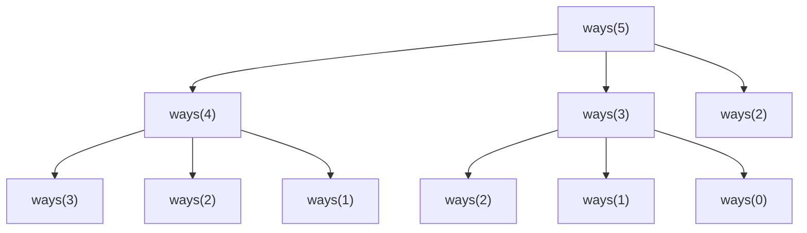

# Recursion and dynamic programming: approach

## Before this lesson

You need functions, lists and dictionaries in Python, and the recursion sections of [Big O foundations](#/lesson/interview-prep/big-o-foundations) (call trees, branches to the power of depth). If recursion itself is new, start with [Recursion examples](#/lesson/dsa-foundations/recursion-examples). This lesson is a compact approach guide; the full pattern teaching is in the DP track, beginning with [DP from recursion](#/lesson/neet-dp/dp-from-recursion) and [The DP framework](#/lesson/neet-dp/dp-framework), and in [The backtracking template](#/lesson/neet-heap-graphs/backtracking-template).

## In plain words

**Recursion** is solving a problem by solving smaller copies of the same problem. A function is recursive when it calls itself on a smaller input and combines the results, with a simplest case it can answer directly.

Think of a set of nested dolls. To count the dolls, open the outer one: the answer is one plus the number of dolls inside it, which is the same question about a smaller doll. Eventually you reach a doll that does not open, and its answer is one. Every recursive solution has those two parts: the **base case** (the doll that does not open) and the **recursive step** (one plus the rest).

**Dynamic programming** (DP) is recursion with a notebook. Many recursive solutions ask the same sub-question over and over. If you write each answer down the first time, you never compute it twice. That single change often turns a running time of years into milliseconds.

It matters for a job because tree-shaped and choice-shaped problems (file systems, parsing, scheduling, route planning, text comparison) are naturally recursive. It matters for interviews because these are the questions candidates fear most, and because the skill is far more mechanical than it looks: there is a procedure.

## Recognising a recursive problem

Signals in the wording:

- "Compute the n-th …", "list the first n …"
- "Count the number of ways to …"
- "Generate all …" (subsets, orderings, valid arrangements)
- "Find the best (cheapest, longest, largest) …" where the best overall is built from best parts
- The input is a tree or is naturally nested.

When you see one, ask: **if I already had the answer for a smaller input, could I extend it to this input?**

## Three ways to find the recursive structure

| Approach | Idea | Example |
|---|---|---|
| **Bottom-up** | Solve for one element, then two, then three; see how each solution is built from the previous | All subsets of n items: take the subsets of n − 1 items, and add a copy of each with the new item |
| **Top-down** | Split the problem for n into subproblems and assume they are solved | Ways to climb n stairs = ways to n − 1, plus ways to n − 2, plus ways to n − 3 |
| **Half-and-half** | Split the data in two halves, solve each, combine | Merge sort; binary search |

In every case, decide three things: what the function's arguments mean (the **state**), what it returns, and what the smallest cases are.

## Recursive versus iterative

Every recursive call occupies a frame on the call stack until it returns. A recursion n levels deep uses O(n) memory, and in Python the default limit is roughly 1,000 nested calls. Any recursive algorithm can be rewritten with loops, sometimes easily (a single recursive call at the end becomes a `while` loop) and sometimes only with an explicit stack. In an interview, write whichever is clearer, **state the stack cost**, and be ready to discuss the iterative version.

## From brute force to dynamic programming in four moves

We will carry one problem through all four moves.

> *You walk up a flight of n stairs, and each stride takes you up 1, 2 or 3 stairs. How many different sequences of strides get you exactly to the top?*

### Move 1: write the plain recursion

Look at the last stride. It covered 1, 2 or 3 stairs, so you were standing on stair n − 1, n − 2 or n − 3 before it. Hence

$$\text{ways}(n) = \text{ways}(n-1) + \text{ways}(n-2) + \text{ways}(n-3)$$

with ways(0) = 1 (one way to stand still: do nothing) and ways(negative) = 0.

```python
def ways(n):
    if n < 0:
        return 0
    if n == 0:
        return 1
    return ways(n - 1) + ways(n - 2) + ways(n - 3)
```

Three branches, depth n: roughly O(3ⁿ) calls. Correct, and hopeless beyond n ≈ 30.

### Move 2: notice the overlap

Draw the top of the call tree for ways(5):



`ways(3)` appears twice and `ways(2)` three times already, and each repeat drags its whole subtree with it. Yet there are only n + 1 *different* questions: ways(0) through ways(n). The exponential cost is pure repetition. These repeats are called **overlapping subproblems**, and they are the sign that DP applies.

### Move 3: memoise (top-down DP)

Keep a table (a **memo**) of answers. Before computing, look in the table; after computing, store.

```python
def ways(n, memo=None):
    if memo is None:
        memo = {}
    if n < 0:
        return 0
    if n == 0:
        return 1
    if n not in memo:
        memo[n] = ways(n - 1, memo) + ways(n - 2, memo) + ways(n - 3, memo)
    return memo[n]
```

Each of the n distinct subproblems is computed once, with O(1) work: O(n) time, O(n) space. In Python the decorator `functools.lru_cache(None)` adds a memo to any function whose arguments are hashable.

### Move 4: tabulate (bottom-up DP), then shrink the table

Fill the table from the smallest subproblem upward with a loop, which removes the recursion and its stack. Then notice that each entry needs only the previous three, so three variables are enough.

```python-run
import functools, time

def ways_plain(n):
    if n < 0: return 0
    if n == 0: return 1
    return ways_plain(n - 1) + ways_plain(n - 2) + ways_plain(n - 3)

@functools.lru_cache(None)
def ways_memo(n):
    if n < 0: return 0
    if n == 0: return 1
    return ways_memo(n - 1) + ways_memo(n - 2) + ways_memo(n - 3)

def ways_table(n):
    table = [1] + [0] * n
    for i in range(1, n + 1):
        table[i] = table[i - 1] + (table[i - 2] if i >= 2 else 0) + (table[i - 3] if i >= 3 else 0)
    return table[n]

def ways_three_vars(n):
    a, b, c = 1, 0, 0                  # ways(i), ways(i-1), ways(i-2) for i = 0
    for _ in range(n):
        a, b, c = a + b + c, a, b
    return a

for n in (4, 10, 22):
    start = time.perf_counter()
    plain = ways_plain(n)
    took = (time.perf_counter() - start) * 1000
    print(f"n = {n:2d}: plain {plain:7d} ({took:8.2f} ms) | memo {ways_memo(n)} | table {ways_table(n)} | three vars {ways_three_vars(n)}")
print("n = 200:", ways_three_vars(200))
```

All four functions agree. The plain version's time multiplies by about 1.84 for each extra step, so n = 22 is already noticeable and n = 60 would not finish; the last line computes n = 200 instantly. In `ways_three_vars`, the tuple assignment evaluates the right-hand side first and then shifts the three values along. This last version is [Token Trail](#/problem/ctci-token-trail).

### The procedure, summarised

1. Define the **state**: what arguments identify a subproblem?
2. Write the **recurrence**: how does a state's answer follow from smaller states? Think about the last (or first) decision.
3. Fix the **base cases**.
4. Count the states and the work per state: that product is the running time after memoisation.
5. Memoise, or fill a table in an order that guarantees the smaller states are ready.
6. Optionally reduce memory if each state depends only on a few recent ones.

## Generating all answers: backtracking

"Generate all …" problems use recursion to build candidates one choice at a time: **choose** an option, **explore** further, **undo** the choice. Because the output itself can be exponential in size, no table will make these fast; the skill is to avoid generating invalid or duplicate candidates.

```python-run
def orderings_with_repeats(text):
    counts = {}
    for ch in text:
        counts[ch] = counts.get(ch, 0) + 1
    letters, current, results = sorted(counts), [], []

    def build():
        if len(current) == len(text):
            results.append("".join(current))
            return
        for ch in letters:                 # choose a letter VALUE, not a position
            if counts[ch] > 0:
                counts[ch] -= 1            # choose
                current.append(ch)
                build()                    # explore
                current.pop()              # undo
                counts[ch] += 1
    build()
    return results

print(orderings_with_repeats("aab"))
print(len(orderings_with_repeats("banana")), "distinct orderings of 'banana' (6! = 720 with repeats counted)")
```

The function counts how many copies of each letter exist. At each position it tries each *distinct* letter that still has copies left, so two identical letters can never produce the same string twice. Three orderings for `aab` instead of six; sixty for `banana` instead of 720. Compare with generating everything and removing duplicates afterwards, which does twelve times the work here. This is [Distinct Letter Orders](#/problem/ctci-letter-orders).

## A worked example with full reasoning

*Problem: a warehouse robot starts at the top-left cell of a grid and must reach the bottom-right cell, moving only down or right; some cells are blocked. Find a path, or report that none exists.* ([Warehouse Robot Path](#/problem/ctci-grid-robot-path).)

**Listen and example.** A 3 × 3 grid with the middle-left and middle-right cells blocked: the only way through is the centre column.

**Brute force.** From each cell, try down, then right, recursively. Each path has rows + cols − 2 moves with two choices each: O(2^(rows+cols)).

**Notice the overlap.** Whether the goal is reachable from cell (r, c) does not depend on how the robot got to (r, c). Many different routes arrive at the same cell, and each time the plain recursion re-explores everything below it, including all the dead ends.

**State and recurrence.** State: the cell (r, c). `ok(r, c)` = the goal can be reached from here = the cell is free **and** (it is the goal **or** `ok(r + 1, c)` **or** `ok(r, c + 1)`). Base cases: outside the grid or blocked → false.

**Count.** rows × cols states, O(1) work each: O(rows × cols) after memoisation, down from exponential.

**Implement** bottom-up to avoid deep recursion: fill `ok` from the bottom-right corner upward and leftward; then walk from the start, always stepping to a neighbour whose `ok` is true.

```python
def find_path(grid):
    rows, cols = len(grid), len(grid[0])
    ok = [[False] * (cols + 1) for _ in range(rows + 1)]      # one padding row and column of False
    for r in range(rows - 1, -1, -1):
        for c in range(cols - 1, -1, -1):
            if grid[r][c] == 0:
                ok[r][c] = (r == rows - 1 and c == cols - 1) or ok[r + 1][c] or ok[r][c + 1]
    if not ok[0][0]:
        return None
    path, r, c = [], 0, 0
    while (r, c) != (rows - 1, cols - 1):
        if ok[r + 1][c]:
            path.append("D"); r += 1
        else:
            path.append("R"); c += 1
    return "".join(path)
```

**Test.** A 1 × 1 grid (empty path); a blocked start or goal; a single row; a grid where the greedy choice "go down whenever the cell below is free" leads into a dead end (the table prevents this, and it is the case that breaks naive solutions).

**Complexity.** O(rows × cols) time and space.

## Where the famous DP problems fit

| Family | State | Example on this site |
|---|---|---|
| Linear sequence | index i | [Linear DP](#/lesson/neet-dp/dp-linear) |
| Take or skip with a capacity | (index, remaining capacity) | [Knapsack](#/lesson/neet-dp/dp-knapsack) |
| Longest increasing chain | "best chain ending at i" | [LIS](#/lesson/neet-dp/dp-lis), this track's [Tallest Crate Tower](#/problem/ctci-crate-tower) |
| Grid paths | (row, column) | [DP on grids](#/lesson/neet-dp/dp-grids) |
| Two strings | (i, j) positions in each | [DP on strings](#/lesson/neet-dp/dp-strings) |
| Split an interval at every point | (left, right) | [Interval DP](#/lesson/neet-dp/dp-intervals), this track's [Ways to Bracket a Boolean Expression](#/problem/ctci-bool-expr-ways) |

## Complexity cheat sheet

| Pattern | Time | Space |
|---|---|---|
| Plain recursion, b branches, depth d | O(bᵈ) | O(d) stack |
| Memoised recursion | (number of states) × (work per state) | states + recursion depth |
| Bottom-up table | same as memoised | table size; often reducible to the last row or a few variables |
| All subsets of n items | O(2ⁿ) subsets, O(n · 2ⁿ) to output them | O(n) depth |
| All orderings of n items | O(n · n!) | O(n) depth |
| Divide in half, linear combine (merge sort) | O(n log n) | O(n) |
| Divide in half, constant combine (binary search) | O(log n) | O(1) iterative |

## Problems in this module and what each trains

| Problem | Skill |
|---|---|
| [Token Trail](#/problem/ctci-token-trail) | Recurrence from the last decision; rolling variables |
| [Warehouse Robot Path](#/problem/ctci-grid-robot-path) | Reachability table; reconstructing a path |
| [Fixed Point](#/problem/ctci-fixed-point-index) | Half-and-half reasoning on sorted data |
| [Tower Transfer](#/problem/ctci-tower-moves) | Trusting the recursive call; role-swapping arguments |
| [Distinct Letter Orders](#/problem/ctci-letter-orders) | Backtracking without duplicates |
| [Tallest Crate Tower](#/problem/ctci-crate-tower) | Sort, then "best ending here" DP |
| [Ways to Bracket a Boolean Expression](#/problem/ctci-bool-expr-ways) | Interval DP over the last operation |

## Pitfalls

- **Missing or wrong base cases**: infinite recursion, or answers off by a constant. ways(0) is 1, not 0.
- **A state that does not capture everything** the future depends on. If the answer from (r, c) depended on the path taken, (r, c) would not be a valid state.
- **Memoising on mutable or huge arguments**, such as a whole list. Use indexes into the input.
- **Forgetting to undo a choice** in backtracking, which corrupts later branches.
- **Sharing one mutable default argument** between calls (`def f(n, memo={})`), which leaks results across unrelated inputs in Python.
- **Filling a table in the wrong order**, reading entries that have not been computed yet.
- **Ignoring recursion depth** on large inputs.
- **Reaching for DP when the subproblems do not overlap** (plain divide and conquer) or when a greedy rule suffices.

> [!INTERVIEW]
> Say the recurrence in words before any code: "The number of ways to reach step n is the sum of the ways to reach the three steps below it, because the last stride was 1, 2 or 3." Then state the number of distinct states. Those two sentences are most of the marks for a DP question.

> [!TIP]
> If you cannot see the recurrence, compute the answer by hand for n = 0, 1, 2, 3, 4 and look at how each value relates to the ones before it. The bottom-up approach turns pattern-spotting into arithmetic.

> [!WARNING]
> "Dynamic programming" is not a synonym for "use a table". If your memoised function has as many distinct states as the plain recursion has calls, you have saved nothing. Always count the states.

## Summary

- Recursion = base case + a step that reduces the problem; find the structure bottom-up, top-down or by halving.
- Every recursive call costs stack space; mention it and know the iterative alternative.
- Dynamic programming applies when subproblems overlap: define the state, write the recurrence, fix base cases, count states, then memoise or tabulate, and shrink memory when only recent states are needed.
- Running time after memoisation is states × work per state.
- "Generate all" problems use choose–explore–undo backtracking; avoid duplicates by choosing among distinct values.
- Practise the procedure on the problems above and continue with the [DP track](#/track/neet-dp).

## Glossary

- **Recursion**: a function solving a problem by calling itself on smaller inputs.
- **Base case**: an input small enough to answer directly.
- **Recurrence**: a formula giving a problem's answer in terms of smaller instances.
- **State**: the set of arguments that identifies a subproblem.
- **Overlapping subproblems**: the same subproblem arising many times in a recursion.
- **Memoisation (top-down DP)**: caching each subproblem's answer the first time it is computed.
- **Tabulation (bottom-up DP)**: filling a table of answers from the smallest subproblems upward.
- **Backtracking**: building candidates by making a choice, exploring, and undoing the choice.
- **Call stack frame**: the memory used by one active function call.
- **Divide and conquer**: splitting a problem into independent parts, solving each and combining.

```quiz
[
  {"q": "What two parts must every recursive function have?",
   "options": ["A loop and a counter", "A base case and a step that reduces the problem toward it", "A class and a method", "A sort and a search"],
   "answer": 1,
   "explain": "Without a base case the recursion never ends; without reduction it never reaches the base case."},
  {"q": "What property of a recursive solution signals that dynamic programming will help?",
   "options": ["It uses multiplication", "The same subproblems are solved many times (overlapping subproblems)", "It has more than ten lines", "It sorts its input"],
   "answer": 1,
   "explain": "Caching only pays off when answers are reused."},
  {"q": "After memoisation, how do you estimate the running time?",
   "options": ["Branches to the power of depth", "Number of distinct states times the work per state", "Always O(n)", "Always O(n²)"],
   "answer": 1,
   "explain": "Each state is computed once; multiply by the cost of combining its sub-results."},
  {"q": "For the staircase with strides of 1, 2 or 3, what is ways(0)?",
   "options": ["0", "1", "3", "Undefined"],
   "answer": 1,
   "explain": "There is exactly one way to climb zero steps: take no strides. Using 0 would make every answer 0."},
  {"q": "Why can the staircase table be replaced by three variables?",
   "options": ["Python limits list size", "Each entry depends only on the previous three entries", "The answers repeat", "Tables are slower than variables"],
   "answer": 1,
   "explain": "When a state needs only a fixed number of recent states, older entries can be discarded."},
  {"q": "In the robot-path problem, why is the cell (r, c) a valid DP state?",
   "options": ["Cells are numbers", "Whether the goal is reachable from a cell does not depend on how the robot arrived there", "The grid is square", "There are few cells"],
   "answer": 1,
   "explain": "The future depends only on the current position, so one answer per cell can be reused by every path through it."},
  {"q": "How does the backtracking code avoid producing the same ordering of 'aab' twice?",
   "options": ["It removes duplicates with a set at the end", "At each position it chooses among distinct letter values that still have copies left", "It sorts the output", "It skips every second result"],
   "answer": 1,
   "explain": "Choosing values instead of positions means identical letters are interchangeable and never generate duplicate strings."},
  {"q": "What is a hidden cost of a recursive solution on a large input?",
   "options": ["Extra disk usage", "O(depth) call-stack memory and possible recursion-limit errors", "It cannot return values", "It always runs in exponential time"],
   "answer": 1,
   "explain": "Every unfinished call occupies a stack frame; Python stops at about a thousand nested calls by default."}
]
```

> **Source:** McDowell, Cracking the Coding Interview 6e, ch. 8 (Recursion and Dynamic Programming). Explanations, code and examples are original.
