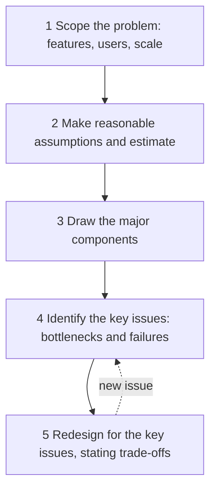

# System design and scalability questions

## Before this lesson

You should know hash tables ([Arrays and strings](#/lesson/interview-prep/arrays-strings-approach)), graph search ([Trees and graphs](#/lesson/interview-prep/trees-graphs-approach)) and Big O. No experience with large systems is assumed. This lesson is an overview and an approach; the site's [System Design track](#/track/system-design) teaches each idea properly, starting from [Clients, servers and requests](#/lesson/system-design/clients-servers-requests) and its [four-step framework](#/lesson/system-design/framework-four-steps).

## In plain words

A **system design question** asks how you would build a whole service, not a single function: "design a link shortener", "design the feed of a social network", "find all pairs of friends within three steps in a network of a billion people". **Scalability** is the ability of a system to keep working as the amount of data and the number of users grow far beyond what one computer can handle.

Picture a café. With ten customers a day, one person takes orders, makes coffee and washes up. With ten thousand customers, that arrangement collapses. You need several tills, several baristas, a way to send each customer to a free till, a stock room that does not run out, and a plan for what happens when a machine breaks. Nothing about making one coffee changed; everything about the *organisation* changed. System design is that organisation, for software.

These questions are conversations with no single right answer. The interviewer wants to see whether you can take a vague goal, make it concrete, propose a reasonable structure, find its weak points and improve it. It matters for a job because this is what senior engineering work looks like, and it matters for interviews because the design round largely decides the level of an experienced candidate.

## How to behave in the conversation

- **Communicate constantly.** Think aloud and draw. The interviewer cannot evaluate a design that exists only in your head.
- **Go broad first.** Sketch the whole system at a high level before diving into any one part.
- **Use the whiteboard.** Boxes for components, arrows for requests and data. Keep it updated as the design changes.
- **Take concerns seriously.** When the interviewer points at a weakness, acknowledge it and adjust. Defending a flawed design is worse than changing it.
- **State assumptions explicitly**, and make them reasonable: "I will assume 10 million users, each posting twice a day."
- **Estimate when it helps.** Rough arithmetic about data size and request rates tells you whether one machine suffices. See [Estimation numbers](#/lesson/system-design/estimation-numbers).
- **Drive.** Do not wait to be asked the next question. Propose it: "The database is now the bottleneck; shall I look at how to split it?"

## A five-step procedure for design questions



1. **Scope the problem.** What exactly must the system do? Which features are in, which are out? Who uses it and how?
2. **Make reasonable assumptions.** Number of users, requests per second, data per item, read-heavy or write-heavy, how fresh results must be.
3. **Draw the major components.** Clients, a load balancer, application servers, a database, perhaps a cache and a queue. Trace one request from start to finish.
4. **Identify the key issues.** Where does it break as load grows? What happens when a machine dies? Which operation is slowest?
5. **Redesign for those issues**, one at a time, and say what each change costs.

## A second procedure, for "algorithms that scale"

Some questions are really algorithm problems with an enormous input: "find the duplicate web addresses among ten billion", "find the shortest chain of friends between two people". A dependable procedure:

1. **Ask your questions** to make sure you understand the problem.
2. **Pretend everything fits on one machine** with unlimited memory, and solve that problem.
3. **Get real**: how much data fits on one machine? What goes wrong when it is split across many: how do you know which machine holds a given piece, and what does a lookup across machines cost?
4. **Solve those problems**, removing or reducing each one. Often the answer is to change how data is divided so that related data sits together.

Step 2 is what stops candidates from freezing: the single-machine solution is usually a familiar data structure, and steps 3 and 4 adapt it.

## Key concepts

### Horizontal and vertical scaling

**Vertical scaling** means making one machine more powerful (more memory, faster processor). It is easy and has a hard ceiling. **Horizontal scaling** means adding more machines. It has no fixed ceiling but requires the system to be designed for it. Large systems scale horizontally.

### Load balancer

A **load balancer** sits in front of a group of identical servers and spreads incoming requests among them. It also stops sending traffic to a server that has failed. For this to work, any server must be able to handle any request, which means servers should not keep a user's state in their own memory (they should be **stateless**), or the state should live in a shared store.

### Database denormalisation and NoSQL

In a relational database, information is normally stored once and combined with **joins** when queried ([Databases and SQL](#/lesson/interview-prep/databases-sql)). Joins across very large tables are slow, and joins across machines are slower. **Denormalisation** stores redundant copies of data so that common reads need no join: for example, storing the author's name inside each post. Reads become fast; writes must update every copy. **NoSQL** databases (key-value stores, document stores, wide-column stores) are built to spread across many machines and usually do not support joins at all, which pushes you toward denormalised designs.

### Database partitioning (sharding)

**Sharding** splits one large data set across several machines. The question is always: by what rule?

| Scheme | Rule | Strength | Weakness |
|---|---|---|---|
| Vertical partitioning | By feature: profiles on one database, messages on another | Simple | One feature's table may still outgrow a machine |
| Key-based (hash) partitioning | `machine = hash(key) mod N` | Even spread | Changing N moves almost every key |
| Directory-based partitioning | A lookup table says where each key lives | Flexible; easy to add machines | The table is a single point of failure and an extra hop |

The weakness of plain `mod N` is the reason **consistent hashing** exists: servers and keys are placed on a ring, and a key belongs to the next server clockwise, so adding or removing one server moves only the keys in that server's arc. The demo shows the difference.

```python-run
import bisect, hashlib

def h(text):
    return int(hashlib.md5(text.encode()).hexdigest(), 16) % 10_000     # position on a ring of 10,000

keys = [f"user{i}" for i in range(5000)]

def mod_owner(key, n):
    return h(key) % n

def ring_owner(key, ring):
    i = bisect.bisect_left(ring, h(key))
    return ring[i] if i < len(ring) else ring[0]          # wrap around

ring4 = sorted(h(f"server{j}") for j in range(4))
ring5 = sorted(ring4 + [h("server4")])

moved_mod = sum(mod_owner(k, 4) != mod_owner(k, 5) for k in keys)
moved_ring = sum(ring_owner(k, ring4) != ring_owner(k, ring5) for k in keys)
print(f"adding a 5th server moves {moved_mod / len(keys):.0%} of keys with mod N")
print(f"adding a 5th server moves {moved_ring / len(keys):.0%} of keys with a hash ring")
```

`h` turns any text into a position between 0 and 9,999 using a standard hash. `mod_owner` picks a server by remainder. `ring_owner` finds the first server position at or after the key's position with binary search, wrapping to the first server at the end of the ring. With `mod N`, going from four to five servers reassigns about four keys in five. With the ring, only the keys that fall in the new server's arc move (the exact share depends on where the new server lands). This track's [Ring Router](#/problem/ctci-ring-router) implements the lookup; the full treatment, including virtual nodes that even out the arcs, is in [The hash ring](#/lesson/system-design/consistent-hashing-ring).

### Caching

A **cache** is a fast, usually in-memory, key-value store placed in front of something slow. The application looks in the cache first; on a miss it asks the database and stores the result. Caches hold whole query results or individual objects. Two questions always follow: how are stale entries removed or refreshed (**invalidation**), and what is evicted when the cache is full (commonly the least recently used entry)?

### Asynchronous processing and queues

Slow work does not have to happen while the user waits. The system can accept the request, put a job on a **queue**, answer immediately ("your video is being processed") and let background workers do the job. Queues also absorb bursts of traffic. Some results can be computed ahead of time: a ranking page rebuilt every few minutes is slightly stale and extremely cheap to serve.

### Networking metrics

| Term | Meaning | Analogy |
|---|---|---|
| **Bandwidth** | The maximum amount of data that can be transferred per unit of time | The width of a pipe |
| **Throughput** | The amount actually transferred per unit of time | The water currently flowing |
| **Latency** | The delay between sending and receiving | How long one drop takes to travel the pipe |

A wide pipe does not make an individual request arrive sooner; latency depends on distance and processing, which is why systems place data close to users.

### MapReduce

**MapReduce** is a way to process a huge data set on many machines by writing two small functions: a *map* step that turns each input record into key-value pairs, and a *reduce* step that combines all values for the same key. The framework handles splitting the data, moving pairs with the same key to the same machine, and re-running failed pieces. It is covered in [Hashing, balanced trees and MapReduce](#/lesson/interview-prep/review-hashing-trees-mapreduce).

## What to consider in every design

- **Failures.** Essentially any component can fail. For each box on the board, ask what happens when it does, and add redundancy (replicas, a standby) where the answer is "the service is down".
- **Availability and reliability.** *Availability* is the fraction of time the system is operational. *Reliability* is the probability that it works correctly over a period. They are related but distinct.
- **Read-heavy or write-heavy.** For read-heavy systems, cache and replicate. For write-heavy systems, queue the writes and partition the data.
- **Security.** Who may read or change which data? What could an attacker abuse? Mention at least authentication and rate limiting; this track's [Sliding-Window Rate Gate](#/problem/ctci-rate-gate) is a small example of the latter.

There is no perfect system: every choice trades something (speed for freshness, simplicity for flexibility, cost for redundancy). Naming the trade-off is the mark of a strong answer. The Thinking track's [trade-off framework](#/lesson/thinking/tradeoff-framework) practises exactly this.

## A worked example with full reasoning

*Problem: a company has a list of millions of documents. Design a service that, given a list of words, returns the documents containing all of them. The service will be called very often with different word lists; the documents rarely change.*

**Ask questions.** Is the order of words relevant? (No, any order.) Whole words only? (Yes.) How many documents? (Millions; too many for one machine's memory.) How fresh must results be? (Documents change rarely.)

**Pretend it fits on one machine.** "Called very often" plus "documents rarely change" suggests doing work once in advance. Build a hash table from each word to the list of documents containing it:

```
"ledger" -> {doc3, doc8, doc19}
"audit"  -> {doc8, doc11}
```

This is called an **inverted index**. A query for `["ledger", "audit"]` looks up both lists and intersects them: `{doc8}`. Start the intersection from the shortest list to do the least work.

**Get real.** The index does not fit on one machine. So:

1. *How do we divide it?* Two natural options: by word (each machine holds the lists for a range of words, for example alphabetical ranges or a hash of the word), or by document (each machine indexes a subset of the documents).
2. *How do we know which machine has what?* With division by word, a small routing table (or a hash) maps a word to its machine. With division by document, every machine must be asked.
3. *What does a query cost?* By word: one lookup per query word, each on a possibly different machine, then the lists are sent to one place and intersected; the lists for common words can be very long. By document: the query is sent to every machine, each intersects locally and returns only its matches, which are then merged.

**Solve the issues and state the trade-off.** Division by word touches few machines per query but moves long lists over the network. Division by document touches every machine but keeps intersections local and results small. For a service with many machines and heavy traffic, the per-document layout with parallel queries is common; for fewer, larger machines, per-word works well. Either way: replicate each partition so that a machine failure loses nothing, cache the results of popular queries, and rebuild or update the index in the background when documents change.

The interviewer may push on any point: "What if one word appears in almost every document?" (Store lists compactly; skip extremely common words; intersect the rarest first.) "How do you add a document?" (Append to the lists on its partition; the cache entries for affected words must be invalidated.) Each follow-up is another turn of steps 4 and 5.

```python-run
from collections import defaultdict

documents = {
    1: "quarterly ledger review and audit notes",
    2: "holiday rota for the support team",
    3: "audit of the supplier ledger",
    4: "ledger migration plan",
}

index = defaultdict(set)                       # word -> set of document ids
for doc_id, text in documents.items():
    for word in text.split():
        index[word].add(doc_id)

def search(words):
    lists = sorted((index.get(w, set()) for w in words), key=len)   # shortest first
    result = set(lists[0])
    for other in lists[1:]:
        result &= other                        # set intersection
    return sorted(result)

print("ledger + audit ->", search(["ledger", "audit"]))
print("ledger         ->", search(["ledger"]))
print("ledger + rota  ->", search(["ledger", "rota"]))
```

The first loop builds the inverted index: for every word of every document, add the document's id to that word's set. `search` fetches the set for each query word, sorts the sets by size so that the smallest comes first, and intersects them with `&=`. The single-machine solution is a dozen lines; the design discussion above is about what changes when `index` is too big for one process.

## Problems in this module and what each trains

| Problem | Skill |
|---|---|
| [Friend Hops](#/problem/ctci-friend-hops) | Bidirectional search: the algorithmic core of "find a path in a huge network" |
| [Ring Router](#/problem/ctci-ring-router) | Consistent-hashing lookup with a sorted structure |
| [Sliding-Window Rate Gate](#/problem/ctci-rate-gate) | Rate limiting with a bounded window of history |
| [Top Terms Across Shards](#/problem/ctci-shard-top-terms) | Why per-machine summaries cannot always be merged; aggregate first |

## Pitfalls

- **Jumping into detail.** Spending fifteen minutes on a database schema before the overall architecture exists.
- **Not asking about scale**, and therefore designing either a toy or a data centre for a problem that needed neither.
- **Hand-waving numbers.** "A lot of users" is not an assumption. "Ten million daily users, 100 requests per second on average" is.
- **A single point of failure** left on the board unmentioned.
- **Buzzwords without reasons.** Every component you add should answer a problem you have stated.
- **Ignoring the interviewer's hints.** A question such as "what if this server dies?" is the next topic.
- **Claiming a perfect design.** State the trade-offs.
- **Forgetting the simple version.** The one-machine solution is the foundation; skipping it loses the easiest marks.

> [!INTERVIEW]
> A reliable opening sentence: "Before I design anything, let me check the scope and the scale." Then ask three or four questions, write the answers on the board, and say which features you will leave out. Interviewers consistently rate this start highly.

> [!TIP]
> When stuck, follow one request through your drawing end to end and narrate each hop. Missing components, slow steps and failure points become visible as soon as you trace a concrete request.

> [!WARNING]
> Do not invent facts about how a specific well-known company's system works. Describe what *you* would do and why. If you happen to know a real architecture, present it as an option with trade-offs, not as the answer.

## Summary

- System design questions are open conversations: communicate, go broad first, draw, state assumptions, estimate, take feedback and drive the discussion.
- For design questions: scope, assumptions, major components, key issues, redesign. For large-data algorithm questions: ask, solve on one machine, get real about splitting, fix the issues.
- Core vocabulary: horizontal and vertical scaling, load balancers, denormalisation and NoSQL, sharding schemes and consistent hashing, caching, queues and asynchronous work, bandwidth, throughput and latency, MapReduce.
- Always consider failures, availability and reliability, the read/write balance and security, and say what each choice trades away.
- Continue with the [System Design track](#/track/system-design) for complete worked designs.

## Glossary

- **Scalability**: the ability of a system to handle growth in data and traffic.
- **Vertical / horizontal scaling**: a bigger machine / more machines.
- **Load balancer**: a component that distributes requests across servers.
- **Stateless server**: a server that keeps no per-user data between requests.
- **Denormalisation**: storing redundant copies of data to avoid joins on reads.
- **NoSQL**: non-relational databases designed to spread across many machines.
- **Sharding (partitioning)**: splitting a data set across machines.
- **Consistent hashing**: a partitioning scheme in which adding or removing a machine moves only a small share of keys.
- **Cache**: a fast store holding copies of frequently used results.
- **Invalidation**: removing or refreshing cache entries that are out of date.
- **Queue**: a buffer of jobs processed later by workers.
- **Bandwidth / throughput / latency**: maximum transfer rate / actual transfer rate / delay.
- **Availability / reliability**: fraction of time operational / probability of correct operation over a period.
- **Inverted index**: a map from each word to the documents containing it.
- **Single point of failure**: a component whose failure stops the whole system.

```quiz
[
  {"q": "What should you do first in a system design interview?",
   "options": ["Choose a database", "Scope the problem and ask about features and scale", "Draw every table", "Write code"],
   "answer": 1,
   "explain": "The requirements and scale decide the design; assumptions should be explicit before components are drawn."},
  {"q": "In the procedure for large-data algorithm questions, what is the purpose of pretending everything fits on one machine?",
   "options": ["To avoid the question", "To find a correct basic solution with familiar data structures before dealing with distribution", "Because large systems use one machine", "To save time by skipping scale"],
   "answer": 1,
   "explain": "The single-machine solution is the foundation; splitting it across machines is then a separate, manageable step."},
  {"q": "What is the main weakness of partitioning with hash(key) mod N?",
   "options": ["Keys are spread unevenly", "Changing the number of machines moves almost every key", "It requires joins", "It cannot store strings"],
   "answer": 1,
   "explain": "The remainder changes for most keys when N changes; consistent hashing limits movement to one server's share."},
  {"q": "What does denormalisation trade?",
   "options": ["Faster writes for slower reads", "Faster reads without joins, at the cost of redundant data that writes must keep in sync", "Security for speed", "Nothing: it is always better"],
   "answer": 1,
   "explain": "Redundant copies remove joins on the read path but every update must change all copies."},
  {"q": "Which statement about bandwidth and latency is correct?",
   "options": ["They are the same thing", "Bandwidth is the maximum data per unit of time; latency is the delay for data to arrive", "Higher bandwidth always lowers latency", "Latency is measured in bytes"],
   "answer": 1,
   "explain": "A wider pipe carries more per second but does not shorten the travel time of an individual message."},
  {"q": "Why should servers behind a load balancer be stateless?",
   "options": ["To use less electricity", "So that any server can handle any request and a failed server loses no user state", "Because state is illegal", "To avoid using a database"],
   "answer": 1,
   "explain": "If user state lived in one server's memory, requests would have to return to that server and its failure would lose the state."},
  {"q": "In the document search example, what is an inverted index?",
   "options": ["A list of documents sorted backwards", "A map from each word to the set of documents containing it", "A cache of recent queries", "A table of document sizes"],
   "answer": 1,
   "explain": "Precomputing word-to-documents lists turns each query into a few lookups and an intersection."},
  {"q": "The interviewer asks 'what happens if this machine dies?'. What is the best response?",
   "options": ["Say it will not die", "Acknowledge the single point of failure and propose replication or a standby, stating the cost", "Change the subject", "Remove the machine from the drawing"],
   "answer": 1,
   "explain": "Failure handling is a required part of any design; taking the concern seriously and adjusting is what is being assessed."}
]
```

> **Source:** McDowell, Cracking the Coding Interview 6e, ch. 9 (System Design and Scalability). The worked example, demos and wording are original.
