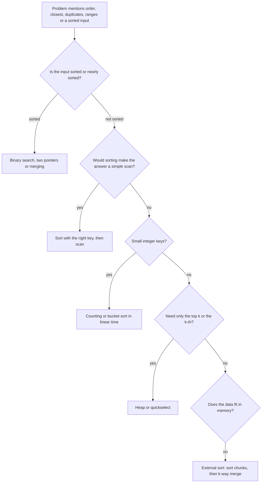

# Sorting and searching: approach and cheat sheet

## Before this lesson

You need loops, lists and recursion in Python, plus [Big O foundations](#/lesson/interview-prep/big-o-foundations). This is a compact review. The algorithms are taught in depth in [Merge sort](#/lesson/dsa-foundations/merge-sort), [Quick sort](#/lesson/dsa-foundations/quick-sort) and [Lower bounds and linear-time sorting](#/lesson/dsa-foundations/lower-bound-linear), and searching patterns in [Binary search done right](#/lesson/neet-window-stack/binary-search-right) and [Search on the answer](#/lesson/neet-window-stack/search-on-answer). For Python's own tools see [heapq, bisect and sorting](#/lesson/python/py-heapq-bisect-sorting).

## In plain words

**Sorting** means putting items in order: numbers from small to large, names alphabetically, orders by date. **Searching** means finding an item, or the place where it would go.

The two belong together because order is what makes fast searching possible. A dictionary with its words in random order would be useless: finding one word would mean reading the whole book. Because the words are sorted, you open the book in the middle, see whether your word comes before or after, and discard half the pages at a glance. Repeating that a dozen times finds any word among thousands. That halving idea is **binary search**, and sorting is the preparation that pays for it.

This matters for a job because you will sort and search constantly, almost always through library functions, and you need to know what they cost and how to steer them with keys and comparisons. It matters for interviews in three ways: you may be asked how the classic algorithms work, "sort it first" is the hidden first step of many solutions, and binary search has a family of variations that are easy to get subtly wrong.

## The sorting algorithms to know

You should be able to explain each in two sentences, state its cost, and write merge sort and quick sort.

| Algorithm | Idea | Average time | Worst time | Extra space | Stable? |
|---|---|---|---|---|---|
| Bubble sort | Repeatedly swap neighbours that are out of order | O(n²) | O(n²) | O(1) | Yes |
| Selection sort | Repeatedly pick the smallest remaining item and put it next | O(n²) | O(n²) | O(1) | No |
| Insertion sort | Grow a sorted prefix by inserting each item where it belongs | O(n²) | O(n²); O(n) if nearly sorted | O(1) | Yes |
| **Merge sort** | Split in half, sort each half, merge the two sorted halves | O(n log n) | O(n log n) | O(n) | Yes |
| **Quick sort** | Pick a pivot, partition into smaller and larger, sort each side | O(n log n) | O(n²) with bad pivots | O(log n) stack | No |
| Heap sort | Build a heap, repeatedly remove the maximum | O(n log n) | O(n log n) | O(1) | No |
| Counting / radix sort | Count occurrences of each key, or sort digit by digit | O(n + k) / O(d · n) | same | O(n + k) | Yes |

A sort is **stable** if items that compare as equal keep their original relative order. Stability matters when you sort by one field after another: sort by name, then stably by department, and names stay in order within each department.

Python's `sorted` and `list.sort` use Timsort, a stable hybrid of merge sort and insertion sort with O(n log n) worst case and O(n) on already-ordered input.

### Merge sort

```python-run
def merge_sort(items):
    if len(items) <= 1:                    # base case: nothing to sort
        return items
    middle = len(items) // 2
    left = merge_sort(items[:middle])      # sort each half
    right = merge_sort(items[middle:])
    merged, i, j = [], 0, 0
    while i < len(left) and j < len(right):
        if left[i] <= right[j]:            # <= keeps equal items in order: stable
            merged.append(left[i]); i += 1
        else:
            merged.append(right[j]); j += 1
    merged.extend(left[i:])                # one of these two is empty
    merged.extend(right[j:])
    return merged

print(merge_sort([38, 27, 43, 3, 9, 82, 10]))
```

The function splits the list at the middle, sorts both halves by calling itself, and then **merges**: two indexes walk the sorted halves, and the smaller front element is copied each time. When one half runs out, the rest of the other is appended. There are log n levels of splitting and each level does O(n) work in merging: O(n log n). The merge step by itself is a favourite interview tool (merging two sorted arrays, merging k sorted lists).

### Quick sort

Choose one element as the **pivot**. Rearrange the list so that everything smaller is on its left and everything larger on its right (the **partition** step). Sort the two sides recursively. With a pivot that splits evenly, the cost is O(n log n); if the pivot is always the smallest or largest element (for example, taking the first element of an already sorted list), the split is as uneven as possible and the cost degrades to O(n²). Choosing a random pivot makes that worst case extremely unlikely.

The partition step alone solves "find the k-th smallest element" in O(n) average time, an algorithm called quickselect, taught in [Selection](#/lesson/dsa-foundations/selection).

### When the standard answer is not the best

Comparison-based sorting cannot beat O(n log n) in general. But if the keys are small integers (ages, exam scores, single characters), **counting sort** tallies how many times each key occurs and writes the result in O(n + k), where k is the number of possible keys. **Radix sort** applies that idea digit by digit for larger integers. **Bucket sort** distributes items into ranges and sorts each range. Mention these when the problem says the values lie in a small range.

## Binary search

Binary search finds a target in a **sorted** list by repeatedly halving the range that could contain it.

```python-run
def find(sorted_items, target):
    low, high = 0, len(sorted_items) - 1          # the range still possible, inclusive
    steps = 0
    while low <= high:
        steps += 1
        middle = (low + high) // 2
        if sorted_items[middle] == target:
            return middle, steps
        if sorted_items[middle] < target:
            low = middle + 1                      # target can only be to the right
        else:
            high = middle - 1                     # target can only be to the left
    return -1, steps

data = list(range(0, 2_000_000, 2))               # one million even numbers
print("looking for 1,234,568:", find(data, 1_234_568))
print("looking for 7 (absent):", find(data, 7))
```

`low` and `high` bracket the positions where the target could still be. Each pass looks at the middle; if it is too small the left part including the middle is discarded, and if too large the right part. The loop ends when the range is empty. With a million items the search needs about twenty steps; the output shows the index found and the number of steps.

The details are where bugs live: `low <= high` versus `low < high`, `middle + 1` versus `middle`. A robust habit is to decide precisely what your range means and keep that meaning true on every pass.

### The most useful form: first position where a condition becomes true

Many problems are not "find x" but "find the boundary". If a condition is false for a while and then true forever after (false, false, false, true, true), binary search finds the first true in O(log n).

```python
def first_true(low, high, condition):
    """Smallest index in [low, high) where condition(index) is True, or high if none."""
    while low < high:
        middle = (low + high) // 2
        if condition(middle):
            high = middle          # middle might be the answer; keep it
        else:
            low = middle + 1       # middle is not the answer; discard it
    return low
```

This one template gives: the first element ≥ x (lower bound), the first element > x (upper bound), the insertion point, the smallest capacity that works, the first bad version, and more. Python's `bisect.bisect_left` and `bisect.bisect_right` are the first two.

## The usual tricks



### 1. Sort with a key that expresses what you need

Sorting is rarely about the raw values. Group words that are rearrangements of each other by sorting on "the word's letters in alphabetical order". Order events by time and, for ties, by type. In Python a key function returns a tuple; tuples compare element by element.

```python-run
words = ["tea", "bat", "eat", "tab", "ate", "cab"]
print(sorted(words, key=lambda w: ("".join(sorted(w)), w)))

people = [("Dana", "ops", 41), ("Ali", "dev", 29), ("Bo", "ops", 35), ("Cy", "dev", 29)]
print(sorted(people, key=lambda p: (p[1], -p[2], p[0])))   # department, then oldest first, then name
```

In the first call the key is a pair: the signature (sorted letters) and the word itself, so shuffles of the same letters end up adjacent and each group is alphabetical. In the second, `-p[2]` reverses the order for age only. This is [Cluster Shuffled Words](#/problem/ctci-cluster-shuffled-words).

### 2. Binary search needs a decidable midpoint, not a tidy array

Variations keep the halving idea but change how you decide which half to keep:

- **Rotated sorted array**: one half is always properly sorted; check whether the target lies in that half.
- **Unknown length**: probe positions 1, 2, 4, 8, … until you pass the end or the target, then binary-search the last interval.
- **Blanks between values**: if the midpoint is blank, move to the nearest non-blank element ([Search With Blanks](#/problem/ctci-sparse-word-search)).
- **Rows and columns both sorted**: start at a corner where one direction increases and the other decreases; each comparison eliminates a row or a column ([Staircase Grid Search](#/problem/ctci-staircase-grid-search)).
- **Monotone function of an index**: if `arr[i] − i` never decreases, search for where it crosses zero ([Fixed Point](#/problem/ctci-fixed-point-index)).

### 3. Merge from the correct end

To merge a sorted array into another that has spare room at its end, fill from the back so that nothing unread is overwritten ([Merge Into the Spare Room](#/problem/ctci-merge-into-buffer)).

### 4. Do not sort more than you need

For "top k" use a heap of size k: O(n log k). For "the k-th smallest" use quickselect: O(n) average. For "alternate high and low" a single pass of local swaps works without sorting ([Zigzag Fence](#/problem/ctci-zigzag-heights)).

### 5. When the data does not fit in memory

Sort chunks that do fit, write each to disk, then merge the sorted chunks by repeatedly taking the smallest front element among them (a heap of the chunk heads). This is an **external sort**. If the question is "find duplicates" or "find a missing number" in a huge file, also consider a **bit vector**: one bit per possible value uses an eighth of a byte each, so four billion possible values fit in about half a gigabyte.

### 6. Rank queries on a stream

To answer "how many values seen so far are ≤ x?" repeatedly, a sorted list gives O(log n) queries and O(n) inserts; a balanced search tree with subtree sizes, or a binary indexed tree over the value range, gives O(log n) for both ([Rank Board](#/problem/ctci-rank-board)). A **binary indexed tree** (Fenwick tree) is an array in which cell i stores the sum of a block of positions ending at i, the block length being the lowest set bit of i; both "add at a position" and "sum of a prefix" then touch only about log n cells.

## A worked example with full reasoning

*Problem: an alphabetically sorted list of words has empty strings scattered through it, for example `["", "bee", "", "", "cow", "", "elk"]`. Find the position of a given word.*

**Listen.** Sorted (ignoring blanks); blanks can be anywhere and numerous; the target is not blank.

**Brute force.** Scan: O(n).

**Optimise.** Sorted data suggests binary search. The obstacle: if the middle element is blank, comparing it with the target says nothing about which half to keep. The halving idea only needs *some* real word near the middle to compare with. So when the midpoint is blank, step outward, left and right alternately, to the nearest real word inside the current range, and use that as the pivot.

**Walk through** for target `cow`: range 0..6, middle 3 is blank. Step outward: index 2 is blank, index 4 is `cow`. Compare: equal → answer 4. For target `ant`: pivot at 4 is `cow`, larger than `ant`, so keep 0..3; middle 1 is `bee`, larger, keep 0..0; that element is blank and the range has no real word → not found.

**Implement** with care for one thing: the outward scan must stay within `low..high`, otherwise it wanders into territory already discarded and the loop may never end.

**Complexity.** O(log n) when blanks are sparse. In the worst case, such as a list of almost all blanks, O(n), and no algorithm can do better there because every position might need inspecting. State both.

**Test.** Empty list; all blanks; target at the first and last real positions; target absent but between two words; a single-element list.

## Complexity cheat sheet

| Task | Tool | Time | Space |
|---|---|---|---|
| Sort n items by comparison | merge sort, Timsort, heap sort | O(n log n) | O(n), O(n), O(1) |
| Sort n integers in a range of size k | counting sort | O(n + k) | O(n + k) |
| Search a sorted array | binary search | O(log n) | O(1) |
| Search an unsorted array | linear scan | O(n) | O(1) |
| First index satisfying a monotone condition | binary search on the condition | O(log n) checks | O(1) |
| Merge two sorted arrays | two pointers | O(n + m) | O(1) with spare room, else O(n + m) |
| Merge k sorted lists of total size N | heap of k heads | O(N log k) | O(k) |
| Top k of n | heap of size k | O(n log k) | O(k) |
| k-th smallest | quickselect | O(n) average, O(n²) worst | O(1) |
| Search in a row- and column-sorted grid | corner walk | O(rows + cols) | O(1) |
| Prefix count on a stream | binary indexed tree | O(log M) per operation | O(M) |

## Problems in this module and what each trains

| Problem | Skill |
|---|---|
| [Merge Into the Spare Room](#/problem/ctci-merge-into-buffer) | Merging from the back, in place |
| [Cluster Shuffled Words](#/problem/ctci-cluster-shuffled-words) | Sorting with a composite key |
| [Search With Blanks](#/problem/ctci-sparse-word-search) | Binary search with an unusable midpoint |
| [Zigzag Fence](#/problem/ctci-zigzag-heights) | Achieving an ordering property without a full sort |
| [Rank Board](#/problem/ctci-rank-board) | Rank queries on a stream |
| [Staircase Grid Search](#/problem/ctci-staircase-grid-search) | Eliminating a row or column per comparison |

## Pitfalls

- **Binary search on unsorted data.** It returns nonsense without any error.
- **Infinite loops** from `low = middle` when `middle` is rounded down. Use `middle + 1` on the side you discard.
- **Off-by-one in the loop condition.** Decide whether `high` is inclusive or exclusive and be consistent.
- **Midpoint overflow** in fixed-width languages: write `low + (high - low) / 2`. Python is unaffected.
- **Assuming a sort is stable** when it is not (quick sort, heap sort), or needing stability and not saying so.
- **Quoting quick sort as O(n log n) without "on average"**, or forgetting its O(n²) worst case.
- **Sorting when a hash table or a single pass would do**, paying O(n log n) for an O(n) problem; or the reverse, rejecting a sort that would make the solution simple.
- **Expensive comparisons.** Sorting strings of length L costs O(L · n log n).
- **Modifying the caller's list** by sorting in place when a sorted copy was expected.

> [!INTERVIEW]
> When you plan to sort as a first step, say what it buys: "Sorting costs n log n and lets me find each element's partner with two pointers, so the total is n log n instead of n squared." Linking the cost to the benefit shows that the sort is a decision, not a reflex.

> [!TIP]
> For any binary search, test three inputs by hand before trusting it: a single-element list, a two-element list, and a target that is absent. Nearly all boundary bugs appear on lists of length one or two.

> [!WARNING]
> Library sorts are almost always the right choice in real code. In an interview, ask whether you may use the built-in sort; writing merge sort from scratch when it is not required spends ten minutes that the actual problem needed.

## Summary

- Know the classic sorts by idea, cost, space and stability; be able to write merge sort and explain quick sort's partition and its worst case.
- Comparison sorts are O(n log n) at best; counting, radix and bucket sorts beat that for restricted keys.
- Binary search halves a sorted range; its most reusable form finds the first position where a monotone condition holds.
- Standard tricks: sort with a well-chosen key, adapt how the midpoint decides, merge from the back, use heaps or quickselect for partial order, external sorting and bit vectors for data too large for memory, and indexed trees for rank queries.
- Watch loop boundaries, stability and hidden comparison costs.

## Glossary

- **Sorting**: arranging items in a defined order.
- **Stable sort**: a sort that keeps equal items in their original relative order.
- **In-place sort**: a sort using only O(1) or O(log n) extra memory.
- **Comparison sort**: a sort that orders items only by comparing pairs.
- **Merge**: combining two sorted sequences into one.
- **Pivot / partition**: the chosen element in quick sort / rearranging items around it.
- **Counting sort / radix sort**: linear-time sorts for small integer keys / digit by digit.
- **Binary search**: finding a target or boundary in sorted data by halving the range.
- **Lower bound / upper bound**: the first position with a value ≥ x / > x.
- **Monotone condition**: a condition that, once true, stays true for all later positions.
- **Quickselect**: finding the k-th smallest element by repeated partitioning.
- **External sort**: sorting data larger than memory by sorting chunks and merging them.
- **Bit vector**: an array of single bits recording presence or absence of each possible value.
- **Binary indexed tree**: an array structure supporting point updates and prefix sums in O(log n).

```quiz
[
  {"q": "Which statement about merge sort is correct?",
   "options": ["O(n²) worst case, in place", "O(n log n) in every case, uses O(n) extra space, stable", "O(n) always", "Unstable and O(log n) time"],
   "answer": 1,
   "explain": "There are log n levels of splitting and O(n) merging work per level; the merge needs a buffer and preserves the order of equal items."},
  {"q": "When does quick sort degrade to O(n²)?",
   "options": ["When the list has duplicates", "When pivots repeatedly split the list as unevenly as possible, such as first-element pivots on sorted input", "When the list is short", "Never"],
   "answer": 1,
   "explain": "An extreme pivot leaves one side with almost all the items, giving n levels instead of log n."},
  {"q": "What does it mean for a sort to be stable?",
   "options": ["It never crashes", "Items that compare equal keep their original relative order", "It uses no extra memory", "It always takes the same time"],
   "answer": 1,
   "explain": "Stability lets you sort by several fields in successive passes."},
  {"q": "A list of one million exam scores from 0 to 100 must be sorted. Which approach is fastest in Big O terms?",
   "options": ["Bubble sort", "Merge sort, O(n log n)", "Counting sort, O(n + k) with k = 101", "Binary search"],
   "answer": 2,
   "explain": "With a small range of integer keys, counting occurrences is linear."},
  {"q": "Binary search requires which property of the data?",
   "options": ["It must be stored in a linked list", "It must be sorted, or the condition tested must be monotone", "It must contain no duplicates", "Its length must be a power of two"],
   "answer": 1,
   "explain": "Halving is valid only if a comparison at the midpoint tells you which half cannot contain the answer."},
  {"q": "In the first_true template, why is `high = middle` used when the condition is true, instead of `middle - 1`?",
   "options": ["To make the loop longer", "Because middle itself might be the first true position and must stay in the range", "Because of integer overflow", "It is a mistake"],
   "answer": 1,
   "explain": "Discarding middle when it satisfies the condition could throw away the answer."},
  {"q": "In the sorted list with blanks, what is done when the midpoint is an empty string?",
   "options": ["Give up", "Move outward to the nearest non-empty element within the current range and compare with that", "Treat the blank as smaller than everything", "Restart from index 0"],
   "answer": 1,
   "explain": "Any real word near the middle can serve as the pivot that decides which half to keep."},
  {"q": "You need the 10 largest of one billion numbers. Which approach is best?",
   "options": ["Sort everything, O(n log n)", "Keep a min-heap of size 10, O(n log 10)", "Binary search", "Bubble sort"],
   "answer": 1,
   "explain": "A small heap holds the current top ten; each new number costs at most log 10 work."}
]
```

> **Source:** McDowell, Cracking the Coding Interview 6e, ch. 10 (Sorting and Searching). Explanations, code and examples are original.
