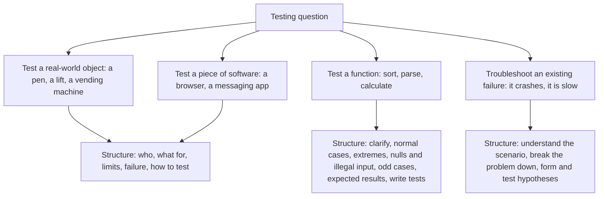

# Testing questions

## Before this lesson

You should be able to read a short Python function and have worked through [The seven-step method](#/lesson/interview-prep/seven-step-method), whose last step is testing your own code. No testing experience is assumed. The Thinking track teaches test design in much greater depth: [Partitions and boundaries](#/lesson/thinking/partitions-boundaries), [Decision tables, states and pairwise](#/lesson/thinking/tables-states-pairwise), [A template: the vending machine](#/lesson/thinking/template-vending-machine) and [Hypotheses and triage](#/lesson/thinking/hypothesis-triage) for debugging.

## In plain words

**Testing** is the deliberate search for ways in which something fails to do what it should. A **testing question** in an interview asks you to plan that search: "how would you test a lift?", "how would you test this sorting function?", "the app crashes on start for some users; what do you do?".

Think of a building inspector. An inspector does not wander through a house hoping to notice problems. They carry a list: structure, electrics, plumbing, fire exits; and for each item they know what could go wrong and how to check it. They also know they cannot check everything, so they start with what would hurt most. A good answer to a testing question sounds like that inspector: organised, aware of who uses the thing and how, focused on the riskiest parts first.

These questions matter in two ways. If you are applying for a testing role (tester or SDET), they are the core of the interview. If you are applying as a developer, they still appear, because every engineer is expected to test their own work, and because the ability to imagine how things break is the same ability that prevents bugs in the first place.

## What the interviewer is looking for

Four things, whatever the specific question:

1. **Big-picture understanding.** Do you understand what the thing is for and which behaviours matter most? Can you prioritise? If a photo-sharing app is being tested, uploading must work before the choice of filter colours does.
2. **Knowing how the pieces fit together.** Real systems are assembled from parts. Can you see where the parts meet and what could go wrong at each joint?
3. **Organisation.** Do you approach the problem with structure, in categories, or do you blurt out whatever comes to mind? Structure is the single biggest difference between strong and weak answers.
4. **Practicality.** Are your plans reasonable to carry out? "Test every possible input" is not a plan. "These six classes of input, automated, and these three checked by hand before each release" is.

## The four kinds of testing question



### Kind 1: test a real-world object

The object is a pretext: a stapler, a pen, a paperclip. The interviewer wants the method.

**Step 1. Who will use it, and why?** A pen for a child drawing, an office worker signing contracts and an astronaut have different requirements. Ask, and if several users exist, cover each.

**Step 2. What are the use cases?** List what each user does with it: writing on paper, writing on other surfaces, drawing, being carried in a pocket, being chewed by a toddler.

**Step 3. What are the limits of use?** Up to how long, how hot, how heavy, how many times? A stapler: how many sheets at once before it jams?

**Step 4. What are the stress and failure conditions?** No product lasts forever. What happens at and beyond the limits, and is failure *safe*? A pen for children may run dry; it must not be toxic or have small detachable parts.

**Step 5. How would you perform the tests?** Some by hand (does it feel comfortable?), some with a rig or automation (press the button 100,000 times), some by measurement (how many metres of line per cartridge), some by review (is the ink certified non-toxic?).

**Worked example: a lift (elevator) in an office building.**

<details>
<summary>Open for a structured answer</summary>

**Clarify.** One lift or a bank of several? How many floors? Passengers only, or freight? Are there special modes (fire service, maintenance, accessibility)?

**Users and uses.** Office workers travelling between floors; visitors unfamiliar with the building; wheelchair users; people with trolleys; maintenance staff; firefighters.

**Normal behaviour.**
- Call button on each floor brings a lift; the direction indicators are correct.
- Selecting a floor inside takes you there; the display and announcement match the actual floor.
- Doors open fully, stay open long enough, and close; "door open" and "door close" buttons work.
- The lift stops level with the floor.

**Limits and boundaries.**
- Top and bottom floors (no "up" from the top).
- Maximum load: at the limit, slightly over the limit (should refuse to move and signal), far over.
- Many requests at once, in both directions: are they served in a sensible order, and does nobody wait forever?

**Failure and safety.**
- Something or someone in the doorway: doors must reopen.
- Power failure during travel: does it stop safely, is there emergency lighting, does the alarm work, does it recover when power returns?
- Emergency stop and alarm buttons.
- Fire mode: returns to the ground floor and ignores ordinary calls.

**Non-functional.**
- Waiting time and travel time at peak hours.
- Noise, smoothness of starting and stopping.
- Accessibility: button height, Braille, audible signals.
- Reliability: thousands of door cycles.

**How to test.** Functional checks by hand against a checklist; a simulator or logged controller data for the scheduling logic with thousands of generated request patterns; physical load tests with weights; safety tests supervised by qualified staff; long-running soak tests for door mechanisms.

**Priority.** Safety behaviours first, then basic transport, then efficiency and comfort.

</details>

### Kind 2: test a piece of software

The same steps apply, with a few additions that are specific to software.

- **Black-box versus white-box.** In *black-box* testing you only see inputs and outputs. In *white-box* testing you can see the code and aim tests at its branches. Ask which you have.
- **Manual versus automated.** Humans are good at noticing that something looks or feels wrong; machines are good at repeating thousands of precise checks. A good plan uses both and says which checks belong to which.
- **Functional versus non-functional.** Beyond "does it do the right thing": speed, behaviour under load, security, accessibility, behaviour on different devices, languages and time zones, and recovery from failures such as a lost network connection.

A structure that always works: **who uses it → what are the use cases → what are the limits → what are the stress and failure conditions → how will each test be run, and in what order of priority**.

**Worked example in brief: an image-upload feature of a web application.** Users: ordinary members on phones and laptops, administrators. Use cases: choose a file, drag and drop, see a preview, replace, delete. Inputs by class: supported formats (one test each), unsupported formats, a file with the wrong extension, zero bytes, exactly the size limit, one byte over, very large dimensions, unusual file names. Conditions: slow network, connection lost halfway, two uploads at once, storage full, not logged in. Security: a file that is not really an image, a script disguised as one, access to other users' images by guessing addresses. Automation: format and size classes through the upload interface; manual: preview quality and layout on several devices. Priority: correct storage and access control first.

### Kind 3: test a function

Here you are expected to be thorough and concrete. A reliable procedure:

1. **Define the test cases by category.**
   - *Normal cases*: typical valid inputs.
   - *Extremes*: empty input, one element, very large input, minimum and maximum values.
   - *Nulls and illegal input*: missing arguments, wrong types, values outside the allowed range. Ask how the function is supposed to respond.
   - *Strange input*: already sorted, reverse sorted, all equal, duplicates, negative numbers, mixed case.
2. **Define the expected result for each.** Usually the right output, but sometimes also a property: does the function modify its input? Is the result stable?
3. **Write the tests.**

Two techniques from the Thinking track make the categories systematic. **Equivalence partitioning** groups inputs that the function should treat alike, so that one test per group suffices. **Boundary-value analysis** adds tests at the edges of each group, where `<` and `<=` get confused: for a valid range of 1 to 10, test 0, 1, 2, 9, 10, 11 ([Boundary Value Set](#/problem/ctci-boundary-values)).

**Worked example: classifying a triangle.** The function takes three side lengths and returns "equilateral", "isosceles", "scalene" or "invalid". It is a classic teaching example because the code is tiny and the test list is long. Try to write your own list before running the block.

```python-run
def classify(a, b, c):
    x, y, z = sorted((a, b, c))
    if x <= 0 or x + y <= z:
        return "invalid"
    if x == z:
        return "equilateral"
    if x == y or y == z:
        return "isosceles"
    return "scalene"

tests = [
    # (sides, expected, why this case exists)
    ((3, 4, 5), "scalene", "normal scalene"),
    ((2, 2, 2), "equilateral", "normal equilateral"),
    ((2, 2, 3), "isosceles", "equal pair first"),
    ((3, 2, 2), "isosceles", "equal pair last (permutation)"),
    ((2, 3, 2), "isosceles", "equal pair split (permutation)"),
    ((1, 2, 3), "invalid", "flat: boundary of the triangle inequality"),
    ((1, 2, 4), "invalid", "one side too long"),
    ((5, 1, 1), "invalid", "long side in first position (permutation)"),
    ((0, 0, 0), "invalid", "zero lengths"),
    ((-1, 5, 5), "invalid", "negative length"),
    ((2, 2, 4), "invalid", "looks isosceles but is flat"),
    ((10**18, 10**18, 10**18), "equilateral", "very large values"),
]
failures = 0
for sides, expected, why in tests:
    got = classify(*sides)
    status = "ok  " if got == expected else "FAIL"
    failures += got != expected
    print(f"{status} {str(sides):38s} {got:12s} {why}")
print("failures:", failures)
```

Each test is a tuple of input, expected output and the *reason* for the test. Writing the reason forces you to notice gaps: there is a line for each output, each position of the odd side, each kind of invalid input, a boundary (1 + 2 = 3) and large values. `classify(*sides)` unpacks the tuple into three arguments. Now break the function on purpose: change `x + y <= z` to `x + y < z` and run again. Exactly the boundary tests fail, which shows why they are on the list. The function itself is the problem [Triangle Classifier](#/problem/ctci-triangle-kind).

### Kind 4: troubleshooting

"A user reports that the browser crashes when it starts. What do you do?" This is not about guessing the cause. It is about a method that converges on it.

**Step 1. Understand the scenario.** Ask before theorising.
- How long has it been happening? What changed around that time (a new version, an operating-system update, a new extension)?
- Which version, which platform, which device?
- Does it happen every time or sometimes? For everyone or for some users?
- What exactly does the user see? Is there an error message or a log?

**Step 2. Break the problem down.** Write the sequence of steps the system performs in the failing scenario, for example: (1) the program is launched; (2) it loads settings; (3) it restores the previous session; (4) it loads extensions; (5) it draws the window; (6) it requests the home page. Each step is a place where the failure could occur.

**Step 3. Form specific hypotheses and test each cheaply.** Does it crash with a fresh profile (points to settings or session data)? With extensions disabled? Without a network connection? On another machine with the same version? Each test either confirms a step as the culprit or eliminates it. Prefer tests that eliminate half of the possibilities at once.

That last idea, halving, is binary search applied to debugging. If a failure appeared somewhere between version 100 (good) and version 164 (bad), testing version 132 halves the range, and seven tests find the exact change.

```python-run
def first_bad_version(first_good, first_known_bad, is_bad):
    """Return the earliest bad version, and how many builds were tested."""
    low, high, tested = first_good + 1, first_known_bad, 0
    while low < high:
        middle = (low + high) // 2
        tested += 1
        if is_bad(middle):
            high = middle            # the culprit is here or earlier
        else:
            low = middle + 1         # the culprit is later
    return low, tested

culprit = 147
found, tested = first_bad_version(100, 164, lambda version: version >= culprit)
print(f"regression introduced in version {found}, located with {tested} test runs instead of up to 63")
```

`is_bad` stands for "install this version and try to reproduce the crash". The loop keeps a range in which the first bad version must lie and tests its midpoint. Six or seven runs replace up to sixty-three. Version-control tools automate exactly this procedure.

## A reusable checklist of what to cover

| Area | Questions to ask |
|---|---|
| Users | Who uses it? With what goals, skills and devices? |
| Core behaviour | What must work for the product to be of any use? |
| Inputs | Valid classes, invalid classes, boundaries, empty, huge, malformed |
| State and sequence | Does order matter? What about repeating, undoing, interrupting an action? |
| Combinations | Which settings interact? Is pairwise coverage enough? ([Pairwise Coverage Gaps](#/problem/ctci-pairwise-gaps)) |
| Environment | Platforms, versions, languages, time zones, slow or missing network |
| Load | Many users, large data, long running time |
| Failure and recovery | Power loss, crashes, full disk, dependencies unavailable |
| Security and privacy | Who can see or change what? What can be abused? |
| Usability and accessibility | Is it clear, comfortable, usable with assistive technology? |

You will rarely cover all ten in an interview. Naming the areas, then going deep on the three that matter most for this product, shows both structure and prioritisation.

## Problems in this module and what each trains

| Problem | Skill |
|---|---|
| [Triangle Classifier](#/problem/ctci-triangle-kind) | Writing a function that survives a complete test list |
| [Boundary Value Set](#/problem/ctci-boundary-values) | Boundary-value analysis as code |
| [Pairwise Coverage Gaps](#/problem/ctci-pairwise-gaps) | Measuring combination coverage of a test suite |

## Pitfalls

- **A stream of unstructured test ideas.** Twenty random cases impress less than five categories with two cases each.
- **Not asking who uses the thing or what it is for.**
- **Only happy-path cases.** The value of testing is in boundaries, invalid input and failure.
- **"Test everything".** Exhaustive testing is impossible; choose representatives and prioritise by risk.
- **No expected results.** A test without a stated correct outcome cannot fail.
- **Forgetting non-functional qualities**: performance, security, accessibility, recovery.
- **In troubleshooting, guessing a cause before understanding the scenario**, or changing several things at once so that you cannot tell which change mattered.
- **Ignoring how tests would actually be run.** Say what is automated, what is manual and what needs special equipment.

> [!INTERVIEW]
> Open with structure, aloud: "I will first clarify who uses it and what it must do, then go through normal use, limits, failure cases and non-functional aspects, and finally say how I would run and prioritise the tests." The interviewer now knows your answer has a shape, and will forgive gaps in any one part.

> [!TIP]
> For a function, write the categories as headings first (normal, extremes, illegal, strange) and fill each with two cases. An empty heading is a visible reminder that something is missing.

> [!WARNING]
> When asked to test something you have never used (industrial equipment, an unfamiliar product), do not bluff. Ask how it works. Asking good questions about an unfamiliar system is itself the skill being assessed.

## Summary

- Testing questions assess big-picture understanding, knowledge of how parts fit together, organisation and practicality.
- For objects and software: who uses it, use cases, limits, stress and failure conditions, how to run the tests, in priority order; for software add black-box versus white-box, manual versus automated and non-functional qualities.
- For functions: normal cases, extremes, nulls and illegal input, strange input; state the expected result for each; use equivalence partitions and boundary values.
- For troubleshooting: understand the scenario, break the flow into steps, form hypotheses and eliminate them, halving the search space where possible.
- Structure and prioritisation matter more than the number of test cases.

## Glossary

- **Test case**: a specific input or scenario together with its expected result.
- **Use case**: one way a user employs the product.
- **Black-box / white-box testing**: testing through inputs and outputs only / testing with knowledge of the code.
- **Manual / automated testing**: checks performed by a person / by a program.
- **Functional / non-functional testing**: does it do the right thing / how well (speed, load, security, usability).
- **Equivalence partition**: a group of inputs the system should treat in the same way.
- **Boundary value**: an input at or next to the edge of a partition.
- **Stress test**: a test at or beyond the intended limits.
- **Regression**: a failure in something that used to work.
- **Hypothesis**: a specific, testable guess about the cause of a failure.
- **Bisection**: finding the change that introduced a failure by repeatedly halving the range of versions.
- **Pairwise coverage**: every combination of values of every two parameters appears in at least one test.

```quiz
[
  {"q": "Which four qualities do interviewers look for in answers to testing questions?",
   "options": ["Speed, memory, syntax, style", "Big-picture understanding, knowing how pieces fit together, organisation, practicality", "Number of test cases, length, vocabulary, confidence", "Knowledge of one specific testing tool"],
   "answer": 1,
   "explain": "The object or program is a pretext; the structured, prioritised, realistic approach is what is assessed."},
  {"q": "You are asked how to test a pen. What should you ask first?",
   "options": ["What colour it is", "Who will use it and for what purpose", "How much it costs", "Nothing; start listing tests"],
   "answer": 1,
   "explain": "The users and their use cases determine which properties matter, such as safety for a children's pen."},
  {"q": "Which set of categories is recommended for testing a function?",
   "options": ["Only typical valid inputs", "Normal cases, extremes, nulls and illegal input, strange input", "Random inputs only", "The examples in the documentation"],
   "answer": 1,
   "explain": "Each category targets a different class of bug; together they give broad coverage with few tests."},
  {"q": "For a field accepting integers from 1 to 10, which values does boundary-value analysis suggest?",
   "options": ["5 only", "0, 1, 2, 9, 10, 11", "1 and 10 only", "Every integer from −100 to 100"],
   "answer": 1,
   "explain": "Bugs cluster at edges, so test each edge and its immediate neighbours on both sides."},
  {"q": "In the triangle tests, why include (1, 2, 3) with expected result 'invalid'?",
   "options": ["It is a random choice", "It sits exactly on the boundary of the triangle inequality, where < and <= are confused", "It checks large numbers", "It checks negative numbers"],
   "answer": 1,
   "explain": "A flat triangle distinguishes a correct <= check from an incorrect < check."},
  {"q": "A user reports that an application crashes at start-up. What is the first step?",
   "options": ["Reinstall the operating system", "Understand the scenario: versions, platform, when it started, how often, what changed", "Rewrite the start-up code", "Blame the hardware"],
   "answer": 1,
   "explain": "Facts about the scenario narrow the possible causes before any hypothesis is tested."},
  {"q": "How does bisection find the version that introduced a bug?",
   "options": ["By testing every version in order", "By repeatedly testing the middle of the range between a known good and a known bad version", "By reading all the code", "By asking users"],
   "answer": 1,
   "explain": "Each test halves the range, so about log2 of the number of versions tests are needed."},
  {"q": "What is the difference between black-box and white-box testing?",
   "options": ["Colour of the test report", "Black-box uses only inputs and outputs; white-box uses knowledge of the internal code", "Black-box is automated; white-box is manual", "There is no difference"],
   "answer": 1,
   "explain": "White-box tests can target specific branches and conditions; black-box tests check behaviour against the specification."}
]
```

> **Source:** McDowell, Cracking the Coding Interview 6e, ch. 11 (Testing). The worked examples, test lists and code are original.
