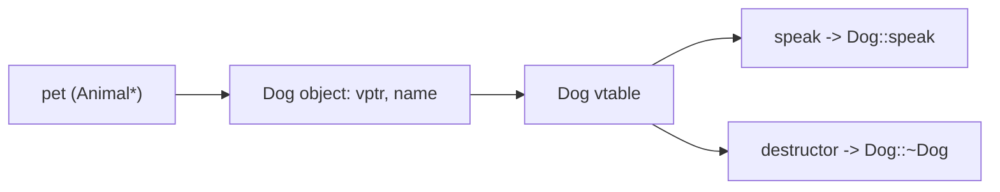

# C and C++ essentials

## Before this lesson

You should know what a class, an object and inheritance are ([Object-oriented design questions](#/lesson/interview-prep/object-oriented-design)) and be comfortable reading code in at least one language. You do not need to have written C++. This lesson covers the facts that interviewers most often ask of candidates who list C or C++ on their resume. For how memory and addresses work underneath, the Computer Systems track is the place to go deeper, starting with [Bits and bytes](#/lesson/csapp/bits-bytes).

## In plain words

**C** is a small, old, fast programming language that gives the programmer direct control over memory. **C++** adds classes, inheritance, templates and a large standard library on top of C. Both are used where performance and control matter: operating systems, game engines, browsers, databases, embedded devices, trading systems.

Driving a car with a manual gearbox is a fair comparison with languages such as Python or Java, which resemble automatics. The manual gives more control and can be more efficient in skilled hands, but the driver must do things the automatic does for them, and mistakes (stalling, grinding the gears) are the driver's own. In C and C++ the main thing you must do for yourself is **manage memory**: ask for it, keep track of who owns it, and give it back exactly once.

**Knowledge-based questions** are questions about how a language or technology works, as opposed to algorithm puzzles. Interviewers ask them when your resume claims the language, or when the job needs it. Nobody expects encyclopaedic recall; they expect a solid grasp of the core ideas below and honest reasoning about anything you are unsure of.

The code samples in this lesson are C++ (shown, not run), followed by small Python simulations you can run to see the ideas in action.

## Classes and inheritance

```cpp
#include <iostream>
#include <string>
using namespace std;

class Animal {
public:
    Animal(const string& n) : name(n) {}        // constructor with an initialiser list
    virtual ~Animal() {}                        // virtual destructor (explained below)
    virtual void speak() const { cout << name << " makes a sound\n"; }
    void eat() const { cout << name << " eats\n"; }
protected:
    string name;
};

class Dog : public Animal {                     // Dog inherits from Animal
public:
    Dog(const string& n) : Animal(n) {}
    void speak() const override { cout << name << " barks\n"; }
    void eat() const { cout << name << " gulps\n"; }
};
```

Points to know:

- Members are **private by default** in a `class` and public by default in a `struct`; otherwise the two keywords are equivalent in C++.
- `public`, `protected`, `private` control access: anyone, the class and its subclasses, or the class only.
- A **constructor** runs when an object is created; a **destructor** (`~Animal`) runs when it is destroyed. Destructors take no arguments and are where an object releases what it owns.
- The **initialiser list** (`: name(n)`) sets fields before the constructor body runs. It is required for constant and reference members and for base classes.
- C++ allows **multiple inheritance** (a class with several base classes), unlike Java.

## Virtual functions

This is the most frequently asked C++ topic. Consider:

```cpp
Animal* pet = new Dog("Rex");
pet->speak();     // prints "Rex barks"       : speak is virtual
pet->eat();       // prints "Rex eats"        : eat is NOT virtual
```

The pointer has the **static type** `Animal*` (what the compiler sees) but points to an object of **dynamic type** `Dog` (what really exists at run time).

- For a **non-virtual** function, the compiler decides at compile time which function to call, using the static type. That is **static binding**: `Animal::eat`.
- For a **virtual** function, the decision is made at run time using the object's real type. That is **dynamic binding**: `Dog::speak`.

### How it works: the vtable

A class with at least one virtual function gets a hidden table, the **vtable**, holding the addresses of its virtual functions. Each object of such a class carries a hidden pointer to its class's vtable. A subclass's table starts as a copy of its parent's, with overridden entries replaced. A virtual call looks up the function through the object's pointer, so the cost is one extra indirection.



The Python simulation below reproduces the rule: static type decides *whether the call is allowed and whether it is virtual*; dynamic type decides *which implementation runs* only for virtual functions.

```python-run
CLASSES = {
    # name: (parent, {method: declared_virtual})
    "Animal": (None, {"speak": True, "eat": False}),
    "Dog": ("Animal", {"speak": False, "eat": False, "fetch": False}),
}

def nearest(cls, method):
    while cls and method not in CLASSES[cls][1]:
        cls = CLASSES[cls][0]
    return cls

def is_virtual(cls, method):
    while cls:
        if CLASSES[cls][1].get(method):
            return True
        cls = CLASSES[cls][0]
    return False

def call(static_type, dynamic_type, method):
    found = nearest(static_type, method)
    if found is None:
        return "compile error: no such member in " + static_type
    if is_virtual(found, method):
        return nearest(dynamic_type, method) + "::" + method + "  (dynamic binding)"
    return found + "::" + method + "  (static binding)"

for method in ("speak", "eat", "fetch"):
    print(f"Animal* -> Dog, {method:5s}: {call('Animal', 'Dog', method)}")
```

`nearest` climbs from a class through its parents until it finds one that defines the method. `is_virtual` climbs further to see whether any ancestor declared it virtual, because once a function is virtual in a base class it is virtual in every subclass, with or without the keyword. The output shows three behaviours: `speak` runs the `Dog` version, `eat` runs the `Animal` version, and `fetch` does not compile through an `Animal*` even though the object really is a dog. The problem [Which Method Runs?](#/problem/ctci-vtable-dispatch) generalises this.

### Virtual destructors

```cpp
Animal* pet = new Dog("Rex");
delete pet;       // which destructor runs?
```

If `~Animal` is not virtual, only the base-class destructor runs, and whatever `Dog` owns is never cleaned up. **A class intended to be a base class should have a virtual destructor.** This is a standard interview question; the one-sentence answer is the bold one.

### Pure virtual functions and abstract classes

`virtual void speak() const = 0;` declares a function with no implementation. A class with such a function is **abstract**: it cannot be instantiated, and subclasses must implement the function. This is how C++ expresses an interface.

## Pointers and references

A **pointer** is a variable that holds a memory address. A **reference** is another name for an existing object.

```cpp
int count = 7;

int* p = &count;      // p holds the address of count
*p = 8;               // follow the pointer: count is now 8
p = nullptr;          // a pointer can point nowhere, and can be re-pointed

int& r = count;       // r is another name for count
r = 9;                // count is now 9
```

| | Pointer | Reference |
|---|---|---|
| Can be null | Yes | No |
| Can be re-assigned to another object | Yes | No: bound once, at creation |
| Must be initialised | No (but should be) | Yes |
| Access syntax | `*p`, `p->member` | Same as the object itself |
| Arithmetic | Yes | No |

**Pointer arithmetic**: adding 1 to a pointer moves it forward by the size of the type it points to, not by one byte. If `int` occupies 4 bytes and `p` holds address 1000, `p + 1` is address 1004. This is how arrays work in C: `a[i]` means `*(a + i)`.

**Passing arguments.** By value: the function receives a copy; changes do not affect the caller, and large objects are expensive to copy. By pointer or by reference: the function works on the caller's object. `const T&` (a constant reference) is the idiom for "do not copy, and promise not to modify".

## Memory: stack, heap, and who cleans up

- **Stack** memory holds local variables. It is allocated when a function is entered and released automatically when it returns. Fast, limited in size.
- **Heap** memory is requested explicitly (`malloc` in C, `new` in C++) and lives until explicitly released (`free`, `delete`). Flexible, and the source of most C and C++ bugs.

| Bug | What happens | Typical cause |
|---|---|---|
| **Memory leak** | Memory is never released; the program's memory use grows | A `new` without a matching `delete` |
| **Dangling pointer** | A pointer refers to memory that has been released | Using an object after `delete`; returning the address of a local variable |
| **Double free** | Releasing the same memory twice | Two owners both delete |
| **Buffer overflow** | Writing beyond the end of an array | Missing bounds check; classic security hole |
| **Null dereference** | Following a null pointer | Missing check |

Rules of thumb: `new` pairs with `delete`, `new[]` with `delete[]`, `malloc` with `free`; never mix them.

### Shallow copy and deep copy

Copying an object that contains a pointer copies the *pointer* by default, so both objects share the same heap memory (**shallow copy**). When one is destroyed and frees the memory, the other is left with a dangling pointer. A **deep copy** duplicates the pointed-to data. A class that manages a resource must therefore define its destructor, copy constructor and copy assignment operator together (often called the rule of three; with move operations, the rule of five), or better, hold the resource in a standard class that already does this correctly.

### Smart pointers and reference counting

Modern C++ avoids manual `delete` by wrapping heap objects in **smart pointers**: small objects that own the memory and release it in their destructor. Tying a resource's lifetime to an object in this way is called **RAII** (resource acquisition is initialisation).

- `unique_ptr`: exactly one owner; cannot be copied, only moved.
- `shared_ptr`: several owners, with a **reference count**; the object is deleted when the count reaches zero.
- `weak_ptr`: observes an object owned by `shared_ptr` without keeping it alive; it breaks ownership cycles, which reference counting alone cannot clean up.

Interviewers sometimes ask you to sketch a reference-counted pointer. The simulation shows the bookkeeping.

```python-run
class Shared:
    """A toy shared_ptr: copies share one counter; the object is 'deleted' at zero."""
    def __init__(self, payload=None, _block=None):
        self.block = _block if _block else {"payload": payload, "count": 0}
        self.block["count"] += 1
    def copy(self):
        return Shared(_block=self.block)
    def release(self):
        self.block["count"] -= 1
        if self.block["count"] == 0:
            print(f"   deleting {self.block['payload']!r}")
        self.block = None
    def count(self):
        return self.block["count"]

a = Shared("config data")
b = a.copy()
c = b.copy()
print("owners after two copies:", a.count())
b.release()
print("owners after one release:", a.count())
a.release()
print("one owner left; releasing the last one:")
c.release()
```

All copies refer to the same control block, a dictionary holding the payload and the count. `copy` increments the count; `release` decrements it and "deletes" the payload at zero. The output shows the count going 3, 2, and the deletion happening only when the last owner lets go. In real C++ the increments and decrements happen in the copy constructor and destructor, so they cannot be forgotten.

## Other frequently asked items

**Operator overloading.** C++ lets a class define what `+`, `==`, `<<`, `[]` and others mean for its objects, for example adding two `Money` values. It is ordinary function definition with a special name (`operator+`).

**Default arguments.** `void log(string msg, int level = 1);` lets callers omit trailing arguments.

**Templates.** A way to write code once for many types: `template <class T> class Stack { ... };` gives `Stack<int>`, `Stack<string>` and so on. The compiler generates a separate version for each type actually used, at compile time. The standard containers (`vector`, `map`, `unordered_map`) are templates.

**`const`.** `const int x` cannot be changed. `const int* p` points to an int that cannot be changed through `p`; `int* const p` is a pointer that cannot be re-pointed. A `const` member function promises not to modify the object.

**`volatile`.** Tells the compiler that a variable can change outside the program's normal flow (hardware registers, signal handlers), so reads must not be optimised away. It is not a thread-synchronisation tool in C++.

**`static`.** Inside a function: a variable that keeps its value between calls. In a class: a member shared by all objects. At file level: visible only within that file.

**`malloc` versus `new`.** `malloc` returns raw, uninitialised bytes and knows nothing about types; `new` allocates and calls the constructor, and `delete` calls the destructor before freeing.

**The standard library containers.**

| Container | Underlying structure | Typical costs |
|---|---|---|
| `vector` | Resizable array | Index O(1); append O(1) amortised; insert in middle O(n) |
| `list` | Doubly linked list | Insert or erase at a known position O(1); no indexing |
| `deque` | Blocks of arrays | Push and pop at both ends O(1) |
| `map`, `set` | Balanced search tree (red-black) | O(log n); iteration in sorted order |
| `unordered_map`, `unordered_set` | Hash table | O(1) average |
| `priority_queue` | Binary heap | Push, pop O(log n); top O(1) |

## A worked question with full reasoning

*"Write a function that prints the last K lines of a text file."*

**Clarify.** How large is the file? (Possibly huge.) How large is K? (Small.) One pass only? (Preferably.)

**Brute force.** Read the file once to count the lines, then read again and print from line N − K. Two passes over a huge file.

**Optimise.** We cannot know which lines are the last K until we reach the end, so we must remember the most recent K lines at every moment. A **circular buffer** of K strings does that: line number i is stored in slot `i % K`, overwriting the oldest. At the end, the oldest remaining line is in slot `count % K` (if at least K lines were read), and printing K slots from there, wrapping around, gives the right order.

**C++ sketch.**

```cpp
void printLastK(istream& in, int K) {
    if (K <= 0) return;
    vector<string> ring(K);
    string line;
    long count = 0;
    while (getline(in, line)) {
        ring[count % K] = line;
        ++count;
    }
    long start = count > K ? count % K : 0;
    long shown = min<long>(count, K);
    for (long i = 0; i < shown; ++i)
        cout << ring[(start + i) % K] << '\n';
}
```

**Test.** Fewer than K lines; exactly K; K = 0; an empty file; K = 1; a very long file.

**Complexity.** O(N) time for N lines, O(K) memory, one pass. The Python version of this task is the problem [Tail of a Log](#/problem/ctci-tail-lines).

## Problems in this module and what each trains

| Problem | Skill |
|---|---|
| [Tail of a Log](#/problem/ctci-tail-lines) | Circular buffer, modulo indexing, edge cases |
| [Which Method Runs?](#/problem/ctci-vtable-dispatch) | Static versus dynamic binding, inherited virtual-ness |

## Pitfalls

- **Forgetting the virtual destructor** in a base class.
- **Assuming all C++ member functions are virtual**, as in Java. They are not unless declared so.
- **Returning a pointer or reference to a local variable.** The variable is gone when the function returns.
- **Mismatched allocation and release**: `new[]` with `delete`, or `malloc` with `delete`.
- **Shallow copies of resource-owning classes**, leading to double frees.
- **Confusing `const int*` with `int* const`.** Read declarations from right to left.
- **Pointer arithmetic in bytes.** It is in units of the pointed-to type.
- **Claiming expertise you cannot support.** If C++ is on your resume, expect these questions; if your knowledge is rusty, say "working knowledge" and reason carefully.

> [!INTERVIEW]
> For knowledge questions, a good answer has three parts: the definition in one sentence, how it works underneath in one or two, and when it matters. For example: "A virtual function is resolved at run time by the object's actual type. Each such class has a table of function addresses and each object points to its class's table. It matters whenever you call through a base-class pointer, and it is why base classes need virtual destructors."

> [!TIP]
> If you do not know an answer, reason from principles aloud: "I have not used `weak_ptr`, but if `shared_ptr` counts owners, two objects owning each other would never reach zero, so there must be a non-owning kind of pointer." Interviewers value that far more than a guess stated as fact.

> [!WARNING]
> Undefined behaviour (reading freed memory, overflowing a buffer, dereferencing null) does not reliably crash. The program may appear to work and fail later or elsewhere. "It ran fine on my machine" proves nothing in C and C++.

## Summary

- C and C++ trade safety for control; the programmer manages memory and object lifetimes.
- Non-virtual calls are bound at compile time by static type; virtual calls at run time by dynamic type through a vtable. Base classes need virtual destructors.
- Pointers hold addresses, can be null and re-pointed, and support arithmetic in units of the pointed-to type; references are permanent aliases.
- Stack memory is automatic; heap memory must be released exactly once. Know leaks, dangling pointers, double frees and buffer overflows.
- Copying an object with owned pointers needs a deep copy; smart pointers and RAII automate ownership, with reference counting for shared ownership.
- Be able to explain templates, `const`, `static`, `volatile`, `new` versus `malloc`, operator overloading and the main standard containers.

## Glossary

- **Knowledge-based question**: an interview question about how a language or technology works.
- **Constructor / destructor**: code run when an object is created / destroyed.
- **Virtual function**: a member function resolved at run time by the object's actual type.
- **Static / dynamic type**: the type known to the compiler / the real type of the object at run time.
- **Static / dynamic binding**: choosing the function at compile time / at run time.
- **Vtable**: a per-class table of virtual function addresses.
- **Abstract class**: a class with at least one pure virtual function; it cannot be instantiated.
- **Pointer**: a variable holding a memory address.
- **Reference**: an alias for an existing object.
- **Stack / heap**: automatically managed memory for locals / explicitly managed memory.
- **Memory leak**: memory that is allocated and never released.
- **Dangling pointer**: a pointer to memory that is no longer valid.
- **Shallow / deep copy**: copying pointers / copying the data they point to.
- **Smart pointer**: an object that owns heap memory and releases it automatically.
- **RAII**: tying a resource's lifetime to an object's lifetime.
- **Reference count**: the number of owners sharing an object.
- **Template**: code parameterised by type, instantiated by the compiler.

```quiz
[
  {"q": "Animal* p = new Dog(); p->eat(); where eat is NOT virtual and both classes define it. Which eat runs?",
   "options": ["Dog::eat", "Animal::eat", "Both", "It does not compile"],
   "answer": 1,
   "explain": "Non-virtual calls are bound at compile time using the static type of the pointer, which is Animal*."},
  {"q": "Why should a base class have a virtual destructor?",
   "options": ["To make objects smaller", "So that deleting a derived object through a base pointer runs the derived destructor too", "To allow multiple inheritance", "To prevent copying"],
   "answer": 1,
   "explain": "Without it only the base destructor runs and the derived class's resources are not released."},
  {"q": "Which statement about references is true?",
   "options": ["They can be null", "They can be re-bound to another object later", "They must be initialised and always refer to the same object", "They support pointer arithmetic"],
   "answer": 2,
   "explain": "A reference is an alias fixed at creation; a pointer can be null and re-pointed."},
  {"q": "If int is 4 bytes and p is an int* holding address 1000, what address is p + 1?",
   "options": ["1001", "1004", "1008", "1000"],
   "answer": 1,
   "explain": "Pointer arithmetic moves in units of the pointed-to type."},
  {"q": "What is a memory leak?",
   "options": ["Using memory after it is freed", "Heap memory that is allocated and never released", "Writing past the end of an array", "A null pointer"],
   "answer": 1,
   "explain": "The program's memory use grows because allocated blocks are never returned."},
  {"q": "Two objects are shallow copies and each destructor deletes the same pointer. What goes wrong?",
   "options": ["Nothing", "A double free, and a dangling pointer in whichever object outlives the other", "A memory leak only", "A compile error"],
   "answer": 1,
   "explain": "Both objects believe they own the memory; a deep copy or a smart pointer fixes the ownership."},
  {"q": "When does a shared_ptr delete the object it manages?",
   "options": ["Immediately after creation", "When its reference count drops to zero", "When the program exits only", "Never"],
   "answer": 1,
   "explain": "Each copy increments the count and each destruction decrements it; the last owner triggers deletion."},
  {"q": "In the last-K-lines solution, why use a circular buffer of size K?",
   "options": ["To sort the lines", "To keep only the most recent K lines in one pass with O(K) memory", "To count words", "To reverse the file"],
   "answer": 1,
   "explain": "Line i overwrites slot i mod K, so the buffer always holds the latest K lines without storing the whole file."}
]
```

> **Source:** McDowell, Cracking the Coding Interview 6e, ch. 12 (C and C++). Explanations, code and simulations are original.
