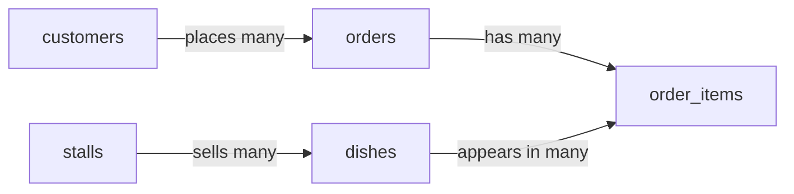

# Databases and SQL

## Before this lesson

> **Before this lesson:** You should be comfortable with Python lists and dictionaries and with Big O notation from [Big O foundations](#/lesson/interview-prep/big-o-foundations). No database experience is assumed: every term is defined here. This lesson is the interview-sized tour. The SQL track teaches each topic in full, starting with [The relational model](#/lesson/sql/relational-model), and has its own bank of query problems.

## In plain words

A **database** is an organised store of data that many programs and people can read and change at the same time without corrupting it. A **relational database** keeps the data in **tables**: grids in which every **row** is one thing (one customer, one order) and every **column** is one fact about that thing (a name, a date). **SQL**, short for Structured Query Language, is the language used to ask a relational database questions and to change what it holds. A single question written in SQL is called a **query**.

Think of the paperwork behind a busy food centre. One ring binder lists the stalls. Another lists every dish with its price and which stall sells it. A third lists registered customers, and a fourth records each order. No binder repeats what another already holds: the dish binder says "stall 2", and you look up stall 2 in the stall binder when you need its name. Keeping each fact in exactly one place is what makes the paperwork trustworthy, and looking facts up across binders is what a query does. A relational database is that set of binders, with a clerk who can cross-reference them in milliseconds.

Why it matters for a job: almost every product stores its data in a database, so interviewers for back-end, data and full-stack roles check four things. Can you write a query with a join and a grouping? Can you design a small set of tables for a described system? Do you know why data is split across tables (normalisation) and when to undo that? Do you know what an index is? This lesson covers all four, with queries you can run and change.

## The vocabulary, on one small database

The runnable examples use a food-centre database with five tables.



- A **schema** is the description of the tables: their names, their columns and the type of each column.
- A **primary key** is the column (or group of columns) whose value identifies one row and is never repeated. `stalls.stall_id` is a primary key: there is exactly one row with `stall_id = 2`.
- A **foreign key** is a column that holds the primary-key value of a row in another table. `dishes.stall_id` is a foreign key: it says which stall sells the dish. Foreign keys are how tables point at each other.
- **NULL** is the marker for "no value here". It is not zero and not an empty string.

Here is how two of the tables were declared. The `CREATE TABLE` statement names each column and its type; `REFERENCES` declares a foreign key.

```sql
CREATE TABLE stalls (
  stall_id INTEGER PRIMARY KEY,
  name     TEXT NOT NULL,
  cuisine  TEXT NOT NULL
);

CREATE TABLE dishes (
  dish_id     INTEGER PRIMARY KEY,
  stall_id    INTEGER NOT NULL REFERENCES stalls(stall_id),
  name        TEXT NOT NULL,
  price_cents INTEGER NOT NULL
);
```

The remaining tables are `customers(customer_id, name, joined)`, `orders(order_id, customer_id, ordered_on)` and `order_items(order_id, dish_id, quantity)`. An order can contain several dishes, and a dish can appear in many orders, so `order_items` holds one row per (order, dish) pair.

## A first query, clause by clause

Press Run, then change the number and run again.

```sql-run dataset=ctci_hawker
SELECT name, price_cents
FROM dishes
WHERE price_cents <= 400
ORDER BY price_cents, name;
```

- `FROM dishes` names the table to read.
- `WHERE price_cents <= 400` keeps only the rows for which the condition is true.
- `SELECT name, price_cents` chooses which columns to show. `SELECT *` would show them all.
- `ORDER BY price_cents, name` sorts the result: by price first, and by name among equal prices. Without `ORDER BY`, the database may return rows in any order.

You wrote *what* you want, not *how* to find it. The database decides how. That is the main difference from Python, and it is why SQL is called a declarative language.

## Joins: combining tables

The dish table holds a stall number, not a stall name. To show both the dish and the stall name, the two tables must be combined. A **join** produces rows made of one row from each table, for every pair that satisfies a matching condition.

```sql-run dataset=ctci_hawker
SELECT d.name AS dish, s.name AS stall
FROM dishes AS d
JOIN stalls AS s ON s.stall_id = d.stall_id
ORDER BY s.name, d.name;
```

- `dishes AS d` gives the table a short alias, so `d.name` means "the name column of dishes". Both tables have a `name` column, so the prefix is required to say which one.
- `JOIN stalls AS s ON s.stall_id = d.stall_id` pairs each dish with the stall whose id equals the dish's `stall_id`.
- `AS dish` renames a column in the output.

Eight dishes come out, each with its stall. Now count the stalls in the result: there are three, but the stalls table has four. The stall called Green Bowl sells no dishes yet, so no dish row matched it, and it vanished. This plain `JOIN` is an **inner join**: only matched pairs survive.

A **left join** keeps every row of the left-hand table. Where no partner exists, the right-hand columns are filled with NULL.

```sql-run dataset=ctci_hawker
SELECT s.name AS stall, d.name AS dish
FROM stalls AS s
LEFT JOIN dishes AS d ON d.stall_id = s.stall_id
ORDER BY s.name, d.name;
```

Green Bowl now appears, with NULL in the dish column.

| Join | Rows kept |
|---|---|
| `INNER JOIN` (or `JOIN`) | Only pairs that match |
| `LEFT JOIN` | All matches, plus every unmatched left row padded with NULLs |
| `RIGHT JOIN` | The mirror image: every right row is kept |
| `FULL OUTER JOIN` | All matches, plus unmatched rows from both sides |
| `CROSS JOIN` | Every left row with every right row, no condition |

You will meet an older way of writing an inner join: `FROM dishes d, stalls s WHERE s.stall_id = d.stall_id`. It gives the same result. The explicit `JOIN ... ON` form is preferred because the matching rule sits next to the table it belongs to and cannot be forgotten.

> [!TIP]
> Before writing a join, say the sentence "one row of the result is one ___". For the first join it is "one dish". For the left join it is "one dish, or one stall that has none". If you cannot finish the sentence, you do not yet know which join you need.

### How a database carries out a join

Interviewers sometimes ask what happens underneath. Three methods are standard. A **nested-loop join** compares every row of one table with every row of the other: O(n · m). A **hash join** builds a dictionary on the join column of one table and looks each row of the other table up in it: O(n + m). A **merge join** sorts both tables by the join column and walks them together. The demo counts the work of the first two.

```python-run
stalls = [(1, "Ah Seng Chicken Rice"), (2, "Warung Sari"), (3, "Madras Corner"), (4, "Green Bowl")]
dishes = [("Chicken rice", 1), ("Roasted pork rice", 1), ("Nasi lemak", 2), ("Mee rebus", 2),
          ("Satay set", 2), ("Roti prata", 3), ("Thosai", 3), ("Fish curry", 3)]

# Nested loops: try every (dish, stall) pair.
comparisons, joined_a = 0, []
for dish, stall_id in dishes:
    for sid, stall_name in stalls:
        comparisons += 1
        if sid == stall_id:
            joined_a.append((dish, stall_name))
print("nested-loop comparisons:", comparisons)

# Hash join: build a dictionary once, then one lookup per dish.
by_id = {sid: stall_name for sid, stall_name in stalls}     # 4 insertions
lookups, joined_b = 0, []
for dish, stall_id in dishes:
    lookups += 1
    if stall_id in by_id:
        joined_b.append((dish, by_id[stall_id]))
print("hash-join work:", len(stalls), "insertions +", lookups, "lookups")
print("same rows:", joined_a == joined_b)
```

The first loop compares all 8 × 4 = 32 pairs. The second builds a four-entry dictionary and performs eight lookups. With a million orders and a hundred thousand customers, that difference is a hundred thousand million comparisons against about a million lookups. The practice problem [Customer Spend Report](#/problem/ctci-spend-report) asks you to write a hash join with grouping by hand.

## Grouping and aggregates

An **aggregate function** turns many rows into one value: `COUNT`, `SUM`, `MIN`, `MAX`, `AVG`. `GROUP BY` splits the rows into groups first, so that the aggregate is computed once per group.

```sql-run dataset=ctci_hawker
SELECT s.name AS stall,
       COUNT(d.dish_id) AS dishes,
       MIN(d.price_cents) AS cheapest
FROM stalls AS s
LEFT JOIN dishes AS d ON d.stall_id = s.stall_id
GROUP BY s.stall_id, s.name
ORDER BY dishes DESC, s.name;
```

Read it in the order the database works, which is not the order it is written:

1. `FROM` and `JOIN` build the combined rows (nine of them: eight dishes plus the padded Green Bowl row).
2. `WHERE` would filter single rows (there is none here).
3. `GROUP BY s.stall_id, s.name` puts rows with the same stall into one group: four groups.
4. Aggregates are computed per group; `HAVING` (shown below) can then filter whole groups.
5. `SELECT` produces one output row per group.
6. `ORDER BY` sorts, and `LIMIT n` would keep the first n.

Two details in that query are favourite interview traps.

**`COUNT(column)` skips NULLs; `COUNT(*)` counts rows.** Green Bowl's group contains one row, the padded one, whose `dish_id` is NULL. `COUNT(d.dish_id)` reports 0, which is right. Change it to `COUNT(*)` and run again: Green Bowl claims one dish.

**Every selected column must be either grouped or aggregated.** `s.name` is in the `GROUP BY`; the others are inside aggregates. Selecting a bare `d.name` would be meaningless, because a group has several dish names.

`WHERE` filters rows before grouping; `HAVING` filters groups after it. "Stalls with at least three dishes" is a condition on a count, so it needs `HAVING`: add the line `HAVING COUNT(d.dish_id) >= 3` after the `GROUP BY` line and run the query again.

## A worked query: spending per customer

*"List every customer with the number of orders they placed and the total they spent, biggest spender first. Include customers who have never ordered."*

**Step 1: what is one row of the result?** One customer. So `customers` is the starting table and the grouping key.

**Step 2: where is the money?** The amount of an order is not stored anywhere. It must be computed from `order_items.quantity` times `dishes.price_cents`. The path is customers → orders → order_items → dishes: three joins.

**Step 3: which joins?** "Include customers who have never ordered" means customers must survive without a partner, so the joins are left joins, all the way along the chain.

**Step 4: aggregate with care.** After joining to `order_items`, an order with two different dishes occupies two rows. Counting `o.order_id` would count it twice. `COUNT(DISTINCT o.order_id)` counts each order once. For a customer with no orders, `SUM` over nothing is NULL; `COALESCE(x, 0)` replaces a NULL by 0.

```sql-run dataset=ctci_hawker
SELECT c.name,
       COUNT(DISTINCT o.order_id) AS orders,
       COALESCE(SUM(i.quantity * d.price_cents), 0) AS spent_cents
FROM customers AS c
LEFT JOIN orders AS o ON o.customer_id = c.customer_id
LEFT JOIN order_items AS i ON i.order_id = o.order_id
LEFT JOIN dishes AS d ON d.dish_id = i.dish_id
GROUP BY c.customer_id, c.name
ORDER BY spent_cents DESC, c.name;
```

**Step 5: test it.** Check one row by hand. Aisha placed orders 101, 103 and 107. Order 101 is two chicken rice and one roti prata: 2 × 450 + 250 = 1150. Order 103 is two thosai: 600. Order 107 is two satay sets and two roti prata: 1200 + 500 = 1700. Total 3450, with 3 orders, which is what the first row says. Ethan, who never ordered, appears with 0 and 0. Remove `DISTINCT` and run again to see the over-count the previous step warned about.

Grouping by `c.customer_id` and not by the name alone matters: two different customers can share a name, and they must not be merged.

### Finding what is missing

"Which dishes have never been ordered?" asks for rows *without* a partner. The pattern is a left join followed by a test for the padding:

```sql-run dataset=ctci_hawker
SELECT d.name AS never_ordered
FROM dishes AS d
LEFT JOIN order_items AS i ON i.dish_id = d.dish_id
WHERE i.dish_id IS NULL;
```

A dish that was ordered pairs with real rows; a dish that was never ordered gets one padded row whose `i.dish_id` is NULL, and the `WHERE` keeps only those. Note `IS NULL`: writing `= NULL` never matches anything, because a comparison with NULL is neither true nor false. An equivalent form is `WHERE NOT EXISTS (SELECT 1 FROM order_items i WHERE i.dish_id = d.dish_id)`, which reads closer to the English.

## Subqueries: a query inside a query

So far every query read from tables. A **subquery** is a complete `SELECT` written in brackets inside another query, so the inner answer feeds the outer question. It is like asking a colleague "what is the average price?" and then using that number in your next sentence. Four shapes cover nearly everything you will meet.

**1. Scalar subquery: it returns one value.** "Scalar" means a single value (one row, one column), so it can stand wherever a number could. Which dishes cost more than the average dish?

```sql-run dataset=ctci_hawker
SELECT name, price_cents
FROM dishes
WHERE price_cents > (SELECT AVG(price_cents) FROM dishes)
ORDER BY price_cents DESC, name;
```

The inner query returns 441.25 (the eight prices add to 3530, divided by 8). The outer query keeps the dishes above that: Fish curry 650, Satay set 600, Roasted pork rice 500 and Chicken rice 450. If the inner query could return more than one row, the comparison would be an error or give an arbitrary row, depending on the database, so be sure it is truly scalar.

**2. `IN` with a subquery: it returns a list.** Which dishes are sold by Malay stalls? We do not know the stall numbers, only the cuisine, so a subquery finds the ids first.

```sql-run dataset=ctci_hawker
SELECT name
FROM dishes
WHERE stall_id IN (SELECT stall_id FROM stalls WHERE cuisine = 'Malay')
ORDER BY name;
```

The inner query yields the list `(2)`, and the outer keeps dishes whose `stall_id` is in it: Mee rebus, Nasi lemak, Satay set. The same answer comes from a join; the subquery version reads closer to the English and cannot multiply rows the way a join sometimes does.

**3. `EXISTS`: it asks only "is there at least one row?"** `EXISTS (subquery)` is true if the inner query returns anything and false if it returns nothing. What the inner query selects does not matter, which is why `SELECT 1` is the habit.

```sql-run dataset=ctci_hawker
SELECT c.name
FROM customers AS c
WHERE EXISTS (SELECT 1 FROM orders AS o WHERE o.customer_id = c.customer_id)
ORDER BY c.name;
```

This inner query mentions `c.customer_id`, a column of the **outer** query. That makes it a **correlated subquery**: it cannot be answered once and for all, because it depends on the current outer row. Conceptually the database visits each customer and asks "does this customer have an order?" The result is Aisha, Bao, Chandra and Devi; Ethan is missing because for him the inner query finds nothing. Changing `EXISTS` to `NOT EXISTS` returns exactly the customers who never ordered (Ethan), the "find what is missing" question from earlier.

**4. A correlated scalar subquery: one value per outer row.** Which dishes cost more than the average dish *of their own stall*?

```sql-run dataset=ctci_hawker
SELECT d.name, d.price_cents
FROM dishes AS d
WHERE d.price_cents > (SELECT AVG(d2.price_cents)
                       FROM dishes AS d2
                       WHERE d2.stall_id = d.stall_id)
ORDER BY d.name;
```

For each dish the inner query recomputes the average for that dish's stall: 475 for stall 1, 460 for stall 2 and 400 for stall 3. The survivors are Fish curry (650 against 400), Roasted pork rice (500 against 475) and Satay set (600 against 460). The inner table needs its own alias (`d2`) so the two uses of `dishes` can be told apart. Many databases rewrite such a query into a join with a grouped table behind the scenes, so do not assume it is slow, but on a very large table check the plan.

**The `NOT IN` trap.** `x NOT IN (list)` means "x differs from every item", and a comparison with NULL is never true. If the list contains even one NULL, `NOT IN` returns no rows at all. In this dataset `order_items.dish_id` is declared `NOT NULL`, so `dish_id NOT IN (SELECT dish_id FROM order_items)` works (it finds Fish curry), but on a nullable column it silently returns nothing. `NOT EXISTS` has no such trap, which is why interviewers favour it.

| Shape | Inner query returns | Typical use |
|---|---|---|
| Scalar | One value | Compare with an average, maximum or count |
| `IN` | A list of values | "Belongs to any of these" |
| `EXISTS` / `NOT EXISTS` | Anything or nothing | "Has at least one" / "has none" |
| Correlated | Depends on the outer row | "Compared with its own group" |

> [!INTERVIEW]
> When asked for rows with no match, say you would use `NOT EXISTS` or a left join with `IS NULL`, and explain why `NOT IN` is dangerous with NULLs.

## Normalisation: one fact, one place

**Normalisation** is the practice of organising tables so that each fact is stored once. To see why it matters, imagine the food centre had kept everything in a single wide table:

| order_id | customer | dish | qty | price_cents | stall | stall_phone |
|---|---|---|---|---|---|---|
| 102 | Bao | Nasi lemak | 1 | 400 | Warung Sari | 6555 0101 |
| 102 | Bao | Satay set | 1 | 600 | Warung Sari | 6555 0101 |
| 105 | Devi | Nasi lemak | 3 | 400 | Warung Sari | 6555 0101 |

The stall's phone number appears three times, and the price of nasi lemak twice. That repetition (**redundancy**) causes three kinds of trouble, called anomalies:

- **Update anomaly**: the stall changes its number; if one row is missed, the table now holds two different numbers and nobody knows which is right.
- **Insert anomaly**: a new stall with no orders yet cannot be recorded at all, because there is no order row to put it on.
- **Delete anomaly**: deleting the last order for a dish also deletes the only record of that dish's price.

```python-run
# One wide table: the stall's phone number is repeated on every row.
flat = [
    {"dish": "Nasi lemak", "price": 400, "stall": "Warung Sari", "phone": "6555 0101"},
    {"dish": "Mee rebus",  "price": 380, "stall": "Warung Sari", "phone": "6555 0101"},
    {"dish": "Satay set",  "price": 600, "stall": "Warung Sari", "phone": "6555 0101"},
]
# The stall changes its number, and the program doing the update misses a row.
for row in flat[:2]:
    row["phone"] = "6555 0999"
print("phones on file, wide table:    ", sorted({row["phone"] for row in flat}))

# Normalised: the phone is stored once; each dish points at its stall by id.
stalls = {2: {"name": "Warung Sari", "phone": "6555 0101"}}
dishes = [
    {"dish": "Nasi lemak", "price": 400, "stall_id": 2},
    {"dish": "Mee rebus",  "price": 380, "stall_id": 2},
    {"dish": "Satay set",  "price": 600, "stall_id": 2},
]
stalls[2]["phone"] = "6555 0999"          # one change, in one place
print("phones on file, split tables:  ",
      sorted({stalls[d["stall_id"]]["phone"] for d in dishes}))
```

The wide table ends with two phone numbers for one stall. The split version cannot disagree with itself, because there is only one copy to change.

The rules for splitting are called **normal forms**. Three are worth knowing by name:

| Normal form | Rule in plain words | Violation in the wide table | Repair |
|---|---|---|---|
| First (1NF) | Each cell holds one value, and each row can be identified by a key | A cell such as "Nasi lemak ×1, Satay set ×1" | One row per (order, dish) |
| Second (2NF) | No column depends on only part of a multi-column key | Key is (order_id, dish); `price_cents` depends on the dish alone | Move dish facts to a `dishes` table |
| Third (3NF) | No non-key column depends on another non-key column | `stall_phone` depends on `stall`, not on the key | Move stall facts to a `stalls` table |

Applying the three repairs to the wide table produces exactly the five tables of this lesson.

### Denormalisation: deliberately breaking the rule

A normalised design is safe to change and costs joins to read. **Denormalisation** means storing a redundant copy on purpose to make reads faster: for example keeping a `total_cents` column on `orders`, or the customer's name on each order row, so that a common screen needs no join.

| | Normalised | Denormalised |
|---|---|---|
| Each fact stored | Once | Possibly several times |
| Writes | Small and safe | Must update every copy |
| Reads | Need joins | Fewer joins, often faster |
| Risk | Slow reads on very large tables | Copies drifting apart |

The interview answer is a trade-off, not a rule: start normalised; denormalise a specific read path when measurements show joins are the bottleneck, and say how the copies will be kept in step.

## Indexes: how lookups get fast

Without help, the only way to find the orders of customer 31337 is to read every order row: a **full table scan**, O(n). An **index** is an extra structure the database maintains, sorted by one or more columns, that leads straight to the matching rows, in the way the index at the back of a textbook leads to a page. Most databases store indexes as a **B-tree**, a wide, shallow, always-balanced search tree, so a lookup costs O(log n).

```python-run
import random

random.seed(4)
# 100,000 order rows: (order_id, customer_id)
rows = [(order_id, random.randrange(25_000)) for order_id in range(100_000)]

def full_scan(customer):
    examined, found = 0, []
    for order_id, cust in rows:
        examined += 1
        if cust == customer:
            found.append(order_id)
    return found, examined

# The index: (customer_id, row position) pairs kept in sorted order.
index = sorted((cust, position) for position, (_, cust) in enumerate(rows))

def index_lookup(customer):
    steps, lo, hi = 0, 0, len(index)
    while lo < hi:                         # binary search for the customer's first entry
        steps += 1
        mid = (lo + hi) // 2
        if index[mid][0] < customer:
            lo = mid + 1
        else:
            hi = mid
    found = []
    while lo < len(index) and index[lo][0] == customer:   # read the neighbours that match
        steps += 1
        found.append(rows[index[lo][1]][0])
        lo += 1
    return sorted(found), steps

by_scan, examined = full_scan(12345)
by_index, steps = index_lookup(12345)
print("same answer:", by_scan == by_index, "| matching orders:", len(by_scan))
print("rows examined by the full scan:", examined)
print("steps taken with the index:   ", steps)
```

`full_scan` touches all 100,000 rows. `index_lookup` halves the search range about 17 times to land on the customer's first entry, then reads the handful of matching entries sitting next to each other. The answers are identical; the work differs by a factor of several thousand.

You can watch a real database make the same choice. `EXPLAIN QUERY PLAN` asks it to describe its plan instead of running the query.

```sql-run dataset=ctci_hawker
EXPLAIN QUERY PLAN
SELECT name FROM dishes WHERE price_cents = 400;
```

The `detail` column says `SCAN dishes`: a full scan. Now create an index first:

```sql-run dataset=ctci_hawker
CREATE INDEX idx_dishes_price ON dishes(price_cents);
EXPLAIN QUERY PLAN
SELECT name FROM dishes WHERE price_cents = 400;
```

The plan changes to `SEARCH dishes USING INDEX idx_dishes_price`.

Indexes are not free, which is the second half of every interview answer about them:

- Every `INSERT`, `UPDATE` and `DELETE` must also update each index on the table, so writes get slower.
- Indexes take disk space and memory.
- An index on (a, b) helps conditions on `a`, or on `a` and `b`, but not on `b` alone, for the same reason a phone book sorted by surname does not help you find everyone called "Mei".
- An index on a column with very few distinct values (a yes/no flag) rarely helps: half the table still matches.

Primary keys are indexed automatically. Good candidates for further indexes are foreign-key columns used in joins and columns that appear often in `WHERE` or `ORDER BY`. More in [Indexes](#/lesson/sql/indexes) and [Query performance](#/lesson/sql/performance).

## Designing a small database

"Design the tables for …" is the database version of an object-oriented design question, and it has a method.

**Step 1: clear up ambiguity.** Ask what must be stored and what questions the system must answer.

**Step 2: list the entities.** The nouns that have their own facts become tables.

**Step 3: work out the relationships.** For each pair of related entities, ask "how many of each?":

- **One-to-many** (one stall sells many dishes): put a foreign key on the "many" side.
- **Many-to-many** (an order has many dishes; a dish is in many orders): create a third table, called a **junction table**, with a foreign key to each side. `order_items` is one.
- **One-to-one**: usually the two belong in one table.

**Step 4: add keys, types and constraints,** then **walk through the required queries** to check that each can be answered.

**Worked example.** *"Design a database for a badminton hall where members book courts by the hour, and a booking can list several members as players."*

Clarify: can a court be booked twice for the same hour? (No.) Do we need prices? (One hourly rate per court.) Entities: members, courts, bookings. Relationships: one court has many bookings; one member makes many bookings; a booking has many players and a member plays in many bookings, which is many-to-many and needs a junction table.

```sql
CREATE TABLE members (
  member_id INTEGER PRIMARY KEY,
  name      TEXT NOT NULL,
  phone     TEXT
);

CREATE TABLE courts (
  court_id          INTEGER PRIMARY KEY,
  label             TEXT NOT NULL,
  hourly_rate_cents INTEGER NOT NULL
);

CREATE TABLE bookings (
  booking_id INTEGER PRIMARY KEY,
  court_id   INTEGER NOT NULL REFERENCES courts(court_id),
  booked_by  INTEGER NOT NULL REFERENCES members(member_id),
  play_date  TEXT NOT NULL,
  start_hour INTEGER NOT NULL,
  UNIQUE (court_id, play_date, start_hour)
);

CREATE TABLE booking_players (
  booking_id INTEGER NOT NULL REFERENCES bookings(booking_id),
  member_id  INTEGER NOT NULL REFERENCES members(member_id),
  PRIMARY KEY (booking_id, member_id)
);
```

The `UNIQUE` line is the design's most valuable sentence: it makes the database itself refuse a double booking, even if two requests arrive at the same instant. Checking the queries: "which courts are free on a date at 7 pm?" is courts left-joined to bookings for that slot, keeping the unmatched; "how often did each member play last month?" is a count over `booking_players` joined to `bookings`. Both work, so the design holds.

For very large systems the same thinking continues: joins across huge tables are expensive, so designs denormalise selected data and split tables across machines. Those topics live in [Partitioning](#/lesson/sql/partitioning), [Sharding](#/lesson/sql/sharding) and [System design and scalability questions](#/lesson/interview-prep/system-design-scalability).

One more term you should be able to define: a **transaction** is a group of changes that the database applies completely or not at all, so that a failure halfway cannot leave money deducted from one account and not added to another. See [ACID and isolation](#/lesson/sql/acid-isolation).

## Problems in this module and what each trains

| Problem | Skill |
|---|---|
| [Customer Spend Report](#/problem/ctci-spend-report) | What a left join with grouping computes, implemented as a hash join; ordering by several keys |

For query-writing practice in SQL itself, use the problems of the [SQL track](#/track/sql).

## Pitfalls

- **Inner join when the question says "all" or "including those with none".** Rows without a partner disappear silently. Use a left join.
- **`COUNT(*)` after a left join.** It counts the padded row. Count a column from the right-hand table.
- **Double counting after joining two one-to-many tables.** Each extra join can multiply rows. Use `COUNT(DISTINCT ...)` or aggregate before joining.
- **`= NULL`.** It never matches. Write `IS NULL` or `IS NOT NULL`.
- **Selecting a column that is neither grouped nor aggregated.**
- **Filtering an aggregate in `WHERE`.** Conditions on `COUNT` or `SUM` belong in `HAVING`.
- **Grouping by a name instead of a key.** Two people can share a name.
- **Assuming a result is sorted without `ORDER BY`.**
- **"Add an index" as a reflex.** Say what it costs on writes and which queries it serves.
- **Designing tables before asking what must be stored and queried.**

> [!INTERVIEW]
> When asked to write a query, narrate four decisions before typing: what one row of the result represents, which tables hold the needed columns, which joins keep the rows that must not be lost, and what is grouped. Then write the clauses in the order `FROM`, joins, `WHERE`, `GROUP BY`, `HAVING`, `SELECT`, `ORDER BY`, and test one row by hand, as in the worked example. Interviewers forgive a small syntax slip (dialects differ, and saying so is fine); they do not forgive a wrong join.

> [!WARNING]
> A query that returns plausible numbers is not thereby correct. The double-counting and `COUNT(*)` mistakes both produce believable output. Always check one group by hand against the raw rows.

## Summary

- A relational database stores data in tables; primary keys identify rows and foreign keys link tables.
- A query reads as `SELECT … FROM … WHERE … GROUP BY … HAVING … ORDER BY`, and runs as from, where, group, having, select, order.
- Inner joins keep matched pairs only; left joins also keep unmatched left rows, padded with NULLs. "Missing partner" questions are a left join plus `IS NULL`, or `NOT EXISTS`.
- Aggregates summarise groups; `COUNT(column)` ignores NULLs; `HAVING` filters groups.
- Normalisation stores each fact once and prevents update, insert and delete anomalies; denormalisation trades that safety for faster reads.
- An index turns an O(n) scan into an O(log n) search and slows writes; column order in a multi-column index matters.
- To design a schema: clarify, list entities, classify relationships (foreign key for one-to-many, junction table for many-to-many), add constraints, then test against the required queries.

## Glossary

- **Database**: an organised, shared store of data.
- **Relational database**: a database that keeps data in tables linked by keys.
- **Table / row / column**: a grid of data / one item in it / one attribute of every item.
- **SQL**: Structured Query Language, used to read and change relational data.
- **Query**: one question (or command) written in SQL.
- **Schema**: the definition of tables, columns and types.
- **Primary key**: the column or columns that identify each row uniquely.
- **Foreign key**: a column holding the primary key of a row in another table.
- **NULL**: the marker for a missing value.
- **Join**: combining rows from two tables according to a matching condition.
- **Inner / left join**: keep matched pairs only / also keep unmatched rows of the left table.
- **Aggregate function**: a function such as `COUNT` or `SUM` that reduces many rows to one value.
- **Normalisation**: organising tables so each fact is stored once.
- **Redundancy**: the same fact stored in more than one place.
- **Anomaly**: an inconsistency or loss caused by redundancy when data is updated, inserted or deleted.
- **Normal form**: one of the numbered rules (1NF, 2NF, 3NF) that a normalised design satisfies.
- **Denormalisation**: storing redundant data on purpose to speed up reads.
- **Full table scan**: reading every row to answer a query.
- **Index**: a sorted auxiliary structure that speeds up lookups on chosen columns.
- **B-tree**: the balanced, wide search tree in which most database indexes are stored.
- **Junction table**: a table that represents a many-to-many relationship with two foreign keys.
- **Transaction**: a group of changes applied completely or not at all.
- **Subquery**: a `SELECT` written inside another query, usually in brackets.
- **Scalar subquery**: a subquery that returns exactly one value, usable where a number could be.
- **`IN`**: a test that a value equals any item in a list or a subquery's result.
- **`EXISTS`**: a test that is true when its subquery returns at least one row.
- **Correlated subquery**: a subquery that refers to a column of the outer query, so it is evaluated per outer row.

```quiz
[
  {"q": "A report must list every stall, including stalls that sell no dishes. Stalls is the first table. Which join to dishes is needed?",
   "options": ["INNER JOIN", "LEFT JOIN", "CROSS JOIN", "No join"],
   "answer": 1,
   "explain": "A left join keeps every row of the left table (stalls) and pads the dish columns with NULL where no dish matches. An inner join would drop those stalls."},
  {"q": "After stalls LEFT JOIN dishes, a stall with no dishes forms a group of one padded row. What do COUNT(*) and COUNT(d.dish_id) return for it?",
   "options": ["0 and 0", "1 and 0", "1 and 1", "0 and 1"],
   "answer": 1,
   "explain": "COUNT(*) counts rows, including the padded one. COUNT(column) ignores NULLs, so it returns 0, the correct number of dishes."},
  {"q": "Where does a condition such as 'at least three orders' belong?",
   "options": ["In WHERE", "In HAVING", "In ORDER BY", "In SELECT"],
   "answer": 1,
   "explain": "WHERE filters single rows before grouping. A condition on an aggregate is tested per group, after grouping, in HAVING."},
  {"q": "A wide table repeats each stall's phone number on every order row. The stall changes its number and one row is missed. What is this called?",
   "options": ["An insert anomaly", "An update anomaly", "A deadlock", "A full table scan"],
   "answer": 1,
   "explain": "Redundant copies drift apart when an update does not reach all of them. Storing the phone once, in a stalls table, removes the possibility."},
  {"q": "What is the main cost of adding an index to a table?",
   "options": ["Queries can no longer use WHERE", "Every insert, update and delete must also maintain the index, and it uses space", "The table loses its primary key", "Joins stop working"],
   "answer": 1,
   "explain": "An index speeds up reads on its columns and adds work to every write, plus storage."},
  {"q": "An order can contain many dishes and a dish can appear in many orders. How is this modelled?",
   "options": ["A dish_id column in orders", "An order_id column in dishes", "A junction table with a foreign key to each", "It cannot be modelled relationally"],
   "answer": 2,
   "explain": "Many-to-many relationships need a third table with one row per related pair, such as order_items(order_id, dish_id, quantity)."},
  {"q": "Which condition finds rows whose phone column has no value?",
   "options": ["phone = NULL", "phone IS NULL", "phone == ''", "phone = 0"],
   "answer": 1,
   "explain": "Comparisons with NULL are never true, so = NULL matches nothing. IS NULL is the dedicated test."},
  {"q": "Customers are joined to orders and then to order_items. Why can COUNT(o.order_id) overstate the number of orders?",
   "options": ["Because of NULLs", "Because an order with several items appears on several rows after the second join", "Because COUNT ignores duplicates", "Because of the ORDER BY"],
   "answer": 1,
   "explain": "Each one-to-many join multiplies rows. COUNT(DISTINCT o.order_id) counts each order once."},
  {"q": "What makes a subquery correlated?", "options": ["It uses GROUP BY", "It refers to a column of the outer query, so it depends on the current outer row", "It returns exactly one row", "It appears in the FROM clause"], "answer": 1, "explain": "A correlated subquery cannot be evaluated once in isolation; its result changes with each outer row, as in WHERE o.customer_id = c.customer_id."},
  {"q": "A column used in `x NOT IN (SELECT col FROM t)` contains one NULL. What does the query return?", "options": ["All rows", "No rows, because comparing with NULL is never true", "An error always", "Only rows where x is NULL"], "answer": 1, "explain": "NOT IN requires x to differ from every listed value, and x <> NULL is neither true nor false. NOT EXISTS avoids the trap."}
]
```

> **Source:** McDowell, Cracking the Coding Interview 6e, ch. 14 (Databases: SQL syntax and variations, denormalized vs. normalized databases, SQL statements, small and large database design). The schema, queries, demos and worked design are original.
