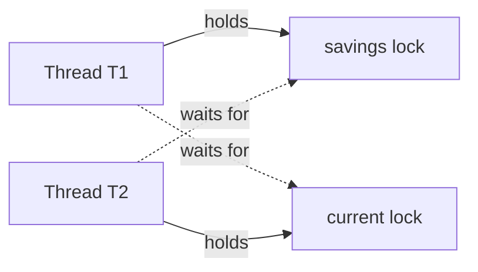

# Threads and locks

## Before this lesson

> **Before this lesson:** You should be able to read Python functions and loops, and the short Java samples will be easier after [Java essentials](#/lesson/interview-prep/java-essentials). No experience with concurrent programs is assumed. For the operating-system view in depth, see [Processes and threads](#/lesson/os/processes-threads), [Races and mutual exclusion](#/lesson/os/races-mutual-exclusion) and [Semaphores, monitors and messages](#/lesson/os/semaphores-monitors-messages).

## In plain words

A **thread** is one independent sequence of steps being carried out inside a running program. A program with several threads is doing several things during the same period: answering one user while saving a file for another. A **lock** is a tool that lets only one thread at a time into a chosen piece of code.

Picture a restaurant kitchen with four cooks and one shared order board. Each cook follows a recipe at their own pace: four threads. They share the fridge, the stove and the board: shared memory. Most of the time sharing is harmless. Trouble starts when two cooks read "1 portion of fish left" at the same moment and both promise it to a customer. The cure is a rule: whoever wants to promise the fish must first take the single red token hanging by the board, and hang it back afterwards. The token is a lock. And a new kind of trouble appears when one cook holds the token for the fish while waiting for the token for the grill, and another holds the grill token while waiting for the fish token: both stand still forever. That standstill is a **deadlock**.

Why it matters for a job: servers handle thousands of requests at once, phones keep their screens responsive while downloading, and data pipelines split work across processor cores. Bugs in such code are rare, random and expensive, so interviewers want to know that you can name the dangers (races, deadlocks), explain the standard tools, and reason about a small concurrent design. Few interviews ask you to write complex threaded code on a whiteboard; many ask you to explain these ideas clearly.

Browsers cannot run real threads in these demos, so each demo builds pretend threads whose switching points we control. That turns out to be a better teaching tool: a real race might show up once in a million runs, and ours shows up on demand.

## Programs, processes and threads

A **program** is code sitting on disk. A **process** is a program that is running: the operating system has given it its own private region of memory and other resources such as open files. A **thread** lives inside a process. Every process starts with one thread and may create more. All threads of a process share that process's memory, and each has its own **stack** (the record of which functions it is in the middle of, with their local variables).

| | Process | Thread |
|---|---|---|
| Memory | Its own; other processes cannot touch it | Shared with the other threads of the same process |
| Cost to create and switch | Higher | Lower |
| Talking to another one | Through the operating system: pipes, sockets, files | Directly, by reading and writing the same variables |
| If it crashes | Other processes carry on | The whole process, with all its threads, usually dies |
| Main danger | Slow communication | Accidental interference through shared data |

"What is the difference between a process and a thread?" is the most common opening question on this topic. A complete answer is the first three rows of that table in sentences, plus one consequence: sharing memory makes threads fast to coordinate and easy to break.

Two more terms. The operating system's **scheduler** decides which thread runs on each processor core and for how long. A **context switch** is the act of pausing one thread and resuming another: the processor's registers and the position in the code are saved for the first and restored for the second. Switches take time (they also disturb the processor's caches), and the scheduler may make one at almost any moment, between any two machine instructions. That last fact is the root of everything that follows.

If asked how you would *measure* a context switch, describe an experiment, not a number: let two threads pass a token back and forth, each one waiting until it receives the token, so that every hand-over forces a switch; time a million hand-overs and divide. Then list what pollutes the measurement: the cost of the hand-over call itself and other activity on the machine.

**Concurrency** means several tasks are in progress during the same period, possibly by taking turns on one core. **Parallelism** means several tasks are executing at the same instant on different cores. All the bugs in this lesson need only concurrency.

## Race conditions

A **race condition** is a bug in which the result depends on the order in which threads happen to be scheduled. The standard example is two threads adding 1 to a shared counter. The line `counter = counter + 1` looks like one action. The machine performs three: read the value, add one to a private copy, write the copy back. A switch can occur between any two.

To demonstrate, we need pretend threads. A Python **generator** is a function containing the word `yield`. Calling `next()` on it runs the function until it reaches a `yield`, where it pauses and keeps all its local variables; the following `next()` resumes from that spot. If we write `yield` wherever a real thread could be interrupted, a generator behaves like a thread whose interruptions we choose.

```python-run
import random

counter = 0

def worker(times):
    """A pretend thread. Each yield marks a point where the scheduler may switch threads."""
    global counter
    for _ in range(times):
        local = counter          # step 1: read the shared value
        yield
        local = local + 1        # step 2: add one to a private copy
        yield
        counter = local          # step 3: write the copy back
        yield

def run(schedule):
    """Give one step to thread A or thread B, in the order the schedule lists."""
    global counter
    counter = 0
    threads = {"A": worker(1), "B": worker(1)}
    for name in schedule:
        next(threads[name], None)        # run that thread as far as its next yield
    return counter

print("A finishes, then B:   ", run("AAABBB"))
print("strictly alternating: ", run("ABABAB"))
print("B squeezed inside A:  ", run("ABBBAA"))

def random_run(times, rng):
    global counter
    counter = 0
    alive = [worker(times), worker(times)]
    while alive:
        thread = rng.choice(alive)       # the scheduler picks whoever it likes
        try:
            next(thread)
        except StopIteration:            # that thread has finished all its work
            alive.remove(thread)
    return counter

rng = random.Random(7)
results = [random_run(100, rng) for _ in range(200)]
print("two threads x 100 increments, 200 runs: smallest", min(results), "largest", max(results))
```

Line by line: `worker` performs the three steps with a `yield` after each. `run` creates two workers and walks through a schedule string; `next(threads[name], None)` advances one worker by one step (the `None` stops Python complaining when a worker has finished). In the first schedule A completes all three steps before B starts, and the counter reaches 2. In the second, both read 0, both compute 1 and both write 1: one increment has disappeared. This is called a **lost update**. The third schedule shows it needs only one unlucky switch.

`random_run` lets a random scheduler choose the next thread at every step. Two hundred increments were requested each time, and the totals printed are far below 200. Nothing in the code is wrong line by line; the lines are wrong *together*. The problem [Lost Update Replay](#/problem/ctci-lost-update-replay) asks you to replay such schedules yourself.

## Critical sections and locks

The three steps must not be interleaved with another thread's three steps. A stretch of code with that requirement is a **critical section**, and the property we want is **mutual exclusion**: at most one thread inside at a time.

A **lock** (also called a **mutex**, from "mutual exclusion") provides it. A lock has two operations. `acquire` takes the lock if it is free; if another thread holds it, the caller waits. `release` gives it back. The promise that makes it work is that `acquire` is **atomic**: checking that the lock is free and taking it happen as one indivisible action, which the hardware and the operating system guarantee.

```python-run
import random

counter = 0
lock_owner = None                # None means the lock is free

def worker(name, times):
    global counter, lock_owner
    for _ in range(times):
        while lock_owner is not None:     # acquire: while someone else holds the lock ...
            yield                         # ... wait, letting other threads run
        lock_owner = name                 # free: take it (no yield between the test and this line)
        local = counter                   # --- critical section starts
        yield
        local = local + 1
        yield
        counter = local                   # --- critical section ends
        lock_owner = None                 # release
        yield

def random_run(times, rng):
    global counter, lock_owner
    counter, lock_owner = 0, None
    alive = [worker("A", times), worker("B", times)]
    while alive:
        thread = rng.choice(alive)
        try:
            next(thread)
        except StopIteration:
            alive.remove(thread)
    return counter

rng = random.Random(7)
results = [random_run(100, rng) for _ in range(200)]
print("with a lock, 200 runs: smallest", min(results), "largest", max(results))
```

The only change is the pair of lines before the read and the one line after the write. A worker that finds the lock taken yields without doing anything, which models a blocked thread. There is deliberately no `yield` between testing the lock and taking it: that is our stand-in for atomic acquisition. The scheduler is as random as before, and every run now ends at exactly 200.

### What this looks like in real code

In Java, every object can act as a lock, and the keyword `synchronized` acquires it on entry and releases it on exit:

```java
class Counter {
    private int count = 0;
    public synchronized void increment() { count++; }   // one thread at a time per Counter object
    public synchronized int get() { return count; }
}
```

For more control there is an explicit lock object. The `finally` block guarantees the release even if the protected code throws an exception:

```java
Lock lock = new ReentrantLock();
lock.lock();
try {
    balance += amount;
} finally {
    lock.unlock();
}
```

Python's version is `lock = threading.Lock()` followed by `with lock:` around the critical section; the `with` block releases the lock however the block is left.

Creating a thread in Java means handing a task to a `Thread` object:

```java
Runnable task = () -> System.out.println("running in " + Thread.currentThread().getName());
Thread t = new Thread(task);
t.start();      // start() creates the new thread; calling run() would execute on the current one
t.join();       // wait until t has finished
```

A task can be supplied by implementing the `Runnable` interface, as here, or by writing a subclass of `Thread`. Prefer `Runnable`: a Java class can extend only one parent, so subclassing `Thread` uses up that one slot, and a `Runnable` keeps "the work" separate from "the thread that runs it", so the same task can be handed to a thread pool.

A standard follow-up: *a class has two `synchronized` instance methods. Can two threads run them at the same time?* On the **same object**, no: both methods need that object's one lock, whichever of the two methods each thread calls. On **two different objects**, yes: each object has its own lock. A `static synchronized` method locks the class itself, which is a different lock again.

### Other synchronisation tools

| Tool | What it is | Typical use |
|---|---|---|
| Lock / mutex | One holder at a time | Protecting a critical section |
| **Semaphore** | A counter of permits; `acquire` takes one or waits, `release` returns one | Limiting to N users at once; signalling between threads |
| **Condition variable** (`wait` / `notify` in Java) | Lets a thread holding a lock sleep until another thread signals that something changed | "Wait until the buffer is not empty" |
| Read-write lock | Many readers together, or one writer alone | Data read often and changed rarely |
| **Atomic variable** | A value with indivisible operations such as increment or compare-and-swap | Counters and flags without a lock |
| Thread-safe queue | A queue whose operations are already synchronised | Handing work between threads |

Two cautions. Locks only work if *every* access to the shared data goes through the same lock; one unprotected write elsewhere brings the race back. And locking has a price: threads queue up behind a lock, so holding one for longer than necessary, or using one lock for unrelated data, removes the benefit of having threads at all.

## Deadlock

A **deadlock** is a state in which each thread of a group is waiting for something that only another thread of the group can give, so none of them will ever move.

The smallest example needs two locks. A transfer between two bank accounts locks both accounts so that no other thread sees money in flight. Thread T1 transfers from savings to current, and locks them in that order. Thread T2 transfers from current to savings, and locks in *its* natural order.



```python-run
def acquire(locks, lock, me):
    """Wait (yielding) until the lock is free, then take it."""
    while locks[lock] is not None:
        yield "blocked"
    locks[lock] = me

def transfer(me, first, second, locks, log):
    yield from acquire(locks, first, me)
    log.append(f"{me} holds {first}")
    yield "working"                                # a switch can happen here
    yield from acquire(locks, second, me)
    log.append(f"{me} holds {first} and {second}, moves the money, releases both")
    locks[first] = locks[second] = None

def run(plans):
    locks = {"savings": None, "current": None}
    log = []
    threads = {name: transfer(name, a, b, locks, log) for name, (a, b) in plans.items()}
    idle_rounds = 0
    while threads and idle_rounds < 3:
        progressed = False
        for name in list(threads):                 # round robin: one step for each thread
            try:
                if next(threads[name]) != "blocked":
                    progressed = True
            except StopIteration:
                del threads[name]
                progressed = True
        idle_rounds = 0 if progressed else idle_rounds + 1
    for line in log:
        print("   " + line)
    if threads:
        print("   DEADLOCK:", " and ".join(sorted(threads)), "wait for each other forever")
    else:
        print("   both transfers completed")

print("Opposite lock orders:")
run({"T1": ("savings", "current"), "T2": ("current", "savings")})
print("One agreed order (savings before current):")
run({"T1": ("savings", "current"), "T2": ("savings", "current")})
```

`acquire` is the waiting loop from the previous demo, packaged so that `yield from acquire(...)` means "pause here until the lock is mine". `transfer` takes its first lock, is interrupted once, then asks for the second. `run` gives each thread one step per round and declares a deadlock when three rounds pass in which nobody moved. In the first scenario each thread takes one lock and then waits for the other's. In the second, T2 cannot take `savings` while T1 has it, so T2 holds nothing while it waits; T1 finishes and releases; T2 then proceeds. The work is identical. Only the order of acquisition changed.

### The four conditions

A deadlock can occur only when all four of the following hold at once. They are the answer to "what are the conditions for deadlock?"

1. **Mutual exclusion**: a resource can be held by only one thread at a time.
2. **Hold and wait**: a thread keeps what it holds while waiting for more.
3. **No preemption**: nothing can take a resource away from a thread; it must release it itself.
4. **Circular wait**: there is a ring of threads, each waiting for a resource held by the next.

Because all four are required, removing any one prevents deadlock:

| Condition attacked | Technique | Cost |
|---|---|---|
| Circular wait | **Lock ordering**: give every lock a rank and always acquire in increasing rank | Requires discipline across the whole code base |
| Hold and wait | Acquire everything needed in one step, or release everything and retry if something is unavailable | Less concurrency; possible retry loops |
| No preemption | `tryLock` with a time limit: on failure, release what you hold and back off | Risk of **livelock**: threads keep retrying in step and never succeed |
| Mutual exclusion | Avoid sharing: immutable data, one owner thread, message queues | Requires a different design |

Lock ordering is the technique used most in practice, and the second scenario of the demo is an instance of it. Two related words: **livelock** means threads are active but make no progress (two people stepping aside for each other in a corridor, repeatedly, in the same direction), and **starvation** means one thread never gets its turn although others keep running.

The problem [Lock-Order Risk](#/problem/ctci-lock-order-risk) turns this into an algorithm: draw an arrow from lock a to lock b whenever some thread requests b while holding a; if the arrows contain a cycle, a deadlock is possible. A lock manager that refuses any request order which would close such a cycle is the usual answer to "design a class that only grants locks when no deadlock can result".

## Classic exercises

### The dining philosophers

Five philosophers sit round a table with one chopstick between each pair of neighbours. To eat, a philosopher needs the two chopsticks beside them. If every philosopher picks up the left chopstick first, and all do so at the same moment, each holds one and waits forever for the right one: all four conditions hold, with the ring of waiting going once round the table.

```python-run
def acquire(held, stick, me):
    while held[stick] is not None:
        yield "blocked"
    held[stick] = me

def philosopher(me, first, second, held, ate):
    yield from acquire(held, first, me)
    yield "holding one chopstick"
    yield from acquire(held, second, me)
    ate.append(me)                                 # eats, then puts both down
    held[first] = held[second] = None

def dinner(choose_order, seats=5):
    held = {stick: None for stick in range(seats)}
    ate = []
    threads = {}
    for p in range(seats):
        left, right = p, (p + 1) % seats
        first, second = choose_order(left, right)
        threads[p] = philosopher(p, first, second, held, ate)
    idle_rounds = 0
    while threads and idle_rounds < 3:
        progressed = False
        for p in list(threads):
            try:
                if next(threads[p]) != "blocked":
                    progressed = True
            except StopIteration:
                del threads[p]
                progressed = True
        idle_rounds = 0 if progressed else idle_rounds + 1
    return ate, sorted(threads)

ate, stuck = dinner(lambda left, right: (left, right))
print("left first:           ate", ate, "| stuck forever:", stuck)

ate, stuck = dinner(lambda left, right: (min(left, right), max(left, right)))
print("lower number first:   ate", ate, "| stuck forever:", stuck)
```

Each philosopher is a pretend thread that takes two chopsticks in the order given by `choose_order`. With "left first", round one gives every philosopher one chopstick and nobody can ever get a second. With "lower-numbered chopstick first", philosopher 4, whose chopsticks are 4 and 0, reaches for 0 first and finds it taken; while waiting, that philosopher holds nothing, so chopstick 4 stays free for philosopher 3, and the meal unwinds from there. Numbering the chopsticks is lock ordering: no ring of waiting can form, because along any chain of waits the chopstick numbers only increase.

Other accepted fixes: try for the second chopstick and put the first down if it is unavailable (attacking hold-and-wait, with a random pause to avoid livelock), or allow at most four philosophers to reach for chopsticks at once using a semaphore with four permits.

### Producer and consumer with a bounded buffer

Some threads (**producers**) create items and others (**consumers**) process them; between them sits a queue with a fixed capacity. A producer must wait while the queue is full and a consumer must wait while it is empty. The textbook solution is one lock and waiting on a condition:

```java
synchronized void put(Item item) throws InterruptedException {
    while (queue.size() == capacity) {
        wait();                    // gives up the lock and sleeps until notified
    }
    queue.add(item);
    notifyAll();                   // wake waiting consumers
}
```

The detail interviewers check is `while`, not `if`. When a waiting thread wakes up, it must re-test the condition, because another thread may have filled the last slot between the wake-up signal and the moment this thread got the lock back. `take` is the mirror image. In production you would use a ready-made class such as Java's `ArrayBlockingQueue` or Python's `queue.Queue`. The problem [Bounded Buffer Replay](#/problem/ctci-bounded-buffer-replay) makes you track who is waiting and who gets woken.

### Forcing an order

*Three stages of a job are started on three threads in an unpredictable order, and stage 2 must not begin before stage 1 has finished, nor stage 3 before stage 2.* A lock cannot express "after"; a semaphore that starts with zero permits can. Stage 1 releases a permit when it is done; stage 2 begins by acquiring that permit, so it waits if it arrived early.

```java
Semaphore oneDone = new Semaphore(0);
Semaphore twoDone = new Semaphore(0);

void stageOne()   { loadData();                         oneDone.release(); }
void stageTwo()   throws InterruptedException { oneDone.acquire(); transform(); twoDone.release(); }
void stageThree() throws InterruptedException { twoDone.acquire(); publish(); }
```

The same idea, a shared piece of state that says whose turn it is and makes everyone else wait, solves the exercise in which several threads must jointly print a sequence in order, each thread responsible for one kind of line.

## A worked question, start to finish

*"Two threads each call `deposit(10)` on the same account object a thousand times. The final balance is sometimes less than 20,000. Why, and how do you fix it?"*

**Name the bug.** "`balance += 10` is a read, an add and a write. If a switch falls between one thread's read and its write, the other thread's deposit in between is overwritten. It is a lost update, a race condition."

**Show one bad interleaving.** "Balance is 50. T1 reads 50. T2 reads 50, writes 60. T1 writes 60. Two deposits, one increase." Writing out a concrete schedule is worth more than the definition.

**Fix.** "Make read-add-write a critical section: mark `deposit` as `synchronized`, or guard it with a lock released in `finally`. For a single number, an atomic integer's add operation also works and avoids blocking."

**Check the fix.** "Every method that reads or writes `balance` must use the same lock, including `getBalance`, or a reader can still see a half-finished state. And a `transfer` between two accounts needs both locks, so I would always lock the account with the smaller id first to rule out deadlock."

**Cost.** "Deposits on one account now run one at a time. Deposits on different accounts do not block each other, because each account has its own lock."

## Problems in this module and what each trains

| Problem | Skill |
|---|---|
| [Lost Update Replay](#/problem/ctci-lost-update-replay) | Seeing `x += 1` as three steps; tracing an interleaving exactly |
| [Bounded Buffer Replay](#/problem/ctci-bounded-buffer-replay) | Producer-consumer bookkeeping: who blocks, who is woken, in what order |
| [Lock-Order Risk](#/problem/ctci-lock-order-risk) | Deadlock as a cycle in the lock-order graph; cycle detection |

## Pitfalls

- **Treating a one-line update as atomic.** `count++`, `x += 1` and "check then act" (`if key not in cache: cache[key] = …`) are all several steps.
- **Protecting writes and forgetting reads.** Every access to shared data needs the same lock.
- **Using different locks for the same data.** Two threads each holding "a lock" exclude nobody.
- **Acquiring locks in different orders in different places.** That is the recipe for deadlock.
- **Forgetting to release on an error path.** Use `finally` in Java or `with` in Python.
- **`if` instead of `while` around a wait.**
- **Calling `run()` instead of `start()` in Java.** No new thread is created.
- **"It passed when I ran it."** A race can stay hidden for thousands of runs. Argue correctness from the code, not from a test.
- **One giant lock around everything.** Correct, and it turns a multi-threaded program back into a single-threaded one.

> [!INTERVIEW]
> For concurrency questions, interviewers listen for three habits. First, you identify the **shared data** before anything else: "the only shared state is the balance". Second, you can produce a **concrete bad interleaving** when you claim there is a race. Third, when you add locks you immediately ask the two follow-up questions yourself: "could this deadlock?" and "what does this cost in throughput?".

> [!TIP]
> Python has a global interpreter lock (often called the GIL) that lets only one thread execute Python code at any instant. It does not make your code safe: a switch can still fall between the read and the write of `counter += 1`. Say so if the topic comes up.

> [!WARNING]
> Adding a `sleep` to "give the other thread time" hides a race on your machine and leaves it in place for your users. Timing is never a synchronisation tool.

## Summary

- A process has its own memory; threads within a process share memory and each has its own stack. Sharing makes threads cheap to coordinate and easy to break.
- The scheduler can switch threads between any two steps. A race condition is a result that depends on where those switches fall; the lost update is the standard example.
- A critical section must be executed by one thread at a time. Locks give mutual exclusion; semaphores count permits; condition variables let threads wait for a change; atomic variables make single operations indivisible.
- Deadlock needs mutual exclusion, hold and wait, no preemption and circular wait, all together. Break one of them, most often circular wait by a global lock order.
- Dining philosophers illustrates deadlock and lock ordering; producer-consumer illustrates waiting on conditions with `while`; ordered stages illustrate signalling with semaphores.
- In an interview: name the shared data, show a bad interleaving, fix it, then examine the fix for deadlock and cost.

## Glossary

- **Program / process**: code on disk / a running instance of it with its own memory.
- **Thread**: one sequence of execution inside a process, sharing the process's memory.
- **Stack**: a thread's private record of active function calls and their local variables.
- **Scheduler**: the part of the operating system that chooses which thread runs next.
- **Context switch**: pausing one thread and resuming another.
- **Concurrency / parallelism**: tasks in progress during the same period / tasks executing at the same instant.
- **Generator**: a Python function with `yield` that can pause and resume; used here to imitate threads.
- **Race condition**: a bug where the outcome depends on the timing of thread switches.
- **Lost update**: one thread's write overwriting another's because both started from the same old value.
- **Critical section**: code that must not be run by two threads at once.
- **Mutual exclusion**: the guarantee that at most one thread is in a critical section.
- **Lock (mutex)**: an object only one thread can hold at a time.
- **Atomic**: happening as one indivisible step.
- **Semaphore**: a counter of permits that threads acquire and release.
- **Condition variable**: a mechanism for sleeping until another thread signals a change.
- **Deadlock**: a group of threads each waiting for something held by another in the group.
- **Lock ordering**: always acquiring locks in one agreed order, which prevents circular wait.
- **Livelock**: threads keep acting and retrying without making progress.
- **Starvation**: a thread that never gets the resource or processor time it needs.
- **Producer / consumer**: a thread that adds work to a shared queue / one that removes it.

```quiz
[
  {"q": "What do the threads of one process share, and what does each have for itself?",
   "options": ["They share nothing", "They share the process's memory; each has its own stack", "They share a stack; each has its own memory", "They share only files"],
   "answer": 1,
   "explain": "Threads read and write the same variables in the process's memory, while each keeps its own call stack. That sharing is what makes races possible."},
  {"q": "Two threads each run counter = counter + 1 once, with no lock, starting from 0. Which final values are possible?",
   "options": ["Only 2", "Only 1", "1 or 2", "0, 1 or 2"],
   "answer": 2,
   "explain": "If one finishes before the other starts the result is 2. If both read 0 before either writes, both write 1 and one update is lost."},
  {"q": "What is a critical section?",
   "options": ["The slowest part of a program", "Code that must be executed by at most one thread at a time", "Code that runs before main", "Any function that takes a lock as a parameter"],
   "answer": 1,
   "explain": "It is the stretch of code touching shared data whose steps must not interleave with another thread's."},
  {"q": "Which is NOT one of the four conditions required for deadlock?",
   "options": ["Mutual exclusion", "Hold and wait", "Circular wait", "A high number of processor cores"],
   "answer": 3,
   "explain": "The four are mutual exclusion, hold and wait, no preemption and circular wait. Deadlock can happen on a single core."},
  {"q": "Every thread in a program acquires locks in increasing order of lock id. Which deadlock condition can no longer hold?",
   "options": ["Mutual exclusion", "No preemption", "Circular wait", "Hold and wait"],
   "answer": 2,
   "explain": "Along any chain of waits the lock ids increase, so the chain can never loop back to form a ring."},
  {"q": "In the producer-consumer code, why is the wait placed inside while and not if?",
   "options": ["while is faster", "After waking, the thread must re-check the condition because another thread may have changed it first", "if is not allowed in synchronized methods", "To make the thread sleep longer"],
   "answer": 1,
   "explain": "Between the notification and re-acquiring the lock, the buffer can fill up or empty again, so the condition must be tested again."},
  {"q": "An object has two synchronized instance methods. Thread 1 is inside the first one. Can thread 2 enter the second one on the SAME object?",
   "options": ["Yes, they are different methods", "No, both need the same object's lock", "Only if the methods are private", "Only on a multi-core machine"],
   "answer": 1,
   "explain": "synchronized instance methods lock the object, and there is one lock per object. On a different object thread 2 would not be blocked."},
  {"q": "Five philosophers each take the lower-numbered of their two chopsticks first. Why can they not deadlock?",
   "options": ["Because one philosopher is not hungry", "Because a ring of waiting would require chopstick numbers to increase all the way round and come back, which is impossible", "Because chopsticks are atomic", "Because they eat faster"],
   "answer": 1,
   "explain": "Ordered acquisition removes circular wait: each philosopher waits only for a chopstick numbered higher than any they hold."}
]
```

> **Source:** McDowell, Cracking the Coding Interview 6e, ch. 15 (Threads and Locks: threads in Java, synchronization and locks, deadlocks and deadlock prevention). The simulations, examples and worked answer are original.
