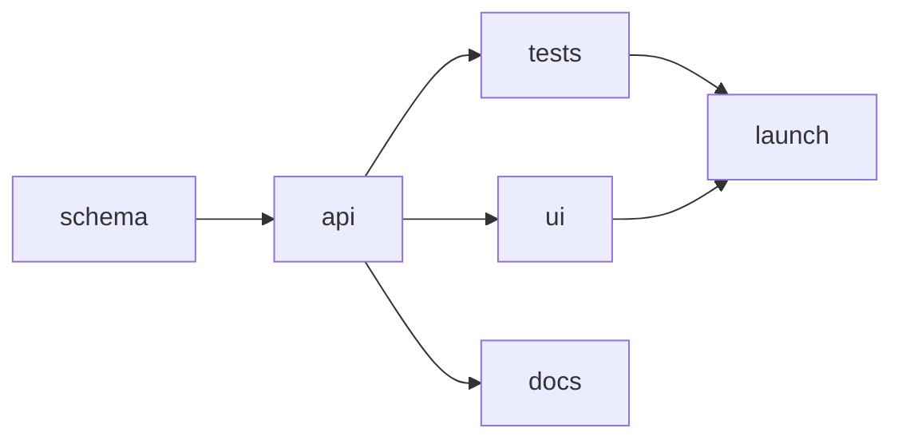
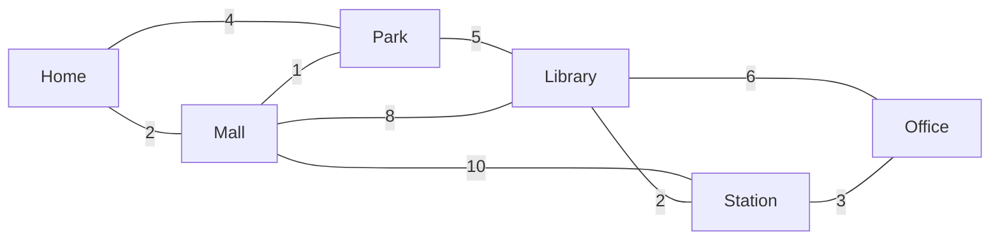

# Useful maths and graph algorithms

## Before this lesson

> **Before this lesson:** You need Big O notation and logarithms as introduced in [Big O foundations](#/lesson/interview-prep/big-o-foundations), and the graph vocabulary (node, edge, directed, breadth-first search) and the idea of a heap from [Trees and graphs: approach and cheat sheet](#/lesson/interview-prep/trees-graphs-approach). School-level algebra is enough for the maths; every formula is derived, not assumed. Fuller treatments live in [Cycles and topological sort](#/lesson/neet-heap-graphs/cycles-toposort) and [Shortest paths](#/lesson/neet-heap-graphs/shortest-paths).

## In plain words

This lesson is a review shelf: a handful of formulas and two graph algorithms that are not needed in every interview, yet appear often enough that meeting them for the first time under pressure is costly.

A carpenter does not re-derive how many 30-centimetre tiles cover a floor each time; a few relationships are known by heart, and the mind is free for the real problem. In the same way, if you recognise at a glance that a loop inside a loop which runs 1, then 2, then 3 … up to n times does about n²/2 steps, you can state a runtime in one breath and move on. That is the "useful maths" half.

The second half is about ordering and routing. Getting dressed has rules: socks before shoes, shirt before jacket. Any order that respects all the rules is fine; an order that puts shoes before socks is not. Finding such an order for any set of "this before that" rules is called a **topological sort**. And when you look at a map with travel times on each road and want the quickest route, the procedure that finds it is **Dijkstra's algorithm** (pronounced "DYKE-struh").

Why it matters for a job: build systems, package installers, spreadsheet recalculation and course planners are topological sorts; navigation, network routing and "cheapest way to do X" problems are shortest-path problems. Interviewers at product companies ask both under many disguises.

## Part 1: useful maths

### The sum 1 + 2 + … + n

Write the sum forwards and backwards and add the two rows column by column:

```
  1  +   2    +   3    + ... +  n
  n  + (n-1)  + (n-2)  + ... +  1
----------------------------------
(n+1) + (n+1) + (n+1)  + ... + (n+1)      n columns
```

Twice the sum is n columns of (n + 1), so

$$1 + 2 + \dots + n = \frac{n(n+1)}{2}$$

Check with n = 4: 1 + 2 + 3 + 4 = 10, and 4 · 5 / 2 = 10.

Where it appears: any loop whose inner part runs a growing number of times. Comparing every pair of items once means the first item is compared with n − 1 others, the second with n − 2, and so on: (n − 1) + (n − 2) + … + 1 = n(n − 1)/2 comparisons. In Big O terms both formulas are O(n²), because the largest term is n²/2 and constants are dropped. So "half of a square is still a square".

### Powers of two

$$2^0 + 2^1 + 2^2 + \dots + 2^n = 2^{n+1} - 1$$

The reason is visible in binary. The sum 1 + 2 + 4 + 8 is the binary number `1111`. Add one and every digit carries: `10000`, which is 16. So the sum is 16 − 1. In words: **the sum of all powers of two up to some power is one less than the next power**.

Where it appears:

- A perfect binary tree with levels of 1, 2, 4, …, 2ʰ nodes has 2ʰ⁺¹ − 1 nodes in total. The bottom level alone holds about half of them.
- Read backwards, n + n/2 + n/4 + … + 1 is less than 2n. This is why appending to a resizable array is O(1) on average although the array is sometimes copied: the copies cost 1 + 2 + 4 + … + n, under 2n in total for n appends. It is also why an algorithm that halves its input each round and does work proportional to the remaining size is O(n), not O(n log n).

```python-run
def pair_comparisons(n):
    """Count how often the inner line runs when every pair is examined once."""
    count = 0
    for i in range(n):
        for j in range(i + 1, n):
            count += 1
    return count

print("n      1+2+...+n   n(n+1)/2    pairs counted   n(n-1)/2")
for n in (4, 10, 100, 1000):
    print(f"{n:<6} {sum(range(1, n + 1)):<11} {n * (n + 1) // 2:<11} {pair_comparisons(n):<15} {n * (n - 1) // 2}")

print()
for n in (3, 10, 20):
    print(f"2^0 + ... + 2^{n} = {sum(2 ** k for k in range(n + 1))}   and 2^{n + 1} - 1 = {2 ** (n + 1) - 1}")

copies, capacity = 0, 1
for size in range(1, 1_000_001):          # append a million items to a doubling array
    if size > capacity:
        copies += capacity                # every existing item is copied to the bigger array
        capacity *= 2
print("\nitems copied while appending 1,000,000 items:", copies, "(under 2 x 1,000,000)")
```

`pair_comparisons` literally counts loop iterations, and the table shows the count agreeing with n(n − 1)/2. The middle block checks the powers-of-two identity. The last block simulates an array that doubles when full: a million appends cause 1,048,575 item copies in total, which is the powers-of-two sum again.

### Logarithms, and why the base does not matter

The **logarithm** of n to base b, written log_b n, is the number of times you multiply b by itself to reach n: log₂ 8 = 3 because 2 · 2 · 2 = 8. Read the other way, log₂ n is the number of times n can be halved before reaching 1, which is why halving algorithms such as binary search take about log₂ n steps.

Logarithms in different bases differ only by a constant factor:

$$\log_b n = \frac{\log_{10} n}{\log_{10} b}$$

For example log₂ 1000 = log₁₀ 1000 / log₁₀ 2 = 3 / 0.301 ≈ 9.97. Since Big O ignores constant factors, O(log₂ n), O(log₁₀ n) and O(ln n) are the same class, and we write O(log n) without a base. (The base *does* matter when it is in an exponent: 2ⁿ and 3ⁿ are different classes.)

A number to keep in your head: 2¹⁰ = 1024 ≈ 10³. So log₂ of a thousand is about 10, of a million about 20, of a billion about 30.

### Permutations and combinations

Counting questions arise whenever you estimate the size of a brute-force search.

**Permutations: order matters.** In how many orders can n different items be arranged? There are n choices for the first position, n − 1 for the second, and so on down to 1: n · (n − 1) · … · 1, written **n!** and read "n factorial". Three letters have 3! = 6 orders.

If only k positions are filled from n items, stop multiplying after k factors: n · (n − 1) · … · (n − k + 1), which equals n! / (n − k)!. Choosing a gold, silver and bronze winner among 5 runners: 5 · 4 · 3 = 60.

**Combinations: order does not matter.** In how many ways can k items be chosen from n when only the set counts? Take the ordered count above and divide by the number of orders in which the same k items could have been picked, k!:

$$\binom{n}{k} = \frac{n!}{k!\,(n-k)!}$$

read "n choose k". Choosing 3 runners out of 5 to receive identical medals: 60 / 3! = 10.

Two more counts worth knowing: a set of n items has 2ⁿ subsets (each item is in or out: two choices, n times), and n! grows faster than 2ⁿ, which is why trying all orderings is hopeless beyond n ≈ 11 while trying all subsets survives to n ≈ 20.

```python-run
import itertools, math

runners = ["Ana", "Ben", "Chen", "Dev", "Eli"]

podiums = list(itertools.permutations(runners, 3))       # ordered: gold, silver, bronze
print("ordered podiums, by listing them:", len(podiums), "| by formula 5*4*3:", math.perm(5, 3))
print("   first three:", podiums[:3])

medal_sets = list(itertools.combinations(runners, 3))    # unordered groups of three
print("unordered groups, by listing them:", len(medal_sets), "| by formula:", math.comb(5, 3))
print("   each group was counted", len(podiums) // len(medal_sets), "times among the podiums (3! = 6)")

subsets = sum(math.comb(5, k) for k in range(6))
print("groups of every size from 0 to 5:", subsets, "= 2^5")

print("\n n    2^n          n!")
for n in (5, 10, 15, 20):
    print(f"{n:>2}    {2 ** n:<12} {math.factorial(n)}")
```

`itertools.permutations(runners, 3)` produces every ordered selection of three, and `itertools.combinations` every unordered one; counting them confirms the formulas. The ratio 60 / 10 = 6 is the "divide by k!" step made visible. The final table shows how far apart 2ⁿ and n! are by n = 20.

### Proof by induction

**Induction** is a way to prove that a statement holds for every whole number n from some starting point. It has two parts:

1. **Base case**: show the statement is true for the first value (often n = 1 or n = 0).
2. **Inductive step**: assume it is true for some value n = k, and show that it must then be true for n = k + 1.

Together they are a row of dominoes: the first one falls, and each one knocks over the next.

*Example: prove 1 + 2 + … + n = n(n + 1)/2.* Base case: for n = 1 the left side is 1 and the right side is 1 · 2 / 2 = 1. Inductive step: assume 1 + … + k = k(k + 1)/2. Add the next term to both sides: 1 + … + k + (k + 1) = k(k + 1)/2 + (k + 1) = (k + 1)(k/2 + 1) = (k + 1)(k + 2)/2, which is the formula with k + 1 in place of n. Done.

Why a programmer cares: a recursive function is an induction in code. The base case of the proof is the base case of the function; the inductive step is "assuming the recursive call returns the right answer for the smaller input, my code produces the right answer for this input". When an interviewer asks "how do you know this recursion is correct?", that two-part argument is the answer.

## Part 2: topological sort

### The problem

Some tasks must happen before others. Draw each task as a node and each rule "a before b" as an arrow a → b. A **topological order** is a list of all the nodes in which every arrow points from an earlier item to a later one.

Such an order exists exactly when the graph has no **cycle** (a path of arrows that returns to its start). If a needs b first and b needs a first, nothing can go first. A directed graph without cycles is called a **DAG**, for directed acyclic graph.

Example: preparing a small web application for launch.



### Kahn's algorithm

The idea is what you would do by hand: find a task with nothing left to wait for, do it, cross it off, and see what that frees up.

1. For every node, count its incoming arrows. This count is the node's **in-degree**: the number of prerequisites not yet done.
2. Put every node with in-degree 0 into a queue of ready tasks.
3. Repeat while the queue is not empty: remove a node, append it to the order, and for each arrow leaving it, reduce the in-degree of the node at the other end by one. Any node whose in-degree reaches 0 joins the queue.
4. If the order contains every node, it is a valid topological order. If some nodes were never output, they are stuck waiting for each other: the graph has a cycle.

```python-run
from collections import deque

def topological_order(nodes, arrows, trace=False):
    leaving = {n: [] for n in nodes}
    indegree = {n: 0 for n in nodes}
    for before, after in arrows:
        leaving[before].append(after)
        indegree[after] += 1
    ready = deque(n for n in nodes if indegree[n] == 0)
    order = []
    while ready:
        node = ready.popleft()
        order.append(node)
        for nxt in leaving[node]:
            indegree[nxt] -= 1
            if indegree[nxt] == 0:
                ready.append(nxt)
        if trace:
            print(f"   did {node:<7} ready now: {list(ready)}")
    return order if len(order) == len(nodes) else None

tasks = ["launch", "docs", "ui", "tests", "api", "schema"]
rules = [("schema", "api"), ("api", "tests"), ("api", "ui"), ("api", "docs"),
         ("tests", "launch"), ("ui", "launch")]
print("order:", topological_order(tasks, rules, trace=True))

rules_with_loop = rules + [("launch", "schema")]
print("with launch -> schema added:", topological_order(tasks, rules_with_loop))
```

`leaving` maps each task to the tasks that depend on it, and `indegree` holds the count of unmet prerequisites. Only `schema` starts with zero, so it is done first, which frees `api`; `api` frees three tasks at once; `launch` waits for both `tests` and `ui`, so its count drops from 2 to 1 to 0. The second call adds the rule "launch before schema". Now every task has an unmet prerequisite, the queue starts empty, and the function returns `None` to report a cycle.

**Cost.** Each node enters the queue once and each arrow is examined once: O(V + E) for V nodes and E arrows.

**Alternative.** A depth-first search that appends a node to a list *after* visiting everything reachable from it, then reverses the list, also yields a topological order. Kahn's version is easier to explain and reports cycles for free. Several orders may be valid; if a question wants a particular one (alphabetical among the ready tasks, say), replace the queue with a heap.

The problem [Compile Order](#/problem/ctci-compile-order) in the trees-and-graphs module is this algorithm, and [Lock-Order Risk](#/problem/ctci-lock-order-risk) uses its cycle test.

## Part 3: Dijkstra's algorithm

### The problem

Each edge of a graph now carries a number called its **weight**: a distance, a time, a price. The **length of a path** is the sum of the weights along it, and the **shortest path** between two nodes is the one with the smallest sum. Breadth-first search finds the path with the fewest edges, which is the shortest only when all weights are equal. With unequal weights, a route with more edges can be cheaper.

Example: walking times in minutes around a neighbourhood. The roads work in both directions.



Home to Park directly takes 4 minutes, but Home → Mall → Park takes 2 + 1 = 3.

### The idea

Keep, for every node, the best total found so far from the start (infinity if none yet). Then repeat one move: **among the nodes not yet finished, take the one with the smallest total, declare it final, and use it to improve its neighbours.**

Why is it safe to declare that node final? Every other unfinished node already has a total at least as large, and all weights are zero or positive, so any detour through them could only add to the cost. Nothing can undercut the smallest. This argument needs non-negative weights; we return to that below.

"Improving a neighbour" is called **relaxing** an edge: if total(u) + weight(u, v) is smaller than total(v), lower total(v) to it and remember that the best way into v is from u.

A **priority queue** (a min-heap, in Python the `heapq` module) hands out the unfinished node with the smallest total in O(log n). Python's heap cannot change an entry's priority, so the standard trick is to push a new (total, node) pair on every improvement and to skip a popped pair if it is worse than the node's recorded total: such a pair is **stale**.

### Tracing the example from Home

| Step | Popped (total, node) | What happens | Totals afterwards |
|---|---|---|---|
| 1 | (0, Home) | Park ← 4, Mall ← 2 | Mall 2, Park 4 |
| 2 | (2, Mall) | Park improves to 3; Library ← 10; Station ← 12 | Park 3, Library 10, Station 12 |
| 3 | (3, Park) | Library improves to 8 | Library 8, Station 12 |
| 4 | (4, Park) | Stale (Park is already 3): skipped | |
| 5 | (8, Library) | Station improves to 10; Office ← 14 | Station 10, Office 14 |
| 6 | (10, Station) | Office improves to 13 | Office 13 |
| 7 | (13, Office) | Destination reached | |

(Stale pairs for Library, Station and Office are also popped and skipped along the way.)

```python-run
import heapq

def dijkstra(roads, start, goal, trace=False):
    neighbours = {}
    for a, b, minutes in roads:                      # roads work both ways
        neighbours.setdefault(a, []).append((b, minutes))
        neighbours.setdefault(b, []).append((a, minutes))
    best = {start: 0}                                # best known total for each place
    came_from = {}                                   # how we reached each place most cheaply
    heap = [(0, start)]
    while heap:
        total, place = heapq.heappop(heap)
        if total > best[place]:
            continue                                 # stale pair: a better total was found later
        if trace:
            print(f"   final: {place:<8} at {total}")
        if place == goal:
            break
        for nxt, minutes in neighbours[place]:
            candidate = total + minutes
            if candidate < best.get(nxt, float("inf")):      # relax the edge
                best[nxt] = candidate
                came_from[nxt] = place
                heapq.heappush(heap, (candidate, nxt))
    if goal not in best:
        return None, []
    path = [goal]
    while path[-1] != start:                         # walk the came_from links backwards
        path.append(came_from[path[-1]])
    return best[goal], path[::-1]

roads = [("Home", "Park", 4), ("Home", "Mall", 2), ("Mall", "Park", 1), ("Park", "Library", 5),
         ("Mall", "Library", 8), ("Mall", "Station", 10), ("Library", "Station", 2),
         ("Library", "Office", 6), ("Station", "Office", 3)]
minutes, path = dijkstra(roads, "Home", "Office", trace=True)
print("quickest:", minutes, "minutes via", " -> ".join(path))
```

Reading the code: `neighbours` is an adjacency list built from the road list. `best` starts with only the start node at 0; a missing key means "infinity", handled by `best.get(nxt, float("inf"))`. Each loop turn pops the smallest pair, skips it if stale, and otherwise relaxes every edge out of that place. `came_from` records the predecessor each time a total improves, and the last four lines follow those links from the goal back to the start and reverse the list. The trace prints the places in the order they become final: Home 0, Mall 2, Park 3, Library 8, Station 10, Office 13.

**Cost.** With a binary heap, every edge can cause one push and every push is later popped: O((V + E) log V). With a plain array scanned for the minimum each time, it is O(V²), which is competitive only for graphs where almost every pair of nodes is connected.

### Why negative weights break it

The "nothing can undercut the smallest" argument fails if an edge can *reduce* a total.

```python-run
import heapq

def dijkstra_one_way(edges, start, goal):
    out = {}
    for a, b, w in edges:
        out.setdefault(a, []).append((b, w))
    best, heap = {start: 0}, [(0, start)]
    while heap:
        total, node = heapq.heappop(heap)
        if total > best[node]:
            continue
        if node == goal:
            return total                              # declared final when popped
        for nxt, w in out.get(node, []):
            if total + w < best.get(nxt, float("inf")):
                best[nxt] = total + w
                heapq.heappush(heap, (total + w, nxt))
    return None

edges = [("A", "B", 2), ("A", "C", 5), ("C", "B", -4)]
print("Dijkstra says A to B costs:", dijkstra_one_way(edges, "A", "B"))
print("true cheapest, A -> C -> B:", 5 + (-4))
```

B is popped with total 2 and declared final before C (total 5) is examined; the cheaper route through C, 5 − 4 = 1, is never considered. For graphs with negative weights the Bellman-Ford algorithm is used instead; it is slower, O(V · E).

### Choosing among the graph searches

| Situation | Algorithm | Cost |
|---|---|---|
| Fewest edges, or all weights equal | Breadth-first search | O(V + E) |
| Non-negative weights | Dijkstra with a heap | O((V + E) log V) |
| Some negative weights | Bellman-Ford | O(V · E) |
| "Before/after" constraints, find an order or a cycle | Topological sort | O(V + E) |

The problem [Cheapest Ferry Route](#/problem/ctci-cheapest-ferry-route) is Dijkstra on a directed graph.

## Problems connected to this lesson

| Problem | Skill |
|---|---|
| [Cheapest Ferry Route](#/problem/ctci-cheapest-ferry-route) | Dijkstra with a heap; stale entries; unreachable targets |
| [Compile Order](#/problem/ctci-compile-order) | Kahn's algorithm; reporting a cycle |
| [Lock-Order Risk](#/problem/ctci-lock-order-risk) | Cycle detection by failing to finish a topological sort |

The other problems of this module belong to the next lesson, [Hashing, balanced trees and MapReduce](#/lesson/interview-prep/review-hashing-trees-mapreduce).

## Pitfalls

- **Calling a triangular loop O(n).** An inner loop that runs i times for i from 1 to n totals n(n + 1)/2: O(n²).
- **Calling a halving sum O(n log n).** n + n/2 + n/4 + … is under 2n: O(n).
- **Mixing up permutations and combinations.** Ask "does the order of my choices matter?" before picking a formula.
- **Dropping the base of an exponent.** Log bases may be dropped in Big O; 2ⁿ versus 3ⁿ may not.
- **Topological sort without the cycle check.** Always compare the length of the output with the number of nodes.
- **Forgetting nodes that have no arrows.** They still belong in the order; initialise the in-degree table from the node list, not from the arrows.
- **Using breadth-first search on weighted edges.** It minimises the number of edges, not the total weight.
- **Finalising a node when it is first discovered.** In Dijkstra a node is final when it is *popped*, not when it is first pushed.
- **Dijkstra with negative weights.**
- **Forgetting the stale check.** The answer is often still right, and the runtime can degrade badly.

> [!INTERVIEW]
> You are not expected to recite Dijkstra from memory flawlessly, but you are expected to recognise when a problem *is* a shortest-path or an ordering problem. Say the mapping aloud: "the places are nodes, each ferry is a directed edge whose weight is the price, prices are non-negative, so this is Dijkstra". Then state the three ingredients (a table of best totals, a min-heap of (total, node) pairs, the stale check) before writing code. Naming the model first earns credit even if the code needs hints.

> [!TIP]
> For runtime questions, keep four sums in reach: 1 + 2 + … + n ≈ n²/2; 1 + 2 + 4 + … + n ≈ 2n; n halvings take log₂ n steps; and a full binary tree of depth d has about 2ᵈ⁺¹ nodes. Most loop analyses reduce to one of them.

## Summary

- 1 + 2 + … + n = n(n + 1)/2, so triangular loops are O(n²). 2⁰ + … + 2ⁿ = 2ⁿ⁺¹ − 1, so doubling and halving sums stay linear.
- Logarithms of different bases differ by a constant factor; Big O writes O(log n) with no base.
- n! orders of n items; n!/(n − k)! ordered selections of k; n!/(k!(n − k)!) unordered selections; 2ⁿ subsets.
- Induction proves a statement for all n from a base case and a step; it is the reasoning behind correct recursion.
- Topological sort orders the nodes of a DAG so every arrow points forward. Kahn's algorithm removes zero-in-degree nodes repeatedly and detects cycles; O(V + E).
- Dijkstra finds shortest paths with non-negative weights by finalising the closest unfinished node and relaxing its edges; O((V + E) log V) with a heap. Negative weights need Bellman-Ford.

## Glossary

- **Factorial (n!)**: the product n · (n − 1) · … · 1; the number of orders of n items.
- **Permutation**: an arrangement in which order matters.
- **Combination**: a selection in which order does not matter.
- **Logarithm**: the number of times a base must be multiplied by itself to reach a value.
- **Induction**: proving a statement for all whole numbers via a base case and an inductive step.
- **Directed graph**: a graph whose edges (arrows) have a direction.
- **Cycle**: a path that returns to its starting node.
- **DAG**: directed acyclic graph, a directed graph with no cycle.
- **Topological order**: a listing of a DAG's nodes with every arrow pointing forward.
- **In-degree**: the number of arrows arriving at a node.
- **Kahn's algorithm**: topological sort by repeatedly removing nodes of in-degree zero.
- **Weight**: the number attached to an edge (distance, time, cost).
- **Shortest path**: the path between two nodes with the smallest total weight.
- **Relaxing an edge**: lowering a node's best known total because a cheaper way in was found.
- **Priority queue**: a structure that returns the smallest item first; usually a heap.
- **Stale entry**: a heap entry that has been superseded by a better total for the same node.
- **Bellman-Ford**: a slower shortest-path algorithm that tolerates negative weights.

```quiz
[
  {"q": "A loop runs i from 1 to n, and inside it another loop runs i times. How many times does the innermost line run, and what is the Big O?",
   "options": ["n times, O(n)", "n(n+1)/2 times, O(n^2)", "n log n times, O(n log n)", "2^n times, O(2^n)"],
   "answer": 1,
   "explain": "The total is 1 + 2 + ... + n = n(n+1)/2, whose dominant term is n^2/2."},
  {"q": "What is 1 + 2 + 4 + 8 + ... + 1024?",
   "options": ["2048", "2047", "1025", "1023"],
   "answer": 1,
   "explain": "The sum of powers of two up to 2^10 is 2^11 - 1 = 2047: in binary, eleven 1s."},
  {"q": "From 6 candidates you must pick a chairperson and a different secretary. How many outcomes?",
   "options": ["15", "30", "36", "720"],
   "answer": 1,
   "explain": "The two roles are different, so order matters: 6 choices for the chair times 5 for the secretary = 30. (Choosing an unordered pair would give 15.)"},
  {"q": "Why can the base of a logarithm be omitted in Big O notation?",
   "options": ["Because all logarithms are equal", "Because logarithms in different bases differ only by a constant factor", "Because the base is always 2", "It cannot be omitted"],
   "answer": 1,
   "explain": "log_b n = log n / log b, and 1 / log b is a constant, which Big O ignores."},
  {"q": "Kahn's algorithm finishes with fewer nodes in its output than the graph contains. What does that mean?",
   "options": ["The graph is disconnected", "The graph contains a cycle", "The queue was too small", "The graph has no edges"],
   "answer": 1,
   "explain": "Nodes on a cycle (and nodes that depend on them) never reach in-degree zero, so they are never output."},
  {"q": "In Dijkstra's algorithm, at which moment is a node's distance final?",
   "options": ["When it is first pushed on the heap", "When it is popped from the heap with a total equal to its recorded best", "When all nodes have been pushed", "Never"],
   "answer": 1,
   "explain": "The popped node has the smallest total among unfinished nodes, and with non-negative weights no later path can be shorter."},
  {"q": "Why does Dijkstra's algorithm require non-negative edge weights?",
   "options": ["Heaps cannot store negative numbers", "A negative edge could make a later path cheaper than one already declared final", "Negative weights create cycles", "It does not; any weights work"],
   "answer": 1,
   "explain": "The correctness argument is that extending a path never makes it cheaper. A negative edge breaks that."},
  {"q": "You must find the route with the fewest train changes, where every change counts the same. Which algorithm is the simplest correct choice?",
   "options": ["Dijkstra", "Breadth-first search", "Bellman-Ford", "Topological sort"],
   "answer": 1,
   "explain": "When every edge has the same cost, breadth-first search already finds the path with the fewest edges in O(V + E)."}
]
```

> **Source:** McDowell, Cracking the Coding Interview 6e, ch. XI Advanced Topics (Useful Math; Topological Sort; Dijkstra's Algorithm). Derivations, examples, traces and code are original.
