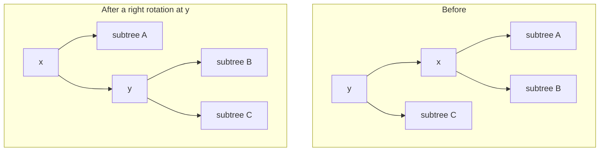
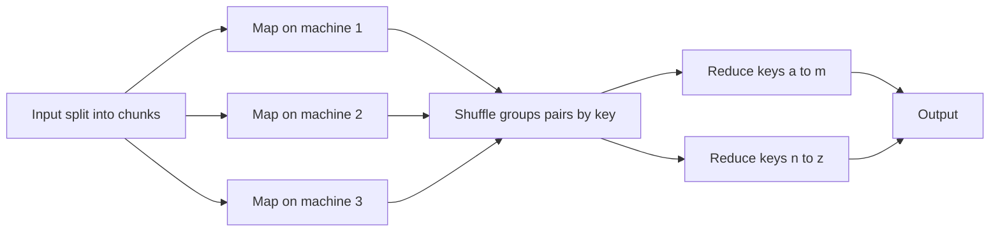

# Hashing, balanced trees and MapReduce

## Before this lesson

> **Before this lesson:** You should know what a hash table and a binary search tree are and what they cost, from [Arrays and strings: approach and cheat sheet](#/lesson/interview-prep/arrays-strings-approach) and [Trees and graphs: approach and cheat sheet](#/lesson/interview-prep/trees-graphs-approach), and the powers-of-two and logarithm facts from [Useful maths and graph algorithms](#/lesson/interview-prep/review-math-graphs). Deeper treatments: [Collision handling](#/lesson/dsa-foundations/collisions), [Pattern matching](#/lesson/dsa-foundations/pattern-matching), [AVL trees](#/lesson/dsa-foundations/avl) and [(2,4) and red-black trees](#/lesson/dsa-foundations/two-four-red-black).

## In plain words

Earlier lessons treated three tools as sealed boxes: "a hash table finds a key in O(1)", "a balanced tree keeps operations at O(log n)", "big data is processed on many machines". This lesson opens the boxes far enough that you can answer the follow-up question "and how does it do that?".

Four everyday pictures cover the four parts.

- **Collisions.** A cloakroom gives each coat a hook chosen from the last digit of the ticket. Sooner or later two coats are sent to the same hook. The attendant can hang both on that hook, or walk along to the next free hook. Those are the two families of collision handling.
- **Rabin-Karp.** To find one paragraph inside a long report, you could compare it letter by letter at every position. Or you could compute a short fingerprint of the paragraph, slide a paragraph-sized window along the report, and compare fingerprints, checking letters only when fingerprints agree.
- **Balanced trees.** A hanging mobile stays level because each arm is adjusted whenever a piece is added. A balanced search tree adjusts itself after every insertion so that it never grows lopsided.
- **MapReduce.** Counting a national vote: each polling station tallies its own ballots, the tallies are gathered per candidate, and each candidate's tallies are added up. Nobody ever holds all the ballots.

Why it matters for a job: these are "senior-flavoured" follow-ups. You will rarely implement a red-black tree in an interview, but being able to say why `HashMap` lookups can degrade, why a sorted map costs O(log n), or how you would count events across a thousand machines separates a memorised answer from an understood one.

## Part 1: what a hash table does when keys collide

Recall the mechanism. A **hash function** turns a key into a whole number; the table takes that number modulo its array length to choose a slot, often called a **bucket**. A **collision** happens when two different keys are sent to the same slot. Collisions cannot be avoided, because there are more possible keys than slots, so every hash table needs a policy. The **load factor** is the number of stored keys divided by the number of slots; it measures how crowded the table is.

### Policy 1: chaining

Each slot holds a small list of all the entries sent there (classically a linked list). To look a key up, go to its slot and search the list.

- With a good hash function and a load factor kept below about 1, lists have one or two entries on average, so operations are O(1) on average.
- In the worst case every key lands in one slot and the table is a linked list: O(n).
- A variation stores each slot's entries in a balanced search tree, which caps the worst case at O(log n) for more memory and code. Java's `HashMap` switches a crowded bucket from a list to a tree for exactly this reason.

### Policy 2: open addressing

All entries live in the array itself. If a key's home slot is taken, try other slots in a fixed sequence until a free one is found. Lookups follow the same sequence and stop at the key or at a never-used slot.

- **Linear probing** tries the next slot, then the next, wrapping round at the end. It is friendly to the processor's cache, but occupied slots clump into long runs (**clustering**), and a long run makes every key that lands in it walk further and then lengthens the run.
- **Quadratic probing** jumps by growing steps (1, 4, 9, … slots away), which spreads keys out.
- **Double hashing** uses a second hash function to choose the step size, so keys with the same home slot follow different sequences.

Two consequences of open addressing: the table can become completely full, so it must grow before that; and deleting an entry cannot empty its slot, because a later key's search path may pass through it. Deleted slots are marked with a **tombstone** meaning "keep walking".

### Growing the table

Whatever the policy, when the load factor passes a threshold (about 0.75 for chaining, lower for probing) the table allocates a larger array and re-inserts every key, because each key's slot depends on the array length. This **rehash** costs O(n) and happens rarely enough that insertion remains O(1) on average, by the doubling argument from the previous lesson.

```python-run
import random

SIZE = 11
keys = [12, 23, 34, 45, 7, 18, 56]

# Policy 1: chaining. Each slot is a list.
chains = [[] for _ in range(SIZE)]
for key in keys:
    chains[key % SIZE].append(key)
print("chaining:      ", {slot: chain for slot, chain in enumerate(chains) if chain})

# Policy 2: linear probing. Each slot holds one key or None.
slots = [None] * SIZE
for key in keys:
    i, steps = key % SIZE, 1
    while slots[i] is not None:          # occupied: move to the next slot, wrapping round
        i = (i + 1) % SIZE
        steps += 1
    slots[i] = key
    print(f"   probing: key {key:>2} has home slot {key % SIZE}, stored in slot {i} after {steps} step(s)")
print("linear probing:", slots)

def average_probes(load, size=10007, trials=2000, seed=3):
    """Fill a probing table to the given load factor, then measure the cost of further inserts."""
    rng = random.Random(seed)
    table = [False] * size
    for _ in range(int(load * size)):
        i = rng.randrange(size)
        while table[i]:
            i = (i + 1) % size
        table[i] = True
    total = 0
    for _ in range(trials):
        i, steps = rng.randrange(size), 1
        while table[i]:
            i = (i + 1) % size
            steps += 1
        total += steps
    return total / trials

for load in (0.25, 0.5, 0.75, 0.9):
    print(f"load factor {load}: about {average_probes(load):.1f} slots examined to place a new key")
```

Five of the seven keys have home slot 1 (12, 23, 34, 45 and 56 all leave remainder 1 when divided by 11). With chaining they share one list. With linear probing they spill into slots 2, 3, 4 and 5, and key 56 needs five steps. The last experiment fills a large table to several load factors and measures how many slots a new key must examine: the cost is small at one quarter full and climbs steeply as the table fills. That curve is why real tables resize long before they are full.

The problem [Probe Table](#/problem/ctci-probe-table) has you implement linear probing with tombstones.

| | Chaining | Open addressing |
|---|---|---|
| Where entries live | In per-slot lists | In the array itself |
| Load factor above 1? | Possible | Impossible |
| Deletion | Remove from the list | Needs tombstones |
| Memory behaviour | Extra pointers; scattered | Compact; cache-friendly |
| Degrades when | One slot's list grows long | The table gets crowded (clustering) |

## Part 2: Rabin-Karp substring search

**The task.** Find where a pattern of length m occurs in a text of length n. The direct method lines the pattern up at each of the n − m + 1 starting positions and compares characters: O(n · m) in the worst case, for instance a pattern of many `a`s followed by a `b` searched in a text of `a`s.

**The idea.** Compute a hash of the pattern once. Then compute the hash of each length-m window of the text and compare *numbers*. Only when the numbers are equal do we compare the characters, to rule out an accidental collision. This helps only if a window's hash can be obtained from the previous window's hash in O(1); recomputing it from scratch would cost O(m) per window and gain nothing. A hash with that property is a **rolling hash**.

**Rolling, shown with digits.** Treat the window as a number. For the text `271828` and windows of three digits, the first window is 271. To slide one place right: remove the leading 2 (subtract 2 · 100), shift what remains one place left (multiply by 10), and bring in the next digit (add 8): (271 − 200) · 10 + 8 = 718. Three arithmetic operations, whatever the window length.

For letters, the same scheme uses each character's code as a "digit" in some base B (a number larger than the alphabet, or any convenient prime such as 257). Because such numbers become enormous, every operation is taken modulo a large prime M, which keeps them small at the price of occasional collisions:

$$\text{hash}(c_0 c_1 \dots c_{m-1}) = (c_0 B^{m-1} + c_1 B^{m-2} + \dots + c_{m-1}) \bmod M$$

Why not something simpler, such as the sum of the character codes? It rolls easily (subtract the outgoing code, add the incoming one), but every rearrangement of the same letters has the same sum, so `"tops"`, `"spot"` and `"post"` would all look like matches and need verifying. Position-dependent weights make such coincidences rare.

```python-run
# Rolling with plain digits, to see the mechanics.
text, m = "271828", 3
window = int(text[:m])
print("first window:", window)
for start in range(1, len(text) - m + 1):
    window = (window - int(text[start - 1]) * 10 ** (m - 1)) * 10 + int(text[start + m - 1])
    print(f"slide: drop {text[start - 1]}, bring in {text[start + m - 1]} -> {window}")

def brute_force(text, pattern):
    n, m, compared, hits = len(text), len(pattern), 0, []
    for start in range(n - m + 1):
        k = 0
        while k < m:
            compared += 1
            if text[start + k] != pattern[k]:
                break
            k += 1
        if k == m:
            hits.append(start)
    return hits, compared

def rabin_karp(text, pattern, base=257, mod=1_000_000_007):
    n, m, compared, hits = len(text), len(pattern), 0, []
    if m == 0 or m > n:
        return hits, compared
    top = pow(base, m - 1, mod)                   # weight of the window's first character
    want = have = 0
    for i in range(m):                            # hash the pattern and the first window
        want = (want * base + ord(pattern[i])) % mod
        have = (have * base + ord(text[i])) % mod
    for start in range(n - m + 1):
        if have == want:                          # numbers agree: confirm with the characters
            compared += m
            if text[start:start + m] == pattern:
                hits.append(start)
        if start + m < n:                         # roll: drop text[start], bring in text[start + m]
            have = ((have - ord(text[start]) * top) * base + ord(text[start + m])) % mod
    return hits, compared

text = "a" * 2000 + "b"
pattern = "a" * 100 + "b"
slow_hits, slow_count = brute_force(text, pattern)
fast_hits, fast_count = rabin_karp(text, pattern)
print("\nbrute force: found at", slow_hits, "after", slow_count, "character comparisons")
print("Rabin-Karp:  found at", fast_hits, "after", fast_count, "character comparisons (plus one hash update per position)")
```

The first loop prints the digit example: 271, then 718, 182, 828. `rabin_karp` follows the same pattern with characters. `top` is B^(m−1) mod M, the weight of the leading character, needed to remove it. The first `for` builds both hashes with the usual "multiply by the base, add the next symbol" loop. In the main loop, a hash match triggers a real comparison; then the window rolls. On the awkward input, brute force performs about 190,000 character comparisons because almost every alignment matches for a hundred characters before failing; Rabin-Karp compares characters once, at the true match.

**Cost.** Expected O(n + m): O(m) to hash the pattern and first window, O(1) per slide, plus O(m) per verification. The worst case remains O(n · m) if nearly every window matches or collides, which a large prime modulus makes very unlikely. Practise with [Find Every Occurrence](#/problem/ctci-rolling-hash-find).

## Part 3: self-balancing search trees, in outline

### Why balance matters

A binary search tree keeps smaller keys to the left and larger keys to the right, so a search walks one path from the root: its cost is the tree's **height** (the number of nodes on the longest root-to-leaf path). Insert keys in random order and the height stays near log₂ n. Insert them in sorted order and every key becomes the right child of the previous one: the "tree" is a linked list of height n, and every operation is O(n). A **self-balancing tree** repairs its shape after each insertion and deletion so the height stays O(log n) no matter the order.

### The repair tool: rotation

A **rotation** rearranges a parent and one of its children so that the child moves up and the parent moves down, while keeping the left-to-right order of all keys.



Before, the order of keys is A, x, B, y, C; after, it is still A, x, B, y, C. Only three links changed, so a rotation costs O(1). Its effect is to shorten the left side by one level and lengthen the right side by one. A **left rotation** is the mirror image.

### AVL trees

An **AVL tree** (named after its inventors Adelson-Velsky and Landis) obeys one rule: at every node, the heights of the left and right subtrees differ by at most 1. Each node stores its height. After an insertion, walk back up from the new node; at the first node where the rule is broken, the shape is one of four cases:

| Case | Where the new key went | Repair |
|---|---|---|
| Left-left | Left child's left subtree | One right rotation at the unbalanced node |
| Right-right | Right child's right subtree | One left rotation |
| Left-right | Left child's right subtree | Left rotation at the child, then right rotation at the node |
| Right-left | Right child's left subtree | Right rotation at the child, then left rotation at the node |

The two "zig-zag" cases need two rotations because a single one would only move the tall subtree to the other side.

```python-run
class Node:
    def __init__(self, key):
        self.key, self.left, self.right, self.height = key, None, None, 1

def height(node):
    return node.height if node else 0

def refresh(node):
    node.height = 1 + max(height(node.left), height(node.right))

def rotate_right(y):
    x = y.left
    y.left, x.right = x.right, y          # x's right subtree moves under y; y moves under x
    refresh(y)
    refresh(x)
    return x                              # x is the new top of this subtree

def rotate_left(x):
    y = x.right
    x.right, y.left = y.left, x
    refresh(x)
    refresh(y)
    return y

def insert(node, key, log):
    if node is None:
        return Node(key)
    if key < node.key:
        node.left = insert(node.left, key, log)
    else:
        node.right = insert(node.right, key, log)
    refresh(node)
    lean = height(node.left) - height(node.right)
    if lean > 1:                                           # left side two levels taller
        if key > node.left.key:                            # zig-zag: straighten it first
            log.append(f"insert {key}: left-right case at {node.key}")
            node.left = rotate_left(node.left)
        else:
            log.append(f"insert {key}: left-left case at {node.key}")
        return rotate_right(node)
    if lean < -1:                                          # right side two levels taller
        if key < node.right.key:
            log.append(f"insert {key}: right-left case at {node.key}")
            node.right = rotate_right(node.right)
        else:
            log.append(f"insert {key}: right-right case at {node.key}")
        return rotate_left(node)
    return node

def levels(root):
    out, row = [], [root]
    while row:
        out.append([n.key for n in row])
        row = [child for n in row for child in (n.left, n.right) if child]
    return out

root, log = None, []
for key in [10, 20, 30, 25, 28]:
    root = insert(root, key, log)
print("\n".join(log))
print("levels after inserting 10, 20, 30, 25, 28:", levels(root))

# Sorted input: a plain search tree becomes a chain; the AVL tree stays shallow.
n = 500
plain_height = n                       # each key becomes the right child of the previous one
root = None
for key in range(1, n + 1):
    root = insert(root, key, [])
print(f"{n} keys inserted in sorted order: plain tree height {plain_height}, AVL height {height(root)}")
```

`insert` is ordinary search-tree insertion followed by three extra steps on the way back up the recursion: refresh the stored height, compute `lean` (left height minus right height), and rotate if the lean is 2 or −2. Inserting 10, 20, 30 makes a right-leaning chain, repaired by one left rotation that puts 20 on top. Inserting 25 and then 28 creates a zig-zag under 30 (30's left child is 25, whose right child is 28): the left-right case, two rotations, leaving 28 above 25 and 30. The final lines insert 500 keys in increasing order, the worst input for a plain tree, and the AVL tree's height is 9, close to log₂ 500.

An AVL tree's height never exceeds about 1.44 · log₂ n, so search, insert and delete are all O(log n). [AVL Insertions](#/problem/ctci-avl-insert-all) asks you to write this yourself.

### Red-black trees

A **red-black tree** reaches the same goal with a looser rule that is cheaper to maintain. Every node carries one extra bit, its colour, and the tree obeys:

1. Every node is red or black.
2. The root is black.
3. Every missing child (a null position at the bottom) counts as black.
4. A red node never has a red child.
5. From any node, every path down to a null position passes the same number of black nodes.

Rule 5 says all paths have equal "black length"; rule 4 says red nodes can at most alternate with black ones. So the longest possible path (black, red, black, red, …) is at most twice the shortest (all black). The tree may be lopsided, but never by more than a factor of two, and its height is at most 2 · log₂(n + 1): still O(log n).

Insertion in outline: add the new node as in a plain search tree and colour it **red**, which cannot break rule 5. If its parent is black, nothing more is needed. If its parent is red, rule 4 is broken, and the fix depends on the parent's sibling (the "uncle"):

- **Red uncle**: recolour parent and uncle black and the grandparent red, then repeat the check from the grandparent. No rotation.
- **Black uncle**: one or two rotations around the grandparent (the same straight and zig-zag shapes as AVL), with a colour swap. This ends the repair.

Finally the root is recoloured black. You are very unlikely to be asked to code this; you may well be asked what the rules guarantee.

```python-run
RED, BLACK = "red", "black"

def black_height(tree, low=float("-inf"), high=float("inf"), parent_colour=BLACK):
    """Return the black-height of a valid red-black subtree, or raise ValueError naming the broken rule.
    A tree is None or a tuple (colour, key, left, right)."""
    if tree is None:
        return 1                                      # null positions count as black
    colour, key, left, right = tree
    if not low < key < high:
        raise ValueError(f"search-tree order broken at {key}")
    if colour == RED and parent_colour == RED:
        raise ValueError(f"red node {key} has a red parent (rule 4)")
    left_blacks = black_height(left, low, key, colour)
    right_blacks = black_height(right, key, high, colour)
    if left_blacks != right_blacks:
        raise ValueError(f"paths below {key} pass different numbers of black nodes (rule 5)")
    return left_blacks + (1 if colour == BLACK else 0)

def check(name, tree):
    try:
        if tree and tree[0] != BLACK:
            raise ValueError("the root is not black (rule 2)")
        print(f"{name}: valid, black-height {black_height(tree)}")
    except ValueError as problem:
        print(f"{name}: INVALID, {problem}")

leaf = lambda colour, key: (colour, key, None, None)
check("tree 1", (BLACK, 20, leaf(RED, 10), leaf(RED, 30)))
check("tree 2", (BLACK, 20, (BLACK, 10, None, leaf(RED, 15)), leaf(BLACK, 30)))
check("tree 3", (BLACK, 20, (RED, 10, leaf(RED, 5), None), leaf(BLACK, 30)))
check("tree 4", (BLACK, 20, leaf(BLACK, 10), None))
```

`black_height` walks the tree once. For each node it checks the search-tree order, checks that a red node's parent is not red, computes the number of black nodes on the way down each side, and insists the two numbers agree. Trees 1 and 2 pass. Tree 3 has a red node 5 under a red node 10. Tree 4 has a black node on the left and nothing on the right, so paths through the left pass more black nodes than the path to the right.

| | AVL tree | Red-black tree |
|---|---|---|
| Balance rule | Subtree heights differ by at most 1 | Colour rules; longest path at most twice the shortest |
| Height bound | About 1.44 · log₂ n | 2 · log₂(n + 1) |
| Lookups | Slightly faster (shallower) | Slightly slower |
| Inserts and deletes | More rotations | Fewer rotations |
| Used in | Read-heavy indexes | Java `TreeMap`, C++ `std::map`, many kernels |

## Part 4: MapReduce

**MapReduce** is a way of writing a computation over data too large for one machine, so that a framework can run it on hundreds or thousands of machines. You supply two small functions and the framework does everything else.

- **Map** receives one input record and emits zero or more **(key, value)** pairs.
- The framework then performs the **shuffle**: it collects all pairs from all machines and groups them by key.
- **Reduce** receives one key together with all of its values and emits a result for that key.



Why this shape scales: a map call looks at one record and needs nothing else, so chunks can be processed on different machines at the same time, each close to where its data is stored. A reduce call looks at one key's values and needs nothing else, so different keys can be reduced on different machines. The framework handles splitting the input, moving the pairs, and re-running the work of a machine that dies, which on a thousand machines is a daily event.

The demo is a miniature framework: the "machines" are list chunks processed in turn, which is enough to see the data flow.

```python-run
from collections import defaultdict

def map_reduce(chunks, mapper, reducer):
    emitted = []
    for machine, chunk in enumerate(chunks, start=1):          # MAP: independent per chunk
        pairs = [pair for record in chunk for pair in mapper(record)]
        print(f"   map on machine {machine}: {len(chunk)} records -> {len(pairs)} pairs")
        emitted.extend(pairs)
    groups = defaultdict(list)                                 # SHUFFLE: group values by key
    for key, value in emitted:
        groups[key].append(value)
    return {key: reducer(key, values) for key, values in sorted(groups.items())}   # REDUCE

# Job 1: how many times was each page requested?
log_chunks = [
    ["/home", "/menu", "/home", "/order"],
    ["/menu", "/home", "/contact"],
    ["/order", "/order", "/home"],
]

def hit_mapper(url):
    yield (url, 1)                      # "I saw this page once"

def hit_reducer(url, ones):
    return sum(ones)

print("page hits:", map_reduce(log_chunks, hit_mapper, hit_reducer))

# Job 2: an inverted index: for each word, which documents contain it?
doc_chunks = [
    [("doc1", "fresh kaya toast"), ("doc2", "toast with butter")],
    [("doc3", "fresh butter cake")],
]

def index_mapper(record):
    name, text = record
    for word in set(text.split()):
        yield (word, name)

def index_reducer(word, names):
    return sorted(names)

print("index:", map_reduce(doc_chunks, index_mapper, index_reducer))
```

In job 1, `hit_mapper` emits the pair (page, 1) for each log line; after the shuffle, the key `/home` holds the list [1, 1, 1, 1], and `hit_reducer` adds it up. In job 2, the mapper emits (word, document) for each distinct word, and the reducer's list of values is already the answer: the documents containing that word. The framework function `map_reduce` did not change between the jobs; only the two small functions did.

Refinements worth one sentence each: a **combiner** runs the reduce logic on each mapping machine first (sending `("/home", 2)` instead of two separate pairs) to cut network traffic; and pairs are routed to reducers by hashing the key, so all values for a key meet on one machine.

When to reach for the idea in an interview: whenever a question says "the data does not fit on one machine". Ask what the key is (what must be brought together), what each record contributes (map), and how contributions combine (reduce). The problem [Top Terms Across Shards](#/problem/ctci-shard-top-terms) from the system-design module is that pattern in miniature. MapReduce suits large batch jobs; it is a poor fit for answering a single request in milliseconds or for computations that need many passes with shared state. Newer systems keep the model and relax its restrictions.

## Where to go after these topics

These two review lessons cover what is asked most often. If you have time left before your interviews, the next most useful advanced topics, in rough order of how often they appear, are:

| Topic | One-sentence idea | Where to learn it |
|---|---|---|
| Bellman-Ford and Floyd-Warshall | Shortest paths when weights may be negative; shortest paths between all pairs | [Shortest paths](#/lesson/dsa-foundations/shortest-paths) |
| Minimum spanning trees | The cheapest set of edges that connects every node | [Minimum spanning trees](#/lesson/neet-heap-graphs/minimum-spanning-trees) |
| Union-find | Tracking which items are in the same group as groups merge | [Union-find](#/lesson/neet-heap-graphs/union-find) |
| KMP string search | Substring search that is linear in the worst case, with no hashing | [Pattern matching](#/lesson/dsa-foundations/pattern-matching) |
| B-trees | Wide, shallow balanced trees designed for disks; the structure behind database indexes | [B-trees](#/lesson/dsa-foundations/btrees) |
| Bloom filters | A compact set that answers "definitely not present" or "probably present" | [Log-structured storage](#/lesson/databases/log-structured) |

None of these is required to pass a typical interview. Each is worth knowing by name and by its one-sentence idea, so that you can recognise when a question is steering towards it.

## Problems in this module and what each trains

| Problem | Skill |
|---|---|
| [Cheapest Ferry Route](#/problem/ctci-cheapest-ferry-route) | Dijkstra's algorithm (previous lesson) |
| [Probe Table](#/problem/ctci-probe-table) | Open addressing with linear probing; tombstones |
| [Find Every Occurrence](#/problem/ctci-rolling-hash-find) | Rolling hash; verifying matches; overlapping occurrences |
| [AVL Insertions](#/problem/ctci-avl-insert-all) | Heights, the four rotation cases |

## Pitfalls

- **"Hash tables are O(1)" with no qualifier.** It is O(1) on average, given a good hash function and a bounded load factor; the worst case is O(n) for plain chaining.
- **Emptying a slot on delete under open addressing.** Later keys become unreachable. Use a tombstone.
- **Forgetting that resizing re-inserts every key.** Slots depend on the array length.
- **Trusting a hash match in Rabin-Karp.** Equal hashes do not prove equal strings; verify.
- **Recomputing the window hash from scratch.** That is O(m) per position and no better than brute force.
- **Negative values after the subtraction** in languages whose `%` can return a negative number. Add the modulus before taking the remainder. (Python's `%` already returns a non-negative result.)
- **Assuming any binary search tree is O(log n).** Only a balanced one is.
- **Rotating without updating heights** (AVL), or updating them in the wrong order: the node that moved down first.
- **Describing MapReduce without the shuffle.** Grouping by key between the two phases is what makes reduce possible.

> [!INTERVIEW]
> These topics usually arrive as follow-ups, and a three-sentence answer is enough. "How does a hash map handle collisions?": "Either each bucket holds a small list of entries, or the entry goes to another slot found by probing. Both stay O(1) on average while the load factor is kept low by resizing. Worst case is O(n), or O(log n) if buckets become trees." Give that, then offer more detail only if asked.

> [!TIP]
> If asked to compare AVL and red-black trees and you remember only one thing, remember the trade: AVL is more strictly balanced, so lookups are a little faster; red-black tolerates more imbalance, so updates need fewer rotations. Then say which workload favours which.

## Summary

- Collisions are unavoidable. Chaining keeps a list (or tree) per slot; open addressing probes for another slot (linear, quadratic, double hashing) and needs tombstones for deletion. Resizing keeps the load factor, and so the average cost, low.
- Rabin-Karp compares rolling hashes of text windows with the pattern's hash and verifies on equality: expected O(n + m).
- A search tree is only as fast as it is shallow. Rotations reshape a tree in O(1) without disturbing key order.
- AVL trees keep sibling subtree heights within 1 using four rotation cases. Red-black trees use colour rules that keep the longest path within twice the shortest. Both guarantee O(log n).
- MapReduce splits a large computation into map (record to key-value pairs), shuffle (group by key) and reduce (combine one key's values), so that a framework can spread it over many machines and survive failures.

## Glossary

- **Hash function**: a function turning a key into a whole number used to choose a slot.
- **Bucket (slot)**: one position of a hash table's array.
- **Collision**: two different keys assigned to the same slot.
- **Load factor**: stored keys divided by number of slots.
- **Chaining**: resolving collisions by keeping a list of entries per slot.
- **Open addressing**: resolving collisions by placing the entry in another slot of the array.
- **Linear / quadratic probing**: trying the next slot / slots at growing distances.
- **Double hashing**: using a second hash function to pick the probing step.
- **Clustering**: occupied slots forming long runs under linear probing.
- **Tombstone**: a marker left in a deleted slot so that searches continue past it.
- **Rehash**: rebuilding a hash table in a larger array.
- **Rolling hash**: a hash of a sliding window that can be updated in O(1) per step.
- **Height**: the number of nodes on the longest path from the root down to a leaf.
- **Self-balancing tree**: a search tree that restores a height guarantee after every update.
- **Rotation**: an O(1) rearrangement of a parent and child that preserves key order.
- **AVL tree**: a search tree in which sibling subtree heights differ by at most 1.
- **Red-black tree**: a search tree balanced by colour rules; longest path at most twice the shortest.
- **MapReduce**: a model for large-scale processing built from a map function, a shuffle and a reduce function.
- **Shuffle**: the framework step that groups all emitted pairs by key.
- **Combiner**: a local pre-reduce step on the mapping machine.

```quiz
[
  {"q": "A hash table uses chaining and a poor hash function sends every key to the same slot. What is the cost of a lookup among n keys?",
   "options": ["O(1)", "O(log n)", "O(n)", "O(n^2)"],
   "answer": 2,
   "explain": "All entries sit in one list, which must be searched from the start: the table has degenerated into a linked list."},
  {"q": "Why does deleting from a linear-probing table leave a tombstone instead of an empty slot?",
   "options": ["To save memory", "Because a search stops at an empty slot, which would hide keys stored further along the probe path", "Because slots cannot be reused", "To keep keys sorted"],
   "answer": 1,
   "explain": "Keys that collided earlier were placed beyond this slot; an empty slot would end their search too soon."},
  {"q": "What makes a hash function suitable for Rabin-Karp?",
   "options": ["It never collides", "The hash of the next window can be computed from the current one in O(1)", "It sorts the characters", "It needs no modulus"],
   "answer": 1,
   "explain": "The rolling property is what brings the cost per window down from O(m) to O(1)."},
  {"q": "In Rabin-Karp, the window's hash equals the pattern's hash. What must happen next?",
   "options": ["Report a match immediately", "Compare the actual characters, because different strings can share a hash", "Restart the search", "Double the modulus"],
   "answer": 1,
   "explain": "Hash equality is necessary but not sufficient; verification removes false matches."},
  {"q": "Keys 1, 2, 3, ..., n are inserted in that order into a plain (unbalanced) binary search tree. What is its height?",
   "options": ["About log n", "About the square root of n", "n", "2"],
   "answer": 2,
   "explain": "Each key is larger than all before it and becomes the right child of the previous one, forming a chain."},
  {"q": "An AVL node becomes unbalanced after a key is inserted into the RIGHT subtree of its LEFT child. Which repair applies?",
   "options": ["One right rotation", "One left rotation", "A left rotation at the left child, then a right rotation at the node", "Recolouring only"],
   "answer": 2,
   "explain": "This is the left-right (zig-zag) case: the first rotation straightens the shape, the second restores balance."},
  {"q": "Which statement follows from the red-black rules?",
   "options": ["All leaves are at the same depth", "The longest root-to-null path is at most twice the shortest", "The tree is always perfectly balanced", "Red nodes are never leaves"],
   "answer": 1,
   "explain": "All paths contain the same number of black nodes and reds cannot be adjacent, so a path can at most alternate black and red."},
  {"q": "In a MapReduce job that counts page views, what does the shuffle step do?",
   "options": ["Sorts the input files by size", "Groups all emitted (page, 1) pairs by page so each reduce call sees one page's values", "Deletes duplicate pages", "Chooses which machine fails"],
   "answer": 1,
   "explain": "Reduce works one key at a time, so the framework must first bring every value for a key together."}
]
```

> **Source:** McDowell, Cracking the Coding Interview 6e, ch. XI Advanced Topics (Hash Table Collision Resolution; Rabin-Karp Substring Search; AVL Trees; Red-Black Trees; MapReduce). Explanations, examples and code are original.
