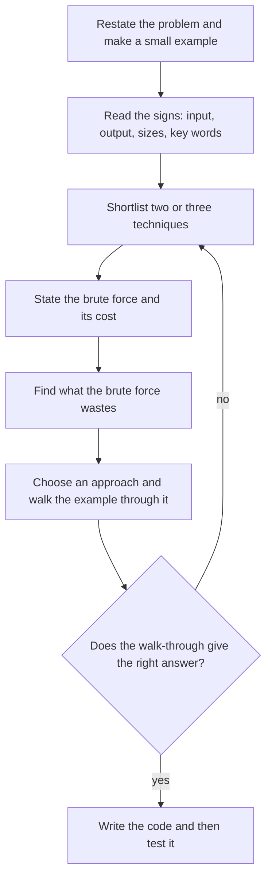

# Mixed practice: moderate and hard problems

## Before this lesson

> **Before this lesson:** This lesson pulls the whole track together. You should have worked through [The seven-step method](#/lesson/interview-prep/seven-step-method) and [Optimisation techniques and the best conceivable runtime](#/lesson/interview-prep/optimisation-techniques), and have met the topic lessons from [Arrays and strings](#/lesson/interview-prep/arrays-strings-approach) to [Sorting and searching](#/lesson/interview-prep/sorting-searching). Nothing new is assumed beyond them; where a technique is used, it is explained again briefly and linked.

## In plain words

Every earlier problem set came with a label: "linked lists", "bit manipulation", "dynamic programming". The label did half the work, because it told you which tools to pick up. A real interview question arrives with no label. **Mixed practice** means solving problems without being told the topic, so that you train the missing skill: looking at an unfamiliar problem and deciding which approach fits.

Think of a doctor meeting a new patient. The patient does not announce a diagnosis; they describe symptoms. The doctor listens for telling signs, forms two or three candidate explanations, orders the cheapest test that separates them, and only then treats. A doctor who prescribed after the first sentence would often be wrong. A doctor who ordered every test would run out of time. Interview problems reward the same middle path: read the signs, shortlist, check on a small example, then commit.

Why it matters for a job: in a 45-minute interview, the first five to ten minutes decide the rest. Candidates who choose a workable approach early finish with time to test; candidates who code the first idea often discover at minute 30 that it cannot work. Choosing well is a skill that can be practised, and this lesson gives you a routine for it, a table of signs, and four problems worked from first reading to tested code.

## A routine for the first ten minutes



1. **Restate and make an example.** Say the task in your own words and write one small input with its answer, worked by hand. Half of all wrong approaches come from a misread question.
2. **Read the signs.** What is the input (numbers, a string, a grid, pairs)? What is the output (one number, yes/no, a list, an arrangement)? How large can the input be? Which words stand out ("contiguous", "sorted", "k-th", "in how many ways")?
3. **Shortlist.** Name two or three techniques the signs suggest. Do not settle on one yet.
4. **Brute force.** State the most direct correct method and its Big O. It is your safety net and your reference for testing.
5. **Find the waste.** Where does the brute force repeat work, or look at things that cannot matter? The technique that removes that waste is usually the one to choose.
6. **Walk the example.** Run your small example through the chosen idea by hand before writing code. If it fails, return to the shortlist; you have lost two minutes, not twenty.
7. **Code, then test** with the smallest inputs, the edge cases, and a comparison against the brute force in your head.

### Sign 1: the size of the input tells you the target

An online judge or a careful interviewer states limits such as "n up to 10⁵". Those limits are a strong hint about the intended complexity, because a computer performs very roughly 10⁸ simple steps per second.

```python-run
import math

BUDGET = 10 ** 8          # rough number of simple steps that fit in a second or so

growth = [
    ("O(log n)",   lambda n: math.log2(n)),
    ("O(n)",       lambda n: n),
    ("O(n log n)", lambda n: n * math.log2(n)),
    ("O(n^2)",     lambda n: n ** 2),
    ("O(n^3)",     lambda n: n ** 3),
    ("O(2^n)",     lambda n: 2 ** n if n <= 60 else math.inf),
    ("O(n!)",      lambda n: math.factorial(n) if n <= 20 else math.inf),
]

print("largest n              slowest growth rate that still fits the budget")
for n in (10, 20, 300, 5000, 10 ** 5, 10 ** 6, 10 ** 9, 10 ** 18):
    feasible = [name for name, steps in growth if steps(n) <= BUDGET]
    print(f"{n:<22} {feasible[-1]}")
```

Each entry of `growth` pairs a name with a function giving the number of steps for an input of size n (the two fastest-growing ones return infinity for large n so that Python does not try to compute astronomically large numbers). For each n the loop keeps the growth rates whose step count fits the budget and prints the slowest of them. Read the output as a lookup table:

| If n can be as large as | Aim for | Typical techniques |
|---|---|---|
| about 10 | O(n!) is acceptable | Try every ordering |
| about 20 | O(2ⁿ) | Try every subset; backtracking |
| a few hundred | O(n³) | Triple loops; DP over pairs of positions |
| a few thousand | O(n²) | Double loops; DP tables |
| 10⁵ to 10⁶ | O(n log n) or O(n) | Sorting, heaps, hash maps, two pointers, prefix sums |
| 10⁹ and beyond | O(log n) or O(1) | Binary search on the answer; a formula; digit-by-digit reasoning |

In an interview without stated limits, ask: "roughly how large can the input get?". The answer does this table's job.

### Sign 2: words and shapes that point to a technique

| What you notice | First techniques to consider | Where it was taught |
|---|---|---|
| "Have I seen this before?", counting, matching pairs | Hash map or set | [Arrays and strings](#/lesson/interview-prep/arrays-strings-approach) |
| Sorted input, or order does not matter so you may sort | Binary search; two pointers | [Sorting and searching](#/lesson/interview-prep/sorting-searching) |
| A **contiguous** run of an array or string | Sliding window; prefix sums | [Sliding window](#/track/neet-window-stack) |
| "Sum over a range", "equal numbers of two kinds" | Prefix sums with a hash map | Worked example 1 below |
| Intervals with start and end | Sort by start; sweep through events | Worked example 2 below |
| "k largest", "k-th", "median of a stream" | Heap | [Trees and graphs](#/lesson/interview-prep/trees-graphs-approach) |
| "All arrangements", "all subsets", small n | Backtracking | [Recursion and dynamic programming](#/lesson/interview-prep/recursion-dp-approach) |
| "In how many ways", "fewest", "largest total" with choices at each step | Dynamic programming | [Recursion and dynamic programming](#/lesson/interview-prep/recursion-dp-approach) |
| A grid with regions, or things "connected" to things | Graph search (depth-first or breadth-first) | [Trees and graphs](#/lesson/interview-prep/trees-graphs-approach) |
| Items declared "the same" in pairs; groups merge | Union-find, or graph components | [Union-find](#/lesson/neet-heap-graphs/union-find) |
| "Must come before" | Topological sort | [Useful maths and graph algorithms](#/lesson/interview-prep/review-math-graphs) |
| Many words sharing prefixes | Trie | [Trees and graphs](#/lesson/interview-prep/trees-graphs-approach) |
| Design a structure with fast operations | Combine two structures (hash map plus list, heap, or tree) | [Stacks and queues](#/lesson/interview-prep/stacks-queues-approach) |
| Huge numeric limit, a question about digits or divisors | Find the pattern; count in blocks | Worked example 4 below |
| Nested best-of-rectangle or best-of-subarray | Fix some dimensions, reduce to a known one-dimensional problem | [Optimisation techniques](#/lesson/interview-prep/optimisation-techniques) |

A sign suggests; it does not decide. "Fewest" suggests dynamic programming, and sometimes a greedy rule or a breadth-first search is the right tool. That is why step 6, walking an example, exists.

## Worked example 1: the longest stretch that nets to zero

*A shop records its net cash flow for each day, positive or negative. Find the longest run of consecutive days whose flows add up to exactly zero, and return those flows.*

**Restate and example.** Given a list of integers, find the longest contiguous slice with sum 0. For `[5, -2, -3, 4, -4, 1, 7]` the slice `[5, -2, -3, 4, -4]` sums to 0 and has length 5.

**Signs.** "Consecutive" means a contiguous slice: sliding window or prefix sums. Assume up to 10⁵ days, so the target is O(n) or O(n log n).

**Shortlist.** (a) Sliding window. (b) Prefix sums with a hash map.

**Brute force.** Try every start and every end, summing as you extend: O(n²). For 10⁵ days that is 10¹⁰ steps: too slow.

**Find the waste, and test the shortlist.** A sliding window works when growing the window moves the sum in one direction and shrinking moves it in the other. With negative numbers that is false: adding a day may raise or lower the sum, so there is no rule for when to shrink. Candidate (a) is out. For (b), define the **prefix sum** P(i) as the total of the first i days. The sum of days i+1 … j is P(j) − P(i). That is zero exactly when P(j) = P(i). So the question becomes: *which two positions with equal prefix sums are furthest apart?* A dictionary remembering the **first** position at which each prefix sum occurred answers that in one pass.

**Walk the example.** Prefix sums after each day: 5, 3, 0, 4, 0, 1, 8, with P = 0 before day one. The value 0 occurs before the start and again after day five (index 4): a zero-sum slice of length 5. Matches.

```python-run
import random

def longest_zero_run(flows):
    first_seen = {0: -1}                 # prefix sum -> earliest index where it occurred
    total, best_length, best_start = 0, 0, 0
    for i, amount in enumerate(flows):
        total += amount
        if total in first_seen:          # same prefix sum earlier: the days in between net to zero
            length = i - first_seen[total]
            if length > best_length:
                best_length, best_start = length, first_seen[total] + 1
        else:
            first_seen[total] = i        # remember only the FIRST time, for the longest stretch
    return flows[best_start:best_start + best_length]

def brute_force_length(flows):
    best = 0
    for start in range(len(flows)):
        total = 0
        for end in range(start, len(flows)):
            total += flows[end]
            if total == 0:
                best = max(best, end - start + 1)
    return best

print(longest_zero_run([5, -2, -3, 4, -4, 1, 7]))
print(longest_zero_run([1, 2, 3]), longest_zero_run([]), longest_zero_run([0]))

rng = random.Random(1)
for _ in range(300):
    flows = [rng.randint(-3, 3) for _ in range(rng.randint(0, 12))]
    assert len(longest_zero_run(flows)) == brute_force_length(flows)
print("300 random lists agree with the brute force")
```

`first_seen` starts with `{0: -1}`: a prefix sum of zero "occurred" before index 0, which lets a slice starting at the very first day be found. The loop keeps a running total. If that total has been seen before, the days after the earlier position sum to zero, and the length is the difference of the two indexes. If it is new, its index is stored; an already-stored total is never overwritten, because the earliest position gives the longest stretch. The last lines are the testing step made concrete: three hundred random small lists are checked against the O(n²) method.

**Complexity.** One pass, O(n) time; the dictionary can hold up to n + 1 totals, O(n) space.

**What to take away.** "Contiguous" plus negative numbers rules out a plain sliding window; "a range sums to a target" becomes "two prefix sums differ by the target". The module problem [Longest Balanced Stretch](#/problem/ctci-equal-letters-digits) needs one extra step before this idea applies.

## Worked example 2: the fullest moment in a car park

*A car park logs, for each car, the minute it entered and the minute it left. What was the largest number of cars inside at the same time? A car leaving at minute t has freed its space for a car entering at minute t.*

**Restate and example.** Intervals `[enter, leave)`; find the maximum overlap. For `[(8, 10), (9, 12), (9, 11), (10, 13), (11, 14)]`: at minute 9 three cars are inside; at 10 one leaves and one enters, still three. Answer 3.

**Signs.** Intervals. Minutes could span years, so counting minute by minute is out. Up to 10⁵ cars: aim for O(n log n).

**Shortlist.** (a) For each car, count the others overlapping it: O(n²). (b) Sort by start and keep a heap of leave times. (c) Turn intervals into events and sweep.

**Find the waste.** The count of cars inside changes only at the moments when a car enters or leaves. Between such moments nothing happens. So only 2n moments matter: make an **event** `(minute, +1)` for each entry and `(minute, −1)` for each exit, sort the events, and add them up in order while tracking the maximum. This is called a **sweep line**: imagine a vertical line sweeping across a timeline, stopping at each event.

**The detail that decides correctness.** At equal minutes, exits must be processed before entries, or the example would briefly count four cars at minute 10. Sorting the pairs does this automatically, since −1 sorts before +1.

```python-run
def fullest(stays, trace=False):
    events = []
    for enter, leave in stays:
        events.append((enter, +1))
        events.append((leave, -1))
    events.sort()                        # by minute; at the same minute, -1 (exit) comes before +1
    inside = best = 0
    for minute, change in events:
        inside += change
        best = max(best, inside)
        if trace:
            print(f"   minute {minute:>2}: {'enter' if change > 0 else 'leave'} -> {inside} inside")
    return best

print("answer:", fullest([(8, 10), (9, 12), (9, 11), (10, 13), (11, 14)], trace=True))
print("no cars:", fullest([]), "| one car:", fullest([(5, 6)]), "| back to back:", fullest([(1, 2), (2, 3), (3, 4)]))
```

Each stay contributes two events. After sorting, the loop adds +1 or −1 to `inside` and records the highest value reached. The trace shows the count rising to 3 at minute 9, dipping to 2 and returning to 3 at minutes 10 and 11. The second line checks the edge cases: an empty log, a single car, and three cars that hand over the same space without ever overlapping (answer 1).

**Complexity.** Sorting 2n events: O(n log n) time, O(n) space.

**What to take away.** When something changes only at a few known moments, process those moments in order and ignore the time in between. Decide what happens at ties *before* coding. The module problem [Busiest Year](#/problem/ctci-busiest-year) has a different tie rule; work out what it implies for the sort.

## Worked example 3: when the tempting shortcut is wrong

*A post office sells stamps worth 1, 5 and 12 cents. What is the smallest number of stamps that make exactly a given amount?*

**Restate and example.** For 15 cents: is it 12 + 1 + 1 + 1 (four stamps) or 5 + 5 + 5 (three)? Three.

**Signs.** "Smallest number", with a choice at each step. Shortlist: (a) a **greedy** rule, meaning take the locally best option each time, here the largest stamp that fits; (b) dynamic programming.

**Test the cheap candidate first.** Greedy is one line of thought and O(number of stamps), so it deserves the first look. Walking the example: 15 → take 12, leaving 3 → three 1-cent stamps. Four stamps. But three 5s do better. One counterexample is enough: greedy is wrong for these denominations. (It happens to be right for some sets, such as 1, 5, 10, 50, which is why it is tempting.)

**Why DP fits.** The best way to make an amount `a` ends with some last stamp `s`. Before that stamp the amount was `a − s`, and it must itself have been made with as few stamps as possible. So `best[a] = 1 + min(best[a − s])` over the stamps `s` that fit. The same smaller amounts are needed again and again (overlapping subproblems), so fill a table from 0 upward.

```python-run
def greedy(amount, stamps):
    count = 0
    for s in sorted(stamps, reverse=True):
        count += amount // s
        amount %= s
    return count

def fewest(amount, stamps):
    INF = float("inf")
    best = [0] + [INF] * amount          # best[a] = fewest stamps that make exactly a
    for a in range(1, amount + 1):
        for s in stamps:
            if s <= a and best[a - s] + 1 < best[a]:
                best[a] = best[a - s] + 1
    return best[amount] if best[amount] != INF else -1

stamps = [1, 5, 12]
print("amount:", " ".join(f"{a:>2}" for a in range(0, 17)))
print("greedy:", " ".join(f"{greedy(a, stamps):>2}" for a in range(0, 17)))
print("best:  ", " ".join(f"{fewest(a, stamps):>2}" for a in range(0, 17)))
print("no 1-cent stamp, amount 7 with [5, 12]:", fewest(7, [5, 12]))
```

`greedy` takes as many of the largest stamp as fit, then moves to the next. `fewest` builds `best` one amount at a time: for each amount it tries each stamp as the last one and keeps the smallest count. The printed rows agree until 15 and 16, where greedy needs 4 and 5 stamps and the table finds 3 and 4. The final line shows the "impossible" case returning −1, which the greedy version would get wrong silently.

**Complexity.** O(amount × number of stamps) time and O(amount) space.

**What to take away.** Try the cheap idea, but *attack it with a small example before trusting it*. If you can break it, say so aloud and move to the technique that considers every choice. Interviewers count a self-found counterexample in your favour.

## Worked example 4: when n is too large to loop over

*Someone writes the whole numbers from 1 to n in a row with no spaces: 123456789101112… How many digits are written? n can be as large as 10¹⁸.*

**Restate and example.** For n = 12 the row is `123456789101112`: nine one-digit numbers and three two-digit numbers, 9 + 3 × 2 = 15 digits.

**Signs.** The limit 10¹⁸ rules out any loop over the numbers. The table says O(log n) or a formula. The question is about digits, so think in blocks of numbers that share a length.

**Brute force.** Add up `len(str(k))` for every k: O(n). Fine as a reference for small n, hopeless for the real limit.

**Find the pattern.** There are 9 one-digit numbers (1–9), 90 two-digit numbers (10–99), 900 three-digit numbers, and so on. Every number in a block contributes the same count of digits. So walk through the blocks, not the numbers: for each length, find how many numbers of that length are ≤ n, and multiply. There are at most 19 blocks.

```python-run
def digits_written(n):
    total, length, first = 0, 1, 1           # first = the smallest number with `length` digits
    while first <= n:
        last = min(n, first * 10 - 1)        # the block ends at 9, 99, 999, ... or at n
        total += (last - first + 1) * length
        length += 1
        first *= 10
    return total

def slow(n):
    return sum(len(str(k)) for k in range(1, n + 1))

print("n = 12:", digits_written(12))
for n in (1, 9, 10, 99, 100, 12345):
    assert digits_written(n) == slow(n)
print("matches the slow count on the small cases")
print("n = 10**18:", digits_written(10 ** 18))
```

`first` and `last` mark the part of each block that lies within 1 … n; `(last - first + 1)` is how many numbers that is, each contributing `length` digits. The assertions compare with the slow count at the boundaries where mistakes hide (9, 10, 99, 100). The last line answers for n = 10¹⁸ instantly.

**Complexity.** One loop turn per digit length: O(log n).

**What to take away.** A huge limit is a message: "do not iterate; find the structure". Group the inputs into blocks that behave alike and count per block. The module problem [Counting a Digit](#/problem/ctci-count-digit-occurrences) asks a harder question of the same kind, solved position by position.

## When you are stuck

The first ten minutes do not always produce an approach. Before silence sets in, work down this list aloud; each item comes from [Optimisation techniques](#/lesson/interview-prep/optimisation-techniques).

1. **Solve a smaller or simpler version.** Three items, not n. One dimension, not two. No duplicates. Then ask what changes when the restriction is lifted.
2. **Solve it by hand on a concrete example,** then notice what your own brain did. People do not compare every pair when looking for the closest two numbers in two short lists; they sort them first, usually without noticing.
3. **Start from a tiny case and extend.** If you had the answer for the first k items, how would item k + 1 change it?
4. **Run through the data structures.** Would a hash map help? A heap? A stack? Sorting first? Asking the question for each takes thirty seconds.
5. **State the best conceivable runtime.** If every element must be read, O(n) is the floor; if your current idea is O(n²), the gap tells you how much there is to find.
6. **Say what you know.** "I have a correct O(n²) method and I am looking for the repeated work" keeps the interviewer with you and often draws a hint.

### Small helpers worth knowing by heart

Mixed problems go faster when a few building blocks cost you no thought. Be able to write each of these in under a minute:

```python
from collections import defaultdict, deque

groups = defaultdict(list)            # a map from a key to a list of items: groups[key].append(item)

class ListNode:                       # singly linked list node
    def __init__(self, val, next=None):
        self.val, self.next = val, next

class TreeNode:                       # binary tree node
    def __init__(self, val, left=None, right=None):
        self.val, self.left, self.right = val, left, right

class TrieNode:                       # prefix tree node: one child per next letter
    def __init__(self):
        self.children, self.is_word = {}, False

def neighbours(r, c, rows, cols):     # the four cells next to (r, c) that are inside the grid
    for dr, dc in ((1, 0), (-1, 0), (0, 1), (0, -1)):
        if 0 <= r + dr < rows and 0 <= c + dc < cols:
            yield r + dr, c + dc
```

`defaultdict(list)` creates an empty list the first time a key is used, which removes the "is the key there yet?" check from grouping code. The three node classes are the ones behind every list, tree and trie problem in this track, and the `neighbours` generator is the core of grid searches.

## Problems in this module and what each trains

Attempt each one with the routine: write down the signs and a shortlist *before* opening the hints. The right-hand column names the main idea; cover it if you want the full exercise.

| Problem | Main idea |
|---|---|
| [Noughts and Crosses Referee](#/problem/ctci-tic-tac-winner) | Systematic checking of rows, columns and diagonals without repetition |
| [Closest Pair Across Two Lists](#/problem/ctci-smallest-gap-pair) | Sort, then two pointers |
| [Busiest Year](#/problem/ctci-busiest-year) | Sweep line over events, with a tie rule |
| [Code Peg Scoring](#/problem/ctci-code-peg-score) | Counting with frequency tables; exact matches first |
| [Two-Symbol Pattern Match](#/problem/ctci-pattern-ab-match) | Enumerate one length, derive the other; verify |
| [Ink Blot Sizes](#/problem/ctci-blot-sizes) | Flood fill on a grid with eight directions |
| [Longest Balanced Stretch](#/problem/ctci-equal-letters-digits) | Map to +1 and −1, then prefix sums with a hash map |
| [Counting a Digit](#/problem/ctci-count-digit-occurrences) | Count position by position, no loop over the numbers |
| [Merging Spelling Variants](#/problem/ctci-name-frequency-merge) | Groups that merge: union-find or graph components |
| [Restoring Spaces](#/problem/ctci-unspace-text) | Dynamic programming over positions in a string |
| [Longest Compound Word](#/problem/ctci-longest-compound-word) | Sort by length; test with memoised word-break |
| [Most Profitable Block](#/problem/ctci-max-block-sum) | Fix two rows, reduce to the best one-dimensional run |

## Pitfalls

- **Coding the first idea.** Shortlist at least two and spend a minute comparing them.
- **Skipping the brute force.** Without it you have no fallback, no reference for testing and no way to see what is wasted.
- **Ignoring the limits.** An O(n²) answer for n = 10⁵, or a loop over 10¹⁸ numbers, is a wrong answer however clean the code.
- **Forcing a favourite technique.** A sliding window with negative numbers, greedy without a proof or a test: check that the technique's requirement holds.
- **Not deciding tie and boundary behaviour early.** Whether intervals touching at an endpoint overlap changes the code.
- **Trusting an untested shortcut.** One small counterexample search costs a minute.
- **Going quiet when stuck.** Work the stuck list aloud.
- **Stopping at "it works on the example".** Test empty input, one element, all equal, and the largest size.
- **Treating practice as memorising answers.** After each problem, write one sentence: "the sign was …, the technique was …". That sentence is what transfers to the next unfamiliar problem.

> [!INTERVIEW]
> Narrate the choice, not only the result. "Because the slice must be contiguous I considered a sliding window, but the values can be negative so the window has no rule for shrinking. Prefix sums with a hash map avoid that and give O(n)." Two sentences like these show the interviewer exactly the judgment they are trying to measure, and they still earn credit if the code that follows has a slip.

> [!TIP]
> Keep a practice log with four columns: problem, the signs you noticed, the technique that worked, and the sign you missed. After twenty problems the last column shows your blind spots, and those are the topics to revise.

> [!WARNING]
> Hard problems are meant to take time and hints. Needing a hint on a hard question is normal and does not sink an interview; refusing to start because no perfect idea has arrived does.

## Summary

- Without a topic label, the first job is diagnosis: restate, read the signs, shortlist, state the brute force, find the waste, walk an example, then code and test.
- Input size points to the target complexity: about 20 allows 2ⁿ, a few thousand allows n², 10⁵ needs n log n or better, 10⁹ and beyond needs a logarithm or a formula.
- Words and shapes point to techniques: contiguous runs to windows and prefix sums, intervals to sweeps, "fewest" and "how many ways" to dynamic programming, connected things to graph search, merging groups to union-find.
- A sign suggests and an example confirms. Test cheap ideas such as greedy with a small counterexample search before trusting them.
- When stuck, simplify, solve by hand, extend from a small case, try each data structure, and say what you have.
- After each problem, record the sign and the technique. That habit is what makes the next unfamiliar problem familiar.

## Glossary

- **Mixed practice**: solving problems without being told which topic they belong to.
- **Sign (signal)**: a feature of a problem statement that hints at a suitable technique.
- **Brute force**: the most direct correct method, used as a baseline.
- **Prefix sum**: the total of the first i elements of a sequence.
- **Sliding window**: a contiguous range whose two ends move forward through the data.
- **Event**: a moment at which a tracked quantity changes.
- **Sweep line**: processing events in sorted order while maintaining a running state.
- **Greedy algorithm**: one that takes the locally best option at each step and never reconsiders.
- **Counterexample**: one input on which a proposed method gives a wrong answer.
- **Dynamic programming**: solving a problem by combining stored answers to smaller overlapping subproblems.
- **Flood fill**: a graph search that visits every cell of a connected region of a grid.
- **Union-find**: a structure that tracks which items belong to the same group as groups merge.
- **Best conceivable runtime**: the fastest runtime any solution could have, given what must be read or produced.

```quiz
[
  {"q": "A problem states that n can be up to 100,000. Which complexity should you aim for?",
   "options": ["O(n^3)", "O(n^2)", "O(n log n) or O(n)", "O(2^n)"],
   "answer": 2,
   "explain": "n^2 would be 10^10 steps, far beyond the rough budget of 10^8. Sorting, hashing and linear scans fit."},
  {"q": "You must find the longest contiguous slice of an array with sum zero, and values may be negative. Why does a plain sliding window not work?",
   "options": ["Windows cannot hold negative numbers", "Extending the window may raise or lower the sum, so there is no rule for when to shrink it", "Sliding windows are always O(n^2)", "The array is not sorted"],
   "answer": 1,
   "explain": "A window needs the sum to move in one direction as it grows. With mixed signs, use prefix sums and a hash map."},
  {"q": "In the car-park problem, why are exits processed before entries at the same minute?",
   "options": ["To make sorting faster", "Because a car leaving at minute t has freed its space for one arriving at t, so they should not be counted together", "Because exits are more common", "It makes no difference"],
   "answer": 1,
   "explain": "Processing the entry first would briefly count both cars and could overstate the maximum."},
  {"q": "With stamps of 1, 5 and 12 cents, the largest-first rule uses four stamps for 15 cents but three 5-cent stamps suffice. What does this show?",
   "options": ["The problem has no solution", "A greedy rule is not guaranteed to be optimal; one counterexample disproves it", "Dynamic programming is always slower", "12-cent stamps should be removed"],
   "answer": 1,
   "explain": "A single input where the shortcut is beaten is enough to reject it and switch to a method that considers all choices."},
  {"q": "n can be as large as 10^18 and the question concerns the digits of the numbers 1 to n. What is the right kind of approach?",
   "options": ["Loop over every number", "Group numbers into blocks that behave alike and count per block, in O(log n)", "Sort the numbers first", "Use a hash set of all numbers"],
   "answer": 1,
   "explain": "A loop of 10^18 steps is impossible. Numbers with the same length (or the same digit position) can be counted together."},
  {"q": "What is the main purpose of stating the brute-force solution first?",
   "options": ["To fill time", "It gives a correct baseline, a reference for testing, and shows what work an optimisation must remove", "Interviewers require the slowest solution", "It is always the final answer"],
   "answer": 1,
   "explain": "The brute force is a safety net and the starting point for finding repeated or unnecessary work."},
  {"q": "A problem gives pairs of names declared to be the same person, and asks for totals per person. Which technique does the sign 'groups that merge' suggest?",
   "options": ["Binary search", "Union-find or connected components of a graph", "A sliding window", "Bit manipulation"],
   "answer": 1,
   "explain": "Each pair links two items; the people are the connected groups. Union-find merges groups efficiently."},
  {"q": "You have walked your small example through your chosen approach and it gives the wrong answer. What should you do?",
   "options": ["Code it anyway and debug later", "Return to the shortlist and reconsider, having lost only a couple of minutes", "Ask to change the question", "Start writing tests"],
   "answer": 1,
   "explain": "The walk-through exists to catch a wrong approach before the expensive step of coding it."}
]
```

> **Source:** McDowell, Cracking the Coding Interview 6e, ch. 16 (Moderate) and ch. 17 (Hard), with the problem-solving method of ch. VII and the helper structures of the Code Library. The routine, tables, worked examples and code are original.
