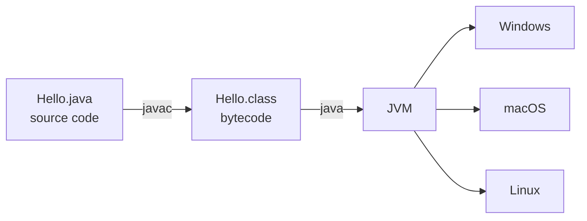
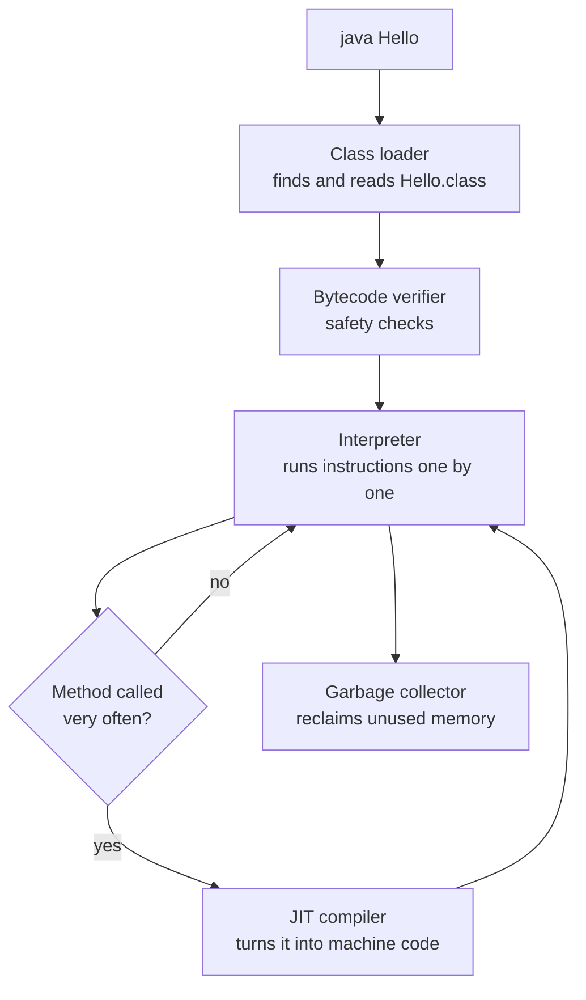

# From source code to a running program

> **Before this lesson:** nothing is assumed. If you have used any programming language before (for example the [Python track](#/track/python)) some ideas will feel familiar, but every term is explained here from zero.

## In plain words

Imagine you write a recipe in English and want cooks in forty countries to follow it. Translating it into forty languages yourself is slow, and every time you fix a typo you must fix forty copies. A smarter plan: translate the recipe **once** into a compact, precise "kitchen code", and give every kitchen a trained assistant who reads kitchen code and performs the steps with the local equipment.

Java works this way.

- You write **source code**: text that a person can read, saved in a file ending in `.java`.
- A program called the **compiler** translates that text once into **bytecode**, the "kitchen code". Bytecode is saved in a file ending in `.class`.
- Each computer has a **Java Virtual Machine** (JVM), the trained assistant. The JVM reads bytecode and carries out the instructions on that particular computer.

The same `.class` file runs on Windows, macOS and Linux without being translated again, because each of those systems has its own JVM that understands the same bytecode. This idea is often summed up as "write once, run anywhere".

Why this matters for a job: Java runs a very large share of the world's banking systems, online shops, Android apps and data pipelines. Interviewers for Java roles almost always open with "what happens between typing your code and seeing output?" because the answer shows whether you understand the tool you use all day.

## The four words you must be able to define

Before any code, fix these four terms in your mind. Each definition is one sentence.

| Term | One-sentence meaning |
|---|---|
| **Source code** | The human-readable text of a program, stored in `.java` files. |
| **Compiler** (`javac`) | The tool that checks your source code for mistakes and translates it into bytecode. |
| **Bytecode** | A compact set of instructions for an imaginary computer, stored in `.class` files. |
| **JVM** (Java Virtual Machine) | The program that loads bytecode and executes it on a real computer. |

Two more acronyms appear on every download page, so here they are as well:

- **JDK** (Java Development Kit): everything a developer needs. It contains the compiler `javac`, the launcher `java`, the standard library and other tools. You install this.
- **JRE** (Java Runtime Environment): an older name for "the JVM plus the standard library, without the compiler". Modern Java no longer ships a separate JRE download; you install a JDK.



## Your first program, one line at a time

Create a file named `Hello.java` containing exactly this:

```java
public class Hello {
    public static void main(String[] args) {
        System.out.println("Hello from Java");
    }
}
```

Compile it and run it from a terminal (a text window where you type commands):

```text
> javac Hello.java
> java Hello
Hello from Java
```

Here is what each line of the file does.

1. `public class Hello {` starts a **class** named `Hello`. A class is a named container for code; in Java, all code lives inside some class. The word `public` means any other code may use this class. The opening brace `{` begins the body of the class.
2. `public static void main(String[] args) {` starts a **method** named `main`. A method is a named list of instructions. The JVM looks for a method with exactly this shape and begins running there. The next lesson explains each word; for now treat the line as the fixed "start here" sign.
3. `System.out.println("Hello from Java");` is a **statement**, one complete instruction. It prints the text between the double quotes and then moves to a new line. Every statement ends with a semicolon `;`, the way an English sentence ends with a full stop.
4. The first `}` closes the method. The second `}` closes the class. Braces always come in pairs.

And here is what each command does.

- `javac Hello.java` runs the compiler. If the source has no mistakes, it writes `Hello.class` next to the source file and prints nothing. Silence means success.
- `java Hello` starts a JVM, tells it to load the class named `Hello`, and runs its `main` method. Notice there is no `.class` in the command: you give the **class name**, not a file name.

> [!TIP]
> Since Java 11 you can type `java Hello.java` for a single file. The launcher compiles it in memory and runs it straight away. That shortcut is handy for experiments; real projects still compile to `.class` files with a build tool, covered in [Maven, Gradle and the module system](#/lesson/java/java-maven-gradle-modules).

### The file name rule

A `public` class must live in a file with the same name, with the same capital letters, plus `.java`. A public class `Hello` goes in `Hello.java`. If you save it as `hello.java`, the compiler refuses:

```text
hello.java:1: error: class Hello is public, should be declared in a file named Hello.java
```

## What the compiler does for you

The compiler is a strict proofreader. It reads the whole file before anything runs and refuses to produce bytecode if it finds a rule broken. Problems found at this stage are called **compile-time errors**.

Consider this broken program, where the closing quote and the semicolon are fine but a variable is given the wrong kind of value:

```java
public class Broken {
    public static void main(String[] args) {
        int crates = "seven";
        System.out.println(crates);
    }
}
```

```text
> javac Broken.java
Broken.java:3: error: incompatible types: String cannot be converted to int
        int crates = "seven";
                     ^
1 error
```

Line 3 says "make a whole-number variable called `crates`" and then tries to put text into it. Java is a **statically typed** language, which means every variable has a declared kind of value (its **type**) and the compiler checks every use before the program runs. The compiler tells you the file, the line (`:3`) and points a caret `^` at the exact spot.

Catching mistakes before the program runs is a major reason large companies choose Java. A typo that would crash a Python program at three in the morning is rejected by `javac` on the developer's desk.

Other problems cannot be seen by the compiler because they depend on what happens while the program runs. Those are **runtime errors**. Dividing by a number that turns out to be zero is the classic example:

```java
public class Divide {
    public static void main(String[] args) {
        int parcels = 12;
        int vans = 0;
        System.out.println(parcels / vans);
    }
}
```

```text
> javac Divide.java
> java Divide
Exception in thread "main" java.lang.ArithmeticException: / by zero
        at Divide.main(Divide.java:5)
```

The compiler accepted the file because the types are right (a whole number divided by a whole number). The JVM stopped the program when it reached line 5. The report it printed is a **stack trace**: the kind of problem, a short message, and the file and line where it happened. You will learn to handle such events in [Exceptions: try, catch, finally, checked and unchecked](#/lesson/java/java-exceptions-basics).

## What is inside a .class file

Bytecode is not text, and it is not the machine code of your processor either. It is a list of small instructions for an imaginary machine. The JDK includes a tool, `javap`, that prints bytecode in readable form. For the `Hello` class it shows (shortened):

```text
> javap -c Hello
public static void main(java.lang.String[]);
    Code:
       0: getstatic     #7    // Field java/lang/System.out:Ljava/io/PrintStream;
       3: ldc           #13   // String Hello from Java
       5: invokevirtual #15   // Method java/io/PrintStream.println:(Ljava/lang/String;)V
       8: return
```

You do not need to read bytecode in daily work. Seeing it once makes the pipeline concrete: "fetch the `out` object, load the text, call `println`, return". Four instructions, the same on every operating system.

## What the JVM does when you type `java Hello`

The JVM is far more than a translator. It performs five jobs, in roughly this order.

1. **Class loading.** The JVM finds `Hello.class` and reads it into memory. It also loads the classes `Hello` uses, such as `String` and `System`, the first time each is needed.
2. **Verification.** Before running any loaded bytecode, the JVM checks that it obeys safety rules (for example, that it never treats a number as a memory address). This protects against corrupted or malicious class files.
3. **Interpretation.** The JVM starts executing bytecode instructions one at a time. This starts quickly but runs slowly compared with machine code.
4. **Just-in-time compilation** (JIT). While the program runs, the JVM counts how often each method is called. Methods that run often ("hot" methods) are translated into real machine code for your processor and that fast version is used from then on. This is why Java programs speed up after a "warm-up" period.
5. **Memory management.** The JVM hands out memory when your program creates things, and a component called the **garbage collector** reclaims memory that the program can no longer reach. You never free memory by hand in Java.



> [!INTERVIEW]
> "Is Java compiled or interpreted?" A strong answer: **both**. `javac` compiles source to bytecode ahead of time. The JVM then interprets that bytecode and, for frequently executed code, compiles it to native machine code at run time with the JIT compiler. Mention that this design gives portability (one bytecode, many platforms) plus speed close to compiled languages once warmed up.

### A model you can run

Java itself cannot run inside this page, but the pipeline can be modelled. The simulation below "compiles" a tiny arithmetic language into stack instructions, then "runs" them on a small virtual machine. Real bytecode works on the same principle: values are pushed onto a stack, and instructions pop their inputs and push their result.

```python-run
# A toy version of the javac -> bytecode -> JVM pipeline.

def compile_expr(tokens):
    """Turn  3 + 4 * 2  style tokens (no brackets) into stack instructions."""
    prec = {"+": 1, "-": 1, "*": 2, "/": 2}
    out, ops = [], []
    for t in tokens:
        if t.isdigit():
            out.append(("PUSH", int(t)))
        else:
            while ops and prec[ops[-1]] >= prec[t]:
                out.append((ops.pop(), None))
            ops.append(t)
    while ops:
        out.append((ops.pop(), None))
    return out

def run(bytecode):
    stack = []
    for op, arg in bytecode:
        if op == "PUSH":
            stack.append(arg)
        else:
            b, a = stack.pop(), stack.pop()
            if op == "+": stack.append(a + b)
            if op == "-": stack.append(a - b)
            if op == "*": stack.append(a * b)
            if op == "/": stack.append(int(a / b))   # Java int division truncates
        print(f"{op:5} {'' if arg is None else arg!s:3} stack = {stack}")
    return stack[0]

source = "3 + 4 * 2"
code = compile_expr(source.split())
print("source  :", source)
print("bytecode:", code)
print("result  :", run(code))
```

Change `source` to `"20 / 3 - 1"` and run again. The "compiler" step happens once; the "run" step could be repeated on any machine that has the `run` function. That is the whole trick.

## Java versions, briefly

Java has a new release every six months. Most companies stay on **LTS** (long-term support) releases, which receive fixes for years. At the time of writing the LTS versions you will meet in jobs are **8, 11, 17, 21 and 25**. This track teaches modern Java (17 and 21 features such as records, sealed types, pattern matching, text blocks and virtual threads) and points out when a feature is recent.

Check what you have installed:

```text
> java -version
openjdk version "21.0.4" 2024-07-16 LTS
> javac -version
javac 21.0.4
```

If both commands print a version number, you are ready. If the terminal says the command is not found, install a JDK (for example Eclipse Temurin or Oracle's OpenJDK build) and open a new terminal.

> [!WARNING]
> Bytecode compiled by a **newer** `javac` does not run on an **older** JVM. Trying it produces `UnsupportedClassVersionError`. The other direction is fine: a new JVM runs old class files. Teams therefore agree on one Java version for building and running.

## jshell: try a line without a file

The JDK includes an interactive prompt called `jshell`. Type an expression and see its value at once. It is a good way to test a small idea while reading these lessons.

```text
> jshell
jshell> 7 / 2
==> 3
jshell> "crate".toUpperCase()
==> "CRATE"
jshell> /exit
```

Notice `7 / 2` gives `3`, not `3.5`. Dividing two whole numbers in Java throws away the fraction. That surprise gets its own section in [Primitive types and how numbers are stored](#/lesson/java/java-primitives).

## Practising in this track

Every module ends with practice problems, of two kinds.

- **Model problems** are solved in Python and run in your browser. Each one asks you to reproduce a precisely defined piece of Java behaviour (for example how `int` arithmetic overflows), and its guide ends with the idiomatic Java.
- **Java problems** are real Java 21: you edit a class named `Solution`, and your code is compiled and run on a judge server against hidden cases.

> [!NOTE]
> Java problems run on a server, not in the browser, so **you need to be logged in** to submit them. Model problems and the runnable demos inside lessons work without logging in.

## Pitfalls

- **Running the file name.** `java Hello.class` fails with "Could not find or load main class Hello.class". Give the class name: `java Hello`.
- **Capital letters matter.** Java is **case-sensitive**: `Main`, `main` and `MAIN` are three different names. `string` is not `String`; `system.out` is not `System.out`.
- **Forgetting to recompile.** If you edit `Hello.java` and run `java Hello` without running `javac` again, the old bytecode runs and your change seems to be ignored.
- **File name differs from the public class.** The compiler refuses, as shown above.
- **Confusing compile-time and runtime errors.** A message that starts with a file name and line from `javac` means nothing ran. A message that starts with `Exception in thread` came from the JVM while the program was running.
- **Mixed-up brackets.** Parentheses `( )` surround method inputs, square brackets `[ ]` belong to arrays, braces `{ }` group code. Each opening bracket needs a matching closing one of the same kind.

## Cheat sheet

| You want to | Command or fact |
|---|---|
| Compile a file | `javac Hello.java` produces `Hello.class` |
| Run a compiled class | `java Hello` (class name, no extension) |
| Run a single source file directly | `java Hello.java` (Java 11+) |
| See the bytecode | `javap -c Hello` |
| Try a line interactively | `jshell` |
| Check versions | `java -version`, `javac -version` |
| Source file extension | `.java` |
| Bytecode file extension | `.class` |
| Error before running | compile-time error, reported by `javac` |
| Error while running | runtime error (an exception), reported by the JVM |
| Who frees memory | the garbage collector, automatically |

## Summary

- Java source code is compiled **once** to platform-neutral bytecode; a JVM on each platform runs that bytecode.
- `javac` is a strict checker: type mistakes are caught before the program ever runs.
- The JVM loads classes, verifies them, interprets bytecode, compiles hot code to machine code with the JIT, and manages memory with a garbage collector.
- A public class lives in a file of the same name; the program starts at `public static void main(String[] args)`.
- Install a JDK, prefer an LTS version, and keep build and run versions aligned.

## Glossary

- **Source code**: the readable text of a program (`.java`).
- **Compiler**: a tool that translates source code into another form; in Java, `javac` produces bytecode.
- **Bytecode**: instructions for the JVM, stored in `.class` files.
- **JVM**: Java Virtual Machine, the program that executes bytecode.
- **JDK**: Java Development Kit, the installer that contains the compiler, the JVM and the library.
- **JIT compiler**: the part of the JVM that turns frequently run bytecode into machine code while the program runs.
- **Garbage collector**: the part of the JVM that reclaims memory the program can no longer use.
- **Statement**: one complete instruction, ended by a semicolon.
- **Statically typed**: every variable has a type that the compiler checks before the program runs.
- **Stack trace**: the report printed when a program fails at run time, listing where it was.
- **LTS**: long-term support, a release that receives updates for several years.

## Check yourself

```quiz
[
  {"q": "Which tool turns `Hello.java` into `Hello.class`?", "options": ["java", "javac", "javap", "jshell"], "answer": 1,
   "explain": "javac is the compiler. java launches the JVM, javap prints bytecode, jshell is the interactive prompt."},
  {"q": "A file contains `public class Parcel { }`. What must the file be called?", "options": ["parcel.java", "Parcel.class", "Parcel.java", "Any name ending in .java"], "answer": 2,
   "explain": "A public class must be in a file with exactly the same name and capitalisation, plus .java."},
  {"q": "Does this compile? `int total = \"12\";`", "options": ["Yes, total becomes 12", "Yes, total becomes 0", "No: a String cannot be put into an int variable", "It compiles but fails at run time"], "answer": 2,
   "explain": "Java is statically typed. Text in double quotes is a String, and the compiler rejects assigning it to an int."},
  {"q": "What does `System.out.println(9 / 2);` print?", "options": ["4.5", "4", "5", "It does not compile"], "answer": 1,
   "explain": "Both operands are whole numbers (int), so Java performs integer division and drops the fraction: 4."},
  {"q": "You compile with Java 21 and try to run the class on a Java 11 JVM. What happens?", "options": ["It runs normally", "It runs but slower", "UnsupportedClassVersionError", "The JVM recompiles it automatically"], "answer": 2,
   "explain": "Older JVMs reject class files produced for a newer version. New JVMs can run old class files, not the reverse."},
  {"q": "Which statement about the JIT compiler is true?", "options": ["It runs before javac", "It converts frequently executed bytecode to machine code while the program runs", "It replaces the garbage collector", "It produces .class files on disk"], "answer": 1,
   "explain": "The JIT lives inside the JVM and compiles hot methods to native code at run time, which is why Java speeds up after warming up."},
  {"q": "`int a = 10; int b = 0; System.out.println(a / b);` What is the result?", "options": ["Prints 0", "Prints Infinity", "A compile-time error", "It compiles, then throws ArithmeticException when run"], "answer": 3,
   "explain": "The types are fine so javac accepts it. Integer division by zero is detected by the JVM at run time and throws ArithmeticException."},
  {"q": "Which command correctly runs a compiled class named `Shop`?", "options": ["java Shop.class", "java Shop", "javac Shop", "run Shop.java"], "answer": 1,
   "explain": "The java launcher takes a class name, not a file name."}
]
```

> **Source:** Head First Java, ch. 1 (how Java works, code structure). Fact-checked against the Java SE documentation at https://docs.oracle.com/en/java/javase/21/ and https://dev.java/learn/getting-started/ .
