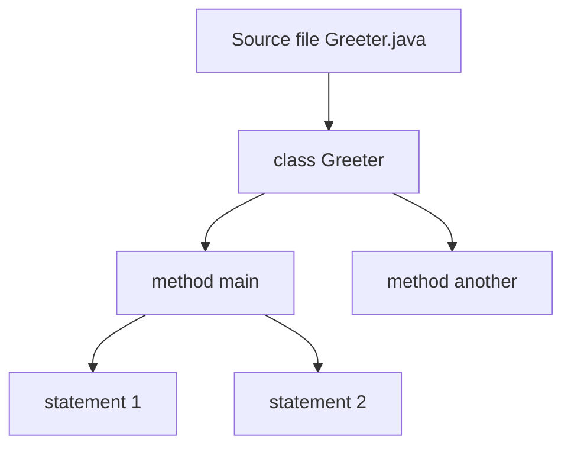

# Anatomy of a class, main, and your first statements

> **Before this lesson:** you can compile and run a one-file program and you know the words source code, compiler, bytecode and JVM ([From source code to a running program](#/lesson/java/java-source-to-jvm)).

## In plain words

A Java program is organised like a filing cabinet. The cabinet drawer is a **source file**. Inside the drawer is a folder: a **class**. Inside the folder are sheets of instructions: **methods**. Each sheet lists steps, one per line: **statements**.



When you start a program, the JVM opens the folder you named, pulls out the one sheet titled `main`, and performs its steps from top to bottom. When the last step of `main` finishes, the program ends.

Why this matters for a job: every Java file you will ever open has this shape. Reading it fluently, including knowing what each word in `public static void main(String[] args)` means, is the first thing a technical interviewer checks.

## The nesting rule

Java has a strict rule about what goes inside what:

- A **statement** must be inside a method.
- A **method** must be inside a class.
- A **class** is written in a source file.

You cannot write a loose `System.out.println(...)` at the top of a file the way you can in Python. This program is rejected:

```java
System.out.println("loose statement");   // not inside a class or a method
```

```text
error: class, interface, enum, or record expected
```

## The main method, word by word

```java
public class Greeter {
    public static void main(String[] args) {
        System.out.println("Shop is open");
    }
}
```

```text
Shop is open
```

Each word in the method's first line has a job.

| Word | Meaning |
|---|---|
| `public` | Code outside this class may call the method. The JVM is outside, so it needs this. |
| `static` | The method belongs to the class itself, so it can run before any object exists. Objects arrive in the next module. |
| `void` | The method hands nothing back when it finishes. "Void" means empty. |
| `main` | The name the JVM looks for. |
| `String[] args` | The method receives a list of pieces of text: the extra words typed on the command line. `String` is the type for text; `[]` means "an array of", a fixed-length list. |

The name `args` is a convention and could be any name. The rest is fixed: change `static` or `void` and the JVM reports that it cannot find `main`.

> [!NOTE]
> Java 21 began previewing a shorter form for beginners, and Java 25 finalised it: a source file may contain only `void main() { ... }` with no class line. Almost all existing code, and every interview, still uses the full form, so learn it by heart.

### Command-line arguments

The values in `args` come from whatever follows the class name when the program is started.

```java
public class Echo {
    public static void main(String[] args) {
        System.out.println("You passed " + args.length + " word(s)");
        System.out.println("The first is " + args[0]);
    }
}
```

```text
> java Echo tea biscuits
You passed 2 word(s)
The first is tea
```

- `args.length` is how many items the array holds.
- `args[0]` is the first item. Counting positions starts at **0**, so the second item is `args[1]`.
- The `+` between text and a number glues them into one piece of text. This is called **concatenation**.

Run `java Echo` with no extra words and line 4 fails with `ArrayIndexOutOfBoundsException`, because there is no item at position 0.

## Variables: named boxes with a fixed kind

A **variable** is a named place that holds a value. In Java you must state what kind of value it holds (its **type**) when you create it. Creating a variable is called **declaring** it.

```java
public class Stock {
    public static void main(String[] args) {
        int crates = 12;              // a whole number
        double pricePerCrate = 4.5;   // a number with a fractional part
        boolean open = true;          // true or false
        String product = "apples";    // text

        crates = crates - 2;          // change the value: 12 - 2
        System.out.println(crates + " crates of " + product);
        System.out.println("Value: " + crates * pricePerCrate);
        System.out.println("Open? " + open);
    }
}
```

```text
10 crates of apples
Value: 45.0
Open? true
```

Line by line:

- `int crates = 12;` declares a variable named `crates` whose type is `int` (a whole number) and stores 12 in it.
- `crates = crates - 2;` is an **assignment**. The right-hand side is worked out first (12 minus 2 is 10) and the result is stored in the variable on the left. The `=` sign means "store into", not "is equal to".
- `crates * pricePerCrate` multiplies an `int` by a `double`. Java converts the `int` to a `double` first, so the answer is `45.0`, with a decimal point.

A variable's type never changes. `crates = "many";` would be a compile-time error, because `crates` was declared to hold whole numbers.

### var: let the compiler work out the type

Since Java 10 you may write `var` for a local variable when the value on the right makes the type clear:

```java
var total = 40;          // the compiler decides: int
var label = "pending";   // the compiler decides: String
```

The variable still has one fixed type; `var` only saves typing. `var x;` with no value is an error, because there is nothing to infer the type from.

### Comments

Text after `//` up to the end of the line is a **comment**: a note for people, ignored by the compiler. A block between `/*` and `*/` is a comment that can span several lines.

## Making decisions: if and else

A **condition** is an expression whose value is `true` or `false`. Such a value is called a **boolean**. The `if` statement runs a block of code only when its condition is true.

```java
public class Delivery {
    public static void main(String[] args) {
        int weightKg = 23;

        if (weightKg > 30) {
            System.out.println("Needs two people");
        } else if (weightKg > 20) {
            System.out.println("Use the trolley");
        } else {
            System.out.println("Carry by hand");
        }
        System.out.println("Done");
    }
}
```

```text
Use the trolley
Done
```

The JVM checks the conditions from the top. `23 > 30` is false, so the first block is skipped. `23 > 20` is true, so "Use the trolley" prints and the remaining `else` is skipped. Execution then continues after the whole chain, printing "Done".

The comparison operators are:

| Operator | Meaning | Example (with `x = 5`) |
|---|---|---|
| `==` | equal to | `x == 5` is `true` |
| `!=` | not equal to | `x != 5` is `false` |
| `<`  `<=` | less than, less than or equal | `x <= 5` is `true` |
| `>`  `>=` | greater than, greater than or equal | `x > 5` is `false` |

Conditions combine with `&&` (and), `||` (or) and `!` (not):

```java
if (weightKg > 20 && weightKg <= 30) { ... }   // both must be true
if (weightKg < 1 || weightKg > 500) { ... }    // at least one must be true
if (!open) { ... }                             // true when open is false
```

> [!WARNING]
> `=` assigns and `==` compares. Writing `if (crates = 10)` is a compile-time error in Java, because the result of that assignment is an `int`, and an `if` needs a `boolean`. Unlike C or Python, Java never treats a number as true or false.

## Repeating: the while loop

A **loop** repeats a block of code. The `while` loop repeats as long as its condition stays true.

```java
public class Countdown {
    public static void main(String[] args) {
        int seconds = 3;
        while (seconds > 0) {
            System.out.println(seconds + "...");
            seconds = seconds - 1;
        }
        System.out.println("Lift off");
    }
}
```

```text
3...
2...
1...
Lift off
```

Trace it by hand, the way you would in an interview:

| Pass | `seconds` before test | `seconds > 0`? | Printed | `seconds` after |
|---|---|---|---|---|
| 1 | 3 | true | `3...` | 2 |
| 2 | 2 | true | `2...` | 1 |
| 3 | 1 | true | `1...` | 0 |
| 4 | 0 | false | loop ends | 0 |

If you forget the line `seconds = seconds - 1;` the condition never becomes false and the program prints `3...` forever. That is an **infinite loop**; stop it with Ctrl+C. The `for` loop, which packs the counter into one line, is covered in [Loops, operators and casting](#/lesson/java/java-loops-casting).

## Choosing among many values: switch

When one value decides between several branches, a `switch` is easier to read than a long `if` chain. Java has two forms, and interviews ask about both.

### The classic form and fall-through

```java
public class Grade {
    public static void main(String[] args) {
        int stars = 2;
        switch (stars) {
            case 3:
                System.out.println("excellent");
            case 2:
                System.out.println("good");
            case 1:
                System.out.println("fair");
                break;
            default:
                System.out.println("unknown");
        }
    }
}
```

```text
good
fair
```

Many people expect only `good`. The classic `switch` jumps to the matching `case` label and then **keeps running downward through the following cases** until it meets a `break` or the end of the switch. This is called **fall-through**. Here execution enters at `case 2`, prints "good", falls into `case 1`, prints "fair", then hits `break` and leaves. The `default` label is where execution enters when no case matches.

To get one branch only, end each case with `break;`.

### The arrow form (Java 14 and later)

```java
public class GradeArrow {
    public static void main(String[] args) {
        int stars = 2;
        String word = switch (stars) {
            case 3 -> "excellent";
            case 2 -> "good";
            case 1 -> "fair";
            default -> "unknown";
        };
        System.out.println(word);
    }
}
```

```text
good
```

With `->` there is **no fall-through**: exactly one branch runs. This form can also produce a value, so the whole `switch` is used on the right of `=`. Prefer the arrow form in new code. Several values can share a branch: `case 6, 7 -> "weekend";`.

### A fall-through model you can run

The simulation follows the classic rules exactly: find the entry label, then execute downward until a `break`.

```python-run
def classic_switch(value, cases):
    """cases: list of (label, text, has_break). label None means default."""
    start = None
    for i, (label, _, _) in enumerate(cases):
        if label == value:
            start = i
            break
    if start is None:                       # no match: look for default
        for i, (label, _, _) in enumerate(cases):
            if label is None:
                start = i
    if start is None:
        return []
    printed = []
    for label, text, has_break in cases[start:]:
        printed.append(text)
        if has_break:
            break
    return printed

cases = [(3, "excellent", False), (2, "good", False), (1, "fair", True), (None, "unknown", False)]
for stars in (3, 2, 1, 9):
    print(stars, "->", classic_switch(stars, cases))
```

Before running, predict the line for `3`. Then move the `default` entry to the first position in `cases` and predict what `9` prints. A `default` placed first still falls through into the cases below it.

> [!INTERVIEW]
> "What does this switch print?" is a favourite. Method: (1) find the label that matches, or `default` if none does; (2) read downward, collecting every statement; (3) stop at the first `break`. Say aloud that the arrow form does not fall through; it shows you know modern Java.

## Statements, blocks and whitespace

- A **block** is a group of statements inside `{ }`. Variables declared inside a block exist only until its closing brace. This region is the variable's **scope**.
- Java ignores extra spaces and line breaks. Indentation is for human readers; the braces define the structure. The usual style is four spaces per level and an opening brace at the end of the line.
- Names follow conventions that every Java team uses: classes start with a capital and use `CamelCase` (`DeliveryVan`); variables and methods start lower-case (`weightKg`, `printLabel`); constants are `UPPER_SNAKE_CASE`.

```java
if (open) {
    int queue = 4;                 // queue exists from here...
    System.out.println(queue);
}                                  // ...to here
// System.out.println(queue);     // would not compile: queue is out of scope
```

## Text blocks

Since Java 15, a piece of text spanning several lines can be written between triple double quotes. The compiler strips the common indentation.

```java
String note = """
    Dear customer,
    your order has shipped.
    """;
System.out.print(note);
```

```text
Dear customer,
your order has shipped.
```

`print` differs from `println` in one way: it does not add a line break at the end.

## Pitfalls

- **A semicolon after the condition.** `if (open);` ends the `if` immediately; the block after it always runs. The same mistake after `while (x > 0);` creates an infinite loop.
- **Missing braces.** Without braces, only the single next statement belongs to the `if`. Always write the braces.
- **Forgetting `break`** in a classic switch produces fall-through.
- **Using an uninitialised local variable.** `int n; System.out.println(n);` does not compile: "variable n might not have been initialised". Local variables get no automatic starting value.
- **Comparing text with `==`.** For `String` values use `a.equals(b)`. The reason is explained in [References, arrays, the stack and the heap](#/lesson/java/java-references-stack-heap).
- **Off-by-one in `args`.** The first argument is `args[0]`; the program name is not included, unlike in C or Python.

## Cheat sheet

| Construct | Shape |
|---|---|
| Class | `public class Name { ... }` |
| Entry point | `public static void main(String[] args) { ... }` |
| Declare a variable | `int n = 5;`  `var n = 5;` |
| Print with / without newline | `System.out.println(x);`  `System.out.print(x);` |
| Decision | `if (cond) { } else if (cond) { } else { }` |
| Loop | `while (cond) { }` |
| Classic switch | `switch (v) { case 1: ...; break; default: ... }` falls through |
| Arrow switch | `switch (v) { case 1 -> ...; default -> ...; }` no fall-through |
| Logic | `&&` and, `\|\|` or, `!` not |
| Text block | `"""` ... `"""` |

## Summary

- Statements live in methods, methods live in classes, classes live in files.
- The JVM starts at `public static void main(String[] args)`; `args` holds the command-line words, counted from 0.
- Every variable has a fixed type; `var` lets the compiler infer it for local variables.
- `if`/`else` chooses, `while` repeats, `switch` selects among values.
- The classic `switch` falls through until a `break`; the arrow `switch` runs one branch and can yield a value.

## Glossary

- **Class**: a named container for methods and data.
- **Method**: a named list of statements.
- **Statement**: one instruction ending in a semicolon.
- **Variable**: a named storage location with a fixed type.
- **Declaration**: the statement that creates a variable and states its type.
- **Assignment**: storing a value into a variable with `=`.
- **Boolean**: a value that is either `true` or `false`.
- **Condition**: an expression that produces a boolean.
- **Concatenation**: joining text with `+`.
- **Loop**: a construct that repeats a block of code.
- **Fall-through**: in a classic switch, continuing into the next case because no `break` was met.
- **Block**: statements grouped by braces.
- **Scope**: the region of code where a variable can be used.

## Check yourself

```quiz
[
  {"q": "In `public static void main(String[] args)`, what does `void` mean?", "options": ["The method takes no inputs", "The method returns nothing", "The method is empty", "The method cannot be called"], "answer": 1,
   "explain": "void is the return type: the method hands no value back to its caller."},
  {"q": "The program is started with `java Echo red green blue`. What is `args[1]`?", "options": ["Echo", "red", "green", "blue"], "answer": 2,
   "explain": "Positions start at 0 and the class name is not part of args, so args[0] is red and args[1] is green."},
  {"q": "What does this print? `int d = 3; switch (d) { case 1: System.out.print(\"A\"); case 3: System.out.print(\"B\"); case 4: System.out.print(\"C\"); break; default: System.out.print(\"D\"); }`", "options": ["B", "BC", "BCD", "ABC"], "answer": 1,
   "explain": "Execution enters at case 3, prints B, falls through to case 4, prints C, then break leaves the switch."},
  {"q": "Does this compile? `int n = 4; if (n = 4) { System.out.println(\"four\"); }`", "options": ["Yes, prints four", "Yes, prints nothing", "No: the condition is an int, not a boolean", "No: n is already declared"], "answer": 2,
   "explain": "n = 4 is an assignment whose value is an int. Java requires a boolean condition, so the compiler rejects it."},
  {"q": "How many times does the body run? `int i = 5; while (i > 2) { i = i - 1; }`", "options": ["2", "3", "4", "5"], "answer": 1,
   "explain": "i goes 5 -> 4 -> 3 -> 2. The test passes for 5, 4 and 3, so the body runs three times."},
  {"q": "What does this print? `int k = 2; String s = switch (k) { case 1 -> \"one\"; case 2 -> \"two\"; default -> \"many\"; }; System.out.println(s);`", "options": ["two", "twomany", "many", "It does not compile"], "answer": 0,
   "explain": "The arrow form never falls through, and the switch is used as an expression that yields the chosen value."},
  {"q": "Does this compile? `int count; System.out.println(count);`", "options": ["Yes, prints 0", "Yes, prints null", "No: count might not have been initialised", "Yes, prints a random number"], "answer": 2,
   "explain": "Local variables have no default value. The compiler insists that a value is assigned before the variable is read."},
  {"q": "Which line is a valid use of `var`?", "options": ["var x;", "var x = 12;", "var int x = 12;", "public var x = 12; (as a field)"], "answer": 1,
   "explain": "var needs an initial value to infer the type, and it is allowed only for local variables."}
]
```

> **Source:** Head First Java, ch. 1 (code structure, statements, loops, branching). Checked against the Java Language Specification, sections 14.11 (switch) and 15.28 (switch expressions): https://docs.oracle.com/javase/specs/jls/se21/html/jls-14.html and https://dev.java/learn/language-basics/ .
