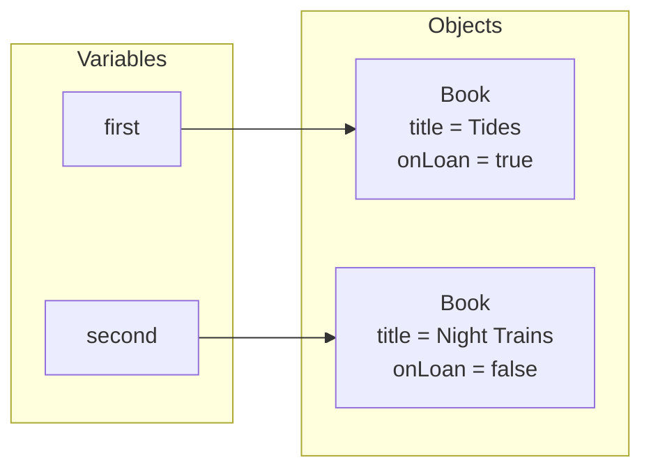

# Classes and objects: blueprint and building

> **Before this lesson:** you can write a class with a `main` method, declare variables, and use `if` and `while` ([Anatomy of a class, main, and your first statements](#/lesson/java/java-class-anatomy)).

## In plain words

An architect draws one blueprint for a house. A builder can use that single drawing to put up fifty houses on a street. Every house has the same layout, yet each has its own address, its own paint colour and its own people inside. Painting house number 4 green does nothing to house number 9.

In Java:

- the blueprint is a **class**: a description of what a kind of thing knows and what it can do;
- each house is an **object**: one concrete thing built from the class, with its own data. An object is also called an **instance** of its class.

A program that is organised around objects is called **object-oriented**. Java was designed for this style from the start.

Why this matters for a job: real systems are too large to hold in your head as one long list of steps. Objects let a team split a system into small parts (an `Order`, a `Customer`, a `Payment`) that each look after their own data. Every Java interview assumes you can explain the difference between a class and an object in one breath.

## What a class describes

A class answers two questions about a kind of thing.

1. **What does each one know?** These are its **instance variables**, also called **fields**. Together their values are the object's **state**.
2. **What can each one do?** These are its **methods**. Together they are the object's **behaviour**.

Take a library book. Each book knows its title and whether it is on loan. Each book can be borrowed and returned.

```java
class Book {
    String title;          // instance variable (state)
    boolean onLoan;        // instance variable (state)

    void borrow() {        // method (behaviour)
        onLoan = true;
    }

    void giveBack() {      // method (behaviour)
        onLoan = false;
    }

    void describe() {
        System.out.println(title + (onLoan ? " is out" : " is on the shelf"));
    }
}
```

Reading it line by line:

- `class Book {` opens the blueprint. Nothing exists yet; this is only the drawing.
- `String title;` and `boolean onLoan;` say that **every** `Book` object will carry its own title and its own on-loan flag. These variables are declared inside the class but outside any method, which is what makes them instance variables.
- `void borrow() { onLoan = true; }` is a method. When it runs, it changes the `onLoan` value **of the particular book it was called on**.
- `onLoan ? " is out" : " is on the shelf"` is the **conditional operator**. It reads "if `onLoan` is true use the first text, otherwise the second". It is a compact `if`/`else` that produces a value.

## Making objects with new

A class by itself does nothing. To get an actual book you write `new Book()`.

```java
public class LibraryDemo {
    public static void main(String[] args) {
        Book first = new Book();        // build one Book object
        first.title = "Tides";          // set its state

        Book second = new Book();       // build another, separate object
        second.title = "Night Trains";

        first.borrow();                 // only the first book changes

        first.describe();
        second.describe();
    }
}
```

```text
Tides is out
Night Trains is on the shelf
```

Three things happen in `Book first = new Book();`

1. `Book first` declares a variable named `first` that can refer to a `Book`.
2. `new Book()` asks the JVM to set aside memory for a new `Book` object and fill its fields with starting values.
3. `=` connects the two: the variable now **refers to** the object.

The **dot operator** `.` means "go to the object this variable refers to". `first.title = "Tides"` stores text in the first book's `title` field. `first.borrow()` runs the `borrow` method on the first book. The second book is a separate object with separate fields, so its `onLoan` is untouched.



### Fields start with default values

In the example `second.onLoan` was never set, yet `describe` worked. Instance variables always receive a default value when the object is created:

| Field type | Default |
|---|---|
| whole numbers (`int`, `long`, ...) | `0` |
| fractional numbers (`double`, `float`) | `0.0` |
| `boolean` | `false` |
| `char` | the character with code 0 |
| any object type such as `String` | `null`, meaning "refers to nothing" |

This differs from local variables (those declared inside a method), which have **no** default and must be assigned before use.

## One class, many independent objects

A counter that tracks visitors at a museum door shows the independence clearly.

```java
class DoorCounter {
    String door;
    int visitors;

    void click() {
        visitors = visitors + 1;
    }

    void report() {
        System.out.println(door + ": " + visitors);
    }
}

public class Museum {
    public static void main(String[] args) {
        DoorCounter north = new DoorCounter();
        north.door = "North";
        DoorCounter south = new DoorCounter();
        south.door = "South";

        north.click();
        north.click();
        south.click();
        north.click();

        north.report();
        south.report();
    }
}
```

```text
North: 3
South: 1
```

There is one `click` method in the blueprint, but each call works on the fields of the object in front of the dot. `north.click()` adds one to `north`'s `visitors`; `south`'s number is a different piece of memory.

### A model you can run

The simulation below copies what the JVM does: each `new` creates a separate record of fields, and calling a method on an object changes that record only.

```python-run
# Model: a "heap" of objects, each a dict of fields. Variables hold object ids.
heap = {}
next_id = 1

def new(cls, **defaults):
    global next_id
    oid = next_id; next_id += 1
    heap[oid] = {"class": cls, **defaults}
    return oid

def click(oid):                      # the single method body, applied to one object
    heap[oid]["visitors"] += 1

north = new("DoorCounter", door=None, visitors=0)
south = new("DoorCounter", door=None, visitors=0)
heap[north]["door"] = "North"
heap[south]["door"] = "South"

for who in (north, north, south, north):
    click(who)

for name, ref in (("north", north), ("south", south)):
    print(f"variable {name} -> object #{ref}: {heap[ref]}")
```

Add a third counter called `east`, click it five times, and confirm the other two do not move.

## Where does main go? The tester-class pattern

`main` is not a natural part of a `Book` or a `DoorCounter`. A common pattern while learning is to keep two classes:

- the **real class** (`Book`), which models the thing;
- a **tester class** (`LibraryDemo`), which holds `main`, creates objects and tries them out.

Both classes may sit in the same file while you experiment, as long as at most one of them is `public` and the file is named after that one. In real projects each class gets its own file, and tests are written with a testing library such as JUnit.

`main` is only the spark that starts things. A well-shaped object-oriented program spends very little time in `main`: it creates a few objects, asks one of them to begin, and the objects then call each other's methods.

## Objects talking to objects

Objects become useful when they hold references to other objects and send them messages (which is another way of saying "call their methods"). Here a `Shelf` keeps two books.

```java
class Shelf {
    Book left;
    Book right;

    int countAvailable() {
        int n = 0;
        if (!left.onLoan) {
            n = n + 1;
        }
        if (!right.onLoan) {
            n = n + 1;
        }
        return n;
    }
}

public class ShelfDemo {
    public static void main(String[] args) {
        Book a = new Book();
        a.title = "Tides";
        Book b = new Book();
        b.title = "Night Trains";

        Shelf shelf = new Shelf();
        shelf.left = a;
        shelf.right = b;

        b.borrow();
        System.out.println("Available: " + shelf.countAvailable());
    }
}
```

```text
Available: 1
```

- `Book left;` inside `Shelf` is an instance variable whose type is another class. A `Shelf` object does not contain a copy of a book; it holds a reference to a `Book` object.
- `int countAvailable()` declares a method that hands back an `int`. The statement `return n;` ends the method and sends the value of `n` to the caller.
- `shelf.left = a;` makes the shelf's `left` field refer to the same object that `a` refers to. When `b.borrow()` runs, the shelf sees the change, because `shelf.right` and `b` are two names for one object.

That last point (two variables, one object) is central to Java and gets a full lesson: [References, arrays, the stack and the heap](#/lesson/java/java-references-stack-heap).

## The null trap

A field of an object type starts as `null`. Using the dot on `null` fails at run time.

```java
public class NullDemo {
    public static void main(String[] args) {
        Shelf shelf = new Shelf();              // left and right are null
        System.out.println(shelf.countAvailable());
    }
}
```

```text
Exception in thread "main" java.lang.NullPointerException: Cannot read field "onLoan" because "this.left" is null
        at Shelf.countAvailable(ShelfDemo.java:7)
        at NullDemo.main(NullDemo.java:4)
```

A `NullPointerException` (often shortened to NPE) is the most common runtime failure in Java. Modern JVMs print a helpful message that names the exact variable that was null. The cure is to make sure objects are fully set up before use, which is the job of constructors: see [Constructors, this and super](#/lesson/java/java-constructors).

> [!WARNING]
> `Book b;` declares a variable but creates **no object**. As a field it holds `null`; as a local variable it holds nothing at all and the compiler will not let you read it. Only `new` (or a method that calls `new` for you) creates an object.

## Records: a class in one line

Many classes exist only to carry a few values. Since Java 16 a **record** declares such a class compactly.

```java
record Point(int x, int y) { }

public class RecordDemo {
    public static void main(String[] args) {
        Point p = new Point(3, 4);
        System.out.println(p.x() + " " + p.y());
        System.out.println(p);
    }
}
```

```text
3 4
Point[x=3, y=4]
```

The single line `record Point(int x, int y) { }` gives you two fields that can never change after creation, a way to create points with both values, methods `x()` and `y()` to read them, and a readable printout. You will meet records again in several lessons; for now, know that they are ordinary classes written in shorthand.

## Classes are types

When you write a class you add a new **type** to the language, alongside the built-in ones. Wherever you could write `int` or `String` you can now write `Book`:

- a variable: `Book current;`
- a field: `Book left;`
- a method input: `void shelve(Book b) { ... }`
- a method result: `Book newest() { ... }`

The compiler checks these the same way it checks numbers. `Book b = new DoorCounter();` is rejected as "incompatible types", which again moves a whole class of mistakes from run time to compile time.

> [!INTERVIEW]
> "What is the difference between a class and an object?" Answer in two sentences: *A class is a template that defines fields and methods; it exists once, in the compiled code. An object is an instance created from that template at run time with `new`; it has its own copy of the instance fields and lives on the heap.* Then give a quick example: one `Book` class, many `Book` objects.

## Pitfalls

- **Expecting objects to share fields.** Each object has its own instance variables. If you want one value shared by every object, that is a `static` field, covered in [static, final, constants and the Math class](#/lesson/java/java-static-final).
- **Forgetting `new`.** Declaring `Book b;` and then calling `b.borrow()` either fails to compile (local variable) or throws `NullPointerException` (field).
- **Putting statements directly in the class body.** `visitors = visitors + 1;` outside any method does not compile; only declarations may appear there.
- **Calling an instance method from `main` without an object.** `borrow();` inside `static main` gives "non-static method cannot be referenced from a static context". Create an object and call it through a reference.
- **Thinking the class is the object.** `Book.title = "x";` is an error: `title` belongs to individual books, not to the blueprint.

## Cheat sheet

| Idea | Java |
|---|---|
| Declare a class | `class Book { ... }` |
| Instance variable | declared in the class, outside methods: `String title;` |
| Method that returns nothing | `void borrow() { ... }` |
| Method that returns a value | `int count() { return n; }` |
| Create an object | `Book b = new Book();` |
| Read / write a field | `b.title`, `b.title = "Tides";` |
| Call a method | `b.borrow();` |
| No object | `null` |
| Compact data class | `record Point(int x, int y) { }` |
| Conditional operator | `cond ? valueIfTrue : valueIfFalse` |

## Summary

- A class is a blueprint; an object is one thing built from it with `new`.
- Instance variables hold an object's state; methods are its behaviour.
- Every object has its own copies of the instance variables, with default values `0`, `false` or `null`.
- The dot operator reaches through a reference to an object's fields and methods.
- Using the dot on `null` throws `NullPointerException`.
- Writing a class creates a new type that the compiler checks like any other.

## Glossary

- **Class**: a blueprint describing the fields and methods of a kind of object.
- **Object / instance**: one concrete thing created from a class.
- **Instance variable / field**: a variable that each object carries its own copy of.
- **State**: the current values of an object's fields.
- **Behaviour**: what an object can do; its methods.
- **`new`**: the keyword that creates an object.
- **Reference**: a value that leads to an object; what an object-typed variable holds.
- **Dot operator**: `.`, used to reach a field or method of an object.
- **`null`**: the special value meaning "refers to no object".
- **NullPointerException**: the runtime failure raised when code uses the dot on `null`.
- **Record**: a compact class for unchangeable data.
- **Object-oriented**: a style of programming organised around objects that combine data and behaviour.

## Check yourself

```quiz
[
  {"q": "How many `Book` objects exist after: `Book a = new Book(); Book b = new Book(); Book c = b;`", "options": ["1", "2", "3", "0"], "answer": 1,
   "explain": "new ran twice, so there are two objects. c is a third variable but it refers to the same object as b."},
  {"q": "A class has the field `int visitors;` and no code sets it. What is `new DoorCounter().visitors`?", "options": ["null", "0", "undefined", "It does not compile"], "answer": 1,
   "explain": "Instance variables of numeric type default to 0."},
  {"q": "What does this print? `DoorCounter p = new DoorCounter(); DoorCounter q = new DoorCounter(); p.click(); p.click(); q.click(); System.out.println(p.visitors + q.visitors);`", "options": ["21", "3", "2", "1"], "answer": 1,
   "explain": "p.visitors is 2 and q.visitors is 1. Both are ints, so + adds them: 3. No String is involved, so nothing is concatenated."},
  {"q": "Does this compile, and what happens? `public static void main(String[] a) { Book b; b.borrow(); }`", "options": ["Compiles, throws NullPointerException", "Does not compile: b might not have been initialised", "Compiles and runs silently", "Does not compile: Book has no constructor"], "answer": 1,
   "explain": "b is a local variable with no value. The compiler refuses to let it be read. (As a field it would be null and throw at run time.)"},
  {"q": "A `Shelf` has the field `Book left;`. Right after `new Shelf()`, what is `left`?", "options": ["A new empty Book", "null", "0", "false"], "answer": 1,
   "explain": "Fields of object types default to null. No Book is created unless some code calls new Book()."},
  {"q": "Which part of a class describes what each object can DO?", "options": ["Instance variables", "Methods", "The class name", "The import statements"], "answer": 1,
   "explain": "Methods are behaviour. Instance variables are state."},
  {"q": "Given `record Point(int x, int y) { }` and `Point p = new Point(2, 5);` what does `System.out.println(p);` print?", "options": ["Point@1b6d3586", "(2, 5)", "Point[x=2, y=5]", "2 5"], "answer": 2,
   "explain": "Records generate a readable toString of the form Name[field=value, ...]."},
  {"q": "Why does calling `borrow();` directly inside `public static void main` fail to compile?", "options": ["main cannot call methods", "borrow is an instance method and main has no object to call it on", "borrow returns void", "Methods must be called with new"], "answer": 1,
   "explain": "Instance methods act on a particular object. Static main runs without one, so you must create an object and call b.borrow()."}
]
```

> **Source:** Head First Java, ch. 2 (classes and objects). Records checked against https://docs.oracle.com/en/java/javase/21/language/records.html and https://dev.java/learn/classes-objects/ .
