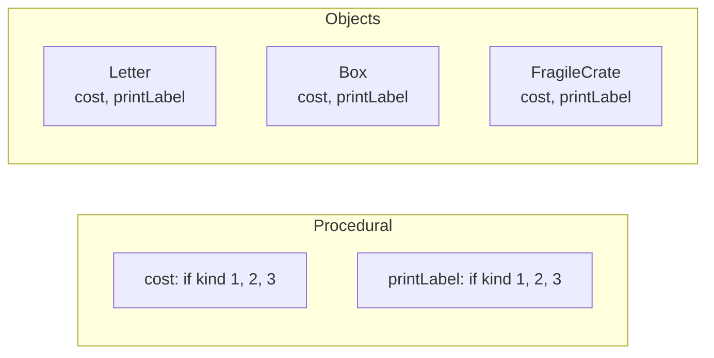
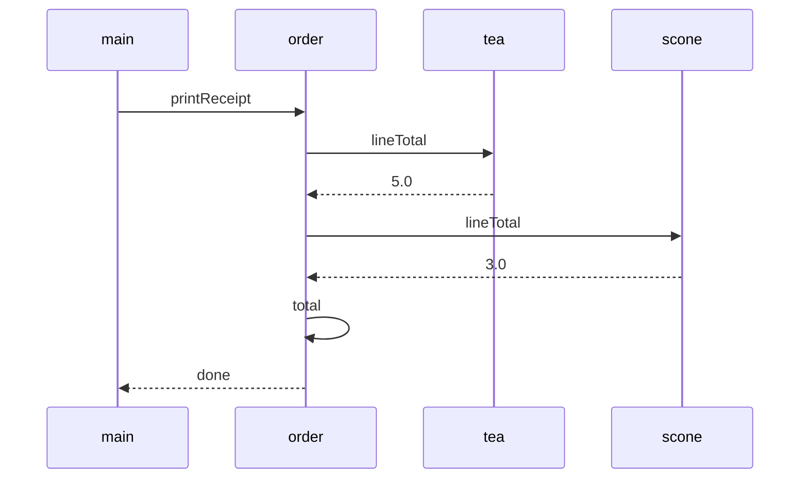

# Thinking in objects: several classes working together

> **Before this lesson:** you know that a class is a blueprint, an object is built with `new`, and each object has its own fields ([Classes and objects: blueprint and building](#/lesson/java/java-classes-vs-objects)).

## In plain words

A restaurant does not run on one person who takes orders, cooks, pours drinks and washes plates by following a single giant checklist. It runs on roles. The waiter knows the tables. The cook knows the recipes. The cashier knows the prices. Each person keeps their own notes and does their own tasks, and they cooperate by asking each other for things: "two soups for table five, please".

Writing a program as one long list of steps is called **procedural** programming. Writing it as a set of cooperating roles, each with its own data and its own tasks, is **object-oriented** programming. Neither is magic. The object-oriented style earns its keep when requirements change, because a change usually lands inside one role and leaves the others alone.

Why this matters for a job: most of a developer's time is spent changing existing code, not writing new code. Interviewers ask "how would you design X?" to see whether you can split a problem into classes with clear responsibilities.

## One problem, two designs

A parcel company needs a program that prints a shipping label and works out the cost for three kinds of parcel: letters, boxes and pallets.

### The procedural design

One method receives a code for the kind of parcel and decides what to do with a chain of `if` statements.

```java
public class ShippingProcedural {
    static double cost(int kind, double weightKg) {
        if (kind == 1) {                 // letter
            return 1.20;
        } else if (kind == 2) {          // box
            return 3.00 + 0.50 * weightKg;
        } else {                         // pallet
            return 40.00 + 0.20 * weightKg;
        }
    }

    static void printLabel(int kind, String to) {
        if (kind == 1) {
            System.out.println("[LETTER] " + to);
        } else if (kind == 2) {
            System.out.println("[BOX] " + to);
        } else {
            System.out.println("[PALLET - FORKLIFT] " + to);
        }
    }

    public static void main(String[] args) {
        printLabel(2, "14 Mill Lane");
        System.out.println(cost(2, 4.0));
    }
}
```

```text
[BOX] 14 Mill Lane
5.0
```

It works. `static double cost(int kind, double weightKg)` is a method that takes two inputs and returns a `double`. The trouble arrives with the next request.

### The change request

"We now also ship fragile crates. They cost the same as a box plus a flat 8.00, and the label must say HANDLE WITH CARE."

In the procedural design you must open **every** method that looks at `kind` and add another branch. Forget one and the fragile crate is silently treated as a pallet, because of that final `else`. With thirty methods spread over ten files, a missed branch is close to certain.

### The object-oriented design

Give each kind of parcel its own class. Each class holds its own data and knows how to price and label itself.

```java
class Letter {
    String to;

    double cost() {
        return 1.20;
    }

    void printLabel() {
        System.out.println("[LETTER] " + to);
    }
}

class Box {
    String to;
    double weightKg;

    double cost() {
        return 3.00 + 0.50 * weightKg;
    }

    void printLabel() {
        System.out.println("[BOX] " + to);
    }
}

public class ShippingObjects {
    public static void main(String[] args) {
        Box b = new Box();
        b.to = "14 Mill Lane";
        b.weightKg = 4.0;
        b.printLabel();
        System.out.println(b.cost());
    }
}
```

```text
[BOX] 14 Mill Lane
5.0
```

Now the change request means **adding one new class**, `FragileCrate`, with its own `cost` and `printLabel`. `Letter` and `Box` are not opened, so they cannot be broken. Code that was tested stays tested.

You may notice that `Letter` and `Box` repeat the `to` field. Removing that duplication is what inheritance is for, and it has its own lesson: [Inheritance: sharing code through a family tree](#/lesson/java/java-inheritance-basics).



In the procedural picture, a new kind cuts across every box. In the object picture, a new kind is one new box.

## How to find the classes

A reliable beginner method uses the problem description itself.

1. **Underline the nouns.** They are candidate classes or fields. "A *customer* places an *order* containing several *items*; each item has a *price*."
2. **Underline the verbs.** They are candidate methods. "places", "contains", "calculate the total".
3. **Ask of each noun: does it have its own data and its own things to do?** If yes, it is probably a class (`Order`). If it is a single plain value, it is probably a field (`price`).
4. **Give each class one clear job.** If you need the word "and" to describe what a class does, consider splitting it.

For each class, write down two short lists before any code:

| Class | Knows (fields) | Does (methods) |
|---|---|---|
| `Item` | name, unit price, quantity | work out its line total |
| `Order` | its items, the customer name | add an item, work out the grand total, print a receipt |

## A complete small program: a café order

The following program has three classes. Read each, then the output, then the walk-through.

```java
class Item {
    String name;
    double unitPrice;
    int quantity;

    double lineTotal() {
        return unitPrice * quantity;
    }
}

class Order {
    String customer;
    Item[] items = new Item[3];   // room for up to three items
    int count = 0;                // how many slots are filled

    void add(Item item) {
        items[count] = item;
        count = count + 1;
    }

    double total() {
        double sum = 0;
        int i = 0;
        while (i < count) {
            sum = sum + items[i].lineTotal();
            i = i + 1;
        }
        return sum;
    }

    void printReceipt() {
        System.out.println("Order for " + customer);
        int i = 0;
        while (i < count) {
            Item it = items[i];
            System.out.println("  " + it.quantity + " x " + it.name + " = " + it.lineTotal());
            i = i + 1;
        }
        System.out.println("  TOTAL " + total());
    }
}

public class Cafe {
    public static void main(String[] args) {
        Item tea = new Item();
        tea.name = "tea";
        tea.unitPrice = 2.5;
        tea.quantity = 2;

        Item scone = new Item();
        scone.name = "scone";
        scone.unitPrice = 3.0;
        scone.quantity = 1;

        Order order = new Order();
        order.customer = "Priya";
        order.add(tea);
        order.add(scone);
        order.printReceipt();
    }
}
```

```text
Order for Priya
  2 x tea = 5.0
  1 x scone = 3.0
  TOTAL 8.0
```

Walk-through of the new pieces:

- `Item[] items = new Item[3];` creates an **array**: a fixed-length row of three slots, each able to refer to an `Item`. The slots start as `null`. Arrays are covered properly in the next module; here it is enough to know that `items[0]` is the first slot.
- `void add(Item item)` takes an `Item` reference as its input. `items[count] = item;` stores that reference in the next free slot, and `count` moves up by one.
- `total()` loops over the filled slots and asks **each item** for its own `lineTotal()`. The order does not multiply prices itself. Each object does the part it has the data for.
- `printReceipt()` calls `total()`, another method of the same object. Inside a class you call your own methods by name, with no dot.

Notice who knows what. `Order` never touches `unitPrice`. If the café later introduces a discount for buying three of the same item, the change goes into `Item.lineTotal()` and nothing in `Order` moves.

> [!TIP]
> A guideline worth memorising: **put the behaviour next to the data it needs.** If a method spends its time pulling fields out of another object, it probably belongs in that other object's class.

## Following the messages

When objects cooperate, it helps to draw who calls whom. This is a **sequence diagram**: time runs downward, each column is an object, each arrow is a method call.



### A model you can run

The model mirrors the Java program: three "classes", each object holding its own data, and the order delegating the arithmetic to its items. The `log` list records every call so you can see the conversation between objects.

```python-run
log = []

class Item:
    def __init__(self, name, unit_price, quantity):
        self.name, self.unit_price, self.quantity = name, unit_price, quantity
    def line_total(self):
        log.append(f"{self.name}.lineTotal()")
        return self.unit_price * self.quantity

class Order:
    def __init__(self, customer):
        self.customer, self.items = customer, []
    def add(self, item):
        log.append(f"order.add({item.name})")
        self.items.append(item)
    def total(self):
        log.append("order.total()")
        return sum(i.line_total() for i in self.items)

order = Order("Priya")
order.add(Item("tea", 2.5, 2))
order.add(Item("scone", 3.0, 1))
print("TOTAL", order.total())
print("\nCalls made, in order:")
for line in log:
    print("  ", line)
```

Add a third item and watch the call log grow by exactly two lines: one `add`, one `lineTotal`. The `Order` code did not change.

## Responsibilities: a short checklist

Good classes tend to share a few properties. These names will come back in the interview lessons.

- **Cohesion**: everything in the class relates to one job. `Item` is about one line of an order; it does not also send emails.
- **Low coupling**: classes know as little as possible about each other's insides. `Order` knows that an `Item` can report a `lineTotal`; it does not know how.
- **Tell, don't ask**: tell an object to do something (`item.lineTotal()`) instead of asking for its raw data and doing the work elsewhere (`item.unitPrice * item.quantity` scattered in five places).

> [!INTERVIEW]
> "Why object-oriented programming?" Avoid buzzwords alone. Give the mechanism: *data and the code that works on it are kept together in a class, so a change in requirements usually touches one class; new variants are added as new classes without editing tested code; and objects can be swapped for others that offer the same methods.* Then name the four pillars you will study in this track: **encapsulation**, **inheritance**, **polymorphism** and **abstraction**.

## The four pillars, previewed

| Pillar | One-line meaning | Lesson |
|---|---|---|
| Encapsulation | Hide an object's fields and expose a small set of methods | [Encapsulation](#/lesson/java/java-encapsulation) |
| Inheritance | A new class reuses and extends an existing one | [Inheritance basics](#/lesson/java/java-inheritance-basics) |
| Polymorphism | One call such as `parcel.cost()` runs different code depending on the object's real class | [Polymorphism](#/lesson/java/java-polymorphism) |
| Abstraction | Work with what a thing can do (an interface) and ignore how | [Interfaces](#/lesson/java/java-interfaces) |

## Where objects live: a first look at the heap

Every object created with `new` is placed in a region of memory called the **heap**. The heap is managed by the JVM. When no variable or field refers to an object any more, the object is unreachable, and the **garbage collector** may reclaim its memory.

```java
Item a = new Item();   // object 1
Item b = new Item();   // object 2
a = b;                 // a now refers to object 2; nothing refers to object 1
```

After the third line, object 1 can never be used again by this program. It is eligible for garbage collection. You do not delete it yourself. The full story is in [Object lifecycle, scope and garbage collection](#/lesson/java/java-object-lifecycle-gc).

## Pitfalls

- **The "god class".** One enormous class that knows and does everything is procedural code wearing a costume. Split by responsibility.
- **Classes with only data and no behaviour**, plus a separate class of methods that operate on them. Sometimes right (records carrying data between layers), but often a sign that behaviour is in the wrong place.
- **Type codes.** A field such as `int kind` with `if (kind == 1)` scattered around is the procedural design sneaking back. Separate classes, or an `enum`, serve better.
- **Overflowing a fixed array.** Calling `order.add` a fourth time above throws `ArrayIndexOutOfBoundsException`. The growable `ArrayList` solves this: [ArrayList and reading the API documentation](#/lesson/java/java-arraylist-api).
- **Designing for imaginary needs.** Do not invent ten classes for features nobody asked for. Start with the nouns in today's requirements.

## Cheat sheet

| Question | Rule of thumb |
|---|---|
| What becomes a class? | A noun with its own data and its own tasks |
| What becomes a field? | A plain value that describes an object |
| What becomes a method? | A verb: something an object does |
| Where does a method go? | In the class that owns the data it needs |
| How do objects cooperate? | One holds a reference to another and calls its methods |
| How should a new variant be added? | As a new class, leaving existing ones untouched |
| Where do objects live? | On the heap, until nothing refers to them |

## Summary

- Procedural code is one long recipe; object-oriented code is a team of roles.
- Keeping data and behaviour together means a requirement change usually touches one class.
- Find classes from nouns, methods from verbs, and list what each class knows and does before coding.
- Objects cooperate by holding references to each other and calling methods.
- Aim for cohesion, low coupling and "tell, don't ask".
- Objects live on the heap and are reclaimed automatically when unreachable.

## Glossary

- **Procedural programming**: organising a program as steps that operate on separate data.
- **Object-oriented programming**: organising a program as objects that combine data with behaviour.
- **Responsibility**: the job a class is in charge of.
- **Cohesion**: how closely the parts of one class relate to a single job.
- **Coupling**: how much one class depends on the details of another.
- **Delegation**: an object asking another object to do part of the work.
- **Sequence diagram**: a drawing of method calls between objects over time.
- **Array**: a fixed-length row of slots of one type.
- **Heap**: the memory region where all objects are stored.
- **Garbage collection**: automatic reclaiming of objects that can no longer be reached.

## Check yourself

```quiz
[
  {"q": "A new parcel type must be supported. In the object-oriented design, what is the typical change?", "options": ["Edit every method that checks the kind code", "Add one new class with its own cost and printLabel", "Rewrite main", "Add a new branch to each existing class"], "answer": 1,
   "explain": "Each variant is its own class, so a new variant is a new class and existing tested classes stay closed."},
  {"q": "Which is the best home for a method that computes `unitPrice * quantity`?", "options": ["The Order class", "The class with main", "The Item class, which owns both fields", "A separate Calculator class"], "answer": 2,
   "explain": "Put behaviour next to the data it needs. Item owns unitPrice and quantity."},
  {"q": "What does this print? `Item a = new Item(); a.quantity = 2; Item b = a; b.quantity = 5; System.out.println(a.quantity);`", "options": ["2", "5", "0", "It does not compile"], "answer": 1,
   "explain": "b = a copies the reference, not the object. Both names refer to one Item, so the change through b is seen through a."},
  {"q": "`Item[] items = new Item[3];` How many Item objects exist right after this line?", "options": ["3", "1", "0", "It depends on the JVM"], "answer": 2,
   "explain": "The array has three slots, each holding null. No Item is created until new Item() runs."},
  {"q": "Does this compile? `class Order { int count; count = count + 1; }`", "options": ["Yes", "No: a statement cannot appear directly in a class body", "No: count is not initialised", "Yes, but it throws at run time"], "answer": 1,
   "explain": "Only declarations (fields, methods, nested types) may sit directly in a class. Statements must be inside a method or initialiser block."},
  {"q": "What does 'low coupling' mean?", "options": ["Classes have few fields", "Classes depend as little as possible on each other's internal details", "Methods are short", "There is only one class"], "answer": 1,
   "explain": "Coupling measures dependency between classes. Low coupling lets one class change without breaking others."},
  {"q": "After `Item a = new Item(); Item b = new Item(); a = b;` how many objects are eligible for garbage collection?", "options": ["0", "1", "2", "It cannot be known"], "answer": 1,
   "explain": "The first object has no remaining references, so it is unreachable. The second is referred to by both a and b."}
]
```

> **Source:** Head First Java, ch. 2 (object-oriented versus procedural design, the heap). Additional reading: https://dev.java/learn/oop/ .
