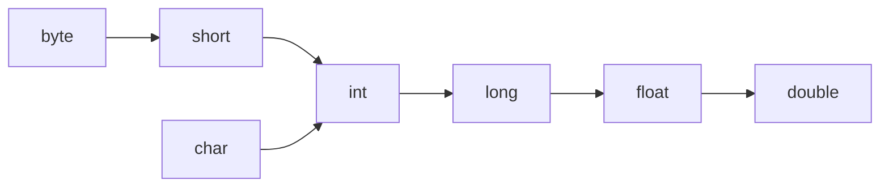

# Primitive types and how numbers are stored

> **Before this lesson:** you can declare variables such as `int crates = 12;` and write `if` and `while` ([Anatomy of a class, main, and your first statements](#/lesson/java/java-class-anatomy)). No knowledge of binary is assumed.

## In plain words

Think of the cups in a coffee shop: espresso, small, medium, large. Each size holds a fixed amount. Pour a large coffee into an espresso cup and most of it spills. Pour an espresso into a large cup and it fits with room to spare.

Java variables are cups. For plain values such as numbers, single characters and true/false, Java offers eight cup sizes called the **primitive types**. Each has a fixed size in memory and therefore a fixed range of values. The compiler stops you pouring a big cup into a small one unless you say explicitly "I accept the spill".

Why this matters for a job: money totals that silently wrap round to negative numbers, averages that lose their fraction, and loops that never end because a counter overflowed are real production bugs. "What does this arithmetic print?" is one of the most common Java screening questions.

## Bits and bytes in sixty seconds

Computer memory is a long row of switches that are either off or on, written 0 and 1. One switch is a **bit**. Eight bits form a **byte**. With 8 bits there are $2^8 = 256$ different on/off patterns, so one byte can stand for 256 different values. With 32 bits there are $2^{32}$, a little over four billion.

A type's size in bits decides how many different values it can hold. That is the entire reason the ranges below look the way they do.

## The eight primitive types

| Type | Size | Holds | Range | Example literal |
|---|---|---|---|---|
| `byte` | 8 bits | whole number | -128 to 127 | `byte b = 100;` |
| `short` | 16 bits | whole number | -32,768 to 32,767 | `short s = 3000;` |
| `int` | 32 bits | whole number | about -2.1 billion to 2.1 billion | `int i = 250000;` |
| `long` | 64 bits | whole number | about ±9.2 quintillion | `long n = 9000000000L;` |
| `float` | 32 bits | fractional number | about 7 significant digits | `float f = 2.5f;` |
| `double` | 64 bits | fractional number | about 15 significant digits | `double d = 2.5;` |
| `char` | 16 bits | one character | 0 to 65,535 (a character code) | `char c = 'K';` |
| `boolean` | not specified | truth value | `true` or `false` | `boolean ok = true;` |

A **literal** is a value written directly in the code, such as `42` or `'K'`.

Everyday guidance:

- Use `int` for whole numbers unless you have a reason not to.
- Use `long` when values can pass two billion: timestamps in milliseconds, file sizes, database ids.
- Use `double` for measurements and scientific values. Do **not** use it for money; see below.
- `byte`, `short` and `float` are for special situations such as large arrays of raw data.

Literal rules that trip people up:

- A whole-number literal is an `int`. To write a `long` literal add `L`: `9000000000L`. Without the `L` that number does not compile, because it is too large for an `int`.
- A literal with a decimal point is a `double`. To write a `float` literal add `f`: `2.5f`.
- Underscores may be used to make long numbers readable: `1_000_000`.
- A `char` uses **single** quotes and holds exactly one character: `'K'`. Double quotes make a `String`, which is an object, not a primitive.

## Integer division and remainder

When both sides of `/` are whole-number types, Java does **integer division**: the fractional part is discarded (the result moves toward zero).

```java
public class Division {
    public static void main(String[] args) {
        System.out.println(17 / 5);      // int / int
        System.out.println(17 % 5);      // remainder
        System.out.println(-17 / 5);     // truncates toward zero
        System.out.println(-17 % 5);     // sign follows the left operand
        System.out.println(17 / 5.0);    // one double makes it double division
        System.out.println(1 / 2 * 10);  // left to right: (1 / 2) is 0
    }
}
```

```text
3
2
-3
-2
3.4
0
```

- `17 / 5` is 3 because 5 goes into 17 three whole times.
- `%` is the **remainder** operator: what is left after integer division. `17 % 5` is 2.
- With negative numbers Java rounds the quotient toward zero, so `-17 / 5` is `-3`, and the remainder takes the sign of the left-hand value: `-2`. (Python gives `-4` and `3` for the same inputs. This difference is a classic trap.)
- If either side is a `double`, the other is converted to `double` and you get ordinary division.
- The last line shows order: `1 / 2` is computed first, giving `0`, and `0 * 10` is `0`.

A handy identity always holds for whole numbers: `(a / b) * b + (a % b) == a`.

## Overflow: when the cup is full

An `int` has exactly 32 bits. If a result needs more, the extra bits are dropped and the value **wraps around** with no error and no warning.

```java
public class Overflow {
    public static void main(String[] args) {
        int big = Integer.MAX_VALUE;          // 2147483647
        System.out.println(big);
        System.out.println(big + 1);          // wraps to the most negative int

        int msPerDay = 24 * 60 * 60 * 1000;   // 86,400,000 fits
        int msPer30Days = msPerDay * 30;      // 2,592,000,000 does not fit
        System.out.println(msPer30Days);

        long correct = msPerDay * 30L;        // 30L forces long arithmetic
        System.out.println(correct);
    }
}
```

```text
2147483647
-2147483648
-1702967296
2592000000
```

`Integer.MAX_VALUE` is a named constant holding the largest `int`. Adding 1 gives the smallest. Think of a car's mileage counter rolling from 999999 to 000000, except that the roll-over lands on the most negative number.

The line `long wrong = msPerDay * 30;` would **still** be wrong: the multiplication happens in `int` (both operands are `int`), overflows, and only then is the wrapped result widened to `long`. Making one operand a `long` (`30L`) makes the whole multiplication happen in 64 bits.

> [!WARNING]
> The type of an arithmetic result is decided by the operand types, never by the variable you store it in. `long x = intA * intB;` overflows first and widens afterwards.

If you want an error instead of silent wrap-around, use `Math.addExact`, `Math.multiplyExact` and friends; they throw `ArithmeticException` on overflow.

### A wrap-around model you can run

Python integers never overflow, so we can model Java's rule exactly: keep the low 32 (or 64) bits and reinterpret the top bit as the sign.

```python-run
def wrap(v, bits):
    """What Java stores when the true result is v, for an int (32) or long (64)."""
    v &= (1 << bits) - 1                 # keep only the low bits
    return v - (1 << bits) if v >= 1 << (bits - 1) else v

def jdiv(a, b):                          # Java integer division: toward zero
    q = abs(a) // abs(b)
    return q if (a < 0) == (b < 0) else -q

def jmod(a, b):                          # Java remainder: sign of the left operand
    return a - jdiv(a, b) * b

print("MAX + 1        :", wrap(2147483647 + 1, 32))
print("ms in 30 days  :", wrap(86_400_000 * 30, 32), "(int)   ", wrap(86_400_000 * 30, 64), "(long)")
print("-17 / 5, -17 % 5:", jdiv(-17, 5), jmod(-17, 5), "  (Python gives", -17 // 5, -17 % 5, ")")
print("MIN * -1       :", wrap(-2147483648 * -1, 32))
```

The last line is a famous oddity: negating the smallest `int` gives the same number back, because +2,147,483,648 does not exist in 32 bits. For the same reason `Math.abs(Integer.MIN_VALUE)` is negative.

You can also explore bit patterns with the widget:

<div class="widget" data-widget="bits"></div>

## Widening and narrowing

Moving a value into a bigger cup is always safe, so Java does it automatically. This is **widening**. The allowed automatic direction is:



Moving into a smaller cup might lose information, so the compiler demands a **cast**: the target type in parentheses, which is your written promise that you accept the loss. This is **narrowing**.

```java
public class Casting {
    public static void main(String[] args) {
        int crates = 42;
        long big = crates;               // widening: automatic
        double d = crates;               // widening: 42.0

        double price = 9.99;
        // int bad = price;              // does not compile: possible lossy conversion
        int whole = (int) price;         // narrowing cast: fraction is cut off
        System.out.println(whole);

        int large = 300;
        byte small = (byte) large;       // keeps the low 8 bits
        System.out.println(small);

        System.out.println((int) -3.7);  // toward zero, not rounding
        System.out.println(Math.round(-3.7));
    }
}
```

```text
9
44
-3
-4
```

- `(int) 9.99` is `9`. A cast from fractional to whole **truncates**; it does not round. Use `Math.round` to round.
- `(byte) 300` keeps the low 8 bits. 300 is 256 + 44, so the result is 44.
- Widening `long` to `float` or `double` is automatic even though very large `long` values lose their last digits. It is allowed because the magnitude survives.

### The small-type promotion rule

In arithmetic, `byte`, `short` and `char` are first converted to `int`. The result is therefore an `int`:

```java
byte a = 10;
byte b = 20;
// byte c = a + b;        // does not compile: a + b is an int
byte c = (byte) (a + b);   // fine
a += b;                    // also fine: compound assignment contains a hidden cast
```

The **compound assignment** operators (`+=`, `-=`, `*=`, `/=`) cast the result back to the variable's type for you. That is convenient, and it also means `a += 1000;` on a `byte` compiles and silently wraps.

## char is a number in disguise

A `char` stores a character's numeric code from the **Unicode** table, the international list that assigns a number to every character. `'A'` is 65, `'a'` is 97, `'0'` is 48.

```java
public class Chars {
    public static void main(String[] args) {
        char letter = 'A';
        System.out.println(letter);          // prints the character
        System.out.println(letter + 1);      // char + int is an int
        System.out.println((char) (letter + 1));
        System.out.println('7' - '0');       // digit character to its value
        letter++;                            // ++ keeps the type char
        System.out.println(letter);
    }
}
```

```text
A
66
B
7
B
```

`letter + 1` is an `int` (the promotion rule), so `println` shows the number 66. Casting back to `char` shows `B`. Subtracting `'0'` from a digit character is the standard trick for turning `'7'` into the number 7.

## Text plus numbers: the left-to-right rule

`+` means addition for numbers and concatenation when either side is a `String`. Java evaluates `+` from left to right, and that decides which meaning applies at each step.

```java
System.out.println(1 + 2 + "3");     // 3 then "33"
System.out.println("1" + 2 + 3);     // "12" then "123"
System.out.println('a' + 'b');       // two chars: numeric addition
System.out.println("" + 'a' + 'b');  // starts as text
System.out.println('a' + 1 + "z");   // 98 then "98z"
```

```text
33
123
195
ab
98z
```

Read each from the left. `1 + 2` is numeric: 3. Then `3 + "3"` involves a `String`, so it concatenates: `"33"`. In the third line no `String` appears at all, so the two `char` values are added as numbers: 97 + 98.

## Fractional numbers are approximate

`float` and `double` store numbers in binary **floating point**, a format that cannot represent most decimal fractions exactly, in the same way that one third cannot be written exactly in decimal.

```java
System.out.println(0.1 + 0.2);
System.out.println(0.1 + 0.2 == 0.3);
System.out.println(1.0 / 0);          // no exception for doubles
System.out.println(0.0 / 0);
```

```text
0.30000000000000004
false
Infinity
NaN
```

Consequences:

- Never compare `double` values with `==`. Check that their difference is tiny: `Math.abs(a - b) < 1e-9`.
- Never store money in `double`. Use whole numbers of the smallest unit (`long` cents) or `BigDecimal`, covered in [Everyday habits: scope, for-each, libraries, money and boxing](#/lesson/java/java-ej-everyday-habits).
- Dividing a `double` by zero gives `Infinity` or `NaN` ("not a number") instead of throwing. `NaN` is not equal to anything, including itself.

<div class="widget" data-widget="float"></div>

## Increment, decrement and their two forms

`i++` and `++i` both add one to `i`. They differ in the **value of the expression**:

```java
int i = 5;
int a = i++;   // a gets the OLD value 5, then i becomes 6
int b = ++i;   // i becomes 7 first, then b gets 7
System.out.println(i + " " + a + " " + b);
```

```text
7 5 7
```

Used on a line alone (`i++;`) the two forms are identical. Avoid mixing them into larger expressions; interviewers do it to test you, and good code does not.

> [!INTERVIEW]
> Expect: "What is the output of `int x = 5; x = x++ + ++x;`?" Work left to right. `x++` yields 5 and makes x 6. `++x` makes x 7 and yields 7. The sum 12 is then assigned to x. Answer: 12. Add that you would never write this in production.

## Bitwise operators: working on the switches directly

So far numbers were quantities. Sometimes a number is better thought of as a **row of independent on/off switches**: the permissions on a file, the options of a feature, the red, green and blue parts of a colour. The **bitwise operators** work on those switches one position at a time. Picture a bank of light switches on a wall: you can flip one switch without touching its neighbours.

> [!NOTE]
> This section uses the idea of a bit from "Bits and bytes in sixty seconds" and the casting rules above. It is a favourite interview topic, but it also appears in real code: network addresses, graphics, hash functions and compact flag fields.

### Reading binary and two's complement

Whole numbers are written in **binary** (base 2), where each position is worth double the one to its right: 1, 2, 4, 8, 16, and so on. Reading `1100` from the right: 0 ones, 0 twos, 1 four, 1 eight, so 4 + 8 = 12.

Java lets you write numbers in other bases directly. A **binary literal** starts with `0b`, a **hexadecimal literal** (base 16, digits 0-9 then a-f) starts with `0x`. Hex is popular because one hex digit is exactly four bits. Underscores are allowed for readability.

```java
int a = 0b1100;          // 12
int b = 0x0C;            // also 12
int c = 0b1111_0000;     // 240
int d = 0xFF;            // 255, eight ones
```

How does an `int` hold a **negative** number? Java uses **two's complement**: the leftmost of the 32 bits, the **sign bit**, is worth a large negative amount (-2^31) instead of a large positive one. The rule to negate a number: flip every bit, then add 1.

| Step | Pattern (shown with 8 bits for readability) | Value |
|---|---|---|
| start | `00000101` | 5 |
| flip every bit | `11111010` | -6 |
| add 1 | `11111011` | -5 |

So `-5` is a pattern of mostly ones, and `-1` is all ones. This explains the overflow wrap in the previous section: adding 1 to `0111...1` carries into the sign bit and gives `1000...0`, the most negative number.

### The six operators

| Operator | Name | Rule, applied to each bit position |
|---|---|---|
| `a & b` | AND | 1 only if both bits are 1 |
| `a \| b` | OR | 1 if at least one bit is 1 |
| `a ^ b` | XOR (exclusive or) | 1 if the bits differ |
| `~a` | NOT (complement) | flips every bit |
| `a << n` | left shift | moves bits left by n, fills with zeros |
| `a >> n` / `a >>> n` | right shift | moves bits right by n (two kinds, below) |

```java
public class BitOps {
    public static void main(String[] args) {
        int a = 0b1100;   // 12
        int b = 0b1010;   // 10
        System.out.println(a & b);   // 1000
        System.out.println(a | b);   // 1110
        System.out.println(a ^ b);   // 0110
        System.out.println(~a);      // flips all 32 bits
        System.out.println(Integer.toBinaryString(~a));
    }
}
```

```text
8
14
6
-13
11111111111111111111111111110011
```

Line by line: `1100 & 1010` keeps the positions where both are 1, which is `1000`, or 8. `|` keeps positions where either is 1, `1110`, or 14. `^` keeps positions where they differ, `0110`, or 6. `~12` flips all 32 bits, and by the negation rule above, `~x` always equals `-x - 1`, so the result is -13. `Integer.toBinaryString` returns the bits as text, **without leading zeros**, which is why a negative number shows all 32 digits and a small positive number shows few.

> [!WARNING]
> `&`, `|` and `^` also work on `boolean` values, but `&` and `|` always evaluate **both** sides, unlike `&&` and `||`, which stop early. Use the doubled forms for conditions.

### Shifts: signed, unsigned, and why Java has `>>>`

Shifting slides the whole row of bits. `x << n` moves them left and fills the gap on the right with zeros. For an `int` that is multiplication by 2^n, as long as nothing falls off the left end.

Right shifts have a decision to make: what fills the gap on the **left**? Java offers two answers.

- `>>` is the **signed (arithmetic) right shift**. It copies the sign bit into the gap, so a negative number stays negative. It divides by 2^n, rounding toward negative infinity.
- `>>>` is the **unsigned (logical) right shift**. It always fills with zeros, so the result is non-negative whenever n is at least 1.

Why does Java need both? Because the leftmost bit means "negative" for a number but may be only another data bit when you treat the int as raw bits (a hash, a packed colour, a bit set). Java defines one portable behaviour for each operator, so the same code gives the same answer on every machine.

```java
public class Shifts {
    public static void main(String[] args) {
        int x = -16;                    // 11111111111111111111111111110000
        System.out.println(x >> 2);     // sign copied in
        System.out.println(x >>> 28);   // zeros copied in: only the top 4 bits remain
        System.out.println(x >>> 2);    // a huge positive number
        System.out.println(x << 1);
        System.out.println(-5 >> 1);    // rounds toward negative infinity
        System.out.println(-5 / 2);     // division truncates toward zero
        System.out.println(1 << 31);    // lands in the sign bit
        System.out.println(1 << 32);    // distance is taken modulo 32
        System.out.println(1L << 32);   // long has room
    }
}
```

```text
-4
15
1073741820
-32
-3
-2
-2147483648
1
4294967296
```

Notes on the results:

- `-16 >> 2` is -4: the pattern slides right and ones fill in from the left.
- `-16 >>> 28` leaves only the top four bits, `1111`, which is 15.
- `-5 >> 1` is -3 but `-5 / 2` is -2. They agree for non-negative numbers and differ for negative odd ones. This is a common trick question.
- The **shift distance** is reduced to the low 5 bits for `int` (low 6 for `long`), so `1 << 32` is `1 << 0`, which is 1. Shifting by 32 does not clear the number, as many beginners expect.
- There is no `<<<`: a left shift fills with zeros either way.
- Precedence trap: `+` binds tighter than `<<`, so `1 << 2 + 1` means `1 << 3`, which is 8. Use parentheses.

### What happens to `byte` and `short`

The promotion rule from earlier applies here too: `byte`, `short` and `char` operands are converted to `int` **before** any bitwise operator or shift runs, and the conversion copies the sign bit (this is called **sign extension**). The result is an `int`.

```java
public class SmallTypes {
    public static void main(String[] args) {
        byte b = (byte) 0xF0;                          // -16
        System.out.println(Integer.toBinaryString(b)); // b became an int first
        System.out.println(b >>> 4);                   // unexpected
        System.out.println((b & 0xFF) >>> 4);          // intended
        System.out.println(Integer.toBinaryString(b & 0xFF));
        b >>>= 4;                                      // compound assignment casts back
        System.out.println(b);
    }
}
```

```text
11111111111111111111111111110000
268435455
15
11110000
-1
```

The byte `0xF0` is -16, and as an `int` it grows 24 extra ones on the left. So `b >>> 4` shifts a full 32-bit pattern of ones and gives 268,435,455. The fix is the **mask** `& 0xFF`: it keeps the low eight bits and clears the rest, which recovers the byte as the unsigned value 240. Use `& 0xFF` whenever you want a byte treated as 0 to 255. The last line shows the same bug hiding inside `>>>=`: the shift happens on the `int`, and the hidden cast keeps only the low byte, which is all ones again, so `b` becomes -1 and not 15.

### Masks and flags: set, clear, toggle, test

A **mask** is a number whose 1-bits select positions. A **flag** is a single bit that stands for one yes/no option. Giving each option its own bit lets one `int` hold many options.

```java
public class Flags {
    static final int READ  = 1 << 0;   // 001
    static final int WRITE = 1 << 1;   // 010
    static final int EXEC  = 1 << 2;   // 100

    public static void main(String[] args) {
        int perms = READ | EXEC;                      // combine with OR
        System.out.println(perms);
        System.out.println((perms & WRITE) != 0);     // test one bit
        perms |= WRITE;                               // set
        System.out.println(perms);
        perms &= ~EXEC;                               // clear
        System.out.println(perms);
        perms ^= READ;                                // toggle
        System.out.println(perms);
    }
}
```

```text
5
false
7
3
2
```

The four recipes, each worth memorising:

| Goal | Code | Why it works |
|---|---|---|
| set bit | `x \|= MASK` | OR with 1 forces 1, OR with 0 changes nothing |
| clear bit | `x &= ~MASK` | `~MASK` has 0 at the target and 1 elsewhere, so AND wipes only the target |
| toggle bit | `x ^= MASK` | XOR with 1 flips, XOR with 0 keeps |
| test bit | `(x & MASK) != 0` | AND leaves only the target bit; non-zero means it was on |

Always compare to `!= 0`, not `== 1`: a mask such as `4` produces 4, not 1.

The same tools pack and unpack **fields**. A colour like `0x336699` stores red, green and blue in one byte each:

```java
int rgb = 0x336699;
int red   = (rgb >> 16) & 0xFF;   // 51
int green = (rgb >> 8)  & 0xFF;   // 102
int blue  =  rgb        & 0xFF;   // 153
int packed = (red << 16) | (green << 8) | blue;
System.out.println(Integer.toHexString(packed));   // 336699
```

Shift the wanted field down to the right edge, then mask off everything above it. To pack, shift each part up and OR the parts together.

### EnumSet: the readable alternative

Bit flags are compact but easy to misuse: a typo in a mask compiles fine, and `perms = 8` means nothing to a reader. When the options are a fixed list, Java has a type-safe tool that stores bits internally but reads like a normal set: `EnumSet`. It needs an **enum** (a type with a fixed list of named values); the lesson [Enums: constants with data and behaviour](#/lesson/java/java-ej-enums) covers both in depth.

```java
import java.util.EnumSet;

public class PermSet {
    enum Perm { READ, WRITE, EXEC }

    public static void main(String[] args) {
        EnumSet<Perm> perms = EnumSet.of(Perm.READ, Perm.EXEC);
        System.out.println(perms.contains(Perm.WRITE));
        perms.add(Perm.WRITE);
        perms.remove(Perm.EXEC);
        System.out.println(perms);
        System.out.println(EnumSet.complementOf(perms));
    }
}
```

```text
false
[READ, WRITE]
[EXEC]
```

`add`, `remove` and `contains` replace `|=`, `&= ~` and `& != 0`, and printing shows names instead of numbers. Prefer `EnumSet` in application code. Keep raw bit operations for protocols, hashing, graphics and performance-critical code, or when an `int` is the format you must produce.

### Interview favourites

```java
public class Tricks {
    static boolean isPowerOfTwo(int x) { return x > 0 && (x & (x - 1)) == 0; }

    public static void main(String[] args) {
        System.out.println(12 & 11);        // x & (x - 1)
        System.out.println(12 & -12);       // x & -x
        System.out.println(isPowerOfTwo(64) + " " + isPowerOfTwo(12) + " " + isPowerOfTwo(0));
        System.out.println(Integer.bitCount(255));
        System.out.println(Integer.bitCount(-1));
        System.out.println(Long.bitCount(-1L));
        System.out.println(Integer.toHexString(255));
        System.out.println(Integer.parseInt("1010", 2));
        System.out.println((-3 & 1) + " " + (-3 % 2));
    }
}
```

```text
8
4
true false false
8
32
64
ff
10
1 -1
```

- **`x & (x - 1)` clears the lowest set bit.** Subtracting 1 flips the lowest 1 to 0 and every 0 below it to 1, so the AND wipes exactly that bit. `12` (`1100`) becomes `8` (`1000`).
- **Power-of-two test.** A power of two has exactly one 1-bit, so clearing it leaves 0. The `x > 0` guard matters: zero and `Integer.MIN_VALUE` would otherwise pass.
- **`x & -x` isolates the lowest set bit.** `12 & -12` is 4.
- **Counting bits.** The hand-written loop `while (x != 0) { x &= x - 1; count++; }` runs once per 1-bit. In real code use `Integer.bitCount` (or `Long.bitCount`), which the JVM can turn into a single processor instruction. Note `bitCount(-1)` is 32, because negative numbers carry many ones.
- **Odd check.** `(x & 1) != 0` works for all integers. `x % 2 == 1` fails for negative odd numbers, since `-3 % 2` is -1.
- **Related helpers:** `Integer.highestOneBit`, `numberOfLeadingZeros`, `numberOfTrailingZeros`, `Integer.toBinaryString`, `toHexString`, and `Integer.parseInt(text, 2)` for the reverse direction.

> [!INTERVIEW]
> "Check whether an integer is a power of two in O(1)." Answer `x > 0 && (x & (x - 1)) == 0`, then explain why subtracting 1 flips the trailing bits, and mention the zero and negative cases. Expect follow-ups: count the set bits (Kernighan's loop or `Integer.bitCount`), and "what is the difference between `>>` and `>>>`?"

### A model you can run

Python has a `>>` that behaves like Java's signed shift, and no `>>>`. This model builds Java's three shifts for 32 bits, so you can test your predictions.

```python-run
MASK = 0xFFFFFFFF

def to_int(v):                       # reinterpret low 32 bits as a signed int
    v &= MASK
    return v - (1 << 32) if v >> 31 else v

def shl(x, n):  return to_int(x << (n & 31))           # distance uses low 5 bits
def shr(x, n):  return to_int(x) >> (n & 31)           # signed: Python's >> copies the sign
def ushr(x, n): return to_int((x & MASK) >> (n & 31))  # zeros fill in from the left

def bits(x):    return format(x & MASK, "032b")

x = -16
print(bits(x))
print("x >> 2   =", shr(x, 2))
print("x >>> 28 =", ushr(x, 28))
print("x >>> 2  =", ushr(x, 2))
print("1 << 31  =", shl(1, 31), "  1 << 32 =", shl(1, 32))
b = x & 0xFF                          # a byte treated as unsigned
print("byte bits:", format(b, "08b"), " >>> 4 with mask:", b >> 4)
```

Change `x` and the distances, predict the output first, then run.

## Pitfalls

- **Integer division where a fraction was wanted.** `double avg = sum / count;` with two `int`s loses the fraction. Write `(double) sum / count`.
- **Overflow in `int` multiplication** before widening to `long`.
- **Missing `L` on a large literal**: "integer number too large".
- **Missing `f` on a float literal**: `float f = 2.5;` does not compile because `2.5` is a `double`.
- **Casting instead of rounding**: `(int) 2.99` is 2.
- **`==` on doubles**, and money in doubles.
- **Assuming Python's rules** for negative division and remainder.
- **`char` arithmetic printing numbers** when a letter was expected.
- **`>>>` on a `byte`** without `& 0xFF`: the sign-extended `int` is shifted instead.
- **`x & 1 == 0`** without parentheses: `==` binds tighter than `&`, so it does not compile; write `(x & 1) == 0`.

## Cheat sheet

| Expression | Value | Why |
|---|---|---|
| `7 / 2` | `3` | integer division |
| `7 / 2.0` | `3.5` | one operand is double |
| `-7 / 2`, `-7 % 2` | `-3`, `-1` | truncation toward zero; sign of left operand |
| `Integer.MAX_VALUE + 1` | `-2147483648` | 32-bit wrap-around |
| `(int) 3.99` | `3` | cast truncates |
| `(byte) 200` | `-56` | keeps low 8 bits |
| `'A' + 1` | `66` | char promoted to int |
| `(char) ('A' + 1)` | `'B'` | cast back |
| `1 + 2 + "x"` | `"3x"` | left to right |
| `"x" + 1 + 2` | `"x12"` | left to right |
| `0.1 + 0.2 == 0.3` | `false` | binary floating point |

## Summary

- Java has eight primitives: `byte`, `short`, `int`, `long`, `float`, `double`, `char`, `boolean`.
- Sizes are fixed, so ranges are fixed; exceeding a range wraps silently.
- Integer division truncates toward zero; `%` takes the sign of the left operand.
- Widening is automatic; narrowing needs a cast and may lose data.
- `byte`, `short` and `char` are promoted to `int` in arithmetic; compound assignment hides a cast.
- `+` concatenates as soon as a `String` is involved, reading left to right.
- Floating-point numbers are approximations: no `==`, no money.
- Bitwise operators work on each bit: `&` AND, `|` OR, `^` XOR, `~` NOT; `>>` keeps the sign, `>>>` fills with zeros; `byte` and `short` are sign-extended to `int` first, so mask with `& 0xFF`.
- Set, clear, toggle and test a bit with `|=`, `&= ~`, `^=` and `(x & mask) != 0`; `EnumSet` is the readable alternative; `x & (x - 1)` and `Integer.bitCount` are the classic tricks.

## Glossary

- **Primitive type**: one of the eight built-in value types that are not objects.
- **Bit / byte**: a single 0-or-1 switch; a group of eight bits.
- **Literal**: a value written directly in source code.
- **Integer division**: division of whole numbers that discards the fraction.
- **Remainder (`%`)**: what is left over after integer division.
- **Overflow**: a result too large for its type, which wraps around.
- **Widening**: automatic conversion to a larger type.
- **Narrowing**: conversion to a smaller type, requiring a cast.
- **Cast**: a type in parentheses that forces a conversion, e.g. `(int) x`.
- **Promotion**: automatic conversion of small types to `int` in arithmetic.
- **Unicode**: the standard that assigns a number to every character.
- **Floating point**: the approximate binary format used by `float` and `double`.
- **NaN**: "not a number", the result of undefined floating-point operations.
- **Binary / hexadecimal**: writing numbers in base 2 or base 16; literals start with `0b` and `0x`.
- **Two's complement**: how Java stores negative integers: flip all bits, add 1.
- **Sign bit**: the leftmost bit of a signed integer, which marks it negative when 1.
- **Bitwise operator**: an operator (`&`, `|`, `^`, `~`, `<<`, `>>`, `>>>`) that works on each bit separately.
- **Signed (arithmetic) shift `>>`**: right shift that copies the sign bit into the gap.
- **Unsigned (logical) shift `>>>`**: right shift that fills the gap with zeros.
- **Sign extension**: copying the sign bit when a smaller integer type widens to `int`.
- **Mask**: a number whose 1-bits select which bit positions an operation affects.
- **Flag**: one bit standing for a yes/no option.
- **`EnumSet`**: a type-safe set of enum values stored internally as bits.

## Check yourself

```quiz
[
  {"q": "What does `System.out.println(10 / 4 * 4);` print?", "options": ["10", "8", "10.0", "2"], "answer": 1,
   "explain": "10 / 4 is integer division giving 2; 2 * 4 is 8."},
  {"q": "What does `System.out.println(-9 % 4);` print?", "options": ["3", "-1", "1", "-3"], "answer": 1,
   "explain": "-9 / 4 truncates to -2; the remainder is -9 - (-2 * 4) = -1. The sign follows the left operand."},
  {"q": "Does this compile? `byte a = 5; byte b = 6; byte c = a + b;`", "options": ["Yes, c is 11", "No: a + b has type int", "No: byte cannot hold 11", "Yes, but it overflows"], "answer": 1,
   "explain": "byte operands are promoted to int, so the sum is an int and needs a cast: (byte) (a + b)."},
  {"q": "What does `System.out.println(1 + 2 + \"a\" + 1 + 2);` print?", "options": ["3a3", "12a12", "3a12", "12a3"], "answer": 2,
   "explain": "Left to right: 1 + 2 = 3 (numeric), then \"3a\", then \"3a1\", then \"3a12\"."},
  {"q": "What is the value of `long t = 1000000 * 3000;` ?", "options": ["3000000000", "-1294967296", "It does not compile", "0"], "answer": 1,
   "explain": "Both literals are int, so the multiplication overflows in 32 bits before being widened. Writing 3000L fixes it."},
  {"q": "What does `System.out.println((int) 7.9 + (int) -7.9);` print?", "options": ["0", "1", "-1", "0.0"], "answer": 0,
   "explain": "Casting truncates toward zero: 7 and -7, which sum to 0."},
  {"q": "What does `char c = 'C'; c += 2; System.out.println(c);` print?", "options": ["69", "E", "C2", "It does not compile"], "answer": 1,
   "explain": "Compound assignment includes a hidden cast back to char, so c becomes the character with code 69, which is E."},
  {"q": "Does this compile? `float rate = 0.5;`", "options": ["Yes", "No: 0.5 is a double literal; write 0.5f", "No: float cannot hold fractions", "Yes, with a warning"], "answer": 1,
   "explain": "A literal with a decimal point is a double. Narrowing double to float needs the f suffix or a cast."},
  {"q": "What does `System.out.println(-16 >>> 28);` print?", "options": ["-1", "15", "-16", "0"], "answer": 1,
   "explain": "-16 is 0xFFFFFFF0. The unsigned shift moves it right by 28 and fills with zeros, leaving the top four bits 1111, which is 15."},
  {"q": "`byte b = (byte) 0xF0;` What does `b >>> 4` evaluate to?", "options": ["15", "-1", "268435455", "240"], "answer": 2,
   "explain": "b is promoted to the int -16 with sign extension, so 32 bits are shifted, giving 0x0FFFFFFF. Use (b & 0xFF) >>> 4 to get 15."},
  {"q": "Which statement clears the bit selected by `MASK` and leaves the others alone?", "options": ["x |= MASK;", "x &= ~MASK;", "x ^= MASK;", "x &= MASK;"], "answer": 1,
   "explain": "~MASK has 0 only at the target position, so AND zeroes that bit and keeps every other bit."},
  {"q": "Which expression tests whether a positive int x is a power of two?", "options": ["x % 2 == 0", "(x & (x - 1)) == 0", "(x | (x - 1)) == 0", "x >> 1 == 0"], "answer": 1,
   "explain": "A power of two has one 1-bit; x & (x - 1) clears the lowest set bit, leaving 0. (Also require x > 0 so zero and negatives are rejected.)"}
]
```

> **Source:** Head First Java, ch. 3 (primitive variables), ch. 10 (numbers) and appendix B (bit manipulation). Checked against the Java Language Specification, ch. 4 and 5 (types and conversions): https://docs.oracle.com/javase/specs/jls/se21/html/jls-5.html and https://dev.java/learn/language-basics/primitive-types/ .
