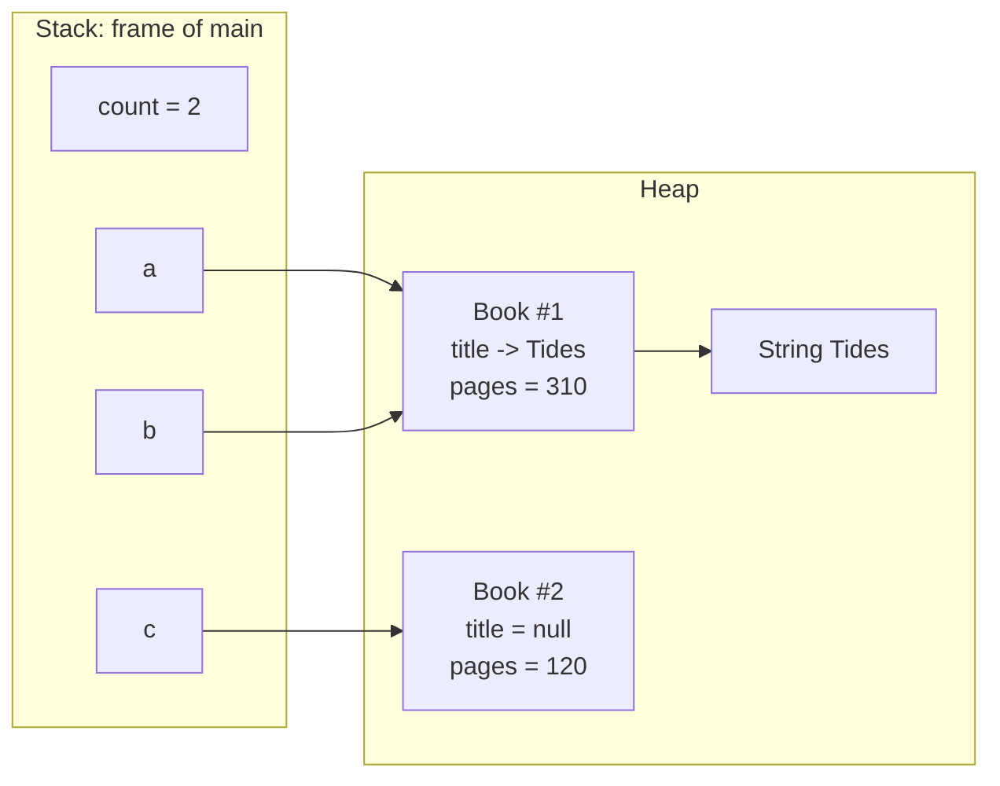
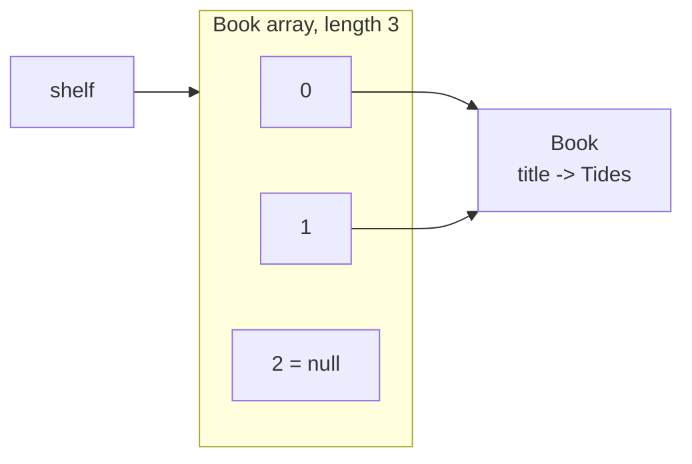

# References, arrays, the stack and the heap

> **Before this lesson:** you know the eight primitive types ([Primitive types and how numbers are stored](#/lesson/java/java-primitives)) and you can create objects with `new` ([Classes and objects: blueprint and building](#/lesson/java/java-classes-vs-objects)).

## In plain words

A television and its remote control are two different things. The remote is small and sits on your sofa. The television is large and hangs on the wall. Pressing a button on the remote changes what the television does. You can own two remotes for the same television, and either one changes the same screen. You can also have a remote that is paired with nothing; pressing its buttons achieves nothing.

In Java, an object is the television and a **reference variable** is the remote control. A variable whose type is a class never contains the object itself. It contains a **reference**: a small value that tells the JVM how to reach the object. Two variables can hold references to the same object. A variable can also hold `null`, the remote paired with nothing.

Why this matters for a job: nearly every confusing Java bug ("I changed this list and that other list changed too", "why is `==` false for two equal strings?") is explained by the difference between a reference and the object it refers to. Interviewers test it constantly.

## Two families of variables

| | Primitive variable | Reference variable |
|---|---|---|
| Declared type | one of the eight primitives (`int`, `double`, ...) | a class, interface, array or record (`String`, `Book`, `int[]`) |
| What the variable holds | the value itself | a reference to an object, or `null` |
| `b = a` copies | the value | the reference; both now reach the same object |
| `a == b` compares | the values | whether both refer to the **same object** |

```java
int x = 7;
int y = x;        // y gets its own copy of 7
y = 99;           // x is still 7

int[] p = {7, 8};
int[] q = p;      // q gets a copy of the reference
q[0] = 99;        // p[0] is now 99 too: one array, two names
```

## The stack and the heap

The JVM keeps running programs' data in two main areas.

- The **stack** holds one **frame** for each method that is currently running. A frame is a block of memory containing that method's **local variables** (variables declared inside the method, including its parameters). When a method is called, a frame is pushed on top; when it returns, its frame is removed and its local variables vanish.
- The **heap** holds every object and every array. Objects stay on the heap for as long as something can still reach them.

So in `Book b = new Book();` written inside `main`, the variable `b` lives in `main`'s stack frame, and the `Book` object lives on the heap. The variable holds a reference pointing from the stack to the heap.

```java
class Book {
    String title;
    int pages;
}

public class Memory {
    public static void main(String[] args) {
        int count = 2;
        Book a = new Book();
        a.title = "Tides";
        a.pages = 310;
        Book b = a;
        Book c = new Book();
        c.pages = 120;
    }
}
```



Things to read off the picture:

- `count` is a primitive, so the number 2 sits directly in the frame.
- `a` and `b` are two remotes for Book #1. There are three reference variables but only two `Book` objects.
- Instance variables live **inside the object on the heap**, wherever the object lives. `pages` is a primitive stored in the object; `title` is a reference stored in the object, pointing to another heap object, a `String`.
- Book #2's `title` was never set, so it holds `null`.

> [!INTERVIEW]
> "Where are variables stored?" Local variables and parameters: in the stack frame of their method. Objects and arrays, together with their instance variables: on the heap. A local reference variable is on the stack, but the object it refers to is on the heap. Each thread has its own stack; all threads share one heap.

## Assignment copies the reference

```java
public class Aliasing {
    public static void main(String[] args) {
        Book a = new Book();
        a.pages = 100;

        Book b = a;            // copy the reference
        b.pages = 250;         // change the one shared object
        System.out.println(a.pages);

        b = new Book();        // b now refers to a brand-new object
        b.pages = 7;
        System.out.println(a.pages);

        a = null;              // a refers to nothing
        // System.out.println(a.pages);   // would throw NullPointerException
    }
}
```

```text
250
250
```

When two variables refer to the same object they are called **aliases**. A change made through one alias is visible through the other, because there is only one object. After `b = new Book();` the two variables part ways: reassigning a variable changes where that one remote points and has no effect on the object or on other remotes.

After `a = null;` the first book has no references left. It is unreachable and the garbage collector may remove it.

## == versus equals

For references, `==` asks "are these the same object?" It does not look inside. To ask "do these two objects have the same contents?" you call the `equals` method.

```java
public class Same {
    public static void main(String[] args) {
        String s1 = new String("crate");
        String s2 = new String("crate");
        String s3 = s1;

        System.out.println(s1 == s2);        // two different objects
        System.out.println(s1 == s3);        // same object
        System.out.println(s1.equals(s2));   // same characters
    }
}
```

```text
false
true
true
```

`new String("crate")` forces a fresh object each time, which makes the demonstration clear. Text written directly as a literal behaves a little differently because the JVM shares identical literals in a **string pool**; that detail is covered in [Strings, equals/hashCode, HashMap and ConcurrentHashMap internals](#/lesson/java/java-iv-strings-hashmap). The rule to live by is short: **compare strings, and objects in general, with `equals`, never with `==`.**

For classes you write yourself, `equals` behaves like `==` until you define what "same contents" means. That is the subject of [Writing equals and hashCode correctly](#/lesson/java/java-ej-equals-hashcode).

## Arrays are objects

An **array** is a fixed-length, numbered row of slots that all have the same type. It is created on the heap and reached through a reference, like any other object.

```java
public class Arrays1 {
    public static void main(String[] args) {
        int[] scores = new int[4];          // four slots, each 0
        scores[0] = 70;
        scores[3] = 95;
        System.out.println(scores.length);
        System.out.println(scores[1]);

        double[] prices = {2.5, 3.0, 4.75}; // create and fill in one go
        System.out.println(prices[2]);

        String[] names = new String[2];     // two slots, each null
        System.out.println(names[0]);

        System.out.println(scores[4]);      // there is no slot 4
    }
}
```

```text
4
0
4.75
null
Exception in thread "main" java.lang.ArrayIndexOutOfBoundsException: Index 4 out of bounds for length 4
```

- `new int[4]` creates four slots numbered **0 to 3**. The number in brackets is an **index**.
- Slots are filled with the type's default: `0` for numbers, `false` for `boolean`, `null` for references.
- `scores.length` is the number of slots. It is a field, with no parentheses, and it never changes.
- Using an index below 0 or at or beyond `length` throws `ArrayIndexOutOfBoundsException` at run time. Java checks every access; it never reads memory beyond the array.

### An array of objects holds references

```java
Book[] shelf = new Book[3];       // three null slots; ZERO Book objects
shelf[0] = new Book();            // now one Book exists
shelf[0].title = "Tides";
shelf[1] = shelf[0];              // two slots, one Book
// shelf[2].title = "x";          // NullPointerException: slot 2 is null
```



Creating an array of a class type takes two steps: create the array, then create each object and store it in a slot. Forgetting the second step is one of the commonest beginner errors.

### Arrays of arrays

A "two-dimensional" array in Java is an array whose slots refer to other arrays.

```java
int[][] grid = new int[2][3];      // 2 rows, each an int[3]
grid[1][2] = 9;
System.out.println(grid.length + " rows, " + grid[0].length + " columns");

int[][] ragged = {{1}, {2, 3, 4}}; // rows may have different lengths
System.out.println(ragged[1].length);
```

```text
2 rows, 3 columns
3
```

### Printing and comparing arrays

`System.out.println(scores)` prints something like `[I@1b6d3586`, a type code and a number, not the contents. Use the helper class `java.util.Arrays`:

```java
import java.util.Arrays;

int[] a = {1, 2, 3};
int[] b = {1, 2, 3};
System.out.println(Arrays.toString(a));
System.out.println(a == b);
System.out.println(a.equals(b));          // arrays do not override equals
System.out.println(Arrays.equals(a, b));
```

```text
[1, 2, 3]
false
false
true
```

## A reference model you can run

The simulation keeps a stack frame of variables and a heap of objects, and replays a list of Java-like statements. After each one it prints both areas so you can watch references being copied.

```python-run
heap, frame, next_id = {}, {}, [1]

def new(fields):
    oid = f"#{next_id[0]}"; next_id[0] += 1
    heap[oid] = dict(fields)
    return oid

def show(stmt):
    vars_ = ", ".join(f"{k}={v}" for k, v in frame.items())
    objs = ", ".join(f"{k}{v}" for k, v in heap.items())
    print(f"{stmt:22} | stack: {vars_:28} | heap: {objs}")

frame["a"] = new({"pages": 100});         show("Book a = new Book()")
frame["b"] = frame["a"];                  show("Book b = a")
heap[frame["b"]]["pages"] = 250;          show("b.pages = 250")
frame["b"] = new({"pages": 7});           show("b = new Book()")
frame["a"] = None;                        show("a = null")

reachable = {v for v in frame.values() if v}
print("\neligible for garbage collection:", sorted(set(heap) - reachable))
```

Before running, predict which object ends up unreachable. Then add a line `frame["c"] = frame["a"]` **before** `a = null` and predict again: with a third remote still pointing at it, object #1 survives.

## Strings are objects that cannot change

`String` is a class, so a `String` variable holds a reference. A `String` object is **immutable**: once created, its characters never change. Methods that look as if they modify a string return a **new** string instead.

```java
String word = "crate";
word.toUpperCase();              // result thrown away
System.out.println(word);
word = word.toUpperCase();       // keep the new object
System.out.println(word);
```

```text
crate
CRATE
```

Immutability makes aliasing harmless for strings: nobody holding another reference can alter the text under your feet.

## Pitfalls

- **`==` on objects.** It compares identity. Use `equals` for contents, and `Arrays.equals` for arrays.
- **Believing `b = a` copies an object.** It copies the reference. To get an independent array use `a.clone()` or `Arrays.copyOf(a, a.length)`.
- **Array of objects with no objects in it.** `new Book[3]` creates three `null` slots.
- **Off-by-one indices.** Valid indices are `0` to `length - 1`.
- **Calling a method on `null`.** Throws `NullPointerException`.
- **Ignoring the result of a `String` method.** Strings never change in place.
- **`length` versus `length()`.** Arrays have a field `length`; `String` has a method `length()`.

## Cheat sheet

| Code | Effect |
|---|---|
| `Book b = new Book();` | variable on the stack, object on the heap |
| `Book c = b;` | second reference to the same object |
| `b == c` | `true` only if same object |
| `b.equals(c)` | content comparison, if the class defines it |
| `b = null;` | b refers to nothing |
| `int[] a = new int[5];` | five zeros, indices 0 to 4 |
| `int[] a = {1, 2, 3};` | create and fill |
| `a.length` | number of slots |
| `Arrays.toString(a)` | readable contents |
| `Arrays.equals(a, b)` | compare contents |
| `a.clone()` | independent copy of a one-dimensional array |

## Summary

- Primitive variables hold values; reference variables hold references to objects on the heap.
- Local variables live in a stack frame that disappears when the method returns; objects live on the heap until unreachable.
- Assigning one reference variable to another creates an alias, not a copy.
- `==` on references tests identity; `equals` tests contents.
- Arrays are fixed-length objects with zero-based indices, default-filled slots and bounds checking.
- An array of objects is an array of references that start as `null`.
- Strings are immutable objects.

## Glossary

- **Reference**: a value that leads to an object.
- **Reference variable**: a variable whose type is a class, interface, array or record.
- **Stack**: per-thread memory holding one frame per running method.
- **Frame**: the block of stack memory for one method call, holding its local variables.
- **Local variable**: a variable declared inside a method, including parameters.
- **Heap**: the shared memory area where objects and arrays are stored.
- **Alias**: a second reference to the same object.
- **Identity**: being the very same object; tested with `==`.
- **Array**: a fixed-length sequence of same-typed slots.
- **Index**: the position number of an array slot, starting at 0.
- **Immutable**: unable to change after creation.

## Check yourself

```quiz
[
  {"q": "What does this print? `int[] a = {1, 2, 3}; int[] b = a; b[1] = 20; System.out.println(a[1]);`", "options": ["2", "20", "0", "It does not compile"], "answer": 1,
   "explain": "b = a copies the reference. There is one array, so the change through b is seen through a."},
  {"q": "What does this print? `String p = new String(\"hi\"); String q = new String(\"hi\"); System.out.println((p == q) + \" \" + p.equals(q));`", "options": ["true true", "false true", "false false", "true false"], "answer": 1,
   "explain": "new creates two separate objects, so == is false; their characters match, so equals is true."},
  {"q": "`Book[] shelf = new Book[5];` How many Book objects were created?", "options": ["5", "1", "0", "6"], "answer": 2,
   "explain": "Only the array object was created. Its five slots hold null until you store Book objects in them."},
  {"q": "What happens? `int[] v = new int[3]; System.out.println(v[3]);`", "options": ["Prints 0", "Prints null", "Compile-time error", "ArrayIndexOutOfBoundsException at run time"], "answer": 3,
   "explain": "Valid indices are 0, 1 and 2. The compiler does not check index values; the JVM does, at run time."},
  {"q": "Where does a local variable of type `Book` store its Book object?", "options": ["The object is in the stack frame", "The variable is in the stack frame; the object is on the heap", "Both are on the heap", "Both are in the stack frame"], "answer": 1,
   "explain": "Local variables live in the frame. The frame holds the reference; the object is always on the heap."},
  {"q": "What does this print? `String s = \"tea\"; s.concat(\"cup\"); System.out.println(s);`", "options": ["teacup", "tea", "cup", "null"], "answer": 1,
   "explain": "Strings are immutable. concat returns a new String, which is discarded here; s still refers to \"tea\"."},
  {"q": "Does this compile? `int[] nums = new int[2]; int n = nums.length();`", "options": ["Yes", "No: length is a field of arrays, not a method", "No: arrays have no length", "Yes, n is 0"], "answer": 1,
   "explain": "Arrays expose length without parentheses. length() with parentheses belongs to String."},
  {"q": "After `Book a = new Book(); Book b = new Book(); Book c = a; a = b; c = null;` how many Book objects are unreachable?", "options": ["0", "1", "2", "3"], "answer": 1,
   "explain": "Object 1 was reachable through a and c; a moved to object 2 and c became null, so object 1 is unreachable. Object 2 is still reachable through a and b."}
]
```

> **Source:** Head First Java, ch. 3 (reference variables, arrays) and ch. 9 (stack and heap). Checked against the Java Language Specification ch. 10 (arrays): https://docs.oracle.com/javase/specs/jls/se21/html/jls-10.html and https://dev.java/learn/language-basics/arrays/ .
