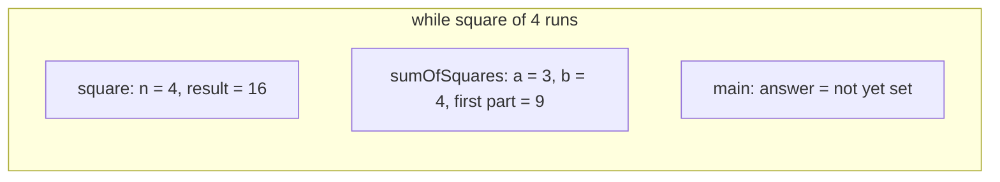
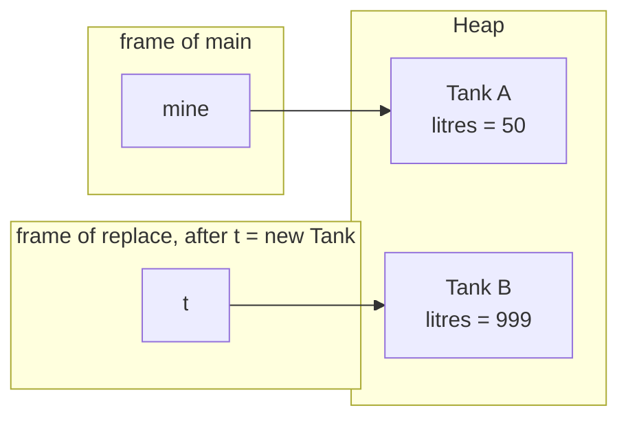

# Methods, parameters, return values and pass-by-value

> **Before this lesson:** you understand reference variables, aliases, the stack and the heap ([References, arrays, the stack and the heap](#/lesson/java/java-references-stack-heap)).

## In plain words

A vending machine is a box with a slot for coins, buttons for your choice, and a tray where something drops out. You do not need to know what happens inside. You supply inputs, the machine does its work, and you collect a result.

A **method** is a vending machine made of code. The inputs it accepts are its **parameters**. The thing it hands back is its **return value**. Code that uses a method is the **caller**.

There is one more idea in this lesson, and it is the one interviewers love. When you hand something to a method, Java gives the method a **photocopy** of what your variable holds. The method can scribble on its photocopy as much as it likes; your original sheet is unchanged. This rule is called **pass-by-value**, and Java uses it for everything, with no exceptions.

Why this matters for a job: "Is Java pass-by-value or pass-by-reference?" appears in a large share of Java interviews, and many working developers answer it wrongly.

## Declaring a method

```java
class Thermostat {
    int target = 20;

    void raise(int degrees) {            // one parameter, returns nothing
        target = target + degrees;
    }

    int gapTo(int roomTemp) {            // one parameter, returns an int
        return target - roomTemp;
    }

    boolean isHeating(int roomTemp) {    // returns a boolean
        return roomTemp < target;
    }
}
```

The first line of a method has a fixed layout: **return type**, **name**, then a **parameter list** in parentheses.

- `void raise(int degrees)`: `void` means the method returns nothing. `int degrees` declares a parameter: a local variable that receives a value from the caller.
- `int gapTo(int roomTemp)`: the return type `int` is a promise. Every path through the method must end in `return` followed by a value that fits in an `int`, or the compiler rejects the method.
- `return` does two things at once: it ends the method immediately and hands the value to the caller.

Using the class:

```java
public class Heating {
    public static void main(String[] args) {
        Thermostat t = new Thermostat();
        t.raise(3);                              // 3 is the argument
        int gap = t.gapTo(18);                   // the result is stored
        System.out.println(gap);
        System.out.println(t.isHeating(18));     // the result is used directly
        t.gapTo(25);                             // legal: the result is ignored
    }
}
```

```text
5
true
```

Two words that are easy to mix up:

- A **parameter** is the variable in the method declaration (`degrees`).
- An **argument** is the actual value the caller supplies (`3`).

The compiler checks that the arguments match the parameters in **number, order and type**. `t.raise("three")` and `t.raise()` are both compile-time errors. An argument may be any expression whose value fits the parameter type, with automatic widening: passing an `int` where a `long` is expected is fine; passing a `double` where an `int` is expected is not.

### Several parameters, and several return statements

```java
class Shipping {
    double cost(double weightKg, boolean express) {
        if (weightKg <= 0) {
            return 0;                       // leave early for a special case
        }
        double base = 3.0 + 0.5 * weightKg;
        if (express) {
            return base * 2;
        }
        return base;
    }
}
```

A method may contain several `return` statements, but each call executes only one. A method returns **one** value. To hand back several related values, return an object, an array or a record: `record Range(int low, int high) { }`.

## What happens on the stack during a call

Each call creates a new **stack frame** holding that call's parameters and local variables. When the method returns, its frame is discarded.

```java
public class Frames {
    static int square(int n) {
        int result = n * n;
        return result;
    }

    static int sumOfSquares(int a, int b) {
        return square(a) + square(b);
    }

    public static void main(String[] args) {
        int answer = sumOfSquares(3, 4);
        System.out.println(answer);
    }
}
```

```text
25
```



The stack grows as methods call methods and shrinks as they return. The frame on top belongs to the method running right now. This is also why a stack trace lists methods from the innermost call outward: it is a printout of the frames from top to bottom.

A method that calls itself without ever stopping fills the stack and fails with `StackOverflowError`.

## Pass-by-value with primitives

```java
public class PassPrimitive {
    static void addTen(int n) {
        n = n + 10;
        System.out.println("inside: " + n);
    }

    public static void main(String[] args) {
        int score = 5;
        addTen(score);
        System.out.println("after : " + score);
    }
}
```

```text
inside: 15
after : 5
```

When `addTen(score)` is called, the **value** 5 is copied into the parameter `n`, which lives in a different stack frame. Changing `n` changes the copy. `score` is a separate variable in `main`'s frame and stays 5.

## Pass-by-value with references

Here is the part that causes arguments. When the argument is a reference variable, the thing that gets copied is **the reference**. The object is not copied. After the call begins there are two remotes (the caller's variable and the parameter) for one television.

That leads to two different outcomes depending on what the method does.

```java
class Tank {
    int litres;
}

public class PassReference {
    static void fill(Tank t) {
        t.litres = 50;            // follows the copied reference to the shared object
    }

    static void replace(Tank t) {
        t = new Tank();           // re-points the LOCAL copy only
        t.litres = 999;
    }

    public static void main(String[] args) {
        Tank mine = new Tank();
        mine.litres = 10;

        fill(mine);
        System.out.println(mine.litres);

        replace(mine);
        System.out.println(mine.litres);
    }
}
```

```text
50
50
```

- `fill` uses its copy of the reference to reach the caller's object and change a field. The caller sees the change, because there is only one object.
- `replace` assigns a new reference to its parameter. That changes where the **parameter** points. The caller's variable `mine` still points at the original tank, which still holds 50. The tank with 999 litres becomes unreachable when `replace` returns.



> [!INTERVIEW]
> The answer to memorise: **"Java is always pass-by-value. For primitives the value is the number itself. For objects the value is the reference, so a method can change the object's state through that reference, but it cannot make the caller's variable refer to a different object."** Then offer the swap test: a method `swap(Tank a, Tank b)` that exchanges its two parameters has no effect on the caller. In a true pass-by-reference language it would.

### The swap test

```java
static void swap(Tank a, Tank b) {
    Tank temp = a;
    a = b;
    b = temp;
}
// ...
Tank x = new Tank();  x.litres = 1;
Tank y = new Tank();  y.litres = 2;
swap(x, y);
System.out.println(x.litres + " " + y.litres);
```

```text
1 2
```

Only the copies inside `swap` were exchanged.

### Strings and arrays as arguments

Arrays are objects, so a method can change the caller's array elements. Strings are objects too, but they are immutable, so there is nothing a method can change through the reference; it can only re-point its own copy.

```java
static void tweak(int[] data, String label) {
    data[0] = 99;                 // visible to the caller
    label = label + "!";          // creates a new String; caller unaffected
}
// ...
int[] nums = {1, 2, 3};
String name = "pump";
tweak(nums, name);
System.out.println(nums[0] + " " + name);
```

```text
99 pump
```

## A pass-by-value model you can run

The simulator copies **what the variable holds** into the parameter: a number for primitives, an object id for references. Watch the two cases diverge.

```python-run
heap = {}
def new_tank(litres):
    oid = f"#{len(heap) + 1}"
    heap[oid] = {"litres": litres}
    return oid

def fill(t):                 # t is a COPY of the caller's reference
    heap[t]["litres"] = 50   # mutate the shared object

def replace(t):
    t = new_tank(999)        # re-point the local copy only
    return None

def add_ten(n):
    n = n + 10               # change the local copy of a primitive

mine = new_tank(10)
score = 5

add_ten(score);  print("after addTen :", "score =", score)
fill(mine);      print("after fill   :", "mine ->", mine, heap[mine])
replace(mine);   print("after replace:", "mine ->", mine, heap[mine])
print("heap now     :", heap, "(#2 is unreachable)")
```

Python's own argument passing follows the same rule, which is why this model is so direct.

## Returning references

A method that returns an object returns a **reference** to it. The caller and the method's owner may then share the object.

```java
class Roster {
    String[] names = {"Ada", "Bo"};

    String[] getNames() {
        return names;                     // hands out the reference to the internal array
    }
}
// ...
Roster r = new Roster();
String[] copy = r.getNames();
copy[0] = "HACKED";
System.out.println(r.names[0]);
```

```text
HACKED
```

The caller reached inside the `Roster` and changed its data. Protecting against that is called making a **defensive copy** (`return names.clone();`), and it is examined in [Parameter checks, defensive copies, signatures and overloading](#/lesson/java/java-ej-params-defensive).

## Varargs: a flexible number of arguments

A parameter written with three dots accepts zero or more arguments and is seen inside the method as an array.

```java
static int total(int... amounts) {
    int sum = 0;
    for (int a : amounts) {     // for each value a in amounts
        sum += a;
    }
    return sum;
}
// total() is 0, total(4) is 4, total(1, 2, 3) is 6
```

The varargs parameter must be the last one in the list.

## Method signatures and overloading, in brief

A method's **signature** is its name plus its parameter types. A class may have several methods with the same name if their signatures differ; this is **overloading**. `System.out.println` is overloaded for `int`, `double`, `String` and more, which is why it accepts all of them.

```java
double area(double radius)           { return Math.PI * radius * radius; }
double area(double width, double h)  { return width * h; }
```

The return type is **not** part of the signature: two methods differing only in return type do not compile. Overloading is studied with its relative, overriding, in [Polymorphism, overriding and overloading](#/lesson/java/java-polymorphism).

> [!TIP]
> Name methods with a verb that says what the caller gets: `calculateTotal`, `isEmpty`, `findByEmail`. A method named `process` or `handle` tells the reader nothing.

## Pitfalls

- **Expecting a method to change a caller's primitive.** It cannot. Return the new value and assign it: `score = addTen(score);`.
- **Expecting reassignment of a parameter to affect the caller.** `t = new Tank()` inside a method is invisible outside.
- **Missing return on some path.** `int f(int x) { if (x > 0) { return 1; } }` does not compile: when `x` is not positive nothing is returned.
- **Returning a value from a `void` method**, or `return;` with no value from a non-void method: both are compile-time errors.
- **Ignoring a returned value** that matters, for example `name.trim();` without assignment.
- **Leaking internal arrays or collections** by returning them directly.
- **Unreachable code.** A statement directly after `return` is a compile-time error.

## Cheat sheet

| Idea | Fact |
|---|---|
| Declaration | `returnType name(type param, ...) { ... }` |
| No result | return type `void` |
| Parameter vs argument | variable in the declaration vs value in the call |
| Passing a primitive | the number is copied; caller's variable cannot change |
| Passing a reference | the reference is copied; the object is shared |
| Method mutates `param.field` | caller sees it |
| Method does `param = new ...` | caller does not see it |
| Returning an object | returns a reference, not a copy |
| Varargs | `int... xs`, last parameter, behaves as an array |
| Signature | name + parameter types (not the return type) |

## Summary

- Methods take parameters and may return one value; the compiler checks argument count, order and types.
- Each call gets its own stack frame for parameters and locals.
- Java always passes by value: the content of the argument variable is copied into the parameter.
- With a reference, the copy still leads to the same object, so the object can be modified but the caller's variable cannot be re-pointed.
- Returned references also create sharing; defensive copies prevent leaks.

## Glossary

- **Method**: a named block of code that can receive inputs and produce a result.
- **Parameter**: a variable declared in a method's parentheses that receives an input.
- **Argument**: the value supplied for a parameter in a call.
- **Return type**: the type of value a method hands back; `void` for none.
- **Return value**: the value handed back by `return`.
- **Caller**: the code that invokes a method.
- **Stack frame**: the memory for one method call's parameters and local variables.
- **Pass-by-value**: copying the argument's content into the parameter.
- **Defensive copy**: a copy made so that outside code cannot alter internal data.
- **Varargs**: a parameter that accepts a variable number of arguments.
- **Signature**: a method's name together with its parameter types.
- **Overloading**: several methods with the same name and different parameter lists.

## Check yourself

```quiz
[
  {"q": "What does this print? `static void bump(int v) { v++; }` then `int k = 3; bump(k); System.out.println(k);`", "options": ["3", "4", "0", "It does not compile"], "answer": 0,
   "explain": "The value 3 is copied into v. Incrementing v does not touch k."},
  {"q": "What does this print? `static void m(int[] a) { a[0] = 7; a = new int[]{1}; a[0] = 8; }` then `int[] x = {5}; m(x); System.out.println(x[0]);`", "options": ["5", "7", "8", "1"], "answer": 1,
   "explain": "a[0] = 7 changes the shared array. Then a is re-pointed to a new array, so the 8 goes into an array the caller never sees."},
  {"q": "Is Java pass-by-value or pass-by-reference?", "options": ["By reference for objects, by value for primitives", "Always by value; for objects the value copied is the reference", "Always by reference", "It depends on the JVM"], "answer": 1,
   "explain": "Every argument is copied. With an object type, what gets copied is the reference, which still leads to the same object."},
  {"q": "Does this compile? `int sign(int n) { if (n > 0) return 1; else if (n < 0) return -1; }`", "options": ["Yes", "No: missing return statement for the case n == 0", "No: two returns are not allowed", "Yes, it returns 0 by default"], "answer": 1,
   "explain": "The compiler sees a path (neither condition true) that ends without returning a value."},
  {"q": "What does this print? `static void change(String s) { s = s + \"!\"; }` then `String t = \"go\"; change(t); System.out.println(t);`", "options": ["go!", "go", "!", "null"], "answer": 1,
   "explain": "s + \"!\" creates a new String and re-points the local parameter. The caller's variable t still refers to \"go\"."},
  {"q": "Do these two methods compile in one class? `int size() { return 1; }` and `long size() { return 1L; }`", "options": ["Yes, they are overloads", "No: they differ only in return type", "Yes, the compiler picks by context", "No: size is a reserved word"], "answer": 1,
   "explain": "The signature is the name plus parameter types. Return type alone cannot distinguish overloads."},
  {"q": "Given `static int total(int... a)`, what is `total()`'s parameter inside the method?", "options": ["null", "An empty int array", "A compile-time error occurs", "An array containing 0"], "answer": 1,
   "explain": "Calling a varargs method with no arguments passes an array of length zero, not null."},
  {"q": "What does this print? `static Tank make(Tank t) { t.litres = 3; return t; }` then `Tank a = new Tank(); Tank b = make(a); System.out.println((a == b) + \" \" + a.litres);`", "options": ["false 0", "true 3", "false 3", "true 0"], "answer": 1,
   "explain": "The method returns the same reference it received, so a and b are aliases, and the field was set to 3 on that one object."}
]
```

> **Source:** Head First Java, ch. 4 (methods, parameters, return values, pass-by-value). Checked against the Java Language Specification section 8.4 (method declarations) and 15.12.4 (argument evaluation): https://docs.oracle.com/javase/specs/jls/se21/html/jls-8.html and https://dev.java/learn/classes-objects/calling-methods-constructors/ .
