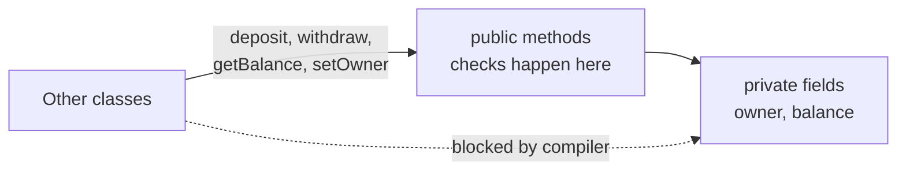

# Encapsulation: private fields, getters and setters

> **Before this lesson:** you can write classes with fields and methods, and you know how arguments are passed ([Methods, parameters, return values and pass-by-value](#/lesson/java/java-methods-pass-by-value)).

## In plain words

A cash machine holds a lot of money, yet you cannot open the back and take notes out. You must use the slot, the keypad and the screen. Those few controls let the bank check your card, your PIN and your balance before a single note moves. If the steel door were left open, no rule the bank wrote would mean anything.

**Encapsulation** is the steel door for an object's data. You mark the fields as `private`, which means only the code inside the same class can touch them. Then you provide a small set of public methods, the "slot and keypad", through which the rest of the program must go. Because every change passes through your methods, you can check it, reject it, log it, or later change how the data is stored without breaking anyone.

Why this matters for a job: encapsulation is the first of the four pillars of object-oriented programming, and "why do we use getters and setters instead of public fields?" is asked in almost every junior Java interview.

## The problem with open fields

```java
class Account {
    String owner;
    double balance;
}

public class Bank {
    public static void main(String[] args) {
        Account acc = new Account();
        acc.owner = "Noor";
        acc.balance = 100;

        acc.balance = -5000;          // nothing stops this
        acc.owner = null;             // or this
        System.out.println(acc.owner + " has " + acc.balance);
    }
}
```

```text
null has -5000.0
```

Any line anywhere in the program can put the object into a state that makes no sense. When the balance turns out to be wrong in production, the faulty line could be in any of several hundred files.

## Access modifiers

An **access modifier** is a keyword that says who may use a class member (a field or a method). Java has four levels.

| Modifier | Who can access the member |
|---|---|
| `private` | only code inside the same class |
| *(none)*, called **package-private** | code in the same package (folder of related classes) |
| `protected` | the same package, plus subclasses in other packages |
| `public` | all code everywhere |

For now two are enough: **fields `private`, methods that others need `public`**. The other two levels are revisited in [Minimal accessibility and immutable classes](#/lesson/java/java-ej-accessibility-immutability).

## The encapsulated version

```java
class Account {
    private String owner;
    private double balance;

    public String getOwner() {
        return owner;
    }

    public void setOwner(String newOwner) {
        if (newOwner == null || newOwner.isBlank()) {
            throw new IllegalArgumentException("owner must not be empty");
        }
        owner = newOwner;
    }

    public double getBalance() {
        return balance;
    }

    public void deposit(double amount) {
        if (amount <= 0) {
            throw new IllegalArgumentException("deposit must be positive");
        }
        balance = balance + amount;
    }

    public boolean withdraw(double amount) {
        if (amount <= 0 || amount > balance) {
            return false;                    // refuse; state unchanged
        }
        balance = balance - amount;
        return true;
    }
}

public class Bank2 {
    public static void main(String[] args) {
        Account acc = new Account();
        acc.setOwner("Noor");
        acc.deposit(100);
        System.out.println(acc.withdraw(5000));
        System.out.println(acc.withdraw(30));
        System.out.println(acc.getOwner() + " has " + acc.getBalance());
        // acc.balance = -5000;   // does not compile: balance has private access in Account
    }
}
```

```text
false
true
Noor has 70.0
```

Line by line, the new pieces:

- `private double balance;` hides the field. Outside `Account`, the name `balance` cannot be used at all; the compiler says "balance has private access in Account".
- `public double getBalance()` is a **getter**: a method that returns the value of a field. By convention its name is `get` plus the field name with a capital letter. For a `boolean` field the convention is `is`: `isActive()`.
- `public void setOwner(String newOwner)` is a **setter**: a method that changes a field. It first checks the input. `throw new IllegalArgumentException(...)` stops the method and signals an error to the caller; exceptions are covered fully in [Exceptions: try, catch, finally, checked and unchecked](#/lesson/java/java-exceptions-basics).
- There is **no** `setBalance`. A balance should change only by depositing or withdrawing, so those are the methods offered. The withdraw rule lives in one place.

The set of rules that must always be true for an object, such as "balance is never negative" and "owner is never empty", are its **invariants**. Encapsulation is how a class guarantees its invariants: nothing outside can break them, so only the class's own methods need checking.



## Getters and setters are not the goal

A common beginner habit is to make every field private and then generate a public getter and setter for each one. That is only a slower way of writing public fields: any code can still set any value. Ask of each field:

- Does outside code need to **read** it? If so, add a getter.
- Does outside code need to **change** it directly? Often not. Offer a meaningful operation instead (`deposit`, `cancel`, `rename`) that enforces the rules.
- Can the field be fixed at creation and never change? Then it needs no setter at all. Objects whose fields never change are **immutable**, and they are the easiest objects to reason about.

> [!TIP]
> Design the public methods from the caller's point of view ("what do I need this object to do for me?"), not from the field list.

## The payoff: change the inside, keep the outside

Suppose the bank decides that `double` is the wrong type for money (it is; see [Primitive types and how numbers are stored](#/lesson/java/java-primitives)) and wants to store whole cents in a `long`.

```java
class Account {
    private long balanceCents;                    // new internal representation

    public double getBalance() {                  // same public method as before
        return balanceCents / 100.0;
    }

    public void deposit(double amount) {
        if (amount <= 0) {
            throw new IllegalArgumentException("deposit must be positive");
        }
        balanceCents += Math.round(amount * 100);
    }
    // withdraw changes in the same way
}
```

Every class that calls `getBalance()` and `deposit()` keeps working without a single edit. If `balance` had been a public field used in two hundred places, all two hundred would need changing. The public methods of a class form its **interface** to the world (also called its **API**, application programming interface); the private parts are its **implementation**. Encapsulation lets the implementation change freely while the interface stays stable.

## this: naming clashes between fields and parameters

It is natural to give a setter's parameter the same name as the field. Inside the method the parameter **shadows** (hides) the field. The keyword `this` means "the object this method was called on", so `this.owner` is the field.

```java
class Member {
    private String name;

    public void setName(String name) {
        this.name = name;      // field = parameter
    }

    public void brokenSetName(String name) {
        name = name;           // assigns the parameter to itself; the field is untouched
    }

    public String getName() {
        return name;           // no clash here, so plain name means the field
    }
}
```

```java
Member m = new Member();
m.brokenSetName("Ivo");
System.out.println(m.getName());
m.setName("Ivo");
System.out.println(m.getName());
```

```text
null
Ivo
```

The broken version compiles and silently does nothing. Modern editors flag it; an interviewer will expect you to spot it.

## Instance variables versus local variables

Encapsulated classes mix both kinds of variable, so be clear on the differences.

| | Instance variable (field) | Local variable |
|---|---|---|
| Declared | in the class, outside methods | inside a method (includes parameters) |
| Lives | inside the object, on the heap | in the method's stack frame |
| Lifetime | as long as the object | until the method returns |
| Default value | `0`, `0.0`, `false`, `null` | **none**: must be assigned before use |
| Access modifier | allowed | not allowed |

```java
class Meter {
    private int reading;          // field: starts at 0

    public int next() {
        int step;                 // local: no default
        // return reading + step; // does not compile: step might not have been initialised
        step = 1;
        reading = reading + step;
        return reading;
    }
}
```

## Comparing: == for primitives, equals for objects

Setters and business methods compare values constantly, so here is the rule again in one place.

```java
int a = 3;
byte b = 3;
System.out.println(a == b);                 // primitives: compares values

String code1 = new String("X7");
String code2 = new String("X7");
System.out.println(code1 == code2);         // references: same object?
System.out.println(code1.equals(code2));    // contents
```

```text
true
false
true
```

Inside `setOwner` above, `newOwner == null` is correct, because there we really are asking "does this variable refer to nothing?".

## An encapsulation model you can run

The model shows the benefit in miniature: every change goes through one gate, so one check protects the invariant, and a log shows exactly who changed what.

```python-run
class Account:
    def __init__(self):
        self.__balance = 0          # double underscore: Python's nearest thing to private
        self.log = []

    def deposit(self, amount):
        if amount <= 0:
            self.log.append(f"REJECTED deposit {amount}")
            return False
        self.__balance += amount
        self.log.append(f"deposit {amount}")
        return True

    def withdraw(self, amount):
        if amount <= 0 or amount > self.__balance:
            self.log.append(f"REJECTED withdraw {amount}")
            return False
        self.__balance -= amount
        self.log.append(f"withdraw {amount}")
        return True

    def get_balance(self):
        return self.__balance

acc = Account()
for op, amt in [("deposit", 100), ("withdraw", 5000), ("deposit", -3), ("withdraw", 30)]:
    getattr(acc, op)(amt)

print("balance:", acc.get_balance())
print("\n".join(acc.log))
try:
    print(acc.__balance)
except AttributeError as e:
    print("direct access blocked:", e)
```

Try to drive the balance negative using only `deposit` and `withdraw`. You cannot; that is the invariant holding.

## Records and encapsulation

A record's fields are private and unchangeable, and the generated accessor methods are named after the fields (`p.x()`, not `p.getX()`). Validation goes in a **compact constructor**:

```java
record Percentage(int value) {
    Percentage {
        if (value < 0 || value > 100) {
            throw new IllegalArgumentException("0 to 100 only: " + value);
        }
    }
}
```

`new Percentage(140)` throws at once, so an invalid `Percentage` object can never exist.

> [!INTERVIEW]
> "What is encapsulation and why is it useful?" *Bundling data with the methods that operate on it and restricting direct access to the data, usually with private fields and public methods.* Benefits to list: (1) invariants are enforced in one place; (2) the internal representation can change without breaking callers; (3) debugging is easier because all changes pass through known methods; (4) it enables read-only or immutable objects. If asked for the difference from **abstraction**: encapsulation hides *data*; abstraction hides *complexity* by exposing what something does and not how.

## Pitfalls

- **Public fields "for now".** They are used everywhere within a week and can never be taken back.
- **A setter for every field by reflex.** It destroys the invariants you meant to protect.
- **Forgetting `this.`** in a setter whose parameter shadows the field.
- **Getters that leak mutable internals.** Returning a private array or list lets callers change it behind your back; return a copy or an unmodifiable view.
- **Validation in some paths only.** If a constructor sets a field without the check that the setter performs, the invariant has a hole.
- **Thinking `private` is per-object.** It is per-class: a method of `Account` may read the private fields of *another* `Account` object passed to it.

## Cheat sheet

| Goal | Write |
|---|---|
| Hide a field | `private int reading;` |
| Read access | `public int getReading() { return reading; }` |
| Boolean read access | `public boolean isActive()` |
| Controlled write | `public void setX(int x) { validate; this.x = x; }` |
| Meaningful operation | `deposit`, `withdraw`, `cancel` instead of a raw setter |
| Refer to the current object | `this` |
| Signal a bad argument | `throw new IllegalArgumentException("...")` |
| Unchangeable data carrier | `record` with a compact constructor for checks |

## Summary

- Encapsulation hides fields behind `private` and exposes a deliberate set of public methods.
- It lets a class enforce its invariants and change its internals without affecting callers.
- Getters and setters are a naming convention, not a requirement; offer meaningful operations and skip setters where possible.
- `this.field = param;` resolves the name clash in setters.
- Fields get default values; local variables do not.

## Glossary

- **Encapsulation**: keeping an object's data private and controlling access through methods.
- **Access modifier**: `private`, package-private, `protected` or `public`.
- **Getter**: a method that returns a field's value.
- **Setter**: a method that changes a field's value, ideally after validation.
- **Invariant**: a condition that must always hold for an object.
- **Interface / API**: the public methods through which other code uses a class.
- **Implementation**: the private details behind the interface.
- **`this`**: a reference to the object the current method was called on.
- **Shadowing**: a local variable or parameter hiding a field of the same name.
- **Immutable**: unable to change after creation.

## Check yourself

```quiz
[
  {"q": "A field is declared `private int stock;` in class `Shop`. Which code may read it directly?", "options": ["Any class in the same package", "Only code inside class Shop", "Subclasses of Shop", "Any class that creates a Shop"], "answer": 1,
   "explain": "private restricts access to the declaring class itself."},
  {"q": "What does this print? `class P { private int v; void set(int v) { v = v; } int get() { return v; } }` then `P p = new P(); p.set(9); System.out.println(p.get());`", "options": ["9", "0", "null", "It does not compile"], "answer": 1,
   "explain": "Inside set, v refers to the parameter, so v = v assigns the parameter to itself. The field keeps its default 0. this.v = v fixes it."},
  {"q": "Does this compile? `Account a = new Account(); a.balance = 10;` where balance is private and the code is in another class.", "options": ["Yes", "No: balance has private access in Account", "Yes, but it throws at run time", "Only if Account has a setter"], "answer": 1,
   "explain": "Access is checked by the compiler. Private members are not visible outside their class."},
  {"q": "Why might a class deliberately have a getter but no setter for a field?", "options": ["Setters are slower", "The field should be readable but only change through meaningful operations, or never", "Java does not allow both", "Getters are required by the compiler"], "answer": 1,
   "explain": "Omitting the setter protects the invariant; state changes go through methods that enforce the rules."},
  {"q": "What is an invariant?", "options": ["A variable that never changes", "A condition about an object's state that must always be true", "A private method", "A final class"], "answer": 1,
   "explain": "For example 'balance >= 0'. Encapsulation lets the class guarantee it."},
  {"q": "Does this compile? `int next() { int step; return step + 1; }`", "options": ["Yes, returns 1", "No: local variable step might not have been initialised", "Yes, returns a random value", "No: step must be static"], "answer": 1,
   "explain": "Local variables have no default value and must be definitely assigned before they are read."},
  {"q": "Inside class `Account`, can method `boolean richerThan(Account other)` read `other.balance` if balance is private?", "options": ["No, private means per object", "Yes, private access is per class", "Only through a getter", "Only if other == this"], "answer": 1,
   "explain": "private is enforced at class level. Code in Account may access private members of any Account instance."},
  {"q": "By convention, what is the getter for `private boolean active;` called?", "options": ["getActive()", "isActive()", "active()", "hasActive()"], "answer": 1,
   "explain": "Boolean getters use the is prefix under the JavaBeans naming convention. (Records use the bare field name: active().)"}
]
```

> **Source:** Head First Java, ch. 4 (encapsulation, getters and setters, instance versus local variables). Checked against https://docs.oracle.com/javase/tutorial/java/javaOO/accesscontrol.html and https://dev.java/learn/classes-objects/creating-classes/ .
