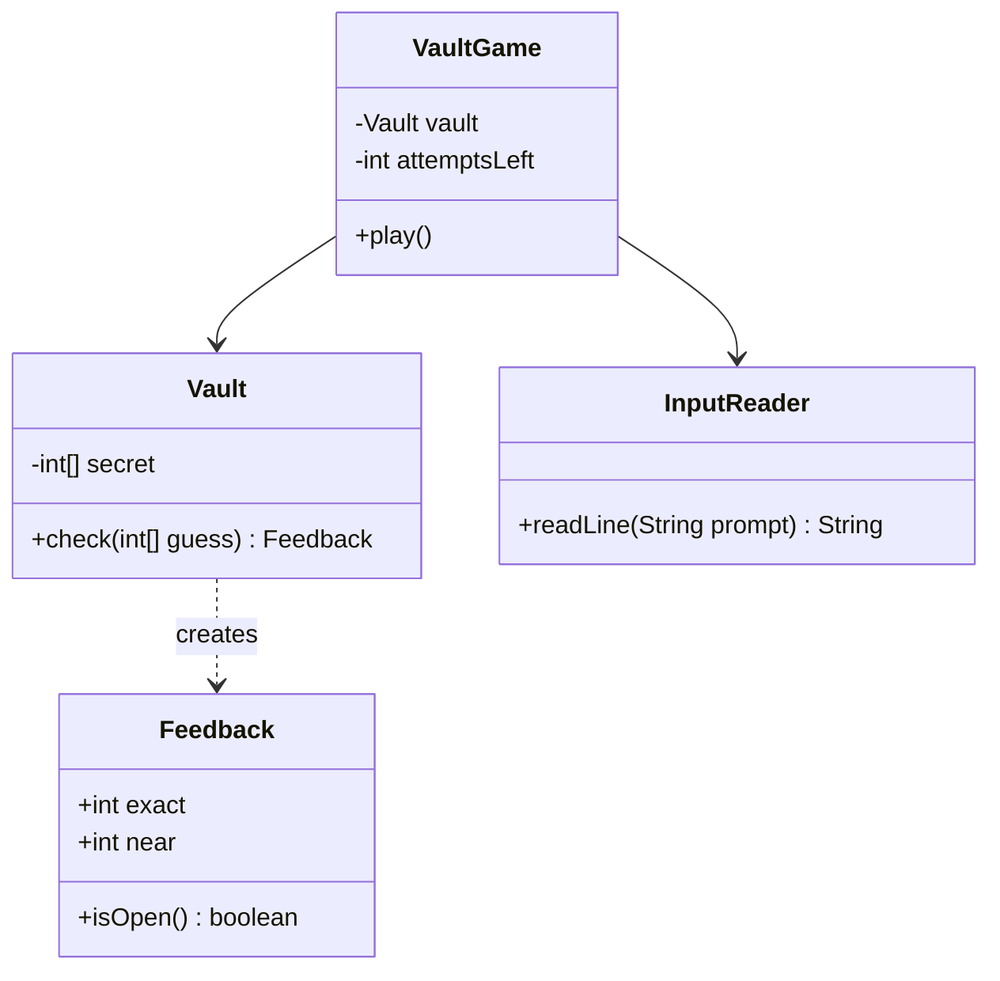

# Building a small game: the Vault Dial

> **Before this lesson:** you can write classes with private fields and public methods ([Encapsulation: private fields, getters and setters](#/lesson/java/java-encapsulation)), and you know arrays and `while` loops ([References, arrays, the stack and the heap](#/lesson/java/java-references-stack-heap)).

## In plain words

Nobody builds a garden shed by nailing boards together and hoping a shed appears. You sketch it, list the parts, check that the first wall stands up straight, and only then add the roof. If the wall leans, you find out while it is still one wall.

Writing a program works the same way. This lesson builds a complete small game from an empty file, and the game matters less than the **routine** used to build it:

1. describe what the program should do in plain sentences;
2. decide which classes are needed and what each is responsible for;
3. write **pseudocode**: the logic in structured English, with no Java syntax to worry about;
4. write **test code** that says what correct behaviour looks like, before the real code exists;
5. write the real code and run the tests;
6. fix what the tests reveal, then connect the pieces.

Why this matters for a job: interviewers watch *how* you approach a problem. A candidate who states the plan, writes a quick example, and tests as they go is rated far above one who types immediately and debugs by guesswork. Writing tests first is a professional practice called **test-driven development** (TDD).

## Step 1: what the game does

**Vault Dial** is a code-breaking game.

- The vault picks a secret code of three **different** digits from 1 to 9, for example `4 7 2`.
- The player types a three-digit guess.
- The vault answers with two numbers:
  - **exact**: how many digits are correct and in the correct position;
  - **near**: how many digits appear in the secret but in a different position.
- Three exact digits open the vault. The player has eight attempts.

Example with the secret `4 7 2`:

| Guess | exact | near | Why |
|---|---|---|---|
| `1 3 5` | 0 | 0 | none of these digits is in the secret |
| `2 7 9` | 1 | 1 | 7 is in place; 2 is present but elsewhere |
| `7 4 2` | 1 | 2 | 2 is in place; 7 and 4 are swapped |
| `4 7 2` | 3 | 0 | opened |

## Step 2: choose the classes

Underline the nouns: *vault*, *secret code*, *guess*, *feedback*, *game*, *player input*.

| Class | Knows | Does |
|---|---|---|
| `Vault` | the secret digits | compare a guess with the secret and produce feedback |
| `Feedback` | exact count, near count | report whether the vault is open |
| `VaultGame` | the vault, attempts left | run the loop: ask, check, report, stop |
| `InputReader` | nothing | read a line the player typed |

Each class has one job. `Vault` contains the only tricky logic, so that is where to start and where to test hardest.



## Step 3: pseudocode for the hard part

Pseudocode is for thinking. Write it in whatever structured English is clear to you.

```text
METHOD check(guess) returns Feedback
    SET exact to 0
    SET near to 0
    FOR each position i from 0 to 2
        IF guess[i] equals secret[i]
            ADD 1 to exact
        ELSE IF guess[i] appears anywhere in secret
            ADD 1 to near
    RETURN a Feedback holding exact and near
```

Reading the pseudocode against the example table already catches design slips. `2 7 9` against `4 7 2`: position 0 holds 2, which is not equal to 4 but appears in the secret, so near becomes 1. Position 1: 7 equals 7, exact becomes 1. Position 2: 9 is absent. Result 1 exact, 1 near. Correct.

## Step 4: test code first

Before `Vault` exists, write down what it must do. Each test creates a vault with a **known** secret, makes a guess, and compares the answer with the expected one.

```java
public class VaultTest {
    static int failures = 0;

    static void expect(String name, Feedback got, int exact, int near) {
        boolean ok = got.exact() == exact && got.near() == near;
        if (!ok) {
            failures++;
        }
        System.out.println((ok ? "PASS " : "FAIL ") + name
                + " -> exact=" + got.exact() + " near=" + got.near());
    }

    public static void main(String[] args) {
        Vault v = new Vault(new int[] {4, 7, 2});
        expect("nothing right", v.check(new int[] {1, 3, 5}), 0, 0);
        expect("one each     ", v.check(new int[] {2, 7, 9}), 1, 1);
        expect("swapped pair ", v.check(new int[] {7, 4, 2}), 1, 2);
        expect("opened       ", v.check(new int[] {4, 7, 2}), 3, 0);
        expect("repeated digit", v.check(new int[] {7, 7, 7}), 1, 0);
        System.out.println(failures == 0 ? "ALL PASS" : failures + " FAILED");
    }
}
```

Notes on the test code:

- `new Vault(new int[] {4, 7, 2})` passes the secret in when the vault is created. A test needs a predictable secret; a random one would make the expected answers unknowable. Designing a class so that its inputs can be supplied from outside is what makes it **testable**.
- `expect` is a small helper so each test fits on one line.
- The last test is an **edge case**: an unusual input chosen to probe a corner of the rules. What should `7 7 7` score against `4 7 2`? There is one 7 in the secret and it is in the middle. The fair answer is 1 exact, 0 near. Writing the test forces that decision now.

In a real project you would use the JUnit library, where the same check reads `assertEquals(1, feedback.exact());`. The hand-made version shows there is nothing mysterious underneath.

## Step 5: the real code

`Feedback` is two numbers that never change, so a record fits.

```java
record Feedback(int exact, int near) {
    boolean isOpen() {
        return exact == 3;
    }
}
```

The first version of `Vault` follows the pseudocode line for line.

```java
class Vault {
    private final int[] secret;

    Vault(int[] secret) {
        this.secret = secret.clone();       // keep our own copy
    }

    Feedback check(int[] guess) {
        int exact = 0;
        int near = 0;
        for (int i = 0; i < 3; i++) {
            if (guess[i] == secret[i]) {
                exact++;
            } else if (contains(guess[i])) {
                near++;
            }
        }
        return new Feedback(exact, near);
    }

    private boolean contains(int digit) {
        for (int s : secret) {
            if (s == digit) {
                return true;
            }
        }
        return false;
    }
}
```

What is new here:

- `Vault(int[] secret) { ... }` is a **constructor**: a special block that runs when `new Vault(...)` is called and sets up the new object. It has the class's name and no return type. Constructors get a full lesson in [Constructors, this and super](#/lesson/java/java-constructors).
- `private final int[] secret;` The word `final` means the field is assigned once and never re-pointed.
- `secret.clone()` stores a copy, so the caller cannot change our secret later through their own array reference.
- `for (int i = 0; i < 3; i++)` is the counting `for` loop: start `i` at 0, continue while `i < 3`, add one after each pass. `for (int s : secret)` is the for-each loop: run the body once for each element. Both are explained in the next lesson, [Loops, operators and casting](#/lesson/java/java-loops-casting).
- `contains` is `private`: a helper for this class only.

Run the tests:

```text
PASS nothing right -> exact=0 near=0
PASS one each      -> exact=1 near=1
PASS swapped pair  -> exact=1 near=2
PASS opened        -> exact=3 near=0
FAIL repeated digit -> exact=1 near=2
1 FAILED
```

## Step 6: the test found a bug

For the guess `7 7 7`, positions 0 and 2 hold a 7 that is not in place but "appears in the secret", so each counts as near. The player is told there are three matching digits when the secret contains a single 7. The pseudocode was wrong, and the test written *before* the code exposed it within seconds.

The fix: a digit of the secret may be matched by only one digit of the guess. Count exact matches first and mark those secret positions as used; then, for the remaining guess digits, look for an **unused** secret position holding that digit and mark it used.

```java
Feedback check(int[] guess) {
    boolean[] secretUsed = new boolean[3];
    boolean[] guessUsed = new boolean[3];
    int exact = 0;
    for (int i = 0; i < 3; i++) {
        if (guess[i] == secret[i]) {
            exact++;
            secretUsed[i] = true;
            guessUsed[i] = true;
        }
    }
    int near = 0;
    for (int i = 0; i < 3; i++) {
        if (guessUsed[i]) {
            continue;                       // skip to the next i
        }
        for (int j = 0; j < 3; j++) {
            if (!secretUsed[j] && guess[i] == secret[j]) {
                near++;
                secretUsed[j] = true;
                break;                      // stop searching for this guess digit
            }
        }
    }
    return new Feedback(exact, near);
}
```

```text
PASS repeated digit -> exact=1 near=0
ALL PASS
```

`continue` jumps to the next pass of the loop it is in; `break` leaves the innermost loop. The earlier four tests still pass, which tells us the fix did not break what already worked. Re-running old tests after a change is called **regression testing**.

### The logic as a runnable model

The same two-pass algorithm in Python, so you can experiment with secrets and guesses here in the page.

```python-run
def check(secret, guess):
    n = len(secret)
    s_used, g_used = [False] * n, [False] * n
    exact = 0
    for i in range(n):
        if guess[i] == secret[i]:
            exact += 1
            s_used[i] = g_used[i] = True
    near = 0
    for i in range(n):
        if g_used[i]:
            continue
        for j in range(n):
            if not s_used[j] and guess[i] == secret[j]:
                near += 1
                s_used[j] = True
                break
    return exact, near

secret = [4, 7, 2]
for guess in ([1, 3, 5], [2, 7, 9], [7, 4, 2], [7, 7, 7], [2, 2, 4], [4, 7, 2]):
    print(guess, "-> exact, near =", check(secret, guess))
```

Predict `[2, 2, 4]` before running: neither 2 is in place; the first 2 claims the secret's 2; the second 2 finds it already used; 4 is present elsewhere. So 0 exact, 2 near.

## Step 7: connect the pieces

The game needs a random secret and keyboard input. Both come from the Java library.

```java
import java.util.Random;
import java.util.Scanner;

class InputReader {
    private final Scanner scanner = new Scanner(System.in);

    String readLine(String prompt) {
        System.out.print(prompt);
        return scanner.nextLine().trim();
    }
}

public class VaultGame {
    private final Vault vault;
    private final InputReader input = new InputReader();
    private int attemptsLeft = 8;

    VaultGame(Vault vault) {
        this.vault = vault;
    }

    static int[] randomSecret() {
        int[] digits = {1, 2, 3, 4, 5, 6, 7, 8, 9};
        Random random = new Random();
        for (int i = digits.length - 1; i > 0; i--) {   // shuffle
            int j = random.nextInt(i + 1);              // 0..i
            int tmp = digits[i];
            digits[i] = digits[j];
            digits[j] = tmp;
        }
        return new int[] {digits[0], digits[1], digits[2]};
    }

    static int[] parse(String text) {
        if (text.length() != 3) {
            return null;
        }
        int[] guess = new int[3];
        for (int i = 0; i < 3; i++) {
            char c = text.charAt(i);
            if (c < '1' || c > '9') {
                return null;
            }
            guess[i] = c - '0';
        }
        return guess;
    }

    void play() {
        while (attemptsLeft > 0) {
            int[] guess = parse(input.readLine("Guess (" + attemptsLeft + " left): "));
            if (guess == null) {
                System.out.println("Type three digits from 1 to 9.");
                continue;                               // a bad line costs no attempt
            }
            attemptsLeft--;
            Feedback f = vault.check(guess);
            if (f.isOpen()) {
                System.out.println("Click. The vault is open!");
                return;
            }
            System.out.println("exact: " + f.exact() + "  near: " + f.near());
        }
        System.out.println("Alarm! Out of attempts.");
    }

    public static void main(String[] args) {
        new VaultGame(new Vault(randomSecret())).play();
    }
}
```

```text
Guess (8 left): 123
exact: 0  near: 1
Guess (7 left): abc
Type three digits from 1 to 9.
Guess (7 left): 429
exact: 1  near: 1
Guess (6 left): 472
Click. The vault is open!
```

Walk-through of the new library pieces:

- `import java.util.Scanner;` tells the compiler which library class the short name `Scanner` means. Imports are the subject of [Packages, imports and the String toolbox](#/lesson/java/java-packages-imports-strings).
- `new Scanner(System.in)` wraps the keyboard; `nextLine()` waits for the player to press Enter and returns the typed text.
- `random.nextInt(n)` returns a whole number from 0 up to, but not including, `n`. The shuffle swaps each position with a random earlier-or-same position, then the first three digits are taken, which guarantees three different digits.
- `text.charAt(i)` returns the character at position `i`; `c - '0'` turns a digit character into its number, as shown in the primitives lesson.
- `parse` returns `null` for bad input, and `play` checks for that. Input from a person is never to be trusted; validate it at the edge of the program.

> [!TIP]
> `main` is one line. It builds the objects and starts them. Everything else is in small methods with one purpose each, and each of those can be tested alone: `parse("12")` should return `null`, `randomSecret()` should return three different digits.

## What the routine bought us

| Step | What it prevented |
|---|---|
| Plain-language rules and example table | building the wrong game |
| Class list with responsibilities | one tangled class |
| Pseudocode | fighting syntax and logic at the same time |
| Tests first | the duplicate-digit bug reaching the player |
| Secret passed into the constructor | untestable randomness |
| Input validation in one method | crashes on `abc` |

> [!INTERVIEW]
> In a live coding round, narrate this routine in thirty seconds before writing: "I'll restate the problem, write two or three examples including an edge case, outline the approach, code it, then walk my examples through the code." Then do exactly that. Many interviewers score the process as heavily as the final code.

## Pitfalls

- **Coding before the rules are clear.** The repeated-digit question had to be answered sooner or later; a test made it sooner.
- **Testing only the happy path.** Bugs live at the edges: repeated values, empty input, the first and last positions, the maximum count.
- **Randomness inside the class under test.** Pass random values in, or pass in the random generator, so tests can control them.
- **Trusting input.** `Integer.parseInt("abc")` throws `NumberFormatException`; check or catch.
- **Fixing a bug without re-running old tests.**
- **Magic numbers.** The literal `3` appears many times above; a named constant such as `CODE_LENGTH` would let the game grow to four digits with one edit. See [static, final, constants and the Math class](#/lesson/java/java-static-final).

## Cheat sheet

| Need | Java |
|---|---|
| Random whole number 0..n-1 | `new Random().nextInt(n)` |
| Random double 0.0..1.0 | `Math.random()` |
| Read a line from the keyboard | `new Scanner(System.in).nextLine()` |
| Text to int | `Integer.parseInt("42")` |
| Character at a position | `text.charAt(i)` |
| Digit char to number | `c - '0'` |
| Skip to next loop pass | `continue;` |
| Leave the loop | `break;` |
| Copy an array | `arr.clone()` |
| Tiny test | compare actual with expected, print PASS or FAIL |

## Summary

- Build programs in a fixed routine: rules, classes, pseudocode, tests, code, fix, connect.
- Put tricky logic in a small class with inputs supplied from outside, so it can be tested with known values.
- Write edge-case tests before the code; they find design mistakes early.
- Re-run all tests after every fix.
- Keep `main` tiny and validate everything a user types.

## Glossary

- **Pseudocode**: program logic written in structured plain language.
- **Test code**: code whose only job is to check that other code behaves correctly.
- **Test-driven development**: writing a failing test first, then the code to make it pass.
- **Edge case**: an unusual or boundary input that may expose a bug.
- **Regression testing**: re-running earlier tests to confirm a change broke nothing.
- **Constructor**: a block that runs when an object is created, to set it up.
- **Testable**: designed so behaviour can be checked with controlled inputs.
- **Validation**: checking that input is acceptable before using it.
- **Magic number**: an unexplained literal number repeated in code.

## Check yourself

```quiz
[
  {"q": "With secret 4 7 2 and the final check method, what is the feedback for the guess 2 4 7?", "options": ["exact 0, near 3", "exact 3, near 0", "exact 1, near 2", "exact 0, near 0"], "answer": 0,
   "explain": "No digit is in its own position, and each of 2, 4, 7 occurs elsewhere in the secret, so near is 3."},
  {"q": "Why does the Vault constructor accept the secret as a parameter instead of generating a random one itself?", "options": ["Random is slow", "So tests can supply a known secret and predict the feedback", "Constructors cannot call Random", "To save memory"], "answer": 1,
   "explain": "Controlled inputs make behaviour predictable, which is what makes a class testable."},
  {"q": "What does `new Random().nextInt(6)` return?", "options": ["A whole number from 1 to 6", "A whole number from 0 to 5", "A whole number from 0 to 6", "A double between 0 and 6"], "answer": 1,
   "explain": "nextInt(n) returns a value from 0 inclusive to n exclusive. Add 1 for a die roll."},
  {"q": "What does this print? `for (int i = 0; i < 5; i++) { if (i == 1) continue; if (i == 3) break; System.out.print(i); }`", "options": ["0124", "02", "012", "024"], "answer": 1,
   "explain": "i = 0 prints 0; i = 1 is skipped by continue; i = 2 prints 2; i = 3 leaves the loop."},
  {"q": "What happens when `Integer.parseInt(\"7a\")` runs?", "options": ["Returns 7", "Returns 0", "Throws NumberFormatException", "Does not compile"], "answer": 2,
   "explain": "The text is not a valid whole number, so parseInt throws at run time. The call itself compiles fine."},
  {"q": "With the FIRST (buggy) version of check and secret 4 7 2, what does the guess 2 2 2 return?", "options": ["exact 1, near 0", "exact 1, near 2", "exact 0, near 3", "exact 3, near 0"], "answer": 1,
   "explain": "Position 2 is exact. Positions 0 and 1 hold a 2 that 'appears in the secret', so the buggy version counts both as near."},
  {"q": "What is regression testing?", "options": ["Testing only new features", "Re-running existing tests after a change to make sure nothing that worked is now broken", "Testing with random inputs", "Deleting failing tests"], "answer": 1,
   "explain": "A fix in one place can break another. Old tests are the safety net."}
]
```

> **Source:** Head First Java, ch. 5 and 6 (developing a class: prep code, test code, real code; a first game). The game, its rules and all code here are original. Library facts checked against https://docs.oracle.com/en/java/javase/21/docs/api/java.base/java/util/Random.html and https://docs.oracle.com/en/java/javase/21/docs/api/java.base/java/util/Scanner.html .
