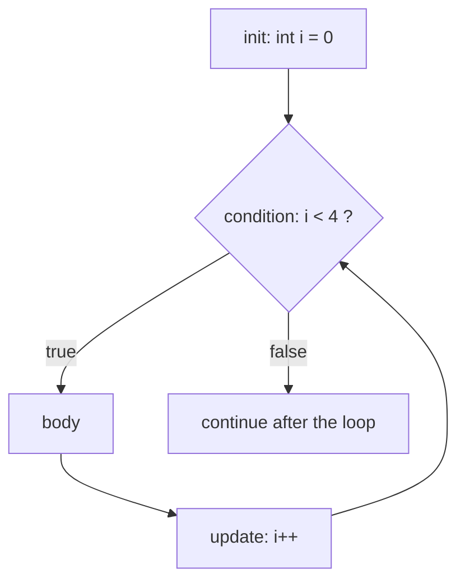

# Loops, operators and casting

> **Before this lesson:** you have met `while`, `if`, arrays and the primitive types ([Primitive types and how numbers are stored](#/lesson/java/java-primitives)), and you saw `for` loops used in [Building a small game: the Vault Dial](#/lesson/java/java-building-a-game). This lesson explains them properly.

## In plain words

A baker who must ice forty cupcakes does not read an instruction sheet with forty identical lines. The sheet says: "For each cupcake on the tray, ice it." One instruction, repeated.

A **loop** is that instruction. Java gives you four ways to write it, suited to four situations:

- you know how many times, or you need the position number: the **counting `for`**;
- you want every item in a collection and do not care about positions: the **for-each**;
- you repeat until something changes and may run zero times: **`while`**;
- you repeat until something changes but must run at least once: **`do`-`while`**.

Alongside loops this lesson covers the operators that drive them (increment, compound assignment, logical operators) and **casting**, the explicit conversion of a value from one type to another.

Why this matters for a job: loops are where off-by-one errors, infinite loops and accidental integer division live. Interviewers hand you a loop and ask what it prints because it is the quickest check of whether you can trace code in your head.

## The counting for loop

```java
public class Count {
    public static void main(String[] args) {
        for (int i = 0; i < 4; i++) {
            System.out.println("pass " + i);
        }
    }
}
```

```text
pass 0
pass 1
pass 2
pass 3
```

The parentheses hold three parts separated by semicolons.

| Part | Here | When it runs |
|---|---|---|
| **Initialisation** | `int i = 0` | once, before anything else |
| **Condition** | `i < 4` | before every pass; the loop ends when it is false |
| **Update** | `i++` | after every pass |



The variable `i` exists only inside the loop. After the closing brace the name `i` is unknown.

The loop is an exact shorthand for this `while`:

```java
int i = 0;
while (i < 4) {
    System.out.println("pass " + i);
    i++;
}
```

### The standard array loop and the off-by-one error

```java
int[] temps = {18, 21, 19, 24};
int max = temps[0];
for (int i = 1; i < temps.length; i++) {
    if (temps[i] > max) {
        max = temps[i];
    }
}
System.out.println(max);
```

```text
24
```

The idiom is `i = 0; i < length; i++`. Writing `i <= temps.length` makes the last pass use index 4, which does not exist, and the program dies with `ArrayIndexOutOfBoundsException`. Being wrong by exactly one at a boundary is so common it has a name: the **off-by-one error**.

### Variations

```java
for (int i = 10; i > 0; i -= 3) { ... }          // counts down: 10, 7, 4, 1
for (int i = 0, j = 9; i < j; i++, j--) { ... }  // two variables moving toward each other
for (;;) { ... }                                 // all parts empty: loops forever
```

## The for-each loop

When you need every element and not its position, the **enhanced for loop**, usually called **for-each**, is shorter and cannot go out of bounds.

```java
String[] crew = {"Ada", "Bo", "Cy"};
for (String name : crew) {
    System.out.println("Hello " + name);
}
```

```text
Hello Ada
Hello Bo
Hello Cy
```

Read the colon as "in": *for each `String name` in `crew`*. On each pass `name` receives the next element. It works on arrays and on every collection in the Java library.

Limits to remember:

- There is no index. If you need the position, use the counting `for`.
- Assigning to the loop variable does not change the array, because the variable is a copy of the element (pass-by-value again):

```java
int[] nums = {1, 2, 3};
for (int n : nums) {
    n = n * 10;               // changes the copy only
}
System.out.println(nums[0]);  // still 1
```

```text
1
```

- If the elements are references to objects, the copy is a reference, so you **can** change the objects' fields through it.

## while and do-while

`while` tests first, so its body may run zero times. `do`-`while` runs the body, then tests, so the body runs at least once.

```java
int stock = 0;
while (stock > 0) {
    System.out.println("selling");     // never runs
    stock--;
}

int tries = 0;
do {
    System.out.println("attempt " + tries);
    tries++;
} while (tries < 0);                    // false, but the body already ran once
```

```text
attempt 0
```

Note the semicolon after `while (...)` in the `do` form; it is required there and a bug everywhere else.

`do`-`while` suits "ask, then check the answer" situations such as menu prompts.

## break, continue and labels

- `break;` leaves the innermost loop (or `switch`) at once.
- `continue;` abandons the rest of this pass and moves on to the next one.

```java
for (int n = 1; n <= 10; n++) {
    if (n % 2 == 0) {
        continue;            // skip even numbers
    }
    if (n > 7) {
        break;               // stop entirely
    }
    System.out.print(n + " ");
}
```

```text
1 3 5 7 
```

With nested loops, `break` and `continue` affect only the loop they are directly inside. To leave an outer loop, give it a **label**:

```java
int[][] grid = {{1, 2}, {3, 99}, {5, 6}};
search:
for (int r = 0; r < grid.length; r++) {
    for (int c = 0; c < grid[r].length; c++) {
        if (grid[r][c] == 99) {
            System.out.println("found at " + r + "," + c);
            break search;    // leaves BOTH loops
        }
    }
}
```

```text
found at 1,1
```

Labels are rare in everyday code. Moving the nested loops into a method and using `return` is usually clearer.

## Nested loops: trace them with a table

```java
for (int row = 1; row <= 3; row++) {
    for (int col = 1; col <= row; col++) {
        System.out.print(row * col + " ");
    }
    System.out.println();
}
```

```text
1 
2 4 
3 6 9 
```

The inner loop runs completely for every single pass of the outer loop. When asked to predict output, write a small table of the variables instead of holding them in your head:

| row | col values | printed |
|---|---|---|
| 1 | 1 | `1` |
| 2 | 1, 2 | `2 4` |
| 3 | 1, 2, 3 | `3 6 9` |

### A loop tracer you can run

The model executes a counting loop the way the JVM does, printing each step: condition, body, update. Use it to check your predictions for unusual loops.

```python-run
def trace_for(start, cond, update, body, limit=20):
    """cond, update, body are small functions of i. Stops after `limit` passes."""
    i, passes = start, 0
    print(f"init        i = {i}")
    while True:
        ok = cond(i)
        print(f"condition   i = {i:<3} -> {ok}")
        if not ok:
            break
        print(f"  body      {body(i)}")
        i = update(i)
        passes += 1
        if passes == limit:
            print("  ... stopped: would loop for a long time"); break
    print(f"passes: {passes}, i after loop = {i}")

# for (int i = 10; i > 0; i -= 3)
trace_for(10, lambda i: i > 0, lambda i: i - 3, lambda i: f"print {i}")
print()
# for (int i = 0; i != 5; i += 2)   <- a classic mistake
trace_for(0, lambda i: i != 5, lambda i: i + 2, lambda i: f"print {i}", limit=6)
```

The second loop never hits 5 because `i` jumps from 4 to 6. Prefer `<` over `!=` in loop conditions so that overshooting still ends the loop.

## Operators you will use in loops

### Compound assignment

`x += 5` means `x = x + 5`, and likewise `-=`, `*=`, `/=`, `%=`. They include an automatic cast back to the variable's type, as described in the primitives lesson.

### Increment and decrement

`i++` and `++i` add one; `i--` and `--i` subtract one. As a statement alone they are the same. Inside a larger expression, the **postfix** form (`i++`) yields the old value and the **prefix** form (`++i`) yields the new value.

```java
int[] data = {5, 6, 7};
int idx = 0;
System.out.println(data[idx++]);   // uses 0, then idx becomes 1
System.out.println(data[++idx]);   // idx becomes 2, then uses 2
```

```text
5
7
```

### Short-circuit logic

`&&` and `||` evaluate the left side first and **skip the right side** when the answer is already known. This is called **short-circuit evaluation**.

```java
String name = null;
if (name != null && name.length() > 3) {   // right side skipped: no NullPointerException
    System.out.println("long name");
}

int[] items = {};
if (items.length == 0 || items[0] < 0) {   // right side skipped: no out-of-bounds
    System.out.println("nothing useful");
}
```

```text
nothing useful
```

The single-character forms `&` and `|` on booleans evaluate **both** sides always. With them the first example would throw `NullPointerException`. Use the doubled forms for conditions.

### Operator precedence, the short version

When an expression mixes operators, Java applies them in a fixed order called **precedence**. From first to last, the groups you meet daily are:

| Order | Operators |
|---|---|
| 1 | postfix `x++ x--` |
| 2 | prefix `++x --x`, unary `+ -`, `!`, casts `(type)` |
| 3 | `* / %` |
| 4 | `+ -` |
| 5 | `< <= > >=` |
| 6 | `== !=` |
| 7 | `&&` |
| 8 | `\|\|` |
| 9 | `? :` |
| 10 | `= += -=` and the other assignments |

So `a || b && c` means `a || (b && c)`, and `x + y * 2` multiplies first. When in doubt, add parentheses; nobody was ever marked down for clarity.

## Casting primitives

A **cast** is a type name in parentheses in front of a value: `(int) price`. It is required whenever a conversion might lose information.

```java
public class Casts {
    public static void main(String[] args) {
        int sum = 17;
        int count = 5;

        double wrong = sum / count;            // int division happens first: 3, then 3.0
        double right = (double) sum / count;   // cast applies to sum, then double division
        double alsoWrong = (double) (sum / count);

        System.out.println(wrong + " " + right + " " + alsoWrong);

        long big = 5_000_000_000L;
        int squeezed = (int) big;              // keeps the low 32 bits
        System.out.println(squeezed);

        double d = 1e20;
        System.out.println((int) d);           // too big: clamps to Integer.MAX_VALUE
        System.out.println((int) 'A');         // char to its code
        System.out.println((char) 97);         // code to char
    }
}
```

```text
3.0 3.4 3.0
705032704
2147483647
65
a
```

Three rules explain every line:

1. A cast binds tighter than arithmetic. `(double) sum / count` converts `sum` first, then divides. `(double) (sum / count)` divides as integers first.
2. Narrowing between whole-number types keeps the low bits, so the result can look unrelated to the original.
3. Narrowing from a fractional type to `int` or `long` drops the fraction, and values beyond the range become the nearest limit. `NaN` becomes 0.

> [!WARNING]
> You cannot cast between `boolean` and numbers in Java. `(int) true` does not compile. Write `flag ? 1 : 0`.

### Text to number and back

Casting does not work between `String` and numbers; those conversions use library methods.

```java
int n = Integer.parseInt("42");            // text -> int
double d = Double.parseDouble("3.5");      // text -> double
String s1 = String.valueOf(42);            // int -> text
String s2 = "" + 42;                       // also works, less clear
// int bad = (int) "42";                   // does not compile
```

Casting of **object references**, such as `(Dog) animal`, is a different mechanism that checks types at run time; it is covered in [Interfaces, default methods, sealed types and pattern matching](#/lesson/java/java-interfaces).

> [!INTERVIEW]
> Typical prompt: "How many times does this loop run, and what is `i` afterwards?" for `for (int i = 0; i < 10; i += 3)`. Passes use i = 0, 3, 6, 9: four passes. After the fourth update `i` is 12, the condition fails and the loop ends. State both numbers. Then mention that `i` is out of scope after the loop unless it was declared before it.

## Pitfalls

- **`<=` instead of `<`** with `length`: one pass too many.
- **A stray semicolon**: `for (int i = 0; i < 3; i++);` has an empty body; the block after it runs once.
- **Changing the loop counter inside the body** as well as in the update.
- **Modifying a collection inside a for-each over it** throws `ConcurrentModificationException`; see [ArrayList and reading the API documentation](#/lesson/java/java-arraylist-api).
- **`!=` as a loop condition** when the step may jump over the target.
- **A loop counter in a `byte` or `short`** that overflows before the condition fails, giving an infinite loop.
- **Casting after integer division**: `(double) (a / b)`.
- **Using `&` where `&&` was meant**, losing the protection of short-circuiting.

## Cheat sheet

| Situation | Loop |
|---|---|
| Fixed number of passes or index needed | `for (int i = 0; i < n; i++)` |
| Every element, no index | `for (Type x : collection)` |
| Zero or more passes, until a condition | `while (cond) { }` |
| At least one pass | `do { } while (cond);` |
| Leave the loop | `break;` |
| Skip to the next pass | `continue;` |
| Leave an outer loop | label + `break label;` |
| Real division of two ints | `(double) a / b` |
| Text to int | `Integer.parseInt(text)` |
| Int to text | `String.valueOf(n)` |

## Summary

- The counting `for` packs initialisation, condition and update into one line; the for-each visits every element safely.
- `while` may run zero times; `do`-`while` runs at least once.
- `break` leaves a loop, `continue` skips to the next pass; labels reach outer loops.
- `&&` and `||` short-circuit, which makes guard conditions safe.
- Casts apply before arithmetic; cast one operand to `double` to get real division.
- Strings convert to numbers with `parse` methods, not casts.

## Glossary

- **Loop**: a construct that repeats a block of code.
- **Iteration**: one pass through a loop body.
- **Counting for**: the three-part `for (init; condition; update)` loop.
- **For-each (enhanced for)**: a loop that visits each element of an array or collection.
- **Off-by-one error**: a boundary mistake of exactly one.
- **Infinite loop**: a loop whose condition never becomes false.
- **Label**: a name placed before a loop so `break` or `continue` can target it.
- **Short-circuit evaluation**: skipping the right operand of `&&` or `||` when the result is already decided.
- **Precedence**: the order in which operators are applied.
- **Cast**: an explicit conversion written as a type in parentheses.
- **Postfix / prefix**: the `i++` and `++i` forms of increment.

## Check yourself

```quiz
[
  {"q": "How many times does the body run? `for (int i = 2; i <= 10; i += 4) { }`", "options": ["2", "3", "4", "9"], "answer": 1,
   "explain": "i takes the values 2, 6 and 10. After that it becomes 14 and the condition fails."},
  {"q": "What does this print? `int[] a = {1, 2, 3}; for (int x : a) { x *= 2; } System.out.println(a[2]);`", "options": ["6", "3", "0", "It does not compile"], "answer": 1,
   "explain": "x is a copy of each element. Changing the copy leaves the array untouched."},
  {"q": "What does this print? `int n = 0; do { n++; } while (n < 0); System.out.println(n);`", "options": ["0", "1", "-1", "Infinite loop"], "answer": 1,
   "explain": "The body runs once before the condition is tested, so n becomes 1; then 1 < 0 is false."},
  {"q": "What does this print? `int a = 7, b = 2; System.out.println((double) (a / b) + \" \" + (double) a / b);`", "options": ["3.5 3.5", "3.0 3.5", "3.0 3.0", "3 3.5"], "answer": 1,
   "explain": "In the first, integer division gives 3 and is then cast to 3.0. In the second, a is cast first, so the division is done in double."},
  {"q": "What happens? `String s = null; if (s != null & s.length() > 0) { }`", "options": ["Nothing; the condition is false", "NullPointerException", "Compile-time error", "The condition is true"], "answer": 1,
   "explain": "The single & evaluates both sides, so s.length() runs on null. && would short-circuit and be safe."},
  {"q": "Does this compile? `int flag = (int) true;`", "options": ["Yes, flag is 1", "Yes, flag is 0", "No: boolean cannot be cast to int", "Yes, with a warning"], "answer": 2,
   "explain": "Java has no conversion between boolean and numeric types. Use a conditional expression."},
  {"q": "What does this print? `int i = 0; for (; i < 3; i++); System.out.println(i);`", "options": ["0", "2", "3", "It does not compile"], "answer": 2,
   "explain": "The semicolon gives the loop an empty body. It still counts 0, 1, 2 and stops when i is 3. i was declared before the loop, so it is still in scope."},
  {"q": "What does this print? `int k = 5; int r = k++ * 2 + --k; System.out.println(r + \" \" + k);`", "options": ["15 5", "16 5", "15 6", "17 5"], "answer": 0,
   "explain": "k++ yields 5 (k becomes 6); 5 * 2 = 10; --k makes k 5 and yields 5; 10 + 5 = 15. k ends at 5."}
]
```

> **Source:** Head First Java, ch. 5 (for loops, enhanced for, casting primitives, operators). Checked against the Java Language Specification ch. 14 (statements) and 15 (expressions): https://docs.oracle.com/javase/specs/jls/se21/html/jls-15.html and https://dev.java/learn/language-basics/controlling-flow/ .
