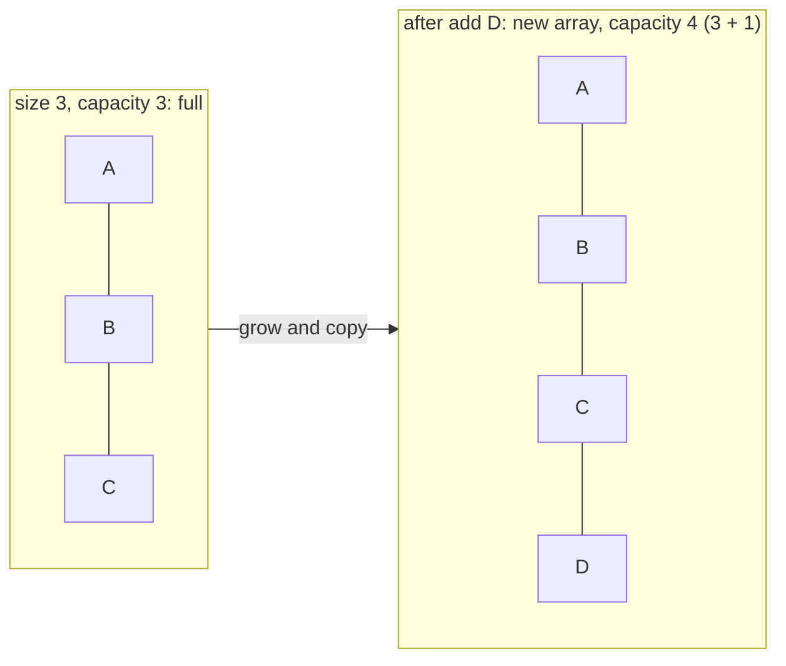

# ArrayList and reading the API documentation

> **Before this lesson:** you can use arrays and loops ([Loops, operators and casting](#/lesson/java/java-loops-casting)) and you know that objects are reached through references ([References, arrays, the stack and the heap](#/lesson/java/java-references-stack-heap)).

## In plain words

An array is an egg carton: it has exactly twelve hollows, decided at the factory. If you come home with thirteen eggs, the carton cannot grow. If you take out egg number three, a gap is left behind and you must shuffle the others along yourself.

An **`ArrayList`** is a shopping list on a notepad. You add a line at the bottom whenever you like, cross a line out and the list closes up, and at any moment you can ask "how many items are on it?" The notepad takes care of finding room.

`ArrayList` is one of several thousand ready-made classes that ship with Java, collectively called the **Java API** (application programming interface) or the **standard library**. Nobody memorises them. The professional skill is knowing that a class for your problem almost certainly exists, and being able to read its documentation.

Why this matters for a job: `ArrayList` is the most used collection in Java code. "What is the difference between an array and an `ArrayList`?" and "how does `ArrayList` grow?" are staple interview questions.

## The limits of arrays

```java
String[] guests = new String[3];
guests[0] = "Ada";
guests[1] = "Bo";
guests[2] = "Cy";
// guests[3] = "Di";     // ArrayIndexOutOfBoundsException: the array cannot grow
```

To add a fourth guest you would create a bigger array and copy everything across. To remove Bo you would move Cy down a slot and track how many slots are truly in use. `ArrayList` does all of this for you.

## First steps with ArrayList

```java
import java.util.ArrayList;

public class Guests {
    public static void main(String[] args) {
        ArrayList<String> guests = new ArrayList<>();
        guests.add("Ada");
        guests.add("Bo");
        guests.add("Cy");
        guests.add("Di");                       // grows automatically

        System.out.println(guests);
        System.out.println(guests.size());
        System.out.println(guests.get(1));

        guests.remove("Bo");                    // later items shift down
        System.out.println(guests);
        System.out.println(guests.contains("Cy"));
        System.out.println(guests.indexOf("Di"));
        System.out.println(guests.isEmpty());
    }
}
```

```text
[Ada, Bo, Cy, Di]
4
Bo
[Ada, Cy, Di]
true
2
false
```

Line by line:

- `import java.util.ArrayList;` tells the compiler that `ArrayList` means the class in the library package `java.util`. Without it the compiler reports "cannot find symbol". Imports are explained in the next lesson.
- `ArrayList<String>` reads "an ArrayList of String". The type in angle brackets is a **type parameter**: it tells the compiler what kind of object this particular list holds. The compiler then refuses `guests.add(42)`, and `guests.get(1)` is known to be a `String` with no cast.
- `new ArrayList<>()` creates an empty list. The empty `<>`, called the **diamond**, means "use the same type as on the left".
- `add` appends, `size()` counts, `get(i)` reads by zero-based index, `remove` deletes and closes the gap, `contains` and `indexOf` search.
- Printing a list shows its contents in square brackets, unlike printing an array.

### The methods you will use every day

| Method | What it does | Returns |
|---|---|---|
| `add(e)` | append at the end | `true` |
| `add(i, e)` | insert at index `i`, shifting later items right | nothing |
| `get(i)` | read the element at index `i` | the element |
| `set(i, e)` | replace the element at index `i` | the old element |
| `remove(i)` | delete the element at **index** `i` | the removed element |
| `remove(obj)` | delete the first element equal to `obj` | `true` if found |
| `size()` | number of elements | `int` |
| `isEmpty()` | is the size zero? | `boolean` |
| `contains(obj)` | is an equal element present? | `boolean` |
| `indexOf(obj)` | index of the first equal element, or `-1` | `int` |
| `clear()` | remove everything | nothing |

`contains`, `indexOf` and `remove(obj)` find elements using the element's `equals` method. For `String` that means "same characters".

## Array versus ArrayList

| | Array | `ArrayList` |
|---|---|---|
| Size | fixed when created | grows and shrinks |
| Length | `arr.length` (field) | `list.size()` (method) |
| Read | `arr[i]` | `list.get(i)` |
| Write | `arr[i] = x` | `list.set(i, x)` |
| Holds primitives | yes: `int[]` | no: uses wrapper objects, `ArrayList<Integer>` |
| Type safety | fixed element type | type parameter in `< >` |
| Printing | needs `Arrays.toString` | prints its contents |
| Extras | none | search, insert, remove, sort and more |

### Lists of numbers and autoboxing

A type parameter must be a class. For primitives Java supplies a matching **wrapper class** for each: `Integer` for `int`, `Double` for `double`, `Boolean` for `boolean`, `Character` for `char`, and so on. The compiler converts between the primitive and its wrapper automatically; this is **autoboxing** (primitive to object) and **unboxing** (object to primitive).

```java
ArrayList<Integer> scores = new ArrayList<>();
scores.add(70);                 // autoboxed to an Integer object
scores.add(85);
int first = scores.get(0);      // unboxed back to int
System.out.println(first + scores.get(1));
```

```text
155
```

> [!WARNING]
> `remove` has two versions, and with a list of `Integer` they collide. `scores.remove(1)` removes the element **at index 1**. To remove the **value** 1 write `scores.remove(Integer.valueOf(1))`. This is a favourite interview trap.

```java
ArrayList<Integer> nums = new ArrayList<>(java.util.List.of(10, 1, 20));
nums.remove(1);                       // index 1: removes the value 1
System.out.println(nums);
nums.remove(Integer.valueOf(20));     // object: removes the value 20
System.out.println(nums);
```

```text
[10, 20]
[10]
```

## Looping over a list

```java
ArrayList<String> tasks = new ArrayList<>();
tasks.add("pack");
tasks.add("label");
tasks.add("ship");

for (String t : tasks) {                     // for-each: simplest
    System.out.println(t);
}

for (int i = 0; i < tasks.size(); i++) {     // index loop: when you need i
    System.out.println(i + ": " + tasks.get(i));
}
```

### Removing while looping

Changing a list's structure during a for-each over it fails:

```java
for (String t : tasks) {
    if (t.startsWith("l")) {
        tasks.remove(t);        // throws ConcurrentModificationException on the next pass
    }
}
```

The for-each uses a helper object called an **iterator** that notices the list changed behind its back. Safe alternatives:

```java
tasks.removeIf(t -> t.startsWith("l"));      // clearest: remove every element matching a test

for (int i = tasks.size() - 1; i >= 0; i--) {  // or loop backwards by index
    if (tasks.get(i).startsWith("l")) {
        tasks.remove(i);
    }
}
```

`t -> t.startsWith("l")` is a **lambda expression**, a short way to write a small function; see [Lambdas, functional interfaces and method references](#/lesson/java/java-lambdas). Looping backwards works because removing an element only shifts the ones after it, which have already been visited.

## How ArrayList works inside

The name says it: an `ArrayList` is a list backed by an array. It keeps two things:

- a private array, whose length is the list's **capacity**;
- a count of how many slots are in use, the **size**.

When you `add` and the array is full, the list creates a new array about **one and a half times** as large, copies the elements across, and drops the old one. In current OpenJDK the first `add` to a default-constructed list creates capacity 10, and growth follows `newCapacity = oldCapacity + oldCapacity / 2` (integer division), giving 10, 15, 22, 33, 49, 73 and so on.



Because the capacity grows by a proportion and not by one slot, copying happens rarely. Averaged over many additions, each `add` costs a constant amount of work. The technical phrase is **amortised constant time**.

### A growth model you can run

```python-run
def simulate_adds(n, initial=10):
    """Model java.util.ArrayList growth for n calls to add() on new ArrayList<>()."""
    capacity, size, copies, history = 0, 0, 0, []
    for _ in range(n):
        if size == capacity:
            new_cap = initial if capacity == 0 else capacity + capacity // 2
            copies += size                  # elements copied into the new array
            capacity = new_cap
            history.append(capacity)
        size += 1
    return history, copies

for n in (10, 11, 100, 1000):
    caps, copies = simulate_adds(n)
    print(f"{n:5} adds -> capacities {caps}  elements copied in total: {copies}")
```

For 1,000 additions about 2,500 element copies happen in total: the cost per `add` stays small however large the list becomes. If you know the final size in advance, `new ArrayList<>(1000)` reserves the capacity once and avoids all the copying.

### What is fast and what is slow

| Operation | Cost | Why |
|---|---|---|
| `get(i)`, `set(i, e)` | constant | direct array access |
| `add(e)` at the end | constant on average | occasional grow-and-copy |
| `add(0, e)`, `remove(0)` | proportional to size | every later element shifts |
| `contains`, `indexOf` | proportional to size | checks elements one by one |

For fast "is it present?" checks use a `HashSet`; for key lookups use a `HashMap`. Both appear in [Collections: List, Set, Map and Queue](#/lesson/java/java-collections).

> [!INTERVIEW]
> "`ArrayList` or `LinkedList`?" Answer: `ArrayList` nearly always. It has constant-time indexed access and is compact in memory, so it is friendly to processor caches. `LinkedList` has constant-time insertion or removal only once you already hold the position, and reaching a position is slow. In practice `ArrayList` outperforms it for almost every workload; for queue behaviour use `ArrayDeque`.

## Creating lists quickly

```java
import java.util.List;
import java.util.ArrayList;

List<String> fixed = List.of("red", "green");            // unmodifiable: add() throws
ArrayList<String> editable = new ArrayList<>(fixed);     // a changeable copy
editable.add("blue");
System.out.println(fixed + " " + editable);
```

```text
[red, green] [red, green, blue]
```

`List.of` produces a list that cannot be changed; calling `add` on it throws `UnsupportedOperationException`. Notice also the variable type `List<String>`: `List` is the general type that `ArrayList` is one kind of. Declaring variables as `List` and creating them as `new ArrayList<>()` is standard practice, explained when you reach [Interfaces](#/lesson/java/java-interfaces).

## Reading the API documentation

The official documentation, often called the **Javadoc**, lists every class in the library. Search the web for "ArrayList Java 21" and open the page on `docs.oracle.com`. Each class page has the same layout:

1. **Module and package** at the top: `java.base`, `java.util`. The package is what you import.
2. **Class declaration and family**: what the class extends and which interfaces it implements.
3. **Description**: what the class is for, with performance notes.
4. **Constructor summary**: the ways to create one, such as `ArrayList()` and `ArrayList(int initialCapacity)`.
5. **Method summary**: one row per method with its return type and parameters.
6. **Method detail**: full description, including which exceptions it throws.

How to read one row, for example `E remove(int index)`:

- `E` is the return type. `E` stands for "the element type of this list", so for an `ArrayList<String>` it is `String`.
- `remove` is the name; `int index` is the single parameter.
- The detail text adds: shifts later elements left; throws `IndexOutOfBoundsException` if the index is out of range.

> [!TIP]
> Before writing a helper method, spend thirty seconds checking the documentation of the class you are holding. Reversing, sorting, searching, joining, counting and copying are almost always already there (`Collections.reverse`, `list.sort`, `String.join`, `Collections.frequency`).

## A worked example: a waiting list

```java
import java.util.ArrayList;

class WaitingList {
    private final ArrayList<String> names = new ArrayList<>();

    void join(String name) {
        if (!names.contains(name)) {
            names.add(name);
        }
    }

    void joinAsPriority(String name) {
        names.remove(name);          // no effect if absent
        names.add(0, name);
    }

    String callNext() {
        return names.isEmpty() ? null : names.remove(0);
    }

    int position(String name) {
        return names.indexOf(name) + 1;      // 0 means "not on the list"
    }
}

public class Clinic {
    public static void main(String[] args) {
        WaitingList w = new WaitingList();
        w.join("Ada");
        w.join("Bo");
        w.join("Ada");                       // ignored: already waiting
        w.joinAsPriority("Cy");
        System.out.println(w.position("Bo"));
        System.out.println(w.callNext());
        System.out.println(w.callNext());
        System.out.println(w.position("Bo"));
    }
}
```

```text
3
Cy
Ada
1
```

The list is `private`, so the rest of the program can only use the four meaningful operations. `remove(0)` returns the removed element, which makes `callNext` a one-liner.

## Pitfalls

- **`length` instead of `size()`**, or `list[i]` instead of `list.get(i)`: neither compiles.
- **`ArrayList<int>`** does not compile; use `ArrayList<Integer>`.
- **`remove(int)` versus `remove(Object)`** on a list of integers.
- **Removing inside a for-each**: `ConcurrentModificationException`.
- **`get(size())`**: valid indices are 0 to `size() - 1`; beyond that is `IndexOutOfBoundsException`.
- **Capacity is not size**: `new ArrayList<>(100)` is an empty list; `get(0)` on it throws.
- **Modifying `List.of(...)`**: throws `UnsupportedOperationException`.
- **Unboxing a `null` element**: `int x = list.get(0);` throws `NullPointerException` if the element is `null`.

## Cheat sheet

| Task | Code |
|---|---|
| Create | `List<String> xs = new ArrayList<>();` |
| Append / insert | `xs.add(e)` / `xs.add(i, e)` |
| Read / replace | `xs.get(i)` / `xs.set(i, e)` |
| Remove by index / by value | `xs.remove(i)` / `xs.remove(obj)` |
| Remove matching | `xs.removeIf(x -> test)` |
| Count / empty | `xs.size()` / `xs.isEmpty()` |
| Search | `xs.contains(o)`, `xs.indexOf(o)` |
| Fixed small list | `List.of(a, b, c)` |
| Copy | `new ArrayList<>(other)` |
| Sort | `xs.sort(null)` or `Collections.sort(xs)` |

## Summary

- `ArrayList` is a resizable list backed by an array; it grows by about half its capacity when full.
- The type in angle brackets fixes the element type at compile time; primitives are stored through wrapper classes with autoboxing.
- Indexed access is fast; inserting or removing near the front, and searching, take time proportional to the size.
- Do not structurally change a list during a for-each over it; use `removeIf` or a backwards index loop.
- The Javadoc tells you a class's package, constructors, methods and exceptions; consult it before writing your own helper.

## Glossary

- **Java API / standard library**: the classes that ship with the JDK.
- **`ArrayList`**: a resizable, ordered collection backed by an array.
- **Type parameter**: the type written in angle brackets, e.g. `<String>`.
- **Diamond**: the empty `<>` that lets the compiler infer the type parameter.
- **Wrapper class**: an object type that holds one primitive value, e.g. `Integer`.
- **Autoboxing / unboxing**: automatic conversion between a primitive and its wrapper.
- **Capacity**: the length of the list's internal array.
- **Size**: the number of elements currently stored.
- **Amortised constant time**: constant cost per operation when averaged over many operations.
- **Iterator**: the helper object a for-each uses to walk a collection.
- **Javadoc**: the standard documentation format and pages for Java classes.

## Check yourself

```quiz
[
  {"q": "What does this print? `ArrayList<String> a = new ArrayList<>(); a.add(\"x\"); a.add(\"y\"); a.add(0, \"z\"); System.out.println(a.get(1));`", "options": ["x", "y", "z", "IndexOutOfBoundsException"], "answer": 0,
   "explain": "Inserting z at index 0 shifts x to index 1 and y to index 2."},
  {"q": "What does this print? `ArrayList<Integer> n = new ArrayList<>(List.of(5, 6, 7)); n.remove(2); System.out.println(n);`", "options": ["[5, 6]", "[5, 6, 7]", "[6, 7]", "[5, 7]"], "answer": 0,
   "explain": "An int argument selects remove(int index), so the element at index 2 (the value 7) is removed."},
  {"q": "Does this compile? `ArrayList<double> prices = new ArrayList<>();`", "options": ["Yes", "No: type parameters must be reference types; use Double", "Yes, with a warning", "No: ArrayList cannot hold numbers"], "answer": 1,
   "explain": "Generics work with classes only. Use the wrapper type Double and let autoboxing convert."},
  {"q": "A default `new ArrayList<>()` receives 11 calls to add. In OpenJDK, what is its capacity afterwards?", "options": ["11", "15", "20", "22"], "answer": 1,
   "explain": "The first add allocates 10. The 11th add finds it full and grows to 10 + 10/2 = 15."},
  {"q": "What happens? `List<String> c = List.of(\"a\"); c.add(\"b\");`", "options": ["c becomes [a, b]", "Compile-time error", "UnsupportedOperationException at run time", "The add is silently ignored"], "answer": 2,
   "explain": "List.of returns an unmodifiable list. It has an add method (so the code compiles) but calling it throws."},
  {"q": "What happens? `ArrayList<String> s = new ArrayList<>(50); System.out.println(s.get(0));`", "options": ["Prints null", "IndexOutOfBoundsException", "Prints an empty string", "Compile-time error"], "answer": 1,
   "explain": "50 is the initial capacity, not the size. The list has zero elements, so index 0 is out of bounds."},
  {"q": "Which operation on a large ArrayList is slowest?", "options": ["get(size() - 1)", "add(e) at the end", "remove(0)", "size()"], "answer": 2,
   "explain": "Removing the first element shifts every other element one slot left, so the cost grows with the size."},
  {"q": "Which is a safe way to delete all blank strings from `ArrayList<String> xs`?", "options": ["for (String x : xs) if (x.isBlank()) xs.remove(x);", "xs.removeIf(x -> x.isBlank());", "xs.remove(\"\") once", "xs.clear()"], "answer": 1,
   "explain": "removeIf is designed for this. Removing inside a for-each throws ConcurrentModificationException."}
]
```

> **Source:** Head First Java, ch. 6 (using the Java library, ArrayList). Growth behaviour checked against the OpenJDK source of java.util.ArrayList and the API documentation: https://docs.oracle.com/en/java/javase/21/docs/api/java.base/java/util/ArrayList.html and https://dev.java/learn/api/collections-framework/ .
