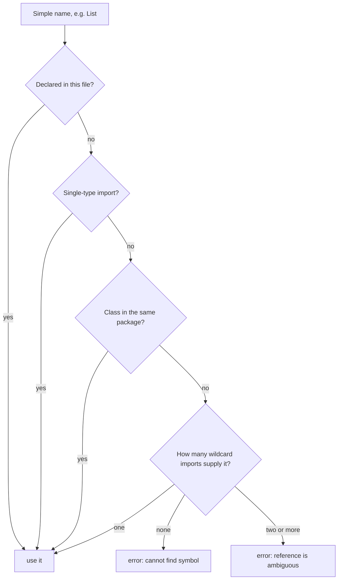

# Packages, imports and the String toolbox

> **Before this lesson:** you have used `import java.util.ArrayList;` without a full explanation ([ArrayList and reading the API documentation](#/lesson/java/java-arraylist-api)) and you know that `String` objects are immutable ([References, arrays, the stack and the heap](#/lesson/java/java-references-stack-heap)).

## In plain words

A city can have a hundred streets called "Station Road", and the post still arrives, because a full address includes the town: *Station Road, Leeds* is not *Station Road, Bath*. Within one town you drop the town name and say "Station Road".

Java has many thousands of classes, written by thousands of different teams. Two teams will both want a class called `Date`, `List` or `User`. A **package** is the town: a named group of related classes. A class's complete name, its **fully qualified name**, is the package name, a dot, then the class name: `java.util.ArrayList`. An **import** statement is you telling the compiler "in this file, when I say `ArrayList`, I mean the one in `java.util`".

The second half of this lesson tours the class you will use more than any other: `String`, together with `StringBuilder`, its changeable partner.

Why this matters for a job: every Java source file starts with a package line and imports, and reading them tells you at a glance what the file depends on. String manipulation is in nearly every coding interview.

## Packages

### What a package gives you

1. **Organisation.** Related classes sit together: `java.util` (collections and utilities), `java.io` (input and output), `java.time` (dates and times), `java.net` (networking).
2. **Unique names.** `java.util.Date` and `java.sql.Date` are different classes that happen to share a short name.
3. **Access control.** A member with no access modifier is visible only inside its own package, which lets a group of classes cooperate while hiding details from everyone else.

### Declaring your own package

The first statement in a source file names its package:

```java
package com.brightpost.shipping;

public class Parcel {
    // ...
}
```

Conventions that every team follows:

- Package names are all lower-case.
- They start with your organisation's internet domain reversed (`com.brightpost`), which makes them globally unique, followed by project and area names.
- The folder structure must match: this file lives at `com/brightpost/shipping/Parcel.java` under the source root.

A file with no `package` line is in the **unnamed package**. That is fine for one-file experiments and is never used in real projects, because classes in the unnamed package cannot be imported from named packages.

## Imports

### Three ways to refer to a class in another package

```java
// 1. Fully qualified name, no import needed
java.util.ArrayList<String> a = new java.util.ArrayList<>();

// 2. Single-type import, at the top of the file
import java.util.ArrayList;

// 3. On-demand (wildcard) import: every public type directly in java.util
import java.util.*;
```

Facts that interviewers probe:

- **An import does not load or copy anything.** It is only a naming shortcut for the compiler. Importing a thousand classes makes neither the compiled class file nor the running program any larger or slower.
- **The wildcard does not reach into sub-packages.** `import java.util.*;` does not import `java.util.concurrent.ExecutorService`; packages are not truly nested, despite the dots.
- **`java.lang` is imported automatically.** That is why `String`, `System`, `Math`, `Integer` and `Object` need no import.
- **Classes in your own package need no import.**

### How the compiler resolves a short name

When the compiler meets a simple name such as `List`, it searches in a fixed order and takes the first hit:

1. a type declared in the current file or nested in the current class;
2. a **single-type import** (`import java.util.List;`);
3. a type in the **same package**;
4. an **on-demand import** (`import java.util.*;`), which includes the automatic `java.lang.*`.



If step 4 finds the name in **two** wildcard-imported packages, the name is **ambiguous** and the file does not compile.

```java
import java.util.*;
import java.sql.*;

public class Clash {
    Date when;              // error: reference to Date is ambiguous
}
```

The cure is a single-type import, which outranks the wildcards, or the full name at the point of use:

```java
import java.util.*;
import java.sql.*;
import java.util.Date;      // settles it: Date means java.util.Date

public class Clash {
    Date when;
    java.sql.Date stored;   // the other one, spelled out
}
```

### A name resolver you can run

The model applies the four steps in order. Edit the inputs to explore ambiguity.

```python-run
PACKAGES = {
    "java.lang": {"String", "Math", "Object"},
    "java.util": {"List", "Date", "ArrayList"},
    "java.sql":  {"Date", "Connection"},
    "com.shop":  {"Order", "List"},          # our own package also has a List!
}

def resolve(name, current_pkg, single_imports, wildcard_imports):
    for full in single_imports:                       # step 2: single-type imports
        if full.rsplit(".", 1)[1] == name:
            return full
    if name in PACKAGES.get(current_pkg, set()):      # step 3: same package
        return f"{current_pkg}.{name}"
    hits = [f"{p}.{name}" for p in ["java.lang"] + wildcard_imports   # step 4
            if name in PACKAGES.get(p, set())]
    if len(hits) == 1:
        return hits[0]
    return "AMBIGUOUS " + str(hits) if hits else "cannot find symbol"

print(resolve("Date",   "com.shop", [], ["java.util", "java.sql"]))
print(resolve("Date",   "com.shop", ["java.sql.Date"], ["java.util", "java.sql"]))
print(resolve("List",   "com.shop", [], ["java.util"]))     # same package beats wildcard
print(resolve("String", "com.shop", [], []))
print(resolve("Socket", "com.shop", [], ["java.util"]))
```

The third line surprises people: a class in your own package wins over a wildcard import, so `List` here is `com.shop.List`, not `java.util.List`.

### Static imports

`import static` brings in static members (constants and static methods) so they can be used without the class name:

```java
import static java.lang.Math.PI;
import static java.lang.Math.sqrt;

double r = sqrt(2) * PI;
```

Use them sparingly; a bare `max(a, b)` gives the reader no clue where `max` comes from.

> [!INTERVIEW]
> "Does importing a package with `*` affect performance?" No. Imports are resolved entirely at compile time; the bytecode contains fully qualified names either way. The only cost of wildcards is to human readers and the risk of ambiguity when a new class with a clashing name is added to one of the packages. Most teams configure their editor to write single-type imports.

## The String toolbox

A `String` is an immutable sequence of characters. Every method below **returns a result** and leaves the original untouched.

```java
public class Strings {
    public static void main(String[] args) {
        String s = "  Parcel-0042  ";
        String t = s.trim();                       // remove spaces at both ends

        System.out.println(t.length());
        System.out.println(t.charAt(0));
        System.out.println(t.toUpperCase());
        System.out.println(t.substring(7));        // from index 7 to the end
        System.out.println(t.substring(0, 6));     // index 0 up to, not including, 6
        System.out.println(t.indexOf("-"));
        System.out.println(t.contains("004"));
        System.out.println(t.startsWith("Par"));
        System.out.println(t.replace("0", "o"));
        System.out.println(t.isEmpty() + " " + "   ".isBlank());
    }
}
```

```text
11
P
PARCEL-0042
0042
Parcel
6
true
true
Parcel-oo42
false true
```

The rule for `substring(begin, end)` is the same as for loops: the start index is included, the end index is not, so the length of the result is `end - begin`.

### Splitting and joining

```java
String line = "ada,bo,,cy";
String[] parts = line.split(",");
System.out.println(parts.length + " " + parts[2].isEmpty());
System.out.println(String.join(" | ", parts));
```

```text
4 true
ada | bo |  | cy
```

`split` cuts at every match of its argument and returns an array. Note the empty string between the two adjacent commas. (The argument is a **regular expression**, a pattern language; to split on a literal dot write `split("\\.")`.)

### Comparing strings

```java
String a = "apple";
String b = "Apple";
System.out.println(a.equals(b));              // exact match
System.out.println(a.equalsIgnoreCase(b));    // ignoring upper/lower case
System.out.println(a.compareTo(b));           // dictionary order by character code
System.out.println("apple".compareTo("apricot"));
```

```text
false
true
32
-2
```

`compareTo` returns a negative number when the first string sorts earlier, zero when they are equal, and a positive number when it sorts later. It compares character codes, so every capital letter sorts before every lower-case letter (`'A'` is 65, `'a'` is 97; the difference is the 32 printed above).

> [!TIP]
> When one side might be `null`, put the known value first: `"yes".equals(answer)` returns `false` for `null`, while `answer.equals("yes")` throws `NullPointerException`.

### Formatting

```java
String name = "Bo";
int items = 3;
double total = 14.5;
String msg = String.format("%s bought %d items for %.2f", name, items, total);
System.out.println(msg);
System.out.println("%s: %5d|".formatted("qty", 42));   // width 5, right-aligned
```

```text
Bo bought 3 items for 14.50
qty:    42|
```

`%s` is a placeholder for text, `%d` for a whole number, `%.2f` for a fractional number with two decimals. More on formatting numbers in [Wrapper classes, autoboxing and formatting](#/lesson/java/java-wrappers-formatting).

## StringBuilder: when text is built in a loop

Because strings are immutable, `s = s + x` inside a loop creates a brand-new string on every pass and copies all the old characters into it. Building a string of length $n$ one character at a time this way copies about $n^2 / 2$ characters in total.

`StringBuilder` is a **mutable** (changeable) sequence of characters. It keeps a growable internal array, much like `ArrayList`, so appending is cheap.

```java
public class Build {
    public static void main(String[] args) {
        StringBuilder sb = new StringBuilder();
        for (int i = 1; i <= 5; i++) {
            sb.append(i).append(',');          // append returns the same builder
        }
        sb.setLength(sb.length() - 1);         // drop the last comma
        sb.insert(0, "[").append("]");
        System.out.println(sb);
        System.out.println(sb.reverse());
        String result = sb.toString();         // convert when finished
        System.out.println(result.length());
    }
}
```

```text
[1,2,3,4,5]
]5,4,3,2,1[
11
```

`append` returns the builder itself, so calls can be chained on one line. This style is called **method chaining**.

### Counting the copies

```python-run
def copies_with_plus(n):
    """Characters copied when doing s = s + 'x' n times."""
    total, length = 0, 0
    for _ in range(n):
        total += length + 1        # new string: old characters plus one
        length += 1
    return total

def copies_with_builder(n, cap=16):
    """Characters copied by a StringBuilder (grows to 2*cap + 2 when full)."""
    total, length = 0, 0
    for _ in range(n):
        if length == cap:
            total += length        # copy into a bigger array
            cap = cap * 2 + 2
        total += 1
        length += 1
    return total

for n in (10, 1_000, 100_000):
    print(f"n = {n:7}:  s = s + x copies {copies_with_plus(n):14,}   StringBuilder copies {copies_with_builder(n):9,}")
```

At a hundred thousand characters the difference is five billion copies against a few hundred thousand. For a handful of concatenations on one line, plain `+` is fine and clearer; the compiler handles it efficiently.

| | `String` | `StringBuilder` | `StringBuffer` |
|---|---|---|---|
| Changeable | no | yes | yes |
| Safe to share between threads | yes (immutable) | no | yes (synchronised) |
| Speed for repeated appends | slow | fast | slower than `StringBuilder` |
| Use when | holding text | building text in one thread | legacy code; rarely needed now |

## Pitfalls

- **Expecting a wildcard import to include sub-packages.**
- **Two wildcard imports with a shared class name**: ambiguous.
- **Forgetting that `java.lang` is the only automatic import**: `Scanner`, `List`, `Random` all need importing.
- **Package line not matching the folder**: the class cannot be found at run time.
- **Discarding the result of a `String` method.**
- **`substring` end index treated as inclusive.**
- **`split(".")` or `split("|")`**: those characters are special in regular expressions; escape them.
- **`+=` on a `String` in a long loop.**
- **Comparing with `==`.** Use `equals`.

## Cheat sheet

| Task | Code |
|---|---|
| Declare a package | `package com.acme.app;` (first line) |
| Import one class | `import java.util.List;` |
| Import all in a package | `import java.util.*;` |
| Import a static member | `import static java.lang.Math.max;` |
| Length / char at | `s.length()` / `s.charAt(i)` |
| Slice | `s.substring(begin, end)` |
| Find | `s.indexOf("x")`, `s.contains("x")` |
| Clean / case | `s.trim()`, `s.strip()`, `s.toLowerCase()` |
| Split / join | `s.split(",")` / `String.join(",", parts)` |
| Compare | `a.equals(b)`, `a.equalsIgnoreCase(b)`, `a.compareTo(b)` |
| Format | `String.format("%d items", n)` |
| Build in a loop | `StringBuilder sb; sb.append(x); sb.toString()` |

## Summary

- A package groups classes and makes their names unique; the folder layout mirrors the package name.
- An import is a compile-time naming shortcut with no run-time cost; `java.lang` and your own package are always visible.
- Name resolution order: current file, single-type imports, same package, wildcard imports; two wildcard hits are ambiguous.
- `String` methods return new strings; indices start at 0 and end indices are exclusive.
- Use `StringBuilder` to assemble text in loops.

## Glossary

- **Package**: a named group of related classes.
- **Fully qualified name**: package name plus class name, e.g. `java.util.List`.
- **Import**: a declaration that lets a file use a class by its short name.
- **Single-type import**: an import naming one class.
- **On-demand (wildcard) import**: an import ending in `.*`.
- **Static import**: an import of static members.
- **Unnamed package**: where classes without a package declaration live.
- **Regular expression**: a pattern language for matching text.
- **Mutable**: able to change after creation.
- **`StringBuilder`**: a mutable character sequence for building strings.
- **Method chaining**: calling several methods in a row on the value each one returns.

## Check yourself

```quiz
[
  {"q": "Which package is imported automatically into every Java file?", "options": ["java.util", "java.lang", "java.io", "None"], "answer": 1,
   "explain": "java.lang (String, System, Math, Object, the wrappers) is always available without an import."},
  {"q": "Does `import java.util.*;` make `java.util.concurrent.ExecutorService` available by its short name?", "options": ["Yes", "No: wildcards cover only types directly in that package", "Only in Java 17+", "Yes, but with a warning"], "answer": 1,
   "explain": "java.util.concurrent is a separate package. Packages do not nest for import purposes."},
  {"q": "A file has `import java.util.*; import java.sql.*;` and declares `Date d;`. Does it compile?", "options": ["Yes, java.util.Date is chosen", "Yes, java.sql.Date is chosen", "No: the reference to Date is ambiguous", "Yes, the first import wins"], "answer": 2,
   "explain": "Both wildcard imports supply a Date and neither outranks the other. A single-type import or a full name resolves it."},
  {"q": "What does `\"warehouse\".substring(4, 7)` return?", "options": ["hous", "hou", "ehou", "house"], "answer": 1,
   "explain": "Indices 4, 5 and 6 are h, o, u. The end index 7 is excluded."},
  {"q": "What does this print? `String s = \"abc\"; s.toUpperCase(); s.replace('a', 'z'); System.out.println(s);`", "options": ["ZBC", "zbc", "abc", "ABC"], "answer": 2,
   "explain": "Both methods return new strings that are discarded. s still refers to the original."},
  {"q": "What does `\"a,b,,c\".split(\",\").length` evaluate to?", "options": ["3", "4", "5", "2"], "answer": 1,
   "explain": "The pieces are a, b, an empty string and c. (Only trailing empty strings are dropped by split.)"},
  {"q": "What does this print? `StringBuilder sb = new StringBuilder(\"ab\"); sb.append(\"c\").reverse(); System.out.println(sb);`", "options": ["abc", "cba", "ab", "c"], "answer": 1,
   "explain": "StringBuilder is mutable: append and reverse change the builder itself, giving cba."},
  {"q": "Does a file with many unused imports produce a larger or slower program?", "options": ["Larger class file", "Slower start-up", "Neither: imports only help the compiler resolve names", "Both"], "answer": 2,
   "explain": "Imports leave no trace in the bytecode beyond the fully qualified names of classes that are in fact used."}
]
```

> **Source:** Head First Java, ch. 6 (packages and imports), ch. 17 (package structure) and appendix B (String and StringBuilder methods). Name-resolution rules checked against the Java Language Specification, sections 6.4.1 and 7.5: https://docs.oracle.com/javase/specs/jls/se21/html/jls-7.html ; String API: https://docs.oracle.com/en/java/javase/21/docs/api/java.base/java/lang/String.html .
