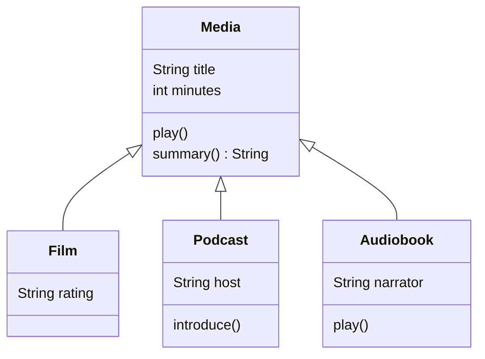
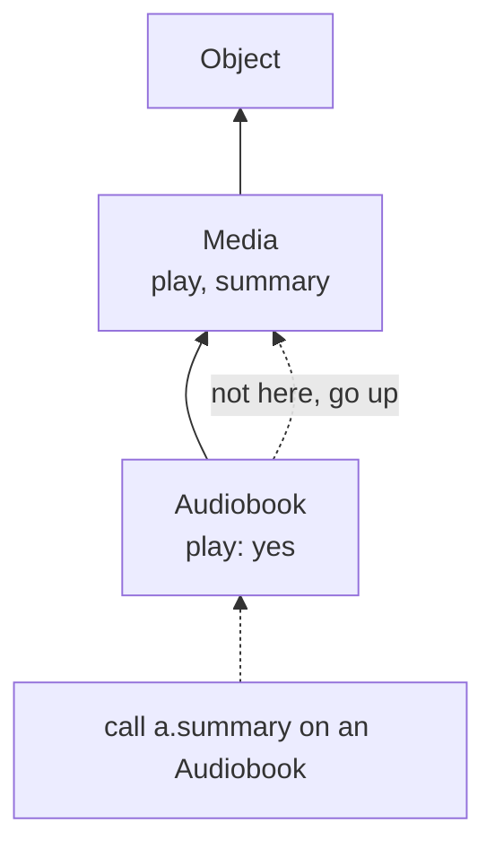

# Inheritance: sharing code through a family tree

> **Before this lesson:** you can design small classes with private fields and public methods ([Encapsulation: private fields, getters and setters](#/lesson/java/java-encapsulation)) and you have seen why separate classes beat `if` chains on a type code ([Thinking in objects: several classes working together](#/lesson/java/java-thinking-in-objects)).

## In plain words

A company writes one employment contract with the terms everyone shares: working hours, holidays, the pension. A manager's contract does not repeat all of that. It says "everything in the standard contract applies, plus a company car, and the notice period is three months instead of one". The manager's contract **inherits** the standard terms, **adds** something, and **replaces** one clause.

In Java a class can do the same thing. A new class can declare that it **extends** an existing class. It then automatically has every field and method of the existing class, may add its own, and may replace the behaviour of inherited methods. The existing class is the **superclass** (also called parent or base class). The new one is the **subclass** (child or derived class).

Why this matters for a job: inheritance is the second pillar of object-oriented programming and the foundation for polymorphism. Interviews routinely ask you to draw a small hierarchy, say what gets inherited, and explain when inheritance is the wrong tool.

## The duplication problem

A streaming service has three kinds of media.

```java
class Film {
    String title;
    int minutes;
    void play()        { System.out.println("Playing " + title); }
    String rating;
}

class Podcast {
    String title;
    int minutes;
    void play()        { System.out.println("Playing " + title); }
    String host;
}
```

`title`, `minutes` and `play` are written twice. Add a third kind and they are written three times. When the play logic needs changing, somebody must remember every copy.

## Extracting a superclass

Move what is common into one class, and let the specific classes extend it.

```java
class Media {
    String title;
    int minutes;

    void play() {
        System.out.println("Playing " + title);
    }

    String summary() {
        return title + " (" + minutes + " min)";
    }
}

class Film extends Media {
    String rating;
}

class Podcast extends Media {
    String host;

    void introduce() {
        System.out.println("Hosted by " + host);
    }
}

public class Streaming {
    public static void main(String[] args) {
        Podcast p = new Podcast();
        p.title = "Deep Tides";      // inherited field
        p.minutes = 42;              // inherited field
        p.host = "Mara";             // its own field
        p.play();                    // inherited method
        p.introduce();               // its own method
        System.out.println(p.summary());
    }
}
```

```text
Playing Deep Tides
Hosted by Mara
Deep Tides (42 min)
```

- `class Podcast extends Media` declares the relationship. One word, `extends`, is all it takes.
- A `Podcast` object contains **all** the instance variables of `Media` plus its own: `title`, `minutes` and `host`.
- All non-private methods of `Media` can be called on a `Podcast`.
- The reverse is not true: a plain `Media` object has no `host` and no `introduce`.



In these diagrams the hollow arrow points **from the subclass to the superclass** and reads "is a kind of".

## Overriding: replacing an inherited method

A subclass may supply its own version of an inherited method. This is **overriding**. The new method must have the same name and the same parameter types.

```java
class Audiobook extends Media {
    String narrator;

    @Override
    void play() {
        System.out.println("Reading " + title + ", narrated by " + narrator);
    }
}
```

```java
Audiobook a = new Audiobook();
a.title = "Night Trains";
a.narrator = "Ivo";
a.play();
System.out.println(a.summary());     // summary was not overridden
```

```text
Reading Night Trains, narrated by Ivo
Night Trains (0 min)
```

`@Override` is an **annotation**, a label for the compiler. It says "I intend this method to override one from a superclass". If you misspell the name or get the parameters wrong, so that nothing is being overridden, the compiler reports an error instead of quietly creating a brand-new unrelated method. Always write it.

### Which method runs?

When a method is called on an object, the JVM starts at the object's **own class** and looks for the method there. If it is not found, it moves up to the superclass, then that class's superclass, and so on. The first match wins. So the most specific version always runs.



### Extending instead of replacing: super

Often a subclass wants the inherited behaviour **plus** something. `super.method()` calls the superclass's version.

```java
class Film extends Media {
    String rating;

    @Override
    String summary() {
        return super.summary() + " rated " + rating;
    }
}
```

```java
Film f = new Film();
f.title = "Glass Harbour";
f.minutes = 118;
f.rating = "12";
System.out.println(f.summary());
```

```text
Glass Harbour (118 min) rated 12
```

Without `super.`, the call `summary()` inside `summary()` would call itself forever and end in `StackOverflowError`.

## IS-A and HAS-A: the test for using inheritance

Before writing `extends`, say the sentence "**X is a Y**" aloud.

- "A podcast **is a** media item." True, in every situation. Inheritance fits.
- "A film **is a** rating." Nonsense.
- "A film **has a** rating." True. A **HAS-A** relationship is modelled with a **field**, not with inheritance.

The test must hold in one direction only and at every level: if `Documentary extends Film` and `Film extends Media`, then a documentary is a film and a documentary is a media item.

A tempting misuse: "My `Playlist` needs to store items, and `ArrayList` already stores items, so `Playlist extends ArrayList`." A playlist is not a kind of array list; it **has** a list. Extending would hand every caller forty public methods (`clear`, `add(0, x)`, `removeIf`) that can break the playlist's rules. Prefer:

```java
class Playlist {
    private final java.util.ArrayList<Media> items = new java.util.ArrayList<>();   // HAS-A

    void add(Media m)  { items.add(m); }
    int totalMinutes() {
        int sum = 0;
        for (Media m : items) {
            sum += m.minutes;
        }
        return sum;
    }
}
```

Using a field and forwarding calls to it is called **composition**. The trade-off is studied in depth in [Composition over inheritance](#/lesson/java/java-ej-composition).

> [!TIP]
> Do not use inheritance only to reuse a few lines of code. Use it when the subclass truly is a more specific kind of the superclass and should be usable wherever the superclass is expected.

## What is inherited, and what is not

| Member of the superclass | Inherited by the subclass? |
|---|---|
| `public` fields and methods | yes |
| `protected` fields and methods | yes |
| package-private (no modifier) | only if the subclass is in the same package |
| `private` fields | they exist inside the subclass object, but subclass code cannot name them |
| `private` methods | no; they cannot be called or overridden from the subclass |
| constructors | no; each class declares its own (see [Constructors, this and super](#/lesson/java/java-constructors)) |

The private-field row deserves an example.

```java
class Media {
    private int plays;                     // hidden even from subclasses

    public void recordPlay() { plays++; }
    public int getPlays()    { return plays; }
}

class Film extends Media {
    boolean popular() {
        // return plays > 1000;            // does not compile: plays has private access in Media
        return getPlays() > 1000;          // go through the public method
    }
}
```

Every `Film` object carries a `plays` value in memory, but the `Film` class must use the superclass's methods to reach it. Keeping fields private even from subclasses is good practice: the superclass keeps control of its invariants.

`protected` grants access to subclasses (and to the same package). It is a larger promise than it looks, because every future subclass may depend on that member.

## Rules of the family tree

- **A class extends exactly one class.** Java has **single inheritance** of classes. `class A extends B, C` does not compile. (A class may implement many interfaces; see [Interfaces](#/lesson/java/java-interfaces).)
- **Every class has a superclass.** If you do not write `extends`, the class extends `Object`, the root of all classes. So every object has the methods `toString`, `equals`, `hashCode` and a few more.
- **Chains can be several levels deep.** Keep them shallow; two or three levels is usual.
- **`final` stops inheritance.** `final class Token` cannot be extended; `final void pay()` cannot be overridden. `String` is a final class.
- **Since Java 17, `sealed` restricts it**: `sealed class Shape permits Circle, Square` lets only the listed classes extend `Shape`.

## Designing a hierarchy step by step

1. List the things you need: film, podcast, audiobook.
2. Write down what each knows and does.
3. Circle what they have in common: title, minutes, play, summary.
4. Put the common part in a superclass and name it for the general idea: `Media`.
5. Decide which behaviours differ per kind and override those.
6. Look for sub-groups with more in common (podcasts and audiobooks are both audio) and consider an intermediate class, `Audio`. Add it only if it removes real duplication.
7. Apply the IS-A test to every arrow.

### A lookup model you can run

The simulation stores, for each class, its parent and the methods it defines, then resolves a call the way the JVM does: start at the object's class and climb.

```python-run
classes = {
    "Object":    {"parent": None,     "methods": ["toString"]},
    "Media":     {"parent": "Object", "methods": ["play", "summary"]},
    "Film":      {"parent": "Media",  "methods": ["summary"]},
    "Audiobook": {"parent": "Media",  "methods": ["play"]},
    "Podcast":   {"parent": "Media",  "methods": ["introduce"]},
}

def resolve(runtime_class, method):
    path, c = [], runtime_class
    while c is not None:
        path.append(c)
        if method in classes[c]["methods"]:
            return f"{method}() runs the version in {c}   (searched: {' -> '.join(path)})"
        c = classes[c]["parent"]
    return f"{method}() not found: compile-time error"

for cls, m in [("Audiobook", "play"), ("Audiobook", "summary"), ("Film", "summary"),
               ("Podcast", "toString"), ("Film", "introduce")]:
    print(f"{cls:10}", resolve(cls, m))
```

Add a class `Documentary` with parent `Film` and no methods, then resolve `summary` on it: the search passes through `Documentary`, finds it in `Film`, and stops.

## The benefits, stated precisely

1. **No duplicated code.** Common fields and methods are written once.
2. **One place to change.** Improve `Media.play()` and every subclass that did not override it improves.
3. **A shared contract.** Every `Media` subclass is guaranteed to have `play()` and `summary()`. Code can be written against `Media` and will work with subclasses that do not exist yet. That last benefit is **polymorphism**, the subject of the next lesson.

> [!INTERVIEW]
> "What are the drawbacks of inheritance?" (1) **Tight coupling**: a subclass depends on the superclass's implementation details, so a change above can break classes below. (2) It is fixed at compile time; an object cannot change its superclass at run time. (3) Only one superclass is allowed. (4) Deep hierarchies are hard to follow. Conclude with the guideline: prefer composition unless there is a real IS-A relationship and the superclass was designed for extension.

## Pitfalls

- **Overloading when you meant to override.** `void play(int speed)` in the subclass does not replace `void play()`; it adds a second method. `@Override` catches this.
- **Forgetting `super.`** when extending behaviour, causing infinite recursion.
- **Accessing private superclass fields** from the subclass.
- **Using inheritance for HAS-A relationships.**
- **Redeclaring an inherited field** in the subclass. This creates a second, separate field that **hides** the first; the two get out of step. Never do it.
- **Weakening access when overriding.** An overriding method cannot be less accessible than the one it overrides: a `public` method cannot be overridden as package-private.
- **Assuming a subclass can remove an inherited method.** It cannot; that would break the IS-A promise.

## Cheat sheet

| Idea | Java |
|---|---|
| Inherit from a class | `class Film extends Media { }` |
| Replace an inherited method | same name and parameters, marked `@Override` |
| Call the superclass version | `super.summary()` |
| Forbid extension | `final class X` |
| Forbid overriding | `final void m()` |
| Limit who may extend | `sealed class S permits A, B` |
| Root of all classes | `java.lang.Object` |
| IS-A | use `extends` |
| HAS-A | use a field |

## Summary

- `extends` makes a subclass that has everything the superclass has and can add or override.
- Method lookup starts at the object's real class and climbs toward `Object`; the lowest version wins.
- `super.method()` reuses the inherited behaviour inside an override.
- Private members are not accessible in subclasses; use the superclass's public or protected methods.
- Use inheritance for true IS-A relationships; use fields (composition) for HAS-A.
- A class has exactly one superclass, and `Object` sits at the top.

## Glossary

- **Inheritance**: a class acquiring the fields and methods of another class.
- **Superclass**: the class being extended; also parent or base class.
- **Subclass**: the class that extends another; also child or derived class.
- **`extends`**: the keyword that declares a superclass.
- **Override**: to supply a new implementation of an inherited method.
- **`@Override`**: an annotation asking the compiler to verify an override.
- **`super`**: a keyword for reaching the superclass's version of a member.
- **IS-A**: the relationship between a subclass and its superclass.
- **HAS-A**: the relationship between an object and a field it holds.
- **Composition**: building a class from other objects held as fields.
- **Single inheritance**: the rule that a class has exactly one direct superclass.
- **`final`**: on a class, forbids subclasses; on a method, forbids overriding.

## Check yourself

```quiz
[
  {"q": "`class Film extends Media` and Media declares `String title`. How many `title` fields does a Film object have?", "options": ["0", "1, inherited from Media", "2", "It depends on the access modifier"], "answer": 1,
   "explain": "The subclass object contains the superclass's instance variables. Film did not redeclare title, so there is one."},
  {"q": "Does this compile? `class A { private int n; } class B extends A { int twice() { return n * 2; } }`", "options": ["Yes", "No: n has private access in A", "Yes, n is inherited as protected", "No: B cannot extend A"], "answer": 1,
   "explain": "Private members are not accessible outside their own class, even in subclasses."},
  {"q": "What does this print? `class P { String who() { return \"P\"; } } class C extends P { @Override String who() { return \"C\" + super.who(); } }` then `System.out.println(new C().who());`", "options": ["C", "P", "CP", "PC"], "answer": 2,
   "explain": "C's version runs, builds \"C\" and appends the result of the superclass version, \"P\"."},
  {"q": "Does this compile? `class Hybrid extends Car, Boat { }`", "options": ["Yes", "No: a class can extend only one class", "Yes, if Car and Boat have no common methods", "Only in Java 17+"], "answer": 1,
   "explain": "Java allows single inheritance of classes. Multiple supertypes are achieved with interfaces."},
  {"q": "A subclass declares `@Override void pley() { }` but the superclass method is `play()`. What happens?", "options": ["A new method pley is added silently", "Compile-time error: method does not override a supertype method", "Runtime error", "play is renamed"], "answer": 1,
   "explain": "That is precisely what @Override is for: it turns a silent mistake into a compiler error."},
  {"q": "Which relationship should be modelled with a field instead of `extends`?", "options": ["A Podcast is a Media", "A Car has an Engine", "A Circle is a Shape", "A Manager is an Employee"], "answer": 1,
   "explain": "HAS-A relationships use composition (a field). The other three pass the IS-A test."},
  {"q": "Does this compile? `class Base { public void run() { } } class Sub extends Base { @Override void run() { } }`", "options": ["Yes", "No: the override reduces visibility from public to package-private", "Yes, with a warning", "No: run is final"], "answer": 1,
   "explain": "An overriding method must be at least as accessible as the method it overrides."},
  {"q": "If a class declaration has no `extends` clause, what is its superclass?", "options": ["None", "java.lang.Object", "java.lang.Class", "Itself"], "answer": 1,
   "explain": "Every class implicitly extends Object, which is why every object has toString, equals and hashCode."}
]
```

> **Source:** Head First Java, ch. 7 (inheritance, IS-A and HAS-A, overriding). Checked against the Java Language Specification section 8.1.4 and 8.4.8: https://docs.oracle.com/javase/specs/jls/se21/html/jls-8.html and https://dev.java/learn/inheritance/ .
