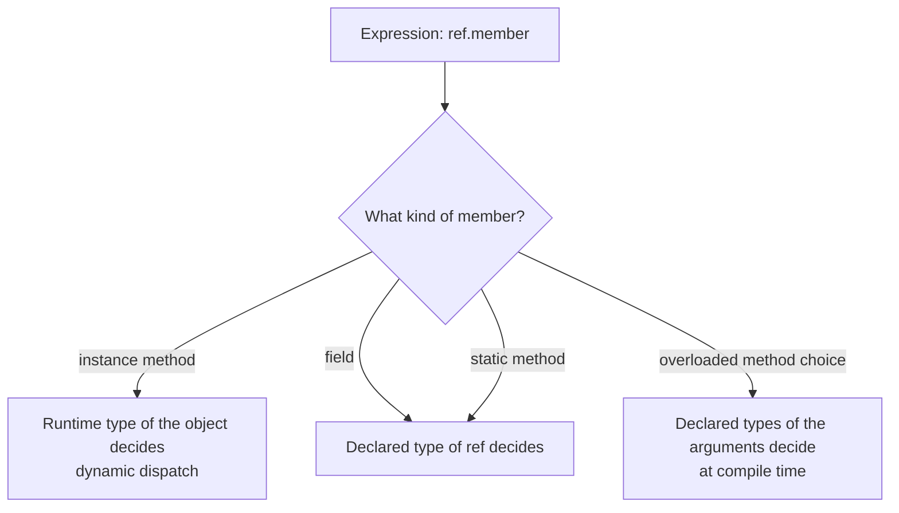

# Polymorphism, overriding and overloading

> **Before this lesson:** you can write a superclass and subclasses, override a method and call `super` ([Inheritance: sharing code through a family tree](#/lesson/java/java-inheritance-basics)).

## In plain words

A universal remote control has a button marked "power". Point it at a television and the screen lights up. Point it at a sound bar and the speakers click on. Point it at a projector and a fan starts whirring. You pressed the same button each time. What happened depended on the **device that received the signal**, not on the remote.

**Polymorphism** (from Greek, "many forms") is this idea in code. You write one call, such as `device.powerOn()`, through a variable of a general type. At run time Java looks at the actual object the variable refers to and runs that object's own version of the method.

The consequence is large: code written today against the general type keeps working with kinds of object that will be invented next year, without being edited or even recompiled.

Why this matters for a job: polymorphism is what makes frameworks, plug-ins and testable designs possible. "What does this print?" questions about overriding, overloading, static methods and fields are the single most common category of Java interview puzzle.

## A supertype variable can hold a subtype object

```java
class Media {
    String title;
    void play() { System.out.println("Playing " + title); }
}

class Audiobook extends Media {
    @Override
    void play() { System.out.println("Reading " + title + " aloud"); }
}

class Film extends Media {
    @Override
    void play() { System.out.println("Projecting " + title); }
    void showSubtitles() { System.out.println("[subtitles on]"); }
}

public class Poly {
    public static void main(String[] args) {
        Media m = new Film();          // variable type Media, object type Film
        m.title = "Glass Harbour";
        m.play();

        m = new Audiobook();           // same variable, different kind of object
        m.title = "Night Trains";
        m.play();
    }
}
```

```text
Projecting Glass Harbour
Reading Night Trains aloud
```

`Media m = new Film();` is legal because a film IS-A media item. Two different types are now in play, and keeping them apart is the key to every puzzle:

| | Name | Decided | Used for |
|---|---|---|---|
| The type of the **variable** | **declared type** (also static or compile-time type) | when you write the code | what the compiler lets you call |
| The type of the **object** | **runtime type** (also dynamic or actual type) | when `new` runs | which overridden method executes |

The rule in two halves:

1. **The compiler checks the call against the declared type.** `m.showSubtitles()` does not compile, even when `m` refers to a `Film`, because `Media` has no such method.
2. **The JVM chooses the method body by the runtime type.** `m.play()` runs `Film`'s version when the object is a `Film`.

Choosing the method body at run time is called **dynamic dispatch** or **late binding**.

## Why it is useful

### Polymorphic collections and loops

```java
Media[] queue = { new Film(), new Audiobook(), new Media() };
String[] titles = { "Glass Harbour", "Night Trains", "Rain Sounds" };
for (int i = 0; i < queue.length; i++) {
    queue[i].title = titles[i];
    queue[i].play();
}
```

```text
Projecting Glass Harbour
Reading Night Trains aloud
Playing Rain Sounds
```

One array type, one loop, one call, and three behaviours. There is no `if (kind == FILM)` anywhere.

### Polymorphic parameters and return types

```java
class Player {
    void start(Media item) {          // accepts ANY subclass of Media
        System.out.print("> ");
        item.play();
    }
}
```

`start` was compiled knowing only `Media`. If someone later writes `class LiveStream extends Media` with its own `play`, then `player.start(new LiveStream())` works and runs the new code. `Player` is not touched. This is the practical meaning of the phrase "open for extension, closed for modification".

## The rules of overriding

For a subclass method to override a superclass method:

| Rule | Detail |
|---|---|
| Same name and parameter types | otherwise it is an overload, a different method |
| Compatible return type | the same type, or a subtype of it (a **covariant return**) |
| Not less accessible | `protected` may become `public`, never the reverse |
| No new or broader checked exceptions | it may throw fewer or narrower ones |
| The superclass method is not `final`, `static` or `private` | those cannot be overridden |

```java
class Shelter {
    Media pick() { return new Media(); }
}
class FilmShelter extends Shelter {
    @Override
    Film pick() { return new Film(); }     // covariant return: Film is a Media
}
```

## Overloading is a different thing

**Overloading** means several methods in the same class (or inherited into it) share a name but have different parameter lists. They are unrelated methods that happen to have the same name.

```java
class Printer {
    void print(int n)       { System.out.println("int " + n); }
    void print(long n)      { System.out.println("long " + n); }
    void print(double d)    { System.out.println("double " + d); }
    void print(Integer n)   { System.out.println("Integer " + n); }
    void print(Object o)    { System.out.println("Object " + o); }
    void print(int... ns)   { System.out.println("varargs of " + ns.length); }
}
```

```java
Printer p = new Printer();
byte b = 5;
p.print(7);            // exact match
p.print(b);            // no print(byte): widen byte -> int
p.print(7L);           // exact match
p.print(7.5f);         // no print(float): widen float -> double
p.print('x');          // char widens to int
p.print("hi");         // String is an Object
p.print();             // only varargs can take zero arguments
```

```text
int 7
int 5
long 7
double 7.5
int 120
Object hi
varargs of 0
```

The compiler chooses among overloads **at compile time**, using the **declared types** of the arguments, in three phases. It stops at the first phase that finds a match.

1. **Exact match or widening** of primitives and references (`byte` to `int`, `String` to `Object`), with no boxing.
2. **Boxing and unboxing** (`int` to `Integer`), possibly followed by reference widening (`Integer` to `Object`).
3. **Varargs.**

Within a phase the **most specific** applicable method wins. If two are equally specific the call is ambiguous and does not compile.

```java
class Q {
    void m(long x)    { System.out.println("long"); }
    void m(Integer x) { System.out.println("Integer"); }
}
new Q().m(5);     // prints long: widening (phase 1) beats boxing (phase 2)
```

### Overloads are picked by declared type, not runtime type

This is the trap that catches experienced developers.

```java
class Sorter {
    void handle(Media m) { System.out.println("some media"); }
    void handle(Film f)  { System.out.println("a film"); }
}

Media item = new Film();
new Sorter().handle(item);
```

```text
some media
```

The object is a `Film`, but the argument's **declared** type is `Media`, and overload selection happened in the compiler, which knew only that. Compare with overriding, where the runtime type decides.

| | Overriding | Overloading |
|---|---|---|
| Where | subclass and superclass | usually within one class |
| Parameter list | identical | different |
| Chosen | at run time | at compile time |
| Chosen by | runtime type of the object the method is called **on** | declared types of the **arguments** |
| Also called | dynamic dispatch, late binding | static dispatch, early binding |

## What is NOT polymorphic: fields, static methods, private methods

Dynamic dispatch applies to **instance methods only**.

```java
class Parent {
    String name = "parent";
    static String kind()  { return "static parent"; }
    String describe()     { return "I am " + name; }
}

class Child extends Parent {
    String name = "child";                       // hides Parent.name
    static String kind()  { return "static child"; }   // hides Parent.kind
    @Override
    String describe()     { return "I am " + name; }
}

public class Hiding {
    public static void main(String[] args) {
        Parent p = new Child();
        System.out.println(p.name);          // field: declared type decides
        System.out.println(p.kind());        // static method: declared type decides
        System.out.println(p.describe());    // instance method: runtime type decides
        System.out.println(((Child) p).name);
    }
}
```

```text
parent
static parent
I am child
child
```

- **Fields are resolved by the declared type.** A subclass field with the same name does not override; it **hides**. The object holds both fields.
- **Static methods belong to a class, not an object.** `p.kind()` is compiled as `Parent.kind()`. Calling a static method through a variable is legal but misleading; write the class name.
- **Private methods are not inherited**, so they cannot be overridden either. A same-named method in a subclass is a new, unrelated method.



## A dispatch model you can run

The model answers the standard interview puzzle mechanically. Each class lists its parent and the members it declares. A call is resolved with the correct rule for its kind of member.

```python-run
classes = {
    "Parent": {"parent": None,
               "methods": {"describe": "Parent.describe"},
               "statics": {"kind": "Parent.kind"},
               "fields":  {"name": "parent"}},
    "Child":  {"parent": "Parent",
               "methods": {"describe": "Child.describe"},
               "statics": {"kind": "Child.kind"},
               "fields":  {"name": "child"}},
    "Grand":  {"parent": "Child", "methods": {}, "statics": {}, "fields": {}},
}

def lookup(start, table, member):
    c = start
    while c:
        if member in classes[c][table]:
            return classes[c][table][member]
        c = classes[c]["parent"]
    return "compile error"

def call(declared, runtime, kind, member):
    start = runtime if kind == "methods" else declared   # the whole lesson in one line
    return lookup(start, kind, member)

for declared, runtime in [("Parent", "Child"), ("Parent", "Grand"), ("Child", "Grand")]:
    print(f"{declared} ref = new {runtime}():",
          call(declared, runtime, "methods", "describe"), "|",
          call(declared, runtime, "statics", "kind"), "|",
          "field name =", call(declared, runtime, "fields", "name"))
```

`Grand` declares nothing, so its instance method lookup climbs to `Child`, while the field and static lookups start from the declared type.

## A complete trace, interview style

```java
class Shape {
    Shape()            { System.out.println("Shape made"); }
    void draw()        { System.out.println("generic shape"); }
    void render()      { System.out.print("render: "); draw(); }
}

class Circle extends Shape {
    @Override
    void draw()        { System.out.println("circle"); }
    void draw(int n)   { System.out.println("circle x" + n); }
}

public class Trace {
    public static void main(String[] args) {
        Shape s = new Circle();
        s.render();
        // s.draw(3);                 // does not compile: Shape has no draw(int)
        ((Circle) s).draw(3);
    }
}
```

```text
Shape made
render: circle
circle x3
```

`render` is inherited from `Shape`, yet the `draw()` it calls is `Circle`'s. Inside a method, a call such as `draw()` means `this.draw()`, and `this` is the `Circle` object, so dynamic dispatch applies there too. Calls from superclass code down into subclass overrides are the heart of many frameworks.

`draw(int)` is an overload added by `Circle`. The compiler looks at the declared type `Shape`, finds no `draw(int)`, and rejects `s.draw(3)`. The cast `(Circle) s` tells the compiler to treat the reference as a `Circle`; the JVM verifies the cast at run time.

> [!INTERVIEW]
> A three-step method for any "what does it print" question. For each call `x.m(args)`: **(1)** take the *declared* type of `x` and of each argument; using only those, pick which method signature is meant (overload resolution) or report a compile error. **(2)** If that method is static, or you are reading a field, stop: the declared type's version is used. **(3)** Otherwise take the *runtime* type of the object and find the lowest class in its hierarchy that overrides that exact signature. Say the three steps aloud as you answer.

## Pitfalls

- **Expecting overloads to be chosen by runtime type.**
- **"Overriding" with a different parameter type.** `boolean equals(Media other)` does not override `equals(Object)`; it overloads it, and collections will not call it. `@Override` exposes the mistake.
- **Redeclaring fields in subclasses.** They hide, they do not override.
- **Calling static methods through instances.**
- **Calling a subclass-only method through a supertype variable** without a cast.
- **Calling overridable methods from a constructor.** The subclass version runs before the subclass's fields are initialised; see [Constructors, this and super](#/lesson/java/java-constructors).
- **Ambiguous overloads with `null`.** With `m(String)` and `m(Integer)`, the call `m(null)` does not compile; with `m(Object)` and `m(String)` it picks `String`, the more specific type.

## Cheat sheet

| Question | Answer |
|---|---|
| What may I call on `ref`? | whatever the **declared type** has |
| Which overridden body runs? | the **runtime type's** |
| Which overload is chosen? | by **declared argument types**, at compile time |
| Overload preference order | exact/widening, then boxing, then varargs |
| Field access `ref.f` | by declared type |
| Static call `ref.s()` | by declared type |
| Return type when overriding | same or a subtype |
| Access when overriding | same or wider |

## Summary

- A variable of a supertype can refer to any subtype object.
- The compiler uses the declared type to decide what is callable and which overload is meant.
- The JVM uses the runtime type to decide which override executes.
- Polymorphism lets one piece of code work with many current and future classes.
- Overriding is resolved at run time; overloading at compile time.
- Fields, static methods and private methods are not subject to dynamic dispatch.

## Glossary

- **Polymorphism**: one call behaving differently depending on the object's actual class.
- **Declared type**: the type written for a variable; known at compile time.
- **Runtime type**: the class of the object a reference refers to at run time.
- **Dynamic dispatch / late binding**: selecting a method implementation at run time.
- **Static dispatch / early binding**: selecting a method at compile time.
- **Overriding**: replacing an inherited instance method in a subclass.
- **Overloading**: several methods with the same name and different parameter lists.
- **Covariant return type**: an override returning a subtype of the original return type.
- **Hiding**: a subclass field or static method with the same name as one in the superclass.
- **Most specific method**: the applicable overload whose parameter types are the narrowest.

## Check yourself

```quiz
[
  {"q": "Given the lesson's classes, does `Media m = new Film(); m.showSubtitles();` compile?", "options": ["Yes, the object is a Film", "No: the declared type Media has no showSubtitles method", "Yes, but it throws at run time", "Only with @Override"], "answer": 1,
   "explain": "The compiler checks calls against the declared type. A cast to Film would be needed."},
  {"q": "What does this print? `class A { void f() { System.out.print(\"A\"); } } class B extends A { void f() { System.out.print(\"B\"); } }` then `A x = new B(); x.f();`", "options": ["A", "B", "AB", "It does not compile"], "answer": 1,
   "explain": "f is an instance method, so the runtime type B decides."},
  {"q": "What does this print? `class A { static void g() { System.out.print(\"A\"); } } class B extends A { static void g() { System.out.print(\"B\"); } }` then `A x = new B(); x.g();`", "options": ["A", "B", "AB", "It does not compile"], "answer": 0,
   "explain": "Static methods are bound by the declared type. x.g() is compiled as A.g()."},
  {"q": "What does this print? `class A { int v = 1; } class B extends A { int v = 2; }` then `A x = new B(); System.out.println(x.v);`", "options": ["1", "2", "0", "It does not compile"], "answer": 0,
   "explain": "Fields are not polymorphic. The declared type A decides, so A's v is read."},
  {"q": "With `void m(long x)` and `void m(Integer x)` in one class, what does `m(3)` call?", "options": ["m(Integer)", "m(long)", "Ambiguous: compile error", "Neither"], "answer": 1,
   "explain": "Phase 1 (widening int to long) finds a match before phase 2 (boxing) is tried."},
  {"q": "With `void h(Object o) { print(\"O\"); }` and `void h(String s) { print(\"S\"); }`, what does `Object v = \"text\"; h(v);` print?", "options": ["S", "O", "OS", "It does not compile"], "answer": 1,
   "explain": "Overloads are selected by the declared type of the argument, which is Object."},
  {"q": "Does this compile? `class A { Object make() { return null; } } class B extends A { @Override String make() { return \"\"; } }`", "options": ["No: return types must be identical", "Yes: String is a subtype of Object (covariant return)", "No: String is final", "Yes, but only without @Override"], "answer": 1,
   "explain": "An override may narrow the return type to a subtype."},
  {"q": "What does this print? `class A { void run() { step(); } void step() { System.out.print(\"A\"); } } class B extends A { void step() { System.out.print(\"B\"); } }` then `new B().run();`", "options": ["A", "B", "AB", "BA"], "answer": 1,
   "explain": "run is inherited, but the step() it calls is this.step() and this is a B, so dynamic dispatch runs B's version."}
]
```

> **Source:** Head First Java, ch. 7 and 8 (polymorphism, overriding rules, overloading). Overload resolution phases checked against the Java Language Specification section 15.12.2 and hiding in 8.3 and 8.4.8: https://docs.oracle.com/javase/specs/jls/se21/html/jls-15.html#jls-15.12.2 and https://dev.java/learn/inheritance/polymorphism/ .
