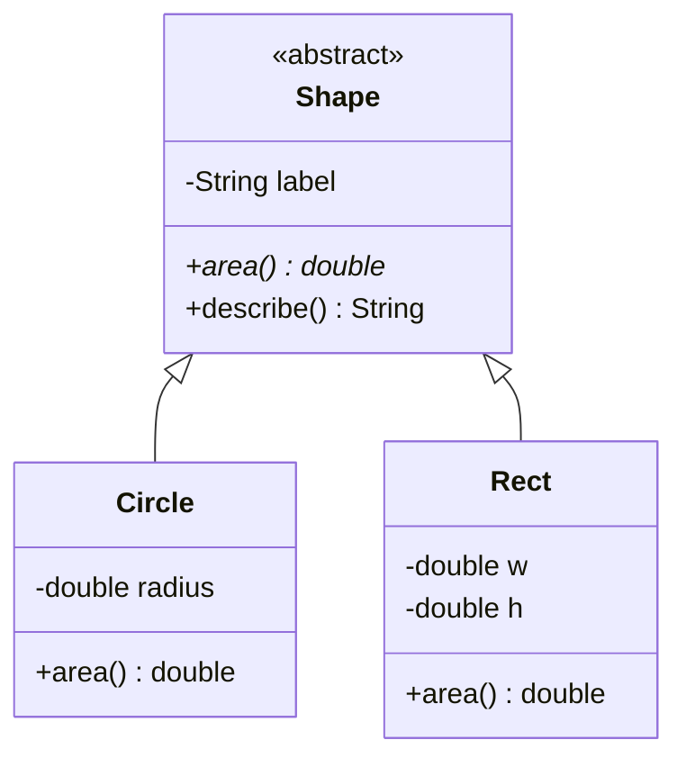
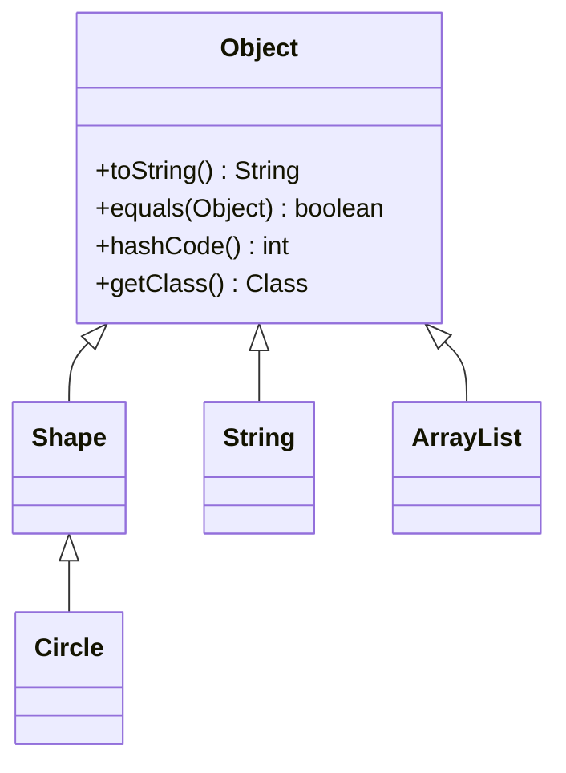

# Abstract classes and the Object class

> **Before this lesson:** you understand inheritance, overriding, declared type versus runtime type and dynamic dispatch ([Polymorphism, overriding and overloading](#/lesson/java/java-polymorphism)).

## In plain words

A government form says "Vehicle type: ______". You may write car, van or motorbike. You may not write "vehicle" and leave it there, because nothing on the road is only a vehicle; it is always some particular kind. "Vehicle" is a useful heading for grouping things and stating what they share (wheels, a registration number, a duty to pass an inspection), but there is never an actual object that is a bare vehicle.

Java lets you say this about a class. An **abstract class** is a class that exists to be a heading: it holds shared fields and methods and can demand that every subclass supplies certain behaviours, but you cannot create an object of the abstract class itself. A class you *can* create objects of is called **concrete**.

The second half of this lesson looks at the one class that sits above every other class in Java: `Object`.

Why this matters for a job: "abstract class versus interface" is among the top five Java interview questions, and the methods of `Object` (`equals`, `hashCode`, `toString`) are used by every collection and every log line.

## The problem: a superclass nobody should instantiate

```java
class Shape {
    String label;

    double area() {
        return 0;            // what is the area of "a shape"? There is no sensible answer.
    }
}

class Circle extends Shape {
    double radius;
    @Override double area() { return Math.PI * radius * radius; }
}

class Rect extends Shape {
    double w, h;
    // the author forgot to override area()
}
```

Two things are wrong.

1. `new Shape()` compiles, yet a bare shape with an area of 0 is meaningless.
2. `Rect` forgot to override `area()`. It compiles and silently reports 0 for every rectangle.

## Abstract classes and abstract methods

```java
abstract class Shape {
    private final String label;

    Shape(String label) {
        this.label = label;
    }

    abstract double area();                 // no body: subclasses MUST provide one

    String describe() {                     // ordinary method, shared by all shapes
        return label + " with area " + String.format("%.2f", area());
    }
}

class Circle extends Shape {
    private final double radius;

    Circle(double radius) {
        super("circle");                    // run the Shape constructor
        this.radius = radius;
    }

    @Override
    double area() {
        return Math.PI * radius * radius;
    }
}

class Rect extends Shape {
    private final double w, h;

    Rect(double w, double h) {
        super("rectangle");
        this.w = w;
        this.h = h;
    }

    @Override
    double area() {
        return w * h;
    }
}

public class Shapes {
    public static void main(String[] args) {
        Shape[] all = { new Circle(1), new Rect(2, 3) };
        for (Shape s : all) {
            System.out.println(s.describe());
        }
        // Shape s = new Shape("blob");   // does not compile: Shape is abstract; cannot be instantiated
    }
}
```

```text
circle with area 3.14
rectangle with area 6.00
```

What changed:

- `abstract class Shape` forbids `new Shape(...)`. The compiler enforces it.
- `abstract double area();` is an **abstract method**: a declaration that ends with a semicolon instead of a body. It says "every concrete shape has an area, and I cannot say how to compute it here".
- A concrete subclass **must** override every abstract method it inherits, or it does not compile. The forgotten `area()` in `Rect` is now impossible.
- `describe()` is a normal method in the abstract class. It calls `area()`, and dynamic dispatch runs the subclass version. A superclass method that fixes the overall steps and lets subclasses fill in one step is known as the **template method** pattern.
- `super("circle")` calls the superclass constructor. An abstract class can have constructors even though it cannot be instantiated directly; they run when a subclass object is created.

The rules in one table:

| Rule | Consequence |
|---|---|
| A class with an abstract method must be declared `abstract` | otherwise a compile error |
| An abstract class may have zero abstract methods | `abstract` then only prevents instantiation |
| Abstract methods have no body | `abstract void m();` |
| The first concrete subclass must implement all inherited abstract methods | or itself be declared `abstract` |
| An abstract class may have fields, constructors and concrete methods | all inherited as usual |
| `abstract` cannot be combined with `final`, `private` or `static` on a method | each would make overriding impossible |
| A variable of the abstract type is fine | `Shape s = new Circle(1);` |



### Abstract all the way down, until concrete

A subclass may stay abstract and pass the duty on.

```java
abstract class Polygon extends Shape {
    Polygon(String label) { super(label); }
    abstract int sides();                    // adds a second duty; area() is still unimplemented
}

class Triangle extends Polygon {
    private final double base, height;
    Triangle(double base, double height) { super("triangle"); this.base = base; this.height = height; }
    @Override double area() { return 0.5 * base * height; }
    @Override int sides()   { return 3; }
}
```

`Triangle` is the first concrete class in its chain, so it must implement **both** `area()` (from `Shape`) and `sides()` (from `Polygon`).

## The Object class

Every class in Java extends `java.lang.Object`, directly or through its ancestors. A class with no `extends` clause extends `Object` automatically. Arrays are objects too. Only the eight primitive types stand outside.



Because of this, **every object has the methods of `Object`**, and a variable of type `Object` can refer to anything.

| Method | What the version in `Object` does | Override it? |
|---|---|---|
| `String toString()` | class name, `@`, hash code in hexadecimal: `Circle@6d06d69c` | almost always |
| `boolean equals(Object o)` | `this == o`: same object | when two distinct objects can be "the same value" |
| `int hashCode()` | a number derived from the object's identity | whenever you override `equals` |
| `Class<?> getClass()` | the runtime class of the object | cannot be overridden (it is `final`) |
| `clone()`, `finalize()` | copying and clean-up hooks | avoid both; see the Effective Java lessons |
| `wait()`, `notify()`, `notifyAll()` | thread coordination | cannot be overridden; prefer higher-level tools |

### toString

`System.out.println(x)` and `"text" + x` both call `x.toString()`.

```java
class Ticket {
    private final String seat;
    private final int price;

    Ticket(String seat, int price) { this.seat = seat; this.price = price; }
}

class NiceTicket {
    private final String seat;
    private final int price;

    NiceTicket(String seat, int price) { this.seat = seat; this.price = price; }

    @Override
    public String toString() {
        return "NiceTicket[seat=" + seat + ", price=" + price + "]";
    }
}
```

```java
System.out.println(new Ticket("A1", 30));
System.out.println(new NiceTicket("A1", 30));
```

```text
Ticket@1b6d3586
NiceTicket[seat=A1, price=30]
```

The first line is the inherited default (the number varies from run to run). A good `toString` saves hours of debugging. Note that the override is `public`: `Object.toString` is public, and an override may not be less accessible.

### equals and hashCode, the short version

```java
NiceTicket t1 = new NiceTicket("A1", 30);
NiceTicket t2 = new NiceTicket("A1", 30);
System.out.println(t1.equals(t2));         // false: the default compares identity
```

To make two tickets with the same seat and price count as equal you override `equals`, and whenever you do that you must also override `hashCode` so that equal objects report the same number. Hash-based collections (`HashMap`, `HashSet`) rely on that pairing. Getting the pair right has rules worth a whole lesson: [Writing equals and hashCode correctly](#/lesson/java/java-ej-equals-hashcode). Records generate all three methods for you:

```java
record Seat(String row, int number) { }

Seat a = new Seat("A", 1);
Seat b = new Seat("A", 1);
System.out.println(a.equals(b) + " " + (a.hashCode() == b.hashCode()) + " " + a);
```

```text
true true Seat[row=A, number=1]
```

### getClass

```java
Shape s = new Circle(2);
System.out.println(s.getClass().getName());
System.out.println(s.getClass().getSimpleName());
```

```text
Circle
Circle
```

`getClass` reveals the runtime type, whatever the declared type of the variable. (If the class were in a package, `getName()` would include it: `com.acme.Circle`.)

## Object as a universal type, and what it costs

A variable, parameter or collection element of type `Object` accepts anything:

```java
Object[] bag = { "text", 42, new Circle(1), new int[3] };
```

The price is that the compiler now knows only `Object`'s methods. `bag[2].area()` does not compile, even though the element really is a `Circle`. To use it as a circle again you must convert the reference back, which is called a **cast** (more precisely a **downcast**):

```java
Object o = new Circle(1);
// double a = o.area();               // does not compile: Object has no area()
Circle c = (Circle) o;                // "trust me, it is a Circle"
System.out.println(c.area() > 3);

Object text = "hello";
Circle bad = (Circle) text;           // compiles, but fails at run time
```

```text
true
Exception in thread "main" java.lang.ClassCastException: class java.lang.String cannot be cast to class Circle
```

The JVM checks every downcast at run time and throws `ClassCastException` if the object is not of the requested type. Test first with `instanceof`:

```java
if (o instanceof Circle circle) {         // test and declare in one step (Java 16+)
    System.out.println(circle.area());
}
```

`o instanceof Circle circle` is **pattern matching**: if `o` refers to a `Circle`, the variable `circle` is created with the right type and the block runs.

This is why collections use type parameters (`ArrayList<Circle>`) instead of holding plain `Object`: the compiler remembers the element type and no casts are needed.

### A cast checker you can run

The model decides, for a declared type, a runtime type and a target type, whether a cast compiles and whether it succeeds at run time.

```python-run
parent = {"Object": None, "Shape": "Object", "Circle": "Shape", "Rect": "Shape",
          "String": "Object"}
final_classes = {"String"}

def ancestors(c):
    out = []
    while c:
        out.append(c); c = parent[c]
    return out

def cast(declared, runtime, target):
    related = target in ancestors(declared) or declared in ancestors(target)
    if not related:
        return "compile error: inconvertible types"
    if target in ancestors(runtime):
        return "ok"
    return "ClassCastException at run time"

tests = [("Object", "Circle", "Circle"), ("Object", "String", "Circle"),
         ("Shape", "Rect", "Circle"), ("Circle", "Circle", "Shape"),
         ("String", "String", "Circle")]
for d, r, t in tests:
    print(f"{d:6} ref = new {r:6}(); ({t}) ref  ->  {cast(d, r, t)}")
```

The compiler rejects a cast only when the two class types are unrelated (neither is an ancestor of the other), as in the last line. When they are related it must wait for the run-time check.

## Choosing: concrete class, abstract class, or something else

| Situation | Choice |
|---|---|
| The type makes sense by itself and objects of it are needed | concrete class |
| The type is only a category; subclasses share fields or method bodies | abstract class |
| You only need to promise a set of methods, with no shared state | interface (next lesson) |
| You want to stop anyone extending the class | `final` class |

> [!INTERVIEW]
> "Can an abstract class have a constructor? Can it have no abstract methods?" Yes to both. The constructor initialises the fields declared in the abstract class and runs as part of creating any subclass object. A class with no abstract methods may still be marked `abstract` purely to prevent instantiation. Follow-up: "Can you declare a variable of an abstract type?" Yes, and that is the whole point; it refers to a concrete subclass object.

## Pitfalls

- **Giving an abstract method a body**, or forgetting the semicolon.
- **Forgetting to implement one abstract method** in a concrete subclass: "is not abstract and does not override abstract method".
- **Dummy bodies instead of `abstract`.** A base method that returns 0 or does nothing "to be overridden" invites the silent bug shown at the start.
- **Overloading `equals`**: `boolean equals(Ticket t)` does not override `equals(Object)`.
- **Overriding `equals` without `hashCode`.**
- **Casting without checking**: `ClassCastException`.
- **Using `Object` as a field or parameter type by reflex.** You lose all compile-time checking; use a precise type or generics.
- **Relying on the default `toString`** in log messages.

## Cheat sheet

| Idea | Java |
|---|---|
| Uninstantiable class | `abstract class Shape { }` |
| Method with no body | `abstract double area();` |
| Implement it | `@Override double area() { ... }` |
| Root class | `java.lang.Object` |
| Readable printing | override `public String toString()` |
| Value equality | override `equals(Object)` **and** `hashCode()` |
| Runtime class | `obj.getClass()` |
| Safe downcast | `if (o instanceof Circle c) { ... }` |
| Unsafe downcast | `(Circle) o` may throw `ClassCastException` |

## Summary

- An abstract class cannot be instantiated; it gathers shared state and behaviour and can declare abstract methods that concrete subclasses must implement.
- Abstract classes may have constructors, fields and ordinary methods.
- Every class descends from `Object` and so has `toString`, `equals`, `hashCode` and `getClass`.
- The default `toString` and `equals` are rarely what you want; override them (and `hashCode` with `equals`).
- A reference of type `Object` can hold anything but allows only `Object`'s methods; downcasts are checked at run time, and `instanceof` tests first.

## Glossary

- **Abstract class**: a class marked `abstract` that cannot be instantiated.
- **Concrete class**: a class that can be instantiated.
- **Abstract method**: a method declared without a body that subclasses must implement.
- **Template method**: a superclass method that defines the steps and calls overridable methods for the details.
- **`Object`**: the root class of every Java class.
- **`toString`**: the method that returns a text form of an object.
- **Downcast**: converting a reference to a more specific type.
- **`ClassCastException`**: the error thrown when a downcast does not match the object's real type.
- **`instanceof`**: the operator that tests whether an object is of a given type.
- **Pattern matching**: testing a type and binding a typed variable in one expression.

## Check yourself

```quiz
[
  {"q": "Does this compile? `abstract class A { abstract void go(); } class B extends A { }`", "options": ["Yes", "No: B is not abstract and does not override go()", "Yes, B inherits an empty go()", "No: A needs a constructor"], "answer": 1,
   "explain": "A concrete subclass must implement every inherited abstract method."},
  {"q": "Does this compile? `abstract class A { void hello() { } }` (no abstract methods at all)", "options": ["No: an abstract class needs an abstract method", "Yes: abstract only prevents instantiation here", "Only if A is also final", "No: hello needs to be abstract"], "answer": 1,
   "explain": "An abstract class may have zero abstract methods."},
  {"q": "Given `abstract class Shape` and `class Circle extends Shape`, which line is legal?", "options": ["Shape s = new Shape();", "Shape s = new Circle();", "Circle c = new Shape();", "new abstract Shape();"], "answer": 1,
   "explain": "You can declare a variable of an abstract type and point it at a concrete subclass object."},
  {"q": "A class does not override toString. What does `System.out.println(new Ticket(\"A1\", 30));` print?", "options": ["A1 30", "Ticket[seat=A1, price=30]", "Something like Ticket@1b6d3586", "null"], "answer": 2,
   "explain": "Object.toString returns the class name, @ and the hash code in hexadecimal."},
  {"q": "What happens? `Object o = \"text\"; Integer n = (Integer) o;`", "options": ["Compile-time error", "n becomes 0", "ClassCastException at run time", "n becomes null"], "answer": 2,
   "explain": "Object to Integer is a legal downcast for the compiler, but the object is a String, so the run-time check fails."},
  {"q": "Does this compile? `String s = \"x\"; Integer n = (Integer) s;`", "options": ["Yes, fails at run time", "No: inconvertible types", "Yes, n is null", "Yes, n is 0"], "answer": 1,
   "explain": "String and Integer are unrelated classes, so no object could ever be both. The compiler rejects the cast."},
  {"q": "Which combination of modifiers is illegal on a method?", "options": ["public abstract", "protected abstract", "abstract final", "public final"], "answer": 2,
   "explain": "abstract demands overriding; final forbids it. The two contradict each other."},
  {"q": "What does this print? `Object o = new int[2]; System.out.println(o instanceof Object);`", "options": ["true", "false", "It does not compile", "ClassCastException"], "answer": 0,
   "explain": "Arrays are objects, and every object is an instance of Object."}
]
```

> **Source:** Head First Java, ch. 8 (abstract classes and methods, the Object class, casting). Checked against the Java Language Specification sections 8.1.1.1 and 5.5 and the Object API: https://docs.oracle.com/en/java/javase/21/docs/api/java.base/java/lang/Object.html and https://dev.java/learn/inheritance/abstract-classes/ .
