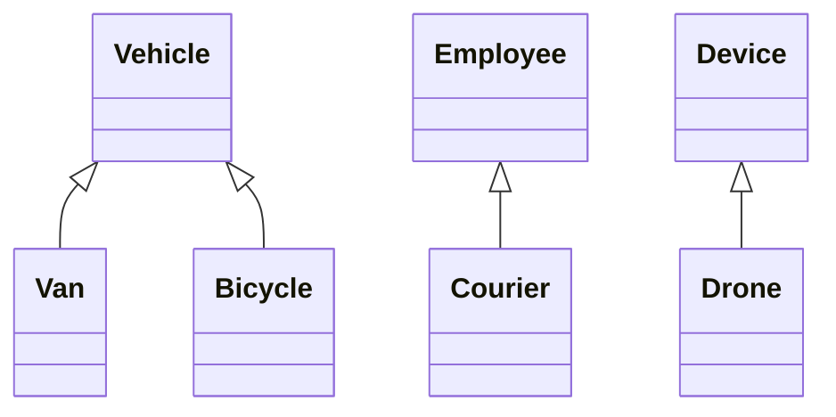
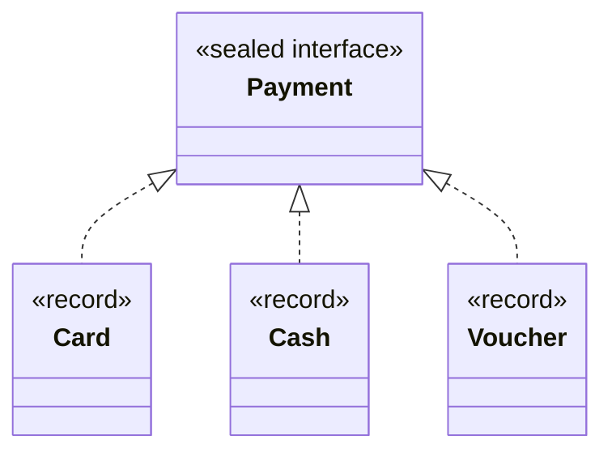

# Interfaces, default methods, sealed types and pattern matching

> **Before this lesson:** you know abstract classes, abstract methods, `Object`, downcasts and `instanceof` ([Abstract classes and the Object class](#/lesson/java/java-abstract-object)).

## In plain words

A wall socket does not care what you plug into it. A kettle, a phone charger and a drill are completely different machines made by different companies, yet each has a plug with the same pins. The pin layout is an agreement: "anything with this plug can draw power here". The socket's maker and the kettle's maker never met; both followed the agreement.

A Java **interface** is that agreement written in code. It lists methods that a class promises to provide, without saying how. Any class, from any family tree, can sign the agreement by declaring that it **implements** the interface. Code that needs "something I can plug in" asks for the interface type and accepts every class that has signed.

Why this matters for a job: almost every professional Java API is expressed as interfaces (`List`, `Map`, `Runnable`, `Comparable`). Programming against interfaces is what allows a database to be swapped for a fake in tests, or one payment provider for another, without rewriting callers. "Abstract class or interface?" is one of the most asked Java questions.

## The problem single inheritance cannot solve

Suppose a delivery app has this hierarchy:



The tracking screen needs to show the position of vans, couriers on foot and drones. They share a capability ("can report a location") but belong to three unrelated hierarchies. Java allows only one superclass, and a courier is not a vehicle, so a common superclass is not available.

Java forbids multiple class inheritance for a reason. If `class C extends A, B` were allowed and both `A` and `B` inherited a field or method body from a common ancestor in different ways, which copy would `C` get? This puzzle is called the **diamond problem**. Interfaces avoid most of it because, traditionally, they carry no state and no method bodies: there is nothing to conflict.

## Declaring and implementing an interface

```java
interface Trackable {
    String position();                 // implicitly public and abstract
}

class Van implements Trackable {
    private final String plate;
    private String street = "Depot";

    Van(String plate) { this.plate = plate; }

    void driveTo(String street) { this.street = street; }

    @Override
    public String position() {          // must be public
        return "van " + plate + " at " + street;
    }
}

class Courier implements Trackable {
    private final String name;
    Courier(String name) { this.name = name; }

    @Override
    public String position() {
        return name + " on foot near the market";
    }
}

public class Tracking {
    static void show(Trackable t) {     // accepts ANYTHING that implements Trackable
        System.out.println("> " + t.position());
    }

    public static void main(String[] args) {
        Van v = new Van("KX-204");
        v.driveTo("Mill Lane");
        Trackable[] fleet = { v, new Courier("Ada") };
        for (Trackable t : fleet) {
            show(t);
        }
    }
}
```

```text
> van KX-204 at Mill Lane
> Ada on foot near the market
```

- `interface Trackable { String position(); }` declares a type with one method and no body. Methods in an interface are **public and abstract** without you writing either word.
- `class Van implements Trackable` is the promise. The compiler then insists that `Van` provides a `public String position()`.
- The implementing method **must be written `public`**. Leaving it off makes it package-private, which is less accessible than the interface's public method, and the compiler refuses.
- `Trackable` is a type like any class. Variables, parameters, arrays and return types can use it, and dynamic dispatch works through it exactly as with superclasses.
- You cannot write `new Trackable()`. An interface has no constructor and no objects of its own.

### One class, many interfaces

A class extends at most one class but may implement any number of interfaces.

```java
interface Chargeable {
    int batteryPercent();
}

class Drone extends Device implements Trackable, Chargeable {
    @Override public String position()   { return "drone above the river"; }
    @Override public int batteryPercent() { return 64; }
}
```

A `Drone` object can be handed to code that wants a `Device`, a `Trackable` or a `Chargeable`. Each of those callers sees only the methods of its own type. Interfaces can also extend other interfaces: `interface Fleet extends Trackable, Chargeable { }`.

## What an interface may contain

| Member | Notes |
|---|---|
| Abstract methods | implicitly `public abstract` |
| Constants | fields are implicitly `public static final`; they must be given a value |
| `default` methods (Java 8) | have a body; inherited by implementing classes, which may override |
| `static` methods (Java 8) | have a body; called as `InterfaceName.method()`; not inherited |
| `private` methods (Java 9) | helpers for the default and static methods |
| Nested types | classes, records, enums, other interfaces |

What it may **not** contain: instance fields and constructors. An interface never holds per-object state.

## Default methods

Before Java 8, adding a method to a published interface broke every class that implemented it. A **default method** carries a body, so existing implementers keep compiling and gain the new behaviour automatically.

```java
interface Trackable {
    String position();

    default String report() {                       // has a body
        return "[" + getClass().getSimpleName() + "] " + position();
    }
}
```

```java
System.out.println(new Courier("Ada").report());
```

```text
[Courier] Ada on foot near the market
```

`Courier` did not mention `report`, yet it has it. A default method can call the interface's abstract methods (here `position()`), and dynamic dispatch finds the implementing class's version.

### When two defaults collide

Default methods bring back a mild form of the diamond problem. Java resolves it with three rules, applied in order.

1. **A class wins over an interface.** If a superclass (anywhere up the chain) provides the method, that version is used and interface defaults are ignored.
2. **The more specific interface wins.** If interface `B extends A` and both provide a default, `B`'s is used.
3. **Otherwise the class must choose.** If two unrelated interfaces both provide a default for the same method, the class does not compile until it overrides the method itself. Inside, it can pick one with `InterfaceName.super.method()`.

```java
interface Printer { default String status() { return "printer ready"; } }
interface Scanner2 { default String status() { return "scanner ready"; } }

class Copier implements Printer, Scanner2 {
    @Override
    public String status() {                         // required by rule 3
        return Printer.super.status() + " + " + Scanner2.super.status();
    }
}
```

```java
System.out.println(new Copier().status());
```

```text
printer ready + scanner ready
```

### A conflict resolver you can run

```python-run
# Each type: kind, parents (superclass first for classes), and whether it declares m with a body.
types = {
    "A":      {"kind": "interface", "parents": [],          "body": True},
    "B":      {"kind": "interface", "parents": ["A"],       "body": True},   # B extends A
    "C":      {"kind": "interface", "parents": [],          "body": True},
    "Base":   {"kind": "class",     "parents": [],          "body": True},
    "Empty":  {"kind": "class",     "parents": [],          "body": False},
}

def supertypes(t):
    seen, stack = [], list(types[t]["parents"])
    while stack:
        x = stack.pop()
        if x not in seen:
            seen.append(x); stack.extend(types[x]["parents"])
    return seen

def resolve(superclass, interfaces):
    # Rule 1: a body from the superclass chain wins.
    c = superclass
    while c:
        if types[c]["body"]:
            return f"uses {c}.m  (rule 1: class wins)"
        ps = [p for p in types[c]["parents"] if types[p]["kind"] == "class"]
        c = ps[0] if ps else None
    # Collect every interface default reachable, then drop those overridden by a sub-interface.
    cands = set()
    for i in interfaces:
        cands |= {x for x in [i] + supertypes(i) if types[x]["body"]}
    cands = {x for x in cands if not any(x in supertypes(y) for y in cands if y != x)}
    if len(cands) == 1:
        return f"uses {cands.pop()}.m  (rule 2: most specific interface)"
    if not cands:
        return "no implementation: class must define m or be abstract"
    return f"COMPILE ERROR unless the class overrides m: conflict between {sorted(cands)}"

print(resolve("Base",  ["A", "C"]))
print(resolve("Empty", ["A", "B"]))
print(resolve("Empty", ["B", "C"]))
print(resolve("Empty", ["A"]))
```

## Abstract class or interface?

| | Abstract class | Interface |
|---|---|---|
| How many per class | one (`extends`) | many (`implements`) |
| Instance fields (state) | yes | no |
| Constructors | yes | no |
| Method bodies | yes | only `default`, `static`, `private` |
| Access levels for members | any | abstract and default methods are always public |
| Relationship expressed | IS-A, a kind of | CAN-DO, a capability or role |
| Typical use | shared code and state among close relatives | a contract across unrelated classes |

Rules of thumb:

- Start with an **interface** for the type that callers see.
- Add an **abstract class** underneath it when several implementations share fields or code. The library does this: `List` is the interface, `AbstractList` supplies shared code, `ArrayList` is concrete.
- Use an abstract class alone only when you control every subclass and they truly share state.

> [!INTERVIEW]
> A complete answer to "abstract class versus interface": state the mechanical differences (state, constructors, single versus multiple), then the design difference (a base of a family versus a capability any class may add), then the modern nuance: since Java 8 interfaces can have default and static methods, and since Java 9 private ones, so the remaining hard difference is that **interfaces cannot hold instance state or constructors**. Finish with "program to an interface, not an implementation": declare variables and parameters as `List`, not `ArrayList`.

## Program to the interface

```java
import java.util.ArrayList;
import java.util.LinkedList;
import java.util.List;

public class Decoupled {
    static int totalLength(List<String> words) {     // any List will do
        int sum = 0;
        for (String w : words) {
            sum += w.length();
        }
        return sum;
    }

    public static void main(String[] args) {
        List<String> a = new ArrayList<>(List.of("tea", "scone"));
        List<String> b = new LinkedList<>(List.of("jam"));
        System.out.println(totalLength(a) + " " + totalLength(b));
    }
}
```

```text
8 3
```

`totalLength` works with every present and future `List` implementation. If the declared type were `ArrayList<String>`, the call with a `LinkedList` would not compile, for no benefit.

## Casting, instanceof and pattern matching

When you hold an interface-typed reference and need a capability of the real class, test before converting.

```java
static String describe(Object o) {
    if (o instanceof Van v) {                 // test and bind
        return "a van: " + v.position();
    } else if (o instanceof String s && !s.isBlank()) {
        return "text of length " + s.length();
    }
    return "something else";
}
```

Since Java 21, `switch` can match on types as well, which reads better than a chain of `if`:

```java
static String describe2(Object o) {
    return switch (o) {
        case null       -> "nothing";
        case Integer i when i > 100 -> "a big number";
        case Integer i  -> "a number";
        case String s   -> "text of length " + s.length();
        default         -> "something else";
    };
}
```

Cases are tried from top to bottom; `when` adds a condition (a **guard**). A more general case placed before a more specific one is a compile error, because the later case could never match.

## Sealed types: a closed family

Sometimes you want to state "these are **all** the kinds there are". A `sealed` interface or class lists its permitted subtypes; nothing else may implement or extend it.

```java
sealed interface Payment permits Card, Cash, Voucher { }

record Card(String last4, double amount)   implements Payment { }
record Cash(double amount)                 implements Payment { }
record Voucher(String code)                implements Payment { }

class Till {
    static String receipt(Payment p) {
        return switch (p) {                     // no default needed: all cases covered
            case Card c    -> "card ending " + c.last4() + ": " + c.amount();
            case Cash c    -> "cash: " + c.amount();
            case Voucher v -> "voucher " + v.code();
        };
    }
}
```

```java
System.out.println(Till.receipt(new Cash(4.5)));
```

```text
cash: 4.5
```

Because `Payment` is sealed, the compiler knows the complete list of subtypes. A `switch` that covers them all is **exhaustive** and needs no `default`. Better still, if a fourth permitted type is added later, every such `switch` in the code base stops compiling until the new case is handled. The compiler finds the places you must update.

Each permitted subtype must itself be `final`, `sealed` or `non-sealed`. Records are implicitly final, which is why they pair so well with sealed interfaces.



> [!TIP]
> Two ways to handle "different behaviour per kind": put an abstract method in the supertype and override it (classic polymorphism), or use a sealed type with an exhaustive `switch`. Prefer overriding when new **kinds** are added often; prefer sealed plus `switch` when the kinds are fixed and new **operations** are added often.

## Pitfalls

- **Forgetting `public`** on an implementing method.
- **Trying to instantiate an interface**: `new Trackable()` is illegal (apart from the anonymous-class and lambda forms covered later).
- **Declaring instance fields in an interface.** Any field there is a `public static final` constant.
- **Unresolved default conflict** when implementing two interfaces with the same default method.
- **Using an interface only to hold constants.** Use a class or an enum for constants.
- **Declaring variables with the implementation type** (`ArrayList<String> xs`) when the interface (`List<String>`) would do.
- **A `default` branch in a switch over a sealed type**: it hides the compiler's "you forgot a case" error when a new subtype appears.
- **Static interface methods are not inherited**: call them as `Trackable.helper()`, not on an implementing class.

## Cheat sheet

| Goal | Java |
|---|---|
| Declare a contract | `interface Trackable { String position(); }` |
| Sign it | `class Van implements Trackable` |
| Several contracts | `class Drone extends Device implements Trackable, Chargeable` |
| Method with a body in an interface | `default String report() { ... }` |
| Pick one inherited default | `Printer.super.status()` |
| Constant in an interface | `int MAX = 10;` (public static final) |
| Test and bind | `if (o instanceof Van v) { ... }` |
| Type switch | `switch (o) { case Van v -> ...; default -> ...; }` |
| Closed family | `sealed interface P permits A, B { }` |

## Summary

- An interface is a contract: a set of methods any class can promise to provide, regardless of its superclass.
- A class extends one class and implements many interfaces.
- Interface methods are public; default methods add behaviour without breaking implementers.
- Default conflicts are resolved by: class wins, then most specific interface, then the class must override.
- Abstract classes share state and code among relatives; interfaces define capabilities across unrelated classes.
- Declare variables and parameters with interface types.
- Sealed types close a hierarchy so that pattern-matching switches can be checked for completeness.

## Glossary

- **Interface**: a type that declares methods without (mostly) implementing them.
- **`implements`**: the keyword by which a class promises to fulfil an interface.
- **Diamond problem**: ambiguity when one class would inherit the same member along two paths.
- **Default method**: an interface method with a body.
- **Contract**: the set of methods and behaviours a type promises.
- **Program to an interface**: depend on the abstract type, not a specific class.
- **Guard**: a `when` condition on a switch case.
- **Sealed type**: a class or interface that lists every permitted direct subtype.
- **Exhaustive switch**: a switch that covers every possible value, so no default is required.
- **`non-sealed`**: a modifier that reopens a branch of a sealed hierarchy.

## Check yourself

```quiz
[
  {"q": "Does this compile? `interface Pet { void feed(); } class Cat implements Pet { void feed() { } }`", "options": ["Yes", "No: feed in Cat must be public", "No: Cat must be abstract", "Yes, with a warning"], "answer": 1,
   "explain": "Interface methods are implicitly public. The implementation without public is package-private, which is weaker access."},
  {"q": "Which declaration is legal?", "options": ["class A extends B, C { }", "class A implements B extends C { }", "class A extends B implements C, D { }", "interface A implements B { }"], "answer": 2,
   "explain": "One superclass with extends first, then any number of interfaces with implements. Interfaces extend other interfaces; they do not implement them."},
  {"q": "Interfaces X and Y are unrelated and both declare `default void go() { }`. `class Z implements X, Y { }` ...", "options": ["compiles and uses X.go", "compiles and uses Y.go", "does not compile until Z overrides go", "throws at run time"], "answer": 2,
   "explain": "Rule 3: with two unrelated defaults the class must override and choose explicitly."},
  {"q": "`class Base { public void go() { System.out.print(\"B\"); } } interface I { default void go() { System.out.print(\"I\"); } } class D extends Base implements I { }` What does `new D().go();` print?", "options": ["B", "I", "BI", "It does not compile"], "answer": 0,
   "explain": "Rule 1: a method inherited from a superclass takes priority over an interface default."},
  {"q": "In an interface, what is `int LIMIT = 5;`?", "options": ["An instance field", "A public static final constant", "A private field", "A compile error"], "answer": 1,
   "explain": "All fields in an interface are implicitly public, static and final."},
  {"q": "`sealed interface S permits A, B { }` with records A and B. A switch over an S value handles `case A a` and `case B b` and has no default. Does it compile?", "options": ["No: default is always required", "Yes: the compiler knows A and B are the only subtypes", "Only if S is abstract", "Yes, but it may throw at run time for other subtypes"], "answer": 1,
   "explain": "Sealing makes the list of subtypes complete, so the switch is exhaustive."},
  {"q": "What does this print? `Object o = 7; String r = switch (o) { case Integer i when i > 5 -> \"big\"; case Integer i -> \"small\"; default -> \"other\"; }; System.out.println(r);`", "options": ["big", "small", "other", "It does not compile"], "answer": 0,
   "explain": "Cases are tried in order. 7 is an Integer greater than 5, so the guarded case matches first."},
  {"q": "What is the one thing an abstract class can have that an interface never can?", "options": ["Methods with bodies", "Static methods", "Instance fields and constructors", "Public methods"], "answer": 2,
   "explain": "Interfaces gained default, static and private methods, but they still cannot hold per-object state or define constructors."}
]
```

> **Source:** Head First Java, ch. 8 (interfaces, the multiple-inheritance problem, casting). Default-method resolution, sealed types and pattern matching checked against the Java Language Specification sections 8.4.8.4, 9.4.1.3, 8.1.1.2 and 14.11.1: https://docs.oracle.com/javase/specs/jls/se21/html/jls-9.html and https://docs.oracle.com/en/java/javase/21/language/pattern-matching-switch.html .
