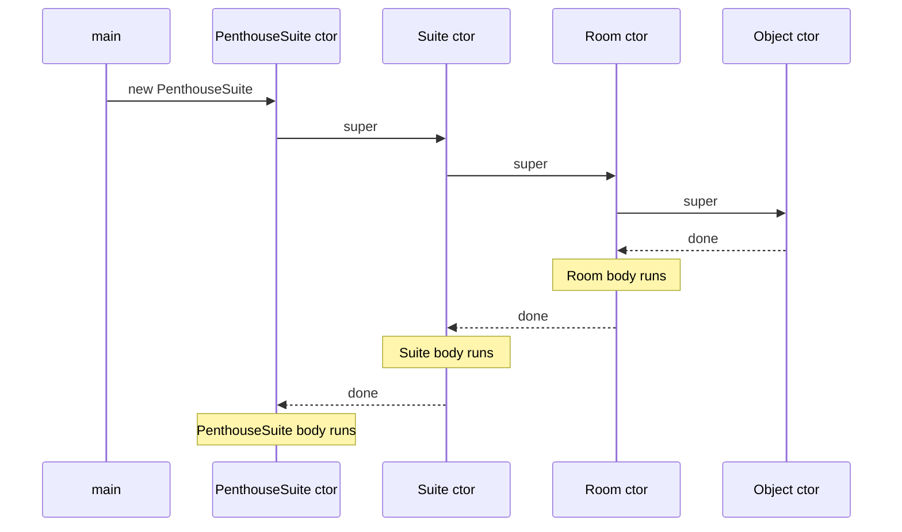

# Constructors, this and super

> **Before this lesson:** you know fields, encapsulation and inheritance ([Encapsulation: private fields, getters and setters](#/lesson/java/java-encapsulation), [Inheritance: sharing code through a family tree](#/lesson/java/java-inheritance-basics)) and how the stack and heap hold variables and objects ([References, arrays, the stack and the heap](#/lesson/java/java-references-stack-heap)).

## In plain words

When a hotel hands you a room, it has already been prepared: the bed is made, towels are in place, the key card is programmed. You never receive a room that is "half ready, please finish it yourself". Preparation happens between "a room is assigned" and "the guest walks in", and nobody else can enter during that time.

A **constructor** is the preparation step for an object. It is a block of code that runs automatically when `new` creates the object, before any other code can get hold of it. Its job is to leave the object in a valid, usable state: every field set, every invariant true.

Why this matters for a job: the order in which constructors and initialisers run is a classic interview puzzle, and objects left half-initialised are a steady source of `NullPointerException` in production.

## The problem constructors solve

```java
class Booking {
    String guest;
    int nights;
}

Booking b = new Booking();
// ... forty lines later someone forgets to set the fields ...
System.out.println(b.guest.toUpperCase());     // NullPointerException
```

Between `new Booking()` and the lines that set the fields, the object exists in a broken state. With setters, every caller must remember every step. A constructor makes it impossible to obtain a `Booking` without supplying what it needs.

## Writing a constructor

```java
class Booking {
    private final String guest;
    private final int nights;

    Booking(String guest, int nights) {             // constructor
        if (guest == null || guest.isBlank()) {
            throw new IllegalArgumentException("guest is required");
        }
        if (nights < 1) {
            throw new IllegalArgumentException("at least one night");
        }
        this.guest = guest;
        this.nights = nights;
    }

    String summary() {
        return guest + ", " + nights + " night(s)";
    }
}

public class Hotel {
    public static void main(String[] args) {
        Booking b = new Booking("Noor", 3);
        System.out.println(b.summary());
        // new Booking();                 // does not compile: no constructor takes zero arguments
        // new Booking("", 2);            // throws IllegalArgumentException
    }
}
```

```text
Noor, 3 night(s)
```

A constructor looks like a method with two differences: its name is exactly the class name, and it has **no return type**, not even `void`. If you write `void Booking(...)` you have declared an ordinary method that happens to share the class's name, and the compiler will not treat it as a constructor.

`this.guest = guest;` assigns the parameter to the field of the object being built. The fields are `final`, so the compiler checks that every constructor assigns them exactly once, and nothing can change them afterwards.

### The default constructor

If a class declares **no constructor at all**, the compiler supplies one with no parameters and an empty body. This is the **default constructor**, and it is why `new Book()` worked in earlier lessons.

The moment you write any constructor, the compiler stops supplying the default. That is why `new Booking()` above fails. If you want both, write both.

## Overloaded constructors and this(...)

A class can offer several constructors with different parameter lists. To avoid repeating the set-up code, one constructor can call another with `this(...)`.

```java
class Booking {
    private final String guest;
    private final int nights;
    private final boolean breakfast;

    Booking(String guest) {
        this(guest, 1);                      // delegate: one night
    }

    Booking(String guest, int nights) {
        this(guest, nights, false);          // delegate: no breakfast
    }

    Booking(String guest, int nights, boolean breakfast) {
        this.guest = guest;                  // the one place where fields are set
        this.nights = nights;
        this.breakfast = breakfast;
    }
}
```

All roads lead to the constructor with the most parameters, so validation is written once. Rules: `this(...)` must be the **first statement** in the constructor, and a constructor cannot call both `this(...)` and `super(...)`.

## Constructors and inheritance: building from the top down

A subclass object contains the fields of all its superclasses. Each class is responsible for initialising its own part, so when you create a subclass object, **every constructor up the chain runs**, starting from `Object` and working down.

```java
class Room {
    Room() {
        System.out.println("1. Room constructor");
    }
}

class Suite extends Room {
    Suite() {
        System.out.println("2. Suite constructor");
    }
}

class PenthouseSuite extends Suite {
    PenthouseSuite() {
        System.out.println("3. PenthouseSuite constructor");
    }
}

public class Chain {
    public static void main(String[] args) {
        new PenthouseSuite();
    }
}
```

```text
1. Room constructor
2. Suite constructor
3. PenthouseSuite constructor
```

No constructor here mentions its superclass, yet they all ran. The compiler inserts `super();`, a call to the superclass's no-argument constructor, as the first statement of any constructor that does not begin with `this(...)` or `super(...)`.



The calls go up; the bodies run on the way back down. On the stack, the constructors pile up like any nested method calls and complete from the top.

### Passing arguments up with super(...)

When the superclass has no no-argument constructor, the automatic `super();` cannot work, and you must call the right one yourself.

```java
class Room {
    private final int number;

    Room(int number) {
        this.number = number;
    }

    int getNumber() { return number; }
}

class Suite extends Room {
    private final int bedrooms;

    Suite(int number, int bedrooms) {
        super(number);                 // must be first: initialise the Room part
        this.bedrooms = bedrooms;
    }
}
```

If `Suite`'s constructor omitted `super(number)`, the compiler would try to insert `super()` and report: "constructor Room in class Room cannot be applied to given types". This is one of the most common compile errors beginners meet with inheritance.

Do not confuse the two uses of each keyword:

| Form | Meaning | Where allowed |
|---|---|---|
| `this(...)` | call another constructor of the same class | first statement of a constructor |
| `super(...)` | call a superclass constructor | first statement of a constructor |
| `this.x`, `this.m()` | the current object's field or method | any instance method or constructor |
| `super.m()` | the superclass's version of a method | any instance method or constructor |

## Field initialisers and initialiser blocks

Fields can be given starting values in three places.

```java
class Kettle {
    private int litres = 2;                          // 1. field initialiser
    private final java.util.List<String> log = new java.util.ArrayList<>();
    private static int made;                         // static field: one per class

    static {                                         // 2a. static initialiser block
        System.out.println("class Kettle loaded");
    }

    {                                                // 2b. instance initialiser block
        log.add("created");
    }

    Kettle() {                                       // 3. constructor
        made++;
        log.add("constructor finished, litres=" + litres);
    }
}
```

Instance initialiser blocks are rare in practice. Static blocks are used for one-off set-up of static data.

## The complete order of initialisation

This is the sequence the JVM follows for `new Sub()`. Learn it; interviewers ask.

1. If the class has not been used before, it is **loaded**, superclass first. As each class is loaded its **static** field initialisers and static blocks run once, in the order they appear in the source.
2. Memory for the object is allocated and **every instance field** (in all classes of the chain) is set to its default: `0`, `false` or `null`.
3. The `Sub` constructor is entered. Its first action is the call to `super(...)` (explicit or inserted).
4. In the superclass: its instance field initialisers and instance blocks run in source order, **then** the rest of its constructor body.
5. Back in `Sub`: its instance field initialisers and instance blocks run in source order, **then** the rest of its constructor body.

```java
class Base {
    static { System.out.println("A  Base static"); }
    int a = show("C  Base field");
    { System.out.println("D  Base instance block"); }
    Base() { System.out.println("E  Base constructor"); }

    static int show(String s) { System.out.println(s); return 1; }
}

class Derived extends Base {
    static { System.out.println("B  Derived static"); }
    int b = show("F  Derived field");
    Derived() { System.out.println("G  Derived constructor"); }
}

public class Order {
    public static void main(String[] args) {
        new Derived();
        System.out.println("---");
        new Derived();
    }
}
```

```text
A  Base static
B  Derived static
C  Base field
D  Base instance block
E  Base constructor
F  Derived field
G  Derived constructor
---
C  Base field
D  Base instance block
E  Base constructor
F  Derived field
G  Derived constructor
```

Static initialisation happened once; the instance steps repeat for every object.

### An initialisation-order model you can run

```python-run
def init_order(chain, loaded):
    """chain: classes from the top superclass down to the class being instantiated.
    Each class is a dict of step lists. `loaded` is the set of classes already loaded."""
    out = []
    for c in chain:                              # static phase, superclass first, once only
        if c["name"] not in loaded:
            out += [f"{c['name']}: {s}" for s in c["static"]]
            loaded.add(c["name"])
    for c in chain:                              # instance phase, superclass first
        out += [f"{c['name']}: {s}" for s in c["instance"]]      # field inits + blocks, source order
        out.append(f"{c['name']}: constructor body")
    return out

base    = {"name": "Base",    "static": ["static block"], "instance": ["field a", "instance block"]}
derived = {"name": "Derived", "static": ["static block"], "instance": ["field b"]}

loaded = set()
print("first  new Derived():"); print("\n".join("   " + s for s in init_order([base, derived], loaded)))
print("second new Derived():"); print("\n".join("   " + s for s in init_order([base, derived], loaded)))
```

## A trap: calling an overridable method from a constructor

```java
class Report {
    Report() {
        print();                         // calls the subclass version!
    }
    void print() { System.out.println("report"); }
}

class SalesReport extends Report {
    private String region = "north";

    @Override
    void print() {
        System.out.println("sales for " + region);
    }
}

public class Trap {
    public static void main(String[] args) {
        new SalesReport();
    }
}
```

```text
sales for null
```

Follow the order above. `Report`'s constructor runs **before** `SalesReport`'s field initialisers. The call `print()` is dispatched dynamically to `SalesReport.print`, which reads `region` while it still holds the default `null`.

> [!WARNING]
> A constructor should never call a method that a subclass can override. Call only `private`, `final` or `static` methods from constructors.

## Constructors and access

Constructors take access modifiers like any member.

- `public Booking(...)`: anyone may create one.
- package-private (no modifier): only classes in the same package.
- `private Booking(...)`: only code inside the class. Useful when objects should be created through a static method instead, for example to control how many instances exist (a **singleton**) or to give creation a descriptive name. See [Static factories, builders, singletons and dependency injection](#/lesson/java/java-ej-factories-builders).

## Records: constructors for free

```java
record Booking(String guest, int nights) {
    Booking {                                    // compact canonical constructor
        if (nights < 1) {
            throw new IllegalArgumentException("at least one night");
        }
        guest = guest.strip();                   // may adjust the parameter before it is stored
    }

    Booking(String guest) {                      // extra constructor must delegate
        this(guest, 1);
    }
}
```

A record's **canonical constructor** takes one parameter per component, in order, and is generated for you. The **compact** form above omits the parameter list and the field assignments; the assignments happen automatically after your code. Any additional constructor must begin with `this(...)`.

> [!INTERVIEW]
> Common quick-fire questions. *Can a constructor be `final`, `static` or `abstract`?* No to all three: constructors are not inherited, so those modifiers have no meaning. *Can a constructor be private?* Yes. *Can it be overloaded?* Yes. *Overridden?* No. *Can it return a value?* No, though `return;` alone is permitted. *What if I write a parameterised constructor only?* The default no-argument constructor disappears.

## Pitfalls

- **Adding a return type**, turning the constructor into a method.
- **Expecting the default constructor** after writing another one.
- **Missing `super(args)`** when the superclass has no no-argument constructor.
- **`this(...)` or `super(...)` not first.** (Java 22 onward relaxes this slightly as a preview feature; assume the strict rule.)
- **Calling overridable methods from a constructor.**
- **Leaving a `final` field unassigned** on some constructor path: "variable might not have been initialised".
- **Doing heavy work in a constructor** (network calls, file reads). It makes objects hard to create in tests; pass the results in instead.
- **Letting `this` escape** from a constructor, for example by registering the half-built object with another object.

## Cheat sheet

| Idea | Java |
|---|---|
| Constructor | `ClassName(params) { ... }` with no return type |
| Default constructor | supplied only if you write none |
| Call sibling constructor | `this(args);` first statement |
| Call superclass constructor | `super(args);` first statement |
| Implicit call | `super();` inserted if neither is written |
| Order for `new Sub()` | statics (once, top down), defaults, then per class top down: field initialisers and blocks, constructor body |
| Static initialiser | `static { ... }` |
| Record validation | compact constructor `Name { ... }` |

## Summary

- A constructor runs when `new` creates an object and should leave it fully valid.
- The compiler supplies a no-argument constructor only when the class declares none.
- `this(...)` chains to another constructor in the same class; `super(...)` to the superclass; one of them is always first, explicitly or implicitly.
- Superclass parts are initialised before subclass parts.
- Static initialisation happens once per class; instance initialisers run before each constructor body.
- Never call overridable methods from constructors.

## Glossary

- **Constructor**: a block named after its class that initialises a new object.
- **Default constructor**: the no-argument constructor the compiler adds when a class declares none.
- **Constructor overloading**: several constructors with different parameter lists.
- **Constructor chaining**: one constructor calling another with `this(...)` or `super(...)`.
- **Field initialiser**: a value assigned in a field's declaration.
- **Initialiser block**: a brace block in a class body that runs during object creation (or class loading, if `static`).
- **Class loading**: the JVM reading a class into memory the first time it is needed.
- **Canonical constructor**: a record's constructor with one parameter per component.
- **Compact constructor**: the short record constructor form without a parameter list.
- **Singleton**: a class designed to have exactly one instance.

## Check yourself

```quiz
[
  {"q": "Does this compile? `class Cup { Cup(int ml) { } } class Test { Cup c = new Cup(); }`", "options": ["Yes", "No: Cup has no no-argument constructor", "Yes, ml defaults to 0", "No: Cup must be public"], "answer": 1,
   "explain": "Declaring any constructor removes the compiler-supplied default one."},
  {"q": "What does this print? `class A { A() { System.out.print(\"A\"); } } class B extends A { B() { System.out.print(\"B\"); } } class C extends B { C() { System.out.print(\"C\"); } }` then `new C();`", "options": ["CBA", "ABC", "C", "ACB"], "answer": 1,
   "explain": "Each constructor implicitly calls super() first, so bodies run from the top of the hierarchy down."},
  {"q": "Does this compile? `class P { P(String s) { } } class Q extends P { Q() { } }`", "options": ["Yes", "No: the implicit super() finds no matching constructor in P", "Yes, s is null", "No: Q needs a String field"], "answer": 1,
   "explain": "Q() gets an inserted super(), but P only has P(String). Q must call super(\"...\") explicitly."},
  {"q": "What does this print? `class T { int x = 5; T() { x = x * 2; } { x = x + 1; } }` then `System.out.println(new T().x);`", "options": ["10", "11", "12", "6"], "answer": 2,
   "explain": "Field initialiser sets 5, the instance block (which appears after it in source order... and before the constructor body runs) makes it 6, then the constructor doubles it to 12."},
  {"q": "What is `void Lamp() { }` inside `class Lamp`?", "options": ["A constructor", "An ordinary method named Lamp", "A compile error", "A static initialiser"], "answer": 1,
   "explain": "A constructor has no return type. With void this is a method, and the class still gets the default constructor."},
  {"q": "What does this print? `class S { static { System.out.print(\"s\"); } S() { System.out.print(\"c\"); } }` then `new S(); new S();`", "options": ["scsc", "scc", "ccs", "cc"], "answer": 1,
   "explain": "The static block runs once when the class is first loaded; the constructor runs for each object."},
  {"q": "What does this print? `class U { U() { hi(); } void hi() { System.out.print(\"U\"); } } class V extends U { int n = 3; void hi() { System.out.print(n); } }` then `new V();`", "options": ["U", "3", "0", "It does not compile"], "answer": 2,
   "explain": "U's constructor calls the overridden hi() in V before V's field initialiser has run, so n still holds its default 0."},
  {"q": "Does this compile? `class W { W() { System.out.println(\"hi\"); this(5); } W(int n) { } }`", "options": ["Yes", "No: this(...) must be the first statement", "Yes, prints hi", "No: W(int) must be public"], "answer": 1,
   "explain": "A call to another constructor has to come first in the constructor body."}
]
```

> **Source:** Head First Java, ch. 9 (constructors, superclass constructors, this and super). Initialisation order checked against the Java Language Specification sections 12.4 and 12.5: https://docs.oracle.com/javase/specs/jls/se21/html/jls-12.html and https://dev.java/learn/classes-objects/creating-objects/ .
