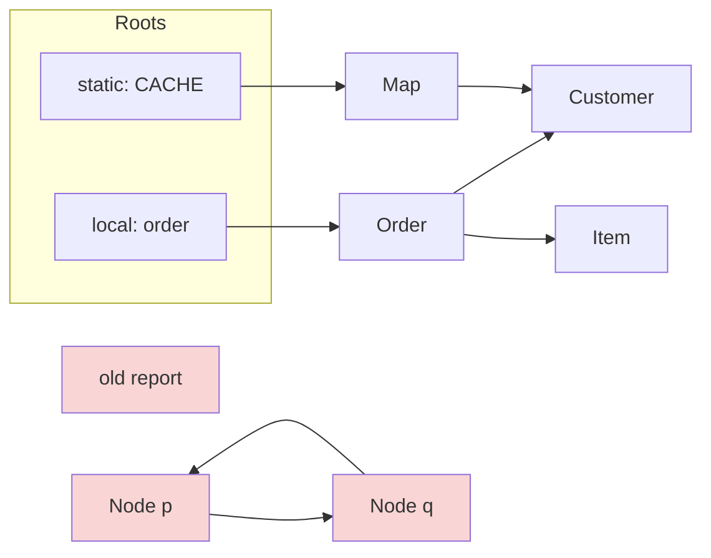
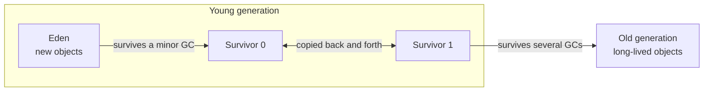
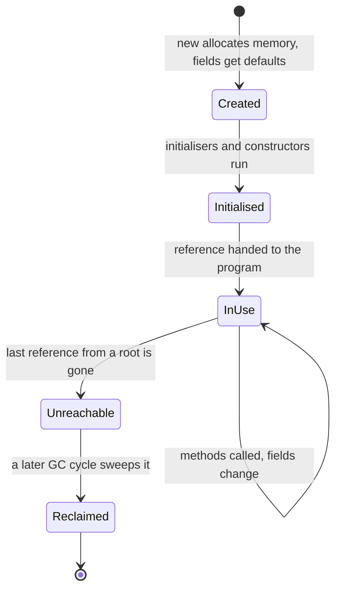

# Object lifecycle, scope and garbage collection

> **Before this lesson:** you know the stack and the heap ([References, arrays, the stack and the heap](#/lesson/java/java-references-stack-heap)) and how constructors bring objects to life ([Constructors, this and super](#/lesson/java/java-constructors)).

## In plain words

A library lends books to anyone holding a library card. Nobody phones the library to say "I have finished with this book, destroy it". Instead, the library's rule is: a book that **no card can lead you to** any more is taken off the system. Now and then a member of staff walks the shelves, starting from the list of active cards, follows every loan and every "see also" note, ticks every book they can reach, and clears out whatever was not ticked.

In Java, objects are the books, references are the loans, and the staff member is the **garbage collector** (GC): a part of the JVM that finds objects the program can no longer reach and reclaims their memory. You create objects with `new`; you never destroy them yourself.

Why this matters for a job: memory is where "works on my machine" turns into "crashes after three days in production". Interviewers ask when an object becomes eligible for collection, whether Java can leak memory (it can), and what `finalize` does (nothing you should rely on).

## Three lifetimes to keep apart

| Thing | Born | Dies |
|---|---|---|
| **Local variable** (and parameter) | when its declaration runs | when its block or method ends |
| **Instance variable** | when its object is created | when its object is collected |
| **Object** | when `new` runs | some time after it becomes unreachable |

A variable's **scope** is the part of the code where its name may be used. A variable's **lifetime** is the period during which it exists in memory. For local variables the two nearly coincide; the distinction matters when methods call other methods.

```java
public class Scopes {
    static int twice(int n) {
        int result = n * 2;          // result: scope and life are this call of twice
        return result;
    }

    public static void main(String[] args) {
        int base = 5;                // alive for all of main
        int answer = twice(base);    // while twice runs, base is ALIVE but OUT OF SCOPE there
        if (answer > 5) {
            String note = "big";     // scope: this block only
            System.out.println(note);
        }
        // System.out.println(note); // does not compile: note is out of scope
        // System.out.println(result); // does not compile either
    }
}
```

```text
big
```

While `twice` is executing, `main`'s frame is still on the stack underneath, so `base` is alive, but code inside `twice` cannot name it. When `twice` returns, its frame is popped and `n` and `result` cease to exist.

## When does an object become garbage?

An object is alive as long as it is **reachable**: there is some chain of references to it starting from a **GC root**. The roots are, in essence:

- local variables and parameters in the frames of every running thread's stack;
- static fields of loaded classes;
- a few JVM-internal references (for example to running threads).

An object with no such chain is **unreachable** and therefore **eligible for garbage collection**. There are three everyday ways a reference goes away.

### 1. The variable goes out of scope

```java
static void greet() {
    StringBuilder sb = new StringBuilder("hello");   // object created
    System.out.println(sb);
}                                                     // sb's frame is popped: object unreachable
```

### 2. The variable is pointed at something else

```java
StringBuilder a = new StringBuilder("first");
a = new StringBuilder("second");                      // "first" object is now unreachable
```

### 3. The variable is set to null

```java
StringBuilder b = new StringBuilder("temp");
b = null;                                             // object unreachable
```

An object stays alive while **any** reference reaches it:

```java
StringBuilder x = new StringBuilder("shared");
StringBuilder y = x;
x = null;                 // still reachable through y: NOT eligible
```

### Objects that refer to each other

Reachability is judged from the roots, not by counting references. Two objects that point at each other but that nothing else points at are both garbage.

```java
class Node {
    Node partner;
}

static void pair() {
    Node p = new Node();
    Node q = new Node();
    p.partner = q;
    q.partner = p;        // a cycle
}                         // p and q go out of scope: BOTH objects are unreachable
```



In the picture the shaded objects are unreachable: the two-node cycle and the orphaned report. Everything else can be reached from a root.

> [!INTERVIEW]
> "How many objects are eligible for garbage collection after line N?" Method: (1) list every object created so far; (2) list the references still live at line N (locals in scope, fields of reachable objects, statics); (3) mark every object reachable from them, following fields; (4) the unmarked ones are the answer. Mention that cycles do not keep objects alive, because Java's collectors trace from roots and do not count references.

## How the collector works, at a high level

The classic algorithm is **mark and sweep**:

1. **Mark.** Starting from the roots, follow every reference and mark each object reached.
2. **Sweep.** Everything unmarked is garbage; its memory is reclaimed.
3. **Compact** (in many collectors). Move the survivors together so that free memory is one large block, which keeps allocation fast.

### A reachability model you can run

```python-run
def collect(heap, roots):
    """heap: {object: [objects it references]}; roots: objects referenced by stack/static variables."""
    marked, stack = set(), [r for r in roots if r is not None]
    while stack:                               # MARK
        obj = stack.pop()
        if obj not in marked:
            marked.add(obj)
            stack.extend(heap[obj])
    garbage = sorted(set(heap) - marked)       # SWEEP
    return sorted(marked), garbage

heap = {
    "order":    ["customer", "item"],
    "customer": [],
    "item":     [],
    "map":      ["customer"],
    "nodeP":    ["nodeQ"],
    "nodeQ":    ["nodeP"],          # cycle with no root
    "report":   [],
}
alive, garbage = collect(heap, roots=["order", "map"])
print("alive  :", alive)
print("garbage:", garbage)

# The local variable 'order' goes out of scope:
alive, garbage = collect(heap, roots=["map"])
print("\nafter 'order' leaves scope")
print("alive  :", alive)
print("garbage:", garbage)
```

After `order` leaves scope, `customer` survives because the static map still refers to it. That is precisely how memory leaks arise in Java.

### Generations: most objects die young

Measurements of real programs show that the great majority of objects become garbage very soon after creation (temporary strings, iterators, small helper objects), while those that survive a while tend to live a long time. Collectors exploit this **generational hypothesis** by splitting the heap.



- New objects are allocated in **Eden**.
- When Eden fills, a **minor collection** runs over the young generation only. It is fast, because most objects there are already dead; the few survivors are copied to a survivor space.
- Objects that survive several minor collections are **promoted** to the **old generation**.
- The old generation is collected less often, in a **major** collection, which takes more work.

The JVM offers several collector implementations. **G1** has been the default since Java 9 and balances throughput with short pauses. **ZGC** and **Shenandoah** target pauses of a millisecond or less on very large heaps. **Parallel** maximises raw throughput for batch jobs. **Serial** suits tiny heaps. The interview-level details are in [JVM memory areas and garbage collectors](#/lesson/java/java-iv-jvm-memory-gc).

## What you cannot control

- **When** the collector runs is the JVM's decision. "Eligible" does not mean "collected now"; an eligible object may linger until memory is needed, or until the program exits.
- `System.gc()` is a **request** that the JVM may ignore. Do not call it in application code.
- **`finalize()`**, a method of `Object` that the collector might call before reclaiming an object, is deprecated and scheduled for removal. It runs at an unpredictable time, possibly never, and can slow collection dramatically. Do not use it. Release resources explicitly with try-with-resources, covered in [try-with-resources, multi-catch and custom exceptions](#/lesson/java/java-twr-custom-exceptions).

## Memory leaks in a garbage-collected language

The collector frees only what is **unreachable**. If your program keeps a reference to an object it will never use again, that object can never be collected. This is a memory leak, Java style.

```java
import java.util.ArrayList;
import java.util.List;

class RequestLog {
    private static final List<String> HISTORY = new ArrayList<>();   // static: a GC root, lives forever

    static void record(String request) {
        HISTORY.add(request);          // grows without limit
    }
}
```

Every string added stays reachable from the static list for the life of the program. After enough requests the JVM fails with `OutOfMemoryError: Java heap space`.

Usual culprits:

| Cause | Fix |
|---|---|
| Collections that only grow (caches, logs, static maps) | bound the size; evict old entries; use a real cache library |
| Listeners or callbacks registered and never removed | unregister when done |
| A long-lived object holding a reference to a large short-lived one | clear the field, or narrow the scope |
| Resources (files, sockets, connections) not closed | try-with-resources |
| Hand-written containers that keep stale slots | set removed slots to `null` |

The last row deserves a concrete example. A stack that manages its own array:

```java
class SimpleStack {
    private Object[] items = new Object[16];
    private int size;

    void push(Object o) { items[size++] = o; }

    Object pop() {
        Object top = items[--size];
        items[size] = null;            // without this line the array keeps the object alive
        return top;
    }
}
```

Without the `null` assignment, the popped object would remain referenced from a slot beyond `size`: the program can never use it again, but the collector must assume it might.

## Two errors about memory

| Error | Which area ran out | Typical cause |
|---|---|---|
| `StackOverflowError` | a thread's stack | recursion that never stops, or is too deep |
| `OutOfMemoryError: Java heap space` | the heap | a leak, or data larger than the configured heap |

```java
static int forever(int n) {
    return forever(n + 1);          // no stopping condition
}
// calling forever(0) ends with java.lang.StackOverflowError
```

Each call adds a frame to the stack and none is ever removed. The heap limit is set with the `-Xmx` option (`java -Xmx512m App`); a thread's stack size with `-Xss`.

## The full life story of an object



## Worked puzzle

```java
class Crate {
    Crate inside;
}

public class Puzzle {
    public static void main(String[] args) {
        Crate a = new Crate();      // object 1
        Crate b = new Crate();      // object 2
        Crate c = new Crate();      // object 3
        a.inside = b;
        b.inside = c;
        b = null;
        c = null;
        // line X
        a.inside = null;
        // line Y
    }
}
```

**At line X.** Live local references: `a` (object 1). Object 1 has a field pointing to object 2, which has a field pointing to object 3. All three are reachable through `a`. **Zero** objects are eligible.

**At line Y.** `a.inside` was cleared, cutting the chain. Object 1 is reachable; objects 2 and 3 are not. **Two** objects are eligible.

Setting the variables `b` and `c` to `null` did not make their objects garbage, because other paths to them existed.

> [!TIP]
> You almost never need to set a local variable to `null` to "help the garbage collector". Keep variables in the smallest scope that works and let them fall out of scope naturally. Explicit nulling is for fields of long-lived objects, as in the stack example.

## Pitfalls

- **Believing `x = null` destroys the object.** It removes one reference; others may remain.
- **Believing "eligible" means "collected immediately".**
- **Calling `System.gc()`** or relying on `finalize()`.
- **Static collections that grow for ever.**
- **Forgetting that inner-class instances and lambdas can hold a reference to their enclosing object**, keeping it alive.
- **Unbounded recursion**, giving `StackOverflowError`.
- **Assuming cycles leak.** They do not in Java.
- **Not closing resources.** The collector reclaims memory, not file handles or network connections.

## Cheat sheet

| Question | Answer |
|---|---|
| Who frees objects? | the garbage collector, automatically |
| When is an object eligible? | when no chain of references from a GC root reaches it |
| What are GC roots? | live locals and parameters on thread stacks, static fields, JVM internals |
| Do reference cycles prevent collection? | no |
| Can I force a collection? | no; `System.gc()` is only a hint |
| Should I use `finalize`? | no; deprecated and unreliable |
| Where are new objects allocated? | Eden, in the young generation |
| Default collector today | G1 |
| Heap exhausted | `OutOfMemoryError` |
| Stack exhausted | `StackOverflowError` |

## Summary

- Local variables live in stack frames and vanish when the method or block ends; objects live on the heap until unreachable.
- Reachability from GC roots, not reference counts, decides what is garbage.
- Collectors mark reachable objects, sweep the rest and often compact; generational collectors exploit the fact that most objects die young.
- You cannot schedule the collector; do not depend on `System.gc()` or `finalize()`.
- Java programs leak memory by holding references they no longer need, typically in static or long-lived collections.

## Glossary

- **Scope**: the region of source code where a name can be used.
- **Lifetime**: the period during which a variable or object exists in memory.
- **Garbage collector**: the JVM component that reclaims unreachable objects.
- **Reachable**: accessible through a chain of references from a GC root.
- **GC root**: a starting point for reachability, such as a live local variable or a static field.
- **Mark and sweep**: mark what is reachable, then reclaim the rest.
- **Compaction**: moving live objects together to remove gaps in free memory.
- **Young / old generation**: heap regions for new and long-lived objects.
- **Minor / major collection**: a collection of the young generation only, or one that includes the old.
- **Memory leak**: memory that stays reachable although the program will never use it again.
- **`OutOfMemoryError`**: thrown when the heap cannot satisfy an allocation.
- **`StackOverflowError`**: thrown when a thread's stack is exhausted.

## Check yourself

```quiz
[
  {"q": "`Crate a = new Crate(); Crate b = a; a = null;` How many objects are eligible for collection?", "options": ["0", "1", "2", "It depends on the JVM"], "answer": 0,
   "explain": "The one object is still reachable through b."},
  {"q": "Two objects refer to each other and no variable refers to either. Are they eligible for collection?", "options": ["No, the cycle keeps them alive", "Yes, neither is reachable from a root", "Only one of them", "Only after System.gc()"], "answer": 1,
   "explain": "Java collectors trace from roots. A cycle that no root reaches is garbage."},
  {"q": "What does `System.gc()` guarantee?", "options": ["An immediate full collection", "Nothing; it is a hint the JVM may ignore", "That finalize runs on all objects", "That the heap is compacted"], "answer": 1,
   "explain": "The specification describes it as a suggestion. Collection timing is the JVM's choice."},
  {"q": "Which is a GC root?", "options": ["Any object in the old generation", "A local variable in a currently executing method", "A private instance field of an unreachable object", "Every String literal's characters"], "answer": 1,
   "explain": "Live local variables on thread stacks and static fields are roots. Fields of unreachable objects are not."},
  {"q": "Does this compile? `void f() { if (true) { int n = 1; } System.out.println(n); }`", "options": ["Yes, prints 1", "No: n is out of scope after the block", "Yes, prints 0", "No: if (true) is illegal"], "answer": 1,
   "explain": "A variable declared inside a block cannot be used after the closing brace."},
  {"q": "A static `List` receives one new element for every web request and is never cleared. What eventually happens?", "options": ["The GC removes old elements", "StackOverflowError", "OutOfMemoryError: Java heap space", "Nothing; static memory is unlimited"], "answer": 2,
   "explain": "Everything in the static list stays reachable, so nothing can be collected and the heap fills up."},
  {"q": "`Crate a = new Crate(); Crate b = new Crate(); a.inside = b; b = null; a = null;` How many objects are eligible?", "options": ["0", "1", "2", "3"], "answer": 2,
   "explain": "After a = null nothing reaches object 1, and object 2 was reachable only through object 1's field. Both are garbage."},
  {"q": "Where are newly created objects normally allocated?", "options": ["The old generation", "Eden in the young generation", "The stack", "Metaspace"], "answer": 1,
   "explain": "Allocation happens in Eden. Survivors of several minor collections are promoted to the old generation."}
]
```

> **Source:** Head First Java, ch. 9 (life and death of an object, scope, garbage collection). Collector facts checked against the HotSpot Garbage Collection Tuning Guide: https://docs.oracle.com/en/java/javase/21/gctuning/ and https://dev.java/learn/jvm/tool/garbage-collection/ .
