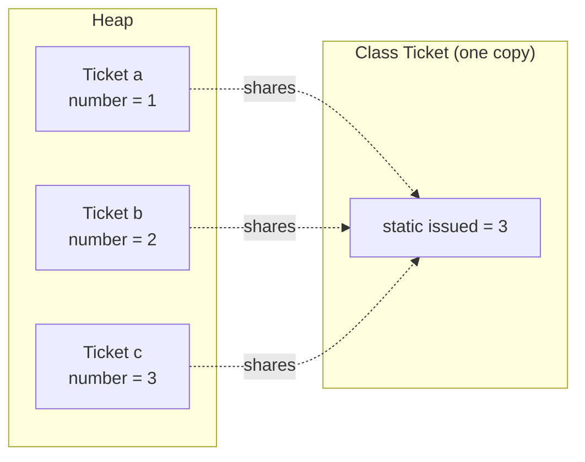

# static, final, constants and the Math class

> **Before this lesson:** you know instance variables and methods ([Classes and objects: blueprint and building](#/lesson/java/java-classes-vs-objects)), constructors and initialisation order ([Constructors, this and super](#/lesson/java/java-constructors)).

## In plain words

A school has thirty classrooms. Each classroom has its own whiteboard: what is written in room 4 is not what is written in room 9. In the entrance hall there is one notice board for the whole school. There is only one of it, everyone reads the same thing, and if the head teacher changes the notice, it has changed for everybody.

Instance variables are the classroom whiteboards: one per object. A **static** variable is the notice board in the hall: one per class, shared by every object, and available even when no classroom is in use.

**final** is a different idea: permanent marker. Whatever is written with it stays as written. A `final` variable is assigned once and can never be assigned again.

Why this matters for a job: `static` and `final` appear on the first line of every Java program (`public static void main`). Interviewers ask "why can't a static method access an instance variable?", "what does `final` mean on a variable, a method and a class?" and "is a `final` list immutable?" (it is not).

## Static fields: one copy for the whole class

```java
class Ticket {
    private static int issued = 0;      // ONE variable, belongs to the class
    private final int number;           // one per object

    Ticket() {
        issued++;
        number = issued;
    }

    int getNumber() { return number; }

    static int getIssued() { return issued; }
}

public class Queue {
    public static void main(String[] args) {
        System.out.println(Ticket.getIssued());      // works before any Ticket exists
        Ticket a = new Ticket();
        Ticket b = new Ticket();
        Ticket c = new Ticket();
        System.out.println(a.getNumber() + " " + b.getNumber() + " " + c.getNumber());
        System.out.println(Ticket.getIssued());
    }
}
```

```text
0
1 2 3
3
```

- `private static int issued` exists exactly once, however many `Ticket` objects are made, including zero.
- Each constructor call increments the shared counter and copies its value into that object's own `number`.
- `Ticket.getIssued()` is called on the **class name**. No object is needed.



Static fields are initialised when the class is loaded, before any object can be created, and receive the usual defaults (`0`, `false`, `null`) if you give no value.

## Static methods: behaviour that needs no object

A **static method** belongs to the class and runs without an object. `Math.max(3, 9)` is the typical case: finding the larger of two numbers does not depend on the state of any particular "Math object".

```java
class Temperature {
    static double toFahrenheit(double celsius) {
        return celsius * 9 / 5 + 32;
    }
}

System.out.println(Temperature.toFahrenheit(20));
```

```text
68.0
```

### The one big rule

Inside a static method there is **no `this`**: no current object. So a static method cannot directly use instance variables or call instance methods.

```java
class Lamp {
    private boolean on;                 // instance variable

    void toggle() { on = !on; }         // instance method

    static void broken() {
        // on = true;                   // does not compile
        // toggle();                    // does not compile
        // error: non-static variable on cannot be referenced from a static context
    }

    static void fine(Lamp which) {
        which.on = true;                // OK: an explicit object is supplied
        which.toggle();
    }
}
```

Which lamp would `on = true` refer to? There might be a thousand lamps, or none. The compiler refuses to guess. This is why `main`, which is static, must create objects before it can call instance methods, and it explains the most common beginner compile error in Java.

The reverse direction is always allowed: an instance method may freely use static fields and static methods.

| From ↓ / To → | instance member | static member |
|---|---|---|
| **instance method** | yes | yes |
| **static method** | only through an object reference | yes |

### When to make a method static

| Make it static when... | Keep it an instance method when... |
|---|---|
| the result depends only on the parameters | it reads or changes the object's fields |
| it is a utility (`Math.sqrt`, `Integer.parseInt`) | subclasses should be able to override it |
| it creates instances (a factory: `List.of`) | it is part of an interface that objects implement |

Static methods cannot be overridden (see [Polymorphism, overriding and overloading](#/lesson/java/java-polymorphism)), and code full of static methods and static mutable state is hard to test. Use static for stateless helpers and constants; be suspicious of static variables that change.

> [!WARNING]
> You *can* write `a.getIssued()` on an instance, and it compiles, but it is misleading: the object is ignored and the call is bound to the declared type. It even works on a `null` reference. Always call static members through the class name.

## Classes that are never instantiated

`Math` has only static members, so creating a `Math` object would be pointless. Its constructor is `private`, and the same pattern suits your own utility classes:

```java
final class Money {
    private Money() { }                          // nobody can instantiate

    static long toCents(double amount) {
        return Math.round(amount * 100);
    }
}
```

## final

`final` means "cannot be changed", and what exactly cannot change depends on where the word is written.

| Applied to | Meaning |
|---|---|
| a **variable** (local, parameter or field) | assigned exactly once |
| a **method** | cannot be overridden by subclasses |
| a **class** | cannot be extended |

### final variables

```java
final int limit = 10;
// limit = 11;                 // does not compile: cannot assign a value to final variable limit

final int later;               // a "blank final": assigned once, later
later = 5;
```

A `final` instance field must be assigned by the time the constructor finishes: in its declaration, in an initialiser block, or in every constructor. The compiler checks.

### final with references: the trap

For a reference variable, `final` freezes **the reference**, not the object it leads to.

```java
import java.util.ArrayList;
import java.util.List;

final List<String> names = new ArrayList<>();
names.add("Ada");              // allowed: the list object is being changed
names.add("Bo");
// names = new ArrayList<>(); // not allowed: the variable cannot be re-pointed
System.out.println(names);
```

```text
[Ada, Bo]
```

`final` is about the variable; **immutability** is about the object. To get a list that cannot be modified use `List.of(...)` or `List.copyOf(...)`. Building classes whose objects never change is covered in [Minimal accessibility and immutable classes](#/lesson/java/java-ej-accessibility-immutability).

### Constants: static final

A value that is the same for every object and never changes is declared `static final`. By convention the name is in capitals with underscores.

```java
class Shop {
    static final double VAT_RATE = 0.20;
    static final int MAX_BASKET_ITEMS = 50;
    static final String CURRENCY = "GBP";
}

double gross = 80 * (1 + Shop.VAT_RATE);
```

Constants replace **magic numbers**, unexplained literals scattered through the code. A reader meeting `0.20` in forty places cannot tell whether they all mean VAT; `Shop.VAT_RATE` says so, and a change is made in one place.

When a constant belongs to a fixed set of named choices (days, states, sizes), use an **enum** instead of `static final int` values:

```java
enum Size { SMALL, MEDIUM, LARGE }

Size s = Size.MEDIUM;
```

Enums are type-safe: a method that takes a `Size` cannot be handed `7`. They are explored in [Enums: constants with data and behaviour](#/lesson/java/java-ej-enums).

### final methods and classes

```java
class Account {
    final boolean authorised(String pin) {     // subclasses cannot weaken this check
        return pin.equals(secretPin());
    }
    String secretPin() { return "0000"; }
}

final class Token { }                           // nobody can extend Token
```

`String`, `Integer` and the other wrapper classes are final, which is part of what makes them safely immutable: no subclass can add mutable behaviour.

### A static and final model you can run

```python-run
class JavaClass:
    """Model: static fields live on the class; instance fields on each object;
    final variables refuse a second assignment."""
    statics = {"issued": 0}
    finals = set()

    def __init__(self):
        self.fields = {}
        JavaClass.statics["issued"] += 1
        self.assign("number", JavaClass.statics["issued"], final=True)

    def assign(self, name, value, final=False):
        key = (id(self), name)
        if key in JavaClass.finals:
            return f"COMPILE ERROR: cannot assign a value to final variable {name}"
        self.fields[name] = value
        if final:
            JavaClass.finals.add(key)
        return "ok"

a, b = JavaClass(), JavaClass()
print("a.number =", a.fields["number"], " b.number =", b.fields["number"],
      " static issued =", JavaClass.statics["issued"])
print("a.number = 99 ->", a.assign("number", 99))

names = []                        # 'final List<String> names'
names.append("Ada")               # mutating the object is still allowed
print("final reference, mutable object:", names)
```

## The Math class

`java.lang.Math` is a collection of static methods and two constants. No import is needed.

```java
public class Maths {
    public static void main(String[] args) {
        System.out.println(Math.abs(-7.5));
        System.out.println(Math.max(3, 9) + " " + Math.min(3, 9));
        System.out.println(Math.pow(2, 10));          // always returns a double
        System.out.println(Math.sqrt(144));
        System.out.println(Math.round(2.5) + " " + Math.round(-2.5));
        System.out.println(Math.floor(-2.1) + " " + Math.ceil(-2.1));
        System.out.println((int) 2.9 + " " + (int) -2.9);
        System.out.println(Math.floorMod(-7, 3) + " " + (-7 % 3));
        System.out.println(Math.PI);
    }
}
```

```text
7.5
9 3
1024.0
12.0
3 -2
-3.0 -2.0
2 -2
2 -1
3.141592653589793
```

Points that surprise people:

- `Math.round` returns a `long` (for a `double` argument) and rounds halves **toward positive infinity**: 2.5 becomes 3, and -2.5 becomes -2.
- `floor` goes down toward negative infinity, `ceil` goes up, and a cast to `int` chops toward zero. For negative numbers these three give different answers.
- `Math.floorMod` gives the remainder with the sign of the divisor, the behaviour Python's `%` has. Use it for wrap-around indexes that may be negative.
- `Math.pow` returns a `double`; `(int) Math.pow(2, 10)` is needed for an `int`.

### Random numbers

```java
double r = Math.random();                       // 0.0 <= r < 1.0
int die = (int) (Math.random() * 6) + 1;        // 1..6

java.util.Random rng = new java.util.Random(42);    // a seed makes the sequence repeatable
int roll = rng.nextInt(6) + 1;                      // 1..6
int between = rng.nextInt(10, 20);                  // 10..19 (Java 17+)
```

The parentheses in `(int) (Math.random() * 6)` are essential: `(int) Math.random() * 6` casts first, giving 0 every time.

> [!INTERVIEW]
> "Why is `main` static?" Because the JVM must call it before any object of your class exists; a static method needs no instance. Common follow-ups: *Can we overload `main`?* Yes, but the JVM starts only `main(String[])`. *Can a static method be overridden?* No; a same-signature static method in a subclass **hides** it. *What is a static block?* Code that runs once when the class is loaded. *What is the difference between `final`, `finally` and `finalize`?* A keyword for "no change", a block that always runs after `try`, and a deprecated clean-up hook; see [The classic comparison questions, answered](#/lesson/java/java-iv-keyword-questions).

## Static imports and static nested classes

- `import static java.lang.Math.*;` lets you write `sqrt(x)` instead of `Math.sqrt(x)`. Use sparingly.
- A class declared inside another class with `static` is a **static nested class**; it is an ordinary class that lives in another class's namespace. Details in [Nested, inner, local and anonymous classes](#/lesson/java/java-inner-classes).

## Pitfalls

- **Using an instance member from a static method.**
- **Static mutable state.** A static variable that many parts of the program change is a global variable: hard to test, unsafe with threads.
- **Believing a `final` reference makes the object immutable.**
- **Calling static methods through an instance** (or through `null`).
- **Expecting static methods to be polymorphic.**
- **`(int) Math.random() * 6`**: always 0.
- **Assuming `Math.round(-2.5)` is -3.**
- **A constant that is not really constant**: `static final List<String> DEFAULTS = new ArrayList<>()` can still be modified by anyone who can reach it.

## Cheat sheet

| Idea | Java |
|---|---|
| Shared field | `static int count;` |
| Utility method | `static double convert(double x)`; call as `Class.convert(x)` |
| Constant | `static final int MAX_SIZE = 100;` |
| Assign once | `final int x = 5;` |
| No overriding | `final void m()` |
| No subclassing | `final class C` |
| One-off class set-up | `static { ... }` |
| Not instantiable | `private` constructor |
| Round / floor / ceil | `Math.round`, `Math.floor`, `Math.ceil` |
| Power / root | `Math.pow(a, b)`, `Math.sqrt(x)` |
| Random 0..n-1 | `new Random().nextInt(n)` |

## Summary

- `static` members belong to the class: one copy, usable without an object.
- A static method has no `this`, so it cannot touch instance members without an explicit object.
- `final` means assign once (variable), cannot override (method), cannot extend (class).
- A `final` reference can still point at a mutable object.
- Constants are `static final` with upper-case names; fixed sets of choices are better as enums.
- `Math` is a class of static utilities; know how `round`, `floor`, `ceil` and casts differ on negatives.

## Glossary

- **Static field (class variable)**: a field with one copy shared by the whole class.
- **Static method (class method)**: a method called on the class, with no current object.
- **Instance member**: a field or method that belongs to each object.
- **Static context**: code inside a static method or static initialiser, where `this` does not exist.
- **`final`**: a modifier meaning "cannot be reassigned, overridden or extended".
- **Blank final**: a final variable declared without a value and assigned once later.
- **Constant**: a `static final` value that never changes.
- **Magic number**: an unexplained literal in code.
- **Utility class**: a non-instantiable class holding only static members.
- **Seed**: the starting value that determines a random generator's sequence.
- **Enum**: a type with a fixed set of named instances.

## Check yourself

```quiz
[
  {"q": "Does this compile? `class C { int n; static void bump() { n++; } }`", "options": ["Yes", "No: non-static variable n cannot be referenced from a static context", "Yes, n is shared", "No: static methods must return a value"], "answer": 1,
   "explain": "A static method has no current object, so there is no particular n to increment."},
  {"q": "What does this print? `class K { static int c; K() { c++; } }` then `new K(); new K(); K k = null; System.out.println(k.c);`", "options": ["0", "2", "NullPointerException", "It does not compile"], "answer": 1,
   "explain": "c is static, so k.c is compiled as K.c and the null reference is never used. Two constructors ran, so c is 2."},
  {"q": "Does this compile? `final StringBuilder sb = new StringBuilder(\"a\"); sb.append(\"b\");`", "options": ["No: sb is final", "Yes: the reference is final, the object can still change", "Only if sb is static", "No: StringBuilder is immutable"], "answer": 1,
   "explain": "final prevents reassigning sb. Calling a method that mutates the object is allowed."},
  {"q": "What does `Math.round(-2.5)` return?", "options": ["-3", "-2", "-2.5", "2"], "answer": 1,
   "explain": "Math.round adds 0.5 and takes the floor: floor(-2.0) = -2. Halves round toward positive infinity."},
  {"q": "What does `(int) Math.random() * 10` evaluate to?", "options": ["A random int from 0 to 9", "A random int from 1 to 10", "Always 0", "A compile error"], "answer": 2,
   "explain": "The cast binds tighter than *. Math.random() is below 1.0, so the cast gives 0, and 0 * 10 is 0."},
  {"q": "Which statement about `final` is FALSE?", "options": ["A final class cannot be extended", "A final method cannot be overridden", "A final field must be assigned by the end of every constructor", "A final List cannot have elements added to it"], "answer": 3,
   "explain": "final fixes the reference, not the contents. Use List.of or an unmodifiable wrapper for a list that cannot change."},
  {"q": "What does `Math.floor(-3.2)` versus `(int) -3.2` give?", "options": ["-4.0 and -3", "-3.0 and -3", "-4.0 and -4", "-3.0 and -4"], "answer": 0,
   "explain": "floor goes toward negative infinity (-4.0); a cast truncates toward zero (-3)."},
  {"q": "Why must `main` be static?", "options": ["So it runs faster", "So the JVM can call it without first creating an object of the class", "So it cannot be overridden", "Because it returns void"], "answer": 1,
   "explain": "At start-up no objects exist. A static method can be invoked on the class alone."}
]
```

> **Source:** Head First Java, ch. 10 (static methods and variables, final, constants, the Math class). Checked against the Math API and the Java Language Specification sections 8.3.1.1 and 4.12.4: https://docs.oracle.com/en/java/javase/21/docs/api/java.base/java/lang/Math.html and https://dev.java/learn/classes-objects/more-on-classes/ .
