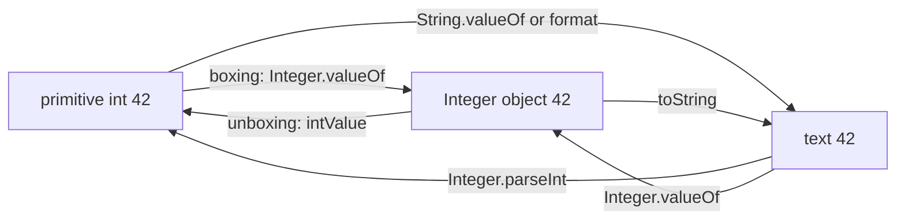

# Wrapper classes, autoboxing and formatting

> **Before this lesson:** you know the primitive types ([Primitive types and how numbers are stored](#/lesson/java/java-primitives)), the difference between `==` and `equals` ([References, arrays, the stack and the heap](#/lesson/java/java-references-stack-heap)) and static methods ([static, final, constants and the Math class](#/lesson/java/java-static-final)).

## In plain words

A coin is a simple thing: a small disc of metal with a value. Some machines, though, accept only items in a standard plastic capsule. To use a coin there, you drop it in a capsule; to spend it again, you take it out. The coin's value never changes, but the capsule lets it travel through systems built for capsules.

Java's primitives (`int`, `double`, `boolean` and the rest) are the bare coins: fast and small, but they are not objects. Much of the library, especially collections such as `ArrayList`, is built to hold objects only. A **wrapper class** is the capsule: an object whose single job is to hold one primitive value. Putting a primitive into its wrapper is called **boxing**; taking it out is **unboxing**. The compiler does both for you automatically, which is called **autoboxing**.

This lesson also covers the other everyday number job: turning numbers into nicely formatted text, and dates too.

Why this matters for a job: autoboxing hides three classic bugs (`==` on wrapper objects, unboxing `null`, and slow loops), and all three are standard interview material.

## The eight wrapper classes

| Primitive | Wrapper | Example |
|---|---|---|
| `byte` | `Byte` | `Byte b = 10;` |
| `short` | `Short` | `Short s = 300;` |
| `int` | `Integer` | `Integer i = 42;` |
| `long` | `Long` | `Long n = 42L;` |
| `float` | `Float` | `Float f = 1.5f;` |
| `double` | `Double` | `Double d = 1.5;` |
| `char` | `Character` | `Character c = 'x';` |
| `boolean` | `Boolean` | `Boolean ok = true;` |

Six follow the pattern "capitalise the primitive name"; the two exceptions are `Integer` and `Character`. All are in `java.lang`, so no import is needed. All are **immutable** and `final`: a wrapper object's value never changes.

Wrappers are needed when:

- a collection or other generic type must hold numbers: `List<Integer>`, `Map<String, Double>`;
- a value must be able to be "absent": an `Integer` can be `null`, an `int` cannot;
- you want their utility methods and constants: `Integer.parseInt`, `Integer.MAX_VALUE`, `Character.isDigit`.

## Autoboxing and unboxing

```java
import java.util.ArrayList;
import java.util.List;

public class Boxing {
    public static void main(String[] args) {
        Integer boxed = 7;              // autoboxing: compiler writes Integer.valueOf(7)
        int plain = boxed;              // unboxing:   compiler writes boxed.intValue()

        List<Integer> marks = new ArrayList<>();
        marks.add(80);                  // boxed on the way in
        int first = marks.get(0);       // unboxed on the way out

        Integer total = boxed + first;  // unbox both, add as ints, box the result
        total++;                        // unbox, add 1, box a NEW object, reassign total
        System.out.println(total);
    }
}
```

```text
88
```

Boxing and unboxing are conversions the compiler inserts wherever the types call for them: assignments, method arguments, return values, arithmetic and comparisons. They are convenient and invisible, which is exactly why the following three traps catch people.

## Trap 1: == compares references

```java
public class CacheTrap {
    public static void main(String[] args) {
        Integer a = 127, b = 127;
        Integer c = 128, d = 128;

        System.out.println(a == b);          // same cached object
        System.out.println(c == d);          // two different objects
        System.out.println(c.equals(d));     // compares values
        System.out.println(c == 128);        // c is unboxed: numeric comparison

        Integer e = new Integer(127);        // deprecated constructor: always a new object
        System.out.println(a == e);
    }
}
```

```text
true
false
true
true
false
```

`==` between two wrapper **objects** asks "same object?", as it does for all references. The surprise is that it sometimes says `true`. `Integer.valueOf`, which autoboxing uses, keeps a **cache** of ready-made `Integer` objects for the values **-128 to 127** and hands out the same object every time for those. Outside that range a new object is created for each boxing.

So `a == b` is true (both refer to the cached 127), `c == d` is false (two separate objects holding 128). If **one** side of `==` is a primitive, the wrapper is unboxed and values are compared, which is why `c == 128` is true.

| Type | Values cached by `valueOf` |
|---|---|
| `Byte`, `Short`, `Integer`, `Long` | -128 to 127 |
| `Character` | 0 to 127 |
| `Boolean` | `true` and `false` (always) |
| `Float`, `Double` | none |

> [!WARNING]
> Always compare wrapper objects with `equals`, or unbox them first. Code that uses `==` on `Integer` passes its tests with small numbers and fails in production with large ones.

### An Integer cache model you can run

```python-run
class Ref:                      # a boxed Integer: identity matters
    def __init__(self, v): self.v = v

CACHE = {v: Ref(v) for v in range(-128, 128)}

def value_of(v):                # what autoboxing calls
    return CACHE[v] if -128 <= v <= 127 else Ref(v)

def java_eq(x, y):
    """Java's == : if either side is a primitive (int), unbox and compare values;
    if both are boxed, compare identity."""
    if isinstance(x, int) or isinstance(y, int):
        return (x.v if isinstance(x, Ref) else x) == (y.v if isinstance(y, Ref) else y)
    return x is y

for n in (0, 127, 128, -128, -129, 1000):
    a, b = value_of(n), value_of(n)
    print(f"{n:5}:  a == b -> {str(java_eq(a, b)):5}   a.equals(b) -> {a.v == b.v}   a == {n} -> {java_eq(a, n)}")
```

## Trap 2: unboxing null

A wrapper variable can hold `null`. Unboxing it calls a method on `null`.

```java
import java.util.HashMap;
import java.util.Map;

Map<String, Integer> stock = new HashMap<>();
stock.put("tea", 12);

int tea = stock.get("tea");          // fine: 12
int coffee = stock.get("coffee");    // get returns null -> NullPointerException on unboxing
```

Nothing on that last line looks like a method call on a null object, which makes the stack trace confusing the first time. Safe alternatives:

```java
int coffee = stock.getOrDefault("coffee", 0);
Integer maybe = stock.get("coffee");           // keep it boxed and test for null
if (maybe != null) { ... }
```

The same trap hides in the conditional operator: `Integer x = flag ? 1 : nullableInteger;` unboxes `nullableInteger` because the other branch is an `int`.

## Trap 3: boxing in hot loops

```java
Long sum = 0L;                                 // capital L: a wrapper
for (long i = 0; i < 1_000_000_000L; i++) {
    sum += i;                                  // unbox, add, box a NEW Long, every pass
}
```

Each pass creates a new `Long` object. Changing the one declaration to `long sum` removes about a billion needless objects and makes the loop several times faster. Use primitives for arithmetic; use wrappers where an object is required.

## Wrappers and method overloading

The compiler prefers widening to boxing (see [Polymorphism, overriding and overloading](#/lesson/java/java-polymorphism)). It never does both widening **then** boxing:

```java
static void take(Long n)   { System.out.println("Long"); }
static void take(Object o) { System.out.println("Object"); }

take(5);       // int -> Integer (boxing) -> Object (reference widening): prints Object
// An int is never widened to long and then boxed to Long.
```

```text
Object
```

For the same reason `Long big = 5;` does not compile, while `Long big = 5L;` does.

## Useful static methods

```java
public class Utilities {
    public static void main(String[] args) {
        int n = Integer.parseInt("42");                  // text -> int
        double d = Double.parseDouble("3.75");           // text -> double
        boolean ok = Boolean.parseBoolean("TRUE");       // case-insensitive
        Integer boxed = Integer.valueOf("42");           // text -> Integer

        System.out.println(n + d);
        System.out.println(ok);
        System.out.println(Integer.toString(255) + " " + Integer.toBinaryString(5) + " " + Integer.toHexString(255));
        System.out.println(Integer.parseInt("ff", 16) + " " + Integer.parseInt("101", 2));
        System.out.println(Integer.MAX_VALUE + " " + Integer.MIN_VALUE);
        System.out.println(Integer.compare(3, 9) + " " + Integer.max(3, 9) + " " + Integer.sum(3, 9));
        System.out.println(Character.isDigit('7') + " " + Character.isLetter('7') + " " + Character.toUpperCase('q'));
        System.out.println(Integer.bitCount(7));         // number of 1 bits
    }
}
```

```text
45.75
true
255 101 ff
255 5
2147483647 -2147483648
-1 9 12
true false Q
3
```

`parseInt` and friends throw `NumberFormatException` when the text is not a valid number (`"12a"`, `""`, `" 12"`). Check or catch when the text comes from a user or a file.

## Formatting numbers

### String.format and printf

A **format string** contains ordinary text plus **format specifiers** that start with `%`. Each specifier is replaced by the next argument.

```java
String product = "Tea";
int qty = 3;
double price = 2.5;
System.out.println(String.format("%s x%d costs %.2f", product, qty, qty * price));
System.out.printf("%-8s|%5d|%8.2f|%n", product, qty, price);
System.out.printf("%,d   %05d   %+d   %x   %b   %c   %.1f%%%n", 1234567, 42, 7, 255, true, 'J', 12.5);
```

```text
Tea x3 costs 7.50
Tea     |    3|    2.50|
1,234,567   00042   +7   ff   true   J   12.5%
```

The general shape is `%[flags][width][.precision]type`.

| Part | Examples | Meaning |
|---|---|---|
| type | `d` whole number, `f` fractional, `s` text, `c` char, `b` boolean, `x` hex, `e` scientific, `n` line break | required |
| width | `%5d`, `%8.2f` | minimum characters, padded with spaces on the left |
| precision | `%.2f` | digits after the decimal point (rounded) |
| flag `-` | `%-8s` | left-align within the width |
| flag `0` | `%05d` | pad with zeros |
| flag `,` | `%,d` | group thousands |
| flag `+` | `%+d` | always show the sign |
| `%%` | | a literal percent sign |

The number and types of arguments must match the specifiers. `%d` given a `double` throws `IllegalFormatConversionException` **at run time**; the compiler does not check format strings.

### Locale-aware formatting

Different countries write numbers and money differently. `NumberFormat` handles that.

```java
import java.text.NumberFormat;
import java.util.Locale;

double amount = 1234567.891;
System.out.println(NumberFormat.getCurrencyInstance(Locale.UK).format(amount));
System.out.println(NumberFormat.getNumberInstance(Locale.GERMANY).format(amount));
System.out.println(NumberFormat.getPercentInstance().format(0.256));
```

```text
£1,234,567.89
1.234.567,891
26%
```

A **locale** identifies a language and region and decides separators, currency symbols and month names.

## Dates and times: java.time

The modern date and time classes live in `java.time` (since Java 8). They are immutable, and every "change" returns a new object. Avoid the old `java.util.Date` and `Calendar` in new code.

```java
import java.time.Duration;
import java.time.LocalDate;
import java.time.LocalDateTime;
import java.time.format.DateTimeFormatter;
import java.time.temporal.ChronoUnit;

public class Dates {
    public static void main(String[] args) {
        LocalDate due = LocalDate.of(2026, 1, 30);
        LocalDate extended = due.plusMonths(1);              // clamps to the end of February
        System.out.println(extended + " " + extended.getDayOfWeek());
        System.out.println(ChronoUnit.DAYS.between(due, extended));
        System.out.println(due.isBefore(extended) + " " + due.isLeapYear());

        LocalDateTime start = LocalDateTime.of(2026, 3, 1, 9, 30);
        DateTimeFormatter f = DateTimeFormatter.ofPattern("dd MMM yyyy, HH:mm");
        System.out.println(start.format(f));
        System.out.println(LocalDate.parse("2026-12-25").getDayOfYear());
        System.out.println(Duration.ofMinutes(135));
    }
}
```

```text
2026-02-28 SATURDAY
29
true false
01 Mar 2026, 09:30
359
PT2H15M
```

| Class | Represents |
|---|---|
| `LocalDate` | a date with no time and no time zone |
| `LocalTime` | a time of day |
| `LocalDateTime` | date and time, no zone |
| `ZonedDateTime` | date and time in a named time zone |
| `Instant` | a point on the universal timeline (for timestamps) |
| `Duration` / `Period` | an amount of time in seconds / in days, months, years |



> [!INTERVIEW]
> "Explain `Integer a = 127, b = 127; a == b` versus 128." Say: `==` on two `Integer` references compares identity. Autoboxing calls `Integer.valueOf`, which returns cached instances for -128 to 127, so both variables refer to the same object and the result is `true`; 128 is outside the cache, so two objects are created and the result is `false`. The fix is `equals` or unboxing. Bonus: the upper bound of the cache can be raised with the JVM option `-XX:AutoBoxCacheMax`, so never write code that depends on it.

## Pitfalls

- **`==` on two wrapper objects.**
- **Unboxing `null`**, especially from `Map.get` or a database value.
- **Wrapper types as loop accumulators.**
- **`Long x = 5;`** does not compile; boxing does not widen.
- **`new Integer(5)`**: deprecated; use `Integer.valueOf(5)` or autoboxing.
- **`list.remove(int)` versus `list.remove(Integer)`** on a `List<Integer>`.
- **Format specifier and argument type mismatch**, found only at run time.
- **`parseInt` on untrusted text** without handling `NumberFormatException`.
- **Mixing `Integer` and `Long` with `equals`**: `Integer.valueOf(1).equals(1L)` is `false` because the types differ.
- **Using `LocalDateTime` for a moment in time shared across time zones.** Use `Instant` or `ZonedDateTime`.

## Cheat sheet

| Task | Code |
|---|---|
| Box / unbox explicitly | `Integer.valueOf(5)` / `boxed.intValue()` |
| Text to number | `Integer.parseInt(s)`, `Double.parseDouble(s)` |
| Number to text | `String.valueOf(n)`, `Integer.toString(n)` |
| Compare wrappers | `a.equals(b)` or `Integer.compare(a, b)` |
| Limits | `Integer.MAX_VALUE`, `Long.MIN_VALUE` |
| Two decimals | `String.format("%.2f", x)` |
| Thousands separators | `String.format("%,d", n)` |
| Zero padding | `String.format("%05d", n)` |
| Currency | `NumberFormat.getCurrencyInstance(locale).format(x)` |
| Today | `LocalDate.now()` |
| Format a date | `date.format(DateTimeFormatter.ofPattern("dd/MM/yyyy"))` |

## Summary

- Each primitive has an immutable wrapper class so that values can be used where objects are required.
- The compiler boxes and unboxes automatically, using `valueOf` and `xxxValue`.
- `==` on wrapper objects compares identity; small integer values are cached, which hides the bug. Use `equals`.
- Unboxing `null` throws `NullPointerException`; boxing in loops is slow.
- `String.format` and `printf` build formatted text from `%` specifiers; `NumberFormat` and `DateTimeFormatter` respect locales.
- Use the immutable `java.time` classes for dates and times.

## Glossary

- **Wrapper class**: an object type holding one primitive value, such as `Integer`.
- **Boxing**: converting a primitive to its wrapper object.
- **Unboxing**: converting a wrapper object to its primitive.
- **Autoboxing**: the compiler performing boxing and unboxing automatically.
- **Integer cache**: the pre-built `Integer` objects for -128 to 127 returned by `valueOf`.
- **Format string**: text containing `%` specifiers to be filled in.
- **Format specifier**: a `%...` placeholder describing how to render one argument.
- **Locale**: a language and region setting that controls formatting conventions.
- **`NumberFormatException`**: thrown when text cannot be parsed as a number.
- **`java.time`**: the modern, immutable date and time API.

## Check yourself

```quiz
[
  {"q": "What does this print? `Integer x = 100, y = 100; Integer p = 200, q = 200; System.out.println((x == y) + \" \" + (p == q));`", "options": ["true true", "true false", "false false", "false true"], "answer": 1,
   "explain": "100 is inside the Integer cache (-128..127), so x and y are the same object. 200 is outside, so p and q are distinct objects."},
  {"q": "What does this print? `Integer p = 200; int q = 200; System.out.println(p == q);`", "options": ["true", "false", "It does not compile", "NullPointerException"], "answer": 0,
   "explain": "One operand is a primitive, so p is unboxed and the values are compared numerically."},
  {"q": "What happens? `Map<String,Integer> m = new HashMap<>(); int v = m.get(\"k\");`", "options": ["v is 0", "Compile-time error", "NullPointerException at run time", "v is -1"], "answer": 2,
   "explain": "get returns null for a missing key, and unboxing null calls intValue() on null."},
  {"q": "Does this compile? `Long big = 10;`", "options": ["Yes", "No: an int literal cannot be boxed to Long", "Yes, with a warning", "No: Long is abstract"], "answer": 1,
   "explain": "The compiler will box int to Integer, not widen then box. Write 10L."},
  {"q": "What does `String.format(\"%05.1f|%-4d|\", 3.14159, 7)` produce?", "options": ["003.1|7   |", "3.1|   7|", "003.14|7|", "03.1|7   |"], "answer": 0,
   "explain": "%05.1f: one decimal, width 5, zero padded gives 003.1. %-4d: width 4, left-aligned gives 7 followed by three spaces."},
  {"q": "What does `Integer.parseInt(\"12.0\")` do?", "options": ["Returns 12", "Returns 0", "Throws NumberFormatException", "Does not compile"], "answer": 2,
   "explain": "parseInt accepts only an optional sign and digits. A decimal point is invalid."},
  {"q": "What does this print? `Integer a = 5; Long b = 5L; System.out.println(a.equals(b));`", "options": ["true", "false", "It does not compile", "ClassCastException"], "answer": 1,
   "explain": "Integer.equals returns true only for another Integer with the same value. A Long is a different type."},
  {"q": "`LocalDate d = LocalDate.of(2026, 1, 31); d.plusDays(1); System.out.println(d);` prints...", "options": ["2026-02-01", "2026-01-31", "2026-01-32", "It throws"], "answer": 1,
   "explain": "java.time objects are immutable. plusDays returns a new date, which is discarded here."}
]
```

> **Source:** Head First Java, ch. 10 (wrapper classes, autoboxing, number formatting, dates). The cache range is specified in the Java Language Specification section 5.1.7 and the Integer.valueOf documentation: https://docs.oracle.com/en/java/javase/21/docs/api/java.base/java/lang/Integer.html ; formatting: https://docs.oracle.com/en/java/javase/21/docs/api/java.base/java/util/Formatter.html ; dates: https://dev.java/learn/date-time/ .
