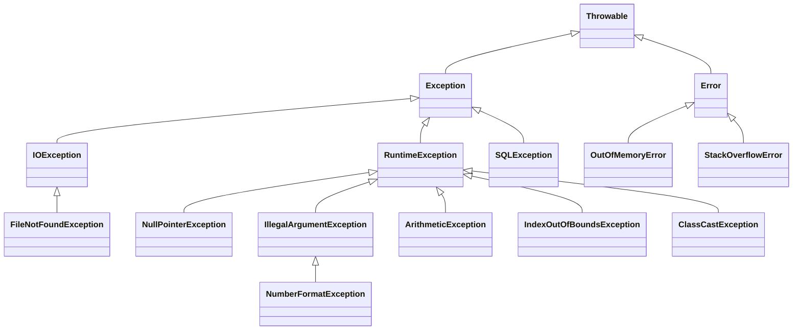
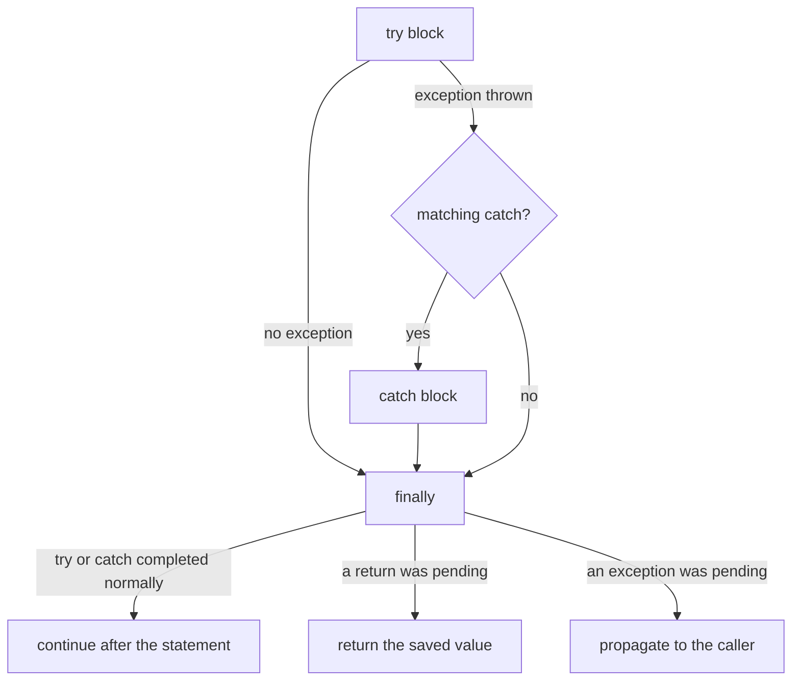

# Exceptions: try, catch, finally, checked and unchecked

> **Before this lesson:** you can write methods and classes, you know inheritance and polymorphism ([Polymorphism, overriding and overloading](#/lesson/java/java-polymorphism)), and you have seen stack traces from `NullPointerException` and `ArithmeticException` in earlier lessons.

## In plain words

A waiter takes your order to the kitchen. Usually the meal comes back. Sometimes the kitchen has run out of fish. The cook does not hand the waiter an empty plate and hope nobody notices; the cook says "we are out of fish". The waiter may be able to deal with it ("the chef suggests the sea bass instead"), or may have to carry the news to you, and you decide what to do.

An **exception** is the "we are out of fish" message in a program: an object that describes a problem, created at the point where a method discovers it cannot do its job. Creating and sending it is called **throwing**. The message travels back up through the chain of callers until some method **catches** it and deals with it. If nobody does, the program stops and prints the message.

Why this matters for a job: networks drop, files go missing, users type nonsense. Code that handles failure well is the difference between a product and a demo. Interviewers ask about checked versus unchecked exceptions, what `finally` does, and what a method returns when both `try` and `finally` contain `return`.

## What happens when something goes wrong

```java
public class Crash {
    static int perPerson(int total, int people) {
        return total / people;
    }

    public static void main(String[] args) {
        System.out.println("start");
        System.out.println(perPerson(90, 0));
        System.out.println("end");
    }
}
```

```text
start
Exception in thread "main" java.lang.ArithmeticException: / by zero
        at Crash.perPerson(Crash.java:3)
        at Crash.main(Crash.java:8)
```

Division by zero made the JVM create an `ArithmeticException` object and throw it. `perPerson` had no handler, so it ended abruptly. Control passed to its caller, `main`, which had none either, so the thread ended and the JVM printed the **stack trace**: the exception's type, its message, and the chain of method calls that were active, innermost first. "end" was never printed.

Read stack traces from the top: the first line is *what* happened, and the first `at` line that mentions your own code is usually *where* to look.

## try and catch

```java
public class Handled {
    static int perPerson(int total, int people) {
        return total / people;
    }

    public static void main(String[] args) {
        System.out.println("start");
        try {
            System.out.println(perPerson(90, 0));
            System.out.println("this line is skipped");
        } catch (ArithmeticException e) {
            System.out.println("Cannot split the bill: " + e.getMessage());
        }
        System.out.println("end");
    }
}
```

```text
start
Cannot split the bill: / by zero
end
```

- The `try` block holds code that might fail.
- If a statement in it throws, the **rest of the try block is skipped** and Java looks for a `catch` whose type matches the thrown object.
- The `catch` block is the handler. Its parameter `e` refers to the exception object; `e.getMessage()` returns its text.
- After the handler finishes, execution continues **after the whole try/catch**, not back where the error occurred.

If nothing in the `try` throws, every `catch` is skipped.

## The exception family tree

Every exception is an object whose class descends from `Throwable`.



Three branches matter:

| Branch | Meaning | Examples | Should you catch it? |
|---|---|---|---|
| `Error` | the JVM itself is in trouble | `OutOfMemoryError`, `StackOverflowError` | almost never |
| `RuntimeException` and subclasses | usually a programming mistake | `NullPointerException`, `IndexOutOfBoundsException`, `IllegalArgumentException` | fix the bug; catch only at a boundary |
| every other `Exception` | an outside condition a correct program may still meet | `IOException`, `SQLException`, `InterruptedException` | yes, or pass it on deliberately |

## Checked and unchecked

This is the distinction interviewers ask about most.

- **Unchecked exceptions** are `RuntimeException`, `Error` and their subclasses. The compiler does not make you do anything about them.
- **Checked exceptions** are all other subclasses of `Exception`. The compiler **checks** that every checked exception a piece of code might throw is either caught or declared. This is the **handle-or-declare** rule.

```java
import java.io.FileReader;
import java.io.IOException;

class Config {
    // Option 1: declare it. The caller must now handle or declare.
    static int firstChar(String path) throws IOException {
        FileReader reader = new FileReader(path);     // may throw FileNotFoundException (checked)
        int c = reader.read();                        // may throw IOException (checked)
        reader.close();
        return c;
    }

    // Option 2: handle it here.
    static int firstCharOrMinusOne(String path) {
        try {
            return firstChar(path);
        } catch (IOException e) {
            return -1;
        }
    }
}
```

`throws IOException` in the method header is the **declaration**: part of the method's contract, telling callers "this may fail in this way". Remove both the `throws` clause and any `try`/`catch`, and the compiler says: "unreported exception java.io.IOException; must be caught or declared to be thrown".

Do not confuse the two similar words:

| Keyword | Where | Meaning |
|---|---|---|
| `throw` | a statement inside a method | throw this exception object now |
| `throws` | the method header | this method might let these exception types escape |

Why the split? The designers reasoned that a missing file or a broken connection can happen to a perfectly correct program, so callers should be made to think about it; whereas a `NullPointerException` signals a bug, and wrapping every line in a `try` for bugs would be absurd. Whether checked exceptions were a good idea is a long-running debate; most newer languages dropped them. For the judgement calls see [Choosing exceptions: when, which kind and which type](#/lesson/java/java-ej-exception-choice).

### A handle-or-declare model you can run

```python-run
PARENT = {"Throwable": None, "Exception": "Throwable", "Error": "Throwable",
          "RuntimeException": "Exception", "IOException": "Exception",
          "FileNotFoundException": "IOException", "SQLException": "Exception",
          "NullPointerException": "RuntimeException", "OutOfMemoryError": "Error"}

def is_a(t, ancestor):
    while t:
        if t == ancestor: return True
        t = PARENT[t]
    return False

def checked(t):
    return is_a(t, "Throwable") and not is_a(t, "RuntimeException") and not is_a(t, "Error")

def compiles(may_throw, caught, declared):
    """A method body may throw `may_throw`; it catches `caught` and declares `declared`."""
    problems = [t for t in may_throw if checked(t)
                and not any(is_a(t, c) for c in caught)
                and not any(is_a(t, d) for d in declared)]
    return "compiles" if not problems else f"ERROR unreported: {problems}"

print(compiles(["FileNotFoundException"], caught=[], declared=[]))
print(compiles(["FileNotFoundException"], caught=["IOException"], declared=[]))
print(compiles(["FileNotFoundException", "SQLException"], caught=[], declared=["IOException"]))
print(compiles(["NullPointerException", "OutOfMemoryError"], caught=[], declared=[]))
print(compiles(["SQLException"], caught=[], declared=["Exception"]))
```

Catching or declaring a **supertype** covers its subtypes, which is why `catch (IOException e)` satisfies the compiler for `FileNotFoundException`.

## Throwing your own exceptions

```java
class Thermostat {
    private int target;

    void setTarget(int degrees) {
        if (degrees < 5 || degrees > 30) {
            throw new IllegalArgumentException("target must be 5..30 but was " + degrees);
        }
        target = degrees;
    }
}
```

`throw` is followed by an exception object, almost always freshly created with `new`. The method stops at once; no statement after the `throw` runs. `IllegalArgumentException` is unchecked, so no `throws` clause is needed. Put the offending value in the message; it turns a mystery into a one-minute fix.

## Several catch blocks

```java
static void process(String text, int[] data) {
    try {
        int index = Integer.parseInt(text);
        System.out.println(100 / data[index]);
    } catch (NumberFormatException e) {
        System.out.println("not a number: " + text);
    } catch (ArrayIndexOutOfBoundsException e) {
        System.out.println("no such position");
    } catch (RuntimeException e) {
        System.out.println("something else: " + e);
    }
}
```

```java
int[] d = {5, 0};
process("0", d);
process("x", d);
process("7", d);
process("1", d);
```

```text
20
not a number: x
no such position
something else: java.lang.ArithmeticException: / by zero
```

Catch blocks are tried **from top to bottom** and the **first** matching one runs; only one ever runs. A `catch` matches if the thrown object IS-A the declared type, so `catch (RuntimeException e)` also catches all its subclasses.

Therefore the order must be **most specific first**. Putting the superclass first makes later blocks unreachable, and the compiler rejects it: "exception NumberFormatException has already been caught".

## finally: code that always runs

A `finally` block runs when the `try` statement finishes, **however** it finishes: normally, through a caught exception, through an uncaught exception, or through `return`, `break` or `continue`.

```java
static String attempt(int divisor) {
    try {
        System.out.println("  try " + 10 / divisor);
        return "normal";
    } catch (ArithmeticException e) {
        System.out.println("  catch");
        return "recovered";
    } finally {
        System.out.println("  finally");
    }
}
```

```java
System.out.println(attempt(2));
System.out.println(attempt(0));
```

```text
  try 5
  finally
normal
  catch
  finally
recovered
```

Notice "finally" prints **before** the returned value appears. When `return "normal"` executes, the value is worked out and set aside, the `finally` block runs, and only then does the method hand the value back.



`finally` is for clean-up that must happen regardless: releasing a lock, closing a connection, restoring a setting. For closing resources there is a better tool, **try-with-resources**, in the next lesson.

### The return-in-finally puzzle

```java
static int puzzle() {
    int x = 1;
    try {
        return x;            // the value 1 is saved
    } finally {
        x = 2;               // changes the variable, not the saved value
    }
}

static int worse() {
    try {
        throw new IllegalStateException("lost");
    } finally {
        return 9;            // overrides everything, and swallows the exception
    }
}
```

```java
System.out.println(puzzle());
System.out.println(worse());
```

```text
1
9
```

In `puzzle`, the return value was evaluated before `finally` ran, so changing `x` afterwards has no effect. (If `x` referred to a mutable object, changes to that object *would* be visible, because what is saved is the reference.) In `worse`, a `return` inside `finally` replaces whatever was pending, including an exception, which disappears without trace.

> [!WARNING]
> Never `return` from a `finally` block, and never let one throw. Both discard the original outcome. Compilers warn: "finally clause cannot complete normally".

The only everyday ways a `finally` block does not run are `System.exit()`, the JVM crashing, or the thread being killed.

## Propagation: ducking an exception

A method that does not catch an exception passes it to its caller. This is **propagation**; informally the method "ducks".

```java
static void c() { throw new IllegalStateException("from c"); }
static void b() { c(); System.out.println("b finishes"); }
static void a() {
    try {
        b();
    } catch (IllegalStateException e) {
        System.out.println("a caught: " + e.getMessage());
    }
}
```

```text
a caught: from c
```

`c` throws; `b` has no handler, so it is terminated ("b finishes" never prints) and its frame is popped; `a` has a matching handler. The process of popping frames while searching for a handler is called **stack unwinding**.

Where should you catch? Where you can do something useful: retry, use a fallback, translate the error into a message for the user, or add context and rethrow. Catching low down only to print and carry on hides failures. A good default is to let exceptions travel up to a layer that knows what the failure means.

## Useful methods on every exception

| Method | Gives you |
|---|---|
| `getMessage()` | the detail text |
| `toString()` | class name plus message |
| `printStackTrace()` | the full trace, written to the error stream |
| `getCause()` | the lower-level exception that led to this one, if any |
| `getStackTrace()` | the trace as an array, for logging tools |

> [!INTERVIEW]
> "Checked versus unchecked exceptions?" *Checked exceptions extend `Exception` but not `RuntimeException`; the compiler enforces handle-or-declare. They model recoverable conditions outside the program's control, such as I/O failures. Unchecked exceptions extend `RuntimeException` (or `Error`); the compiler does not enforce anything, and they normally indicate programming errors such as null dereferences or bad arguments.* Add one opinion: prefer unchecked exceptions for programming errors and use checked ones only when the caller can realistically recover.

## Pitfalls

- **Empty catch blocks.** `catch (Exception e) { }` hides the failure; at minimum log it.
- **Catching `Exception` or `Throwable` broadly**, which also swallows bugs such as `NullPointerException`.
- **Superclass catch before subclass catch**: unreachable code, compile error.
- **Catching a checked exception the try block cannot throw**: also a compile error ("exception IOException is never thrown in body of corresponding try statement").
- **`return` or `throw` inside `finally`.**
- **Using exceptions for ordinary control flow**, such as ending a loop by catching `ArrayIndexOutOfBoundsException`.
- **Losing the cause** when rethrowing: pass the original as the second constructor argument.
- **Printing a stack trace and continuing** as if nothing happened.

## Cheat sheet

| Idea | Java |
|---|---|
| Guard risky code | `try { ... } catch (SomeException e) { ... }` |
| Always-run clean-up | `finally { ... }` |
| Signal a problem | `throw new IllegalArgumentException("why")` |
| Declare a checked exception | `void m() throws IOException` |
| Root of the hierarchy | `Throwable` |
| Unchecked | `RuntimeException`, `Error` and subclasses |
| Checked | other subclasses of `Exception` |
| Catch order | most specific first |
| Legal shapes | `try-catch`, `try-finally`, `try-catch-finally` (never `try` alone) |

## Summary

- An exception is an object describing a failure; throwing it unwinds the stack until a matching `catch` is found.
- `try` holds risky code, `catch` handles a type of exception and its subtypes, `finally` always runs.
- Checked exceptions must be caught or declared; unchecked ones (`RuntimeException`, `Error`) need not be.
- Order catch blocks from specific to general.
- A pending `return` value is computed before `finally` runs; never return from `finally`.
- Catch where you can act; otherwise let the exception propagate.

## Glossary

- **Exception**: an object representing an abnormal event that disrupts normal flow.
- **Throw**: to create and send an exception with the `throw` statement.
- **Catch**: to handle an exception in a `catch` block.
- **Stack trace**: the list of method calls active when an exception was created.
- **Checked exception**: one the compiler requires you to catch or declare.
- **Unchecked exception**: a `RuntimeException` or `Error`, with no such requirement.
- **`throws` clause**: the part of a method header listing exceptions it may let escape.
- **Handle-or-declare**: the compiler rule for checked exceptions.
- **`finally`**: a block that executes whenever its `try` statement completes.
- **Propagation**: an unhandled exception passing to the caller.
- **Stack unwinding**: removing frames from the stack while searching for a handler.
- **`Error`**: a serious JVM-level problem not meant to be handled.

## Check yourself

```quiz
[
  {"q": "What does this print? `try { System.out.print(\"A\"); int x = 1 / 0; System.out.print(\"B\"); } catch (ArithmeticException e) { System.out.print(\"C\"); } finally { System.out.print(\"D\"); } System.out.print(\"E\");`", "options": ["ABCDE", "ACDE", "ACD", "ADE"], "answer": 1,
   "explain": "A prints, the division throws so B is skipped, the catch prints C, finally prints D, and execution continues with E."},
  {"q": "Which of these is a checked exception?", "options": ["NullPointerException", "IOException", "IllegalArgumentException", "StackOverflowError"], "answer": 1,
   "explain": "IOException extends Exception directly. The others are RuntimeException subclasses or an Error."},
  {"q": "Does this compile? `void load() { new java.io.FileReader(\"a.txt\"); }`", "options": ["Yes", "No: unreported FileNotFoundException must be caught or declared", "Yes, it throws at run time if the file is missing", "No: FileReader is abstract"], "answer": 1,
   "explain": "The FileReader constructor declares the checked FileNotFoundException, so the handle-or-declare rule applies."},
  {"q": "Does this compile? `try { } catch (Exception e) { } catch (RuntimeException e) { }`", "options": ["Yes", "No: RuntimeException has already been caught by the first block", "Yes, the second block is ignored", "No: the try block is empty"], "answer": 1,
   "explain": "A superclass catch placed first makes the subclass catch unreachable, which is a compile-time error."},
  {"q": "What does this method return? `static int f() { int n = 5; try { return n; } finally { n = 10; } }`", "options": ["5", "10", "0", "It does not compile"], "answer": 0,
   "explain": "The return value 5 is evaluated and saved before finally runs. Assigning to n afterwards does not change it."},
  {"q": "What does this method return? `static int g() { try { return 1; } finally { return 2; } }`", "options": ["1", "2", "3", "It throws"], "answer": 1,
   "explain": "A return in finally overrides the pending return. This compiles (with a warning) and is bad practice."},
  {"q": "What does this print? `static void m() { try { throw new RuntimeException(\"x\"); } finally { System.out.print(\"F\"); } }` called as `try { m(); } catch (RuntimeException e) { System.out.print(\"C\"); }`", "options": ["F", "C", "FC", "CF"], "answer": 2,
   "explain": "m has no catch, so its finally runs (F) while the exception propagates; the caller then catches it (C)."},
  {"q": "What is the difference between `throw` and `throws`?", "options": ["They are synonyms", "throw raises an exception object; throws declares in the method header which exceptions may escape", "throws raises, throw declares", "throw is for checked, throws for unchecked"], "answer": 1,
   "explain": "throw is a statement; throws is part of a method signature."}
]
```

> **Source:** Head First Java, ch. 11 (exception handling: try/catch, finally, checked versus runtime exceptions, ducking). Checked against the Java Language Specification ch. 11 and section 14.20: https://docs.oracle.com/javase/specs/jls/se21/html/jls-11.html and https://dev.java/learn/exceptions/ .
