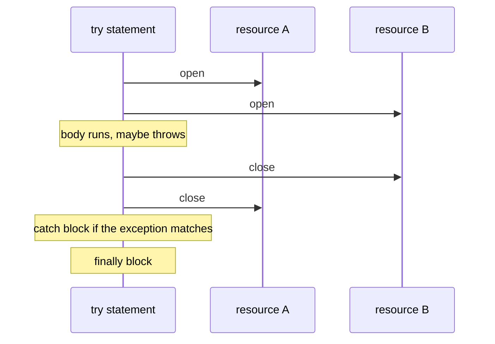

# try-with-resources, multi-catch and custom exceptions

> **Before this lesson:** you know `try`, `catch`, `finally`, the checked/unchecked split and the handle-or-declare rule ([Exceptions: try, catch, finally, checked and unchecked](#/lesson/java/java-exceptions-basics)), and you know interfaces ([Interfaces, default methods, sealed types and pattern matching](#/lesson/java/java-interfaces)).

## In plain words

When you borrow a meeting room, there is a rule: whoever opens it must switch off the projector and lock the door when they leave, whether the meeting went well, ended early, or broke up in an argument. People forget, especially when leaving in a hurry. Many offices solve this with a door that locks itself and lights that switch off when the room empties.

Programs borrow things too: files, network connections, database connections, locks. These are called **resources**, and each must be given back by **closing** it. Forgetting to close is called a **resource leak**; enough leaks and the program can open no more files or connections. The **try-with-resources** statement is the self-locking door: you say which resources you are opening, and Java closes them for you when the block ends, however it ends.

This lesson also covers catching several exception types in one handler, and writing your own exception classes so that errors speak the language of your application.

Why this matters for a job: resource leaks are among the most common causes of production outages. Interviewers ask in which order resources close, what a suppressed exception is, and how to design a custom exception.

## The clumsy old way

```java
import java.io.BufferedReader;
import java.io.FileReader;
import java.io.IOException;

static String firstLine(String path) throws IOException {
    BufferedReader reader = null;
    try {
        reader = new BufferedReader(new FileReader(path));
        return reader.readLine();
    } finally {
        if (reader != null) {
            reader.close();          // may itself throw, hiding the original exception
        }
    }
}
```

It works, but it is long, easy to get wrong, and has a subtle flaw: if `readLine` throws and then `close` throws as well, the exception from `close` **replaces** the one from `readLine`. The real cause is lost.

## try-with-resources

```java
static String firstLine(String path) throws IOException {
    try (BufferedReader reader = new BufferedReader(new FileReader(path))) {
        return reader.readLine();
    }
}
```

The parentheses after `try` declare the resource. When the block ends, by reaching the end, by `return`, or by an exception, Java calls `reader.close()` automatically. No `finally` is needed for closing.

Any object can be used this way if its class implements the interface **`AutoCloseable`**, which has a single method, `void close() throws Exception`. All the library's streams, readers, writers, sockets, database connections and many more implement it.

### Order of events

A class of our own makes the order visible.

```java
class Door implements AutoCloseable {
    private final String name;

    Door(String name) {
        this.name = name;
        System.out.println("open  " + name);
    }

    void use() { System.out.println("use   " + name); }

    @Override
    public void close() {
        System.out.println("close " + name);
    }
}

public class Order {
    public static void main(String[] args) {
        try (Door a = new Door("A");
             Door b = new Door("B")) {
            a.use();
            b.use();
            throw new IllegalStateException("trouble inside");
        } catch (IllegalStateException e) {
            System.out.println("catch " + e.getMessage());
        } finally {
            System.out.println("finally");
        }
    }
}
```

```text
open  A
open  B
use   A
use   B
close B
close A
catch trouble inside
finally
```

Three rules to memorise:

1. Resources are opened in the order written.
2. They are closed in the **reverse** order: last opened, first closed. A later resource often depends on an earlier one (a statement on a connection, a buffer on a file), so it must go first.
3. Closing happens **before** any `catch` or `finally` block of the same statement runs.

Several resources are separated by semicolons. The resource variables are implicitly `final` and are in scope only inside the `try` block. Since Java 9 you may also name an existing variable, provided it is final or never reassigned: `try (reader) { ... }`.

If opening the second resource throws, the first one, already open, is still closed.



### Suppressed exceptions

What if the body throws and then `close` throws too? Try-with-resources keeps the **body's** exception as the main one and attaches the close failure to it as a **suppressed** exception. Nothing is lost.

```java
class Leaky implements AutoCloseable {
    @Override
    public void close() {
        throw new IllegalStateException("close failed");
    }
}

public class Suppressed {
    public static void main(String[] args) {
        try (Leaky l = new Leaky()) {
            throw new IllegalArgumentException("body failed");
        } catch (Exception e) {
            System.out.println("main      : " + e.getMessage());
            for (Throwable s : e.getSuppressed()) {
                System.out.println("suppressed: " + s.getMessage());
            }
        }
    }
}
```

```text
main      : body failed
suppressed: close failed
```

If only `close` throws, its exception is the main one. With several resources, each failing `close` adds another suppressed exception, in closing order.

### A close-order model you can run

```python-run
def try_with_resources(resources, body_throws=None):
    """resources: list of (name, open_fails, close_fails). Returns the log and the outcome."""
    log, opened, primary, suppressed = [], [], None, []
    for name, open_fails, close_fails in resources:
        if open_fails:
            log.append(f"open {name} FAILS")
            primary = f"open {name}"
            break
        log.append(f"open {name}")
        opened.append((name, close_fails))
    else:
        log.append("body")
        primary = body_throws
    for name, close_fails in reversed(opened):          # reverse order, always
        log.append(f"close {name}")
        if close_fails:
            if primary is None:
                primary = f"close {name}"
            else:
                suppressed.append(f"close {name}")
    return log, primary, suppressed

for case in [
    ([("A", False, False), ("B", False, False)], None),
    ([("A", False, True),  ("B", False, True)],  "body"),
    ([("A", False, False), ("B", True,  False), ("C", False, False)], None),
    ([("A", False, True),  ("B", False, False)], None),
]:
    log, primary, sup = try_with_resources(*case)
    print(" -> ".join(log), "| thrown:", primary, "| suppressed:", sup)
```

Read the third case: B fails to open, so C is never opened and the body never runs, yet A is still closed.

## Multi-catch

When two unrelated exception types need the same handling, list them with `|` in one `catch`.

```java
static int parseSlot(String text, int[] slots) {
    try {
        return slots[Integer.parseInt(text)];
    } catch (NumberFormatException | ArrayIndexOutOfBoundsException e) {
        System.out.println("bad slot '" + text + "': " + e.getClass().getSimpleName());
        return -1;
    }
}
```

```java
int[] s = {10, 20};
System.out.println(parseSlot("1", s));
System.out.println(parseSlot("x", s));
System.out.println(parseSlot("9", s));
```

```text
20
bad slot 'x': NumberFormatException
-1
bad slot '9': ArrayIndexOutOfBoundsException
-1
```

Rules: the alternatives must not be related by inheritance (`IOException | FileNotFoundException` does not compile, because the second is already covered by the first), and the variable `e` is implicitly final.

## Custom exceptions

The library's exceptions describe technical events: "file not found", "illegal argument". Your application has its own vocabulary: "insufficient funds", "order already shipped", "seat taken". An exception class of your own lets callers catch exactly that situation and lets it carry relevant data.

Creating one takes a few lines: extend `Exception` for a **checked** exception, or `RuntimeException` for an **unchecked** one.

```java
class InsufficientFundsException extends Exception {          // checked
    private final long shortfallCents;

    InsufficientFundsException(long shortfallCents) {
        super("short by " + shortfallCents + " cents");       // sets the message
        this.shortfallCents = shortfallCents;
    }

    long getShortfallCents() { return shortfallCents; }
}

class Wallet {
    private long cents;

    Wallet(long cents) { this.cents = cents; }

    void pay(long price) throws InsufficientFundsException {
        if (price > cents) {
            throw new InsufficientFundsException(price - cents);
        }
        cents -= price;
    }
}

public class Shop {
    public static void main(String[] args) {
        Wallet w = new Wallet(500);
        try {
            w.pay(200);
            w.pay(450);
            System.out.println("both paid");
        } catch (InsufficientFundsException e) {
            System.out.println("Declined: " + e.getMessage());
            System.out.println("Top up at least " + e.getShortfallCents());
        }
    }
}
```

```text
Declined: short by 150 cents
Top up at least 150
```

Guidelines:

- **Name** it for the problem and end with `Exception`.
- **Pass the message to `super(...)`** so `getMessage()` and stack traces work.
- **Carry data** the handler will need as fields with getters.
- **Offer a constructor that takes a cause** (see below).
- **Checked or unchecked?** Checked if a reasonable caller can recover and you want the compiler to force the decision; unchecked for misuse of your API or conditions nobody can sensibly recover from. When unsure, choose unchecked.
- Do not create a custom type when a standard one says it already: `IllegalArgumentException`, `IllegalStateException`, `UnsupportedOperationException`, `NullPointerException`.

## Exception chaining: keep the cause

Low-level details should not leak through high-level APIs. A method called `loadProfile` should not make its callers deal with `SQLException`; that exposes which storage it happens to use. Catch the low-level exception and throw one that fits your abstraction level, **passing the original as the cause**.

```java
class ProfileLoadException extends RuntimeException {
    ProfileLoadException(String message, Throwable cause) {
        super(message, cause);                 // keeps the original exception
    }
}

class Profiles {
    static String load(String userId) {
        try {
            return readFromDisk(userId);
        } catch (java.io.IOException e) {
            throw new ProfileLoadException("cannot load profile " + userId, e);
        }
    }

    private static String readFromDisk(String id) throws java.io.IOException {
        throw new java.io.FileNotFoundException(id + ".json (No such file)");
    }
}
```

```text
Exception in thread "main" ProfileLoadException: cannot load profile u42
        at Profiles.load(Profiles.java:11)
        ...
Caused by: java.io.FileNotFoundException: u42.json (No such file)
        at Profiles.readFromDisk(Profiles.java:16)
        ...
```

The "Caused by" section is the chained exception. Whoever debugs this sees both the business-level statement and the technical root. Converting one exception into another like this is called **exception translation**.

> [!WARNING]
> `throw new ProfileLoadException("cannot load");` without the cause throws away the only clue about what really went wrong. Always pass `e` along.

## Rethrowing

Sometimes a method wants to react (log, count, clean up) and still let the caller know. It catches and throws the same object again:

```java
try {
    transfer();
} catch (RuntimeException e) {
    metrics.increment("transfer.failed");
    throw e;                    // same exception object, original stack trace
}
```

## Rules for overriding methods that throw

An overriding method may throw **fewer or narrower** checked exceptions than the method it overrides, never more or broader. Callers holding the supertype must not be surprised.

```java
class Source {
    void open() throws java.io.IOException { }
}
class FileSource extends Source {
    @Override void open() throws java.io.FileNotFoundException { }   // narrower: fine
}
class MemorySource extends Source {
    @Override void open() { }                                         // none: fine
}
class BadSource extends Source {
    // @Override void open() throws Exception { }                     // broader: does not compile
}
```

Unchecked exceptions are not restricted.

> [!INTERVIEW]
> "What is the difference between `finally` and try-with-resources?" Try-with-resources closes every declared `AutoCloseable` automatically, in reverse order of declaration, before `catch` and `finally` run, and records exceptions from `close` as *suppressed* instead of letting them mask the primary exception. A hand-written `finally` needs null checks, nested tries, and still loses the original exception if `close` throws. Follow-up: "`Closeable` versus `AutoCloseable`?" `Closeable` is the older I/O interface; it extends `AutoCloseable`, and its `close` is declared to throw `IOException` instead of `Exception`.

## Putting it together

```java
import java.io.BufferedReader;
import java.io.IOException;
import java.nio.file.Files;
import java.nio.file.Path;

class PriceList {
    static double total(Path file) {
        double sum = 0;
        int lineNo = 0;
        try (BufferedReader in = Files.newBufferedReader(file)) {
            String line;
            while ((line = in.readLine()) != null) {
                lineNo++;
                sum += Double.parseDouble(line.strip());
            }
            return sum;
        } catch (IOException e) {
            throw new IllegalStateException("cannot read " + file, e);
        } catch (NumberFormatException e) {
            throw new IllegalArgumentException("bad price on line " + lineNo + " of " + file, e);
        }
    }
}
```

The reader is closed on every path. I/O failures are translated with their cause. A malformed line produces a message that names the file and the line number. `(line = in.readLine()) != null` assigns the next line to `line` and tests it in one expression; `readLine` returns `null` at the end of the file.

## Pitfalls

- **Opening a resource outside the parentheses**: `Reader r = open(); try { ... }` is not protected.
- **Expecting resources to close in declaration order.** It is the reverse.
- **Assuming `finally` runs before `close`.** Resources close first.
- **Related types in a multi-catch.**
- **Custom exceptions without a message or cause constructor.**
- **Swallowing the cause** when translating.
- **One giant `AppException` for everything.** Callers cannot tell situations apart.
- **Checked custom exceptions for programming errors.** They force useless `try` blocks on every caller.
- **Catching an exception only to log it and rethrow it at every level**, which prints the same stack trace five times.

## Cheat sheet

| Idea | Java |
|---|---|
| Auto-closing | `try (Res r = new Res()) { ... }` |
| Several resources | `try (A a = ...; B b = ...) { }`, closed b then a |
| Make a class closable | `implements AutoCloseable` with `public void close()` |
| Failures from close | `e.getSuppressed()` |
| Same handler for several types | `catch (A \| B e)` |
| Checked custom exception | `class X extends Exception` |
| Unchecked custom exception | `class X extends RuntimeException` |
| Keep the cause | `super(message, cause)` / `new X("msg", e)` |
| Read the cause | `e.getCause()` |
| Rethrow | `throw e;` |

## Summary

- Try-with-resources closes every declared `AutoCloseable` in reverse order, before `catch` and `finally`, on every exit path.
- A failure in `close` after a failure in the body is recorded as a suppressed exception, so the primary error survives.
- Multi-catch handles unrelated exception types with one block.
- Custom exceptions express application-level failures and can carry data; extend `Exception` for checked, `RuntimeException` for unchecked.
- When translating exceptions, always chain the cause.
- Overrides may narrow, but never widen, the checked exceptions they declare.

## Glossary

- **Resource**: something that must be released after use, such as a file or connection.
- **Resource leak**: failing to release a resource.
- **Try-with-resources**: a `try` statement that declares resources to be closed automatically.
- **`AutoCloseable`**: the interface (one method, `close`) a resource must implement.
- **Suppressed exception**: an exception from `close` attached to the primary exception.
- **Multi-catch**: one `catch` block listing several exception types separated by `|`.
- **Custom exception**: an exception class defined by your application.
- **Cause**: the lower-level exception that triggered a higher-level one.
- **Exception chaining**: wrapping an exception in another while preserving it as the cause.
- **Exception translation**: converting a low-level exception to one that suits the caller's level of abstraction.
- **Rethrow**: catching an exception and throwing it again.

## Check yourself

```quiz
[
  {"q": "In `try (A a = new A(); B b = new B(); C c = new C()) { }`, in which order are the resources closed?", "options": ["a, b, c", "c, b, a", "All at once", "The order is unspecified"], "answer": 1,
   "explain": "Resources close in the reverse of the order in which they were opened."},
  {"q": "With the lesson's Door class, what does this print? `try (Door d = new Door(\"X\")) { d.use(); } finally { System.out.println(\"fin\"); }`", "options": ["open X, use X, fin, close X", "open X, use X, close X, fin", "open X, close X, use X, fin", "open X, use X, fin"], "answer": 1,
   "explain": "Resources are closed as soon as the try block ends, before any catch or finally block of the same statement."},
  {"q": "The body throws exception E1 and then close() throws E2. What does the caller receive?", "options": ["E2, with E1 lost", "E1, with E2 available through getSuppressed()", "Both, as two separate throws", "Neither"], "answer": 1,
   "explain": "The body's exception stays primary; exceptions from close are added to it as suppressed exceptions."},
  {"q": "Does this compile? `catch (java.io.IOException | java.io.FileNotFoundException e) { }`", "options": ["Yes", "No: the alternatives are related by subclassing", "Yes, with a warning", "Only in Java 17+"], "answer": 1,
   "explain": "FileNotFoundException is a subclass of IOException, so listing both is redundant and rejected."},
  {"q": "You want callers to be forced by the compiler to handle `SeatTakenException`. What should it extend?", "options": ["RuntimeException", "Exception", "Error", "Throwable is the only option"], "answer": 1,
   "explain": "Subclasses of Exception that are not RuntimeExceptions are checked."},
  {"q": "What is lost by writing `catch (IOException e) { throw new AppException(\"failed\"); }`?", "options": ["Nothing", "The original exception and its stack trace (the cause)", "The message", "The ability to catch AppException"], "answer": 1,
   "explain": "Pass e as the cause: new AppException(\"failed\", e). Otherwise the root cause disappears from logs."},
  {"q": "`class P { void m() throws java.io.IOException { } }` Which override in a subclass does NOT compile?", "options": ["void m() { }", "void m() throws java.io.FileNotFoundException { }", "void m() throws Exception { }", "void m() throws IllegalStateException { }"], "answer": 2,
   "explain": "An override may not add broader checked exceptions. Exception is wider than IOException. Unchecked exceptions are unrestricted."},
  {"q": "Which interface must a class implement to be used in try-with-resources?", "options": ["Runnable", "Serializable", "AutoCloseable", "Comparable"], "answer": 2,
   "explain": "AutoCloseable declares close(), which the statement calls automatically. Closeable extends it."}
]
```

> **Source:** Head First Java, ch. 11 (exceptions, multiple catch blocks, declaring and creating exceptions) with try-with-resources from Java 7+. Checked against the Java Language Specification section 14.20.3 and the AutoCloseable documentation: https://docs.oracle.com/javase/specs/jls/se21/html/jls-14.html#jls-14.20.3 and https://dev.java/learn/exceptions/catching-handling/ .
