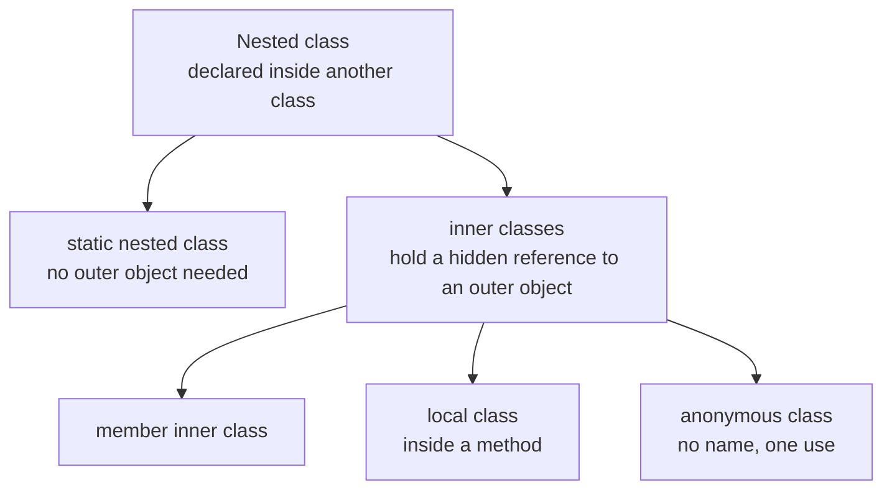
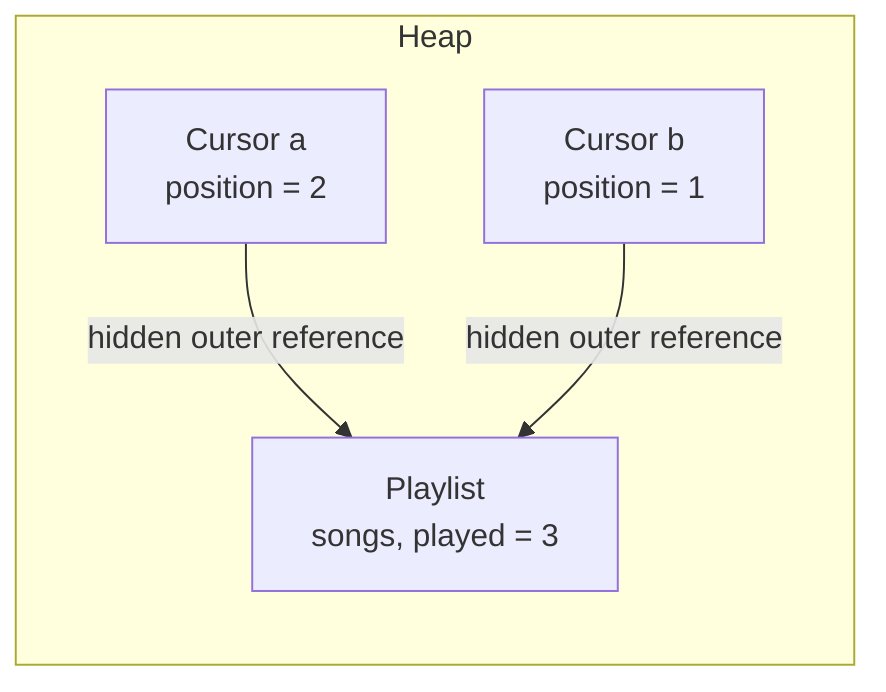

# Nested, inner, local and anonymous classes

> **Before this lesson:** you know classes, interfaces and `static` ([Interfaces, default methods, sealed types and pattern matching](#/lesson/java/java-interfaces), [static, final, constants and the Math class](#/lesson/java/java-static-final)).

## In plain words

A car has an engine. The engine is a real, complicated thing in its own right, but it makes no sense on the pavement next to the car. It lives **inside** the car, and it is connected to the car's fuel tank and battery without anyone running cables across the street. A mechanic thinking about the engine is always thinking about the engine *of that car*.

Java lets you put a class inside another class for the same reasons. A class declared inside another is a **nested class**. Depending on how it is declared, it may be merely stored inside the outer class for tidiness, or it may be wired to one particular outer object and able to use that object's private fields directly.

There are four kinds, and they differ in two questions only: *where is it declared?* and *is it tied to an outer object?*

Why this matters for a job: nested classes are everywhere in the library (`Map.Entry`, builders, iterators) and in older code that uses listeners and callbacks. Interviewers ask for the difference between a static nested class and an inner class, and why a local variable used in an anonymous class must be effectively final.

## The four kinds at a glance

| Kind | Declared | Tied to an outer object? | Typical use |
|---|---|---|---|
| **Static nested class** | inside a class, with `static` | no | a helper type that belongs with the outer class: `Map.Entry`, a `Builder` |
| **Inner class** (non-static member class) | inside a class, without `static` | yes | a helper that needs the outer object's state: an iterator |
| **Local class** | inside a method | yes, if the method is an instance method | a one-method helper needed in one place |
| **Anonymous class** | inside an expression, with no name | same as local | a one-off implementation of an interface |



## Static nested classes

A static nested class is an ordinary class that happens to be declared inside another. It has **no** connection to any outer object.

```java
class Order {
    private final String id;
    private final java.util.List<Line> lines = new java.util.ArrayList<>();

    Order(String id) { this.id = id; }

    static class Line {                       // static nested class
        final String product;
        final int quantity;

        Line(String product, int quantity) {
            this.product = product;
            this.quantity = quantity;
        }
    }

    void add(Line line) { lines.add(line); }
    int lineCount()     { return lines.size(); }
}

public class Nested {
    public static void main(String[] args) {
        Order.Line line = new Order.Line("tea", 2);     // no Order object needed
        Order order = new Order("A-17");
        order.add(line);
        System.out.println(order.lineCount() + " " + line.product);
    }
}
```

```text
1 tea
```

Outside the outer class its name is `Order.Line`. It can be created with no `Order` in existence. It may access the **static** members of `Order`, including private ones, but it has no outer instance, so it cannot touch `id` or `lines` without being handed an `Order`.

Use it when a type only makes sense in connection with another type. It keeps the package tidy and signals the relationship.

## Inner classes

Remove the word `static` and everything changes. Each object of an **inner class** is created *by* an outer object and carries a hidden reference to it. Through that reference it can read and write all of the outer object's fields, including private ones, as if they were its own.

```java
class Playlist {
    private final String[] songs;
    private int played = 0;

    Playlist(String... songs) { this.songs = songs; }

    class Cursor {                               // inner class: tied to one Playlist
        private int position = 0;

        boolean hasNext() {
            return position < songs.length;      // uses the OUTER object's private array
        }

        String next() {
            played++;                            // changes the OUTER object's private field
            return songs[position++];
        }
    }

    Cursor cursor() { return new Cursor(); }     // 'this' Playlist becomes the outer object
    int getPlayed() { return played; }
}

public class Inner {
    public static void main(String[] args) {
        Playlist p = new Playlist("Tides", "Night Trains", "Harbour");
        Playlist.Cursor a = p.cursor();
        Playlist.Cursor b = p.cursor();          // a second, independent cursor on the SAME playlist
        System.out.println(a.next() + ", " + a.next());
        System.out.println(b.next());
        System.out.println(p.getPlayed());
    }
}
```

```text
Tides, Night Trains
Tides
3
```

The two cursors have their own `position`, but both are attached to the same playlist: they read its `songs` and both increment its single `played` counter. This is exactly how the iterators of `ArrayList` and `HashMap` are written.



### Creating an inner object from outside

Because an inner object needs an outer object, the syntax from outside the class is unusual:

```java
Playlist p = new Playlist("x");
Playlist.Cursor c = p.new Cursor();          // "p's new Cursor"
// Playlist.Cursor d = new Playlist.Cursor(); // does not compile: no enclosing instance
```

Inside the inner class, `this` is the inner object. The outer object is written `Playlist.this`. That form is needed only when names clash:

```java
class Outer {
    int x = 1;
    class In {
        int x = 2;
        void show(int x) {
            System.out.println(x + " " + this.x + " " + Outer.this.x);
        }
    }
}
// new Outer().new In().show(3) prints: 3 2 1
```

### The cost of the hidden reference

An inner object keeps its outer object reachable. If a small inner object is stored somewhere long-lived (a static list, a callback registry), the whole outer object, however large, cannot be garbage collected. This is a well-known source of memory leaks.

> [!TIP]
> If a nested class does not need the outer object's instance members, declare it `static`. It saves memory, avoids accidental leaks, and makes the independence obvious. This advice is expanded in [Designing with interfaces, hierarchies and nested classes](#/lesson/java/java-ej-interface-design).

## Local classes

A class may be declared inside a method. It is visible only within that block.

```java
import java.util.ArrayList;
import java.util.List;

class Report {
    static List<String> label(List<Integer> scores, int passMark) {
        class Grader {                                   // local class
            String grade(int score) {
                return score >= passMark ? "pass" : "fail";   // uses a local variable of the method
            }
        }
        Grader g = new Grader();
        List<String> out = new ArrayList<>();
        for (int s : scores) {
            out.add(s + ":" + g.grade(s));
        }
        return out;
    }
}
```

```java
System.out.println(Report.label(List.of(40, 75), 50));
```

```text
[40:fail, 75:pass]
```

The local class uses the method's parameter `passMark`. This is called **capturing** a variable, and it comes with a rule.

### The "effectively final" rule

A local or anonymous class (and a lambda) may use a local variable of the enclosing method only if that variable is **final or effectively final**. *Effectively final* means it is assigned exactly once, even though the word `final` is not written.

```java
static Runnable counter() {
    int count = 0;
    Runnable r = new Runnable() {
        @Override public void run() {
            // count++;      // does not compile: local variables referenced from an inner class
            //               // must be final or effectively final
            System.out.println(count);
        }
    };
    // count = 5;            // adding this line would also break the code above
    return r;
}
```

Why? The local variable lives in the method's stack frame, which disappears when the method returns. The object may live much longer. So Java gives the object its **own copy** of the variable's value. If either side could change its copy afterwards, the two would silently disagree; forbidding changes removes the confusion.

The rule applies to local **variables**, not to fields, and not to the contents of objects. A common workaround is to capture a reference to a mutable object:

```java
int[] count = {0};                 // the reference 'count' is never reassigned
Runnable r = () -> count[0]++;     // the array's content may change
```

## Anonymous classes

An **anonymous class** is a local class with no name, declared and instantiated in one expression. It exists to supply a one-off implementation of an interface or a one-off subclass.

```java
interface Greeter {
    String greet(String name);
}

public class Anonymous {
    public static void main(String[] args) {
        Greeter formal = new Greeter() {                 // class body follows the "constructor call"
            @Override
            public String greet(String name) {
                return "Good evening, " + name + ".";
            }
        };

        Greeter casual = new Greeter() {
            @Override
            public String greet(String name) {
                return "Hi " + name + "!";
            }
        };

        System.out.println(formal.greet("Ada"));
        System.out.println(casual.greet("Ada"));
    }
}
```

```text
Good evening, Ada.
Hi Ada!
```

Read `new Greeter() { ... }` as: "create an object of a new, unnamed class that implements `Greeter`, whose body is between the braces". The semicolon after the closing brace ends the assignment statement. It looks as if an interface is being instantiated; it is not.

Anonymous classes cannot have constructors (they have no name to give one), and they can extend one class **or** implement one interface, not both.

### From anonymous class to lambda

When the interface has exactly **one abstract method**, Java 8 and later offer a far shorter notation, the **lambda expression**:

```java
Greeter formal = name -> "Good evening, " + name + ".";
Greeter casual = name -> "Hi " + name + "!";
```

Each line does the same job as the six-line anonymous class above. An interface with a single abstract method is called a **functional interface**. Lambdas have their own lesson: [Lambdas, functional interfaces and method references](#/lesson/java/java-lambdas).

| | Anonymous class | Lambda |
|---|---|---|
| Works with | any interface or class | functional interfaces only |
| Can have fields / several methods | yes | no |
| `this` refers to | the anonymous object | the enclosing object |
| Length | long | short |

Use a lambda when you can; use an anonymous class when you need state, more than one method, or to extend a class.

## What the compiler produces

Nested classes are a compiler feature; the JVM sees separate classes. Compiling the examples yields class files whose names join outer and nested names with a dollar sign: `Order` and `Order` + dollar + `Line` for the static nested class, `Playlist` + dollar + `Cursor` for the inner class, and numbered names such as `Anonymous` + dollar + `1` for anonymous classes. An inner class's constructor quietly receives the outer object as an extra argument and stores it in a hidden field. That is the "hidden reference".

### A model of the hidden reference you can run

```python-run
class Playlist:
    def __init__(self, *songs):
        self.songs, self.played = list(songs), 0

    def cursor(self):
        return InnerCursor(outer=self)         # what `new Cursor()` compiles to

class InnerCursor:                             # inner class: receives and stores the outer object
    def __init__(self, outer):
        self.outer, self.position = outer, 0
    def next(self):
        self.outer.played += 1                 # reaches into the outer object's state
        song = self.outer.songs[self.position]
        self.position += 1
        return song

class StaticLine:                              # static nested class: no outer reference at all
    def __init__(self, product, qty):
        self.product, self.qty = product, qty

p = Playlist("Tides", "Night Trains", "Harbour")
a, b = p.cursor(), p.cursor()
print(a.next(), "|", a.next(), "|", b.next())
print("played on the shared outer object:", p.played)
print("cursor keeps the playlist reachable:", a.outer is p)
print("static nested object has no outer :", not hasattr(StaticLine("tea", 2), "outer"))
```

## Nested interfaces, enums and records

Interfaces, enums and records declared inside a class are **implicitly static**. They never have an outer instance. `Map.Entry` is an interface nested in the interface `Map`.

```java
class Thermostat {
    enum Mode { HEAT, COOL, OFF }                  // implicitly static
    record Reading(double celsius, long atMillis) { }   // implicitly static

    private Mode mode = Mode.OFF;
}
```

> [!INTERVIEW]
> "Difference between a static nested class and an inner class?" *A static nested class has no implicit reference to an instance of the enclosing class: it can be instantiated without one and can access only the outer class's static members directly. An inner (non-static) class instance is always associated with an enclosing instance, can access that instance's fields and methods including private ones, and is created with `outer.new Inner()`.* Mention the consequence: the hidden reference costs memory and can cause leaks, so prefer static unless you need the outer instance.

## Pitfalls

- **Forgetting `static`** on a nested helper class that does not need the outer instance.
- **`new Outer.Inner()`** for a non-static inner class: needs `outer.new Inner()`.
- **Modifying a captured local variable.** Not allowed; it must be effectively final.
- **`this` inside an anonymous class** refers to the anonymous object, not the enclosing one; write `Outer.this`.
- **Storing inner-class or anonymous-class instances in long-lived collections**, pinning the outer object in memory.
- **Shadowing**: an inner field with the same name as an outer field hides it.
- **Anonymous classes that grow.** Past a handful of lines, give the class a name.
- **Serializing inner classes.** The hidden reference drags the outer object along or fails; avoid it.

## Cheat sheet

| Goal | Java |
|---|---|
| Helper type with no outer state | `static class Helper { }` → `new Outer.Helper()` |
| Helper tied to an outer object | `class Helper { }` → `outer.new Helper()` |
| Outer object from inside | `Outer.this` |
| One-off implementation | `new Iface() { ... }` |
| Shortest one-method implementation | lambda: `x -> expr` |
| Captured local variables | must be final or effectively final |
| Nested enum, record, interface | always implicitly static |

## Summary

- A nested class is declared inside another class; it is either static (independent) or inner (bound to an outer instance).
- Inner class objects carry a hidden reference to their outer object and can use its private members.
- Local classes live inside a method; anonymous classes are local classes without a name, created in an expression.
- Local variables used by local classes, anonymous classes and lambdas must be effectively final because their values are copied.
- Prefer static nested classes unless the outer instance is needed; prefer lambdas to anonymous classes for single-method interfaces.

## Glossary

- **Nested class**: any class declared inside another class.
- **Static nested class**: a nested class declared `static`, with no outer instance.
- **Inner class**: a non-static nested class whose instances are bound to an outer instance.
- **Enclosing (outer) instance**: the object an inner object is attached to.
- **Local class**: a class declared inside a block of code.
- **Anonymous class**: an unnamed class declared and instantiated in a single expression.
- **Capture**: use of an enclosing method's local variable by a local class or lambda.
- **Effectively final**: assigned exactly once, though not declared `final`.
- **Functional interface**: an interface with exactly one abstract method.
- **Lambda expression**: a compact way to implement a functional interface.

## Check yourself

```quiz
[
  {"q": "Given `class Out { class In { } }`, which line creates an In object from another class?", "options": ["new Out.In()", "new In()", "new Out().new In()", "Out.new In()"], "answer": 2,
   "explain": "A non-static inner class needs an enclosing instance: outerObject.new In()."},
  {"q": "Given `class Out { static class Nest { } }`, which line is correct?", "options": ["new Out().new Nest()", "new Out.Nest()", "Out.Nest.new()", "new Nest(Out)"], "answer": 1,
   "explain": "A static nested class needs no outer instance and is referred to as Out.Nest."},
  {"q": "Does this compile? `void m() { int n = 1; Runnable r = () -> System.out.println(n); n = 2; }`", "options": ["Yes, prints 1", "Yes, prints 2", "No: n is not effectively final", "No: lambdas cannot read locals"], "answer": 2,
   "explain": "n is assigned twice, so it is not effectively final and cannot be captured."},
  {"q": "What does this print? `class O { int x = 1; class I { int x = 2; void p() { System.out.println(x + O.this.x); } } }` then `new O().new I().p();`", "options": ["3", "21", "12", "4"], "answer": 0,
   "explain": "x is the inner field (2) and O.this.x is the outer field (1). Both are ints, so + adds: 3."},
  {"q": "Can a static nested class directly read a non-static field of its enclosing class?", "options": ["Yes, always", "No: it has no enclosing instance; it needs an explicit reference to one", "Only if the field is public", "Only if the field is final"], "answer": 1,
   "explain": "Static nested classes are not attached to an outer object. Given a reference they can read even private fields of it."},
  {"q": "What does `new Greeter() { public String greet(String n) { return n; } }` create?", "options": ["An instance of the interface Greeter itself", "An instance of an unnamed class that implements Greeter", "A static method", "A compile error: interfaces cannot be instantiated"], "answer": 1,
   "explain": "The braces define an anonymous class body. The object is an instance of that unnamed class."},
  {"q": "Why can an inner-class instance cause a memory leak?", "options": ["Inner classes are never garbage collected", "It holds a hidden reference to its outer object, keeping that object reachable", "It duplicates the outer object's fields", "It runs on a separate thread"], "answer": 1,
   "explain": "While the inner object is reachable, so is its enclosing instance, even if nothing else refers to it."},
  {"q": "An enum declared inside a class is...", "options": ["an inner class tied to an outer instance", "implicitly static", "illegal", "implicitly private"], "answer": 1,
   "explain": "Nested enums, records and interfaces are always static."}
]
```

> **Source:** Head First Java, ch. 12 and 13 (inner classes introduced for event handling) and appendix B (anonymous and static nested classes). Checked against the Java Language Specification sections 8.1.3 and 15.9.5 and https://docs.oracle.com/javase/tutorial/java/javaOO/nested.html .
