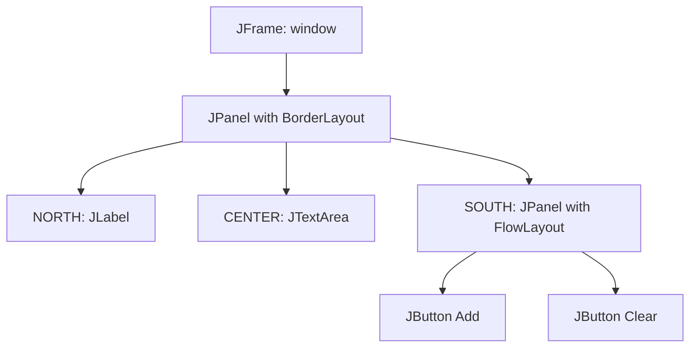
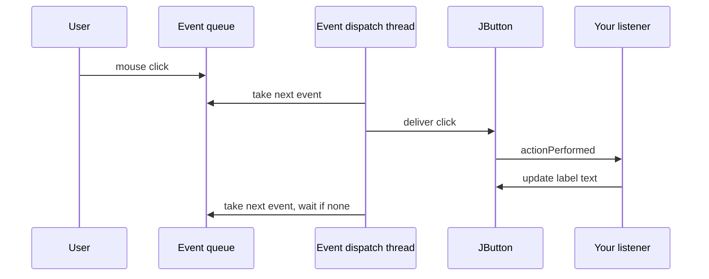

# Swing GUIs and events: the concepts worth keeping

> **Before this lesson:** you know interfaces ([Interfaces, default methods, sealed types and pattern matching](#/lesson/java/java-interfaces)) and inner and anonymous classes ([Nested, inner, local and anonymous classes](#/lesson/java/java-inner-classes)). Lambdas appear briefly; they are explained fully in [Lambdas, functional interfaces and method references](#/lesson/java/java-lambdas).

## An honest note first

**Swing** is Java's classic toolkit for desktop windows, buttons and menus. Very few new applications are written with it today, and it is rarely asked about in interviews: most Java jobs are about servers, and most user interfaces are web pages or phone apps. Head First Java spends two chapters building Swing programs; this track spends one lesson, and it concentrates on the **ideas** that outlive the toolkit:

- **event-driven programming**: code that waits for things to happen;
- **listeners and callbacks**: handing an object a piece of your code to run later;
- **the observer pattern**: the general design behind listeners;
- **the single UI thread rule**: found in Swing, Android, JavaFX and browser JavaScript alike;
- **layout managers and component trees**: how every UI toolkit arranges things.

Learn the concepts and one complete example. If a job ever needs Swing, the details can be looked up in an afternoon.

## In plain words

Until now every program in this track has been a recipe: start at the top of `main`, do the steps in order, stop. A program with a window does not work like that. It behaves like a receptionist. The receptionist sits at the desk and **waits**. When the phone rings, they follow the "phone rings" instructions. When a visitor arrives, they follow the "visitor" instructions. Between events they do nothing, and they never know which event will come next.

A graphical program is the receptionist. A click, a key press or a window being resized is an **event**. For each kind of event you care about, you write a small piece of code, a **handler**, and register it in advance: "when this button is clicked, run this". Then your `main` method finishes, and the toolkit's own loop takes over, waiting for events and calling your handlers.

This inversion (you do not call the framework; the framework calls you) is sometimes called the **Hollywood principle**: "don't call us, we'll call you". It is the foundation of web frameworks such as Spring as much as of GUIs.

## The pieces of a Swing program

| Piece | What it is | Examples |
|---|---|---|
| **Top-level container** | a window on the screen | `JFrame`, `JDialog` |
| **Component** (widget) | something the user sees or interacts with | `JButton`, `JLabel`, `JTextField`, `JTextArea`, `JCheckBox`, `JList` |
| **Container** | a component that holds other components | `JPanel`, the frame's content pane |
| **Layout manager** | an object that decides the size and position of the components in a container | `BorderLayout`, `FlowLayout`, `BoxLayout`, `GridLayout` |
| **Event** | an object describing something that happened | `ActionEvent`, `MouseEvent`, `KeyEvent` |
| **Listener** | an object with a method the toolkit calls when an event occurs | `ActionListener`, `MouseListener` |

Components are arranged in a tree: the frame contains panels, which contain buttons and labels.



## One complete example

A window with a label and a button; each click increases a counter.

```java
import javax.swing.JButton;
import javax.swing.JFrame;
import javax.swing.JLabel;
import javax.swing.SwingUtilities;
import java.awt.BorderLayout;

public class ClickCounter {
    private int clicks = 0;

    private void buildAndShow() {
        JFrame frame = new JFrame("Counter");                 // 1. a window with a title
        frame.setDefaultCloseOperation(JFrame.EXIT_ON_CLOSE); // 2. closing the window ends the program

        JLabel label = new JLabel("Clicked 0 times");         // 3. two components
        JButton button = new JButton("Click me");

        button.addActionListener(event -> {                   // 4. register a handler
            clicks++;
            label.setText("Clicked " + clicks + " times");
        });

        frame.add(label, BorderLayout.CENTER);                // 5. place the components
        frame.add(button, BorderLayout.SOUTH);
        frame.setSize(260, 120);                              // 6. size in pixels
        frame.setVisible(true);                               // 7. show it
    }

    public static void main(String[] args) {
        SwingUtilities.invokeLater(() -> new ClickCounter().buildAndShow());   // 8. start on the UI thread
    }
}
```

```text
(A small window titled "Counter" appears. It shows the text "Clicked 0 times" above a button.
 Each click on the button changes the text: "Clicked 1 times", "Clicked 2 times", ...)
```

Line by line:

1. `new JFrame("Counter")` creates a window object. Nothing is visible yet.
2. Without this line, closing the window would hide it while the program kept running invisibly.
3. A label displays text; a button can be pressed.
4. `addActionListener` **registers** a listener with the button. The code inside the braces does **not** run now. The button stores it and calls it each time the user clicks. The parameter `event` carries details such as which component fired.
5. `BorderLayout`, a frame's default layout manager, has five regions: north, south, east, west and centre.
6. and 7. Give the window a size and make it appear.
8. `main` hands the set-up work to Swing's own thread and returns. The program does **not** end, because that thread stays alive, waiting for events.

After step 8 your code is finished with its "recipe" phase. Everything else happens inside handlers.

## Listeners: the idea underneath

The button's author could not know what your program should do on a click. So the button was written to accept **any** object that implements a small interface:

```java
public interface ActionListener {
    void actionPerformed(ActionEvent e);
}
```

You supply an object with that method; the button calls it at the right moment. A method handed to other code to be invoked later is called a **callback**.

Three ways to write the same listener show how Java evolved.

```java
// 1. A named class (often an inner class, so it can reach the outer object's fields)
class CountListener implements ActionListener {
    @Override
    public void actionPerformed(ActionEvent e) {
        clicks++;
        label.setText("Clicked " + clicks + " times");
    }
}
button.addActionListener(new CountListener());

// 2. An anonymous class
button.addActionListener(new ActionListener() {
    @Override
    public void actionPerformed(ActionEvent e) {
        clicks++;
    }
});

// 3. A lambda (Java 8+): ActionListener has one abstract method
button.addActionListener(e -> clicks++);
```

Inner classes were, historically, added to Java largely to make listeners pleasant to write: one outer class can hold several different listener classes, each with direct access to the window's fields. With two buttons you write two listeners; one object cannot implement `actionPerformed` twice with different bodies.

### The observer pattern

Step back from buttons and the arrangement has a general name, the **observer pattern**:

- a **subject** (the button) holds a list of **observers** (listeners);
- observers register themselves with the subject;
- when something happens, the subject loops over the list and notifies each observer.

The subject knows nothing about its observers except that they implement the listener interface. That loose coupling is why the same button class serves every program ever written with Swing.



### An event loop you can run

This model has the same three parts as any GUI toolkit: components that keep lists of listeners, a queue of events, and one loop that takes events and calls listeners in turn.

```python-run
from collections import deque

class Button:
    def __init__(self, name):
        self.name, self.listeners = name, []
    def add_action_listener(self, fn):          # registration: store the callback
        self.listeners.append(fn)
    def fire(self, event):                      # notification: call every stored callback
        for fn in self.listeners:
            fn(event)

state = {"clicks": 0, "label": "Clicked 0 times"}
add, reset = Button("add"), Button("reset")

def on_add(event):
    state["clicks"] += 1
    state["label"] = f"Clicked {state['clicks']} times"

add.add_action_listener(on_add)
add.add_action_listener(lambda e: print(f"   (logger saw a click at t={e['t']})"))   # a second observer
reset.add_action_listener(lambda e: state.update(clicks=0, label="Clicked 0 times"))

# "main" has finished. Now the event loop runs: one event at a time, in order of arrival.
queue = deque([{"target": add, "t": 1}, {"target": add, "t": 2},
               {"target": reset, "t": 3}, {"target": add, "t": 4}])
while queue:
    event = queue.popleft()
    event["target"].fire(event)
    print(f"t={event['t']}: {event['target'].name:5} -> label shows '{state['label']}'")
```

Notice that the code never calls `on_add` directly; the loop does, by way of the button.

## The event dispatch thread

Swing delivers all events on one special thread, the **event dispatch thread** (EDT). A **thread** is an independent path of execution inside a program; threads are covered in [Threads, Runnable and ExecutorService](#/lesson/java/java-threads-executors). Two rules follow from that design, and the same two rules apply in Android, JavaFX and web browsers.

1. **Touch the UI only from the UI thread.** Swing components are not safe to use from several threads at once. That is why `main` used `SwingUtilities.invokeLater(...)`: it queues the set-up code to run on the EDT.
2. **Never do slow work on the UI thread.** While a handler runs, no other event can be processed. A handler that downloads a file for ten seconds freezes the whole window for ten seconds: no repainting, no response to clicks.

```java
button.addActionListener(e -> {
    button.setEnabled(false);
    new Thread(() -> {
        String result = slowDownload();                       // background thread: slow work
        SwingUtilities.invokeLater(() -> {                    // back on the EDT: update the UI
            label.setText(result);
            button.setEnabled(true);
        });
    }).start();
});
```

The pattern is always the same: leave the UI thread for slow work, then return to it to show the result. Swing's `SwingWorker` class packages this pattern.

> [!WARNING]
> A frozen, "not responding" window almost always means a long task is running on the UI thread. Recognising and explaining this is useful well beyond Swing.

## Layout managers

You could place each component at exact pixel coordinates, but then the window would look wrong as soon as it was resized, translated into a language with longer words, or shown on a different screen. A **layout manager** computes positions from rules.

| Layout manager | Rule | Default for |
|---|---|---|
| `BorderLayout` | five regions; the centre takes the leftover space | `JFrame` content pane |
| `FlowLayout` | left to right at each component's preferred size, wrapping like words in a paragraph | `JPanel` |
| `BoxLayout` | a single row or a single column | none |
| `GridLayout` | equal-sized cells in rows and columns | none |

Real windows are built by nesting panels, each with its own layout manager, as in the tree diagram earlier. Web developers will recognise the same idea in CSS flexbox and grid.

## Drawing your own graphics

To draw shapes or images, extend `JPanel` and override `paintComponent`. Swing calls that method whenever the panel needs redrawing; you never call it yourself. To request a redraw after your data changes, call `repaint()`.

```java
class DotPanel extends javax.swing.JPanel {
    private int x = 20;

    void moveRight() {
        x += 10;
        repaint();                                   // "please redraw me soon"
    }

    @Override
    protected void paintComponent(java.awt.Graphics g) {
        super.paintComponent(g);                     // clear the background first
        g.setColor(java.awt.Color.ORANGE);
        g.fillOval(x, 40, 30, 30);                   // x, y, width, height
    }
}
```

Animation is this in a loop: change the data, call `repaint()`, wait a few milliseconds (using a `javax.swing.Timer`, which fires its events on the EDT). Again the framework calls your code.

## Separating data from display: MVC

Larger interfaces keep three responsibilities apart, a design known as **model-view-controller** (MVC):

- the **model** holds the data and the rules (the click count; a list of contacts);
- the **view** displays the model (labels, tables);
- the **controller** reacts to user input and updates the model (the listeners).

The model should know nothing about buttons and windows. Then it can be tested without a screen, and the same model can sit behind a desktop window, a web page or a command-line tool. This separation is the most transferable lesson of GUI programming; web frameworks are organised the same way.

## What replaced Swing

| Need | Usual choice today |
|---|---|
| Web application | a Java back end (Spring Boot or similar) serving a browser front end in JavaScript or TypeScript |
| Android app | Kotlin or Java with the Android UI toolkit or Jetpack Compose |
| Desktop app in Java | JavaFX, or Swing for maintenance of existing systems |
| Developer tools | notable exception: the IntelliJ family of IDEs is built on Swing |

> [!INTERVIEW]
> Swing itself is rarely asked, but its concepts are. Be ready for: "What is the observer pattern, and where does Java use it?" (listeners; also `PropertyChangeListener` and reactive streams). "What is a callback?" (a function or object passed to other code to be invoked later). "Why must UI updates happen on one thread?" (the toolkit is not thread-safe; a single thread avoids locking and gives predictable ordering). "What is inversion of control?" (the framework owns the main loop and calls your code).

## Pitfalls

- **Doing slow work in a listener**, freezing the interface.
- **Updating components from a background thread** instead of through `invokeLater`.
- **Expecting code after `setVisible(true)` to wait for the user.** It does not; the program continues and handlers run later.
- **Calling `paintComponent` directly** instead of `repaint()`.
- **Forgetting `super.paintComponent(g)`**, which leaves old drawings on screen.
- **Absolute positioning** instead of layout managers.
- **Putting business logic inside listeners**, where it cannot be tested or reused.
- **Registering listeners and never removing them** on long-lived subjects: a memory leak, as noted in [Object lifecycle, scope and garbage collection](#/lesson/java/java-object-lifecycle-gc).

## Cheat sheet

| Concept | In Swing | General name |
|---|---|---|
| Window | `JFrame` | top-level container |
| Thing on screen | `JButton`, `JLabel`, `JTextField` | component, widget |
| "Run this on click" | `button.addActionListener(e -> ...)` | registering a callback |
| Handler interface | `ActionListener.actionPerformed` | listener, observer |
| Loop that delivers events | event dispatch thread | event loop |
| Run on the UI thread | `SwingUtilities.invokeLater(...)` | posting to the UI thread |
| Arrange components | `BorderLayout`, `FlowLayout`, `GridLayout` | layout manager |
| Custom drawing | override `paintComponent`, call `repaint()` | paint callback |
| Data / display / input split | model, view, controller | MVC |

## Summary

- Swing is rarely used for new work and rarely examined, but it teaches ideas found in every UI and many server frameworks.
- GUI programs are event-driven: you register handlers and the framework's loop calls them.
- Listeners are the observer pattern: a subject notifies registered observers through a small interface.
- One thread owns the UI. Never block it, and never touch components from other threads.
- Layout managers position components by rule; components form a tree.
- Keep the model separate from the view and the controllers.

## Glossary

- **GUI**: graphical user interface; windows, buttons and other visual controls.
- **Swing**: Java's classic desktop GUI toolkit, in the `javax.swing` package.
- **Event**: an object describing something that happened, such as a click.
- **Event-driven programming**: structuring a program as handlers that respond to events.
- **Listener**: an object whose method is called when an event occurs.
- **Callback**: code passed to another component to be invoked later.
- **Observer pattern**: a design in which a subject notifies registered observers of changes.
- **Inversion of control**: the framework calls your code, not the reverse.
- **Event dispatch thread**: the single thread on which Swing delivers events and paints.
- **Layout manager**: an object that sizes and positions components inside a container.
- **Component**: a visual element such as a button or label.
- **MVC**: model-view-controller, a separation of data, display and input handling.

## Check yourself

```quiz
[
  {"q": "When does the code inside `button.addActionListener(e -> count++)` run?", "options": ["Immediately, once", "Each time the button is clicked", "When the frame becomes visible", "Never, unless called from main"], "answer": 1,
   "explain": "addActionListener only registers the callback. The button invokes it on every click."},
  {"q": "What general design pattern do Swing listeners implement?", "options": ["Singleton", "Observer", "Builder", "Factory method"], "answer": 1,
   "explain": "A subject (the component) keeps a list of observers (listeners) and notifies them when an event occurs."},
  {"q": "A click handler runs a 20-second calculation directly. What does the user see?", "options": ["A progress bar", "The window freezes: no repainting or response until it finishes", "The calculation is cancelled", "Nothing unusual"], "answer": 1,
   "explain": "Handlers run on the event dispatch thread. While one is busy, no other event, including repaint requests, can be processed."},
  {"q": "Why does a Swing program keep running after `main` returns?", "options": ["main never really returns", "The event dispatch thread is still alive, waiting for events", "The JVM waits 60 seconds", "Because JFrame is static"], "answer": 1,
   "explain": "The JVM stays up while any non-daemon thread is running; the EDT is one."},
  {"q": "Which statement about `paintComponent` is correct?", "options": ["You call it whenever data changes", "The toolkit calls it; you request a redraw with repaint()", "It runs on a background thread", "It must return an Image"], "answer": 1,
   "explain": "Painting is a callback. repaint() asks Swing to schedule a call to paintComponent."},
  {"q": "Does this compile? `button.addActionListener(new ActionListener());`", "options": ["Yes", "No: ActionListener is an interface and cannot be instantiated without a body", "Yes, with a default handler", "Only on the EDT"], "answer": 1,
   "explain": "An interface has no constructor. You need a class, an anonymous class body, or a lambda."},
  {"q": "In model-view-controller, where should the rule 'a count cannot be negative' live?", "options": ["In the button listener", "In the label", "In the model", "In the layout manager"], "answer": 2,
   "explain": "Business rules belong in the model so they can be tested and reused independently of any user interface."},
  {"q": "Which layout manager is the default for a JFrame's content pane?", "options": ["FlowLayout", "GridLayout", "BorderLayout", "BoxLayout"], "answer": 2,
   "explain": "BorderLayout, with its five regions, is the default for frames; FlowLayout is the default for JPanel."}
]
```

> **Source:** Head First Java, ch. 12 and 13 (Swing GUIs, events and listeners, graphics, layout managers, components). Threading rules checked against https://docs.oracle.com/javase/tutorial/uiswing/concurrency/index.html and the javax.swing API: https://docs.oracle.com/en/java/javase/21/docs/api/java.desktop/javax/swing/package-summary.html .
