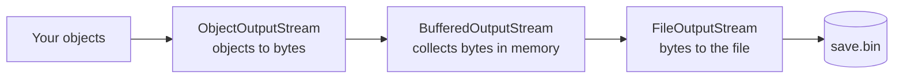
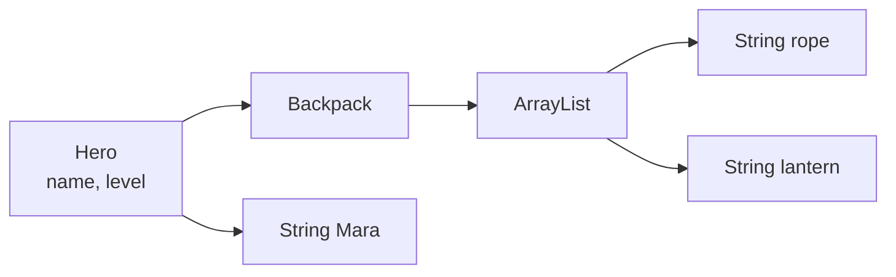

# Saving objects: serialization and I/O streams

> **Before this lesson:** you know objects, references and the heap ([References, arrays, the stack and the heap](#/lesson/java/java-references-stack-heap)), interfaces ([Interfaces, default methods, sealed types and pattern matching](#/lesson/java/java-interfaces)) and try-with-resources ([try-with-resources, multi-catch and custom exceptions](#/lesson/java/java-twr-custom-exceptions)).

## In plain words

When you stop playing a video game, everything about your character (level, position, inventory) exists only in the console's memory. Switch the console off and it is gone, unless the game first writes it to a **save file**. Next time, the game reads that file and rebuilds your character exactly as it was.

Objects in a Java program live on the heap, in memory, and vanish when the program ends. Keeping data beyond the life of the program is called **persistence**. There are two broad ways to do it:

1. **Serialization**: flatten whole objects into a sequence of bytes that Java itself can turn back into objects later.
2. **Writing a file in a format you design or choose**: plain text, CSV, JSON and so on, which any program can read.

This lesson covers the first, plus the machinery both rely on: **I/O streams**. The next lesson covers text files and the modern file API.

Why this matters for a job: every program reads or writes something. Interviewers ask what `Serializable` and `transient` mean, what `serialVersionUID` is for, and, increasingly, why Java's built-in serialization should be avoided.

## Streams: data flowing one piece at a time

In I/O, a **stream** is a channel through which data flows in one direction, a piece at a time, like water through a pipe. (These I/O streams are unrelated to the Stream API for collections that appears later in the track; the shared name is an accident of history.)

- An **input stream** is a source you read from.
- An **output stream** is a destination you write to.

The other end of the pipe might be a file, a network connection, an array in memory or the keyboard. Your code looks the same in every case.

Java has two families:

| Family | Unit | Base classes | Use for |
|---|---|---|---|
| **Byte streams** | raw bytes (8 bits) | `InputStream`, `OutputStream` | images, audio, serialized objects, any binary data |
| **Character streams** | characters | `Reader`, `Writer` | text |

### Connection streams and chain streams

No single stream class does everything. Instead, small classes are snapped together.

- A **connection stream** is attached to a real source or destination: `FileOutputStream` writes bytes to a file.
- A **chain stream** (also called a filter or wrapper stream) wraps another stream and adds an ability: `BufferedOutputStream` adds a memory buffer; `ObjectOutputStream` adds the ability to write whole objects.



Each class has one job, and you compose the pipeline you need. Wrapping an object to add behaviour while keeping the same interface is the **decorator pattern**.

## Serializing an object

```java
import java.io.FileInputStream;
import java.io.FileOutputStream;
import java.io.IOException;
import java.io.ObjectInputStream;
import java.io.ObjectOutputStream;
import java.io.Serializable;

class Hero implements Serializable {
    private static final long serialVersionUID = 1L;

    private final String name;
    private int level;
    private final Backpack pack;

    Hero(String name, int level, Backpack pack) {
        this.name = name;
        this.level = level;
        this.pack = pack;
    }

    @Override
    public String toString() {
        return name + " (level " + level + ") carrying " + pack.items;
    }
}

class Backpack implements Serializable {
    private static final long serialVersionUID = 1L;
    final java.util.List<String> items = new java.util.ArrayList<>();
}

public class SaveGame {
    public static void main(String[] args) throws IOException, ClassNotFoundException {
        Backpack pack = new Backpack();
        pack.items.add("rope");
        pack.items.add("lantern");
        Hero hero = new Hero("Mara", 7, pack);

        try (ObjectOutputStream out = new ObjectOutputStream(new FileOutputStream("hero.ser"))) {
            out.writeObject(hero);                          // flatten and write
        }

        try (ObjectInputStream in = new ObjectInputStream(new FileInputStream("hero.ser"))) {
            Hero loaded = (Hero) in.readObject();           // read and rebuild
            System.out.println(loaded);
            System.out.println(loaded == hero);
        }
    }
}
```

```text
Mara (level 7) carrying [rope, lantern]
false
```

What happened:

- `implements Serializable` is the permission slip. `Serializable` is a **marker interface**: it declares no methods. It tells the JVM "objects of this class may be flattened".
- `out.writeObject(hero)` wrote the hero **and everything reachable from it**: the `Backpack`, its `ArrayList`, and each `String`. The whole web of connected objects is called the **object graph**.
- `in.readObject()` returns `Object`, so a cast is needed. It can throw `ClassNotFoundException` (a checked exception) if the JVM cannot find the class for the data it is reading.
- The loaded hero is a **new object** with the same state: `loaded == hero` is `false`.
- Try-with-resources closes the outermost stream, which closes the streams it wraps.

### The whole graph is saved, or nothing

If any object in the graph is not serializable, `writeObject` fails at run time.

```java
class Pet { String name = "Rex"; }                         // not Serializable

class Owner implements Serializable {
    Pet pet = new Pet();
}
// new ObjectOutputStream(...).writeObject(new Owner())
// throws java.io.NotSerializableException: Pet
```



If two fields refer to the **same** object, it is written once and both references are restored pointing at one restored object. Shared references and cycles survive the round trip.

### transient: skip this field

Mark a field `transient` and serialization ignores it. On reading, the field receives its default value (`null`, `0` or `false`).

```java
class Session implements Serializable {
    private static final long serialVersionUID = 1L;

    String user = "noor";
    transient String password = "s3cret";         // never written
    transient java.net.Socket connection;         // cannot be serialized anyway
    static int liveSessions = 4;                  // static: belongs to the class, not saved
}
```

After a save and load, `user` is `"noor"`, `password` is `null`, and `liveSessions` is whatever the class holds in the JVM doing the reading. Use `transient` for secrets, for values that can be recomputed, and for things that make no sense in another process, such as open connections and threads.

## How deserialization builds the object

This part is unusual, and interviewers ask about it. When an object is deserialized:

1. Memory for the object is allocated.
2. The constructor of the **serializable class itself does not run**. Neither do its field initialisers.
3. If the class has a **non-serializable superclass**, that superclass's no-argument constructor **does** run, as do the constructors above it. Fields inherited from non-serializable ancestors are therefore re-initialised, not restored.
4. Serializable fields are filled in from the saved bytes; transient fields get defaults.

```java
class Base {                                   // NOT Serializable
    int baseValue = 10;
    Base() { System.out.println("Base constructor runs"); }
}

class Derived extends Base implements Serializable {
    int derivedValue = 20;
    Derived() { System.out.println("Derived constructor runs"); }
}
```

Creating a `Derived`, setting `baseValue = 99` and `derivedValue = 77`, then saving and loading prints, at load time:

```text
Base constructor runs
```

and the loaded object has `baseValue == 10` (reset by the constructor) and `derivedValue == 77` (restored). "Derived constructor runs" is **not** printed during loading.

The consequence is serious: deserialization is a **hidden constructor** that bypasses every check your real constructors perform. A corrupted or malicious byte stream can create objects that violate your invariants.

### A serialization model you can run

The model flattens an object graph to a list of records, honouring `transient`, sharing and cycles, then rebuilds it, without calling any constructor.

```python-run
def serialize(root, transient=("password",)):
    ids, records = {}, []
    def visit(obj):
        if not isinstance(obj, dict):
            return obj                                  # primitive or string
        if id(obj) in ids:
            return ("ref", ids[id(obj)])                # already written: back-reference
        handle = len(records)
        ids[id(obj)] = handle
        records.append(None)
        records[handle] = {k: visit(v) for k, v in obj.items() if k not in transient}
        return ("ref", handle)
    visit(root)
    return records

def deserialize(records, transient=("password",)):
    objs = [dict() for _ in records]                    # allocate, NO constructor runs
    for o, rec in zip(objs, records):
        for k, v in rec.items():
            o[k] = objs[v[1]] if isinstance(v, tuple) else v
        for t in transient:
            o.setdefault(t, None)                       # transient fields get the default
    return objs[0]

pack = {"items": "rope,lantern"}
hero = {"name": "Mara", "level": 7, "password": "s3cret", "pack": pack, "spare": pack}
hero["self"] = hero                                     # a cycle

flat = serialize(hero)
print("flattened:", flat)
copy = deserialize(flat)
print("password after load :", copy["password"])
print("shared pack kept    :", copy["pack"] is copy["spare"])
print("cycle kept          :", copy["self"] is copy)
print("same object as before:", copy is hero)
```

## serialVersionUID: does the class still match?

Suppose you save a `Hero` today and next month you change the class. Can the old file still be read?

Every serializable class has a version number, `serialVersionUID`. It is written into the stream. When reading, the JVM compares the number in the stream with the number of the class it has loaded. If they differ, reading fails with `InvalidClassException`.

- If you do not declare the field, the compiler computes one from the class's structure. Almost any edit, including adding a method, changes it, and all old data becomes unreadable.
- If you declare it yourself (`private static final long serialVersionUID = 1L;`), **you** decide when versions are incompatible.

With matching version numbers, the mechanism tolerates some changes:

| Change to the class | Old data still readable? |
|---|---|
| Add a field | yes; the new field gets its default value |
| Remove a field | yes; the extra data is ignored |
| Change a field from non-transient to transient | yes |
| Change a field's type | no |
| Move the class in the hierarchy, or rename it | no |
| Change an instance field to static | no |

## Why professionals avoid Java serialization

Java serialization is convenient for a tutorial and troublesome in production.

1. **Security.** `readObject` will build *any* serializable class on the classpath that the byte stream names, running code in those classes as it goes. Attackers have repeatedly used crafted streams to take over servers. The safest rule is never to deserialize data you do not fully trust.
2. **Fragility.** The saved form is tied to the private fields of your classes. Once data has been written, those internals are effectively a public commitment.
3. **Java only.** A Python or JavaScript program cannot read the format.
4. **Bypassed constructors**, as described above.

The modern approach is to convert objects to a neutral, documented data format with a library:

| Format | Typical Java library | Notes |
|---|---|---|
| JSON | Jackson, Gson | human-readable; the web's default |
| Protocol Buffers | protobuf | compact binary with an explicit schema |
| Avro, CBOR, MessagePack | various | used in data pipelines and messaging |

The detailed arguments, and how records help, are in [Why to avoid Java serialization, and the alternatives](#/lesson/java/java-ej-serialization-risks).

> [!INTERVIEW]
> Quick-fire facts. *What is `Serializable`?* A marker interface enabling Java's object serialization. *`transient`?* Excludes a field. *Are static fields serialized?* No, they belong to the class. *`serialVersionUID`?* A version stamp checked on deserialization; declare it explicitly. *Is the constructor called on deserialization?* Not for serializable classes; the no-arg constructor of the first non-serializable superclass is. *`Externalizable`?* A sub-interface where the class writes and reads its own state in `writeExternal` and `readExternal`, and whose public no-arg constructor *is* called. *Would you use it today?* Prefer JSON or protobuf.

## Buffering and byte streams for raw data

Reading or writing one byte at a time straight to a disk is slow, because each call may reach the operating system. A **buffer** is a block of memory that collects data so that the slow device is touched in large chunks.

```java
import java.io.BufferedInputStream;
import java.io.BufferedOutputStream;
import java.io.FileInputStream;
import java.io.FileOutputStream;
import java.io.IOException;

static long copy(String from, String to) throws IOException {
    long total = 0;
    try (BufferedInputStream in = new BufferedInputStream(new FileInputStream(from));
         BufferedOutputStream out = new BufferedOutputStream(new FileOutputStream(to))) {
        byte[] chunk = new byte[8192];
        int n;
        while ((n = in.read(chunk)) != -1) {      // read returns how many bytes it got, or -1 at the end
            out.write(chunk, 0, n);
            total += n;
        }
    }                                             // close flushes whatever is still in the buffer
    return total;
}
```

`read` returning `-1` signals the end of the stream. Data written to a buffered stream may sit in memory until the buffer fills, `flush()` is called, or the stream is closed. Forgetting to close an output stream is the classic cause of a file that is mysteriously empty or cut short.

For primitives in binary form, `DataOutputStream` and `DataInputStream` offer `writeInt`, `writeDouble`, `writeUTF` and matching `read` methods.

## Pitfalls

- **Forgetting `implements Serializable`** on a class somewhere in the object graph: `NotSerializableException` at run time, not at compile time.
- **Not declaring `serialVersionUID`**, then editing the class.
- **Expecting constructors or validation to run** on deserialization.
- **Serializing secrets** because a field was not marked `transient`.
- **Deserializing untrusted data.**
- **Reading objects in a different order** from the order in which they were written.
- **Not closing or flushing** output streams.
- **Using byte streams for text** and corrupting characters; use readers and writers with an explicit character encoding (next lesson).

## Cheat sheet

| Goal | Java |
|---|---|
| Allow serialization | `class X implements Serializable` |
| Version stamp | `private static final long serialVersionUID = 1L;` |
| Skip a field | `transient` |
| Write an object | `new ObjectOutputStream(new FileOutputStream(f)).writeObject(o)` |
| Read an object | `(X) new ObjectInputStream(new FileInputStream(f)).readObject()` |
| Raw bytes to a file | `FileOutputStream`, wrapped in `BufferedOutputStream` |
| Raw bytes from a file | `FileInputStream`, wrapped in `BufferedInputStream` |
| End of a byte stream | `read()` returns `-1` |
| Push buffered data out | `flush()` or `close()` |
| Portable alternative | JSON or protobuf through a library |

## Summary

- I/O streams move data sequentially; byte streams for binary data, character streams for text.
- Connection streams attach to a source or destination; chain streams wrap others to add buffering, object handling and more.
- Serialization flattens an entire object graph; every class in it must be `Serializable`, and `transient` and `static` fields are skipped.
- Deserialization creates objects without running the serializable class's constructors.
- `serialVersionUID` controls compatibility between saved data and the current class.
- Java serialization is risky and inflexible; prefer a neutral data format in real systems.

## Glossary

- **Persistence**: keeping data beyond the life of the program that created it.
- **I/O stream**: a one-directional channel for reading or writing data sequentially.
- **Byte stream / character stream**: a stream of raw bytes / of characters.
- **Connection stream**: a stream attached directly to a file, socket or other endpoint.
- **Chain (filter) stream**: a stream that wraps another to add behaviour.
- **Decorator pattern**: wrapping an object in another of the same type to extend it.
- **Serialization**: converting an object graph to bytes.
- **Deserialization**: rebuilding objects from those bytes.
- **Object graph**: an object together with everything reachable from it.
- **Marker interface**: an interface with no methods, used as a label.
- **`transient`**: a modifier that excludes a field from serialization.
- **`serialVersionUID`**: a class version number checked when deserializing.
- **Buffer**: memory that holds data temporarily to reduce slow device operations.

## Check yourself

```quiz
[
  {"q": "A serializable class has `transient int score = 50;`. An object with score 80 is saved and loaded. What is score afterwards?", "options": ["80", "50", "0", "It throws"], "answer": 2,
   "explain": "Transient fields are not written, and field initialisers do not run on deserialization, so the field gets the default 0."},
  {"q": "`class A implements Serializable { B b = new B(); }` where B does not implement Serializable. What happens on `writeObject(new A())`?", "options": ["Compile-time error", "b is silently skipped", "NotSerializableException at run time", "b is written as null"], "answer": 2,
   "explain": "The whole object graph must be serializable. The check is made at run time."},
  {"q": "When a `Serializable` object whose direct superclass is also Serializable is deserialized, which of its constructors run?", "options": ["Its own no-arg constructor", "All constructors in the chain", "None of the serializable classes' constructors; only the first non-serializable ancestor's no-arg constructor (here, Object's)", "The constructor used originally"], "answer": 2,
   "explain": "Deserialization bypasses constructors of serializable classes and runs the no-arg constructor of the nearest non-serializable superclass."},
  {"q": "What is `serialVersionUID` used for?", "options": ["Encrypting the stream", "Checking that the saved data and the loaded class are compatible versions", "Counting instances", "Ordering fields"], "answer": 1,
   "explain": "A mismatch between the stream's value and the class's value causes InvalidClassException."},
  {"q": "Are static fields included when an object is serialized?", "options": ["Yes", "No, they belong to the class, not to the object", "Only if final", "Only if public"], "answer": 1,
   "explain": "Serialization saves instance state. Static state lives with the class in each JVM."},
  {"q": "What does `in.read(buffer)` return when the end of a byte stream is reached?", "options": ["0", "-1", "null", "It throws EOFException"], "answer": 1,
   "explain": "The byte-stream read methods signal the end with -1."},
  {"q": "A program writes to a `BufferedOutputStream` and exits without closing or flushing it. What is the likely result?", "options": ["Everything is written", "Some or all of the data is missing from the file", "The file is deleted", "A compile-time error"], "answer": 1,
   "explain": "Data still held in the in-memory buffer never reaches the file. close() or flush() pushes it out."},
  {"q": "Two fields of a serialized object refer to the same list. After deserialization...", "options": ["there are two separate copies of the list", "both fields refer to one restored list", "one field is null", "it throws"], "answer": 1,
   "explain": "The stream records each object once and uses back-references, so sharing and cycles are preserved."}
]
```

> **Source:** Head First Java, ch. 14 (saving objects, serialization, connection and chain streams, transient, version control). Checked against the Java Object Serialization Specification: https://docs.oracle.com/en/java/javase/21/docs/specs/serialization/index.html and https://dev.java/learn/java-io/ .
