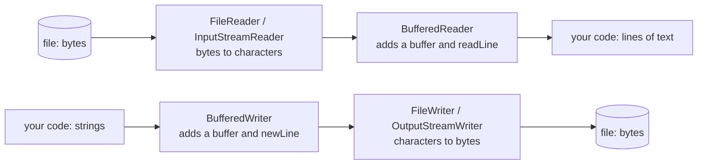

# Text files, readers, writers and NIO.2

> **Before this lesson:** you know byte streams, buffering and try-with-resources ([Saving objects: serialization and I/O streams](#/lesson/java/java-serialization-streams), [try-with-resources, multi-catch and custom exceptions](#/lesson/java/java-twr-custom-exceptions)), and the `String` methods `split` and `strip` ([Packages, imports and the String toolbox](#/lesson/java/java-packages-imports-strings)).

## In plain words

A serialized object file is like a sealed crate that only the original factory can open. A **text file** is like a handwritten list on paper: anyone who can read can use it, in any program, in any language, and you can open it in an editor to see what went wrong.

Most data that programs exchange is text: configuration files, logs, CSV exports from spreadsheets, JSON from web services. This lesson shows how to read and write text reliably, and introduces the modern file API that also lists folders, copies, moves and deletes.

Java has two generations of file API, and you will meet both:

- the original `java.io` package (1996): `File`, `FileReader`, `FileWriter`, `BufferedReader`;
- **NIO.2** (Java 7, package `java.nio.file`): `Path` and `Files`. "NIO" stands for "new input/output". Prefer it in new code.

Why this matters for a job: "read this file and compute X" is a common take-home exercise and a daily task. Two details separate careful engineers from the rest: closing files properly and stating the character encoding.

## Characters, bytes and encodings

A disk stores bytes. Text is made of characters. A **character encoding** (or **charset**) is the rule that converts between the two. The letter `A` is one byte in almost every encoding, but `é`, `€` or `日` are different byte sequences in different encodings.

- **UTF-8** is the encoding of the modern world. It represents every Unicode character, using one to four bytes each.
- Since Java 18, UTF-8 is Java's default on every platform. Before that the default depended on the operating system, which caused files written on one machine to appear as gibberish on another.

A **reader** is a character stream that decodes bytes into characters; a **writer** encodes characters into bytes. Whenever an API lets you name the charset, do so: `StandardCharsets.UTF_8`.



## Path: a location in the file system

A `Path` object represents a file or folder location. Creating a `Path` does not touch the disk; it is only a description of where something is, or will be.

```java
import java.nio.file.Path;

public class Paths1 {
    public static void main(String[] args) {
        Path p = Path.of("data", "reports", "2026", "sales.csv");
        System.out.println(p);
        System.out.println(p.getFileName());
        System.out.println(p.getParent());
        System.out.println(p.getNameCount());
        System.out.println(p.isAbsolute());

        Path base = Path.of("data/reports");
        System.out.println(base.resolve("2025/summary.txt"));          // join
        System.out.println(base.resolve("../archive").normalize());    // remove . and ..
        System.out.println(base.relativize(p));                        // how to get from base to p
    }
}
```

```text
data/reports/2026/sales.csv
sales.csv
data/reports/2026
4
false
data/reports/2025/summary.txt
data/archive
2026/sales.csv
```

(On Windows the separators print as backslashes; `Path` takes care of the platform difference.)

- An **absolute path** starts from the root of the file system (`/home/ada/notes.txt`, `C:\Users\ada\notes.txt`). A **relative path** is interpreted from the program's current working directory.
- `resolve` joins a path onto another. If the argument is absolute, the result is the argument alone.
- `normalize` removes `.` (this folder) and collapses `name/..` pairs.
- `relativize` is the reverse of `resolve`.

### A path model you can run

```python-run
def normalize(parts):
    out = []
    for p in parts:
        if p == ".":
            continue
        if p == ".." and out and out[-1] != "..":
            out.pop()
        else:
            out.append(p)
    return out

def resolve(base, other):
    if other.startswith("/"):
        return other                               # absolute argument wins
    return base.rstrip("/") + "/" + other

def relativize(base, target):
    b, t = normalize(base.split("/")), normalize(target.split("/"))
    i = 0
    while i < len(b) and i < len(t) and b[i] == t[i]:
        i += 1
    return "/".join([".."] * (len(b) - i) + t[i:]) or "."

print(resolve("data/reports", "2025/summary.txt"))
print("/".join(normalize(resolve("data/reports", "../archive/./old").split("/"))))
print(resolve("data/reports", "/etc/hosts"))
print(relativize("data/reports", "data/reports/2026/sales.csv"))
print(relativize("data/reports/2026", "data/archive/a.txt"))
```

## Files: the one-liners

The `Files` class is a collection of static methods that do the work. For small and medium files the simplest calls read or write everything at once.

```java
import java.io.IOException;
import java.nio.charset.StandardCharsets;
import java.nio.file.Files;
import java.nio.file.Path;
import java.nio.file.StandardOpenOption;
import java.util.List;

public class Notes {
    public static void main(String[] args) throws IOException {
        Path file = Path.of("notes.txt");

        Files.writeString(file, "milk\nbread\n", StandardCharsets.UTF_8);       // create or replace
        Files.writeString(file, "eggs\n", StandardOpenOption.APPEND);            // add to the end

        String whole = Files.readString(file);                                  // all text
        List<String> lines = Files.readAllLines(file);                          // one String per line

        System.out.println(whole.length());
        System.out.println(lines);
        System.out.println(Files.exists(file) + " " + Files.size(file));

        Files.write(Path.of("copy.txt"), lines);                                // write a list of lines
    }
}
```

```text
16
[milk, bread, eggs]
true 16
```

- `writeString` creates the file if needed and **replaces** existing content unless told to append.
- `readAllLines` strips the line endings and returns a `List<String>`.
- Almost every `Files` method declares the checked `IOException`. Here `main` declares it too; real code would handle it where a sensible reaction is possible.

These load the entire file into memory. For a file of several gigabytes, process it as a stream of lines instead.

## Reading a large file line by line

```java
import java.io.BufferedReader;
import java.io.IOException;
import java.nio.file.Files;
import java.nio.file.Path;

static int countMatching(Path file, String word) throws IOException {
    int count = 0;
    try (BufferedReader reader = Files.newBufferedReader(file)) {     // UTF-8 by default
        String line;
        while ((line = reader.readLine()) != null) {                  // null means end of file
            if (line.contains(word)) {
                count++;
            }
        }
    }
    return count;
}
```

Only one line is in memory at a time. `readLine()` returns the next line without its line ending, or `null` when there is nothing left. The loop condition assigns and tests in one expression; you will see this idiom in almost every Java program that reads text.

With the Stream API (covered in [The Stream API, collectors and Optional](#/lesson/java/java-streams-optional)) the same job reads:

```java
try (java.util.stream.Stream<String> lines = Files.lines(file)) {
    long count = lines.filter(l -> l.contains(word)).count();
}
```

`Files.lines` is lazy, reading as the stream is consumed, and it holds the file open, so it **must** be in a try-with-resources.

## Writing text with a buffered writer

```java
import java.io.BufferedWriter;
import java.io.IOException;
import java.nio.file.Files;
import java.nio.file.Path;

static void writeReport(Path file, java.util.Map<String, Integer> stock) throws IOException {
    try (BufferedWriter out = Files.newBufferedWriter(file)) {
        out.write("item,quantity");
        out.newLine();                              // platform-appropriate line ending
        for (var entry : stock.entrySet()) {
            out.write(entry.getKey() + "," + entry.getValue());
            out.newLine();
        }
    }                                               // close() flushes the buffer
}
```

The writer collects characters in a memory buffer and sends them to the disk in large blocks. Until the buffer is flushed, the file on disk may be empty; closing the writer flushes it. `PrintWriter` wraps any writer and adds the familiar `println` and `printf`.

## The older classes you will meet

```java
import java.io.BufferedReader;
import java.io.File;
import java.io.FileReader;
import java.io.FileWriter;
import java.io.IOException;

File f = new File("notes.txt");                    // old-style path object
System.out.println(f.exists() + " " + f.length() + " " + f.isDirectory());

try (BufferedReader r = new BufferedReader(new FileReader(f));
     FileWriter w = new FileWriter("out.txt", true)) {       // true = append
    w.write(r.readLine());
}
```

| Old (`java.io`) | New (`java.nio.file`) | Why the new one is better |
|---|---|---|
| `File` | `Path` | richer path operations |
| `file.delete()` returns `false` on failure | `Files.delete(path)` throws an exception saying why | failures are not silent |
| `new FileReader(file)` | `Files.newBufferedReader(path)` | UTF-8 by default, buffered |
| `file.listFiles()` | `Files.list(path)`, `Files.walk(path)` | lazy, works with streams |
| `file.renameTo(...)` | `Files.move(...)` | reliable across file systems, with options |

Convert between them with `file.toPath()` and `path.toFile()`.

## Parsing a text file: a complete example

A file `scores.csv` holds a name and a score on each line.

```text
name,score
Ada,91
Bo,78
Cy,eighty
Di,64

```

```java
import java.io.IOException;
import java.nio.file.Files;
import java.nio.file.Path;
import java.util.ArrayList;
import java.util.List;

record Score(String name, int points) { }

public class ScoreReader {
    static List<Score> load(Path file) throws IOException {
        List<Score> result = new ArrayList<>();
        List<String> lines = Files.readAllLines(file);
        for (int i = 1; i < lines.size(); i++) {               // start at 1: skip the header
            String line = lines.get(i).strip();
            if (line.isEmpty()) {
                continue;                                      // tolerate blank lines
            }
            String[] parts = line.split(",");
            if (parts.length != 2) {
                System.out.println("line " + (i + 1) + ": expected 2 fields, skipped");
                continue;
            }
            try {
                result.add(new Score(parts[0].strip(), Integer.parseInt(parts[1].strip())));
            } catch (NumberFormatException e) {
                System.out.println("line " + (i + 1) + ": bad score '" + parts[1] + "', skipped");
            }
        }
        return result;
    }

    public static void main(String[] args) throws IOException {
        List<Score> scores = load(Path.of("scores.csv"));
        int total = 0;
        for (Score s : scores) {
            total += s.points();
        }
        System.out.println(scores.size() + " valid rows, average " + total / (double) scores.size());
    }
}
```

```text
line 4: bad score 'eighty', skipped
3 valid rows, average 77.66666666666667
```

The pattern is general: read lines, skip what is not data, split, validate, convert, and report problems with a **line number**. Real CSV has quoting rules (a comma inside quotation marks is not a separator); for anything beyond a toy file use a CSV library.

## Working with folders

```java
import java.io.IOException;
import java.nio.file.Files;
import java.nio.file.Path;
import java.nio.file.StandardCopyOption;
import java.util.stream.Stream;

Path dir = Path.of("reports", "2026");
Files.createDirectories(dir);                                   // creates missing parents too
Path a = dir.resolve("a.txt");
Files.writeString(a, "first");
Files.copy(a, dir.resolve("b.txt"), StandardCopyOption.REPLACE_EXISTING);
Files.move(a, dir.resolve("renamed.txt"));

try (Stream<Path> entries = Files.list(dir)) {                  // direct children only
    entries.sorted().forEach(p -> System.out.println(p.getFileName()));
}
try (Stream<Path> all = Files.walk(Path.of("reports"))) {       // the whole tree, depth first
    System.out.println(all.filter(Files::isRegularFile).count());
}
Files.deleteIfExists(dir.resolve("b.txt"));
```

```text
b.txt
renamed.txt
2
```

`Files.delete` refuses to remove a folder that is not empty; delete its contents first. Both `Files.list` and `Files.walk` hold the directory open and must be closed.

> [!WARNING]
> Never build a path from user input without checking it. A user who supplies `../../etc/passwd` can escape the folder you intended. Resolve, normalise, then verify with `candidate.startsWith(baseDir)` before opening anything. This attack is called **path traversal**.

## Standard input, output and error

Three streams are open in every program:

| Stream | Java | Usual destination |
|---|---|---|
| standard input | `System.in` | the keyboard, or a file redirected in |
| standard output | `System.out` | the terminal |
| standard error | `System.err` | the terminal, kept separate so errors survive when output is redirected |

Reading the keyboard a line at a time uses the same classes as reading a file:

```java
BufferedReader in = new BufferedReader(new java.io.InputStreamReader(System.in));
String answer = in.readLine();
```

`java.util.Scanner` is a more convenient alternative that also parses numbers (`nextInt()`), at some cost in speed.

> [!INTERVIEW]
> "How would you process a 50 GB log file?" Do not read it all into memory. Stream it line by line with a `BufferedReader` or `Files.lines`, keep only the running result (a count, a map of totals), and close the file with try-with-resources. Mention the encoding explicitly. If asked about `java.io` versus `java.nio.file`: NIO.2's `Path` and `Files` give better error reporting through exceptions, symbolic-link awareness, file attributes, directory walking and watch services.

## Pitfalls

- **Not closing readers, writers and directory streams.** Use try-with-resources every time.
- **Relying on the platform's default encoding** on Java versions before 18.
- **`readAllLines` or `readString` on huge files**: `OutOfMemoryError`.
- **Forgetting that `writeString` replaces** existing content unless `APPEND` is given.
- **Assuming the current working directory.** Relative paths depend on where the program was started.
- **Comparing `Path` objects as strings.** Use `equals`, `startsWith` and `normalize` on paths.
- **Ignoring the boolean returned by old `File` methods** such as `delete()` and `mkdir()`.
- **Hard-coding `\n` or backslashes.** Use `newLine()` and `Path.of(...)`.
- **Splitting CSV with `split(",")`** when fields can contain commas.

## Cheat sheet

| Task | Code |
|---|---|
| Make a path | `Path.of("dir", "file.txt")` |
| Join / tidy | `base.resolve(child)` / `p.normalize()` |
| Read all text | `Files.readString(p)` |
| Read all lines | `Files.readAllLines(p)` |
| Read lazily | `try (var lines = Files.lines(p)) { ... }` |
| Read line by line | `Files.newBufferedReader(p)` + `readLine()` until `null` |
| Write text | `Files.writeString(p, text)` |
| Append | `Files.writeString(p, text, StandardOpenOption.APPEND)` |
| Buffered writing | `Files.newBufferedWriter(p)` |
| Exists / size | `Files.exists(p)`, `Files.size(p)` |
| Create folders | `Files.createDirectories(p)` |
| Copy / move / delete | `Files.copy`, `Files.move`, `Files.delete` |
| List / walk | `Files.list(dir)`, `Files.walk(dir)` |

## Summary

- Text on disk is bytes interpreted through a character encoding; use UTF-8 and say so.
- `Path` describes a location; `Files` performs operations on it.
- Read small files whole; process large files line by line.
- Buffered readers and writers reduce disk operations; closing a writer flushes it.
- The older `File`, `FileReader` and `FileWriter` classes still appear in existing code; `Path` and `Files` supersede them.
- Validate every line when parsing, report line numbers, and never trust paths supplied by users.

## Glossary

- **Text file**: a file whose bytes represent characters.
- **Character encoding (charset)**: the mapping between characters and bytes.
- **UTF-8**: the dominant encoding, covering all of Unicode.
- **Reader / Writer**: character streams for input and output.
- **NIO.2**: the `java.nio.file` API introduced in Java 7.
- **`Path`**: an object representing a file-system location.
- **Absolute / relative path**: starting at the file-system root / interpreted from the working directory.
- **Working directory**: the folder a program was started in.
- **`Files`**: a class of static methods for file operations.
- **Buffered reader / writer**: wrappers that add an in-memory buffer and line-oriented methods.
- **CSV**: comma-separated values, a common plain-text table format.
- **Path traversal**: an attack that uses `..` in a supplied path to reach unintended files.

## Check yourself

```quiz
[
  {"q": "What does `BufferedReader.readLine()` return when the end of the file is reached?", "options": ["An empty string", "null", "-1", "It throws EOFException"], "answer": 1,
   "explain": "null signals the end. An empty string means an empty line was read."},
  {"q": "What does `Path.of(\"a/b\").resolve(\"../c\").normalize()` produce?", "options": ["a/b/../c", "a/c", "c", "a/b/c"], "answer": 1,
   "explain": "resolve gives a/b/../c; normalize collapses b/.. leaving a/c."},
  {"q": "`Files.writeString(p, \"x\")` is called twice on the same path. What does the file contain?", "options": ["xx", "x", "x on two lines", "It throws on the second call"], "answer": 1,
   "explain": "By default writeString truncates and replaces. Pass StandardOpenOption.APPEND to add."},
  {"q": "Does this compile? `void show(java.nio.file.Path p) { System.out.println(java.nio.file.Files.readString(p)); }`", "options": ["Yes", "No: unreported IOException must be caught or declared", "Yes, it returns null on failure", "No: readString needs a charset"], "answer": 1,
   "explain": "Files.readString declares the checked IOException, so the method must catch it or add throws IOException."},
  {"q": "Why should `Files.lines(path)` be used inside try-with-resources?", "options": ["It is faster", "The returned stream keeps the file open until closed", "It will not compile otherwise", "To set the encoding"], "answer": 1,
   "explain": "The stream reads lazily and holds an open file handle; closing the stream releases it."},
  {"q": "Does creating `Path.of(\"missing/file.txt\")` fail if the file does not exist?", "options": ["Yes, with NoSuchFileException", "No: a Path is only a description of a location", "Yes, with NullPointerException", "It creates the file"], "answer": 1,
   "explain": "Path objects do not touch the file system. Operations in Files do."},
  {"q": "What is the main advantage of `Files.delete(p)` over the old `file.delete()`?", "options": ["It is asynchronous", "It throws an informative exception on failure instead of returning false", "It deletes non-empty directories", "It never fails"], "answer": 1,
   "explain": "The legacy method only returns a boolean, so failures are easy to ignore and hard to diagnose."},
  {"q": "Which is the best way to count lines containing ERROR in a 40 GB log?", "options": ["Files.readAllLines then loop", "Files.readString then split", "A BufferedReader loop or Files.lines, keeping only a counter", "ObjectInputStream"], "answer": 2,
   "explain": "Streaming keeps one line in memory at a time. The first two load the whole file and run out of heap."}
]
```

> **Source:** Head First Java, ch. 14 (writing and reading text files, File, BufferedReader and BufferedWriter, parsing with split). NIO.2 facts checked against https://docs.oracle.com/en/java/javase/21/docs/api/java.base/java/nio/file/Files.html and https://dev.java/learn/java-io/file-system/ ; UTF-8 default: JEP 400, https://openjdk.org/jeps/400 .
