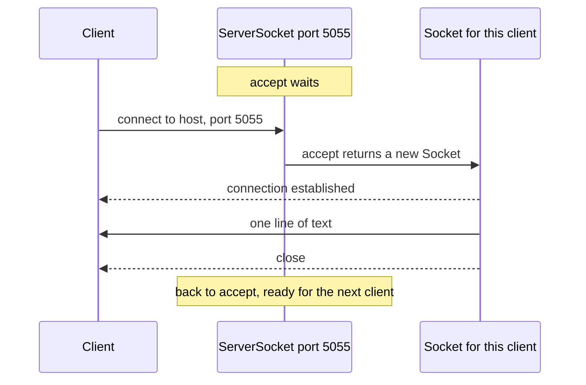
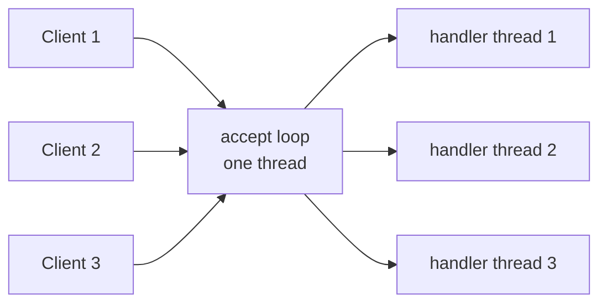
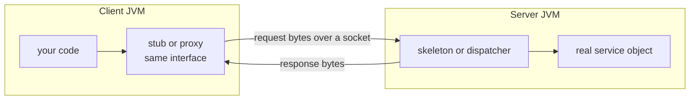

# Networking: sockets, clients, servers and remote calls

> **Before this lesson:** you can read and write with streams, readers and writers ([Text files, readers, writers and NIO.2](#/lesson/java/java-files-nio)) and use try-with-resources ([try-with-resources, multi-catch and custom exceptions](#/lesson/java/java-twr-custom-exceptions)). No networking knowledge is assumed. For the protocols in depth see the [Networking track](#/track/networking).

## In plain words

To phone a company you need two numbers: the number of the building's switchboard and the extension of the person you want. Once connected, both of you can speak and listen until one side hangs up. You do not think about the cables, exchanges and satellites in between.

Network programming has the same parts.

- The switchboard number is the **IP address**: a number that identifies a machine on a network.
- The extension is the **port**: a number from 0 to 65,535 that identifies one particular program on that machine.
- The call in progress is a **connection**, and each end of it is a **socket**.
- Once connected, each side has an input stream and an output stream, the same kinds of stream you used for files.

The program that waits for calls is the **server**. The program that makes the call is the **client**.

Why this matters for a job: you will rarely write raw socket code; you will use HTTP libraries and frameworks built on top. But every one of them rests on these ideas, and interviewers expect you to explain what a port is, what a socket is, and how one server handles many clients at once.

## The vocabulary

| Term | Meaning |
|---|---|
| **Host** | a machine on a network |
| **IP address** | the numeric address of a host, e.g. `192.168.1.20` (IPv4) or `2001:db8::1` (IPv6) |
| **Host name** | a readable name such as `example.org`, translated to an IP address by **DNS**, the domain name system |
| **localhost** | the name for "this same machine"; address `127.0.0.1` |
| **Port** | a number identifying a program (service) on a host |
| **TCP** | transmission control protocol: a reliable, ordered, two-way stream of bytes between two sockets |
| **UDP** | user datagram protocol: individual packets with no connection and no delivery guarantee |
| **Protocol** | the agreed rules for what the two sides say to each other and in what order |

Ports below 1024 are reserved for well-known services: 80 for HTTP, 443 for HTTPS, 22 for SSH. Use numbers above 1024 for your own experiments; 5000 to 9000 is a customary range.

One host can run many servers, each on a different port. Two programs cannot listen on the same port at the same time; the second gets `BindException: Address already in use`.

## A client in five lines

```java
import java.io.BufferedReader;
import java.io.IOException;
import java.io.InputStreamReader;
import java.net.Socket;

public class TipClient {
    public static void main(String[] args) throws IOException {
        try (Socket socket = new Socket("localhost", 5055);                       // 1. connect
             BufferedReader in = new BufferedReader(
                     new InputStreamReader(socket.getInputStream()))) {           // 2. wrap the stream
            String tip = in.readLine();                                           // 3. read a line
            System.out.println("Server says: " + tip);
        }                                                                         // 4. close = hang up
    }
}
```

1. `new Socket(host, port)` asks the operating system to open a TCP connection. It blocks until the connection is made, or throws `ConnectException` if nothing is listening there, or `UnknownHostException` if the name cannot be resolved.
2. `socket.getInputStream()` is a byte stream carrying whatever the server sends. Wrapping it in an `InputStreamReader` and a `BufferedReader` gives lines of text, exactly as with files.
3. `readLine()` **blocks**: it waits until a whole line has arrived or the connection closes.
4. Closing the socket ends the connection.

## The matching server

```java
import java.io.IOException;
import java.io.PrintWriter;
import java.net.ServerSocket;
import java.net.Socket;

public class TipServer {
    private static final String[] TIPS = {
        "Name things for what they mean.",
        "Write the test first.",
        "Close what you open."
    };

    public static void main(String[] args) throws IOException {
        try (ServerSocket server = new ServerSocket(5055)) {              // 1. claim the port
            System.out.println("Listening on 5055");
            int served = 0;
            while (true) {
                try (Socket client = server.accept();                      // 2. wait for a caller
                     PrintWriter out = new PrintWriter(client.getOutputStream(), true)) {
                    out.println(TIPS[served % TIPS.length]);              // 3. send one line
                    served++;
                }                                                          // 4. hang up on this client
            }
        }
    }
}
```

```text
(terminal 1) > java TipServer
Listening on 5055

(terminal 2) > java TipClient
Server says: Name things for what they mean.
(terminal 2) > java TipClient
Server says: Write the test first.
```

- A **`ServerSocket`** is not a connection. It is the switchboard: it claims a port and waits.
- `accept()` blocks until a client connects, then returns a brand-new ordinary `Socket` dedicated to that one client. The `ServerSocket` remains free to accept the next caller.
- `new PrintWriter(stream, true)` turns on **auto-flush**: each `println` is sent immediately. Without flushing, the text might sit in a buffer while the client waits for ever.



## Two-way conversation and the need for a protocol

A socket is two-way. The following server reads a request line and answers it; the conversation follows a tiny **protocol** that both sides must respect: *the client sends one line; the server replies with one line; `QUIT` ends the session*.

```java
import java.io.*;
import java.net.*;

public class UpperServer {
    public static void main(String[] args) throws IOException {
        try (ServerSocket server = new ServerSocket(5056)) {
            while (true) {
                try (Socket client = server.accept();
                     BufferedReader in = new BufferedReader(new InputStreamReader(client.getInputStream()));
                     PrintWriter out = new PrintWriter(client.getOutputStream(), true)) {
                    String line;
                    while ((line = in.readLine()) != null && !line.equals("QUIT")) {
                        out.println(line.toUpperCase());
                    }
                }
            }
        }
    }
}
```

A client session:

```text
> hello
HELLO
> two words
TWO WORDS
> QUIT
```

Protocol mistakes produce the classic networking bug: **both sides waiting to read**. If the client forgets to send a line ending, the server's `readLine()` never returns, the server never answers, and the client waits for an answer that will never come. Nothing crashes; the program hangs. When a network program freezes, ask first: who is blocked reading, and what are they waiting for?

## One server, many clients

The servers above deal with one client at a time. While one client is connected, everyone else waits in a queue. A slow client holds up all the others.

The classic solution is to hand each accepted socket to a separate **thread** (an independent path of execution, introduced fully in the next lesson), so the main loop can return to `accept()` at once.

```java
import java.net.ServerSocket;
import java.net.Socket;
import java.util.concurrent.ExecutorService;
import java.util.concurrent.Executors;

public class ConcurrentServer {
    public static void main(String[] args) throws Exception {
        try (ServerSocket server = new ServerSocket(5056);
             ExecutorService workers = Executors.newVirtualThreadPerTaskExecutor()) {   // Java 21
            while (true) {
                Socket client = server.accept();
                workers.submit(() -> handle(client));        // do not wait; go back to accept
            }
        }
    }

    static void handle(Socket client) {
        try (client) {
            // read requests and write replies for this one client
        } catch (Exception e) {
            System.err.println("client failed: " + e);
        }
    }
}
```



Before Java 21, each handler needed an operating-system thread, which is costly, so servers used a limited pool of threads or a different style called non-blocking I/O (the `java.nio.channels` package and frameworks such as Netty). Java 21's **virtual threads** are so cheap that one per connection is practical for very large numbers of connections; see [Race conditions, synchronization, deadlock and virtual threads](#/lesson/java/java-synchronization).

### A server model you can run

The simulation compares a one-at-a-time server with a thread-per-client server in virtual time. Each client arrives at some moment and needs some seconds of service.

```python-run
def sequential(clients):
    t, done = 0, {}
    for name, arrive, service in clients:
        start = max(t, arrive)              # wait until the server is free
        t = start + service
        done[name] = t
    return done

def thread_per_client(clients):
    return {name: arrive + service for name, arrive, service in clients}   # nobody waits

clients = [("A", 0, 5), ("B", 1, 1), ("C", 2, 1), ("D", 3, 1)]   # A is a slow client
seq, par = sequential(clients), thread_per_client(clients)
print("client  arrives  needs   finishes(sequential)  finishes(thread per client)")
for name, arrive, service in clients:
    print(f"  {name}       {arrive}       {service}            {seq[name]:2}                     {par[name]:2}")
print("worst wait, sequential:", max(seq[n] - a - s for n, a, s in clients),
      "| thread per client:", max(par[n] - a - s for n, a, s in clients))
```

Client B needed one second and waited four for the slow client A in the sequential design. This effect is called **head-of-line blocking**.

## Above sockets: HTTP

Most services today speak **HTTP**, the protocol of the web, which is text sent over a TCP socket: a request line (`GET /tips/3 HTTP/1.1`), headers, an optional body, and a response with a status code (`200 OK`, `404 Not Found`). You could write it by hand on a `Socket`; in practice use the built-in client (Java 11 and later):

```java
import java.net.URI;
import java.net.http.HttpClient;
import java.net.http.HttpRequest;
import java.net.http.HttpResponse;

HttpClient client = HttpClient.newHttpClient();
HttpRequest request = HttpRequest.newBuilder(URI.create("https://example.org/")).GET().build();
HttpResponse<String> response = client.send(request, HttpResponse.BodyHandlers.ofString());
System.out.println(response.statusCode());
System.out.println(response.body().length() > 0);
```

```text
200
true
```

Server-side Java is almost always written with a framework (Spring Boot, Quarkus, Micronaut, Jakarta EE) that owns the `ServerSocket`, the accept loop and the threads, and calls your method for each request. The ideas are the ones in this lesson with the plumbing hidden.

## Calling methods on another machine: from RMI to REST

A method call normally happens between two objects on the same heap. Distributed systems need one program to ask another, on a different machine, to do something. Head First Java introduces this with **RMI** (remote method invocation), and the idea behind RMI is still how most remote-call technology works:

- the client holds a local helper object, a **stub** (or **proxy**), that has the same methods as the remote service;
- calling a stub method **marshals** the arguments (packs them into bytes), sends them over a socket, and waits;
- on the server a matching helper, the **skeleton**, unpacks the request and calls the real object;
- the result travels back the same way.



The technologies have changed with time:

| Era | Technology | Status |
|---|---|---|
| 1990s | RMI, using Java serialization | legacy; Java-to-Java only, security problems |
| 2000s | Servlets and Enterprise JavaBeans (EJB), SOAP web services | servlets underlie today's frameworks; EJB and SOAP are legacy |
| Now | REST over HTTP with JSON; gRPC with Protocol Buffers; message queues such as Kafka | current practice |

One lesson from that history remains essential: **a remote call is not a local call**. It can be a million times slower, it can fail halfway, the other machine can be down, and the same request may arrive twice. Code that hides this behind an innocent-looking method call tends to behave badly in production. Always set timeouts, and decide what happens on failure.

> [!INTERVIEW]
> "What is the difference between `ServerSocket` and `Socket`?" A `ServerSocket` listens on a port and produces connections; it never carries data itself. `accept()` returns a `Socket` representing one established connection, with an input and an output stream. A TCP connection is identified by four values together (client address, client port, server address, server port), which is how one server port can serve thousands of clients at once. "TCP versus UDP?" TCP is connection-oriented, reliable and ordered; UDP is connectionless, with no guarantees but less overhead, used for DNS, live audio and video, and games.

## Pitfalls

- **Forgetting to flush**: the other side waits for data that is sitting in your buffer.
- **Deadlocked protocol**: both ends blocked in `read`.
- **Port already in use**: another process, or an old run of your own program, still holds it.
- **Handling clients one at a time** in a server that should be concurrent.
- **Not closing sockets**: each open socket consumes a limited operating-system resource.
- **No timeouts.** A `read` on a dead connection can block for ever; use `socket.setSoTimeout(millis)` or the HTTP client's timeout settings.
- **Assuming one `read` returns one whole message.** TCP is a stream of bytes with no message boundaries; your protocol must define them (lines, or a length prefix).
- **Sending Java-serialized objects between services.** Use JSON or protobuf.
- **Trusting data from the network.** Validate everything.

## Cheat sheet

| Goal | Java |
|---|---|
| Connect as a client | `new Socket(host, port)` |
| Listen as a server | `new ServerSocket(port)` |
| Wait for a client | `Socket s = server.accept();` |
| Read text | `new BufferedReader(new InputStreamReader(s.getInputStream()))` |
| Write text | `new PrintWriter(s.getOutputStream(), true)` |
| Give up waiting | `s.setSoTimeout(5000)` |
| This machine | `"localhost"` / `127.0.0.1` |
| HTTP request | `HttpClient.newHttpClient().send(request, BodyHandlers.ofString())` |
| Many clients | hand each `Socket` to a thread or executor task |

## Summary

- A host is found by its IP address; a program on it by its port; a socket is one end of a TCP connection.
- A client creates a `Socket`; a server creates a `ServerSocket` and calls `accept()` to obtain one `Socket` per client.
- Socket communication uses ordinary input and output streams, and both sides must follow an agreed protocol.
- Blocking reads make protocol errors appear as hangs; flush output and set timeouts.
- Serving many clients requires concurrency, classically one thread per connection.
- Higher-level tools (HTTP clients, web frameworks, RPC systems) are built on these foundations; RMI is the historical Java example of remote calls through stubs.

## Glossary

- **Client / server**: the program that initiates a connection / the program that waits for connections.
- **IP address**: the numeric address of a machine on a network.
- **DNS**: the system that translates host names into IP addresses.
- **Port**: a number identifying a program on a host.
- **Socket**: one endpoint of a network connection.
- **`ServerSocket`**: an object that listens on a port and accepts connections.
- **TCP**: a reliable, ordered, connection-based transport protocol.
- **UDP**: a connectionless transport protocol without delivery guarantees.
- **Protocol**: the rules governing the exchange of messages.
- **Blocking call**: a call that does not return until its operation completes.
- **HTTP**: the request-response protocol of the web.
- **RMI**: remote method invocation, Java's original remote-call mechanism.
- **Stub / proxy**: a local object that forwards method calls to a remote one.
- **Marshalling**: converting arguments or results into bytes for transmission.
- **Head-of-line blocking**: later requests waiting behind a slow earlier one.

## Check yourself

```quiz
[
  {"q": "What does `ServerSocket.accept()` return?", "options": ["A ServerSocket bound to a new port", "A Socket connected to the client that connected", "An InputStream", "A boolean"], "answer": 1,
   "explain": "accept blocks until a client connects and returns a new Socket for that single connection."},
  {"q": "A client runs `new Socket(\"localhost\", 6000)` but no server is listening on port 6000. What happens?", "options": ["It waits for ever", "It returns null", "It throws ConnectException (connection refused)", "A compile-time error"], "answer": 2,
   "explain": "The operating system refuses the connection and Java reports it as a ConnectException, a kind of IOException."},
  {"q": "A server writes a reply with a PrintWriter created without auto-flush and never calls flush or close. The client's readLine()...", "options": ["returns immediately with null", "may block indefinitely, because the reply is still in the server's buffer", "throws IOException", "returns an empty string"], "answer": 1,
   "explain": "Buffered output is not transmitted until flushed. The client waits for data that has not been sent."},
  {"q": "Two programs try to open `new ServerSocket(8080)` on the same machine. The second one...", "options": ["shares the port", "throws BindException: Address already in use", "is given port 8081 automatically", "blocks until the first exits"], "answer": 1,
   "explain": "Only one process can listen on a given port (for a given address) at a time."},
  {"q": "Why can one server port serve many clients simultaneously?", "options": ["Each client is given a different server port", "A TCP connection is identified by client address, client port, server address and server port together", "Clients take turns", "The server opens one ServerSocket per client"], "answer": 1,
   "explain": "The four-part identity makes each connection unique even though they all share the server's port."},
  {"q": "Does this compile? `void ping() { new java.net.Socket(\"example.org\", 80); }`", "options": ["Yes", "No: the Socket constructor throws checked IOException", "Yes, exceptions here are unchecked", "No: port 80 is reserved"], "answer": 1,
   "explain": "Socket constructors declare IOException (and UnknownHostException, a subclass), which must be caught or declared."},
  {"q": "In remote-call systems such as RMI, what is a stub?", "options": ["The real service object", "A local object with the service's interface that forwards calls over the network", "A unit test", "A thread pool"], "answer": 1,
   "explain": "The stub (proxy) makes the remote service look local by marshalling arguments, sending them and returning the result."},
  {"q": "Which statement about TCP is true?", "options": ["Each write arrives as exactly one read on the other side", "It delivers a reliable, ordered stream of bytes without message boundaries", "It does not need a connection", "It may reorder data"], "answer": 1,
   "explain": "TCP guarantees order and delivery of bytes, but how bytes are grouped into reads is not preserved; the application protocol must frame messages."}
]
```

> **Source:** Head First Java, ch. 15 (sockets, clients and servers) and ch. 18 (distributed computing: RMI, servlets, EJB, in outline only). Checked against the java.net and java.net.http API documentation: https://docs.oracle.com/en/java/javase/21/docs/api/java.base/java/net/package-summary.html and https://docs.oracle.com/en/java/javase/21/docs/api/java.net.http/java/net/http/HttpClient.html .
