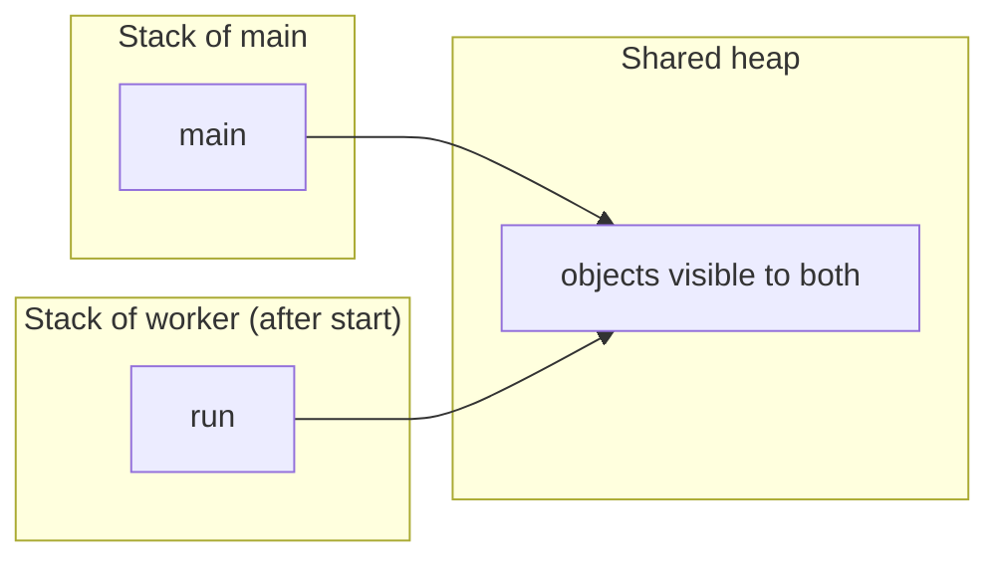
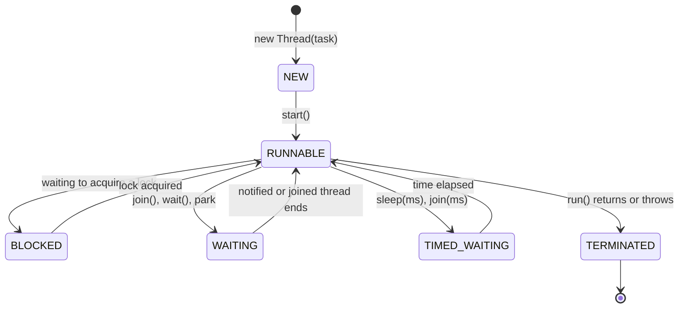
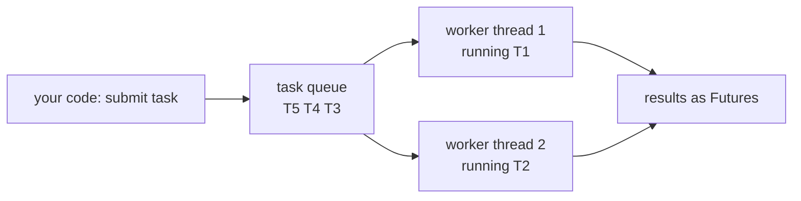

# Threads, Runnable and ExecutorService

> **Before this lesson:** you know the stack and the heap ([References, arrays, the stack and the heap](#/lesson/java/java-references-stack-heap)), interfaces and lambdas at the level of "a short way to pass code" ([Nested, inner, local and anonymous classes](#/lesson/java/java-inner-classes)), and you have seen why a server needs to do several things at once ([Networking: sockets, clients, servers and remote calls](#/lesson/java/java-networking)).

## In plain words

A kitchen with one cook makes one dish at a time. If the cook stands and watches a pot for ten minutes, nothing else gets made. Hire a second cook and two dishes progress together. The cooks share one kitchen: the same fridge, the same hob, the same single salt jar. Sharing is what makes them productive, and it is also what lets them collide.

A **thread** is a cook: an independent path of execution inside one program. Every Java program starts with one thread, called `main`. You can start more. All threads in a program share the same heap (the kitchen), so they can see the same objects, but each has its own call stack (its own hands and its own place in its own recipe).

Running several tasks in overlapping periods of time is called **concurrency**. This lesson shows how to create threads and, better, how to hand tasks to a managed team of threads called an **executor**. The next lesson deals with what goes wrong when threads share data.

Why this matters for a job: every server, every Android app and every data pipeline is concurrent. Concurrency questions are a fixed part of Java interviews at every level above entry.

## Why use more than one thread

1. **Responsiveness.** A user interface or a server stays available while a slow task runs.
2. **Waiting efficiently.** Most programs spend much of their time waiting for disks, databases and networks. While one thread waits, another can work.
3. **Using all the processor cores.** A modern machine has many cores; one thread uses only one.

Two words that sound alike:

- **Concurrency**: dealing with several tasks in overlapping time periods. One cook switching between two pans is concurrent.
- **Parallelism**: several tasks executing at the same instant on different cores. Two cooks at two hobs are parallel.

On a single core, the operating system gives each thread a short turn (a **time slice**) and switches so fast that they appear simultaneous. The part of the system that decides who runs next is the **scheduler**. You do not control it, and that fact shapes everything that follows.

## A task is a Runnable

The work a thread performs is described by an object that implements `Runnable`, an interface with a single method:

```java
public interface Runnable {
    void run();
}
```

```java
public class FirstThread {
    public static void main(String[] args) {
        Runnable task = () -> {                                   // the job, as a lambda
            String me = Thread.currentThread().getName();
            for (int i = 1; i <= 3; i++) {
                System.out.println(me + " step " + i);
            }
        };

        Thread worker = new Thread(task, "worker");               // a thread that will run the job
        worker.start();                                           // begin a NEW call stack

        for (int i = 1; i <= 3; i++) {
            System.out.println("main step " + i);
        }
    }
}
```

One possible output:

```text
main step 1
worker step 1
worker step 2
main step 2
main step 3
worker step 3
```

Run it several times and the order of the lines changes. Each thread prints its own lines in order (1, 2, 3), but how the two sequences **interleave** is decided by the scheduler and is not predictable. A program whose result can differ from run to run is **non-deterministic**, and learning to reason about all the possible interleavings is the core skill of concurrent programming.

### start() versus run()

```java
worker.start();   // creates a new thread; run() executes there, concurrently
worker.run();     // an ordinary method call; run() executes in the CURRENT thread
```

Calling `run()` directly compiles and works, but creates no new thread: the task runs to completion on the caller's stack before the next line. This is a favourite interview trap. A thread can be started only once; a second `start()` throws `IllegalThreadStateException`.



You may also create a thread by extending `Thread` and overriding `run`. Prefer `Runnable`: it separates the job from the worker, leaves your class free to extend something else, and lets the same task be handed to an executor.

## The life of a thread



| State | Meaning |
|---|---|
| `NEW` | created, not yet started |
| `RUNNABLE` | eligible to run; either running now or waiting for the scheduler to give it a turn |
| `BLOCKED` | waiting for a lock held by another thread |
| `WAITING` | waiting indefinitely for another thread to act |
| `TIMED_WAITING` | waiting for a limited time |
| `TERMINATED` | finished |

### sleep and join

```java
public class SleepJoin {
    public static void main(String[] args) throws InterruptedException {
        Thread t = new Thread(() -> {
            try {
                Thread.sleep(300);                         // pause this thread for 300 ms
                System.out.println("worker done");
            } catch (InterruptedException e) {
                Thread.currentThread().interrupt();        // restore the flag and stop
            }
        });
        t.start();
        System.out.println("main waits");
        t.join();                                          // wait until t has finished
        System.out.println("main continues");
    }
}
```

```text
main waits
worker done
main continues
```

- `Thread.sleep(ms)` pauses the **current** thread for at least that long. It guarantees a minimum, not an exact time.
- `t.join()` makes the calling thread wait until thread `t` terminates. It is how you say "do not go on until that work is finished". With `join`, this program's output is the same on every run.
- Both can throw the checked `InterruptedException`.

### Interruption: asking a thread to stop

There is no safe way to kill a thread from outside. Instead you **interrupt** it, which sets a flag on the thread. A thread blocked in `sleep`, `join` or `wait` responds by throwing `InterruptedException`; a thread that is computing must check `Thread.currentThread().isInterrupted()` now and then. The correct reactions are to stop the work and either let the exception propagate or, if you must catch it, set the flag again with `Thread.currentThread().interrupt()`. Never swallow it in an empty `catch`.

## Executors: stop creating threads by hand

Creating a thread per task has costs. A platform thread reserves memory for its stack (commonly around a megabyte) and takes time to start; ten thousand of them can exhaust a machine. Managing their lifetimes by hand is tedious and error-prone.

An **executor** separates *what to run* from *how it is run*. You submit tasks; the executor owns a set of reusable worker threads, a **thread pool**, and a queue of tasks waiting their turn.

```java
import java.util.concurrent.ExecutorService;
import java.util.concurrent.Executors;
import java.util.concurrent.TimeUnit;

public class PoolDemo {
    public static void main(String[] args) throws InterruptedException {
        ExecutorService pool = Executors.newFixedThreadPool(2);        // two worker threads

        for (int i = 1; i <= 5; i++) {
            int job = i;                                               // effectively final copy
            pool.submit(() -> System.out.println(
                    "job " + job + " on " + Thread.currentThread().getName()));
        }

        pool.shutdown();                                               // accept no new tasks
        boolean finished = pool.awaitTermination(5, TimeUnit.SECONDS); // wait for queued work
        System.out.println("all done: " + finished);
    }
}
```

One possible output:

```text
job 1 on pool-1-thread-1
job 2 on pool-1-thread-2
job 3 on pool-1-thread-1
job 4 on pool-1-thread-2
job 5 on pool-1-thread-1
all done: true
```

Five tasks ran on two threads. Tasks that find no free worker wait in the queue.



### Common factory methods

| Factory | Behaviour | Use for |
|---|---|---|
| `Executors.newFixedThreadPool(n)` | exactly `n` workers; unbounded queue | steady CPU-bound load |
| `Executors.newCachedThreadPool()` | creates threads as needed, reuses idle ones | many short tasks; can grow without limit |
| `Executors.newSingleThreadExecutor()` | one worker; tasks run strictly in order | serialising access to something |
| `Executors.newScheduledThreadPool(n)` | runs tasks after a delay or periodically | timers, polling |
| `Executors.newVirtualThreadPerTaskExecutor()` | a new virtual thread per task (Java 21) | large numbers of tasks that mostly wait on I/O |
| `Executors.newWorkStealingPool()` | fork/join pool sized to the cores | divide-and-conquer computation |

How many threads? For work that is pure computation, about the number of processor cores (`Runtime.getRuntime().availableProcessors()`); more only adds switching overhead. For work that mostly waits on I/O, many more can be useful, or use virtual threads.

### Always shut down

An executor's worker threads keep the JVM alive. If you never call `shutdown()`, your program does not exit.

- `shutdown()`: stop accepting tasks, finish the ones already submitted.
- `shutdownNow()`: also interrupt running tasks and return the ones not yet started.
- `awaitTermination(time, unit)`: block until everything has finished or the time runs out.

Since Java 19, `ExecutorService` is `AutoCloseable`: in a try-with-resources block, `close()` performs a shutdown and waits for the tasks.

## Getting results back: Callable and Future

`Runnable.run()` returns nothing and cannot throw checked exceptions. `Callable<V>` is the task type that **returns a value**:

```java
public interface Callable<V> {
    V call() throws Exception;
}
```

Submitting one gives you a `Future<V>`: a ticket for a result that will exist later.

```java
import java.util.List;
import java.util.concurrent.Callable;
import java.util.concurrent.ExecutorService;
import java.util.concurrent.Executors;
import java.util.concurrent.Future;

public class Futures {
    static int slowSquare(int n) throws InterruptedException {
        Thread.sleep(200);
        return n * n;
    }

    public static void main(String[] args) throws Exception {
        try (ExecutorService pool = Executors.newFixedThreadPool(3)) {
            long start = System.currentTimeMillis();

            Future<Integer> a = pool.submit(() -> slowSquare(3));
            Future<Integer> b = pool.submit(() -> slowSquare(4));
            Future<Integer> c = pool.submit(() -> slowSquare(5));

            int sum = a.get() + b.get() + c.get();             // get() blocks until ready
            long elapsed = System.currentTimeMillis() - start;
            System.out.println(sum + " in about " + (elapsed / 100) * 100 + " ms");

            List<Callable<String>> tasks = List.of(() -> "x", () -> "y");
            for (Future<String> f : pool.invokeAll(tasks)) {   // submit all, wait for all
                System.out.print(f.get());
            }
        }
    }
}
```

```text
50 in about 200 ms
xy
```

Three tasks of 200 ms each finished in about 200 ms in total, because they ran at the same time.

- `future.get()` blocks until the result is available. `get(timeout, unit)` gives up after a time.
- If the task threw an exception, `get()` throws `ExecutionException`, whose `getCause()` is the original.
- `future.cancel(true)` attempts to stop the task by interrupting it.
- `invokeAll` submits a collection and returns when all are done; `invokeAny` returns the first successful result.

For chains of asynchronous steps without blocking, Java offers `CompletableFuture`:

```java
import java.util.concurrent.CompletableFuture;

CompletableFuture<String> greeting = CompletableFuture
        .supplyAsync(() -> "ada")                      // runs on a background pool
        .thenApply(String::toUpperCase)                // transform when ready
        .thenCombine(CompletableFuture.supplyAsync(() -> 42), (name, n) -> name + ":" + n);
System.out.println(greeting.join());
```

```text
ADA:42
```

### A scheduling model you can run

The model runs tasks on a fixed pool in virtual time: each task goes to the worker that becomes free first.

```python-run
import heapq

def run_pool(durations, workers):
    """Tasks are submitted at time 0, in order. Returns per-task (worker, start, end) and the total time."""
    free = [(0, w) for w in range(1, workers + 1)]        # (time the worker is free, worker id)
    heapq.heapify(free)
    schedule = []
    for i, d in enumerate(durations, start=1):
        t, w = heapq.heappop(free)                        # earliest-free worker; ties -> lowest id
        schedule.append((f"T{i}", w, t, t + d))
        heapq.heappush(free, (t + d, w))
    return schedule, max(end for *_, end in schedule)

durations = [4, 2, 1, 3, 2]
for n in (1, 2, 3):
    sched, total = run_pool(durations, n)
    print(f"{n} worker(s): finished at t={total}")
    for name, w, s, e in sched:
        print(f"    {name} on worker {w}: {s:2} -> {e:2}")
```

Going from one worker to two cuts the total time from 12 to 6; a third brings it to 4. The total can never be less than the longest single task (4 here), however many workers you add.

## Daemon threads

A thread marked as a **daemon** (`thread.setDaemon(true)` before `start()`) does not keep the JVM alive. When all non-daemon threads have finished, the JVM exits and daemon threads are abandoned mid-step. Use them only for background housekeeping that is safe to cut off.

> [!INTERVIEW]
> "`Runnable` versus `Callable`?" `Runnable.run()` returns nothing and cannot throw checked exceptions; `Callable.call()` returns a value and may throw. Both can be submitted to an `ExecutorService`; `submit` returns a `Future`. "Why use a thread pool?" It reuses threads, avoiding creation cost; it bounds the number of concurrent threads, protecting the machine; and it provides a queue, lifecycle management and result handling. "`execute` versus `submit`?" `execute` takes a `Runnable` and returns nothing, and an uncaught exception reaches the thread's handler; `submit` returns a `Future` and stores any exception in it, where it is silently lost if nobody calls `get()`.

## Pitfalls

- **Calling `run()` instead of `start()`.**
- **Assuming an order** between threads without `join`, a `Future` or another coordination tool.
- **Forgetting to shut down an executor**, so the program never exits.
- **Swallowing `InterruptedException`.**
- **Never calling `Future.get()`**, so exceptions thrown inside tasks vanish.
- **Unbounded thread creation**, or an unbounded queue behind a fixed pool, under heavy load.
- **Blocking a small shared pool with slow I/O**, starving every other task that uses it.
- **Using `Thread.sleep` to "wait until the other thread is probably done".** Use `join`, a `Future` or a latch.
- **Deprecated `Thread.stop()`, `suspend()` and `resume()`.** Never use them.

## Cheat sheet

| Goal | Java |
|---|---|
| Define a task | `Runnable r = () -> { ... };` |
| Task with a result | `Callable<T> c = () -> value;` |
| Start a thread | `new Thread(r).start();` |
| Wait for a thread | `t.join();` |
| Pause | `Thread.sleep(ms);` |
| Ask a thread to stop | `t.interrupt();` |
| Thread pool | `Executors.newFixedThreadPool(n)` |
| Submit | `Future<T> f = pool.submit(c);` |
| Get the result | `f.get()` (blocks) |
| Stop the pool | `pool.shutdown(); pool.awaitTermination(...)` or try-with-resources |
| Run many, wait for all | `pool.invokeAll(tasks)` |
| Cores available | `Runtime.getRuntime().availableProcessors()` |

## Summary

- A thread is an independent call stack sharing the program's heap with other threads.
- Describe work as a `Runnable` (or `Callable` for a result) and call `start()`, never `run()`, to execute it on a new thread.
- The scheduler decides the interleaving; without coordination the order of events between threads is unpredictable.
- `join` waits for a thread; `interrupt` politely requests that it stop.
- Prefer an `ExecutorService` to raw threads: it pools workers, queues tasks and returns `Future` results.
- Always shut executors down.

## Glossary

- **Thread**: an independent path of execution with its own call stack.
- **Concurrency**: managing several tasks in overlapping time periods.
- **Parallelism**: executing several tasks at the same instant on different cores.
- **Scheduler**: the system component that decides which thread runs when.
- **Interleaving**: one particular ordering of steps from different threads.
- **Non-deterministic**: able to produce different results on different runs.
- **`Runnable`**: a task with a `run()` method that returns nothing.
- **`Callable`**: a task with a `call()` method that returns a value.
- **`Future`**: a handle for a result that will be available later.
- **Executor / `ExecutorService`**: an object that runs submitted tasks, usually on a thread pool.
- **Thread pool**: a set of reusable worker threads.
- **Interrupt**: a request, by flag, that a thread stop what it is doing.
- **Daemon thread**: a background thread that does not keep the JVM alive.
- **Blocking**: waiting, without using the processor, for some event.

## Check yourself

```quiz
[
  {"q": "What is the difference between `t.start()` and `t.run()`?", "options": ["None", "start() runs the task on a new thread; run() executes it in the calling thread", "run() is faster", "start() can be called many times"], "answer": 1,
   "explain": "Only start() creates a new call stack. run() is an ordinary method call."},
  {"q": "What does this print? `Thread t = new Thread(() -> System.out.print(\"A\")); t.run(); System.out.print(\"B\");`", "options": ["AB always", "BA always", "AB or BA", "Nothing"], "answer": 0,
   "explain": "run() is called directly, so A is printed on the main thread before B. No second thread exists."},
  {"q": "What does this print? `Thread t = new Thread(() -> System.out.print(\"A\")); t.start(); t.join(); System.out.print(\"B\");`", "options": ["AB always", "BA always", "AB or BA", "It does not compile if InterruptedException is declared"], "answer": 0,
   "explain": "join() makes main wait until t has finished, so A is always printed first."},
  {"q": "What does this print? `Thread t = new Thread(() -> System.out.print(\"A\")); t.start(); System.out.print(\"B\");`", "options": ["AB always", "BA always", "AB or BA, depending on scheduling", "It throws"], "answer": 2,
   "explain": "Without coordination, either thread may reach its print first."},
  {"q": "A fixed pool has 2 threads and receives 5 tasks at once. What happens to tasks 3 to 5?", "options": ["They are rejected", "They wait in the pool's queue until a worker is free", "Three more threads are created", "They run on the main thread"], "answer": 1,
   "explain": "newFixedThreadPool uses an unbounded queue; extra tasks wait their turn."},
  {"q": "A task submitted with `pool.submit(...)` throws a RuntimeException and nobody calls `get()` on the Future. What is observed?", "options": ["The program crashes", "A stack trace is always printed", "Nothing; the exception is stored in the Future and never seen", "The pool shuts down"], "answer": 2,
   "explain": "submit captures the exception in the Future. It surfaces only as an ExecutionException from get()."},
  {"q": "A program creates `Executors.newFixedThreadPool(4)`, submits tasks, and main returns without calling shutdown. What happens?", "options": ["The JVM exits normally", "The JVM keeps running because the pool's non-daemon worker threads are alive", "The tasks are cancelled", "A compile error"], "answer": 1,
   "explain": "Idle worker threads wait for more tasks and prevent the JVM from exiting."},
  {"q": "Which interface should a task implement to return a value and throw a checked exception?", "options": ["Runnable", "Callable", "Future", "Thread"], "answer": 1,
   "explain": "Callable<V>.call() returns V and is declared to throw Exception."}
]
```

> **Source:** Head First Java, ch. 15 (threads, Runnable, thread states, the scheduler, sleep) and the concurrency chapter of the newer edition (ExecutorService). Checked against https://docs.oracle.com/en/java/javase/21/docs/api/java.base/java/lang/Thread.html , https://docs.oracle.com/en/java/javase/21/docs/api/java.base/java/util/concurrent/ExecutorService.html and https://dev.java/learn/new-features/virtual-threads/ .
