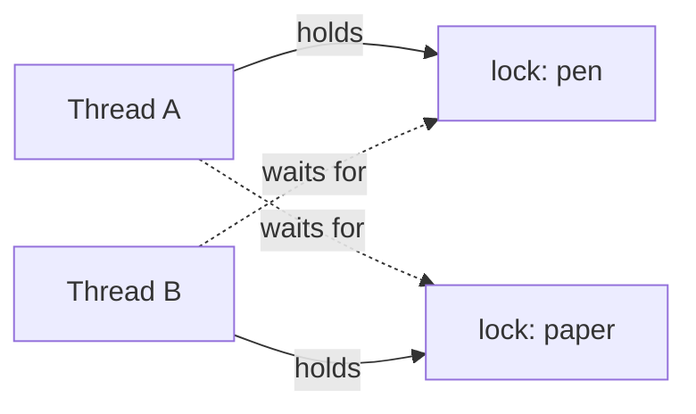

# Race conditions, synchronization, deadlock and virtual threads

> **Before this lesson:** you can start threads, join them and use an `ExecutorService` ([Threads, Runnable and ExecutorService](#/lesson/java/java-threads-executors)), and you know that all threads share the heap ([References, arrays, the stack and the heap](#/lesson/java/java-references-stack-heap)).

## In plain words

Two flatmates share one bank account with 100 in it. Each, on a different phone, checks the balance at the same moment, sees 100, and decides there is enough to pay an 80 bill. Each then pays. The account ends at minus 60, although each person behaved sensibly on the information they had. Nothing was wrong with either person's steps. The problem was that their steps were **interleaved**: both checked before either paid.

When two threads use the same data and at least one changes it, the result can depend on the exact timing of their steps. That situation is a **race condition**. The cure is to make "check, then pay" a single unit that only one person can perform at a time, like a bathroom with a lock on the door: whoever is inside finishes completely before the next person enters. In Java that lock is called a **monitor**, and the keyword that uses it is `synchronized`.

Why this matters for a job: concurrency bugs are the hardest to find, because they appear rarely, vanish under a debugger, and corrupt data silently. Interviewers expect you to explain a race, fix one, describe deadlock and its prevention, and distinguish `volatile` from `synchronized`.

## The smallest race: a counter

```java
public class Race {
    static int count = 0;

    public static void main(String[] args) throws InterruptedException {
        Runnable add = () -> {
            for (int i = 0; i < 100_000; i++) {
                count++;                         // looks like one step; it is three
            }
        };
        Thread a = new Thread(add);
        Thread b = new Thread(add);
        a.start();
        b.start();
        a.join();
        b.join();
        System.out.println(count);
    }
}
```

Three different runs:

```text
137406
200000
118932
```

The expected answer is 200,000, and it almost never appears. The statement `count++` is not **atomic**, meaning it is not a single indivisible action. The machine performs three steps:

1. **read** the current value of `count` into a private temporary;
2. **add** one to the temporary;
3. **write** the temporary back to `count`.

If the scheduler switches threads between steps 1 and 3, an update is lost.

| Time | Thread A | Thread B | `count` |
|---|---|---|---|
| 1 | read 5 | | 5 |
| 2 | | read 5 | 5 |
| 3 | add: 6 | | 5 |
| 4 | | add: 6 | 5 |
| 5 | write 6 | | 6 |
| 6 | | write 6 | 6 |

Two increments ran; the counter went up by one. This is a **lost update**. The piece of code that must not be interleaved (here the read-add-write) is called a **critical section**.

### Every possible outcome, computed

For small cases you can enumerate every interleaving. The model gives each thread a list of steps and tries all orderings that keep each thread's own steps in order.

```python-run
from itertools import combinations

def outcomes(threads, increments_each, start=0):
    """Each increment is two shared-memory steps: READ then WRITE(read value + 1).
    Returns every final counter value that some interleaving can produce."""
    steps_per_thread = increments_each * 2
    total = threads * steps_per_thread
    results = set()

    def schedules(remaining, positions_left):
        if len(remaining) == 1:
            yield {remaining[0]: positions_left}
            return
        first = remaining[0]
        for chosen in combinations(positions_left, steps_per_thread):
            rest = [p for p in positions_left if p not in chosen]
            for sub in schedules(remaining[1:], rest):
                yield {first: list(chosen), **sub}

    for plan in schedules(list(range(threads)), list(range(total))):
        order = [None] * total
        for t, positions in plan.items():
            for p in positions:
                order[p] = t
        shared, temp, phase = start, [0] * threads, [0] * threads
        for t in order:
            if phase[t] % 2 == 0:
                temp[t] = shared            # READ
            else:
                shared = temp[t] + 1        # WRITE
            phase[t] += 1
        results.add(shared)
    return sorted(results)

print("2 threads x 1 increment :", outcomes(2, 1))
print("2 threads x 2 increments:", outcomes(2, 2))
print("3 threads x 1 increment :", outcomes(3, 1))
```

With two threads doing two increments each, the final value can be 2, 3 or 4, and the "correct" 4 is only one of the possibilities. A test that passes a thousand times proves nothing if one of the other schedules is possible.

## synchronized: one thread at a time

Every Java object has a built-in lock, called its **intrinsic lock** or **monitor**. The `synchronized` keyword makes a thread **acquire** an object's lock before running a block of code and **release** it afterwards. While one thread holds the lock, any other thread that wants the same lock is **blocked** until it is released.

```java
class Counter {
    private int count = 0;

    public synchronized void increment() {       // locks 'this' for the whole method
        count++;
    }

    public synchronized int get() {
        return count;
    }
}

public class Safe {
    public static void main(String[] args) throws InterruptedException {
        Counter counter = new Counter();
        Runnable add = () -> {
            for (int i = 0; i < 100_000; i++) {
                counter.increment();
            }
        };
        Thread a = new Thread(add);
        Thread b = new Thread(add);
        a.start(); b.start();
        a.join();  b.join();
        System.out.println(counter.get());
    }
}
```

```text
200000
```

Now the read-add-write sequence is protected: a thread inside `increment` holds the lock on the `Counter` object, and the other thread must wait at the door.

Key facts:

- A `synchronized` **instance method** locks `this`. A `synchronized` **static method** locks the `Class` object, a different lock.
- A **synchronized block** locks whichever object you name, and can cover part of a method only:

```java
private final Object lock = new Object();

void addAll(int[] values) {
    int sum = 0;
    for (int v : values) {            // no lock needed: only local variables
        sum += v;
    }
    synchronized (lock) {             // lock held only for the shared update
        total += sum;
    }
}
```

- The lock is released automatically when the block exits, including when it exits by an exception.
- Locks are **reentrant**: a thread that already holds a lock may acquire it again, so one synchronized method can call another on the same object.
- **Locks are on objects, not on code.** Two threads calling `increment` on two *different* `Counter` objects do not block each other.
- **All access must go through the lock**, reads included. A synchronized `increment` with an unsynchronized `get` is still broken.

Keep synchronized blocks as short as possible. While a thread holds a lock nobody else can enter, so slow work inside a lock turns a concurrent program back into a sequential one.

### Check-then-act is also a race

Synchronizing each method individually does not make a **sequence** of calls atomic.

```java
class Account {
    private int balance = 100;
    synchronized int getBalance()        { return balance; }
    synchronized void withdraw(int amt)  { balance -= amt; }
}

// Two threads each run this, unsynchronized:
if (account.getBalance() >= 80) {        // check
    account.withdraw(80);                // act: the other thread may have withdrawn in between
}
```

Both threads can pass the check before either withdraws. The whole decision must be one synchronized operation inside the class:

```java
synchronized boolean withdrawIfPossible(int amt) {
    if (balance < amt) {
        return false;
    }
    balance -= amt;
    return true;
}
```

## Visibility and volatile

There is a second, stranger problem. For speed, a thread may keep a copy of a shared variable in a processor register or cache. Without some form of synchronization, the Java **memory model** does not promise that one thread ever sees another thread's write.

```java
public class Stuck {
    static boolean stop = false;                  // not volatile

    public static void main(String[] args) throws InterruptedException {
        Thread worker = new Thread(() -> {
            long n = 0;
            while (!stop) {                       // may never notice the change
                n++;
            }
            System.out.println("stopped at " + n);
        });
        worker.start();
        Thread.sleep(1000);
        stop = true;
        System.out.println("main set stop");
    }
}
```

On many machines this prints `main set stop` and then never ends: the JIT compiler is allowed to read `stop` once and reuse the value. Declaring the field **`volatile`** fixes it:

```java
static volatile boolean stop = false;
```

`volatile` guarantees **visibility**: every read sees the most recent write by any thread. It does **not** provide mutual exclusion: `volatile int count; count++;` is still a lost-update race, because the three steps can still interleave.

| | `volatile` | `synchronized` |
|---|---|---|
| Applies to | a field | a method or block |
| Visibility of changes | yes | yes |
| Mutual exclusion (atomic compound actions) | no | yes |
| Can block a thread | no | yes |
| Use for | a flag or reference written by one thread and read by others | any read-modify-write or check-then-act on shared state |

## Better tools from java.util.concurrent

### Atomic variables

`AtomicInteger`, `AtomicLong` and `AtomicReference` perform read-modify-write as one atomic hardware operation, with no lock.

```java
import java.util.concurrent.atomic.AtomicInteger;

AtomicInteger hits = new AtomicInteger();
hits.incrementAndGet();                 // atomic count++
hits.addAndGet(5);
hits.compareAndSet(6, 100);             // set to 100 only if currently 6
System.out.println(hits.get());
```

```text
100
```

### Explicit locks

`ReentrantLock` does what `synchronized` does, with extras: try to acquire without waiting, give up after a time, or respond to interruption. The price is that **you** must release it, in a `finally` block.

```java
import java.util.concurrent.locks.ReentrantLock;

private final ReentrantLock lock = new ReentrantLock();

void update() {
    lock.lock();
    try {
        // critical section
    } finally {
        lock.unlock();                  // always, even if an exception is thrown
    }
}
```

### Concurrent collections

`ArrayList` and `HashMap` are not safe for concurrent modification; they can lose data or loop for ever. Use the purpose-built versions:

| Need | Class |
|---|---|
| a map shared by many threads | `ConcurrentHashMap` |
| a list read often and changed rarely | `CopyOnWriteArrayList` |
| handing work between threads | `BlockingQueue` implementations such as `ArrayBlockingQueue`, `LinkedBlockingQueue` |
| a non-blocking queue | `ConcurrentLinkedQueue` |

`map.merge(key, 1, Integer::sum)` on a `ConcurrentHashMap` is an atomic "add one to this key's count".

### The best fix: do not share, or do not mutate

Two designs remove races entirely:

- **Confinement.** Data used by only one thread (local variables, objects never published to other threads) needs no protection.
- **Immutability.** An object that never changes can be read by any number of threads safely. `String`, records and the wrapper classes are examples.

## Deadlock

Locks cure races and introduce a new disease. A **deadlock** occurs when two or more threads each hold a lock and wait for a lock held by another, in a cycle. None can proceed, and none will ever release what it holds.

```java
public class Deadlock {
    static final Object pen = new Object();
    static final Object paper = new Object();

    public static void main(String[] args) {
        new Thread(() -> {
            synchronized (pen) {
                pause();
                synchronized (paper) { System.out.println("A writes"); }
            }
        }).start();

        new Thread(() -> {
            synchronized (paper) {
                pause();
                synchronized (pen) { System.out.println("B writes"); }
            }
        }).start();
    }

    static void pause() {
        try { Thread.sleep(100); } catch (InterruptedException e) { Thread.currentThread().interrupt(); }
    }
}
```

```text
(no output; the program hangs for ever)
```

Thread A holds the pen and wants the paper. Thread B holds the paper and wants the pen.



A deadlock requires all four of these conditions at once (the Coffman conditions):

1. **Mutual exclusion**: a lock can be held by only one thread.
2. **Hold and wait**: a thread holds one lock while waiting for another.
3. **No pre-emption**: a lock cannot be taken away from its holder.
4. **Circular wait**: a cycle of threads each waiting for the next.

Break any one and deadlock is impossible. The practical methods:

- **Lock ordering.** Decide on one global order for acquiring locks and follow it everywhere. If both threads above took `pen` before `paper`, the cycle could not form. This is the standard fix.
- **Hold one lock at a time** where you can.
- **Timeouts.** `lock.tryLock(1, TimeUnit.SECONDS)` gives up instead of waiting for ever, so the thread can release what it holds and retry.
- **Never call unknown code while holding a lock** (callbacks, listeners, overridable methods): you cannot know which locks it will take.

A hung program can be diagnosed with a **thread dump** (`jstack <pid>`, or `jcmd <pid> Thread.print`), which lists each thread, the locks it holds and the lock it waits for, and reports "Found one Java-level deadlock".

Related failures: **starvation**, where a thread never gets a turn because others always win the lock; and **livelock**, where threads keep reacting to each other and never make progress, like two people stepping aside for each other in a corridor.

## Waiting for a condition

Sometimes a thread must wait until something becomes true: a consumer waits for the queue to be non-empty. The low-level tools are `wait()`, `notify()` and `notifyAll()` on the lock object, and they are easy to misuse. Use a ready-made coordinator from `java.util.concurrent` instead: `BlockingQueue` (its `put` waits for space and its `take` waits for an item), `CountDownLatch`, `Semaphore`, `CompletableFuture`. These are covered in [Concurrency utilities, thread-safety levels and lazy initialisation](#/lesson/java/java-ej-concurrency-utilities).

## Virtual threads (Java 21)

A traditional Java thread, now called a **platform thread**, is a thin wrapper around an operating-system thread. Each costs roughly a megabyte of stack memory and a few thousand of them is a practical limit. A server that dedicates one thread to each request therefore tops out at a few thousand simultaneous requests, most of which are doing nothing except waiting for a database or another service.

A **virtual thread** is a thread managed by the JVM instead of the operating system. It is cheap (a few hundred bytes to start), and millions can exist. When a virtual thread blocks on I/O, the JVM **unmounts** it from the platform thread that was carrying it, and that **carrier thread** goes off to run another virtual thread. When the I/O completes, the virtual thread is mounted again on any free carrier and continues.

```java
import java.util.concurrent.Executors;

public class Virtual {
    public static void main(String[] args) throws Exception {
        long start = System.currentTimeMillis();
        try (var pool = Executors.newVirtualThreadPerTaskExecutor()) {
            for (int i = 0; i < 10_000; i++) {
                pool.submit(() -> {
                    Thread.sleep(1000);              // simulated I/O wait
                    return null;
                });
            }
        }                                            // close() waits for all tasks
        System.out.println("about " + (System.currentTimeMillis() - start) / 1000 + " s");

        Thread vt = Thread.ofVirtual().name("solo").start(() -> System.out.println("virtual: "
                + Thread.currentThread().isVirtual()));
        vt.join();
    }
}
```

```text
about 1 s
virtual: true
```

Ten thousand tasks, each waiting a second, finish in about a second. With ten thousand platform threads many machines would run out of memory.

What to remember:

- Virtual threads help **I/O-bound** work that spends its time waiting. They do nothing for **CPU-bound** work: computation still needs real cores.
- **Do not pool them.** Create a new one per task; they are designed to be disposable.
- They are ordinary `Thread` objects. Everything in this lesson about races, `synchronized`, `volatile` and deadlock applies unchanged.
- They let you write plain, blocking, step-by-step code and still scale, instead of callback-heavy asynchronous styles.

> [!INTERVIEW]
> "What is a race condition, and how do you fix one?" *A bug where the correctness of a program depends on the relative timing of threads accessing shared mutable state. Fix by removing one of the three ingredients: don't share (confinement), don't mutate (immutability), or synchronise the access (locks, atomics, concurrent collections).* "How do you prevent deadlock?" *Acquire locks in a consistent global order; hold as few locks as possible for as short a time as possible; use timed lock attempts; never call foreign code while holding a lock.*

## Pitfalls

- **Assuming `count++` is atomic.**
- **Synchronizing writes but not reads.**
- **Locking on different objects** for the same data, which protects nothing.
- **Synchronizing on a `String` literal, a boxed number, or `this` of a public class**, which outside code can also lock.
- **Believing `volatile` makes compound actions atomic.**
- **Check-then-act across two synchronized calls.**
- **Inconsistent lock order**: deadlock.
- **Long or blocking work inside a synchronized block.**
- **Forgetting `unlock()` in `finally`** with explicit locks.
- **Using `HashMap` or `ArrayList` from several threads.**
- **Testing concurrency by running it a few times.**

## Cheat sheet

| Problem | Tool |
|---|---|
| Compound action on shared state | `synchronized` method or block |
| Counter shared by threads | `AtomicInteger`, `LongAdder` |
| Stop flag or published reference | `volatile` |
| Shared map / list / queue | `ConcurrentHashMap`, `CopyOnWriteArrayList`, `BlockingQueue` |
| Try for a lock, or time out | `ReentrantLock.tryLock(...)` |
| Avoid sharing | local variables, immutable objects |
| Prevent deadlock | one global lock order |
| Diagnose a hang | `jstack <pid>` thread dump |
| Many waiting tasks | virtual threads: `Executors.newVirtualThreadPerTaskExecutor()` |

## Summary

- A race condition arises when threads share mutable state and timing decides the outcome; `count++` is the classic lost update.
- `synchronized` uses an object's monitor so that one thread at a time runs a critical section; it also guarantees visibility.
- `volatile` gives visibility only; atomics give lock-free atomic updates; concurrent collections handle shared containers.
- Deadlock is a cycle of threads holding locks and waiting for each other; a consistent lock order prevents it.
- The simplest thread-safe designs share nothing or share only immutable objects.
- Virtual threads make one-thread-per-task cheap for I/O-bound work, without changing the rules of shared state.

## Glossary

- **Race condition**: a defect in which the result depends on the timing of threads.
- **Atomic**: performed as a single indivisible step.
- **Critical section**: code that must not be executed by more than one thread at a time.
- **Lost update**: a write that is overwritten because two threads read the same old value.
- **Monitor / intrinsic lock**: the lock built into every Java object.
- **`synchronized`**: the keyword that acquires a monitor for a method or block.
- **Mutual exclusion**: only one thread at a time may hold a given lock.
- **Reentrant**: able to be acquired again by the thread that already holds it.
- **Visibility**: whether one thread's write can be seen by another.
- **`volatile`**: a field modifier guaranteeing visibility of writes.
- **Thread-safe**: behaving correctly when used from several threads at once.
- **Deadlock**: threads blocked for ever, each waiting for a lock another holds.
- **Livelock / starvation**: threads active but making no progress / a thread never getting its turn.
- **Platform thread**: a thread backed one-to-one by an operating-system thread.
- **Virtual thread**: a lightweight thread scheduled by the JVM onto carrier threads.

## Check yourself

```quiz
[
  {"q": "Two threads each run `count++` once on a shared non-volatile int starting at 0, with no synchronization. Which final values are possible?", "options": ["Only 2", "1 or 2", "0, 1 or 2", "Only 1"], "answer": 1,
   "explain": "If the read-add-write sequences interleave, one update is lost and the result is 1; otherwise it is 2."},
  {"q": "Does declaring `volatile int count` make `count++` from two threads safe?", "options": ["Yes", "No: volatile ensures visibility but the read-modify-write is still not atomic", "Only on multi-core machines", "Yes, if the threads are virtual"], "answer": 1,
   "explain": "Use AtomicInteger or synchronized for compound actions."},
  {"q": "Two threads call a `synchronized` instance method on two DIFFERENT objects of the same class. Do they block each other?", "options": ["Yes, always", "No: each locks its own object", "Only if the method is long", "Only if the class is final"], "answer": 1,
   "explain": "An instance synchronized method locks this. Different objects have different monitors."},
  {"q": "Thread 1 runs `synchronized (a) { synchronized (b) { } }` and thread 2 runs `synchronized (b) { synchronized (a) { } }`. What can happen?", "options": ["Nothing unusual", "Deadlock: each may hold one lock and wait for the other", "A compile-time error", "IllegalMonitorStateException"], "answer": 1,
   "explain": "Opposite acquisition orders allow a circular wait. Acquiring in the same order in both threads prevents it."},
  {"q": "A class has `synchronized void inc() { n++; }` and `int get() { return n; }` (not synchronized). Is it thread-safe?", "options": ["Yes", "No: the unsynchronized read may see a stale value", "Yes, reads never need locks", "Only if n is static"], "answer": 1,
   "explain": "Without synchronization or volatile on the read path there is no visibility guarantee."},
  {"q": "What does this print? `AtomicInteger a = new AtomicInteger(5); boolean r = a.compareAndSet(4, 9); System.out.println(r + \" \" + a.get());`", "options": ["true 9", "false 5", "false 9", "true 5"], "answer": 1,
   "explain": "compareAndSet changes the value only if it currently equals the expected value. It is 5, not 4, so nothing changes."},
  {"q": "For which workload do virtual threads give the biggest benefit?", "options": ["Heavy number crunching on all cores", "Very many tasks that mostly wait on network or database I/O", "A single long computation", "Swing painting"], "answer": 1,
   "explain": "A blocked virtual thread releases its carrier, so huge numbers of waiting tasks are cheap. CPU-bound work is limited by the number of cores either way."},
  {"q": "A thread holding a monitor calls another synchronized method on the same object. What happens?", "options": ["It deadlocks with itself", "It proceeds, because intrinsic locks are reentrant", "IllegalMonitorStateException", "The lock is released first"], "answer": 1,
   "explain": "A thread may reacquire a lock it already owns."}
]
```

> **Source:** Head First Java, ch. 15 (synchronization, the lost-update problem, deadlock) and the newer edition's concurrency chapter. Checked against the Java Language Specification ch. 17 (threads and locks) and JEP 444 (virtual threads): https://docs.oracle.com/javase/specs/jls/se21/html/jls-17.html and https://openjdk.org/jeps/444 .
