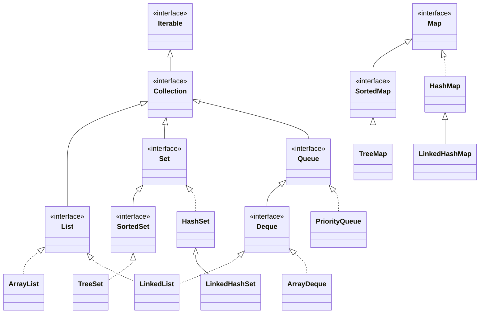
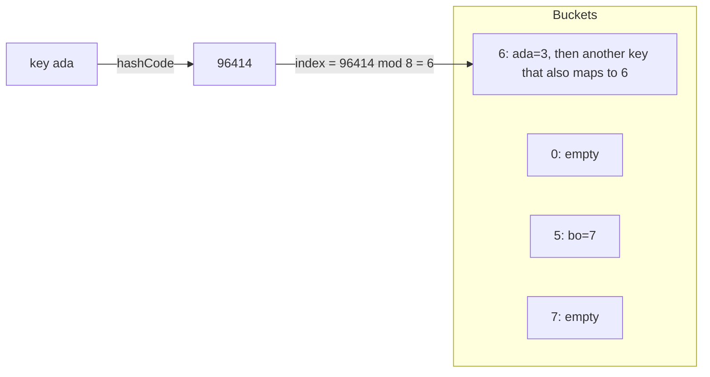
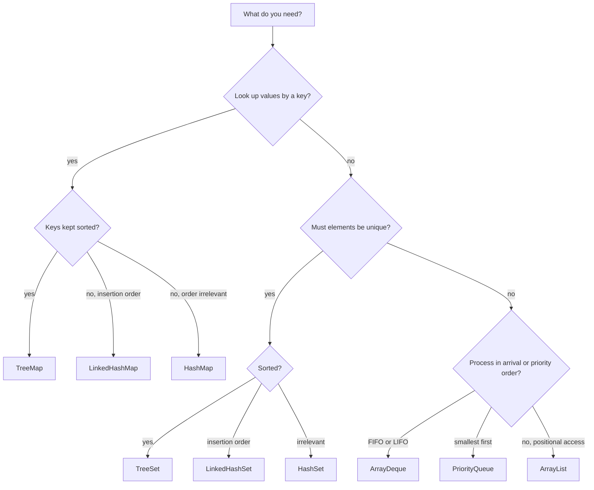

# Collections: List, Set, Map and Queue

> **Before this lesson:** you can use `ArrayList` and its type parameter ([ArrayList and reading the API documentation](#/lesson/java/java-arraylist-api)), you know interfaces ([Interfaces, default methods, sealed types and pattern matching](#/lesson/java/java-interfaces)) and the methods `equals` and `hashCode` that every object inherits ([Abstract classes and the Object class](#/lesson/java/java-abstract-object)).

## In plain words

A kitchen does not store everything in one kind of container. Plates go in a stack, because you take the top one. Spices go on a labelled rack, because you look them up by name. Cutlery goes in a divided tray. Choosing the right container is half of keeping a kitchen usable.

Programs store groups of objects, and the **Java Collections Framework** is the cupboard of ready-made containers. Four shapes cover nearly everything:

- a **List**: a numbered sequence, where order matters and duplicates are allowed (a playlist);
- a **Set**: a group with no duplicates (the unique visitors to a site);
- a **Map**: a lookup table from keys to values (a phone book: name to number);
- a **Queue** or **Deque**: a line where things are added at one end and taken from an end (jobs waiting for a printer).

Why this matters for a job: choosing the right collection is the most frequent design decision in everyday Java, and it decides whether code runs in a millisecond or a minute. Collection questions, especially how `HashMap` works and why `equals` and `hashCode` must agree, appear in almost every Java interview.

## The family tree



The interfaces say **what** a container can do. The classes say **how**. Note that `Map` is not a `Collection`: it stores pairs, not single elements, so it has its own root.

Declare variables with the interface and create objects of the class: `List<String> names = new ArrayList<>();`. The implementation can then be changed in one place.

## List: order and positions

```java
import java.util.ArrayList;
import java.util.List;

List<String> stops = new ArrayList<>(List.of("Depot", "Mill Lane", "Quay"));
stops.add("Mill Lane");                 // duplicates allowed
stops.add(1, "Bridge");                 // insert at a position
System.out.println(stops);
System.out.println(stops.get(2) + " " + stops.indexOf("Mill Lane") + " " + stops.lastIndexOf("Mill Lane"));
System.out.println(stops.subList(1, 3));
```

```text
[Depot, Bridge, Mill Lane, Quay, Mill Lane]
Mill Lane 2 4
[Bridge, Mill Lane]
```

| Implementation | Backed by | Strength | Weakness |
|---|---|---|---|
| `ArrayList` | a resizable array | fast `get(i)`; compact; the default choice | inserting or removing near the front shifts elements |
| `LinkedList` | nodes linked in both directions | constant-time add or remove at either end | slow `get(i)`; much more memory per element |

Use `ArrayList` unless you have measured a reason not to.

## Set: no duplicates

```java
import java.util.HashSet;
import java.util.LinkedHashSet;
import java.util.Set;
import java.util.TreeSet;

List<String> visits = List.of("noor", "ivo", "ada", "noor", "ada", "bo");

Set<String> hash = new HashSet<>(visits);
Set<String> linked = new LinkedHashSet<>(visits);
Set<String> tree = new TreeSet<>(visits);

System.out.println(hash.size() + " unique");
System.out.println(linked);
System.out.println(tree);
System.out.println(hash.add("bo") + " " + hash.add("cy") + " " + hash.contains("ivo"));
```

```text
4 unique
[noor, ivo, ada, bo]
[ada, bo, ivo, noor]
false true true
```

`add` returns `false` when the element was already present. The three implementations differ in order and speed:

| Implementation | Iteration order | `add` / `contains` / `remove` | Needs from elements |
|---|---|---|---|
| `HashSet` | no guaranteed order | constant time on average | correct `equals` and `hashCode` |
| `LinkedHashSet` | insertion order | constant time on average | correct `equals` and `hashCode` |
| `TreeSet` | sorted | proportional to the logarithm of the size | a natural order (`Comparable`) or a `Comparator` |

Set operations from mathematics are one method call each:

```java
Set<Integer> a = new TreeSet<>(Set.of(1, 2, 3, 4));
Set<Integer> b = Set.of(3, 4, 5);
a.retainAll(b);   System.out.println(a);      // intersection
a.addAll(b);      System.out.println(a);      // union
a.removeAll(Set.of(5));  System.out.println(a);   // difference
```

```text
[3, 4]
[3, 4, 5]
[3, 4]
```

## Map: look things up by key

A **map** stores **entries**: pairs of a **key** and a **value**. Keys are unique; each key leads to exactly one value.

```java
import java.util.HashMap;
import java.util.Map;
import java.util.TreeMap;

Map<String, Integer> stock = new HashMap<>();
stock.put("tea", 12);
stock.put("scone", 5);
stock.put("tea", 20);                              // same key: value replaced

System.out.println(stock.get("tea"));
System.out.println(stock.get("jam"));              // absent key: null
System.out.println(stock.getOrDefault("jam", 0));
System.out.println(stock.containsKey("scone") + " " + stock.size());

for (Map.Entry<String, Integer> e : stock.entrySet()) {
    System.out.println(e.getKey() + " -> " + e.getValue());
}
System.out.println(new TreeMap<>(stock).firstKey());
```

```text
20
null
0
true 2
tea -> 20
scone -> 5
scone
```

(The order of the two `->` lines is not guaranteed for a `HashMap`.)

Three views let you loop over a map: `keySet()`, `values()` and `entrySet()`. Use `entrySet()` when you need both, to avoid a second lookup.

### The counting idiom

Counting occurrences is the most common use of a map in interviews.

```java
String text = "to be or not to be";
Map<String, Integer> counts = new TreeMap<>();
for (String word : text.split(" ")) {
    counts.merge(word, 1, Integer::sum);           // insert 1, or add 1 to the existing value
}
System.out.println(counts);
```

```text
{be=2, not=1, or=1, to=2}
```

`merge(key, 1, Integer::sum)` means: "if the key is absent, store 1; otherwise replace the value with old plus 1". Two relatives are worth knowing:

```java
map.putIfAbsent(key, value);                                      // only if there is no value yet
map.computeIfAbsent(key, k -> new ArrayList<>()).add(item);       // grouping: create the list on first use
```

| Implementation | Key order | Speed of `get` / `put` | Notes |
|---|---|---|---|
| `HashMap` | none guaranteed | constant on average | the default; allows one `null` key |
| `LinkedHashMap` | insertion order (or access order) | constant on average | the basis of simple caches |
| `TreeMap` | sorted by key | logarithmic | offers `firstKey`, `floorKey`, `headMap`, ranges |
| `ConcurrentHashMap` | none | constant on average | safe for use by many threads; no `null` keys or values |

## How hashing works, and the equals/hashCode contract

`HashSet` and `HashMap` find an element without scanning, using its **hash code**: an `int` computed from the object by its `hashCode()` method.

1. The collection keeps an array of **buckets**.
2. To store a key, it calls `key.hashCode()`, turns the number into a bucket index, and puts the entry in that bucket.
3. To find a key, it computes the index the same way, goes directly to that one bucket, and compares the few entries there using `equals`.



Two different keys landing in the same bucket is a **collision**; the bucket then holds a short chain of entries. For this to work, a class used as a key or set element must obey a contract:

1. **Equal objects must have equal hash codes.** If `a.equals(b)` then `a.hashCode() == b.hashCode()`.
2. Unequal objects *may* share a hash code (collisions are legal, merely slower).
3. An object's hash code must not change while it is in the collection.

Break rule 1 and the collection looks in the wrong bucket:

```java
class Tag {
    final String label;
    Tag(String label) { this.label = label; }

    @Override
    public boolean equals(Object o) {
        return o instanceof Tag t && t.label.equals(label);
    }
    // hashCode NOT overridden: each object gets an identity-based number
}

Set<Tag> tags = new HashSet<>();
tags.add(new Tag("urgent"));
System.out.println(tags.contains(new Tag("urgent")));
tags.add(new Tag("urgent"));
System.out.println(tags.size());
```

```text
false
2
```

The two `Tag` objects are equal according to `equals`, yet they have different hash codes, so the second is sought in a different bucket and never compared. The set reports that it does not contain something it does contain, and accepts a duplicate. Adding the matching `hashCode` fixes both:

```java
@Override
public int hashCode() {
    return java.util.Objects.hash(label);
}
```

A record does this for you: `record Tag(String label) { }`.

### A bucket model you can run

```python-run
def java_string_hash(s):
    h = 0
    for ch in s:
        h = (31 * h + ord(ch)) & 0xFFFFFFFF          # 32-bit wrap, like Java int
    return h - (1 << 32) if h >= 1 << 31 else h

class TinyHashMap:
    def __init__(self, capacity=4, load_factor=0.75):
        self.buckets = [[] for _ in range(capacity)]
        self.size, self.load_factor = 0, load_factor

    def _index(self, key, n):
        return java_string_hash(key) % n               # Python's % is non-negative for n > 0

    def put(self, key, value):
        bucket = self.buckets[self._index(key, len(self.buckets))]
        for entry in bucket:
            if entry[0] == key:                        # equals(): replace
                entry[1] = value
                return
        bucket.append([key, value])
        self.size += 1
        if self.size > self.load_factor * len(self.buckets):
            self._resize()

    def _resize(self):
        old = [e for b in self.buckets for e in b]
        self.buckets = [[] for _ in range(len(self.buckets) * 2)]
        for k, v in old:
            self.buckets[self._index(k, len(self.buckets))].append([k, v])
        print(f"   resized to {len(self.buckets)} buckets")

    def show(self):
        for i, b in enumerate(self.buckets):
            print(f"   {i}: {b}")

m = TinyHashMap()
for i, name in enumerate(["ada", "bo", "cy", "di", "eve", "ada"]):
    print(f"put({name!r}, {i})")
    m.put(name, i)
m.show()
print("size:", m.size)
```

When the number of entries exceeds the capacity times the **load factor** (0.75 by default), the table doubles and every entry is placed again. The real `HashMap` adds refinements, covered in [Strings, equals/hashCode, HashMap and ConcurrentHashMap internals](#/lesson/java/java-iv-strings-hashmap).

> [!WARNING]
> Never change a field that takes part in `equals` or `hashCode` while the object is a key in a `HashMap` or an element of a `HashSet`. The entry stays in its old bucket and becomes unfindable. Immutable keys (`String`, `Integer`, records, enums) make this impossible.

## Queue and Deque: lines and stacks

A **queue** serves elements in order of arrival: first in, first out (FIFO). A **deque** (double-ended queue, pronounced "deck") allows adding and removing at both ends, so it also works as a **stack**: last in, first out (LIFO).

```java
import java.util.ArrayDeque;
import java.util.Deque;
import java.util.PriorityQueue;
import java.util.Queue;

Queue<String> line = new ArrayDeque<>();
line.offer("ada");  line.offer("bo");  line.offer("cy");
System.out.println(line.peek() + " " + line.poll() + " " + line);

Deque<String> stack = new ArrayDeque<>();
stack.push("page1");  stack.push("page2");  stack.push("page3");
System.out.println(stack.peek() + " " + stack.pop() + " " + stack);

Queue<Integer> urgent = new PriorityQueue<>();
urgent.offer(40);  urgent.offer(5);  urgent.offer(17);
System.out.println(urgent.poll() + " " + urgent.poll() + " " + urgent.poll());
```

```text
ada ada [bo, cy]
page3 page3 [page2, page1]
5 17 40
```

- `ArrayDeque` is the right class for both queues and stacks. The old `Stack` class is a legacy and should be avoided.
- A `PriorityQueue` always hands out the **smallest** element first according to the elements' order, whatever the order of insertion. Iterating over it does not visit elements in sorted order; only repeated `poll` does.

Each operation exists in two forms:

| | Throws an exception on failure | Returns a special value |
|---|---|---|
| Insert | `add(e)` | `offer(e)` returns `false` |
| Remove | `remove()` | `poll()` returns `null` |
| Examine | `element()` | `peek()` returns `null` |

## Choosing a collection



## Unmodifiable and utility collections

```java
import java.util.Collections;

List<Integer> fixed = List.of(3, 1, 2);                  // unmodifiable, no nulls
Map<String, Integer> prices = Map.of("tea", 2, "jam", 4);
List<Integer> snapshot = List.copyOf(new ArrayList<>(fixed));     // unmodifiable copy

List<Integer> nums = new ArrayList<>(fixed);
Collections.sort(nums);
Collections.reverse(nums);
System.out.println(nums + " max=" + Collections.max(nums) + " freq=" + Collections.frequency(nums, 2));
List<Integer> view = Collections.unmodifiableList(nums);  // read-only VIEW of a list that can still change
nums.add(9);
System.out.println(view);
```

```text
[3, 2, 1] max=3 freq=1
[3, 2, 1, 9]
```

`Collections.unmodifiableList` gives a read-only window onto the original; changes to the original show through. `List.copyOf` takes an independent snapshot.

## Iterating safely

Every collection is `Iterable`, which is what lets for-each work. Behind the loop is an `Iterator` with `hasNext()` and `next()`. Most collections' iterators are **fail-fast**: if the collection is structurally modified during iteration by anything other than the iterator itself, the next step throws `ConcurrentModificationException`.

```java
Set<String> words = new HashSet<>(Set.of("a", "bb", "ccc"));
words.removeIf(w -> w.length() == 2);                       // safe
for (var it = words.iterator(); it.hasNext(); ) {
    if (it.next().length() == 3) {
        it.remove();                                        // safe: through the iterator
    }
}
System.out.println(words);
```

```text
[a]
```

> [!INTERVIEW]
> "`HashMap` versus `TreeMap` versus `LinkedHashMap`?" `HashMap`: hash table, constant-time average operations, no order. `LinkedHashMap`: hash table plus a linked list through the entries, predictable insertion (or access) order at a small memory cost. `TreeMap`: red-black tree, logarithmic operations, keys sorted, with navigation methods. Then the follow-up everyone asks: "What happens if you override `equals` but not `hashCode`?" Equal objects may hash to different buckets, so hash-based collections fail to find them and allow duplicates.

## Pitfalls

- **Overriding `equals` without `hashCode`**, or the reverse.
- **Mutable keys** in hash-based collections.
- **Relying on `HashMap` or `HashSet` iteration order.** It can change between runs and Java versions.
- **`TreeSet` or `TreeMap` with elements that are not comparable**: `ClassCastException` at run time.
- **Unboxing `map.get(key)`** for an absent key: `NullPointerException`.
- **Modifying a collection during for-each.**
- **Using `LinkedList` or `Stack`** where `ArrayList` or `ArrayDeque` is better.
- **`list.contains` in a loop** over a large list: quadratic time. Put the data in a `HashSet`.
- **Sharing ordinary collections between threads.**
- **Putting `null` into `List.of`, `Set.of` or `Map.of`**: `NullPointerException`.

## Cheat sheet

| Need | Use |
|---|---|
| Ordered, indexed, duplicates | `ArrayList` |
| Unique, fastest | `HashSet` |
| Unique, insertion order | `LinkedHashSet` |
| Unique, sorted | `TreeSet` |
| Key to value | `HashMap` |
| Key to value, sorted keys | `TreeMap` |
| Key to value, insertion order | `LinkedHashMap` |
| FIFO queue or stack | `ArrayDeque` |
| Smallest first | `PriorityQueue` |
| Count things | `map.merge(k, 1, Integer::sum)` |
| Group things | `map.computeIfAbsent(k, x -> new ArrayList<>()).add(v)` |
| Fixed small collection | `List.of`, `Set.of`, `Map.of` |

## Summary

- The framework is organised by interfaces (`List`, `Set`, `Map`, `Queue`, `Deque`) with several implementations each.
- Lists keep positions and duplicates; sets reject duplicates; maps associate unique keys with values; queues and deques process elements from the ends.
- Hash-based collections are fast because `hashCode` selects a bucket and `equals` confirms the match; the two methods must agree.
- Tree-based collections keep elements sorted at logarithmic cost.
- Choose by asking: lookup by key? uniqueness? ordering? access pattern?

## Glossary

- **Collection**: an object that holds a group of other objects.
- **List**: an ordered collection with positional access that permits duplicates.
- **Set**: a collection with no duplicate elements.
- **Map**: a collection of key-value entries with unique keys.
- **Entry**: one key-value pair in a map.
- **Queue**: a collection processed in first-in, first-out order.
- **Deque**: a double-ended queue; also usable as a stack.
- **Stack**: a last-in, first-out collection.
- **Hash code**: an `int` summary of an object used to choose a bucket.
- **Bucket**: one slot of a hash table's array.
- **Collision**: two different keys falling into the same bucket.
- **Load factor**: the fullness threshold at which a hash table grows.
- **Fail-fast iterator**: an iterator that throws if its collection is modified behind its back.
- **Unmodifiable collection**: one that rejects all changes.

## Check yourself

```quiz
[
  {"q": "What does this print? `Set<String> s = new HashSet<>(); s.add(\"a\"); s.add(\"b\"); s.add(\"a\"); System.out.println(s.size());`", "options": ["1", "2", "3", "It throws"], "answer": 1,
   "explain": "A set ignores a duplicate add; the second add of \"a\" returns false."},
  {"q": "What does this print? `Map<String,Integer> m = new HashMap<>(); m.put(\"k\", 1); m.put(\"k\", 2); System.out.println(m.size() + \" \" + m.get(\"k\"));`", "options": ["2 1", "1 2", "2 2", "1 1"], "answer": 1,
   "explain": "Keys are unique. The second put replaces the value for the existing key."},
  {"q": "A class overrides `equals` to compare an id field but does not override `hashCode`. Two equal instances are added to a HashSet. What is the likely size?", "options": ["1", "2", "0", "It throws"], "answer": 1,
   "explain": "The inherited hashCode differs per object, so they usually land in different buckets and are never compared with equals."},
  {"q": "Which collection iterates its elements in sorted order?", "options": ["HashSet", "LinkedHashSet", "TreeSet", "ArrayList"], "answer": 2,
   "explain": "TreeSet keeps elements ordered by their natural order or a Comparator."},
  {"q": "What does this print? `Deque<Integer> d = new ArrayDeque<>(); d.push(1); d.push(2); d.offer(3); System.out.println(d.pop() + \" \" + d.poll());`", "options": ["2 1", "1 2", "3 2", "2 3"], "answer": 0,
   "explain": "push adds at the front: [2, 1]. offer adds at the back: [2, 1, 3]. pop and poll both remove from the front: 2 then 1."},
  {"q": "What happens? `Set<Object> t = new TreeSet<>(); t.add(\"x\"); t.add(5);`", "options": ["Works; the set holds both", "Compile-time error", "ClassCastException at run time", "The second add is ignored"], "answer": 2,
   "explain": "TreeSet must compare elements. A String and an Integer cannot be compared with each other."},
  {"q": "What does `new PriorityQueue<>(List.of(9, 2, 6)).poll()` return?", "options": ["9", "2", "6", "null"], "answer": 1,
   "explain": "A PriorityQueue hands out the smallest element first by natural order."},
  {"q": "Which loop safely removes all empty strings from `List<String> xs`?", "options": ["for (String x : xs) if (x.isEmpty()) xs.remove(x);", "xs.removeIf(String::isEmpty);", "for (int i = 0; i < xs.size(); i++) if (xs.get(i).isEmpty()) xs.remove(i);", "xs.forEach(x -> xs.remove(x));"], "answer": 1,
   "explain": "removeIf is safe and correct. The first throws ConcurrentModificationException; the third skips the element after each removal."}
]
```

> **Source:** Head First Java, ch. 16 (collections: List, Set, Map, HashSet and the equals/hashCode contract, TreeSet). Checked against the Collections Framework overview and API: https://docs.oracle.com/en/java/javase/21/docs/api/java.base/java/util/doc-files/coll-overview.html and https://dev.java/learn/api/collections-framework/ .
