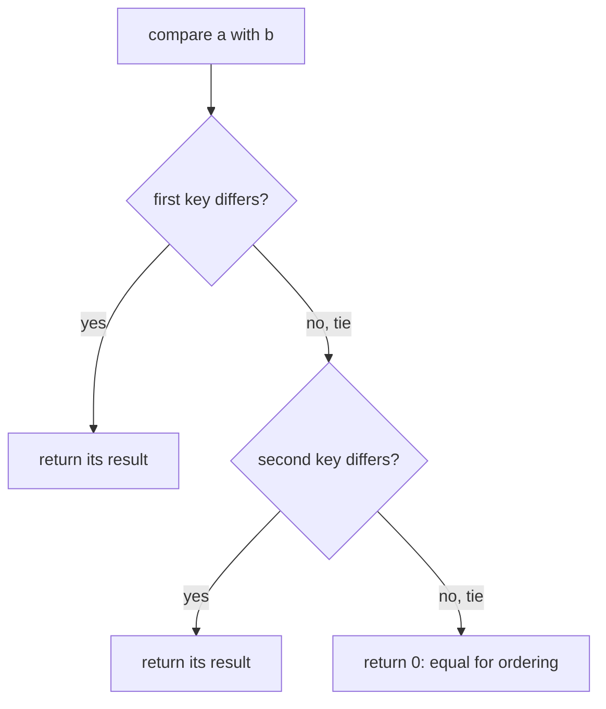

# Sorting with Comparable and Comparator

> **Before this lesson:** you can use lists, sets and maps ([Collections: List, Set, Map and Queue](#/lesson/java/java-collections)), you know interfaces ([Interfaces, default methods, sealed types and pattern matching](#/lesson/java/java-interfaces)) and have met lambdas as short functions ([Nested, inner, local and anonymous classes](#/lesson/java/java-inner-classes)).

## In plain words

Ask ten people to line up "in order" and they will ask: in order of what? Height? Age? Surname? People have no single built-in order, so somebody must supply the rule. Numbers are different: everyone agrees that 3 comes before 7. Words have a customary rule too, the dictionary.

Java sorts the same way. Some types come with an agreed order, called their **natural ordering**: numbers ascend, strings follow character codes. For your own classes (`Employee`, `Song`, `Order`) you must supply the rule, and Java gives you two places to put it:

- **inside the class**, by implementing the interface `Comparable`: "this is how objects of my type normally compare";
- **outside the class**, in a separate object that implements `Comparator`: "for this particular sort, compare this way".

Why this matters for a job: sorting records by one or several fields is everyday work, and "what is the difference between `Comparable` and `Comparator`?" is among the most frequently asked Java questions. Multi-key sorts are a staple of coding rounds.

## Sorting things that already have an order

```java
import java.util.ArrayList;
import java.util.Collections;
import java.util.List;

List<Integer> nums = new ArrayList<>(List.of(40, 7, 23, 7));
Collections.sort(nums);
System.out.println(nums);

List<String> words = new ArrayList<>(List.of("pear", "Fig", "apple", "Banana"));
Collections.sort(words);
System.out.println(words);
```

```text
[7, 7, 23, 40]
[Banana, Fig, apple, pear]
```

The strings look wrong at first glance. `String`'s natural ordering compares character codes, and every capital letter has a smaller code than every lower-case letter, so `"Fig"` sorts before `"apple"`. A different rule fixes that, as shown below.

## The problem with your own class

```java
class Song {
    final String title;
    final String artist;
    final int seconds;

    Song(String title, String artist, int seconds) {
        this.title = title;
        this.artist = artist;
        this.seconds = seconds;
    }

    @Override
    public String toString() { return title + " (" + artist + ", " + seconds + "s)"; }
}

List<Song> songs = new ArrayList<>();
songs.add(new Song("Tides", "Mara", 215));
// Collections.sort(songs);    // does not compile
```

```text
error: no suitable method found for sort(List<Song>)
    inference variable T has incompatible bounds: ... Song is not within bounds; should implement Comparable
```

`Collections.sort(list)` accepts only lists whose elements know how to compare themselves. The compiler is telling you that `Song` has no natural ordering.

## Comparable: the natural ordering, inside the class

```java
public interface Comparable<T> {
    int compareTo(T other);
}
```

The single method returns an `int` whose **sign** carries the answer:

| `a.compareTo(b)` returns | Meaning |
|---|---|
| a negative number | `a` comes **before** `b` |
| zero | they are equal for ordering purposes |
| a positive number | `a` comes **after** `b` |

```java
class Song implements Comparable<Song> {
    final String title;
    final String artist;
    final int seconds;

    Song(String title, String artist, int seconds) {
        this.title = title; this.artist = artist; this.seconds = seconds;
    }

    @Override
    public int compareTo(Song other) {
        return title.compareTo(other.title);        // delegate to String's ordering
    }

    @Override
    public String toString() { return title + " (" + artist + ", " + seconds + "s)"; }
}
```

```java
List<Song> songs = new ArrayList<>(List.of(
        new Song("Tides", "Mara", 215),
        new Song("Harbour", "Ivo", 187),
        new Song("Night Trains", "Mara", 240),
        new Song("Ash", "Bo", 187)));
Collections.sort(songs);
for (Song s : songs) {
    System.out.println(s);
}
```

```text
Ash (Bo, 187s)
Harbour (Ivo, 187s)
Night Trains (Mara, 240s)
Tides (Mara, 215s)
```

A class can implement `Comparable` only once, so it has one natural ordering. That is right for types with an obvious default order (dates, version numbers, money amounts), and limiting when different screens need different sort orders.

## Comparator: an ordering from outside

```java
public interface Comparator<T> {
    int compare(T a, T b);
}
```

A `Comparator` is a separate object that compares **two** given objects, with the same sign convention. You can have as many as you like, for classes you cannot edit, and each sort chooses the one it needs.

```java
import java.util.Comparator;

class BySeconds implements Comparator<Song> {
    @Override
    public int compare(Song a, Song b) {
        return Integer.compare(a.seconds, b.seconds);
    }
}

songs.sort(new BySeconds());                                    // a named class
songs.sort((a, b) -> Integer.compare(a.seconds, b.seconds));    // the same rule as a lambda
songs.sort(Comparator.comparingInt(s -> s.seconds));            // the same rule from a factory method
System.out.println(songs);
```

```text
[Ash (Bo, 187s), Harbour (Ivo, 187s), Tides (Mara, 215s), Night Trains (Mara, 240s)]
```

`list.sort(comparator)` is the modern form; `Collections.sort(list, comparator)` is the older equivalent. Passing `null` to `list.sort` means "use the natural ordering".

Look at the first two results. Ash and Harbour both last 187 seconds, so this comparator calls them equal. They appear in the order they already had (the list was sorted by title a moment ago, which put Ash ahead of Harbour). That is not luck. Java's sort for objects is **stable**: elements that compare as equal keep their previous relative order. Stability is what makes sorting by several keys predictable, as you will see shortly.

| | `Comparable<T>` | `Comparator<T>` |
|---|---|---|
| Package | `java.lang` | `java.util` |
| Method | `int compareTo(T other)` | `int compare(T a, T b)` |
| Where the rule lives | in the class being sorted | in a separate object |
| How many orderings | one: the natural ordering | any number |
| Needs to edit the class | yes | no |
| Used by | `Collections.sort(list)`, `TreeSet`, `TreeMap` by default | `list.sort(cmp)`, `new TreeSet<>(cmp)`, streams |



The diagram shows how a comparison on several keys proceeds: later keys are consulted only to break ties.

## Building comparators the modern way

Since Java 8, `Comparator` has static and default methods that assemble comparators from small pieces. A **key extractor** is a function that pulls the value to sort by out of an object.

```java
Comparator<Song> byArtist = Comparator.comparing(s -> s.artist);
Comparator<Song> byArtistThenTitle = byArtist.thenComparing(s -> s.title);
Comparator<Song> longestFirst = Comparator.comparingInt((Song s) -> s.seconds).reversed();
Comparator<Song> artistThenLongest =
        Comparator.comparing((Song s) -> s.artist)
                  .thenComparing(Comparator.comparingInt((Song s) -> s.seconds).reversed());

songs.sort(artistThenLongest);
for (Song s : songs) {
    System.out.println(s);
}
```

```text
Ash (Bo, 187s)
Harbour (Ivo, 187s)
Night Trains (Mara, 240s)
Tides (Mara, 215s)
```

Read `artistThenLongest` as a sentence: compare by artist; **if those are equal**, compare by seconds, longest first. Within the artist Mara, the 240-second song precedes the 215-second one.

| Building block | Purpose |
|---|---|
| `Comparator.comparing(keyFn)` | compare by a key that is itself `Comparable` |
| `comparingInt`, `comparingLong`, `comparingDouble` | the same for primitive keys, without boxing |
| `.thenComparing(...)` | tie-breaker used only when the previous comparison returns 0 |
| `.reversed()` | flip the whole comparator built so far |
| `Comparator.naturalOrder()`, `reverseOrder()` | natural ordering, and its reverse |
| `Comparator.nullsFirst(cmp)`, `nullsLast(cmp)` | tolerate `null` values |
| `String.CASE_INSENSITIVE_ORDER` | ready-made comparator ignoring case |

With getter methods or records the extractor is usually a **method reference**: `Comparator.comparing(Song::artist)`.

```java
List<String> words = new ArrayList<>(List.of("pear", "Fig", "apple", "Banana"));
words.sort(String.CASE_INSENSITIVE_ORDER);
System.out.println(words);
words.sort(Comparator.comparingInt(String::length).thenComparing(Comparator.reverseOrder()));
System.out.println(words);
```

```text
[apple, Banana, Fig, pear]
[Fig, pear, apple, Banana]
```

> [!WARNING]
> `.reversed()` reverses **everything before it** in the chain. `comparing(a).thenComparing(b).reversed()` reverses both keys. To reverse only the second key, reverse it separately: `comparing(a).thenComparing(Comparator.comparing(b).reversed())`.

## Writing a correct compare method

### Never subtract

A tempting shortcut is `return a.seconds - b.seconds;`. It gives the right sign until the subtraction **overflows**:

```java
int a = 2_000_000_000;
int b = -2_000_000_000;
System.out.println(a - b);                       // should be positive
System.out.println(Integer.compare(a, b));
```

```text
-294967296
1
```

The subtraction wrapped round to a negative number, claiming that two billion is smaller than minus two billion. Always use `Integer.compare`, `Long.compare`, `Double.compare`, or the `comparing...` factories.

### The rules a comparison must obey

A comparison rule is only usable for sorting if it is consistent. For all `a`, `b`, `c`:

1. **Antisymmetry**: the sign of `compare(a, b)` is the opposite of the sign of `compare(b, a)`.
2. **Transitivity**: if `a` is before `b` and `b` is before `c`, then `a` is before `c`.
3. **Consistency of ties**: if `compare(a, b) == 0`, then `a` and `b` compare the same way against every other object.

Breaking these can cause `IllegalArgumentException: Comparison method violates its general contract!` from the sort, or silently wrong results.

### Consistency with equals

It is strongly recommended that `a.compareTo(b) == 0` exactly when `a.equals(b)`. Sorted collections use the comparison, not `equals`, to decide whether two elements are "the same":

```java
import java.util.Set;
import java.util.TreeSet;

Set<Song> byLength = new TreeSet<>(Comparator.comparingInt((Song s) -> s.seconds));
byLength.add(new Song("Harbour", "Ivo", 187));
byLength.add(new Song("Ash", "Bo", 187));          // compares as 0 with Harbour: treated as a duplicate
System.out.println(byLength.size());
```

```text
1
```

The second song vanished because the comparator said it was equal to the first. Add a tie-breaker (`.thenComparing(s -> s.title)`) so that only truly identical songs compare as zero.

## How the sort works: stability and cost

`List.sort` and `Collections.sort` use **TimSort**, a refined merge sort.

- It is **stable**: equal elements keep their relative order.
- It takes time proportional to $n \log n$ in the worst case and close to $n$ on data that is already nearly sorted.

Stability enables an old trick: to sort by artist and then by title, sort by the **least important key first**, then by the more important one. Each later sort preserves the earlier order among ties. `thenComparing` does the same job in one pass and is clearer.

Arrays of primitives (`Arrays.sort(int[])`) use a different algorithm (dual-pivot quicksort), which is not stable; stability is meaningless for primitives because equal values are indistinguishable.

### A multi-key sort you can run

```python-run
from functools import cmp_to_key

songs = [("Tides", "Mara", 215), ("Harbour", "Ivo", 187),
         ("Night Trains", "Mara", 240), ("Ash", "Bo", 187), ("Ember", "Mara", 240)]

def java_compare(a, b):                 # Integer.compare / String.compareTo sign convention
    return (a > b) - (a < b)

def artist_then_longest_then_title(x, y):
    c = java_compare(x[1], y[1])                    # 1st key: artist ascending
    if c != 0: return c
    c = java_compare(y[2], x[2])                    # 2nd key: seconds DESCENDING (arguments swapped)
    if c != 0: return c
    return java_compare(x[0], y[0])                 # 3rd key: title ascending

for s in sorted(songs, key=cmp_to_key(artist_then_longest_then_title)):
    print(s)

print("\nSame result with two stable passes, least important key first:")
step1 = sorted(songs, key=lambda s: s[0])                    # title
step2 = sorted(step1, key=lambda s: -s[2])                   # seconds descending (stable)
step3 = sorted(step2, key=lambda s: s[1])                    # artist (stable)
print(step3 == sorted(songs, key=cmp_to_key(artist_then_longest_then_title)))
```

Swapping the two arguments is how a hand-written comparison reverses one key. Each `if c != 0: return c` is one `thenComparing`.

## Sorted collections and other uses

A comparison rule is not only for `sort`.

```java
import java.util.Arrays;
import java.util.TreeMap;

TreeMap<String, Integer> scores = new TreeMap<>(Comparator.reverseOrder());
scores.put("ada", 91);  scores.put("cy", 64);  scores.put("bo", 78);
System.out.println(scores);

String[] arr = {"kiwi", "fig", "banana"};
Arrays.sort(arr, Comparator.comparingInt(String::length));
System.out.println(Arrays.toString(arr));

System.out.println(Collections.max(List.of("kiwi", "fig", "banana"), Comparator.comparingInt(String::length)));
int pos = Collections.binarySearch(List.of(3, 8, 15, 20), 15);
System.out.println(pos);
```

```text
{cy=64, bo=78, ada=91}
[fig, kiwi, banana]
banana
2
```

`binarySearch` finds an element in logarithmic time, but only in a list that is already sorted by the same rule.

## Records make it tidy

```java
record Employee(String dept, String name, int salary) implements Comparable<Employee> {
    private static final Comparator<Employee> ORDER =
            Comparator.comparing(Employee::dept)
                      .thenComparing(Employee::salary, Comparator.reverseOrder())
                      .thenComparing(Employee::name);

    @Override
    public int compareTo(Employee other) {
        return ORDER.compare(this, other);
    }
}
```

Defining the natural ordering by delegating to a static comparator keeps the rule readable and avoids hand-written sign logic.

> [!INTERVIEW]
> "`Comparable` versus `Comparator`?" *`Comparable` is implemented by the class itself and defines its single natural ordering through `compareTo(T)`. `Comparator` is an external strategy object with `compare(T, T)`; you can define many, including for classes you do not own, and pass them to `sort`, `TreeMap`, `PriorityQueue` or streams.* Then add two things that mark you as experienced: do not implement comparison by subtraction because of overflow, and keep `compareTo` consistent with `equals` or sorted sets will drop "duplicates".

## Pitfalls

- **Subtracting to compare** ints or longs.
- **Comparing doubles with `(int) (a - b)`**: differences smaller than one become zero.
- **An inconsistent comparator** (not transitive, or random).
- **Forgetting a tie-breaker** when the comparator drives a `TreeSet` or `TreeMap`.
- **Misplacing `.reversed()`** in a chain.
- **Sorting an unmodifiable list** (`List.of(...).sort(...)` throws `UnsupportedOperationException`).
- **Comparing boxed `Integer` fields with `==` or `<` hacks**; use `Integer.compare` or `compareTo`.
- **Expecting `HashMap` to stay sorted** after you sorted its keys once. Use `TreeMap` or sort the entries when needed.
- **Case-sensitive string sorting** when the user expects dictionary order.

## Cheat sheet

| Goal | Code |
|---|---|
| Natural-order sort | `Collections.sort(list)` or `list.sort(null)` |
| Sort with a rule | `list.sort(comparator)` |
| By one field | `Comparator.comparing(Song::title)` |
| By an int field | `Comparator.comparingInt(Song::seconds)` |
| Descending | `.reversed()` or `Comparator.reverseOrder()` |
| Tie-breaker | `.thenComparing(Song::artist)` |
| Nulls | `Comparator.nullsLast(Comparator.naturalOrder())` |
| Ignore case | `String.CASE_INSENSITIVE_ORDER` |
| Safe int compare | `Integer.compare(a, b)` |
| Sort an array | `Arrays.sort(arr)` / `Arrays.sort(arr, cmp)` |
| Sorted set / map | `new TreeSet<>(cmp)`, `new TreeMap<>(cmp)` |

## Summary

- `Comparable.compareTo` gives a class its one natural ordering; `Comparator.compare` supplies any number of external orderings.
- Both return negative, zero or positive for before, equal, after.
- Build comparators with `comparing`, `thenComparing` and `reversed` instead of hand-written arithmetic; never compare by subtraction.
- Java's object sort is stable and takes time proportional to $n \log n$.
- Sorted collections treat "compares as zero" as "duplicate", so comparisons should agree with `equals`.

## Glossary

- **Natural ordering**: the default order of a type, defined by `compareTo`.
- **`Comparable`**: the interface a class implements to define its natural ordering.
- **`Comparator`**: a separate object that defines an ordering over some type.
- **Key extractor**: a function returning the value by which to compare.
- **Tie-breaker**: a secondary comparison used when the primary one reports equality.
- **Stable sort**: a sort that keeps equal elements in their original relative order.
- **TimSort**: the stable merge-sort variant used for objects in Java.
- **Method reference**: shorthand such as `Song::title` for a lambda that calls one method.
- **Consistent with equals**: `compareTo` returns zero exactly when `equals` returns true.
- **Binary search**: finding an element in a sorted sequence by repeated halving.

## Check yourself

```quiz
[
  {"q": "What does `\"apple\".compareTo(\"banana\")` return?", "options": ["A positive number", "Zero", "A negative number", "true"], "answer": 2,
   "explain": "'a' has a smaller code than 'b', so apple comes before banana and the result is negative."},
  {"q": "Does this compile? `class P { int age; }` then `List<P> ps = new ArrayList<>(); Collections.sort(ps);`", "options": ["Yes, sorted by age", "No: P does not implement Comparable", "Yes, but throws at run time", "Yes, order unchanged"], "answer": 1,
   "explain": "The one-argument sort requires elements with a natural ordering. Supply a Comparator or implement Comparable."},
  {"q": "What does this print? `List<String> w = new ArrayList<>(List.of(\"bb\", \"a\", \"ccc\")); w.sort(Comparator.comparingInt(String::length).reversed()); System.out.println(w);`", "options": ["[a, bb, ccc]", "[ccc, bb, a]", "[bb, a, ccc]", "[a, ccc, bb]"], "answer": 1,
   "explain": "Sorted by length, then the whole order reversed: longest first."},
  {"q": "Why is `return a.id - b.id;` a risky compare implementation?", "options": ["It is slower", "The subtraction can overflow and give the wrong sign", "It does not compile", "It is not stable"], "answer": 1,
   "explain": "With values of opposite sign and large magnitude the int subtraction wraps around. Use Integer.compare."},
  {"q": "What does this print? `Set<String> t = new TreeSet<>(Comparator.comparingInt(String::length)); t.add(\"cat\"); t.add(\"dog\"); t.add(\"horse\"); System.out.println(t.size());`", "options": ["3", "2", "1", "It throws"], "answer": 1,
   "explain": "cat and dog have the same length, so the comparator returns 0 and the TreeSet treats dog as a duplicate."},
  {"q": "A list is sorted by name, then (with a stable sort) by city. What is the final order?", "options": ["By name only", "By city, and by name within each city", "By name, and by city within each name", "Unpredictable"], "answer": 1,
   "explain": "The last sort decides the primary order; stability preserves the earlier name order among equal cities."},
  {"q": "In `Comparator.comparing(E::dept).thenComparing(E::name).reversed()`, what is reversed?", "options": ["Only name", "Only dept", "The whole ordering: dept descending, then name descending", "Nothing"], "answer": 2,
   "explain": "reversed() applies to the comparator built so far, which includes both keys."},
  {"q": "What does `List.of(3, 1, 2).sort(null)` do?", "options": ["Sorts to [1, 2, 3]", "Throws UnsupportedOperationException", "Does nothing", "Does not compile"], "answer": 1,
   "explain": "List.of returns an unmodifiable list. Sorting is a modification."}
]
```

> **Source:** Head First Java, ch. 16 (sorting with Collections.sort, Comparable and Comparator; newer edition adds lambdas and Comparator factories). Checked against https://docs.oracle.com/en/java/javase/21/docs/api/java.base/java/util/Comparator.html and https://docs.oracle.com/en/java/javase/21/docs/api/java.base/java/lang/Comparable.html .
