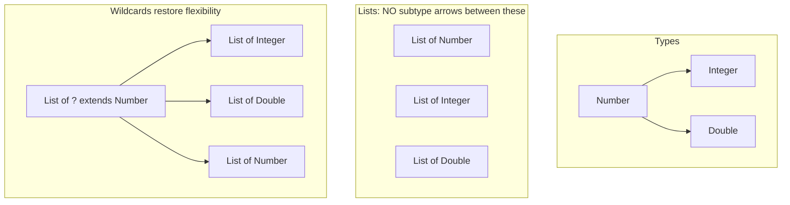

# Generics, wildcards and bounds

> **Before this lesson:** you have used `ArrayList<String>` and `Map<String, Integer>` ([Collections: List, Set, Map and Queue](#/lesson/java/java-collections)), and you understand inheritance, polymorphism and casts ([Polymorphism, overriding and overloading](#/lesson/java/java-polymorphism), [Abstract classes and the Object class](#/lesson/java/java-abstract-object)).

## In plain words

A removal firm labels its boxes. A box marked "BOOKS" should contain books. If the boxes carry no labels, a mover can put a frying pan into the box of paperbacks, and nobody notices until the box is opened in the new house. With labels, the mistake is caught at the moment of packing.

Before Java 5, collections were unlabelled boxes: every list held `Object`, anything could go in, and every item taken out had to be cast, with a crash at run time if the cast was wrong. **Generics** are the labels. `List<String>` is a box marked "strings only". The compiler checks every `add` and knows the type of every `get`, so errors move from run time, in front of the customer, to compile time, on your desk.

Why this matters for a job: every collection, stream and optional in modern Java is generic. Reading signatures such as `<T extends Comparable<? super T>> void sort(List<T> list)` is a required skill, and interviewers love "why is a `List<Dog>` not a `List<Animal>`?" and "what is type erasure?".

## Life before generics

```java
import java.util.ArrayList;
import java.util.List;

List names = new ArrayList();          // a "raw" list: holds Object
names.add("Ada");
names.add(42);                         // nothing stops this
String first = (String) names.get(0);  // cast required
String second = (String) names.get(1); // compiles; fails when run
```

```text
Exception in thread "main" java.lang.ClassCastException: class java.lang.Integer cannot be cast to class java.lang.String
```

With a type argument, the same mistake cannot be compiled:

```java
List<String> names = new ArrayList<>();
names.add("Ada");
// names.add(42);                      // error: incompatible types: int cannot be converted to String
String first = names.get(0);           // no cast
```

A generic type used without its angle brackets, like `List` above, is called a **raw type**. Raw types exist only so that pre-2004 code still compiles. Never write them in new code.

## Writing a generic class

A **generic class** declares one or more **type parameters** in angle brackets after its name. Inside the class a type parameter is used like any type.

```java
class Pair<A, B> {
    private final A first;
    private final B second;

    Pair(A first, B second) {
        this.first = first;
        this.second = second;
    }

    A getFirst()  { return first; }
    B getSecond() { return second; }

    Pair<B, A> swap() { return new Pair<>(second, first); }
}

public class Pairs {
    public static void main(String[] args) {
        Pair<String, Integer> p = new Pair<>("tea", 3);
        String name = p.getFirst();               // the compiler knows this is a String
        int qty = p.getSecond();                  // an Integer, unboxed
        Pair<Integer, String> q = p.swap();
        System.out.println(name + " " + qty + " " + q.getFirst());
    }
}
```

```text
tea 3 3
```

- `class Pair<A, B>` declares two type parameters. By convention they are single capital letters: `T` (type), `E` (element), `K` and `V` (key and value), `R` (result).
- `Pair<String, Integer>` supplies **type arguments**. Within that variable's uses, `A` means `String` and `B` means `Integer`.
- `new Pair<>("tea", 3)` uses the **diamond**: the compiler infers the arguments from the left-hand side.
- Type arguments must be reference types: `Pair<int, int>` is not allowed; use `Pair<Integer, Integer>`.

Records and interfaces can be generic in the same way: `record Pair<A, B>(A first, B second) { }`, `interface Repository<T> { T findById(long id); }`.

## Generic methods

A method can have its own type parameters, declared **before the return type**. It need not be in a generic class.

```java
import java.util.List;

class Lists {
    static <T> T firstOr(List<T> list, T fallback) {
        return list.isEmpty() ? fallback : list.get(0);
    }

    static <T> void swap(T[] array, int i, int j) {
        T tmp = array[i];
        array[i] = array[j];
        array[j] = tmp;
    }
}
```

```java
String s = Lists.firstOr(List.of("a", "b"), "none");
Integer n = Lists.firstOr(List.<Integer>of(), -1);
System.out.println(s + " " + n);
```

```text
a -1
```

The `<T>` before the return type says "this method works for any type `T`". You almost never write the argument at the call; the compiler **infers** it from the arguments. The method links its parameter types and its return type: whatever kind of list goes in, that kind of element comes out.

## Bounded type parameters

A plain `T` could be anything, so inside the method you may only use `Object`'s methods on it. A **bound** restricts `T` and unlocks the bound's methods.

```java
static <T extends Comparable<T>> T largest(List<T> items) {
    T best = items.get(0);
    for (T item : items) {
        if (item.compareTo(best) > 0) {        // allowed because T is known to be Comparable
            best = item;
        }
    }
    return best;
}
```

```java
System.out.println(largest(List.of(4, 19, 7)));
System.out.println(largest(List.of("pear", "fig", "plum")));
// largest(List.of(new Object()));              // does not compile: Object is not Comparable
```

```text
19
plum
```

`<T extends Comparable<T>>` reads "any type `T` that can be compared with other `T`s". In a bound, the word `extends` is used for classes **and** interfaces alike. Several bounds are joined with `&`, class first: `<T extends Number & Comparable<T>>`.

```java
static <N extends Number> double total(List<N> numbers) {
    double sum = 0;
    for (N n : numbers) {
        sum += n.doubleValue();                // every Number has doubleValue()
    }
    return sum;
}
```

## The surprise: generics are invariant

`Integer` is a subtype of `Number`. It seems to follow that `List<Integer>` is a subtype of `List<Number>`. **It is not**, and understanding why is the central insight of this lesson.

```java
List<Integer> ints = new ArrayList<>();
// List<Number> nums = ints;        // does not compile
```

Suppose the assignment were allowed:

```java
List<Number> nums = ints;           // imagine this compiled
nums.add(3.14);                     // legal for a List<Number>: a Double is a Number
Integer i = ints.get(0);            // but ints now contains a Double: ClassCastException
```

The same list object would be reachable as a `List<Integer>` and a `List<Number>`, and writing through the second would corrupt the first. To keep collections type-safe, the compiler treats `List<Integer>` and `List<Number>` as unrelated. This property is called **invariance**.

Arrays made the opposite choice. `Number[] nums = new Integer[1];` compiles (arrays are **covariant**), and `nums[0] = 3.14;` then fails at run time with `ArrayStoreException`. Generics catch the same error at compile time.



## Wildcards

Invariance is safe but inconvenient. The `total` method above should accept a `List<Integer>` and a `List<Double>`. A **wildcard**, written `?`, means "some type I do not name".

### Upper-bounded: `? extends T` (read from it)

```java
static double sum(List<? extends Number> numbers) {
    double sum = 0;
    for (Number n : numbers) {                 // reading as Number is safe
        sum += n.doubleValue();
    }
    // numbers.add(1);                         // does not compile
    return sum;
}

System.out.println(sum(List.of(1, 2, 3)) + " " + sum(List.of(0.5, 0.25)));
```

```text
6.0 0.75
```

`List<? extends Number>` means "a list of some unknown type that is `Number` or a subtype". Whatever that type is, every element is at least a `Number`, so **reading** is safe. But the compiler does not know *which* subtype, so it cannot let you **add** anything (it might be a `List<Double>`, and you are offering an `Integer`). Only `null` may be added.

### Lower-bounded: `? super T` (write to it)

```java
static void fillWithZeros(List<? super Integer> target, int count) {
    for (int i = 0; i < count; i++) {
        target.add(0);                         // adding an Integer is safe
    }
    Object o = target.get(0);                  // reading gives only Object
}

List<Number> nums = new ArrayList<>();
List<Object> objs = new ArrayList<>();
fillWithZeros(nums, 2);
fillWithZeros(objs, 1);
System.out.println(nums + " " + objs);
```

```text
[0, 0] [0]
```

`List<? super Integer>` means "a list of some unknown type that is `Integer` or a supertype": a `List<Integer>`, a `List<Number>` or a `List<Object>`. All of those can hold an `Integer`, so **adding** an `Integer` is safe. Reading is weak: the element type could be anything up to `Object`.

### Unbounded: `?`

`List<?>` is "a list of something". Use it when the method does not depend on the element type at all: `static void printAll(List<?> items)`, `list.size()`, `list.clear()`. It is *not* the same as the raw type `List`: the compiler still forbids adding to a `List<?>`.

### PECS

The memory aid is **PECS: Producer Extends, Consumer Super**.

- If a parameter **produces** values for you (you read from it), use `? extends T`.
- If a parameter **consumes** values from you (you write into it), use `? super T`.
- If it does both, use an exact type, with no wildcard.

```java
static <T> void copy(List<? extends T> source, List<? super T> destination) {
    for (T item : source) {          // source produces Ts
        destination.add(item);       // destination consumes Ts
    }
}

List<Integer> from = List.of(1, 2, 3);
List<Number> to = new ArrayList<>();
copy(from, to);
System.out.println(to);
```

```text
[1, 2, 3]
```

`Collections.copy`, `Collections.addAll` and `Comparator` parameters throughout the library follow this pattern.

| Declaration | Accepts | You can read as | You can add |
|---|---|---|---|
| `List<Number>` | only `List<Number>` | `Number` | any `Number` |
| `List<? extends Number>` | `List<Number>`, `List<Integer>`, `List<Double>`, ... | `Number` | nothing (except `null`) |
| `List<? super Integer>` | `List<Integer>`, `List<Number>`, `List<Object>` | `Object` | `Integer` |
| `List<?>` | any list | `Object` | nothing (except `null`) |

### An assignability checker you can run

The model decides whether a value of type `List<arg>` may be passed where a parameter type with a wildcard is expected.

```python-run
PARENT = {"Object": None, "Number": "Object", "Integer": "Number", "Double": "Number",
          "String": "Object", "Animal": "Object", "Dog": "Animal", "Puppy": "Dog"}

def is_subtype(a, b):
    while a is not None:
        if a == b: return True
        a = PARENT[a]
    return False

def assignable(param, arg):
    """param: 'T', '? extends T', '? super T' or '?'.  arg: the concrete type argument."""
    if param == "?":
        return True
    if param.startswith("? extends "):
        return is_subtype(arg, param[10:])
    if param.startswith("? super "):
        return is_subtype(param[8:], arg)
    return param == arg                              # invariance: exact match only

cases = [("Number", "Integer"), ("? extends Number", "Integer"), ("? extends Number", "String"),
         ("? super Integer", "Number"), ("? super Integer", "Double"), ("? super Dog", "Animal"),
         ("? extends Dog", "Animal"), ("? extends Animal", "Puppy"), ("?", "String"), ("Animal", "Animal")]
for param, arg in cases:
    ok = assignable(param, arg)
    print(f"List<{arg}>  ->  List<{param}> : {'OK' if ok else 'compile error'}")
```

## Type erasure

Generics are checked by the compiler and then largely **erased**. In the bytecode, `List<String>` and `List<Integer>` are both plain `List`, and every type parameter is replaced by its bound (or `Object` if it has none). The compiler inserts the casts you would otherwise have written by hand. This design let generic code run on older JVMs and interoperate with pre-generics libraries.

```java
List<String> a = new ArrayList<>();
List<Integer> b = new ArrayList<>();
System.out.println(a.getClass() == b.getClass());
System.out.println(a.getClass().getName());
```

```text
true
java.util.ArrayList
```

Erasure explains a set of restrictions that otherwise look arbitrary:

| You cannot write | Because at run time... |
|---|---|
| `new T()` | the JVM does not know what `T` is |
| `new T[10]` | arrays must know their element type |
| `if (x instanceof List<String>)` | only `List` is known; `x instanceof List<?>` is allowed |
| `static T shared;` in `class Box<T>` | a static field belongs to the one class shared by all `Box<...>` |
| overloads `void m(List<String>)` and `void m(List<Integer>)` | both erase to `m(List)`: a name clash |
| `class MyEx<T> extends Exception` | `catch` needs a run-time type |

Mixing raw types with generic code produces **unchecked warnings** ("unchecked conversion", "unchecked call"). They mean the compiler can no longer guarantee type safety, and a `ClassCastException` may appear far from the real mistake. Putting an object of the wrong type into a generic collection through a raw reference is called **heap pollution**.

> [!WARNING]
> Treat unchecked warnings as errors to be fixed. Suppress one with `@SuppressWarnings("unchecked")` only on the smallest possible scope, and only with a comment explaining why the code is in fact safe.

## Reading a hard signature

```java
public static <T extends Comparable<? super T>> void sort(List<T> list)
```

Take it in pieces:

1. `<T ...>`: a generic method with one type parameter.
2. `T extends Comparable<...>`: `T` must be comparable.
3. `Comparable<? super T>`: comparable with `T` **or with one of T's supertypes**.
4. `List<T> list`: the list holds exactly `T`.

Why the `? super`? Suppose `class Fruit implements Comparable<Fruit>` and `class Apple extends Fruit`. An `Apple` is comparable to `Fruit`, not specifically to `Apple`. With `T = Apple`, the bound `Comparable<? super Apple>` is satisfied by `Comparable<Fruit>`, so a `List<Apple>` can be sorted. `Comparable` is a **consumer** of `T` (it takes a `T` as an argument), so PECS says `super`.

> [!INTERVIEW]
> "Why can't I assign `List<Dog>` to `List<Animal>`?" Because generics are invariant: if it were allowed, a `Cat` could be added through the `List<Animal>` reference, breaking the `List<Dog>`. Use `List<? extends Animal>` to read animals from any such list. "What is type erasure?" The compiler checks generic types, then removes them: type parameters become their bounds, casts are inserted, and no generic type information about instances exists at run time. Consequences: no `new T()`, no `instanceof List<String>`, no generic arrays, and `List<String>.class` does not exist.

## Pitfalls

- **Raw types.** `List list = new ArrayList();` disables all checking.
- **Expecting `List<Sub>` to be a `List<Super>`.**
- **Trying to add to a `? extends` collection**, or expecting a useful type when reading from a `? super` one.
- **Using a wildcard as a return type.** It forces wildcards onto every caller; return an exact type.
- **`<T>` declared on a method by accident**, hiding the class's `T`.
- **Creating generic arrays.** Prefer `List<T>` to `T[]`.
- **Overloading on type arguments only.**
- **Ignoring unchecked warnings.**
- **Using `Object` or casts where a type parameter would do.**

## Cheat sheet

| Goal | Syntax |
|---|---|
| Generic class | `class Box<T> { T value; }` |
| Generic method | `static <T> T pick(List<T> xs)` |
| Bound | `<T extends Number>` |
| Several bounds | `<T extends Number & Comparable<T>>` |
| Read-only flexible parameter | `List<? extends Number>` |
| Write-only flexible parameter | `List<? super Integer>` |
| Any list | `List<?>` |
| Diamond | `new ArrayList<>()` |
| Explicit type argument | `Lists.<String>firstOr(...)` |
| PECS | producer `extends`, consumer `super` |

## Summary

- Generics let classes and methods be written once for many types while the compiler checks every use.
- Type parameters can be bounded to gain access to methods of the bound.
- Generic types are invariant: `List<Integer>` is not a `List<Number>`.
- Wildcards add flexibility: `? extends T` for sources you read, `? super T` for sinks you write, `?` when the type is irrelevant.
- Generics are erased at compile time, which explains the bans on `new T()`, generic arrays and `instanceof` with type arguments.
- Never use raw types, and fix unchecked warnings.

## Glossary

- **Generic type**: a class or interface with type parameters, such as `List<E>`.
- **Type parameter**: the placeholder in a declaration (`T`, `E`).
- **Type argument**: the actual type supplied (`String` in `List<String>`).
- **Parameterized type**: a generic type with its arguments filled in.
- **Raw type**: a generic type used without type arguments.
- **Diamond**: `<>`, asking the compiler to infer type arguments.
- **Bounded type parameter**: one restricted with `extends`.
- **Invariance**: no subtype relationship between `G<A>` and `G<B>` even when `A` is a subtype of `B`.
- **Covariance**: the subtype relationship carrying over, as with arrays.
- **Wildcard**: `?`, standing for an unknown type argument.
- **PECS**: producer extends, consumer super.
- **Type erasure**: removal of generic type information by the compiler.
- **Unchecked warning**: a compiler notice that type safety cannot be verified.
- **Heap pollution**: a variable of a parameterized type referring to an object of a different one.

## Check yourself

```quiz
[
  {"q": "Does this compile? `List<Number> nums = new ArrayList<Integer>();`", "options": ["Yes", "No: List<Integer> is not a subtype of List<Number>", "Yes, with a warning", "Only with a cast"], "answer": 1,
   "explain": "Generics are invariant. Use List<? extends Number> to refer to a list of some subtype of Number."},
  {"q": "Does this compile? `List<? extends Number> xs = new ArrayList<Integer>(); xs.add(5);`", "options": ["Yes", "No: you cannot add to a list of an unknown subtype of Number", "Yes, it autoboxes", "No: wildcards cannot be used on variables"], "answer": 1,
   "explain": "The list might be a List<Double>. The compiler therefore rejects every add except null."},
  {"q": "Which lists can be passed to `void put(List<? super Integer> out)`?", "options": ["Only List<Integer>", "List<Integer>, List<Number> and List<Object>", "List<Integer> and List<Double>", "Any list"], "answer": 1,
   "explain": "? super Integer accepts Integer and its supertypes as the element type."},
  {"q": "What does this print? `List<String> a = new ArrayList<>(); List<Integer> b = new ArrayList<>(); System.out.println(a.getClass() == b.getClass());`", "options": ["true", "false", "It does not compile", "It throws"], "answer": 0,
   "explain": "Type arguments are erased. Both objects are plain ArrayList at run time."},
  {"q": "Does this compile inside `class Box<T>`? `T make() { return new T(); }`", "options": ["Yes", "No: a type parameter cannot be instantiated", "Yes, if T has a no-arg constructor", "Only if T is bounded"], "answer": 1,
   "explain": "Because of erasure the JVM has no idea which class T stands for, so new T() is illegal."},
  {"q": "In `static <T extends Comparable<T>> T max(List<T> xs)`, what does the bound allow inside the method?", "options": ["Creating new T objects", "Calling compareTo on T values", "Casting T to String", "Using T as an int"], "answer": 1,
   "explain": "The bound guarantees every T has compareTo(T)."},
  {"q": "Does a class compile with both `void show(List<String> x) { }` and `void show(List<Integer> x) { }`?", "options": ["Yes, they are overloads", "No: both have the same erasure, show(List)", "Yes, with a warning", "Only if static"], "answer": 1,
   "explain": "After erasure the two methods have identical signatures, which is a name clash."},
  {"q": "A method reads elements from `src` and adds them to `dst`. Which signature follows PECS?", "options": ["<T> void move(List<? super T> src, List<? extends T> dst)", "<T> void move(List<? extends T> src, List<? super T> dst)", "<T> void move(List<T> src, List<T> dst)", "void move(List<?> src, List<?> dst)"], "answer": 1,
   "explain": "The source produces Ts (extends); the destination consumes Ts (super)."}
]
```

> **Source:** Head First Java, ch. 16 (generics, polymorphic arguments with collections, wildcards). Checked against the Java Language Specification sections 4.5, 4.6 and 8.4.4 and the generics tutorial: https://docs.oracle.com/javase/tutorial/java/generics/index.html and https://dev.java/learn/generics/ .
