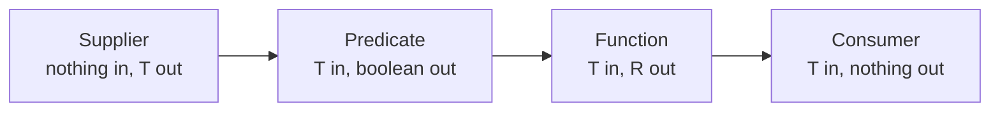

# Lambdas, functional interfaces and method references

> **Before this lesson:** you know interfaces and anonymous classes ([Interfaces, default methods, sealed types and pattern matching](#/lesson/java/java-interfaces), [Nested, inner, local and anonymous classes](#/lesson/java/java-inner-classes)) and generics ([Generics, wildcards and bounds](#/lesson/java/java-generics)). You have already used small lambdas with `removeIf` and `Comparator.comparing`.

## In plain words

You hire a house-sitter. You could give them a fixed service ("water the plants"), or you could hand over a note with your own instructions: "if the post arrives, put it on the hall table". The note is a small piece of behaviour that you write, and someone else carries out later, at the right moment.

A **lambda expression** is that note: a short block of code, with parameters, that you can store in a variable and pass to a method as if it were a value. The method receiving it decides when, and how many times, to run it.

Before Java 8, passing behaviour meant creating an object of an anonymous class, which took five lines to say one thing. Lambdas reduced it to one line and made a whole style possible: telling a collection *what* you want done to its elements instead of writing the loop yourself.

Why this matters for a job: lambdas and method references are in every modern Java code base, in streams, comparators, executors, event handlers and test code. Interviewers ask what a functional interface is, to name the standard ones, and why captured variables must be effectively final.

## From anonymous class to lambda

Sorting strings by length, three ways.

```java
import java.util.ArrayList;
import java.util.Comparator;
import java.util.List;

List<String> words = new ArrayList<>(List.of("plum", "fig", "banana"));

// 1. Anonymous class: a lot of ceremony around one expression
words.sort(new Comparator<String>() {
    @Override
    public int compare(String a, String b) {
        return Integer.compare(a.length(), b.length());
    }
});

// 2. Lambda: only the parameters and the body
words.sort((a, b) -> Integer.compare(a.length(), b.length()));

// 3. Factory plus method reference: say WHAT to compare by
words.sort(Comparator.comparingInt(String::length));

System.out.println(words);
```

```text
[fig, plum, banana]
```

In version 2 the compiler works out everything that was removed: the interface (`Comparator<String>`, because that is what `sort` expects), the method being implemented (`compare`, its only abstract method), the parameter types (`String`) and the return.

## Lambda syntax

```text
(parameters) -> body
```

| Form | Example |
|---|---|
| no parameters | `() -> System.out.println("hi")` |
| one parameter (parentheses optional) | `x -> x * 2` |
| several parameters | `(a, b) -> a + b` |
| declared types (all or none) | `(String s, int n) -> s.repeat(n)` |
| expression body: the value is returned automatically | `x -> x * x` |
| block body: needs `return` if a value is expected | `x -> { int y = x * x; return y + 1; }` |

```java
import java.util.function.BiFunction;
import java.util.function.Function;

Function<Integer, Integer> square = x -> x * x;
BiFunction<String, Integer, String> repeat = (s, n) -> s.repeat(n);
Function<Integer, String> describe = n -> {
    if (n % 2 == 0) {
        return n + " is even";
    }
    return n + " is odd";
};

System.out.println(square.apply(7));
System.out.println(repeat.apply("ab", 3));
System.out.println(describe.apply(5));
```

```text
49
ababab
5 is odd
```

Defining a lambda does not run it. `square` holds the behaviour; `square.apply(7)` executes it.

## Functional interfaces: the type of a lambda

Java is statically typed, so a lambda must have a type. That type is always a **functional interface**: an interface with **exactly one abstract method**. The lambda supplies the body of that one method.

```java
@FunctionalInterface
interface Discount {
    double apply(double price);                // the single abstract method

    default Discount then(Discount next) {     // default methods do not count
        return p -> next.apply(apply(p));
    }
}

Discount tenPercent = p -> p * 0.9;
Discount minusTwo = p -> p - 2;
System.out.println(tenPercent.then(minusTwo).apply(50));
```

```text
43.0
```

`@FunctionalInterface` is optional. It asks the compiler to check that the interface really has one abstract method, and it documents the intent. Interfaces you have already met qualify: `Runnable` (`run`), `Comparator` (`compare`), `Callable` (`call`), `ActionListener` (`actionPerformed`).

A lambda has no type of its own. The compiler determines it from the surrounding context: the declared type of the variable, parameter or return value it is being assigned to. This is called the **target type**. That is why `var f = x -> x + 1;` does not compile: there is nothing to tell the compiler which interface is meant.

## The standard functional interfaces

You rarely need to declare your own. The package `java.util.function` supplies the common shapes. Learn these six; the rest are variations.

| Interface | Abstract method | Shape | Typical use |
|---|---|---|---|
| `Predicate<T>` | `boolean test(T t)` | T → boolean | a yes/no test: `filter`, `removeIf` |
| `Function<T, R>` | `R apply(T t)` | T → R | transform a value: `map` |
| `Consumer<T>` | `void accept(T t)` | T → nothing | do something with a value: `forEach` |
| `Supplier<T>` | `T get()` | nothing → T | produce a value on demand: lazy defaults, factories |
| `UnaryOperator<T>` | `T apply(T t)` | T → T | transform, same type: `replaceAll` |
| `BinaryOperator<T>` | `T apply(T a, T b)` | (T, T) → T | combine two values: `reduce` |

```java
import java.util.function.*;

Predicate<String> isLong = s -> s.length() > 4;
Function<String, Integer> length = s -> s.length();
Consumer<String> shout = s -> System.out.println(s.toUpperCase() + "!");
Supplier<List<String>> fresh = () -> new ArrayList<>();
UnaryOperator<String> trimmed = s -> s.strip();
BinaryOperator<Integer> larger = (a, b) -> a >= b ? a : b;

System.out.println(isLong.test("banana") + " " + length.apply("fig") + " " + larger.apply(3, 9));
shout.accept("ready");
System.out.println(fresh.get().isEmpty() + " [" + trimmed.apply("  x ") + "]");
```

```text
true 3 9
READY!
true [x]
```



Read the diagram as a typical journey: a supplier creates a value, a predicate decides whether to keep it, a function transforms it, and a consumer uses it up.

Variations follow naming patterns:

- `Bi...` takes two arguments: `BiFunction<T, U, R>`, `BiPredicate<T, U>`, `BiConsumer<T, U>`.
- Primitive versions avoid boxing: `IntPredicate`, `IntFunction<R>`, `ToIntFunction<T>`, `IntUnaryOperator`, `IntBinaryOperator`, and the same for `Long` and `Double`.

### Combining functions

The interfaces carry default methods for building bigger behaviours from smaller ones.

```java
Predicate<String> startsWithB = s -> s.startsWith("b");
Predicate<String> longB = isLong.and(startsWithB);
Predicate<String> notLong = isLong.negate();
Function<String, String> lengthLabel = length.andThen(n -> "len=" + n);

System.out.println(longB.test("banana") + " " + longB.test("berry") + " " + longB.test("bay"));
System.out.println(notLong.test("fig") + " " + lengthLabel.apply("plum"));
```

```text
true true false
true len=4
```

`f.andThen(g)` runs `f` and feeds the result to `g`. `f.compose(g)` runs `g` first. `Predicate` has `and`, `or` and `negate`.

## Using lambdas with collections

Many collection methods take a functional interface.

```java
import java.util.HashMap;
import java.util.Map;

List<String> fruit = new ArrayList<>(List.of("plum", "fig", "banana", "kiwi"));

fruit.removeIf(s -> s.length() == 3);                    // Predicate
fruit.replaceAll(s -> s.toUpperCase());                  // UnaryOperator
fruit.forEach(s -> System.out.print(s + " "));           // Consumer
System.out.println();

Map<String, Integer> lengths = new HashMap<>();
fruit.forEach(s -> lengths.put(s, s.length()));
lengths.forEach((k, v) -> System.out.print(k + "=" + v + " "));   // BiConsumer
```

```text
PLUM BANANA KIWI 
PLUM=4 BANANA=6 KIWI=4 
```

(The order of the second line depends on the map.)

## Method references

When a lambda does nothing except call one existing method, a **method reference** says the same thing more briefly, with the `::` operator.

| Kind | Syntax | Equivalent lambda |
|---|---|---|
| Static method | `Integer::parseInt` | `s -> Integer.parseInt(s)` |
| Instance method of a particular object | `System.out::println` | `x -> System.out.println(x)` |
| Instance method of an arbitrary object of a type | `String::toUpperCase` | `s -> s.toUpperCase()` |
| Constructor | `ArrayList::new` | `() -> new ArrayList<>()` |

```java
Function<String, Integer> parse = Integer::parseInt;
Consumer<Object> print = System.out::println;
Function<String, String> upper = String::toUpperCase;
BiFunction<String, String, Boolean> startsWith = String::startsWith;   // (s, prefix) -> s.startsWith(prefix)
Supplier<List<String>> maker = ArrayList::new;
Function<String, StringBuilder> builder = StringBuilder::new;          // s -> new StringBuilder(s)

print.accept(parse.apply("41") + 1);
print.accept(upper.apply("fig") + " " + startsWith.apply("banana", "ban") + " " + maker.get().size());
print.accept(builder.apply("abc").reverse());
```

```text
42
FIG true 0
cba
```

The third kind confuses people. In `String::toUpperCase` no particular string is named, so the **first argument** of the function becomes the object the method is called on. With two arguments, as in `String::startsWith`, the first is the receiver and the second is passed to the method.

Use a method reference when it reads clearly (`map(String::trim)`). Keep the lambda when the reference would be longer or more obscure than the code it replaces.

## Capturing variables

A lambda may use variables from the surrounding method. It may read:

- its own parameters and locals;
- fields of the enclosing object and static fields, which it may also change;
- **local variables of the enclosing method, only if they are effectively final** (assigned once).

```java
int bonus = 5;
Function<Integer, Integer> addBonus = n -> n + bonus;     // captures bonus
// bonus = 10;                                            // adding this line breaks the lambda above
System.out.println(addBonus.apply(1));
```

```text
6
```

The reason was given in the lesson on inner classes: the lambda may outlive the method call, so it works on a **copy** of the local variable; allowing changes would let the copy and the original disagree. A lambda together with the variables it has captured is sometimes called a **closure**.

One difference from anonymous classes: inside a lambda, `this` means the **enclosing object**. A lambda does not introduce a new scope for `this`, and it cannot declare a local variable with the same name as one in the enclosing method.

### A model of functional interfaces you can run

Python functions are values, so the standard shapes and their combinators can be modelled directly.

```python-run
def predicate_and(p, q):   return lambda x: p(x) and q(x)
def negate(p):             return lambda x: not p(x)
def and_then(f, g):        return lambda x: g(f(x))          # f first, then g
def compose(f, g):         return lambda x: f(g(x))          # g first, then f

is_long     = lambda s: len(s) > 4          # Predicate<String>
starts_b    = lambda s: s.startswith("b")   # Predicate<String>
length      = lambda s: len(s)              # Function<String, Integer>
double      = lambda n: n * 2               # UnaryOperator<Integer>
larger      = lambda a, b: a if a >= b else b   # BinaryOperator<Integer>
fresh_list  = lambda: []                    # Supplier<List>

words = ["plum", "banana", "berry", "bay", "fig"]
print("filter isLong.and(startsB):", [w for w in words if predicate_and(is_long, starts_b)(w)])
print("filter isLong.negate()    :", [w for w in words if negate(is_long)(w)])
print("length.andThen(double)    :", [and_then(length, double)(w) for w in words])

# Capturing: each lambda remembers the value of 'bonus' it was created with.
def make_adder(bonus):
    return lambda n: n + bonus
add5, add10 = make_adder(5), make_adder(10)
print("closures                  :", add5(1), add10(1))

# reduce with a BinaryOperator
from functools import reduce
print("reduce(larger)            :", reduce(larger, [length(w) for w in words]))
```

## Lambdas that return lambdas

Because functions are values, a method can build and return one. This lets you configure behaviour.

```java
static Predicate<String> longerThan(int n) {
    return s -> s.length() > n;
}

static <T> Predicate<T> not(Predicate<T> p) {
    return p.negate();
}

List<String> names = new ArrayList<>(List.of("Ada", "Bartholomew", "Cy"));
names.removeIf(not(longerThan(2)));
System.out.println(names);
```

```text
[Ada, Bartholomew]
```

A function that takes or returns another function is a **higher-order function**.

## Lambdas and exceptions

The standard functional interfaces do not declare checked exceptions, so a lambda used as a `Function` or `Consumer` cannot let one escape:

```java
// Function<Path, String> read = p -> Files.readString(p);   // does not compile: unreported IOException
Function<java.nio.file.Path, String> read = p -> {
    try {
        return java.nio.file.Files.readString(p);
    } catch (java.io.IOException e) {
        throw new java.io.UncheckedIOException(e);            // wrap in an unchecked exception
    }
};
```

`Callable` is the exception to the rule: its `call()` method is declared `throws Exception`.

> [!INTERVIEW]
> "What is a functional interface?" *An interface with exactly one abstract method; it may have any number of default and static methods. It can be the target type of a lambda or method reference. `@FunctionalInterface` makes the compiler enforce it.* Be ready to list `Predicate`, `Function`, `Consumer`, `Supplier`, `UnaryOperator`, `BinaryOperator` with their method names. "Lambda versus anonymous class?" A lambda works only for functional interfaces, has no state of its own, does not define a new `this`, and is implemented more efficiently by the JVM (no extra class file per lambda).

## Pitfalls

- **Modifying a captured local variable.** It must be effectively final.
- **`var` with a lambda**, or assigning a lambda to `Object`: there is no target type.
- **Forgetting `return`** in a block-bodied lambda that must produce a value.
- **Long lambdas.** More than a few lines belongs in a named method, used through a method reference.
- **Overloaded methods taking different functional interfaces** can make a lambda argument ambiguous.
- **Checked exceptions** inside lambdas for the standard interfaces.
- **Confusing `String::length` (unbound receiver) with `text::length` (bound to one object).**
- **Side effects in lambdas passed to streams**, covered in the next lesson.
- **Boxing costs**: prefer `IntPredicate`, `ToIntFunction` and friends in hot code.

## Cheat sheet

| Shape | Interface | Call with |
|---|---|---|
| `T -> boolean` | `Predicate<T>` | `test` |
| `T -> R` | `Function<T, R>` | `apply` |
| `T -> void` | `Consumer<T>` | `accept` |
| `() -> T` | `Supplier<T>` | `get` |
| `T -> T` | `UnaryOperator<T>` | `apply` |
| `(T, T) -> T` | `BinaryOperator<T>` | `apply` |
| `() -> void` | `Runnable` | `run` |
| `(T, T) -> int` | `Comparator<T>` | `compare` |
| Static method ref | `Integer::parseInt` | |
| Bound instance ref | `System.out::println` | |
| Unbound instance ref | `String::toUpperCase` | |
| Constructor ref | `ArrayList::new` | |

## Summary

- A lambda is a short anonymous function: parameters, an arrow, and a body.
- Its type is a functional interface, an interface with one abstract method, chosen from the context.
- `java.util.function` provides the standard shapes: `Predicate`, `Function`, `Consumer`, `Supplier`, `UnaryOperator`, `BinaryOperator` and their two-argument and primitive variants.
- Method references (`Type::method`, `object::method`, `Type::new`) abbreviate lambdas that only call one method.
- Lambdas can capture effectively final local variables; `this` inside a lambda is the enclosing object.
- Functions can be combined (`and`, `negate`, `andThen`) and returned from methods.

## Glossary

- **Lambda expression**: an anonymous function written as `(params) -> body`.
- **Functional interface**: an interface with exactly one abstract method.
- **Target type**: the functional interface the compiler infers for a lambda from its context.
- **`Predicate`**: a function returning `boolean`.
- **`Function`**: a function transforming one value into another.
- **`Consumer`**: a function that takes a value and returns nothing.
- **`Supplier`**: a function that takes nothing and returns a value.
- **Method reference**: the `::` shorthand for a lambda that calls a single method.
- **Capture**: use by a lambda of a variable from the enclosing scope.
- **Effectively final**: assigned only once, though not marked `final`.
- **Closure**: a function together with its captured variables.
- **Higher-order function**: a function that accepts or returns functions.

## Check yourself

```quiz
[
  {"q": "Which interface is a valid functional interface?", "options": ["One with two abstract methods", "One with exactly one abstract method and several default methods", "One with no methods", "Any abstract class with one method"], "answer": 1,
   "explain": "Only abstract methods are counted. Default and static methods are allowed in any number. Abstract classes never qualify."},
  {"q": "What does this print? `Function<Integer,Integer> f = x -> x + 1; Function<Integer,Integer> g = x -> x * 2; System.out.println(f.andThen(g).apply(3) + \" \" + f.compose(g).apply(3));`", "options": ["8 7", "7 8", "8 8", "7 7"], "answer": 0,
   "explain": "andThen: f first (4), then g (8). compose: g first (6), then f (7)."},
  {"q": "Does this compile? `int n = 1; Runnable r = () -> System.out.println(n); n++;`", "options": ["Yes", "No: n is not effectively final", "Yes, prints 2", "No: Runnable cannot print"], "answer": 1,
   "explain": "n is modified after being captured, so it is not effectively final."},
  {"q": "Which method reference is equivalent to `s -> s.isEmpty()` for a `Predicate<String>`?", "options": ["String.isEmpty", "String::isEmpty", "s::isEmpty", "isEmpty::String"], "answer": 1,
   "explain": "An unbound instance method reference: the function's argument becomes the receiver."},
  {"q": "Does this compile? `var doubler = x -> x * 2;`", "options": ["Yes", "No: a lambda needs an explicit target type", "Yes, as Function<Integer,Integer>", "Only in Java 21"], "answer": 1,
   "explain": "var infers from the right-hand side, but a lambda has no type without a target functional interface."},
  {"q": "Which standard interface matches a lambda that takes nothing and returns a value?", "options": ["Consumer<T>", "Supplier<T>", "Predicate<T>", "UnaryOperator<T>"], "answer": 1,
   "explain": "Supplier<T> has T get()."},
  {"q": "What does this print? `Predicate<Integer> even = n -> n % 2 == 0; Predicate<Integer> big = n -> n > 10; System.out.println(even.and(big.negate()).test(8));`", "options": ["true", "false", "It does not compile", "8"], "answer": 0,
   "explain": "8 is even, and it is not greater than 10, so both parts are true."},
  {"q": "Inside a lambda written in an instance method, what does `this` refer to?", "options": ["The lambda object", "The enclosing instance", "null", "The functional interface"], "answer": 1,
   "explain": "Lambdas do not introduce their own this, unlike anonymous classes."}
]
```

> **Source:** Head First Java (newer edition), the lambdas chapter; topic coverage only. Checked against the Java Language Specification section 15.27 and the java.util.function documentation: https://docs.oracle.com/en/java/javase/21/docs/api/java.base/java/util/function/package-summary.html and https://dev.java/learn/lambdas/ .
