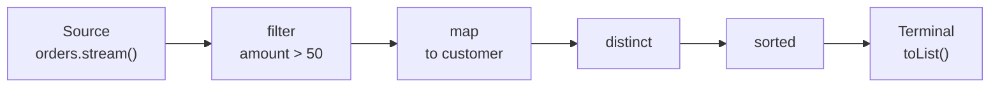

# The Stream API, collectors and Optional

> **Before this lesson:** you know lambdas, method references and the standard functional interfaces ([Lambdas, functional interfaces and method references](#/lesson/java/java-lambdas)), and the collection types ([Collections: List, Set, Map and Queue](#/lesson/java/java-collections)).

## In plain words

A bottling plant moves bottles along a conveyor belt. At the first station, cracked bottles are removed. At the second, a label is stuck on each one. At the third, bottles are packed into crates of six. Nobody carries a bottle from station to station; the belt does that. Each station does one small job, and the plant's design is easy to read: *check, label, pack*.

A Java **stream** is that conveyor belt for data. You name a source (a list, say), describe a series of stations (keep these, transform them like so), and finish with a packing step that produces a result. You say **what** should happen to the elements and leave the looping to the library.

The second topic, **`Optional`**, is a small box that either contains a value or is visibly empty. It is how stream operations such as "find the first match" tell you honestly that there may be no answer.

(These streams have nothing to do with the I/O streams in [Saving objects: serialization and I/O streams](#/lesson/java/java-serialization-streams). The name is shared by accident.)

Why this matters for a job: most data handling in modern Java is written as stream pipelines. "Rewrite this loop with streams", "what does this pipeline print?" and "group these records by a field" are routine interview tasks.

## A loop and the same job as a pipeline

Task: from a list of orders, find the customers of orders over 50, without duplicates, in alphabetical order.

```java
import java.util.ArrayList;
import java.util.List;
import java.util.TreeSet;

record Order(String customer, double amount, String status) { }

List<Order> orders = List.of(
        new Order("noor", 120.0, "PAID"),
        new Order("ivo", 35.5, "PAID"),
        new Order("ada", 80.0, "OPEN"),
        new Order("noor", 60.0, "PAID"),
        new Order("bo", 15.0, "OPEN"));

// With a loop
TreeSet<String> seen = new TreeSet<>();
for (Order o : orders) {
    if (o.amount() > 50) {
        seen.add(o.customer());
    }
}
List<String> viaLoop = new ArrayList<>(seen);

// With a stream
List<String> viaStream = orders.stream()
        .filter(o -> o.amount() > 50)
        .map(Order::customer)
        .distinct()
        .sorted()
        .toList();

System.out.println(viaLoop + " " + viaStream);
```

```text
[ada, noor] [ada, noor]
```

The pipeline reads top to bottom as a description of the result: orders, those over 50, their customers, each once, sorted, as a list.

## The three parts of a pipeline



1. A **source** creates the stream: `collection.stream()`, `Stream.of(a, b, c)`, `Arrays.stream(array)`, `IntStream.range(0, 10)`, `Files.lines(path)`.
2. Zero or more **intermediate operations** each return a new stream, so they can be chained.
3. One **terminal operation** produces a result or a side effect and ends the pipeline.

A stream does not store data and does not change its source. It can be used **once**; calling a second terminal operation on the same stream throws `IllegalStateException`.

## Laziness

Intermediate operations are **lazy**: they do nothing when called. They only record what should happen. Work starts when the terminal operation runs, and then each element travels through the whole pipeline before the next one starts.

```java
import java.util.stream.Stream;

Stream<String> pipeline = Stream.of("kiwi", "fig", "banana", "plum")
        .filter(s -> { System.out.println("filter " + s); return s.length() > 3; })
        .map(s -> { System.out.println("  map " + s); return s.toUpperCase(); });

System.out.println("nothing has happened yet");
System.out.println(pipeline.findFirst().get());
```

```text
nothing has happened yet
filter kiwi
  map kiwi
KIWI
```

`findFirst` needed one element. The pipeline pulled `kiwi` through `filter` and `map`, had its answer, and stopped; `fig`, `banana` and `plum` were never examined. Stopping early is called **short-circuiting**. Laziness is what makes it possible, and it also lets streams be infinite: `Stream.iterate(1, n -> n * 2).limit(10)`.

## Intermediate operations

| Operation | Takes | Effect |
|---|---|---|
| `filter(predicate)` | `Predicate<T>` | keep elements that pass the test |
| `map(function)` | `Function<T, R>` | replace each element with the function's result |
| `flatMap(function)` | `Function<T, Stream<R>>` | replace each element with a stream, and flatten the streams into one |
| `distinct()` | | drop duplicates (by `equals`) |
| `sorted()`, `sorted(comparator)` | | sort by natural order or a comparator |
| `limit(n)` / `skip(n)` | | keep the first `n` / drop the first `n` |
| `peek(consumer)` | `Consumer<T>` | look at each element as it passes; for debugging |
| `takeWhile(p)` / `dropWhile(p)` | `Predicate<T>` | take or drop the leading run that matches |
| `mapToInt`, `mapToDouble`, `boxed` | | switch between object streams and primitive streams |

```java
List<List<String>> baskets = List.of(List.of("tea", "jam"), List.of("jam", "scone"), List.of());
List<String> items = baskets.stream()
        .flatMap(List::stream)            // three lists become one stream of items
        .distinct()
        .sorted()
        .toList();
System.out.println(items);

System.out.println(Stream.of(5, 3, 8, 1, 9, 2).sorted().skip(1).limit(3).toList());
```

```text
[jam, scone, tea]
[2, 3, 5]
```

`map` is one-to-one. `flatMap` is one-to-many: each element becomes zero or more elements.

## Terminal operations

| Operation | Returns | Meaning |
|---|---|---|
| `toList()` | `List<T>` | an unmodifiable list (Java 16+) |
| `collect(collector)` | depends on the collector | flexible gathering into a container |
| `forEach(consumer)` | nothing | perform an action per element |
| `count()` | `long` | how many elements |
| `reduce(identity, operator)` | `T` | fold all elements into one value |
| `min(cmp)`, `max(cmp)` | `Optional<T>` | smallest or largest |
| `findFirst()`, `findAny()` | `Optional<T>` | an element, if any |
| `anyMatch`, `allMatch`, `noneMatch` | `boolean` | test against a predicate; short-circuit |
| `sum()`, `average()`, `summaryStatistics()` | number or `OptionalDouble` | on `IntStream`, `LongStream`, `DoubleStream` |

```java
List<Integer> nums = List.of(4, 9, 16, 25);
System.out.println(nums.stream().reduce(0, Integer::sum));
System.out.println(nums.stream().reduce(1, (a, b) -> a * b));
System.out.println(nums.stream().mapToInt(Integer::intValue).max().getAsInt());
System.out.println(nums.stream().anyMatch(n -> n > 20) + " " + nums.stream().allMatch(n -> n % 2 == 0));
System.out.println(orders.stream().mapToDouble(Order::amount).sum());
```

```text
54
14400
25
true false
310.5
```

`reduce(identity, op)` starts from the **identity** (the value that leaves others unchanged: 0 for addition, 1 for multiplication) and combines it with each element in turn: `((((0 + 4) + 9) + 16) + 25)`.

## Collectors

`collect` takes a **collector**, a recipe for accumulating elements. The class `Collectors` supplies the common ones.

```java
import java.util.Map;
import java.util.stream.Collectors;

Map<String, List<Order>> byStatus = orders.stream()
        .collect(Collectors.groupingBy(Order::status));
System.out.println(byStatus.get("OPEN").size());

Map<String, Long> countByCustomer = orders.stream()
        .collect(Collectors.groupingBy(Order::customer, java.util.TreeMap::new, Collectors.counting()));
System.out.println(countByCustomer);

Map<String, Double> totalByStatus = orders.stream()
        .collect(Collectors.groupingBy(Order::status, java.util.TreeMap::new, Collectors.summingDouble(Order::amount)));
System.out.println(totalByStatus);

Map<Boolean, List<String>> bigOrNot = orders.stream()
        .collect(Collectors.partitioningBy(o -> o.amount() >= 60,
                 Collectors.mapping(Order::customer, Collectors.toList())));
System.out.println(bigOrNot);

String names = orders.stream().map(Order::customer).distinct()
        .collect(Collectors.joining(", ", "[", "]"));
System.out.println(names);
```

```text
2
{ada=1, bo=1, ivo=1, noor=2}
{OPEN=95.0, PAID=215.5}
{false=[ivo, bo], true=[noor, ada, noor]}
[noor, ivo, ada, bo]
```

| Collector | Result |
|---|---|
| `toList()`, `toSet()` | a list or set |
| `toMap(keyFn, valueFn)` | a map; **throws on duplicate keys** unless a merge function is given as a third argument |
| `groupingBy(classifier)` | `Map<K, List<T>>` |
| `groupingBy(classifier, downstream)` | `Map<K, R>` where the downstream collector summarises each group |
| `partitioningBy(predicate)` | `Map<Boolean, List<T>>` with exactly two keys |
| `counting()`, `summingInt`, `averagingDouble` | numeric summaries |
| `mapping(fn, downstream)` | transform before collecting, inside a group |
| `joining(separator)` | one string |

A **downstream collector** is a second collector applied to the elements of each group. `groupingBy(Order::customer, counting())` is the stream version of the word-count loop with `merge`.

### A pipeline evaluator you can run

The model executes a pipeline one element at a time, the way Java does, and logs what each stage sees. It shows laziness and short-circuiting.

```python-run
def run_pipeline(source, stages, terminal):
    """stages: list of ('filter', fn) | ('map', fn) | ('limit', n). terminal: 'toList' or 'findFirst'."""
    out, taken, log = [], [0] * len(stages), []
    for element in source:
        x, alive = element, True
        for i, (kind, arg) in enumerate(stages):
            if kind == "filter":
                keep = arg(x); log.append(f"filter({x}) -> {keep}")
                if not keep: alive = False; break
            elif kind == "map":
                y = arg(x); log.append(f"map({x}) -> {y}"); x = y
            elif kind == "limit":
                taken[i] += 1
        if alive:
            out.append(x)
            if terminal == "findFirst":
                break
            if any(k == "limit" and taken[i] >= a for i, (k, a) in enumerate(stages)):
                break                                  # limit reached: stop pulling from the source
    return (out[0] if out else None) if terminal == "findFirst" else out, log

nums = [3, 8, 5, 12, 7, 20, 9]
stages = [("filter", lambda n: n > 4), ("map", lambda n: n * 10), ("limit", 2)]
result, log = run_pipeline(nums, stages, "toList")
print("result:", result)
print("\n".join("  " + line for line in log))
print(f"elements examined: {sum(1 for l in log if l.startswith('filter'))} of {len(nums)}")
```

Change the terminal to `"findFirst"` and watch the log shrink to three lines.

## Optional: an answer that may be absent

What should `max()` return for an empty stream? Returning `null` invites a `NullPointerException` later. Java returns an **`Optional<T>`**: a container that holds either one value or nothing, and makes you deal with both cases.

```java
import java.util.Optional;

Optional<Order> biggestOpen = orders.stream()
        .filter(o -> o.status().equals("OPEN"))
        .max(java.util.Comparator.comparingDouble(Order::amount));

Optional<Order> refunded = orders.stream()
        .filter(o -> o.status().equals("REFUNDED"))
        .findFirst();

System.out.println(biggestOpen.isPresent() + " " + refunded.isPresent());
System.out.println(biggestOpen.map(Order::customer).orElse("nobody"));
System.out.println(refunded.map(Order::customer).orElse("nobody"));
refunded.ifPresent(o -> System.out.println("never printed"));
```

```text
true false
ada
nobody
```

| Method | Meaning |
|---|---|
| `Optional.of(x)` | wrap a non-null value (throws if `x` is null) |
| `Optional.ofNullable(x)` | wrap, or empty if `x` is null |
| `Optional.empty()` | the empty optional |
| `isPresent()` / `isEmpty()` | test |
| `orElse(default)` | the value, or the default |
| `orElseGet(supplier)` | the value, or one computed only if needed |
| `orElseThrow()` | the value, or throw `NoSuchElementException` |
| `ifPresent(consumer)` | run code only if there is a value |
| `map(fn)` | transform the value if present; empty stays empty |
| `flatMap(fn)` | like `map` when `fn` itself returns an `Optional` |
| `filter(predicate)` | keep the value only if it passes |

Chaining removes nested null checks:

```java
record Address(String city) { }
record Customer(String name, Optional<Address> address) { }

static String cityOf(Optional<Customer> c) {
    return c.flatMap(Customer::address)        // Optional<Address>
            .map(Address::city)                // Optional<String>
            .filter(city -> !city.isBlank())
            .map(String::toUpperCase)
            .orElse("UNKNOWN");
}
```

```java
System.out.println(cityOf(Optional.of(new Customer("ada", Optional.of(new Address("Leeds"))))));
System.out.println(cityOf(Optional.of(new Customer("bo", Optional.empty()))));
System.out.println(cityOf(Optional.empty()));
```

```text
LEEDS
UNKNOWN
UNKNOWN
```

Guidelines: use `Optional` as a **return type** for "may have no result". Do not call `get()` without checking; prefer `orElse`, `orElseThrow`, `map` and `ifPresent`. Do not use `Optional` for fields, method parameters or collection elements, and never return `null` from a method declared to return `Optional`. More in [Varargs, empty collections, Optional returns and documentation](#/lesson/java/java-ej-varargs-returns-docs).

## Primitive streams

`Stream<Integer>` boxes every number. `IntStream`, `LongStream` and `DoubleStream` hold primitives and add numeric operations.

```java
import java.util.stream.IntStream;

System.out.println(IntStream.rangeClosed(1, 5).sum());
System.out.println(IntStream.range(0, 5).map(i -> i * i).boxed().toList());
System.out.println(List.of("fig", "plum", "banana").stream().mapToInt(String::length).summaryStatistics());
```

```text
15
[0, 1, 4, 9, 16]
IntSummaryStatistics{count=3, sum=13, min=3, average=4.333333, max=6}
```

`range(a, b)` excludes `b`; `rangeClosed(a, b)` includes it.

## Rules for well-behaved pipelines

1. **No side effects in lambdas.** A function passed to `filter` or `map` should compute its result from its argument and change nothing else. Adding to an outside list from inside `forEach` or `map` is the commonest misuse; let `collect` or `toList` build the result.
2. **Do not modify the source** while the pipeline runs.
3. **Order of operations affects cost.** Put `filter` before `map` and `sorted`, so less data flows downstream.
4. **`sorted` and `distinct` are stateful**: they must see many or all elements before passing any on, and cannot work on an infinite stream without a `limit` before them.

```java
// Wrong: a side effect doing the collecting
List<String> result = new ArrayList<>();
orders.stream().filter(o -> o.amount() > 50).forEach(o -> result.add(o.customer()));

// Right
List<String> result2 = orders.stream().filter(o -> o.amount() > 50).map(Order::customer).toList();
```

### Parallel streams, briefly

`collection.parallelStream()` splits the work across processor cores. It can help with large, CPU-heavy, side-effect-free pipelines over arrays or `ArrayList`. It can also be slower, or give wrong answers when lambdas touch shared state. Never switch it on without measuring. See [Streams with judgement: purity, return types and parallelism](#/lesson/java/java-ej-stream-style).

> [!INTERVIEW]
> "`map` versus `flatMap`?" `map` transforms each element into exactly one element; `flatMap` transforms each element into a stream and concatenates those streams, so one input can yield zero or many outputs. "Intermediate versus terminal?" Intermediate operations are lazy and return a stream; a terminal operation triggers execution and returns a non-stream result. "Can a stream be reused?" No. "Why `Optional`?" To make the possible absence of a result explicit in the type, instead of returning `null`.

## Pitfalls

- **Forgetting the terminal operation**: nothing runs.
- **Reusing a stream**: `IllegalStateException: stream has already been operated upon or closed`.
- **`Optional.get()` on an empty optional**: `NoSuchElementException`.
- **`Collectors.toMap` with duplicate keys**: `IllegalStateException`.
- **Modifying the list returned by `toList()`**: it is unmodifiable.
- **Side effects inside lambdas.**
- **`peek` for real work**: it may be skipped when the pipeline short-circuits or is optimised.
- **Streams for everything.** A plain loop is clearer when you need `break`, several results at once, or checked exceptions.
- **`orElse(expensiveCall())`**: the argument is evaluated even when the optional has a value; use `orElseGet(() -> expensiveCall())`.
- **`sorted()` on an infinite stream.**

## Cheat sheet

| Goal | Pipeline |
|---|---|
| Keep some | `.filter(x -> test)` |
| Transform | `.map(x -> f(x))` |
| Flatten nested | `.flatMap(x -> x.items().stream())` |
| Unique, sorted, first n | `.distinct().sorted().limit(n)` |
| To a list | `.toList()` |
| Count | `.count()` |
| Sum of ints | `.mapToInt(X::n).sum()` |
| Any / all match | `.anyMatch(p)` / `.allMatch(p)` |
| Group | `.collect(groupingBy(X::key))` |
| Group and count | `.collect(groupingBy(X::key, counting()))` |
| Split in two | `.collect(partitioningBy(p))` |
| Join strings | `.collect(joining(", "))` |
| Largest | `.max(Comparator.comparing(X::n))` returns `Optional` |
| Default for absent | `optional.orElse(d)` |

## Summary

- A stream pipeline is source, lazy intermediate operations, and one terminal operation; it processes elements one at a time and can stop early.
- `filter`, `map`, `flatMap`, `distinct`, `sorted`, `limit` shape the data; `toList`, `collect`, `reduce`, `count`, the `match` family and `find` finish it.
- Collectors such as `groupingBy`, `partitioningBy`, `counting`, `toMap` and `joining` build maps and summaries.
- `Optional` represents a result that may be absent and offers `map`, `flatMap`, `filter` and `orElse` for handling it without null checks.
- Keep lambdas free of side effects, filter early, and treat parallel streams with caution.

## Glossary

- **Stream**: a sequence of elements supporting chained aggregate operations.
- **Pipeline**: a source, intermediate operations and a terminal operation.
- **Intermediate operation**: a lazy operation that returns another stream.
- **Terminal operation**: the operation that triggers processing and yields a result.
- **Lazy evaluation**: postponing work until its result is required.
- **Short-circuiting**: ending processing as soon as the result is known.
- **`map` / `flatMap`**: one-to-one and one-to-many transformation.
- **`reduce`**: combining all elements into one value with a binary operator.
- **Identity**: the starting value that does not change the result of the operator.
- **Collector**: a strategy object for accumulating stream elements.
- **Downstream collector**: a collector applied within each group of `groupingBy`.
- **`Optional`**: a container holding one value or none.
- **Side effect**: any change to state outside a function's own result.
- **Stateful operation**: one that needs to remember earlier elements, such as `sorted`.

## Check yourself

```quiz
[
  {"q": "What does this print? `System.out.println(Stream.of(1, 2, 3, 4, 5).filter(n -> n % 2 == 1).map(n -> n * n).toList());`", "options": ["[1, 9, 25]", "[1, 4, 9, 16, 25]", "[2, 4]", "[1, 3, 5]"], "answer": 0,
   "explain": "The odd numbers 1, 3, 5 pass the filter and are then squared."},
  {"q": "What does this code print? `Stream.of(\"a\", \"b\").map(s -> { System.out.print(s); return s; });`", "options": ["ab", "a", "Nothing", "It throws"], "answer": 2,
   "explain": "There is no terminal operation, so the lazy map never runs."},
  {"q": "What does this print? `System.out.println(Stream.of(List.of(1, 2), List.of(3)).flatMap(List::stream).count());`", "options": ["2", "3", "1", "It does not compile"], "answer": 1,
   "explain": "flatMap flattens the two lists into one stream of three numbers."},
  {"q": "What does this print? `System.out.println(Stream.of(5, 1, 4, 1, 3).distinct().sorted().limit(2).reduce(0, Integer::sum));`", "options": ["4", "6", "5", "2"], "answer": 0,
   "explain": "distinct gives 5, 1, 4, 3; sorted gives 1, 3, 4, 5; limit(2) keeps 1 and 3; their sum is 4."},
  {"q": "What happens? `Stream<String> s = Stream.of(\"x\"); s.count(); s.count();`", "options": ["Returns 1 twice", "IllegalStateException on the second count", "Compile-time error", "Returns 1 then 0"], "answer": 1,
   "explain": "A stream can be consumed by only one terminal operation."},
  {"q": "What does this print? `System.out.println(Optional.ofNullable((String) null).map(String::length).orElse(-1));`", "options": ["0", "-1", "null", "NullPointerException"], "answer": 1,
   "explain": "ofNullable(null) is empty; map on an empty Optional stays empty; orElse supplies -1."},
  {"q": "What is the type of `words.stream().collect(Collectors.groupingBy(String::length, Collectors.counting()))`?", "options": ["Map<Integer, List<String>>", "Map<Integer, Long>", "Map<String, Integer>", "List<Long>"], "answer": 1,
   "explain": "The classifier gives Integer keys; the downstream collector counting() gives a Long per group."},
  {"q": "What happens? `Stream.of(\"aa\", \"bb\").collect(Collectors.toMap(String::length, s -> s));`", "options": ["{2=aa}", "{2=bb}", "IllegalStateException: duplicate key", "{2=[aa, bb]}"], "answer": 2,
   "explain": "Both strings map to key 2. Without a merge function, toMap rejects duplicate keys."}
]
```

> **Source:** Head First Java (newer edition), the streams chapter; topic coverage only. Checked against the java.util.stream package documentation and the Optional API: https://docs.oracle.com/en/java/javase/21/docs/api/java.base/java/util/stream/package-summary.html , https://docs.oracle.com/en/java/javase/21/docs/api/java.base/java/util/Optional.html and https://dev.java/learn/api/streams/ .
