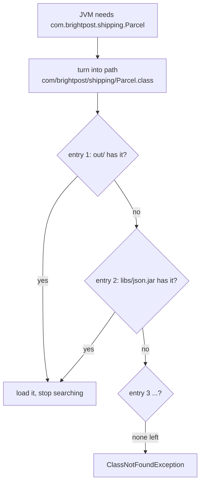
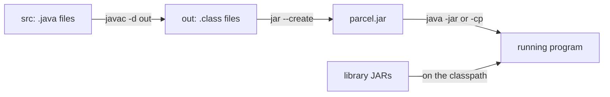

# Packages on disk, the classpath and JAR files

> **Before this lesson:** you can compile and run a single file ([From source code to a running program](#/lesson/java/java-source-to-jvm)) and you know what packages and imports mean in source code ([Packages, imports and the String toolbox](#/lesson/java/java-packages-imports-strings)).

## In plain words

Writing a meal and serving it to guests are different jobs. In your kitchen, half-chopped vegetables sit next to the finished dish and that is fine. A guest should receive only the finished plate, arranged so they can start eating without instructions.

So far your programs have lived in "the kitchen": source files and class files mixed together in one folder, run from that same folder. Handing a program to someone else, or to a server, is called **deployment**, and it needs three things:

1. a tidy layout that keeps source code apart from compiled code;
2. a way for the JVM to **find** every class the program needs, called the **classpath**;
3. a single file that bundles everything, called a **JAR**.

Why this matters for a job: `ClassNotFoundException` and `NoClassDefFoundError` are among the most common failures when a Java program is started outside an editor. Understanding the classpath turns them from mysteries into two-minute fixes, and "what is in a JAR?" is a standard interview warm-up.

## Step 1: keep source and classes apart

A conventional small project looks like this:

```text
parcel-app/
├── src/
│   └── com/brightpost/shipping/
│       ├── App.java
│       └── Parcel.java
└── out/                      (created by the compiler)
    └── com/brightpost/shipping/
        ├── App.class
        └── Parcel.class
```

The two source files:

```java
// src/com/brightpost/shipping/Parcel.java
package com.brightpost.shipping;

public record Parcel(String to, double kg) {
    public double cost() {
        return 3.0 + 0.5 * kg;
    }
}
```

```java
// src/com/brightpost/shipping/App.java
package com.brightpost.shipping;

public class App {
    public static void main(String[] args) {
        Parcel p = new Parcel("14 Mill Lane", 4.0);
        System.out.println(p.to() + ": " + p.cost());
    }
}
```

Compile with `-d` ("destination"), which tells `javac` where to put class files. It creates the package folders for you.

```text
> javac -d out src/com/brightpost/shipping/*.java
> java -cp out com.brightpost.shipping.App
14 Mill Lane: 5.0
```

Two rules are at work, and nearly every beginner trips on them once.

- **The package name is part of the class's name.** The class is not `App`; it is `com.brightpost.shipping.App`, and that is what you give to `java`.
- **The folder structure must mirror the package.** The JVM turns `com.brightpost.shipping.App` into the relative path `com/brightpost/shipping/App.class` and looks for exactly that.

Run it the wrong way and you get the famous error:

```text
> cd out/com/brightpost/shipping
> java App
Error: Could not find or load main class App
Caused by: java.lang.NoClassDefFoundError: App (wrong name: com/brightpost/shipping/App)
```

The file was found, but the class inside it says its name is `com.brightpost.shipping.App`, not `App`. Always run from the folder that **contains** the top package folder, or point the classpath at it.

## Step 2: the classpath

The **classpath** is the list of places where the JVM (and the compiler) look for classes. Each entry is either:

- a **directory** that contains the top-level package folders, or
- a **JAR file**.

Set it with `-cp` (or the longer `--class-path`):

```text
> java -cp out com.brightpost.shipping.App
> java -cp "out:libs/json.jar:libs/util.jar" com.brightpost.shipping.App        (macOS, Linux)
> java -cp "out;libs\json.jar;libs\util.jar" com.brightpost.shipping.App        (Windows)
> java -cp "out:libs/*" com.brightpost.shipping.App                             (every JAR in libs)
```

- Entries are separated by `:` on macOS and Linux and by `;` on Windows.
- If you give no `-cp`, the classpath is the current directory (`.`). The moment you give one, the current directory is **not** included unless you list it.
- The entries are searched **in order**. If two entries contain a class with the same full name, the first wins and the second is silently ignored. That is the root of many "but I fixed that bug" mysteries.



### Two errors that sound alike

| Error | When | Usual cause |
|---|---|---|
| `ClassNotFoundException` | code asked for a class **by name at run time** (for example `Class.forName("x.Y")`, or the launcher looking for your main class) and it is not on the classpath | missing JAR, wrong class name, wrong `-cp` |
| `NoClassDefFoundError` | a class that **was present when you compiled** cannot be loaded now | a JAR used at compile time is missing at run time; or the class's static initialiser failed earlier |

Both mean "fix the classpath" nine times out of ten.

### A classpath search you can run

```python-run
def find_class(fqcn, classpath, contents):
    """classpath: ordered list of entries. contents: entry -> set of class files it holds."""
    path = fqcn.replace(".", "/") + ".class"
    trace = []
    for entry in classpath:
        hit = path in contents.get(entry, set())
        trace.append(f"{entry}: {'FOUND' if hit else 'no'}")
        if hit:
            return entry, trace
    return None, trace

contents = {
    "out":            {"com/brightpost/shipping/App.class", "com/brightpost/shipping/Parcel.class"},
    "libs/old.jar":   {"com/acme/Json.class"},              # version 1 of a library
    "libs/new.jar":   {"com/acme/Json.class", "com/acme/Yaml.class"},   # version 2
}
for cls, cp in [("com.brightpost.shipping.Parcel", ["out", "libs/old.jar"]),
                ("com.acme.Json", ["out", "libs/old.jar", "libs/new.jar"]),
                ("com.acme.Json", ["out", "libs/new.jar", "libs/old.jar"]),
                ("com.acme.Xml",  ["out", "libs/old.jar", "libs/new.jar"]),
                ("Parcel",        ["out"])]:
    where, trace = find_class(cls, cp, contents)
    print(f"{cls:32} -> {where or 'ClassNotFoundException':24} [{', '.join(trace)}]")
```

The second and third lines load **different versions** of the same class purely because the order of the entries changed. The last line fails because the simple name `Parcel` is not the class's name.

## Step 3: JAR files

A **JAR** (Java archive) is a ZIP file with the extension `.jar`. Inside are the class files in their package folders, any resources the program needs (images, configuration files), and one special folder:

```text
parcel.jar
├── META-INF/
│   └── MANIFEST.MF
└── com/brightpost/shipping/
    ├── App.class
    └── Parcel.class
```

`META-INF/MANIFEST.MF` is the **manifest**: a small text file of `Name: value` lines describing the archive.

Create a JAR with the `jar` tool:

```text
> jar --create --file parcel.jar -C out .
> jar --list --file parcel.jar
META-INF/
META-INF/MANIFEST.MF
com/
com/brightpost/
com/brightpost/shipping/
com/brightpost/shipping/App.class
com/brightpost/shipping/Parcel.class
> java -cp parcel.jar com.brightpost.shipping.App
14 Mill Lane: 5.0
```

`-C out .` means "change into `out` and add everything there", so that the paths inside the archive start at `com/`. A JAR is used as a classpath entry exactly like a directory. The older short flags `jar cf`, `jar tf` and `jar xf` (create, list, extract) do the same things.

### Executable JARs

To let someone run the program without knowing the main class's name, record it in the manifest.

```text
> jar --create --file parcel.jar --main-class com.brightpost.shipping.App -C out .
> java -jar parcel.jar
14 Mill Lane: 5.0
```

The manifest now contains:

```text
Manifest-Version: 1.0
Main-Class: com.brightpost.shipping.App
```

Facts interviewers check:

- With `java -jar`, the classpath is **only** that JAR plus whatever its manifest's `Class-Path:` line names. Any `-cp` option on the command line is **ignored**.
- A manifest may list other JARs it needs: `Class-Path: libs/json.jar libs/util.jar` (paths relative to the JAR, separated by spaces).
- A hand-written manifest must end with a newline, or its last line is silently dropped.

### Bundling dependencies: fat JARs

An application usually depends on other people's libraries, which are themselves JARs. You can ship a folder of JARs with a `Class-Path` manifest entry, or build a single **fat JAR** (also called an uber JAR) that contains your classes plus the unpacked classes of every library. Build tools produce these; Spring Boot's runnable JARs are a well-known variant. The next lesson shows the tools.

### Resources inside a JAR

Files packed in the JAR are read through the classpath, not through `File` paths, because inside an archive there is no real file path.

```java
try (java.io.InputStream in = App.class.getResourceAsStream("/config/rates.properties")) {
    java.util.Properties p = new java.util.Properties();
    p.load(in);
}
```

A leading `/` means "from the root of the classpath". Code that opens `new File("src/config/rates.properties")` works on the developer's machine and fails after packaging.

## Package naming and uniqueness

Since every JAR on the classpath is searched as one big namespace, two libraries with a class named `util.Helper` would collide. The convention that prevents it is the reversed domain name: a company owning `brightpost.com` puts everything under `com.brightpost`. Nobody else may use that prefix. Package names are lower-case; class names start with a capital, which makes `com.brightpost.shipping.Parcel` easy to read.



## What happened to the older delivery options

Head First Java ends its deployment chapter with Java Web Start, which let users launch a desktop application from a link in a web page, and applets, which ran inside the browser. Both have been removed from Java. Current options are:

| How the user gets the program | Typical mechanism |
|---|---|
| a server-side service | a JAR (often a fat JAR) run in a container image such as Docker; see the [Docker track](#/track/docker) |
| a desktop application | `jpackage`, a JDK tool that produces a native installer with a bundled, trimmed-down runtime |
| a command-line tool | a JAR with a launcher script, or a native executable built with GraalVM |
| a library for other developers | a JAR published to a repository such as Maven Central |

`jlink`, another JDK tool, builds a custom runtime image containing only the parts of the JDK that your program uses; it relies on the module system described in the next lesson.

> [!INTERVIEW]
> "What is the difference between PATH and CLASSPATH?" `PATH` is an operating-system variable listing folders searched for **executable programs** such as `java` and `javac`. The classpath is the list of folders and JARs the **JVM** searches for class files. They are unrelated. Prefer the `-cp` option to a global `CLASSPATH` environment variable, which affects every Java program on the machine. "JAR versus WAR?" A WAR is a web application archive with a prescribed layout (`WEB-INF/classes`, `WEB-INF/lib`) for deployment to a servlet container; a JAR is the general archive format.

## Pitfalls

- **Running from inside the package folder**, or giving `java` a file path instead of a fully qualified class name.
- **Folder structure not matching the package statement.**
- **Forgetting the current directory** when `-cp` is specified: add `.` yourself.
- **Wrong separator** (`:` versus `;`) in a classpath copied between operating systems.
- **Expecting `-cp` to work with `-jar`.** It is ignored.
- **Two versions of a library on the classpath**: the first found wins, silently.
- **Reading packaged resources with `File`** instead of `getResourceAsStream`.
- **Unquoted wildcards**: write `-cp "libs/*"` in quotes so the shell does not expand it.
- **Compiling with a library and running without it**: `NoClassDefFoundError`.

## Cheat sheet

| Task | Command |
|---|---|
| Compile into a separate folder | `javac -d out src/com/acme/*.java` |
| Run a packaged class | `java -cp out com.acme.App` |
| Classpath with several entries | `-cp "out:libs/*"` (`;` on Windows) |
| Create a JAR | `jar --create --file app.jar -C out .` |
| Create an executable JAR | `jar --create --file app.jar --main-class com.acme.App -C out .` |
| List a JAR's contents | `jar --list --file app.jar` |
| Extract a JAR | `jar --extract --file app.jar` |
| Run an executable JAR | `java -jar app.jar` |
| Read a bundled resource | `X.class.getResourceAsStream("/path/in/jar")` |

## Summary

- A class's full name includes its package, and the directory layout must mirror the package.
- Keep sources in `src` and compiled classes in a separate output folder with `javac -d`.
- The classpath is an ordered list of directories and JARs searched for classes; the first match wins.
- A JAR is a ZIP of class files and resources with a manifest; `Main-Class` makes it executable with `java -jar`.
- Most classpath errors are a missing entry, a wrong class name, or duplicate versions of a class.

## Glossary

- **Deployment**: making a program available to run somewhere other than the developer's machine.
- **Source root**: the folder that contains the top-level package folders of the source code.
- **Classpath**: the ordered list of locations searched for class files.
- **JAR**: a Java archive; a ZIP file of classes and resources.
- **Manifest**: the `META-INF/MANIFEST.MF` file describing a JAR.
- **Executable JAR**: a JAR whose manifest names a `Main-Class`.
- **Fat (uber) JAR**: a JAR that also contains the classes of the application's dependencies.
- **Dependency**: a library that a program needs in order to compile or run.
- **Resource**: a non-class file packaged with the program.
- **`ClassNotFoundException` / `NoClassDefFoundError`**: failures to locate a class by name at run time / to load a class that was available at compile time.
- **`jpackage` / `jlink`**: JDK tools that build native installers / custom runtime images.

## Check yourself

```quiz
[
  {"q": "`App.class` is at `out/com/acme/App.class` and declares `package com.acme;`. Which command, run from the project folder, starts it?", "options": ["java out/com/acme/App", "java -cp out com.acme.App", "java -cp out/com/acme App", "java com/acme/App.class"], "answer": 1,
   "explain": "The classpath entry is the folder containing the top package folder, and the class is named by its fully qualified name."},
  {"q": "What is a JAR file physically?", "options": ["A compiled native executable", "A ZIP archive of class files and resources with a manifest", "A text file listing classes", "A database"], "answer": 1,
   "explain": "JARs use the ZIP format; META-INF/MANIFEST.MF holds metadata."},
  {"q": "You run `java -cp libs/extra.jar -jar app.jar`. Is extra.jar on the classpath?", "options": ["Yes", "No: -jar ignores -cp; only the JAR and its manifest Class-Path are used", "Only on Linux", "Yes, but searched last"], "answer": 1,
   "explain": "With -jar the JAR is the sole source of user classes, apart from entries listed in its manifest."},
  {"q": "Two JARs on the classpath both contain `com.acme.Json`. Which one is used?", "options": ["The newer file", "The one that appears first on the classpath", "Both are merged", "The JVM refuses to start"], "answer": 1,
   "explain": "Entries are searched in order and the first match wins, with no warning."},
  {"q": "A program compiled fine, but at run time fails with `NoClassDefFoundError: com/acme/Json`. Most likely cause?", "options": ["A syntax error", "The library JAR present at compile time is missing from the run-time classpath", "The class is abstract", "Not enough memory"], "answer": 1,
   "explain": "The compiler saw the class; the JVM cannot find it now."},
  {"q": "Which manifest line makes `java -jar app.jar` work?", "options": ["Class-Name: com.acme.App", "Main-Class: com.acme.App", "Start: App.main", "Entry-Point: com/acme/App.class"], "answer": 1,
   "explain": "Main-Class names the class whose main method the launcher should call."},
  {"q": "You specify `-cp libs/a.jar` and your own classes are in the current directory. Are they found?", "options": ["Yes, the current directory is always included", "No: once -cp is given, the current directory must be listed explicitly", "Only if they are in the unnamed package", "Yes, after libs/a.jar"], "answer": 1,
   "explain": "The default classpath is '.', but an explicit -cp replaces it. Use -cp \".:libs/a.jar\"."},
  {"q": "What is the difference between PATH and the classpath?", "options": ["They are the same", "PATH is where the OS finds executables; the classpath is where the JVM finds classes", "PATH is for Windows only", "The classpath is where javac is installed"], "answer": 1,
   "explain": "They serve different programs: the shell versus the JVM."}
]
```

> **Source:** Head First Java, ch. 17 (deployment: separating source and classes, JAR files, packages, executable JARs; Java Web Start is obsolete and mentioned only historically). Checked against https://docs.oracle.com/en/java/javase/21/docs/specs/man/jar.html , https://docs.oracle.com/en/java/javase/21/docs/specs/man/java.html and https://dev.java/learn/jvm/tools/core/ .
