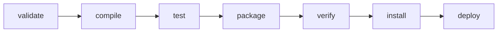
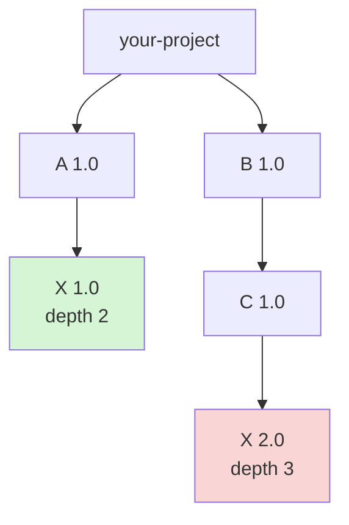
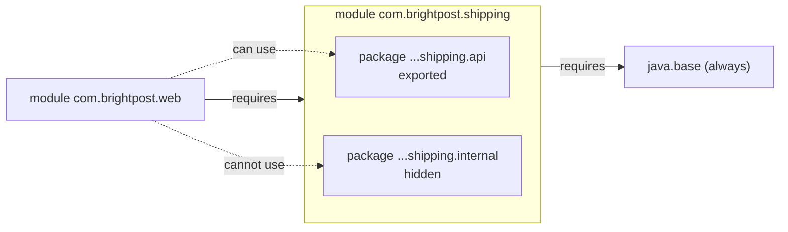

# Maven, Gradle and the module system

> **Before this lesson:** you can compile with `javac -d`, set a classpath and build a JAR by hand ([Packages on disk, the classpath and JAR files](#/lesson/java/java-jars-classpath)).

## In plain words

Cooking one meal at home, you fetch each ingredient yourself. A restaurant cannot work that way. It has a standing order with suppliers (ingredients arrive by themselves, in the right quantities and versions), a fixed sequence in the kitchen (prep, cook, plate, check), and the same sequence is followed whoever is on shift.

A **build tool** is that organisation for a software project. You describe the project in one file: its name, which libraries it needs, which Java version it targets. The tool then downloads the libraries (and the libraries *they* need), compiles, runs the tests, and packages the result, the same way on every developer's machine and on the build server.

Java has two dominant build tools, **Maven** and **Gradle**. This lesson teaches enough of both to work in a real project, and then gives a high-level view of the **Java module system**, which lets a library state which of its packages are public.

Why this matters for a job: you will never compile a company project with bare `javac`. On day one you will be told "clone it and run `mvn verify`" or "`./gradlew build`". Interviewers ask about the Maven lifecycle, dependency scopes, and how version conflicts are resolved.

## What a build tool does

| Job | By hand | With a build tool |
|---|---|---|
| Get libraries | download JARs, and the JARs they need, and theirs | declare a name and version; the rest is automatic |
| Compile | `javac` with a long classpath | one command |
| Test | run each test class | runs all tests; a failure stops the build |
| Package | `jar` with the right flags | produces the JAR, with a manifest |
| Repeatability | "works on my machine" | the same steps everywhere |

A library your project needs is a **dependency**. A dependency of a dependency is a **transitive dependency**. Dependencies are downloaded from a **repository**, most often the public **Maven Central**, and cached on your machine (in `~/.m2/repository` for Maven).

Every published library is identified by three **coordinates**:

- **groupId**: the organisation, in reversed-domain form, e.g. `com.fasterxml.jackson.core`;
- **artifactId**: the library's name, e.g. `jackson-databind`;
- **version**: e.g. `2.17.2`.

Written together: `com.fasterxml.jackson.core:jackson-databind:2.17.2`. Both Maven and Gradle use these coordinates and the same repositories.

## The standard project layout

Both tools expect this structure, originally defined by Maven. Following it means almost no configuration.

```text
parcel-app/
├── pom.xml                      (Maven)   or   build.gradle.kts (Gradle)
└── src/
    ├── main/
    │   ├── java/                application source, in package folders
    │   └── resources/           files copied into the JAR (config, templates)
    └── test/
        ├── java/                test source
        └── resources/           files only tests need
```

Build output goes to `target/` (Maven) or `build/` (Gradle). Never commit those folders to version control.

The idea that a tool should work with no configuration when you follow its conventions is called **convention over configuration**.

## Maven

Maven describes a project in `pom.xml` (POM stands for project object model). The description is **declarative**: you state facts about the project, and Maven knows the steps.

```xml
<project xmlns="http://maven.apache.org/POM/4.0.0">
  <modelVersion>4.0.0</modelVersion>

  <groupId>com.brightpost</groupId>
  <artifactId>parcel-app</artifactId>
  <version>1.0.0</version>
  <packaging>jar</packaging>

  <properties>
    <maven.compiler.release>21</maven.compiler.release>
    <project.build.sourceEncoding>UTF-8</project.build.sourceEncoding>
  </properties>

  <dependencies>
    <dependency>
      <groupId>com.fasterxml.jackson.core</groupId>
      <artifactId>jackson-databind</artifactId>
      <version>2.17.2</version>
    </dependency>
    <dependency>
      <groupId>org.junit.jupiter</groupId>
      <artifactId>junit-jupiter</artifactId>
      <version>5.11.0</version>
      <scope>test</scope>
    </dependency>
  </dependencies>
</project>
```

Reading it: the first block gives the project its own coordinates. `maven.compiler.release` sets the Java version. Each `<dependency>` names a library; the second has `scope` `test`, so it is available to test code only and is not packaged.

### The lifecycle

Maven builds in a fixed sequence of **phases**. Asking for a phase runs **every phase before it** as well.



| Command | What happens |
|---|---|
| `mvn compile` | compile `src/main/java` into `target/classes` |
| `mvn test` | also compile and run the tests |
| `mvn package` | also build `target/parcel-app-1.0.0.jar` |
| `mvn verify` | also run integration checks; the usual "is it all right?" command |
| `mvn install` | also copy the JAR into your local repository, so other local projects can depend on it |
| `mvn deploy` | also upload it to a shared remote repository |
| `mvn clean` | delete `target/` (a separate lifecycle, often combined: `mvn clean verify`) |
| `mvn dependency:tree` | print the full tree of dependencies, including transitive ones |

The work in each phase is done by **plugins** (the compiler plugin, the surefire test plugin, the jar plugin). You configure or add plugins in the POM when you need something beyond the defaults.

### Dependency scopes

A **scope** says when a dependency is on the classpath.

| Scope | Compile main code | Run tests | In the packaged application | Example |
|---|---|---|---|---|
| `compile` (default) | yes | yes | yes | a JSON library |
| `provided` | yes | yes | no: the runtime environment supplies it | the servlet API in an application server |
| `runtime` | no | yes | yes | a database driver loaded by name |
| `test` | no | yes | no | JUnit, Mockito |

### Version conflicts: nearest wins

Your project depends on A and B. A needs library X version 1.0; B needs X version 2.0. Only one version of X can be on the classpath. Which?

Maven's rule is **dependency mediation: the nearest definition wins**. "Nearest" means the fewest steps from your project in the dependency tree. If two candidates are at the same depth, the one **declared first** in the POM wins. Maven does **not** pick the highest version.



Here X 1.0 is chosen because it is two steps away and X 2.0 is three. If C needs something only X 2.0 has, the application fails at run time with `NoSuchMethodError`. Remedies:

- declare X directly in your own POM with the version you want (depth 1 always wins);
- pin versions in a `<dependencyManagement>` section, which is how a **BOM** (bill of materials) keeps a family of libraries on matching versions;
- exclude the unwanted transitive dependency with `<exclusions>`.

### A mediation model you can run

```python-run
from collections import deque

def mediate(root_deps, graph):
    """root_deps: ordered list of 'name:version' declared in the POM.
    graph: 'name:version' -> ordered list of its own dependencies.
    Breadth-first search gives 'nearest wins, then first declared'."""
    chosen, order = {}, []
    queue = deque((d, 1) for d in root_deps)
    while queue:
        coord, depth = queue.popleft()
        name, version = coord.split(":")
        if name in chosen:
            if chosen[name][0] != version:
                order.append(f"   omitted {coord} at depth {depth} (conflict with {name}:{chosen[name][0]})")
            continue                                   # already decided: do not descend into the loser
        chosen[name] = (version, depth)
        order.append(f"   {coord} at depth {depth}")
        for child in graph.get(coord, []):
            queue.append((child, depth + 1))
    return chosen, order

graph = {
    "A:1.0": ["X:1.0"],
    "B:1.0": ["C:1.0"],
    "C:1.0": ["X:2.0", "Y:3.1"],
    "X:1.0": ["Y:3.0"],
}
chosen, log = mediate(["A:1.0", "B:1.0"], graph)
print("\n".join(log))
print("classpath:", {k: v[0] for k, v in sorted(chosen.items())})
```

Y is interesting: both `Y:3.0` (through X 1.0) and `Y:3.1` (through C) sit at depth 3. The one reached first in declaration order wins. Add `"X:2.0"` to the root list and run again: your own declaration at depth 1 overrides everything.

## Gradle

Gradle does the same jobs with a different philosophy. Its build file is a **script**, written in Kotlin (`build.gradle.kts`) or Groovy (`build.gradle`), so builds can contain logic. It is the standard tool for Android and common in large projects because it is fast.

```kotlin
plugins {
    application
}

group = "com.brightpost"
version = "1.0.0"

java {
    toolchain {
        languageVersion = JavaLanguageVersion.of(21)
    }
}

repositories {
    mavenCentral()
}

dependencies {
    implementation("com.fasterxml.jackson.core:jackson-databind:2.17.2")
    testImplementation("org.junit.jupiter:junit-jupiter:5.11.0")
    testRuntimeOnly("org.junit.platform:junit-platform-launcher")
}

application {
    mainClass = "com.brightpost.shipping.App"
}

tasks.test {
    useJUnitPlatform()
}
```

The work is organised into **tasks** that depend on each other, forming a graph instead of a fixed line.

| Command | What happens |
|---|---|
| `./gradlew build` | compile, test and package everything |
| `./gradlew test` | compile and run tests |
| `./gradlew run` | run the application (with the `application` plugin) |
| `./gradlew clean` | delete `build/` |
| `./gradlew dependencies` | print the dependency tree |
| `./gradlew tasks` | list available tasks |

`gradlew` is the **Gradle wrapper**: a small script committed with the project that downloads the exact Gradle version the project expects. Always use it instead of a globally installed `gradle`. Maven has an equivalent, `mvnw`.

Gradle's dependency **configurations** correspond to Maven's scopes:

| Gradle | Rough Maven equivalent | Meaning |
|---|---|---|
| `implementation` | `compile` | needed to compile and run; hidden from projects that depend on yours |
| `api` | `compile` | as above, and exposed to projects that depend on yours |
| `compileOnly` | `provided` | compile time only |
| `runtimeOnly` | `runtime` | run time only |
| `testImplementation` | `test` | tests only |

Two differences matter in practice:

- **Conflict resolution**: Gradle chooses the **highest** requested version by default, where Maven chooses the nearest.
- **Speed**: Gradle skips tasks whose inputs have not changed (**incremental builds**), keeps a background process running (the **daemon**), and can reuse outputs from earlier builds (the **build cache**).

| | Maven | Gradle |
|---|---|---|
| Build file | `pom.xml` (XML, declarative) | `build.gradle.kts` or `build.gradle` (a script) |
| Model | fixed lifecycle of phases | graph of tasks |
| Version conflict rule | nearest wins | highest wins |
| Strengths | uniform, predictable, everywhere | fast, flexible, standard for Android |
| Output folder | `target/` | `build/` |

Neither is "better". Learn to read both.

## The module system, at a high level

Packages group classes; JARs group packages; but until Java 9 nothing stopped any code from using any `public` class in any JAR on the classpath. Library authors had no way to say "this package is for my own internal use". The classpath also could not notice a missing JAR until a class was needed, perhaps hours into a run.

The **Java Platform Module System** (JPMS, Java 9) adds a level above packages. A **module** is a named set of packages with a descriptor, `module-info.java`, at the root of its source tree, declaring two things: what it **needs** and what it **offers**.

```java
// src/main/java/module-info.java
module com.brightpost.shipping {
    requires java.net.http;                 // modules this one depends on
    requires com.fasterxml.jackson.databind;

    exports com.brightpost.shipping.api;    // packages other modules may use
    // com.brightpost.shipping.internal is NOT exported: invisible outside, even its public classes
}
```

| Directive | Meaning |
|---|---|
| `requires M` | this module needs module `M` |
| `requires transitive M` | and anyone who requires this module also gets `M` |
| `exports p` | package `p` is accessible to other modules |
| `exports p to M` | accessible to module `M` only |
| `opens p` | allow reflective access to `p` at run time (needed by frameworks) |
| `uses S` / `provides S with Impl` | declare a service consumer / a service implementation |

What it gives you:

- **Strong encapsulation.** A `public` class in a package that is not exported cannot be used from outside the module. "Public" now means "public within the module" unless the package is exported.
- **Reliable configuration.** Modules live on the **module path** instead of the classpath. At start-up the JVM checks that every `requires` is satisfied and that no two modules contain the same package, so missing or duplicated pieces are reported immediately.
- **Smaller runtimes.** The JDK itself is split into modules (`java.base`, `java.sql`, `java.net.http`, `java.desktop`). `jlink` can assemble a runtime containing only those your application requires.



How much do you need it? Honestly: many applications still run entirely on the classpath, where all code belongs to the "unnamed module" and the old rules apply. You will meet modules mostly through the JDK's own modularisation, for example an error saying that a package of a JDK module "does not export" something to your code, and when writing libraries. Know the concepts and the two key words, `requires` and `exports`.

> [!INTERVIEW]
> "Explain the Maven build lifecycle." Name the default phases in order (validate, compile, test, package, verify, install, deploy) and state that invoking a phase runs all earlier ones. "How does Maven resolve a version conflict?" Nearest definition wins; ties go to the first declaration; use `dependencyManagement`, a direct declaration or exclusions to control it; inspect with `mvn dependency:tree`. "Difference between `install` and `deploy`?" `install` copies the artifact to the local repository on your machine; `deploy` uploads it to a remote repository for others. "What is a SNAPSHOT version?" A version still in development, such as `1.1.0-SNAPSHOT`, which the tool re-downloads periodically because its contents may change; release versions never change.

## Pitfalls

- **Assuming Maven picks the newest version** of a conflicting dependency.
- **Committing `target/` or `build/`**, or not committing the wrapper scripts.
- **Using a globally installed tool version** instead of `mvnw` or `gradlew`.
- **Wrong scope**: a test library in `compile` scope bloats the application; a driver in `test` scope is missing in production.
- **Version ranges and `LATEST`**, which make builds unrepeatable.
- **Depending on a transitive dependency without declaring it.** When the intermediate library drops it, your build breaks.
- **`mvn install` when `mvn verify` would do**, filling the local repository with half-finished artifacts.
- **Split packages**: the same package in two modules is forbidden on the module path.
- **Forgetting `opens`** for packages that a framework accesses by reflection.

## Cheat sheet

| Goal | Maven | Gradle |
|---|---|---|
| Build and test | `mvn verify` | `./gradlew build` |
| Run tests only | `mvn test` | `./gradlew test` |
| Package | `mvn package` | `./gradlew assemble` |
| Clean | `mvn clean` | `./gradlew clean` |
| Dependency tree | `mvn dependency:tree` | `./gradlew dependencies` |
| Add a library | `<dependency>` in `pom.xml` | `implementation("g:a:v")` |
| Test-only library | `<scope>test</scope>` | `testImplementation(...)` |
| Java version | `maven.compiler.release` | `java.toolchain` |
| Module descriptor | `module-info.java` with `requires` and `exports` | the same file |

## Summary

- Build tools download dependencies, compile, test and package in a repeatable way, driven by one project file.
- Libraries are identified by groupId, artifactId and version and fetched from repositories such as Maven Central.
- Maven is declarative, with a fixed lifecycle of phases; Gradle is script-based, with a graph of tasks and incremental builds.
- Scopes and configurations control when a dependency is on the classpath.
- Maven resolves version conflicts by nearest-wins, Gradle by highest-wins.
- The module system adds named modules that declare what they require and which packages they export, giving strong encapsulation and start-up checks.

## Glossary

- **Build tool**: a program that automates compiling, testing and packaging.
- **Dependency**: a library a project needs.
- **Transitive dependency**: a dependency of a dependency.
- **Repository**: a store of published libraries, local or remote.
- **Coordinates**: groupId, artifactId and version, identifying one artifact.
- **Artifact**: a file produced by a build, usually a JAR.
- **POM**: Maven's project description, `pom.xml`.
- **Lifecycle / phase**: Maven's ordered build steps.
- **Plugin**: an extension that performs build work.
- **Scope / configuration**: when a dependency is available (compile, runtime, test...).
- **Dependency mediation**: choosing one version when several are requested.
- **BOM**: a bill of materials; a POM that pins a set of compatible versions.
- **Wrapper**: a script that runs a fixed version of the build tool.
- **Task**: a unit of work in a Gradle build.
- **Module**: a named group of packages with a `module-info.java` descriptor.
- **Module path**: where the JVM looks for modules.

## Check yourself

```quiz
[
  {"q": "Running `mvn package` also runs which of these phases?", "options": ["install and deploy", "compile and test", "Only package", "clean"], "answer": 1,
   "explain": "Invoking a phase executes all earlier phases of the default lifecycle: validate, compile, test, then package."},
  {"q": "Your POM lists A then B. A depends on X:1.0 directly; B depends on C, which depends on X:2.0. Which X does Maven use?", "options": ["X:2.0, the highest", "X:1.0, the nearest", "Both", "The build fails"], "answer": 1,
   "explain": "X:1.0 is at depth 2, X:2.0 at depth 3. Maven's mediation rule is nearest wins."},
  {"q": "Which Maven scope fits JUnit?", "options": ["compile", "provided", "runtime", "test"], "answer": 3,
   "explain": "Test libraries are needed only to compile and run tests and must not be packaged."},
  {"q": "With the same conflict (X:1.0 nearer, X:2.0 further), what does Gradle choose by default?", "options": ["X:1.0", "X:2.0", "It fails", "Whichever is declared first"], "answer": 1,
   "explain": "Gradle's default conflict resolution selects the highest requested version."},
  {"q": "What is the purpose of `gradlew` / `mvnw`?", "options": ["To run builds faster", "To ensure everyone uses the exact tool version the project specifies, without a manual install", "To publish artifacts", "To clean the cache"], "answer": 1,
   "explain": "The wrapper downloads and runs a pinned version of the build tool."},
  {"q": "In `module-info.java`, a package is not listed in any `exports` line. A class in it is declared `public`. Can another module use it?", "options": ["Yes, it is public", "No: non-exported packages are inaccessible outside the module", "Only by importing it", "Only at run time"], "answer": 1,
   "explain": "Strong encapsulation: public means accessible only where the package is exported."},
  {"q": "Where does standard Maven or Gradle layout expect application source code?", "options": ["src/", "src/main/java", "source/java", "java/main"], "answer": 1,
   "explain": "src/main/java for application code, src/test/java for tests, with resources alongside."},
  {"q": "What does `mvn install` do beyond `mvn package`?", "options": ["Uploads the JAR to a remote repository", "Copies the built artifact into the local repository on your machine", "Installs Java", "Deletes target/"], "answer": 1,
   "explain": "install makes the artifact available to other projects on the same machine; deploy uploads it for others."}
]
```

> **Source:** Head First Java, ch. 17 (release your code: packaging and deployment) extended with current tooling. Checked against https://maven.apache.org/guides/introduction/introduction-to-the-lifecycle.html , https://maven.apache.org/guides/introduction/introduction-to-dependency-mechanism.html , https://docs.gradle.org/current/userguide/dependency_resolution.html and https://dev.java/learn/modules/ .
