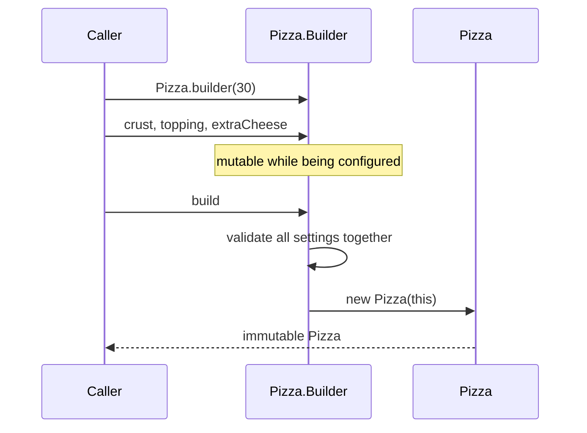
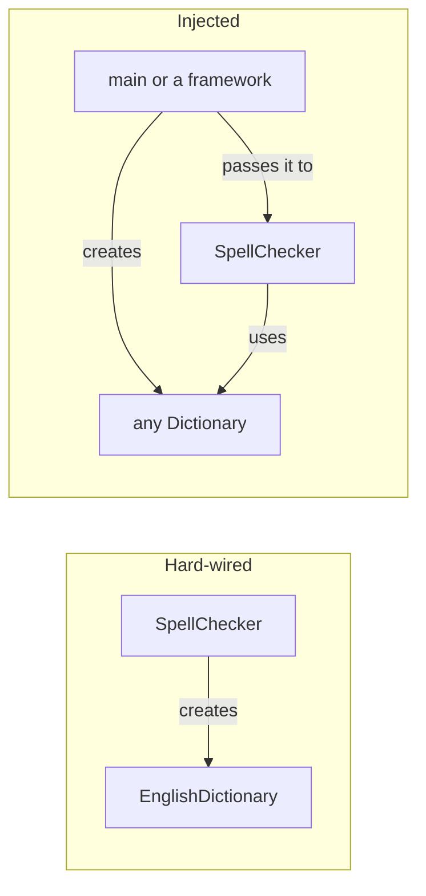

# Static factories, builders, singletons and dependency injection

> **Before this lesson:** you know constructors and `this(...)` chaining ([Constructors, this and super](#/lesson/java/java-constructors)), `static` and `final` ([static, final, constants and the Math class](#/lesson/java/java-static-final)), interfaces ([Interfaces, default methods, sealed types and pattern matching](#/lesson/java/java-interfaces)) and nested classes ([Nested, inner, local and anonymous classes](#/lesson/java/java-inner-classes)).

## In plain words

Part A of this track taught what Java *can* do. Part B is about what experienced developers *choose* to do, and why. It follows the topics of Joshua Bloch's *Effective Java*, explained from the beginning with fresh examples.

Start with the first decision in any object's life: how it gets created. Ordering a coffee, you do not walk behind the counter and assemble it. You say "a flat white, oat milk, extra shot" and the barista decides how to make it, which cup to use, and whether a cup made a moment ago by mistake can be handed over as is. The counter is a layer between *asking for a thing* and *how the thing is produced*.

`new SomeClass(...)` is walking behind the counter. It always creates a brand-new object of exactly that class, and its name can never be anything but the class name. This lesson covers the counters you can put in front of construction, and when each is worth it:

- a **static factory method**, a named method that returns an instance;
- a **builder**, for objects with many optional settings;
- a **singleton**, when exactly one instance must exist;
- a **private constructor**, when no instance should exist at all;
- **dependency injection**, when an object needs helpers and should be handed them.

Why this matters for a job: these are the creation patterns you will read in every library (`List.of`, `LocalDate.of`, `HttpRequest.newBuilder()`), and interviewers ask you to write a thread-safe singleton and a builder from memory.

## Static factory methods

A **static factory method** is a static method that returns an instance of the class.

```java
public final class Temperature {
    private final double kelvin;

    private Temperature(double kelvin) {              // constructor hidden
        if (kelvin < 0) {
            throw new IllegalArgumentException("below absolute zero: " + kelvin);
        }
        this.kelvin = kelvin;
    }

    public static Temperature ofCelsius(double c)    { return new Temperature(c + 273.15); }
    public static Temperature ofFahrenheit(double f) { return new Temperature((f - 32) * 5 / 9 + 273.15); }
    public static Temperature ofKelvin(double k)     { return new Temperature(k); }

    public double celsius() { return kelvin - 273.15; }
}
```

```java
Temperature a = Temperature.ofCelsius(20);
Temperature b = Temperature.ofFahrenheit(68);
System.out.printf("%.1f %.1f%n", a.celsius(), b.celsius());
```

```text
20.0 20.0
```

With constructors this class could not exist in a sensible form: three constructors each taking one `double` would have identical signatures, and `new Temperature(20)` tells a reader nothing about the unit.

### What factories give you that constructors cannot

1. **They have names.** `ofCelsius(20)` documents itself.
2. **They need not create a new object every time.** A factory can return a cached instance. `Boolean.valueOf(true)` always returns the same object; `Integer.valueOf` caches -128 to 127.
3. **They can return any subtype of their declared return type.** `List.of(1, 2)` returns some private implementation class you never see. The library can change it in a later release without breaking you.
4. **The returned class can vary with the arguments.** `EnumSet.noneOf(...)` returns one implementation for small enums and another for large ones.
5. **The implementation class need not exist when the factory is written**, which is how plug-in frameworks such as JDBC drivers work.

```java
public final class Greeting {
    private static final Greeting EMPTY = new Greeting("");
    private final String text;

    private Greeting(String text) { this.text = text; }

    public static Greeting of(String text) {
        return text == null || text.isBlank() ? EMPTY : new Greeting(text.strip());   // reuse one instance
    }
}
```

### The costs

- A class with only private constructors **cannot be subclassed**. Often that is a benefit, since it pushes users toward composition.
- Factories are **harder to spot** in documentation than constructors. Naming conventions help:

| Name | Meaning | Example |
|---|---|---|
| `of` | build from the given values | `List.of(1, 2)`, `LocalDate.of(2026, 5, 1)` |
| `from` | convert from another type | `Date.from(instant)` |
| `valueOf` | a more verbose `of` or `from` | `Integer.valueOf("42")` |
| `getInstance` / `instance` | return an instance, maybe shared | `Calendar.getInstance()` |
| `newInstance` / `create` | return a new instance every time | `Array.newInstance(...)` |
| `getType` / `newType` | factory located in another class | `Files.newBufferedReader(path)` |
| `copyOf` | an independent copy | `List.copyOf(other)` |

Rule of thumb: consider a static factory before reaching for a public constructor, especially when instances are immutable or when several ways of creating one would otherwise collide.

## Builders: many parameters, most of them optional

Consider a class describing a pizza order: size is required; crust, cheese, six toppings and a note are optional. Three approaches fail in different ways.

**Telescoping constructors.** One constructor for the required parameter, another adding one optional parameter, another adding two, and so on.

```java
new Pizza(12, "thin", true, false, true, false, false, null);    // which boolean is which?
```

Callers must pass values for parameters they do not care about, and swapping two booleans compiles and silently makes the wrong pizza.

**Setters on a mutable object** (the JavaBeans pattern).

```java
Pizza p = new Pizza();
p.setSize(12);
p.setCrust("thin");      // between these lines the object is half-built and invalid
```

The object can be used before it is complete, and it can never be immutable.

**The builder pattern** fixes both. A separate **builder** object collects the settings through readable method calls, and a final `build()` call validates everything and creates the finished, immutable object in one step.

```java
import java.util.ArrayList;
import java.util.List;

public final class Pizza {
    private final int sizeCm;
    private final String crust;
    private final boolean extraCheese;
    private final List<String> toppings;

    private Pizza(Builder b) {
        this.sizeCm = b.sizeCm;
        this.crust = b.crust;
        this.extraCheese = b.extraCheese;
        this.toppings = List.copyOf(b.toppings);          // unmodifiable snapshot
    }

    public static Builder builder(int sizeCm) {           // required parameter goes here
        return new Builder(sizeCm);
    }

    public static final class Builder {
        private final int sizeCm;
        private String crust = "classic";                 // defaults for optional settings
        private boolean extraCheese = false;
        private final List<String> toppings = new ArrayList<>();

        private Builder(int sizeCm) { this.sizeCm = sizeCm; }

        public Builder crust(String crust)     { this.crust = crust; return this; }
        public Builder extraCheese()           { this.extraCheese = true; return this; }
        public Builder topping(String topping) { toppings.add(topping); return this; }

        public Pizza build() {
            if (sizeCm < 15 || sizeCm > 50) {
                throw new IllegalStateException("size must be 15..50 cm: " + sizeCm);
            }
            if (toppings.size() > 5) {
                throw new IllegalStateException("at most 5 toppings");
            }
            return new Pizza(this);
        }
    }

    @Override
    public String toString() {
        return sizeCm + "cm " + crust + (extraCheese ? " +cheese " : " ") + toppings;
    }
}
```

```java
Pizza p = Pizza.builder(30)
        .crust("thin")
        .topping("mushroom")
        .topping("olive")
        .extraCheese()
        .build();
System.out.println(p);
```

```text
30cm thin +cheese [mushroom, olive]
```

How it works:

- Each setter-like method on the builder **returns `this`**, which is what allows the calls to be chained. An API designed for chaining is called a **fluent API**.
- The `Pizza` constructor is private and takes the builder, so the only way to get a `Pizza` is through `build()`.
- `build()` is the single place where rules that involve several fields are checked. An invalid `Pizza` never exists.
- The finished object has only `final` fields.



Use a builder when a constructor would have **four or more parameters**, especially optional ones or several of the same type. For two or three required values a constructor, a static factory or a record is simpler. The pattern costs a second class and an extra allocation.

### A builder model you can run

```python-run
class PizzaBuilder:
    def __init__(self, size_cm):
        self.size_cm, self.crust, self.extra_cheese, self.toppings = size_cm, "classic", False, []
    def set_crust(self, c):   self.crust = c; return self          # return self -> chaining
    def cheese(self):         self.extra_cheese = True; return self
    def topping(self, t):     self.toppings.append(t); return self
    def build(self):
        if not 15 <= self.size_cm <= 50:
            raise ValueError(f"size must be 15..50 cm: {self.size_cm}")
        if len(self.toppings) > 5:
            raise ValueError("at most 5 toppings")
        return (self.size_cm, self.crust, self.extra_cheese, tuple(self.toppings))   # immutable result

print(PizzaBuilder(30).set_crust("thin").topping("mushroom").cheese().build())
for bad in (PizzaBuilder(10), PizzaBuilder(30).topping("a").topping("b").topping("c").topping("d").topping("e").topping("f")):
    try:
        bad.build()
    except ValueError as e:
        print("rejected at build():", e)
```

## Singletons: exactly one instance

A **singleton** is a class that is instantiated exactly once: a registry, a connection pool, the object representing "the system clock".

The most robust way to write one in Java is a single-element **enum**:

```java
public enum AppClock {
    INSTANCE;

    public long nowMillis() {
        return System.currentTimeMillis();
    }
}
// use: AppClock.INSTANCE.nowMillis()
```

The JVM guarantees that each enum constant is created once, safely across threads, and that serialization or reflection cannot produce a second one. The other common forms:

```java
public final class Registry {
    private static final Registry INSTANCE = new Registry();     // created when the class is loaded
    private Registry() { }                                        // nobody else can call new
    public static Registry getInstance() { return INSTANCE; }
}
```

This is thread-safe because class initialisation is. If the instance is costly and may never be needed, the **holder idiom** delays creation without any locking:

```java
public final class Catalogue {
    private Catalogue() { /* expensive loading */ }

    private static class Holder {
        static final Catalogue INSTANCE = new Catalogue();        // runs on first use of Holder
    }

    public static Catalogue getInstance() { return Holder.INSTANCE; }
}
```

A warning from experience: singletons are global state. A class that fetches `Registry.getInstance()` deep inside its methods has a hidden dependency and cannot be tested with a substitute. Prefer to create the one instance at the top of the program and **pass it in** (see dependency injection below).

## Classes that must never be instantiated

A class that only groups static methods and constants (`Math`, `Collections`, your own `TextUtils`) should not be instantiable. Do not rely on making it `abstract`; that invites subclassing. Give it a private constructor:

```java
public final class TextUtils {
    private TextUtils() {
        throw new AssertionError("no instances");
    }

    public static boolean isBlank(String s) { return s == null || s.isBlank(); }
}
```

Without an explicit constructor the compiler would add a public one.

## Dependency injection: hand objects what they need

Many classes rely on other objects to do their work. A spell checker needs a dictionary; an order service needs a payment gateway. A helper object of this kind is a **dependency**. There are three ways for a class to obtain one.

```java
// 1. Hard-wired: creates its own. Cannot be changed or faked.
class SpellChecker {
    private final Dictionary dictionary = new EnglishDictionary();
}

// 2. Looks it up in a singleton: still fixed, and now hidden as well.
class SpellChecker {
    boolean isValid(String w) { return EnglishDictionary.getInstance().contains(w); }
}

// 3. Injected: receives it from outside.
class SpellChecker {
    private final Dictionary dictionary;

    SpellChecker(Dictionary dictionary) {
        this.dictionary = java.util.Objects.requireNonNull(dictionary);
    }

    boolean isValid(String word) { return dictionary.contains(word.toLowerCase()); }
}
```

```java
interface Dictionary { boolean contains(String word); }

Dictionary tiny = word -> java.util.Set.of("tea", "scone").contains(word);   // a test double
SpellChecker checker = new SpellChecker(tiny);
System.out.println(checker.isValid("Tea") + " " + checker.isValid("jam"));
```

```text
true false
```

Passing a dependency in through the constructor is **dependency injection** (DI). The gains:

- **Flexibility**: the same `SpellChecker` works with an English, French or medical dictionary.
- **Testability**: a test passes a small fake, with no files or network.
- **Honesty**: the constructor signature lists everything the class needs.
- **Immutability**: the dependency field can be `final`.

A variation is to inject a **factory**, an object that creates dependencies on demand; `Supplier<T>` is the standard type for that.

In large applications, a **DI framework** (Spring, Guice, Dagger, CDI) reads the constructors and wires hundreds of objects together automatically. The framework is a convenience; the principle is the plain constructor parameter shown here.



> [!INTERVIEW]
> "Write a thread-safe singleton." Give the enum version first, then the holder idiom, and explain why each is safe (the JVM initialises classes and enum constants exactly once, under an internal lock). If pressed for double-checked locking, remember that the field must be `volatile`; see [Concurrency utilities, thread-safety levels and lazy initialisation](#/lesson/java/java-ej-concurrency-utilities). Then add the design caveat: singletons hide dependencies and hamper testing, so in real applications the single instance is usually managed by dependency injection.

## Pitfalls

- **Several constructors with the same parameter types in a different order.** Use named factories.
- **Telescoping constructors** with long runs of booleans or strings.
- **Builders that do not validate in `build()`**, or that let the built object share the builder's mutable list.
- **Forgetting `return this`** in a builder method, which breaks chaining.
- **A builder for a class with two fields.** Needless ceremony.
- **Lazy singletons with an unsynchronised `if (instance == null)` check**: two threads can each create one.
- **Singletons holding mutable global state** that tests cannot reset.
- **Utility classes with an accidental public constructor.**
- **`new` for dependencies inside business classes**, making them impossible to substitute.

## Cheat sheet

| Situation | Technique |
|---|---|
| Several ways to create; or reuse instances; or hide the implementation | static factory method (`of`, `from`, `valueOf`) |
| Four or more parameters, many optional | builder with `build()` validation |
| A few required values, all data | record or plain constructor |
| Exactly one instance | single-element enum, or holder idiom |
| No instances | `final` class with a private constructor |
| The class needs collaborators | pass them through the constructor (dependency injection) |
| The class needs to create collaborators later | inject a `Supplier<T>` |

## Summary

- Static factory methods have names, can reuse instances and can return hidden subtypes; prefer them when constructors would be ambiguous.
- Builders make objects with many optional settings readable to create, validated in one place and immutable when built.
- Enforce "one instance" with an enum or the holder idiom, and "no instances" with a private constructor.
- Classes should receive their dependencies from outside instead of creating or looking them up; this is dependency injection, and it makes code flexible and testable.

## Glossary

- **Static factory method**: a static method that returns an instance of its class or a subtype.
- **Instance control**: a class deciding when instances are created or reused.
- **Telescoping constructors**: a family of constructors each adding one more parameter.
- **Builder**: an object that accumulates settings and produces a finished object.
- **Fluent API**: an interface designed for readable chains of method calls.
- **Singleton**: a class with exactly one instance.
- **Holder idiom**: lazy singleton creation through a nested static class.
- **Utility class**: a class of static members that is never instantiated.
- **Dependency**: an object that another object needs to do its work.
- **Dependency injection**: supplying dependencies from outside, usually through the constructor.
- **Test double**: a simplified stand-in for a dependency used in tests.

## Check yourself

```quiz
[
  {"q": "Which is an advantage of a static factory method over a public constructor?", "options": ["It is always faster", "It has a descriptive name and may return a cached instance or a subtype", "It can be overridden", "It allows subclassing"], "answer": 1,
   "explain": "Names, instance control and freedom of return type are the main benefits. A class with only private constructors cannot be subclassed."},
  {"q": "Does this compile? `class T { T(double celsius) { } T(double fahrenheit) { } }`", "options": ["Yes", "No: two constructors with the same parameter types", "Yes, chosen by parameter name", "Only if final"], "answer": 1,
   "explain": "Parameter names are not part of a signature. Named static factories solve this."},
  {"q": "In the builder pattern, why does each setting method return `this`?", "options": ["To save memory", "So calls can be chained in one expression", "Because void is not allowed", "To make the builder immutable"], "answer": 1,
   "explain": "Returning the builder allows builder.a().b().build()."},
  {"q": "Where should a builder check a rule involving two fields, such as 'end must be after start'?", "options": ["In each setter", "In build(), before creating the object", "In toString()", "Nowhere"], "answer": 1,
   "explain": "Only at build() are all values known. Checking there guarantees that no invalid object is ever created."},
  {"q": "Which singleton form is immune to creation of extra instances through serialization and reflection?", "options": ["A public static final field", "A lazy getInstance with an if-null check", "A single-element enum", "An abstract class"], "answer": 2,
   "explain": "The JVM guarantees one instance per enum constant and handles their serialization specially."},
  {"q": "What does this print? `enum One { INSTANCE; int n; }` then `One.INSTANCE.n++; One.INSTANCE.n++; System.out.println(One.INSTANCE.n);`", "options": ["0", "1", "2", "It does not compile"], "answer": 2,
   "explain": "There is one INSTANCE object, so both increments apply to the same field."},
  {"q": "A utility class declares no constructor. Can it be instantiated?", "options": ["No", "Yes: the compiler supplies a public default constructor", "Only by subclasses", "Only by reflection"], "answer": 1,
   "explain": "Add a private constructor to prevent instantiation."},
  {"q": "Why is `OrderService(PaymentGateway gateway)` better than a field `new StripeGateway()` inside the class?", "options": ["It runs faster", "The gateway can be swapped or faked in tests, and the dependency is visible", "It uses less memory", "It avoids interfaces"], "answer": 1,
   "explain": "Constructor injection decouples the class from one implementation and makes its needs explicit."}
]
```

> **Source:** Effective Java 3e, item group "Creating and destroying objects" (static factories, builders, singleton enforcement, non-instantiability, dependency injection); ideas restated with original examples. Naming conventions checked against the JDK API: https://docs.oracle.com/en/java/javase/21/docs/api/java.base/java/util/List.html .
