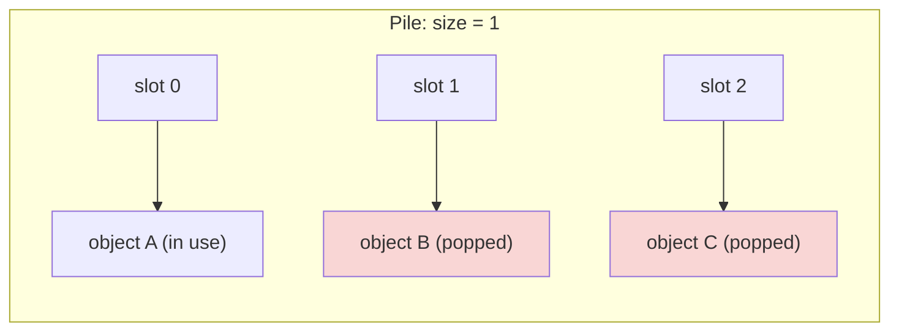
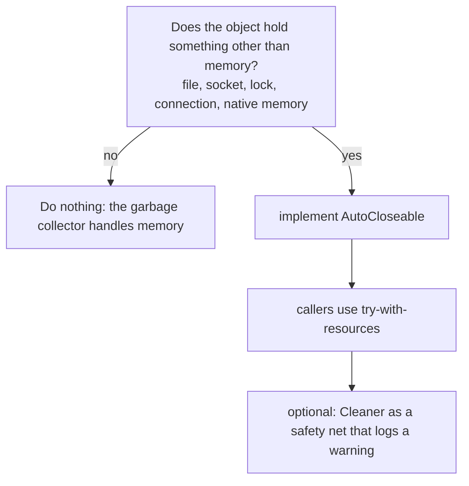

# Needless objects, memory leaks and resource clean-up

> **Before this lesson:** you know how the garbage collector decides an object is dead ([Object lifecycle, scope and garbage collection](#/lesson/java/java-object-lifecycle-gc)), autoboxing ([Wrapper classes, autoboxing and formatting](#/lesson/java/java-wrappers-formatting)) and try-with-resources ([try-with-resources, multi-catch and custom exceptions](#/lesson/java/java-twr-custom-exceptions)).

## In plain words

A café that hands every customer a new ceramic mug and throws it in the bin afterwards will still serve coffee. It will also spend a fortune on mugs and need the bins emptied every ten minutes. A sensible café washes and reuses mugs, clears finished tables so new customers can sit, and switches the machines off at closing time instead of hoping somebody notices they are still on.

The same three habits apply to objects:

1. **Do not create objects you do not need.** Reuse ones that never change.
2. **Let go of objects you have finished with**, or the garbage collector must keep them for ever.
3. **Close resources yourself**, at a known moment. Never rely on the garbage collector to do it.

Why this matters for a job: these are the habits that keep a service running for months. Interviewers ask "can Java have memory leaks?", "what is wrong with `finalize`?" and "spot the performance problem in this loop".

## Habit 1: avoid creating unnecessary objects

Creating a small object is cheap in modern Java, so this habit is not about fear of `new`. It is about noticing the cases where the same object is rebuilt thousands of times for no reason.

### Reuse immutable objects

```java
String a = new String("ready");       // forces a new object every time this line runs
String b = "ready";                   // reuses one shared object from the string pool
Boolean t = Boolean.valueOf("true");  // returns the shared Boolean.TRUE
```

An immutable object can be shared freely, because nobody can change it. Static factories such as `Boolean.valueOf` and `Integer.valueOf` exist partly to hand out shared instances.

### Build expensive objects once

A regular expression must be compiled into an internal machine before it can match. `String.matches` does that compilation **on every call**.

```java
import java.util.regex.Pattern;

class Codes {
    // Slow: compiles the pattern each time it is called
    static boolean isPostcodeSlow(String s) {
        return s.matches("[A-Z]{1,2}[0-9]{1,2} ?[0-9][A-Z]{2}");
    }

    // Fast: compile once, reuse for ever (Pattern is immutable and thread-safe)
    private static final Pattern POSTCODE = Pattern.compile("[A-Z]{1,2}[0-9]{1,2} ?[0-9][A-Z]{2}");

    static boolean isPostcode(String s) {
        return POSTCODE.matcher(s).matches();
    }
}
```

```java
System.out.println(Codes.isPostcode("LS1 4AP") + " " + Codes.isPostcode("hello"));
```

```text
true false
```

In a loop over a million strings the second version is several times faster, and the named constant also documents what the pattern means.

### Watch for hidden boxing

```java
static long sumSlow() {
    Long total = 0L;                                  // one capital letter
    for (long i = 0; i <= Integer.MAX_VALUE; i++) {
        total += i;                                   // unbox, add, box a NEW Long, about 2 billion times
    }
    return total;
}
```

Changing `Long` to `long` removes roughly two billion object creations. Prefer primitives to boxed types for arithmetic, and be suspicious of wrapper types as loop variables or accumulators.

### Keep it in proportion

Do **not** conclude that object creation is bad. A small, short-lived object that makes code clearer or safer is nearly free; the garbage collector is built for exactly that pattern. In particular, the next lesson's advice to make **defensive copies** outranks this habit: an unnecessary copy costs a little time, while a missing copy can cost a security hole. And do not build your own **object pool** (a stock of reusable objects) unless the objects are truly heavy, like database connections. Pools of ordinary objects make code more complicated and usually slower.

### A needless-object counter you can run

```python-run
def count_allocations(n, boxed):
    """Model 'for i in 0..n-1: total += i'. With a boxed accumulator, every addition
    allocates a new wrapper unless the result is in the Integer/Long cache (-128..127)."""
    total, allocations = 0, 0
    for i in range(n):
        total += i
        if boxed and not -128 <= total <= 127:
            allocations += 1
    return total, allocations

for n in (10, 1_000, 100_000):
    _, prim = count_allocations(n, boxed=False)
    total, box = count_allocations(n, boxed=True)
    print(f"n = {n:7}: total = {total:12}   objects created: primitive {prim}, boxed {box:,}")
```

The primitive version allocates nothing however large `n` becomes.

## Habit 2: eliminate obsolete references

Java frees memory automatically, which tempts people to believe leaks are impossible. They are not. The collector frees only **unreachable** objects. An object your program will never use again, but which something still points at, stays in memory. Such a pointer is an **obsolete reference**.

### Leak 1: a class that manages its own memory

```java
import java.util.Arrays;
import java.util.EmptyStackException;

public class Pile {
    private Object[] items = new Object[4];
    private int size = 0;

    public void push(Object o) {
        if (size == items.length) {
            items = Arrays.copyOf(items, size * 2);
        }
        items[size++] = o;
    }

    public Object pop() {
        if (size == 0) {
            throw new EmptyStackException();
        }
        return items[--size];                 // BUG: the slot still refers to the popped object
    }
}
```

After a thousand pushes and a thousand pops, `size` is 0 and the stack looks empty, but the array still holds a thousand references. To the collector those objects are reachable. The fix is one line:

```java
public Object pop() {
    if (size == 0) {
        throw new EmptyStackException();
    }
    Object top = items[--size];
    items[size] = null;                       // clear the obsolete reference
    return top;
}
```



Slots at or beyond `size` are dead to the program and alive to the collector. Any class that keeps its own storage pool (a stack, a ring buffer, a hand-written cache) must null out slots as they become unused. This is the exception, not the rule: nulling ordinary local variables is clutter. Let variables fall out of scope.

### Leak 2: caches

A cache keeps results in case they are needed again. If nothing ever removes entries, a cache is a memory leak with a nicer name. Give every cache a limit:

- a maximum number of entries, evicting the oldest or least recently used;
- a time limit per entry;
- or `WeakHashMap`, whose entries disappear automatically once nothing else refers to the **key**.

A small bounded cache needs only a few lines with `LinkedHashMap`:

```java
import java.util.LinkedHashMap;
import java.util.Map;

class LruCache<K, V> extends LinkedHashMap<K, V> {
    private final int capacity;

    LruCache(int capacity) {
        super(16, 0.75f, true);               // true = order entries by most recent ACCESS
        this.capacity = capacity;
    }

    @Override
    protected boolean removeEldestEntry(Map.Entry<K, V> eldest) {
        return size() > capacity;             // evict the least recently used entry
    }
}
```

```java
LruCache<String, Integer> cache = new LruCache<>(2);
cache.put("a", 1);
cache.put("b", 2);
cache.get("a");                               // a is now the most recently used
cache.put("c", 3);                            // evicts b
System.out.println(cache.keySet());
```

```text
[a, c]
```

### Leak 3: listeners and callbacks

An object that registers itself with a long-lived publisher ("tell me when prices change") is held by that publisher's listener list. If it never unregisters, it can never be collected, and neither can anything it refers to. Unregister explicitly, or have the publisher hold listeners through weak references.

> [!WARNING]
> Memory leaks in Java are silent. Nothing fails until, days later, the heap fills and the service dies with `OutOfMemoryError`. They are found with a **heap dump** (a snapshot of all objects) and a profiler that shows which objects are growing and what holds them.

## Habit 3: never rely on finalizers or cleaners

`Object` has a method `finalize()` that the garbage collector *may* call before reclaiming an object. It looks like a place to put clean-up code. It is a trap, and it has been deprecated for removal. Its replacement, `java.lang.ref.Cleaner`, is less dangerous and shares the central flaw.

| Problem | Consequence |
|---|---|
| **No guarantee of when it runs** | a file may stay open for minutes; you can run out of file handles while "unused" ones wait for a collection |
| **No guarantee that it runs at all** | the program may exit first; never use it to save data or release a lock |
| **Exceptions inside are ignored** | the object may be left half cleaned, with no trace |
| **Severe slow-down** | creating and reclaiming a finalizable object is dramatically slower |
| **Security hole** | a malicious subclass can use `finalize` to resurrect a partly constructed object whose constructor threw |

The collector exists to manage **memory**. It knows nothing about files, sockets, locks or database connections, and memory pressure is unrelated to how scarce those are.

Legitimate uses of `Cleaner` are narrow: as a **safety net** in case a caller forgets to call `close()` (better late than never, with a logged warning), and for freeing memory allocated outside the Java heap by native code.

## The right way: AutoCloseable and try-with-resources

A class that owns a resource should implement `AutoCloseable` and release the resource in `close()`. Callers use try-with-resources.

```java
public class TempWorkspace implements AutoCloseable {
    private final java.nio.file.Path dir;
    private boolean closed = false;

    public TempWorkspace() throws java.io.IOException {
        dir = java.nio.file.Files.createTempDirectory("work");
    }

    public java.nio.file.Path file(String name) {
        if (closed) {
            throw new IllegalStateException("workspace already closed");
        }
        return dir.resolve(name);
    }

    @Override
    public void close() throws java.io.IOException {
        if (closed) {
            return;                                   // closing twice is harmless
        }
        closed = true;
        try (var entries = java.nio.file.Files.list(dir)) {
            for (var p : entries.toList()) {
                java.nio.file.Files.delete(p);
            }
        }
        java.nio.file.Files.delete(dir);
    }
}
```

```java
try (TempWorkspace ws = new TempWorkspace()) {
    java.nio.file.Files.writeString(ws.file("draft.txt"), "hello");
    System.out.println(java.nio.file.Files.exists(ws.file("draft.txt")));
}                                                     // directory removed here, on every path
```

```text
true
```

Good manners for a closable class: `close()` is **idempotent** (calling it twice does no harm), methods used after closing throw `IllegalStateException`, and the class documents that it must be closed.

### Why try-with-resources beats try-finally

```java
// try-finally: two resources need nested blocks, and a failure in close() hides the real error
static void copyOld(String src, String dst) throws java.io.IOException {
    java.io.InputStream in = new java.io.FileInputStream(src);
    try {
        java.io.OutputStream out = new java.io.FileOutputStream(dst);
        try {
            in.transferTo(out);
        } finally {
            out.close();
        }
    } finally {
        in.close();
    }
}

// try-with-resources: flat, correct, and keeps the first exception
static void copy(String src, String dst) throws java.io.IOException {
    try (java.io.InputStream in = new java.io.FileInputStream(src);
         java.io.OutputStream out = new java.io.FileOutputStream(dst)) {
        in.transferTo(out);
    }
}
```

| | try-finally | try-with-resources |
|---|---|---|
| Lines for two resources | many, nested | a few, flat |
| Exception thrown by the body *and* by `close()` | the `close` exception replaces the original | the original is thrown; the other is attached as **suppressed** |
| Forgetting to close | easy | impossible for declared resources |
| Close order | whatever you wrote | reverse of declaration, automatically |

Always use try-with-resources for anything that implements `AutoCloseable`.



> [!INTERVIEW]
> "Can a Java program leak memory?" Yes: any object that is still reachable but will never be used is leaked. Typical sources are static or long-lived collections that only grow, caches without eviction, listeners never removed, stale slots in hand-managed arrays, and unclosed resources. "What is wrong with `finalize()`?" It runs at an unpredictable time or never, swallows exceptions, slows allocation and collection, enables finalizer attacks, and is deprecated for removal. Use `AutoCloseable` with try-with-resources; `Cleaner` only as a backstop.

## Pitfalls

- **`new String("literal")`** and other pointless copies of immutable objects.
- **Compiling a `Pattern`, building a `DateTimeFormatter` or creating an `ObjectMapper` inside a loop** or a frequently called method.
- **Wrapper types (`Long`, `Integer`, `Double`) as accumulators.**
- **Pooling cheap objects** in the name of performance.
- **Skipping defensive copies** to "save allocations".
- **Hand-managed arrays that keep references past their logical end.**
- **Unbounded caches**, especially in static maps.
- **Listeners registered and never removed.**
- **Clean-up in `finalize()`**, or assuming the collector will close a file.
- **`close()` that throws on a second call**, or that can be skipped by an early return.

## Cheat sheet

| Situation | Do this |
|---|---|
| Immutable value used repeatedly | create once; share; use `valueOf`-style factories |
| Expensive helper (regex, formatter) | `private static final` constant |
| Arithmetic in a loop | primitives, not boxed types |
| Class with its own array storage | null out slots when elements are removed |
| Cache | bound it by size or time; consider `LinkedHashMap` or `WeakHashMap` |
| Listeners | unregister, or hold weakly |
| File, socket, lock, connection | `AutoCloseable` + try-with-resources |
| `finalize()` | never |
| `Cleaner` | only as a safety net or for native memory |

## Summary

- Reuse immutable and expensive-to-build objects, and avoid accidental boxing; do not otherwise fear small short-lived objects.
- A reachable object the program no longer needs is a memory leak. Look for it in self-managed storage, caches and listener lists.
- Finalizers and cleaners are unpredictable, slow and unsafe; they are never the primary way to release anything.
- Resources are released by `close()`, and the reliable way to call it is try-with-resources, which also preserves the original exception.

## Glossary

- **Obsolete reference**: a reference that will never be used again but keeps its object reachable.
- **Memory leak**: memory retained by objects the program no longer needs.
- **Cache**: a store of computed results kept for reuse.
- **Eviction**: removing entries from a cache to bound its size.
- **LRU**: least recently used, a common eviction policy.
- **Weak reference**: a reference that does not prevent garbage collection.
- **Object pool**: a set of objects kept for reuse instead of being created on demand.
- **Finalizer**: the deprecated `finalize()` method run by the collector at an unspecified time.
- **Cleaner**: the modern, still unpredictable, replacement for finalizers.
- **Resource**: something other than memory that must be released explicitly.
- **Idempotent**: having the same effect whether performed once or several times.
- **Heap dump**: a snapshot of every object in the heap, used to diagnose leaks.

## Check yourself

```quiz
[
  {"q": "What is inefficient about `static boolean ok(String s) { return s.matches(\"[a-z]+\"); }` when called a million times?", "options": ["Nothing", "The regular expression is compiled on every call", "Strings are immutable", "matches is deprecated"], "answer": 1,
   "explain": "String.matches builds a Pattern each time. Compile it once into a static final Pattern."},
  {"q": "In `Long sum = 0L; for (long i = 0; i < n; i++) sum += i;` what is the hidden cost?", "options": ["Integer overflow", "A new Long object is created on almost every iteration", "The loop never ends", "Nothing"], "answer": 1,
   "explain": "sum is a wrapper, so each += unboxes, adds and boxes again."},
  {"q": "A hand-written stack's pop() returns `items[--size]` without clearing the slot. What is the consequence?", "options": ["ArrayIndexOutOfBoundsException", "The popped object stays reachable from the array and cannot be collected", "The stack returns the wrong element", "Nothing"], "answer": 1,
   "explain": "The array slot is an obsolete reference. Assign null to it after reading."},
  {"q": "Can a garbage-collected Java program leak memory?", "options": ["No, the GC prevents all leaks", "Yes, when objects stay reachable although they will never be used again", "Only with native code", "Only if System.gc() is not called"], "answer": 1,
   "explain": "The collector reclaims unreachable objects only."},
  {"q": "Why should clean-up code not go in `finalize()`?", "options": ["It runs too early", "There is no guarantee when, or whether, it runs, and it is deprecated", "It cannot access fields", "It must be static"], "answer": 1,
   "explain": "Finalization timing is up to the collector, and the mechanism is deprecated for removal."},
  {"q": "With `try (A a = new A(); B b = new B()) { throw new RuntimeException(\"body\"); }` where b.close() also throws, what reaches the caller?", "options": ["The exception from close", "The body exception, with the close exception attached as suppressed", "Both, one after the other", "Nothing"], "answer": 1,
   "explain": "Try-with-resources preserves the primary exception and records close failures via getSuppressed()."},
  {"q": "What does this print? `LruCache<String,Integer> c = new LruCache<>(2); c.put(\"x\", 1); c.put(\"y\", 2); c.put(\"z\", 3); System.out.println(c.keySet());` (using the lesson's LruCache)", "options": ["[x, y]", "[y, z]", "[x, z]", "[x, y, z]"], "answer": 1,
   "explain": "Nothing was accessed between the puts, so x is the eldest and is evicted when z arrives."},
  {"q": "Which statement is the best guidance on object creation?", "options": ["Never use new in loops", "Pool all objects", "Avoid needless creation of expensive or boxed objects, but do not sacrifice clarity or defensive copies to save small allocations", "Always reuse mutable objects"], "answer": 2,
   "explain": "Small short-lived objects are cheap; correctness and clarity come first."}
]
```

> **Source:** Effective Java 3e, item group "Creating and destroying objects" (unnecessary objects, obsolete references, finalizers and cleaners, try-with-resources); ideas restated with original examples. Checked against https://docs.oracle.com/en/java/javase/21/docs/api/java.base/java/lang/ref/Cleaner.html and https://docs.oracle.com/en/java/javase/21/docs/api/java.base/java/util/LinkedHashMap.html .
