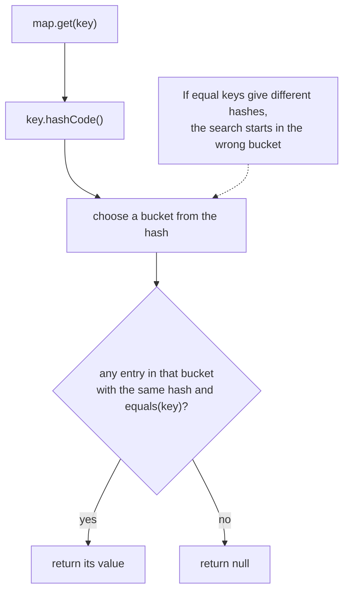

# Writing equals and hashCode correctly

> **Before this lesson:** you know that `==` compares references and `equals` compares contents ([References, arrays, the stack and the heap](#/lesson/java/java-references-stack-heap)), that every class inherits `equals` and `hashCode` from `Object` ([Abstract classes and the Object class](#/lesson/java/java-abstract-object)), and how hash-based collections use buckets ([Collections: List, Set, Map and Queue](#/lesson/java/java-collections)).

## In plain words

Two ten-pound notes are different pieces of paper with different serial numbers. A shopkeeper does not care which one you hand over: for the purpose of paying, they are **equal**. Two passports, in contrast, are never interchangeable, even if the photographs look alike. Whether two things "count as the same" depends on what kind of thing they are.

Java asks you to make that decision for each class you write. The method `equals` answers "do these two objects count as the same?" The method `hashCode` produces a number used to file an object in a hash table, and it must be consistent with the answer `equals` gives. Get either one subtly wrong and nothing crashes; instead a `HashSet` quietly holds duplicates, a `HashMap` cannot find a key you put in a second ago, and `list.contains` says no when the answer is yes.

Why this matters for a job: "explain the `equals`/`hashCode` contract" is very likely the single most asked Java interview question, and writing the two methods correctly on a whiteboard is a common follow-up.

## When to leave equals alone

The inherited `equals` says an object is equal only to itself. That is correct more often than people expect. Do **not** override when:

- **each instance is unique by nature**: a `Thread`, a database connection, a running game session;
- **nobody needs to compare them** for logical equality;
- **a superclass's `equals` is already right**: `ArrayList` inherits a suitable one from `AbstractList`;
- **the class is private or package-private** and you know `equals` is never called.

Override when the class is a **value class**: its instances stand for a value, and two instances with the same value should be interchangeable. `String`, `Integer`, `LocalDate`, a `Money`, a `Point`, an `EmailAddress`.

## The contract of equals

The documentation of `Object.equals` states five rules. For non-null references `x`, `y` and `z`:

| Rule | Statement | Plain meaning |
|---|---|---|
| **Reflexive** | `x.equals(x)` is true | everything equals itself |
| **Symmetric** | `x.equals(y)` is true exactly when `y.equals(x)` is true | it cannot depend on who asks |
| **Transitive** | if `x.equals(y)` and `y.equals(z)` then `x.equals(z)` | equality chains through |
| **Consistent** | repeated calls give the same answer while the objects are unchanged | no randomness, no outside state |
| **Non-null** | `x.equals(null)` is false | and it must not throw |

Collections are written on the assumption that these hold. Violate one and their behaviour becomes unpredictable.

### Breaking symmetry

```java
final class NoCaseText {
    private final String s;
    NoCaseText(String s) { this.s = s; }

    @Override
    public boolean equals(Object o) {
        if (o instanceof NoCaseText other) {
            return s.equalsIgnoreCase(other.s);
        }
        if (o instanceof String str) {               // tries to be friendly to plain Strings
            return s.equalsIgnoreCase(str);
        }
        return false;
    }
}
```

```java
NoCaseText a = new NoCaseText("Tea");
String b = "tea";
System.out.println(a.equals(b) + " " + b.equals(a));
```

```text
true false
```

`a` thinks it equals `b`, but `String.equals` knows nothing about `NoCaseText`. Now `List.of(a).contains(b)` and `List.of(b).contains(a)` give different answers, depending on whose `equals` the list happens to call. The repair is to remove the `String` branch: a class should be equal only to objects of its own kind.

### Breaking transitivity: the subclass problem

```java
class Point {
    final int x, y;
    Point(int x, int y) { this.x = x; this.y = y; }

    @Override
    public boolean equals(Object o) {
        return o instanceof Point p && p.x == x && p.y == y;
    }
    @Override public int hashCode() { return 31 * x + y; }
}

class ColourPoint extends Point {
    final String colour;
    ColourPoint(int x, int y, String colour) { super(x, y); this.colour = colour; }

    @Override
    public boolean equals(Object o) {
        if (!(o instanceof Point)) return false;
        if (!(o instanceof ColourPoint cp)) return o.equals(this);    // plain Point: ignore colour
        return super.equals(o) && cp.colour.equals(colour);
    }
}
```

```java
ColourPoint red = new ColourPoint(1, 2, "red");
Point plain = new Point(1, 2);
ColourPoint blue = new ColourPoint(1, 2, "blue");
System.out.println(red.equals(plain) + " " + plain.equals(blue) + " " + red.equals(blue));
```

```text
true true false
```

`red` equals `plain`, `plain` equals `blue`, yet `red` does not equal `blue`. Transitivity is broken. This is a fundamental limit, not a coding slip: **there is no way to extend an instantiable class with a new field that takes part in equality while keeping the `equals` contract.**

The way out is to **favour composition over inheritance**. A `ColourPoint` *has* a point instead of *being* one:

```java
record Point(int x, int y) { }
record ColourPoint(Point point, String colour) { }      // HAS-A; equality is clean and automatic
```

## A recipe for equals

```java
import java.util.Objects;

public final class Money {
    private final long cents;
    private final String currency;

    public Money(long cents, String currency) {
        this.cents = cents;
        this.currency = Objects.requireNonNull(currency);
    }

    @Override
    public boolean equals(Object o) {
        if (this == o) {                          // 1. same object? quick yes
            return true;
        }
        if (!(o instanceof Money other)) {        // 2. right type? (also rejects null)
            return false;
        }
        return cents == other.cents               // 3. compare every significant field
                && currency.equals(other.currency);
    }

    @Override
    public int hashCode() {
        return Objects.hash(cents, currency);     // same fields as equals
    }

    @Override
    public String toString() { return cents + " " + currency; }
}
```

The steps:

1. **`this == o`**: an optimisation, and it guarantees reflexivity.
2. **Type check** with `instanceof` and a pattern variable. `null instanceof Anything` is false, so no separate null check is needed.
3. **Compare each significant field.** A **significant field** is one that is part of the object's logical value. Skip caches and derived values.

How to compare by field type:

| Field type | Compare with |
|---|---|
| `int`, `long`, `boolean`, `char`, ... | `==` |
| `float`, `double` | `Float.compare(a, b) == 0`, `Double.compare(a, b) == 0` (handles `NaN` and `-0.0` consistently) |
| object that is never null | `a.equals(b)` |
| object that may be null | `Objects.equals(a, b)` |
| array | `Arrays.equals(a, b)` |

Compare the cheapest and most-likely-different fields first.

### The parameter must be Object

```java
public boolean equals(Money other) { ... }       // WRONG: this OVERLOADS, it does not override
```

Collections call `equals(Object)`. With the signature above, they would call the inherited version and ignore yours. Writing `@Override` turns this silent mistake into a compile error. Always write it.

### instanceof or getClass?

Some code uses `if (o == null || getClass() != o.getClass()) return false;` instead of `instanceof`. It keeps symmetry even when subclasses add fields, at the price that a subclass instance is never equal to a superclass instance, even when the subclass adds no state. Both styles are defensible. The cleanest policy sidesteps the debate: make value classes `final` (or use records), so there are no subclasses to worry about.

## The contract of hashCode

1. **Consistent**: while the fields used in `equals` are unchanged, `hashCode` returns the same number.
2. **Equal objects must have equal hash codes.**
3. Unequal objects **may** have equal hash codes, but spreading them out makes hash tables fast.

The second rule is the one everybody breaks. **If you override `equals`, you must override `hashCode`**, using the same fields.

```java
final class PhoneNoHash {
    final int area, number;
    PhoneNoHash(int area, int number) { this.area = area; this.number = number; }

    @Override
    public boolean equals(Object o) {
        return o instanceof PhoneNoHash p && p.area == area && p.number == number;
    }
    // hashCode not overridden
}
```

```java
java.util.Map<PhoneNoHash, String> book = new java.util.HashMap<>();
book.put(new PhoneNoHash(113, 5550199), "Ada");
System.out.println(book.get(new PhoneNoHash(113, 5550199)));
```

```text
null
```

The key used for `get` is equal to the stored key, but its inherited hash code is different, so the map looks in a different bucket and finds nothing.



### Writing a good hashCode

The classic recipe combines the significant fields with the multiplier 31:

```java
@Override
public int hashCode() {
    int result = Long.hashCode(cents);
    result = 31 * result + currency.hashCode();
    return result;
}
```

- Start with the hash of the first field. For each further field, multiply by 31 and add that field's hash.
- Field hashes: `Integer.hashCode(i)`, `Long.hashCode(l)`, `Double.hashCode(d)`, `Boolean.hashCode(b)`, `obj.hashCode()` (0 for null), `Arrays.hashCode(array)`.
- 31 is an odd prime; multiplying by it shuffles the bits so that field order matters, and the JVM can compute `31 * i` as `(i << 5) - i`.

`Objects.hash(cents, currency)` does the same in one line, with a small cost for creating an array and boxing primitives. It is fine unless profiling shows the method is hot.

Rules:

- Use **exactly the fields `equals` uses**, or a subset. Never a field `equals` ignores.
- A legal but terrible hash: `return 42;`. Every object lands in one bucket and the map degrades into a list.
- For an immutable object with a costly hash, compute it once and store it in a field (**caching**), as `String` does.
- Do not promise a specific formula in your documentation; you may want to improve it.

### A contract checker you can run

The model tests a set of sample objects against the rules: reflexive, symmetric, transitive, and equal-implies-equal-hash.

```python-run
from itertools import product

def check(objects, eq, hsh):
    problems = []
    for a in objects:
        if not eq(a, a):
            problems.append(f"not reflexive: {a}")
    for a, b in product(objects, repeat=2):
        if eq(a, b) != eq(b, a):
            problems.append(f"not symmetric: {a} vs {b}")
        if eq(a, b) and hsh(a) != hsh(b):
            problems.append(f"equal but different hash: {a} / {b}")
    for a, b, c in product(objects, repeat=3):
        if eq(a, b) and eq(b, c) and not eq(a, c):
            problems.append(f"not transitive: {a} = {b} = {c} but {a} != {c}")
    return sorted(set(problems)) or ["contract holds"]

# Objects are (kind, x, y, colour). Plain points have colour None.
pts = [("P", 1, 2, None), ("C", 1, 2, "red"), ("C", 1, 2, "blue"), ("P", 3, 4, None)]

twin = tuple(["P", 1, 2, None])    # a second, separate object equal to pts[0]

def mixed_eq(a, b):                      # the flawed ColourPoint rule from the lesson
    if a[0] == "P" or b[0] == "P":
        return a[1:3] == b[1:3]          # if either is a plain point, ignore colour
    return a[1:] == b[1:]

print("Flawed rule, hash = x and y only:")
print("  " + "\n  ".join(check(pts, mixed_eq, lambda p: hash(p[1:3]))))
print("Sound rule (same kind and all fields), hash on identity instead of fields:")
print("  " + "\n  ".join(check(pts + [twin], lambda a, b: a == b, id)))
print("Sound rule with matching hash:")
print("  " + "\n  ".join(check(pts + [twin], lambda a, b: a == b, hash)))
```

The middle case models "overrode `equals`, forgot `hashCode`": two separate but equal objects have different identity-based hashes.

## Mutable fields and hash-based collections

```java
import java.util.ArrayList;
import java.util.HashSet;
import java.util.List;
import java.util.Set;

List<String> key = new ArrayList<>(List.of("a"));
Set<List<String>> set = new HashSet<>();
set.add(key);
key.add("b");                                   // the hash code of key has now changed
System.out.println(set.contains(key) + " " + set.size());
```

```text
false 1
```

The set still holds the list, filed under its **old** hash. Looking it up with its **new** hash searches the wrong bucket. The element is present and unreachable. Keys and set elements should be immutable, or at least never modified while inside the collection.

## Let the tools write it

Hand-writing these methods is error-prone, and the bugs are silent. Prefer:

- **Records.** `record Money(long cents, String currency) { }` generates `equals`, `hashCode` and `toString` from all components.
- **Your IDE's generator**, which produces the recipe above.
- Libraries such as AutoValue or Lombok in code bases that already use them.

Whatever you use, test it: a library called EqualsVerifier checks all the contract rules in one line.

```java
record Money(long cents, String currency) { }

Money a = new Money(500, "GBP");
Money b = new Money(500, "GBP");
System.out.println(a.equals(b) + " " + (a.hashCode() == b.hashCode()) + " " + (a == b));
```

```text
true true false
```

> [!INTERVIEW]
> A model answer to "what is the contract between `equals` and `hashCode`?": *If two objects are equal according to `equals`, they must return the same `hashCode`. The reverse is not required: unequal objects may collide. `hashCode` must also be stable while the fields used by `equals` are unchanged. Hash collections locate a bucket with `hashCode` and then confirm with `equals`, so violating the rule makes lookups fail and allows duplicates.* Then list the five `equals` properties, and mention that `equals` must take `Object`, that both should use the same fields, and that keys should be immutable.

## Pitfalls

- **Overriding `equals` without `hashCode`.**
- **`equals(MyType other)`** instead of `equals(Object o)`.
- **Trying to be equal to other types** (symmetry).
- **Adding a value field in a subclass** of a class with value equality (transitivity).
- **Using a field in `hashCode` that `equals` ignores**, or a mutable field for objects stored in hash collections.
- **Comparing `double` fields with `==`**, or arrays with `equals`.
- **`equals` that depends on unreliable outside resources.** `java.net.URL.equals` resolves host names over the network; avoid it in collections.
- **`hashCode` returning a constant**, or built only from a field that rarely varies.
- **Throwing `NullPointerException` or `ClassCastException` from `equals`** instead of returning false.

## Cheat sheet

| Step | Code |
|---|---|
| Identity shortcut | `if (this == o) return true;` |
| Type and null check | `if (!(o instanceof Money m)) return false;` |
| Primitive field | `a == m.a` |
| `double` field | `Double.compare(d, m.d) == 0` |
| Object field | `Objects.equals(x, m.x)` |
| Array field | `Arrays.equals(arr, m.arr)` |
| Hash, simple | `Objects.hash(a, x)` |
| Hash, manual | `31 * Integer.hashCode(a) + Objects.hashCode(x)` |
| Zero effort | `record` |
| Always | `@Override`, same fields in both, class `final` |

## Summary

- Override `equals` only for value classes; otherwise identity is the right notion.
- `equals` must be reflexive, symmetric, transitive, consistent and false for `null`.
- Extending a class with a new value field cannot preserve the contract; use composition.
- Equal objects must have equal hash codes, so `equals` and `hashCode` are always overridden together, from the same fields.
- Objects used as map keys or set elements should be immutable.
- Records, IDE generators and verification libraries remove most of the risk.

## Glossary

- **Logical equality**: two objects representing the same value, as opposed to being the same object.
- **Value class**: a class whose instances are defined entirely by the values they hold.
- **Contract**: the rules a method's implementation must obey.
- **Reflexive / symmetric / transitive**: the three defining properties of an equivalence relation.
- **Consistent**: giving the same answer on repeated calls while nothing relevant has changed.
- **Significant field**: a field that is part of an object's logical value.
- **Hash code**: an `int` used to place an object in a hash table.
- **Collision**: unequal objects with the same hash code.
- **Bucket**: one slot of a hash table.
- **Overload versus override**: same name with different parameters, versus replacing an inherited method.
- **Caching the hash**: storing a computed hash code in a field for reuse.

## Check yourself

```quiz
[
  {"q": "A class overrides `equals` but not `hashCode`. What is the typical symptom?", "options": ["Compile-time error", "HashMap lookups with an equal key return null, and HashSets contain duplicates", "StackOverflowError", "Nothing at all"], "answer": 1,
   "explain": "Equal objects get different hash codes, so they are filed in and sought from different buckets."},
  {"q": "Does `public boolean equals(Money other) { ... }` override `Object.equals`?", "options": ["Yes", "No: the parameter type differs, so it is an overload", "Only if Money is final", "Only with @Override"], "answer": 1,
   "explain": "The overriding signature is equals(Object). With @Override the compiler would report the mistake."},
  {"q": "`x.equals(y)` is true but `y.equals(x)` is false. Which property is violated?", "options": ["Reflexivity", "Symmetry", "Transitivity", "Consistency"], "answer": 1,
   "explain": "Symmetry requires the two calls to agree."},
  {"q": "Is `public int hashCode() { return 1; }` legal for a class with a correct equals?", "options": ["No, it breaks the contract", "Yes, it satisfies the contract but makes hash tables perform like linked lists", "No, hash codes must be unique", "Only for immutable classes"], "answer": 1,
   "explain": "Equal objects have equal hashes, so the contract holds; performance is terrible because everything collides."},
  {"q": "What does this print? `record P(int x, int y) { }` then `System.out.println(new P(1, 2).equals(new P(1, 2)) + \" \" + (new P(1, 2) == new P(1, 2)));`", "options": ["true true", "true false", "false false", "false true"], "answer": 1,
   "explain": "Records compare components in equals; == still compares identity of two distinct objects."},
  {"q": "What should `x.equals(null)` do for a non-null x?", "options": ["Throw NullPointerException", "Return false", "Return true", "Throw IllegalArgumentException"], "answer": 1,
   "explain": "The contract requires false, without throwing. The instanceof test handles it automatically."},
  {"q": "A mutable object is added to a HashSet and then one of the fields used in hashCode is changed. `set.contains(obj)` most likely returns...", "options": ["true", "false, although the object is still in the set", "It throws", "true, then removes it"], "answer": 1,
   "explain": "The object sits in the bucket for its old hash; the lookup uses the new hash."},
  {"q": "Why can a subclass not add a value field and keep a correct equals relation with its instantiable superclass?", "options": ["Java forbids overriding equals twice", "Any attempt breaks symmetry or transitivity when mixed comparisons occur", "Subclasses cannot have fields", "hashCode would overflow"], "answer": 1,
   "explain": "Ignoring the new field in mixed comparisons breaks transitivity; respecting it breaks symmetry. Composition avoids the problem."}
]
```

> **Source:** Effective Java 3e, item group "Methods common to all objects" (the equals contract; always overriding hashCode with equals); ideas restated with original examples. Contract wording checked against https://docs.oracle.com/en/java/javase/21/docs/api/java.base/java/lang/Object.html#equals(java.lang.Object) and https://docs.oracle.com/en/java/javase/21/docs/api/java.base/java/lang/Object.html#hashCode() .
