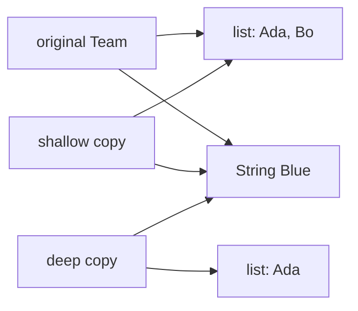
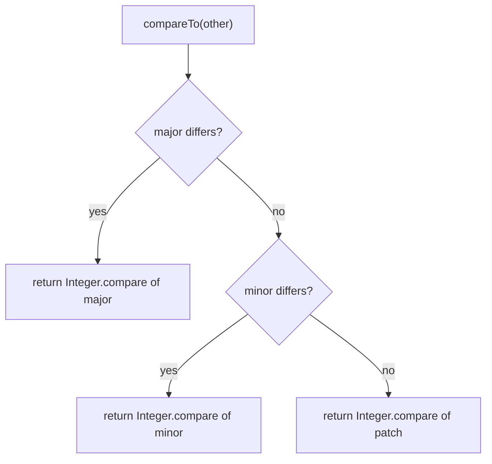

# toString, copying objects and Comparable

> **Before this lesson:** you can write `equals` and `hashCode` ([Writing equals and hashCode correctly](#/lesson/java/java-ej-equals-hashcode)), you know references and aliasing ([References, arrays, the stack and the heap](#/lesson/java/java-references-stack-heap)) and you have sorted with `Comparable` and `Comparator` ([Sorting with Comparable and Comparator](#/lesson/java/java-sorting)).

## In plain words

Three small courtesies make an object pleasant to work with.

- **It can introduce itself.** A parcel with a readable label is easier to deal with than one marked only with a warehouse code. That is `toString`.
- **It can be duplicated safely.** If you photocopy a document that says "see the attached folder", you have two documents pointing at **one** folder. Whether that is acceptable, or whether the folder must be copied as well, is the question behind copying objects.
- **It knows its place in a queue.** Dates know which is earlier; version numbers know which is newer. That is `Comparable`.

Each of these has a right way and a traditional wrong way in Java. This lesson shows both.

Why this matters for a job: a good `toString` shortens every debugging session; a wrong copy causes two parts of a program to corrupt each other's data; a careless `compareTo` makes sorted collections lose elements. Interviewers ask for "shallow versus deep copy" and "why is `clone` considered broken?".

## toString: always override it

`Object.toString` returns the class name, an `@`, and the hash code in hexadecimal.

```java
class Flight {
    private final String code;
    private final int seatsFree;
    Flight(String code, int seatsFree) { this.code = code; this.seatsFree = seatsFree; }
}

System.out.println(new Flight("BP204", 17));
```

```text
Flight@7a81197d
```

That string appears wherever an object is turned into text: `println`, string concatenation, log messages, assertion failures, the debugger's variable view, and the printout of any collection containing the object. A log line reading `Could not book Flight@7a81197d` helps nobody.

```java
class Flight {
    private final String code;
    private final int seatsFree;
    Flight(String code, int seatsFree) { this.code = code; this.seatsFree = seatsFree; }

    @Override
    public String toString() {
        return "Flight[code=" + code + ", seatsFree=" + seatsFree + "]";
    }
}

System.out.println(new Flight("BP204", 17));
System.out.println(java.util.List.of(new Flight("BP204", 17), new Flight("BP310", 0)));
```

```text
Flight[code=BP204, seatsFree=17]
[Flight[code=BP204, seatsFree=17], Flight[code=BP310, seatsFree=0]]
```

Guidelines:

- **Include everything a reader would want to know**, normally all the significant fields.
- **Never include secrets**: passwords, tokens, full card numbers. Log files are read by many people.
- **Decide whether the format is a promise.** For value classes a documented, stable format is useful (`LocalDate` prints `2026-05-01`). If you document it, provide a matching parser (a static `parse` or `of` method), and accept that you can never change it. If you do not want that commitment, say in the documentation that the format may change.
- **Provide getters for every piece of information in the string.** Otherwise callers will parse your `toString` output, and your format becomes an accidental API.
- Records generate a good `toString`; enums print their constant name; IDEs can generate one for classes.

```java
record Flight(String code, int seatsFree) { }
// new Flight("BP204", 17).toString() is "Flight[code=BP204, seatsFree=17]"
```

## Copying objects

### Assignment does not copy

```java
int[] a = {1, 2, 3};
int[] b = a;                 // a second reference, not a second array
b[0] = 99;
System.out.println(a[0]);
```

```text
99
```

To obtain an independent object you must create one and copy the contents across. The question is how far down the copy goes.

### Shallow copy versus deep copy

- A **shallow copy** is a new object whose fields hold the **same values** as the original's fields. Where a field is a reference, both objects now refer to the same inner object.
- A **deep copy** also copies the objects that the fields refer to, and so on down, so that the two structures share nothing mutable.

```java
import java.util.ArrayList;
import java.util.List;

class Team {
    String name;
    List<String> members = new ArrayList<>();
}

Team original = new Team();
original.name = "Blue";
original.members.add("Ada");

Team shallow = new Team();
shallow.name = original.name;
shallow.members = original.members;                    // SAME list object

Team deep = new Team();
deep.name = original.name;
deep.members = new ArrayList<>(original.members);      // a NEW list with the same elements

original.members.add("Bo");
System.out.println(shallow.members + " " + deep.members);
```

```text
[Ada, Bo] [Ada]
```



All three teams share the `String` "Blue", and that is harmless: **immutable objects never need to be copied**, because nobody can change them. Copies need to go deep only as far as the mutable parts.

### A copy model you can run

```python-run
import copy

original = {"name": "Blue", "members": ["Ada"], "captain": {"name": "Ada", "caps": 3}}
alias    = original                      # Team b = a;
shallow  = copy.copy(original)           # new outer object, same inner objects
deep     = copy.deepcopy(original)       # everything duplicated

original["members"].append("Bo")         # mutate an inner object
original["captain"]["caps"] = 4
original["name"] = "Red"                 # re-point a field of the outer object

for label, obj in (("alias", alias), ("shallow", shallow), ("deep", deep)):
    print(f"{label:8} name={obj['name']:5} members={obj['members']} caps={obj['captain']['caps']}")
print("shallow shares the member list:", shallow["members"] is original["members"])
print("deep shares the member list   :", deep["members"] is original["members"])
```

The alias sees everything. The shallow copy keeps its own `name` field but sees changes to shared inner objects. The deep copy sees nothing.

## Why clone is a poor tool

Java has a built-in copying mechanism: the `Cloneable` interface and `Object.clone()`. It is widely regarded as a design mistake.

```java
class Basket implements Cloneable {
    private String owner;
    private ArrayList<String> items = new ArrayList<>();

    Basket(String owner) { this.owner = owner; }
    void add(String item) { items.add(item); }
    int size() { return items.size(); }

    @Override
    public Basket clone() {
        try {
            Basket copy = (Basket) super.clone();          // field-by-field SHALLOW copy
            copy.items = new ArrayList<>(items);           // must deepen the mutable part by hand
            return copy;
        } catch (CloneNotSupportedException e) {
            throw new AssertionError(e);                   // cannot happen: we implement Cloneable
        }
    }
}
```

What is wrong with the mechanism:

| Problem | Detail |
|---|---|
| `Cloneable` has no methods | it is a marker that changes what the protected `Object.clone` does: without it, `clone` throws `CloneNotSupportedException` |
| No constructor runs | the copy is made by copying memory, so invariants and validation in constructors are bypassed |
| Shallow by default | forget to copy one mutable field and the "copy" shares state with the original |
| Fights with `final` | a `final` field cannot be reassigned in `clone`, so a deep copy of it is impossible |
| Checked exception that never happens | every implementation needs the ritual `try`/`catch` |
| Fragile under inheritance | a subclass that adds a mutable field and forgets to override `clone` silently produces broken copies |

The one place `clone` is the best tool is **arrays**: `int[] copy = original.clone();` is the idiomatic, fast way to copy a one-dimensional array (it is shallow for arrays of objects).

## The better ways to copy

### Copy constructor and copy factory

A **copy constructor** takes an instance of its own class. A **copy factory** is the static-method equivalent.

```java
final class Basket {
    private final String owner;
    private final List<String> items;

    Basket(String owner) {
        this.owner = owner;
        this.items = new ArrayList<>();
    }

    Basket(Basket other) {                           // copy constructor
        this.owner = other.owner;                    // immutable: share
        this.items = new ArrayList<>(other.items);   // mutable: copy
    }

    static Basket copyOf(Basket other) {             // copy factory
        return new Basket(other);
    }

    void add(String item) { items.add(item); }
    int size() { return items.size(); }
}
```

```java
Basket mine = new Basket("ada");
mine.add("tea");
Basket yours = new Basket(mine);
yours.add("jam");
System.out.println(mine.size() + " " + yours.size());
```

```text
1 2
```

These run a real constructor, work with `final` fields, throw no odd exceptions, need no cast, and can even accept an interface type, which is how the collections do **conversion copies**: `new ArrayList<>(anySet)`, `new TreeSet<>(anyList)`, `List.copyOf(anything)`.

### Do not copy at all: immutability

If a class is immutable, sharing is always safe and copying is pointless. A record of immutable components needs no copy method. "Changing" one means building a new value from the old:

```java
record Flight(String code, int seatsFree) {
    Flight withSeatsFree(int n) { return new Flight(code, n); }     // a "wither"
}
```

| Need | Use |
|---|---|
| copy an array | `arr.clone()` or `Arrays.copyOf` |
| copy a collection | `new ArrayList<>(c)`, `List.copyOf(c)`, `Map.copyOf(m)` |
| copy your own mutable class | copy constructor or copy factory |
| value object | make it immutable; no copy needed |
| implement `Cloneable` in a new class | avoid |

## Comparable: giving a class a natural order

`compareTo` is not a method of `Object`; it is the single method of the interface `Comparable<T>`. Implementing it declares that instances have a **natural ordering**, and the class then works with `Collections.sort`, `Arrays.sort`, `TreeSet`, `TreeMap`, `PriorityQueue`, `Collections.max` and stream `sorted()` with no extra code. Implement it for value classes with an obvious order: amounts, dates, versions, names.

### The contract

Writing sgn(n) for the sign of n (-1, 0 or 1), for all `x`, `y`, `z`:

1. **Antisymmetry**: `sgn(x.compareTo(y)) == -sgn(y.compareTo(x))`.
2. **Transitivity**: `x.compareTo(y) > 0` and `y.compareTo(z) > 0` imply `x.compareTo(z) > 0`.
3. **Substitution**: if `x.compareTo(y) == 0`, then `x` and `y` compare identically against any `z`.
4. **Recommended: consistent with equals**: `x.compareTo(y) == 0` exactly when `x.equals(y)`.

The last is a recommendation with teeth. Sorted collections decide "same element" by `compareTo`, hash collections by `equals`. `BigDecimal` is the famous inconsistency:

```java
import java.math.BigDecimal;
import java.util.HashSet;
import java.util.Set;
import java.util.TreeSet;

BigDecimal a = new BigDecimal("1.0");
BigDecimal b = new BigDecimal("1.00");
System.out.println(a.equals(b) + " " + a.compareTo(b));

Set<BigDecimal> hash = new HashSet<>(Set.of(a, b));
Set<BigDecimal> tree = new TreeSet<>(Set.of(a, b));
System.out.println(hash.size() + " " + tree.size());
```

```text
false 0
2 1
```

`equals` compares value and scale (number of decimal places); `compareTo` compares numeric value only. The same two numbers are two elements in one set and one element in the other.

### Writing compareTo

```java
import java.util.Comparator;

public final class Version implements Comparable<Version> {
    private final int major, minor, patch;

    public Version(int major, int minor, int patch) {
        this.major = major; this.minor = minor; this.patch = patch;
    }

    private static final Comparator<Version> ORDER =
            Comparator.comparingInt((Version v) -> v.major)
                      .thenComparingInt(v -> v.minor)
                      .thenComparingInt(v -> v.patch);

    @Override
    public int compareTo(Version other) {
        return ORDER.compare(this, other);
    }

    @Override
    public boolean equals(Object o) {
        return o instanceof Version v && compareTo(v) == 0;       // consistent with compareTo
    }

    @Override
    public int hashCode() { return java.util.Objects.hash(major, minor, patch); }

    @Override
    public String toString() { return major + "." + minor + "." + patch; }
}
```

```java
java.util.List<Version> vs = new ArrayList<>(java.util.List.of(
        new Version(1, 10, 0), new Version(1, 2, 9), new Version(0, 9, 1), new Version(1, 2, 10)));
java.util.Collections.sort(vs);
System.out.println(vs + " newest=" + java.util.Collections.max(vs));
```

```text
[0.9.1, 1.2.9, 1.2.10, 1.10.0] newest=1.10.0
```

Numeric fields give the order a person expects. Sorting the same versions as strings would place `1.10.0` before `1.2.9`.

Rules for the body:

- **Compare the most significant field first**; move to the next only on a tie.
- **Never use `<`, `>` or subtraction by hand.** Use `Integer.compare`, `Long.compare`, `Double.compare`, `String.compareTo`, or the comparator construction methods. Subtraction overflows; relational operators are verbose and error-prone.
- **The parameter type is `T`**, not `Object`. Generics remove the need for a cast.
- **`compareTo(null)` should throw `NullPointerException`**, unlike `equals(null)`.
- As with `equals`, a subclass cannot add a value field and keep the contract. Use composition.



> [!INTERVIEW]
> "Shallow copy versus deep copy?" A shallow copy duplicates the top-level object and shares the objects its fields reference; a deep copy recursively duplicates the mutable objects reachable from it, so the two are independent. "Why avoid `clone()`?" It bypasses constructors, is shallow by default, conflicts with `final` fields, relies on a marker interface with no method, and forces handling of a checked exception. Prefer copy constructors or static copy factories, or make the type immutable.

## Pitfalls

- **Not overriding `toString`**, or printing sensitive data in it.
- **Callers parsing `toString` output** because no getters exist.
- **Assuming `b = a` copies.**
- **Shallow copies of objects with mutable fields**, handed out as if independent.
- **Implementing `Cloneable`** on new classes, or forgetting to deep-copy in `clone`.
- **`array.clone()` on a two-dimensional array**: the inner arrays are shared.
- **`compareTo` inconsistent with `equals`** without documenting it.
- **Subtraction in `compareTo`.**
- **`compareTo(Object)`** on a class that implements `Comparable<T>`.
- **Comparing version-like strings alphabetically.**

## Cheat sheet

| Goal | Code |
|---|---|
| Readable text form | `@Override public String toString()` |
| Free `toString`, `equals`, `hashCode` | `record` |
| Copy an array | `a.clone()`, `Arrays.copyOf(a, a.length)` |
| Copy a list (modifiable) | `new ArrayList<>(list)` |
| Copy a list (unmodifiable) | `List.copyOf(list)` |
| Copy your own object | `new Thing(other)` or `Thing.copyOf(other)` |
| Modified copy of a record | a `withX(...)` method |
| Natural order | `implements Comparable<T>` + `compareTo(T)` |
| Multi-field comparison | `Comparator.comparing(...).thenComparing(...)` |
| Safe int comparison | `Integer.compare(a, b)` |

## Summary

- Override `toString` in every class worth logging; make it informative and free of secrets.
- Assignment copies a reference. A shallow copy shares inner objects; a deep copy duplicates the mutable ones.
- `Cloneable` and `clone` are fragile; use copy constructors, copy factories, the collections' copy methods, or immutability. Use `clone` for arrays.
- `Comparable` gives a value class a natural order and integration with sorted collections; `compareTo` must be antisymmetric, transitive and, preferably, consistent with `equals`.
- Build `compareTo` from `Integer.compare` or comparator factories, most significant field first.

## Glossary

- **`toString`**: the method returning an object's textual representation.
- **Shallow copy**: a copy whose fields refer to the same inner objects as the original.
- **Deep copy**: a copy that also duplicates the mutable objects it refers to.
- **`Cloneable`**: the marker interface that enables `Object.clone()`.
- **Copy constructor**: a constructor that takes an instance of the same class and duplicates it.
- **Copy factory**: a static method that returns a copy of its argument.
- **Conversion constructor**: a constructor that builds one collection type from another.
- **Wither**: a method that returns a modified copy of an immutable object.
- **`Comparable`**: the interface defining a class's natural ordering.
- **Natural ordering**: the order defined by a class's `compareTo`.
- **Consistent with equals**: `compareTo` returning zero exactly when `equals` returns true.
- **Scale**: in `BigDecimal`, the number of digits after the decimal point.

## Check yourself

```quiz
[
  {"q": "A class does not override toString. What does `\"Order: \" + order` produce?", "options": ["Order: null", "Order: followed by the class name, @ and a hex hash code", "A compile error", "Order: {}"], "answer": 1,
   "explain": "String concatenation calls toString, and Object's version prints ClassName@hash."},
  {"q": "What does this print? `int[][] g = {{1}, {2}}; int[][] c = g.clone(); c[0][0] = 9; System.out.println(g[0][0]);`", "options": ["1", "9", "0", "It throws"], "answer": 1,
   "explain": "clone on an array is shallow: the outer array is new but both share the same inner arrays."},
  {"q": "What does this print? `List<String> a = new ArrayList<>(List.of(\"x\")); List<String> b = new ArrayList<>(a); b.add(\"y\"); System.out.println(a.size() + \" \" + b.size());`", "options": ["2 2", "1 2", "1 1", "2 1"], "answer": 1,
   "explain": "The copy constructor creates an independent list, so adding to b does not affect a."},
  {"q": "Which is the recommended way to make your own mutable class copyable?", "options": ["Implement Cloneable", "Provide a copy constructor or static copy factory", "Use assignment", "Serialise and deserialise it"], "answer": 1,
   "explain": "Copy constructors and factories run real constructors, work with final fields and need no casts."},
  {"q": "What does `new BigDecimal(\"2.0\").equals(new BigDecimal(\"2.00\"))` return?", "options": ["true", "false", "It throws", "0"], "answer": 1,
   "explain": "BigDecimal.equals also compares the scale. compareTo would return 0."},
  {"q": "Why is `return this.id - other.id;` a poor compareTo body?", "options": ["It does not compile", "It can overflow and return a result with the wrong sign", "It is too slow", "It returns a long"], "answer": 1,
   "explain": "Use Integer.compare(this.id, other.id)."},
  {"q": "A `TreeSet` uses a class whose compareTo returns 0 for two objects that are not equal by equals. What happens when both are added?", "options": ["Both are kept", "Only the first is kept", "It throws", "The set sorts them randomly"], "answer": 1,
   "explain": "Sorted collections treat compareTo == 0 as 'same element'."},
  {"q": "Why do immutable objects not need to be copied?", "options": ["They are stored on the stack", "Nobody can change them, so sharing a reference is always safe", "The JVM copies them automatically", "They cannot be referenced twice"], "answer": 1,
   "explain": "Copies protect against unwanted changes. If change is impossible, sharing is harmless."}
]
```

> **Source:** Effective Java 3e, item group "Methods common to all objects" (toString, the problems of clone, implementing Comparable); ideas restated with original examples. Checked against https://docs.oracle.com/en/java/javase/21/docs/api/java.base/java/lang/Comparable.html and https://docs.oracle.com/en/java/javase/21/docs/api/java.base/java/lang/Cloneable.html .
